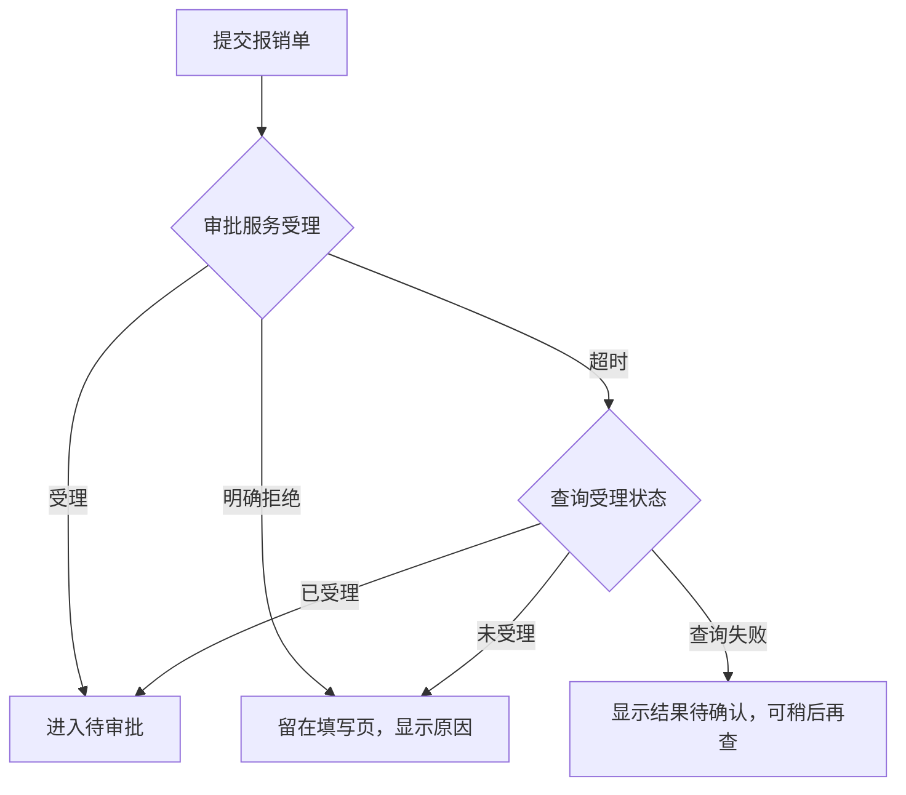

# story 成文：先设计表达，再按章写，最后回看

> 读者：写 `AR/story.md` 的作者。时机：`story-build skeleton` 之后动笔前读一遍，写章、登记决策、回看时回到对应一节。

读者是评审人——产品、开发负责人、测试，都没参与开发，手上只有这一份，不看代码、不翻仓库、不知道内部编号。
他们读完要决定：这件事想清楚了没有，能不能开工，怎么验。像向一个没参与的同事解释这件业务那样写：
每句的主语是用户、系统、对象、规则，不是文档本身；章不写开场白，第一句就是业务；
图前一两句说清看这张图要看出什么，图后补图里没有的条件、责任与结果；表前那一句说的是业务事实。
附录是查阅区，节首一句说清适用对象、成立条件或业务影响；正文十章不写「本章 / 本节 / 这张图 / 下表 / 如下」。

一个中性的范例（活动报名，与任何需求无关；看的是声音，不是结构模板）：

```markdown
### 报名流程

用户在活动页选场次并确认后，先校验报名资格与剩余名额，再向报名服务提交；服务确认后报名立即生效，
用户收到入场凭证。资格不符、名额已满、服务拒绝与提交后没有回应各有去向，用户不会停在没有出路的页面。

（流程图）

- 资格不符：停在活动页并给出原因，不提交报名。
- 名额已满：回到场次列表，已填的报名信息保留，可直接改选其他场次。
- 服务明确拒绝且允许重新提交：报名信息保留，用户看到拒绝原因，改完可以再提交。
- 提交后没有回应：报名信息保留，不显示成功也不显示失败，页面显示「报名结果确认中」，不能再提交一次。

五类结果对用户的意义不同：

| 结果 | 用户看到什么 | 接下来能做什么 |
|---|---|---|
| 报名成功 | 入场凭证与场次时间 | 按时入场 |
| 资格不符 | 不符原因 | 查看报名条件 |
| 名额已满 | 场次列表 | 改选其他场次 |
| 明确拒绝 | 拒绝原因 | 按原因修改后再提交 |
| 结果确认中 | 确认中的说明 | 稍后查看 |

确认中时按这次提交的编号向报名服务查询：已报上就展示凭证；服务答复这次提交已经结束、没有报上，
才回到可提交的状态。只查到「名单里没有这个人」证明不了这次提交不会晚到生效，页面仍显示确认中。
```

不这样写：「本节介绍报名流程」「如下图所示」「下表列出四类结果」「这张图从用户选场次开始」。

**成品同时给三个阅读深度**：先知道本次改变什么、谁参与、整体怎么做；再按业务能力或阶段理解行为；
最后查验收与精确合同。三层贯穿现有十章，不另设三个总结章，
也不把正文里的关键条件藏进链接、折叠或附录。

先写本需求的**写作设计**（第四节）：第一次读的人按什么顺序理解这件事、正文要有哪些小节、
每节要回答什么、依据在哪。然后成文分两步：**一章一章照骨架写**（每章经 `chapter` 命令原子落盘），
**本需求的有效章节都写完后按回看清单逐条处置一次**。逐章写每步输出有界，断了知道从哪一章续。

**起手输入**：读完这一章读者要能回答什么、哪些内容归别的章，在每章草稿开头（按章节合同渲染）；
这一轮的材料与来源、图与登记命令、上游里的图与蓝图生成图在 `story-build skeleton` 的输出里；
设计与知识应用的决定在蓝图里，评审投影是它的人读形态；方法在本页。
动笔前读完：材料清单列的每一份材料、需求分析 `init-analysis.md` 的来源初筛、蓝图的评审投影与其中的决定/待定、
本轮评审输入的原件、有会议材料时的 `doc-refresh.md`、skeleton 给出的当前输入。

## 一、写给这样的读者

这一节的每一条都是用户逐条定下的效果口径。
标「机器核」的有判据，其余**由读者视角的语义审查判**。

- 面向**第一次接触需求**的人类评审者，他无需先读规格、产品需求、系统设计或代码。
  按人的理解顺序讲：为什么做、涉及谁、怎样解决、业务如何推进、当前特性负责什么、哪里会失败、
  怎样验收、怎样交付。照搬规格的章节顺序与表格排布，说明只做了搬运没做改写。
- 标题用真实业务名，简短、准确概括下文；不用模板占位语、模型提问、自造词、
  编号式与工程味命名。章节与小节编号、H1 的单号由定稿时（`story-build review --action prepare`）的 `number` 统一铺（机器核），你只写业务名。
  大标题 `# <需求编号> <需求名>` 由 `skeleton` 建，需求名取自需求详情；本地单只有编号时，直接在 `AR/story.md` 第 1 行补上需求名。
- 业务方案、业务流程、功能说明是全篇最详细的部分。完整业务过程（需求怎样推进、在哪里交接）与
  当前特性功能（能力、动作、状态与分支）分别说明。来源里决定用户判断的跨方关系、异常与未决，
  两者中至少有一处讲清；本端不执行的外部动作，讲它对本端状态与用户的影响。
- **正常受限结果与真正异常分开说明**。
- 单元格不塞成压缩袋（一格里一串分号短语就是该拆了）。
- 接口、字段、错误码、配置、事件和追溯信息**必须保留，但不能打断主叙述**：主叙事零工程标识，
  它们落附录（机器核红线见第五节）。术语表不收空转定义，主叙事反复使用的概念必须进术语表。
- 正文讲清已经成立的需求与决定，也讲清它们受什么限制：三类不确定按下表写；蓝图里仍待定的事写成待定边界，
  正文不替它下结论，也不生成「待确认事项」「评审导读」。
- 材料里的图**单向**：属于本需求的进正文，不属于的登记为什么不用，不引进来再解释。

| 内容 | 正文写 | 精确依据与选择在哪 | 不写成 |
|---|---|---|---|
| 运行结果未知 | 实际可观察的状态、已成立的查询与恢复、不能承诺的结果 | 当前设计里的状态与恢复对象 | 超时即失败、没有记录或可以安全重复 |
| 业务选择或验收前提未定 | 当前承诺受什么限制，用条件态讲已有边界；待定谁定、等什么、当前影响 | 蓝图 gap 保留决定方与解锁条件；设计与人签定最终选择 | 删掉限制让验收变成无条件，或替人选方案 |
| 后续施工细节 | 当前确定的行为与后续负责单位 | 施工单位在共同约束下细化 | 把整体设计必要的缺口推给施工单位 |

**不以数量代替判断**：不用表格数、图数、段数、字数决定形式或合格，也不设填量目标。
一段里塞进好几件并列的事，**换形态比拆段有用**。

**机器只核这一章的最小必要结构**：章节合同点名要定位的小节与表在不在（按最低锚列认，列名可换说法、可加列）、
业务流程章有没有图。小节怎么切、节名、行数、措辞一概不核，**内容讲清没有由语义审查判**。

## 二、成品的阅读组织：每章先给读者什么

十章的职责在章节合同里，不变。这张表定的是每章**先**把什么交给读者、往下怎么展开、什么不能在展开中丢掉。

| 章 | 读者首先得到什么 | 展开方式与保持项 |
|---|---|---|
| 背景 | 当前问题、本次要改变什么、改成了对业务意味着什么 | 具体结果先行，业务目标与关键规则写出数值与条件；现状与目标确有可比维度才列表，不画装饰图 |
| 术语 | 核心对象的同名同义与判别条件 | 保留术语表；确有归属关系可画业务关系图，不把完整功能规则塞进来 |
| 范围 | 本需求做什么、协作方做什么、本部件不负责什么 | 责任表或参与方边界图；保留兄弟单与跨方交接，边界图不冒充运行流程 |
| 业务方案 | 整体做法、业务结果以谁为准、为什么这么定 | 角色协作、数据流向、真实备选的差异；风险成表，写触发条件、影响与应对；不按接口顺序抄蓝图契约 |
| 业务流程 | 从触发到主要结果的路线；有人机交互时，沿流程从哪进入、经过哪些页面、每页做什么、正常与异常各去哪 | 总览给主线与主要分流入口，复杂分支在对应小节完整展开并接回主线；去向写可定位的业务名。小节按业务流程、入口或角色切，页面的经过与去向优先用流转图讲，精确条件与提示按需补页面流转表；页面流转先讲清本场景的必要条件、反馈与去向，需要深入规则或恢复细则时再按业务名指向主责章节，不整段重写完整规则 |
| 功能说明 | 每项能力怎么用、在什么条件下受限 | H3 分能力或对象，H4 展开实质子过程；条件组合用表，生命周期用状态图 |
| 异常与恢复 | 在哪失败、谁负责、用户看得见什么、怎么恢复 | 正常受限与真正异常分开；复杂补偿在局部展开，不重复抄主流程 |
| 验收 | 怎样独立判断一条已定义的行为成立 | 按「要验的事」分组、不按来源分，小标题逐级不跳；每行写可观察的通过条件与主责（谁来验）；**每个原始验收编号独立一行**，编号照上游原文写、不改号（形态登记在章节合同 `id_shapes.keep` 的由机器核全集，其余由审查对照原文核），条件、单位与结果不丢。有埋点时末尾一段按指标写上线后观察什么：每个指标的目的、分子分母（适用时）、观察窗口与数据来源，依据是蓝图 `story_details` 里埋点各指标的定义，没有依据不新增指标；材料有统计需求而蓝图没有埋点明细的，回蓝图补统计设计；统计事件是取得证据的动作，不按事件数推指标数；统计点在附录 |
| 交付与上线 | 依赖怎么接、怎么开、怎么关、怎么回退 | 保留交付物表；有顺序用依赖图，有真实日期才做时间排布。每个开关控制到哪为止、关掉或回退时进行中的业务怎样，不可逆的结果明说 |
| 附录 | 登记处：主叙事里的中文名对应到接口、数据、配置、统计点、规约判断与来源 | 技术契约、规约、埋点、材料清单四节。接口、数据与规约由你按蓝图写业务摘要：调用时机、关键输入与来源、成功与失败的业务后果，数据的持有、权威、用途、有效期、清理与恢复，规约在本需求的适用理由、承担者与对设计的影响；改变决定或验收的精确约束与未决照写，本单读者核对与施工要用的精确字段、取值与来源也写在这里；完整技术全文在设计参考（蓝图的原生评审投影），它只在系统要求或本单已请求时随交付，附录不拿指向它的链接代替本单必要的内容，也不整段搬运全文。配置与埋点由脚本投影，作者说明只写投影表之外的关系，投影里的行不重抄；材料清单由你写。节首可以有一句业务定位（如「接口、数据、配置与统计点的精确名称在这里，正文用中文名」），定位句只在附录、正文各章不写开场白；附录接不住正文漏掉的关系 |

照抄产品原型的「文案要求」不单独成节，有价值的融进讲那个页面的表。
附录的材料清单是一张「材料 | 来源 | 贡献」表，一行一份阅读稿：材料列写名称与阅读稿的相对链接；
来源列列齐合成它的全部原件链接与采用版本（有版号或会议版本写它，没有写 skeleton 给的摘要），
两份原件合成一稿就写在同一行，原件不为计数另起一行；贡献列写采用了什么，未采用写原因。
来源集合以 skeleton 输出的「材料与来源」一节为准，本轮生成的 Story 与写作设计不是来源，图不进这张表。
只取图的原件也是来源，照样一行：材料列与来源列都链原件自己、来源列写采用版本，贡献写采用了哪些视觉信息、正文为什么不采用，图全部不用也写理由；图不逐张成行。
这是全篇唯一允许出现仓内路径的地方；路径带空格或括号时，在链接的圆括号里再用尖括号把路径包起来。

### 分节的执行规则

先列这一章要解释的对象、条件、行为与结果，再按同一能力或同一依赖顺序分组。
**两组有不同的前置、规则或结果，或者读者需要单独定位它，就各成一个同级小节**；
只是同一个对象的几个属性，用表或列表，不为每个属性建一个标题。

H3 用可识别的业务能力或阶段名，H4 展开它下面独立的条件或子过程。
标题说实际内容，如「提交后查看进度」。
每节先给结果或核心规则，再解释关系、条件与理由。父节已经完整列出的同一组属性，不再逐行复制成子节。

写完自检两句：只看各级标题能不能读出这一章的路线；随便读一节，知不知道谁在什么条件下做什么、结果怎样。
**标题数、字数、图数、固定深度都不是合格条件**。

## 三、表达选择：先选用途，再选载体

先问读者在这里要判断什么，再挑承载它的形式。载体按 **图＞表格＞列表＞章节＞文字** 先后考虑：关系先试着用图讲清，
图讲不全的精确条件用表或列表补，章节只管组织，文字解释条件与理由。不是每句话都画图，也不为简洁删掉必要的事实或表；
重要的时序要让参与方、先后、调用与返回、等待与失败责任都看得见，重要的状态图要有触发条件与终态——
「文字里出现过」不等于讲清了，散落各节的文字也替代不了上游时序图讲的交接。

| 读者要判断什么 | 首选 | 用它的条件 | 不用它的情形 |
|---|---|---|---|
| 主路径与条件分流 | 流程图 flowchart | 有两条以上有依据的分支 | 只有一条线：有序列表 |
| 谁调用谁、谁返回、谁补偿 | 时序图 sequenceDiagram | 三方以上或有失败责任要分清 | 两方一来一回：表 |
| 一个对象的状态与允许的动作 | 状态图 stateDiagram + 状态与动作对照表 | 状态互斥且迁移有条件 | 把按钮点击当状态 |
| 业务对象之间的归属与数量关系 | 实体关系图 erDiagram，用业务名与「一对多」 | 对象超过三个且关系会被读混 | 画成库表字段 |
| 参与方边界、数据从哪来到哪去 | 流程图分组 flowchart subgraph | 三方以上交接 | 只有两方：责任表 |
| 多个条件决定不同结果 | 决策表 | 条件可枚举 | — |
| 两个方案或前后两版差在哪 | 同维度对照表、局部差异图 | 方案说明或更新说明里讲这一版改了什么 | 正文仍要把当前有效结论讲清楚 |
| 依赖与开放顺序 | 流程图横排 flowchart LR | 有先后阻塞 | 只有并列项：列表 |
| 生效、到期这类时间关系 | 状态图上标条件 + 表 | — | 不引入新图语法 |
| 用户旅程的阶段体验 | 有序列表；旅程图 journey 只在上游给了阶段与评价时 | 上游材料本身是旅程 | 自评分数 |
| 时间排布 | 甘特 gantt | 有真实日期 | 排期未定 |
| 页面长什么样 | 原型原图 + 状态对照 + 一句说明 | 有真实素材 | 虚构界面 |
| 沿一条流程经过哪些页面、每页做什么、正常与异常各去哪 | 页面流转图 flowchart + 关键页面原图；每页的精确条件与提示按需补页面流转表（写作设计选 `形式：页面流转表`，表头由合同给） | 流程有人机交互 | 没有页面：写调用方与后台过程及无页面的理由；业务已定而材料没给页面稿时，页面组织、操作反馈与返回位置由你补齐，不为此另立决定；改变权限、资金或安全承诺、业务能力、交付范围或外部保证的才要依据或回蓝图形成 gap |
| 一组能力怎么分解 | 层次标题或列表 | — | 类图、思维导图不进 Story |

一个中性的局部例子（适用：有失败与结果未知两条分支，且结果要由另一方确认；只有一条线时改用有序列表）：



选流程图是因为读者要判断每条去向由谁、凭什么定；超时不推断成功或失败，交给查询确认。

**每张图三件套**：图前一两句说清读者看这张图要看出什么；然后是图；
图后用列表补图里没有表达的条件、责任、结果或去向，有几条写几条，不逐箭头复述；需要拆小节对照说明时可配清晰小标题。
图已经把这些讲清时不凑空话。
Markdown 扩展、HTML、折叠与交互不在本版的载体里。
图一律先用 Mermaid 写成；登记、审查与归档都在 Mermaid 形态做，`story` 登记时给每张图建好源 `.mmd`。
图源写定后、正常 `story` 登记之前，按 [`reference/svg.md`](../reference/svg.md)「值不值得做」逐张判断要不要做同 ID 的增强阅读 SVG；
值得做的自己做完（`view --mode prepare` 取 ID、制作、源码独立审查、`review-check`），再正常登记；原图已清楚的保留 Mermaid，不问人补不补。
已开始的增强还差哪一步，以 `story_flow.py status` 的下一步与 `story-build view --mode status` 为准，不靠记忆。

### 总览、局部与图文的关系

业务流程章要讲清从触发到终态的主路径与全部分支去向（开关、登录态、风控、网络、回调这些）
和跨方的交接点——**由总览与局部一起承担**：总览呈现主线和主要分流入口，
复杂分支在对应的局部小节完整展开并接回主线。
**不把所有节点挤进一张图，也不为了简洁在两处都不讲某条分支**——每条分支要么在总览里到终态，
要么在总览里有入口、在局部里走完。总览与局部用一致的业务名，局部的结果能接回主线。

**图讲关系、表讲属性、文字讲理由，三者互补**：图承担最难用线性文字说清的那一层，
表承担条件与属性，图旁的文字补理由、前置与未决。同一件事选它最该待的那一章讲透，
已经讲透的，别处只交代它与本章问题的关系。**必要的重现不是重复**——验收要能独立判，
就得把关键条件与数值重现一遍。

**上游的图可以原样用、增强、拆分或重组，也可以由正文与表承接**，一源多处、多源合一都合法。
与本需求相关的关系都要讲到；想标明某张上游图由哪一节承接，在写作设计里登记（`- 承接上游图：`，脚本核来源真实、那一节有正文），不要求每张都登记。与本需求无关、或只供精确技术查阅的关系可以留在蓝图与来源里；全部上游图仍送独立审查，漏讲由审查发现。
**换图种可以，丢关系不行**：原图的参与方、条件、请求与返回、结果、失败责任与后续状态，要能顺着全部承接内容连起来，不是各处散着几个名词
（独立审查把原图与这些小节并排对照判）；表只能列动作、讲不清交接时换回图或补上关系，把流程图压成一行箭头文字是降级。
表改写成叙述时每一列都要有落点，触发条件、单位或例外落不下来就是有损转换，留着表。上游只有一张简单图时，照搬它不等于讲清了这件事；
反过来也不为了与上游不同而刻意画不同。决定行为理解的关系图放在讲它的那一节，不搬进附录。
没有页面的业务按调用方、后台作业与数据生命周期讲，写明为什么没有页面交互，不硬造页面、不套页面状态表。
界面交互说明与界面原图是 UX 类来源的材料版本（`assets/ux/`，材料索引登记，成文输入逐份给出）：写作设计在对应流程小节的「依据」里写明用它的哪一段、
哪几张图，页面流转表与原图照它写；几份材料讲的页面互相冲突时回蓝图形成 gap，不按日期自动取新。

## 四、动笔前：先设计表达

设计表达定章节怎么组织、每处讲什么、用什么形式承载、解释什么关系、依据在哪；
不定正文答案、图的节点全集、表格的列，也不定还没确认的业务结论——那些是第五节写章时的事。

**先认出关系，再定载体**——阅读主线、骨架、写章与回看共用这一份作业（蓝图是共同决定真源，多章可共享同一事实，不在各章节重新定值；原生字段已有内容直接读取，`story_details` 只补能力缺口）：

1. **认出完整关系**：从原材料、人签原文与当前蓝图走出读者必须理解的每条主链——条件 → 行为 → 写操作中间态与结果未知（操作开始不等于状态迁移完成）→ 恢复 → 验收及负责方，明确用户回到哪个页面或状态、哪些仍未获准。
2. **分清三种决定**：各备选共有的部分照写；改变承诺、范围、验收或批准模块的差异须业务裁定（已有明确答复沿用，临时授权按对象与期限落本期验收，未决部分保留条件与责任；「保持待定」「候选」不授权其中任何一个备选；说了「稍后问」就要真问，材料写明由第三方定的留 gap 不阻断已定部分）；既定规范与知识要求的工程义务由你定，不因「当前还没实现」另造人工取舍，也不因普通写作问题另发新问询。
3. **把关系分到骨架**：图、表、文字可组合，换载体后读者仍能从条件一路走到结果与恢复；只给名词落点不算承接；页面去向与后台状态、按钮点击与完成事件分开讲。
4. **把同一已定条件落到受影响的正文、图和验收**：已有设计明确而稿子漏写，直接改稿；依据确实互斥，标明原文、责任和受影响承诺，回到作决定的位置（材料裁定或蓝图决定/待定），只改一处让另一处留旧说法不算修复，也不把错稿反向同步进蓝图。

写 `AR/story-src/story-template.md`（skeleton 建好了空壳），两部分：

| 部分 | 写什么 |
|---|---|
| `## 阅读主线` | 三问：读者是谁、读完要做什么决定、哪几件事最容易误解（读者先理解哪一件才能理解后文）；简短点出依据在哪、哪些未决限制后文。主线按责任边界 → 整体协作与关键取舍 → 状态与分支 → 验收与待决展开：Story 自己讲完整体关系，附录与设计参考供精确核对。不是再写一份蓝图摘要，也不按十章重述目录 |
| `## 骨架` | 每章一个 `### <章 ID>`（空壳里已列好），下面是这一章正文将要有的小节，照下表写 |

骨架每一行的写法，脚本按它铺草稿、按它核提交：

| 写法 | 意思 | 脚本怎么用 |
|---|---|---|
| `- 本章主线：…`、`- 答：…`、`- 依据：…`、`- 描述：…` 这类说明行 | 这一章或这一节要解决读者的什么理解问题、依据在哪（文件加标题；会议结果写 `doc-refresh.md` 的话题标题，要指原话就写 `meetings/<主名>/<版本>/raw.md:L<起>-L<止>`）；讲设计的小节（流程、状态、接口、数据、分工）在依据里写它出自的蓝图原生地址，如 `view:runtime/flow:<id>`、`contract:<id>`——施工单位按这些地址取这一节的已定表达，背景与材料原话不写地址、要解释的关系与先后、受哪些未决限制 | 铺进草稿成为指引行，提交时剥掉 |
| `#### 标题` | 正文里的一个 `###` 小节，标题原样用 | 草稿里建好这一节；提交时正文要有同名的一节 |
| `##### 标题` | 挂在上一个 `####` 下面，正文里的一个 `####` 小节 | 同上；核的时候先定位父节，别的父节下的同名子节顶替不了 |
| `- 待核：…` | 写骨架时还没解决的问题 | 进各章写完后的回看清单 |
| `形式：<类型>` | 这一处用什么承载。类型只有这几个：`表格`、`有序列表`、`无序列表`、`叙述`，或一种图——`图`（任一种）与点名的图种（流程图、时序图、状态图、类图等）。一处要几种就写几行 | 表格只核那个位置真有一张表（**列不由它定**）；列表核有真的列表项，不数条目；点名的图种正文只认那一种；叙述只进草稿指引 |
| `- 描述：…` | 紧跟在 `形式：` 后面：这个形式要表达的对象、关系与边界；选了图的写两半——图前要点明的阅读目的，图后要补的图外条件、责任与结果 | 铺进草稿成为指引行；写得好不好由审查判 |
| `- 不涉及：<理由>` | 这一章不涉及：只写这一行，不留小节与形式 | 草稿里保留该章并在原位简述本需求依据，不删章、不强造表图或待填占位 |
| 固定十章与小节组织 | 一级章沿合同。小节标题写成读者找得到的业务对象、状态、条件、责任或关系；提纲里的读者问题用来组织答案。先确定读者要判断什么，再看现有图表是否已经讲清。关系交给图，条件组合交给表，单一理由用短段。图前一段只交代场景、参与方与看图目的；图中讲清主关系；图后用简洁列表补图外且影响判断的条件、责任和例外。没有额外信息时自然结束。 | 一级章标题与顺序固定取章节合同十章，不支持改名、换序或删章；各级展示编号由定稿工具统一铺设 |
| `- 承接上游图：<来源> <身份>` | 上游一张图讲的关系由这一节承接（身份照 skeleton 列的写，如 `SR §5.3 #1`），一行一张；一张图可以分几节承接，几张图也可以落在同一节；按需写，不要求每张都写 | 写了的：提交与全篇检查核来源真实、那一节定得到、有正文；草稿里列出原图；没写的图照样送独审 |

一个中性的例子（局部，不是十章模板）：

```markdown
#### 受理协作
形式：时序图
- 描述：发起方提交后受理方与处理方怎样调用与返回；受理失败与处理超时两条分支各归谁、用户看到什么
- 依据：当前系统设计的受理流程；蓝图 `view:runtime/flow:accept-flow`
#### 结果与后续
形式：表格
- 描述：把各种处理结果与用户下一步对照起来，列在写章时按实际内容定
- 待核：结果未知时能否再次提交；没有结论就只写当前边界
```

不为时序图预列参与方，不为表格预定列。行首带不带 `- ` 都按同一行读；协议字段之外的说明文字照常保留，不算格式错误。

**骨架写的是要回答的问题，不是答案。** 完成条件是作者据它能直接展开这一节，不必重新猜这一节为什么存在。
不替 Plan 提前选存储、接口、时限或补偿。
先按当前蓝图与决定认出要讲的业务关系——它的实际来源、条件与结果、仍未决的前提——定每条关系在哪处讲完整、
哪几处重现，再排进各章骨架；不按章节标题各自重猜一遍业务。对照来源初筛与原文核：初筛登记的作用与疑点，
已经解决的反映到骨架里，没解决的写成 `- 待核：` 或回蓝图形成 gap；原文里还有初筛漏掉的有效内容，一并安排进去。

**骨架是最小集合，不是上限**：它列出的问题，成品里要讲清或写明边界；骨架没列的有效内容照样写进正文，
多出小节、多出表图都合法。**它不是新的业务事实源**：业务结论变了回蓝图，
再改骨架；骨架写错了，正文也不照错写。

写好之后再跑一次 skeleton：设计读得了，它把骨架铺进还没动过的草稿、给出第一章的写作动作；读不了，
它说清缺在哪。成文登记记下 Story 与写作设计此刻的指纹，登记之后改了它们，改完重新定稿审查，审查通过后跑 `story` 重新登记。

## 五、照骨架写一章：完成表达

这一步定内容：图里有哪些角色、哪几条边与分支，表格用哪几列、几行，列表列哪些项目。
本章草稿（`AR/story-src/drafts/NN-<章名>.md`）里骨架已铺在里面：小节标题、每节要答的问题与描述、
选定形式的指引，以及读者要能回答的问题、别章分工和提交命令。

**写作单位是一条业务关系，不是一章**：按第四节「先认出关系」那份作业写。受蓝图 gap 影响的那一步写成待定边界
（写法见「写待定、已定与取舍」），不写成默认可重试、已开放或本期不做；没受影响的照常写完。
把讲完整的那一章和需要重现它的章（流程、功能、异常、验收常常共用一条）一起写或改，再逐章提交。写本章前先读已写的章里与本章共用的关系：这一章相对已写内容要增加什么独有解释，
已在别章讲透的只交代关系。

**照骨架写：先答骨架里的问题，再补骨架没列的。** 骨架里的关系要在正文里讲成立，不是换个说法列一遍。
已经成立的决定照着用，不在每章重判同一件业务。范围章讲责任边界，方案讲机制与选择，流程讲跨能力的关系，
功能讲能力内部的行为；验收要独立判所需的条件与数值照样重现。

**写给人读，不是把材料列成条目。** 材料是素材不是提纲：把与这一章有关的部分组织成连贯的叙述。

**写着写着认识变了**：发现更好的讲法或新的关系，就同时改写作设计里受影响的骨架与草稿，接着写，
不用问人（要删骨架里的一节，先删那一行再提交）；改变了业务规则回蓝图改，
设计里只引用当前结论。已经用来写章的安排被你实质改了（换形式、合并或取消一节、放弃原来要解释的事），
在 `AR/story-src/template-adjustments.md` 按「章 ID / 原小节」记一条：原安排、实际调整、原因、依据；
正常填列、画节点不记，没有调整就不建这个文件。
来源互相矛盾时可以分析、推荐，但改变明确的验收或范围口径要有人的裁决：没拿到就登记 `open`，
正文写清受影响的待决边界——不为了让两份材料一致而选一边。术语确认不等于批准了业务改动。
未决的事可以写成明确的边界，但依赖它的行为不能同时写成已定——一个未决也不会让其它确定的内容跟着不能写。
发现正文与设计矛盾，先判是设计错还是表达错：设计错或缺回 component-design 走原生修订；表达错就一次改齐受影响的
正文、图、验收与附录说明，再逐章提交，不留错的旧附件只补解释。

**图怎么选在第三节**，这里只说落盘：上游图由哪一节承接登记在写作设计里，图本身按第三节画或改；
引用材料里的图用它在仓内的**既有落盘路径**，不复制、不改名、不另建图片目录，一张图只引一次。
每张图按第三节的三件套落盘：草稿在选了图的位置铺好三行指引（点明看什么 / 放图 / 补图外的条件、责任与结果），写完提交时指引剥掉。
**材料里的每张图都要有去处**：属于本需求的，在讲它的那一章引用，同样按三件套写；
不属于本需求的（旧版页面、同页面的另一张截图、同类产品的参考稿、别的部件或别的单的页面），
跑 skeleton 输出里给的那条登记命令写明为什么不用。**附录的材料清单不列图**，那一节回答「据哪几份材料写成」。

**验收按材料里的编号逐条给可观察条件**：材料里的验收保持原编号；细分或补充的写成本需求的条目，编号与原件条目分得开，不接着上游编号往下排充作原件；从蓝图派生的验收按它的来源标注。
**附录·规约按蓝图写**：附录「规约」按关联蓝图里的规约适用性事实写影响本需求的判定与理由——适用的条目、它的承担者与对设计的影响，有业务影响的不适用与未决照写，整域无关的一句带过；判断要改，回蓝图的适用性事实，由设计职责修订、重新准入后再同步。**不涉及章**：保留该章标题，在原位简述本需求依据，不删标题、不留空节、不强造表图。

**归档件自包含（三条红线，机器核）**——这份文档会上传到需求系统，读者手上没有这个仓库：

1. 不写仓内路径（需求目录、模块目录名）；唯一例外是附录材料清单里的原文链接；
2. 不写裸文件名当引用（「见某某文件」）；
3. 主叙事不写内部规则编号、仓内标识与实现名（类、方法、组件、存储键），改写中文业务名与中文规约名，它们的落点是附录。

**需求不是演示**：工程现状接不住的承诺、降级做法与临时承载方式，在讲那项能力的位置照实写明它现在怎样承载、
换成正式能力的条件，同时回蓝图形成 gap 或 decision；不把需求或它的实现说成演示、示例、样例，由语义审查判。

**数值有来处**：金额、比例、容量、时限、次数连同单位、适用对象与条件一起写。有上游依据的写依据，换算后要对得回原值与原口径；本轮自设的数值，写明理由与出处，再落到蓝图对应的设计对象与决定；同一约束已有有效决定或设计值的照用，要改先记理由并同步用到它的地方。材料里没有的说法不写。

**来源指得回去**：来源写在材料采用说明、取舍依据或附录里，指到实际文件与能认出的段落或条目，正文自足、不逐句括注；「产品规则」这类回查不到的泛称不算来源。正文的引用块只放有出处的业务原话并写明谁说的，填写说明、阶段提示这类模板残文提交前删掉。

**写完通读一遍**：逐章提交前从头读一遍草稿，找错字、乱码与断句。

**落盘与改章只有一条路**：任何一章写完或要改，都在它的草稿上改、跑草稿开头那条
`chapter` 命令提交——命令原子替换那一章，别处一个字节都碰不到，已写的章同样可以重提。
成文登记**之后**回头返修，动手前先跑 SKILL 里 init 第 ⓪ 步那条 `begin --step story`（这一轮返修从此计时），改完重新定稿审查，审查通过后跑 `story` 重新登记（顺序见 `phases/design.md`「五」）。不要自己去改 `AR/story.md`。
正文走文件不走命令行参数；命令里的引号按输出里写明的 shell 引好，换别的 shell 按它的引用规则核。

### 写待定、已定与取舍

**Story 是唯一的业务交付件**：不另建决策登记表、D 编号表或「待确认」汇总附录。决策与待定以原生形态留在蓝图里
（`decisions_and_gaps.decisions` 与 `.gaps`），Story 只在相关场景内讲清它们的业务含义。

**待定的事项**：写清谁定、等什么、本期影响与已定的共同要求，不写成「本期不做」「可重试」或「已开放」。
蓝图 gap 的 `owner` / `unlock_condition` 是它的真源；Story 不复制整张 gap 表，也不把某个选项的实现写成已定。
蓝图里没有的待定，交蓝图负责方形成新 gap；不先让人再签一张表。

**已定的取舍**：写进它发生的那一章——选了什么、否了什么、为什么被否的不行；有真实原话的引原话并写明是谁在什么场合说的，
模型自主设计写选择与理由，不编造「人已确认」。材料直接给定、没有判断参与的事实复述不另立取舍。
上游已定的方案照实标「上游已定」，不包装成本部件的取舍。

**依据用业务语言写撞点**：story 哪一章或蓝图哪一处的哪个主张，与哪份材料的哪一节、哪条工程事实或规约相撞；
引人的表态写谁、在什么场合、原话。不写关卡号、命令、轮次号。评审人不读这个仓库：对象用业务名，不写内部编号、文件名与模块名。

**评审人的意见不是必须采纳**：未获授权或与有效约束冲突的，写清不采纳的理由并把原话留在本轮 before/（update 时）；
必要时按 `phases/design.md`「首次质询后的集中问答与初始反馈」的必要问人条件集中问人，不自行扩大承诺。表达级意见在自有表达责任内处理，不强造蓝图目标。

## 六、回看：各章写完后逐条处置回看清单

逐章写是每章各自有界的小任务，代价是没有一次拿成稿对着来源从头核。有效章节都写完后，**先按第四节第 4 步沿关系回看**：
拿有效的原材料、人签原文与当前决定，沿每条主旅程从入口走到正常、失败与结果未知的去向，读者不用跨章拼就能走完；再用清单定位疑点。要核的对象是蓝图的评审投影、当前的 `AR/story.md`（含附录投影区）、
本轮评审输入的原件（update 开着时还有 before/ 与 update-notes）；有会议材料时还有 `doc-refresh.md` 与它所引的原话。
还没有 Plan 的阶段不预造 Plan。

这一遍也是唯一一次拿整篇读阅读路线的机会：先核内容有没有丢，再看有没有一段混装了几件独立的事、
同一件事在两处重复讲、该分小节的挤在一段里、句子写得生硬到读者要读两遍。
**改最早出错的那一处**，不另起一轮全文润色。

`skeleton` 与最后一次 `chapter` 的输出里给出**回看清单**，由脚本从来源枚举——它帮你定位问题，
不是「只审已登记的这几条」的上限：

| 清单里的一类 | 从哪来 | 要确认的去向 |
|---|---|---|
| 初筛疑点 | 需求分析 ⑥ 里「还要核实的矛盾或缺口」非空的行 | 正文讲清、交蓝图形成 gap，或有依据地判不适用 |
| 骨架待核 | 骨架里的 `- 待核：` 行 | 在正文或当前设计里有去向 |
| 图 | 正文里每张图所在的节 | 图前声称覆盖的去向，图里有没有 |

对清单里每一条、以及骨架每一节的关键主张，**撞两问**：

1. **这句话材料里有吗？** 有，是搬运，进第二问；没有但说得出依据（工程事实、规约、上游口径），它是决策点，
   依据就是背景；没有也说不出依据，是编的，删掉。
2. **材料给的靠得住吗？** 拿它去撞：更晚的输入（系统设计晚于产品需求、界面稿、当前会议结果）、材料之间、
   工程事实、规约、材料自己声明的目标。「不合适」只认四种：工程没这能力、与既有实现冲突、撞规约、
   材料的目标与做法对不上。「我觉得有更好的设计」不算。

撞出来的东西只有四个出口，**处置回真源，不写台账**：

| 发现 | 出口 |
|---|---|
| 真实未决、跨章矛盾、蓝图与 story 对不上而要人裁 | 回蓝图形成 gap（owner/unlock_condition/影响），正文只写受影响的待定边界 |
| 重要的已定取舍正文有依据、蓝图里没有承接 | 回蓝图补 decision 与依据；Story 的取舍与它同源 |
| 已有依据能定的普通说明 | 沿用，不另立条目 |
| 编造、误读、前后不一致 | 回错误所属的真源改：story 章改草稿再 `chapter` 提交；设计、验收与知识应用回蓝图修订、重新准入；骨架错了改骨架 |

**材料自己打架时不要选一边照抄**——改变明确验收或范围口径的，有人的裁决才写成已定；没有就回蓝图形成 gap。
流程、功能说明、异常与恢复、验收对着读，同一种情况四处说的必须是同一件事。同一件事在全篇出现几处，
先问各处还回答了什么别处没回答的：完整复述（后一处没有独有用途）留在最该讲它的位置、其余改成一句承接；
互补（图讲关系、表讲属性、文字讲理由）与验收独立判所必需的条件与数值重现，两处都留着。
正文里指着文档说话的句子（本章 / 本节 / 这张图 / 下表 / 如下）与章开场白改成业务句，主语是业务里的人、系统、对象、规则。

**没有问题不制造改动**，不写「已核对」，也不凑改动数。每一条的去向由独立审查拿同一张清单复核，不由你自报。
改哪章就只提交哪章，**不重新输出整篇**。改完想再看一次清单就再跑 `skeleton`；全篇改完进下一节的审查准备：
prepare 定稿时跑全篇检查，跨章的判据（章序、验收编号全集、上游图的落点）在那里跟着重核。

## 七、登记

回看之后，按 `phases/design.md`「五、独立审查、登记与交付」定稿（`story-build review --action prepare`）、派审、核结果，
再跑 `story_flow.py story --feature <名>`，按它的输出走，不写自评。登记核结构检查、这一份的审查结果与成文依据，全过才登记成文。报错说的是**这一类事实的落点长什么样**：照它指的位置写那件事的业务落点。
