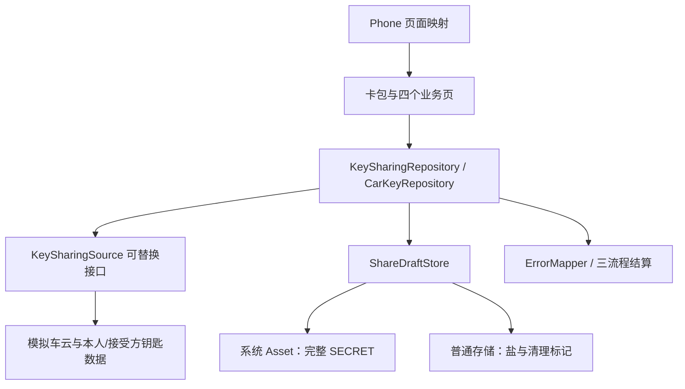
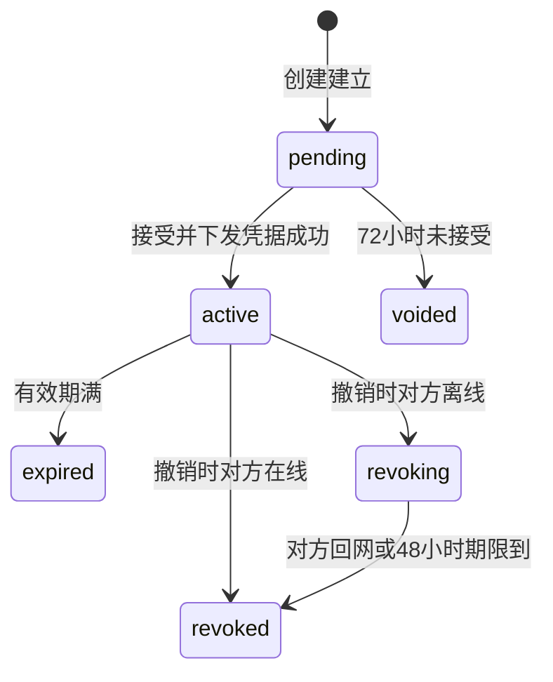
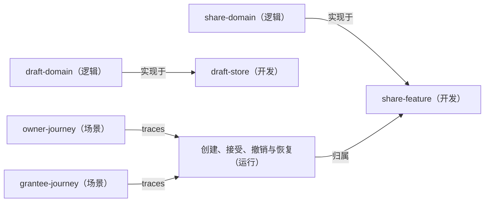

---
derived_from:
  artifact: component-blueprint@1
  component_id: wallet-main
  blueprint_id: ISSUE-206
  revision: 1
  source_fingerprint: sha256:ccddffa3377f1991fa9320e80227c48a058dcac4dfa5d4a53f62434f49040937
  artifact_sha256: sha256:12a9171deee48d2211530f7b281c67b71e65479a39c641dd07c3319cfd109b20
  change_units: []
projection: component-blueprint-review@12
---

# 数字车钥匙分享：钱包端整体设计

阅读入口：先阅读方案、旅程、关键流程和交付安排；类型、方法、完整分支与验收全文见同文档的[技术与追溯参考](#reference)。

## 1 方案摘要

### 1. 分享能做什么，谁负责什么

车主在卡包的本人车钥匙卡片上发起分享，选择对象、权限和有效期；对方在自己的卡包看到待添加钥匙，接受后取得可用卡片。车主从分享管理查看状态，对生效分享逐条撤销。卡包原先只有不可点的车钥匙分类，因此本单同时补齐本人钥匙卡片、收到的钥匙及分享入口。

产品目标是上线三个月内车钥匙用户中发起过分享比例不低于 15%，借车送钥匙类客服咨询下降一半；两者由运营侧统计，不由钱包三流程埋点直接作成功承诺。材料未给页面时延数值，本期不增加时延阈值。

钱包端负责页面、请求编排、本地草稿、状态展示和观察性输出；分享关系由车云裁定，凭据签发与车辆侧是否认可钥匙由车厂云负责。钱包不签发或保存车辆凭据，不把卡片仍显示解释为车辆仍允许使用。

本期按公开模拟前提验证钱包行为。六个车云接口按系统设计 2.1 的字段建立可替换数据源；本人钥匙、接受方账号查询、稳定账号标识、联系人、车型类别与创建恢复也由模拟源提供，后几项不能说成六接口已有。真实车云联调、系统联系人、推送点击入口与真机 Asset 验证不在本次情景终点内。

工程范围是 WalletMain 和 Phone。WalletMain 承担完整业务，Phone 只增加四个页面映射；AccountManager、CommUI、CommFunc 只读复用，不新增公共模块、架构 DSL 或模块依赖边。

设计依据与已审定情景输入见 [source-inputs](../source-inputs.md)。它区分原始材料、宿主立场、旧金样设计前提与真实未决；旧金样头部“已确认”不移签为当前候选的人签。

[设计依据](#reader-guide-source-1)

## 2 背景、目标与边界

一车多人使用，实体钥匙转交给家人或联系人不方便；钱包当前只有不可点车钥匙类别，需要补齐本人和收到的钥匙卡片与分享管理。

**目标**：上线三个月内车钥匙用户发起过分享比例不低于15%

**成功衡量**：

- 运营侧按发布后用户/分享记录统计，钱包流程指标只作支撑，不据模拟验证承诺达标

**目标**：上线三个月内借车送钥匙类客服咨询量下降一半

**成功衡量**：

- 运营/客服侧按一致口径对照上线前后；真实上线与统计未执行

**本次范围**

- WalletMain
- Phone:four-page-routing-only

**不做什么**

- 真实车云联调
- 推送点击入口
- D2
- D5
- D8待接受撤回
- Coding

## 4 用户旅程与界面

### 2. 车主与接受方怎样走完一次分享

| 场景 | 页面和操作 | 决定下一步的事实 |
|---|---|---|
| 进入卡包 | 本人钥匙卡片显示车型、车辆；待接受的显示待添加；生效与撤销中的收到钥匙显示卡片 | 按当前账号重新取数；未登录或没有本人钥匙不显示本人分享入口 |
| 车主设置 | 给谁、权限、有效期三段；选定对象后才查权限，换对象作废旧档位 | 返回的可读档位原样展示和传回；不可分享、空档位或无法解释时说明原因，不猜权限 |
| 车主发出 | 三项齐、开关开、配额未满且草稿保存成功才发送新请求 | 配额统计生效与待接受；已有原请求的结果确认不被端侧满额阻断 |
| 接受方添加 | 从待添加卡片进入接受页，先看车型、车主昵称、权限与有效期，再点添加到钱包 | 不设拒绝按钮；只在当前状态仍为待接受时允许再次添加 |
| 车主管理 | 进页拉配额与列表；生效条目撤销，作废或到期条目重新发起 | 待接受撤回未决；其他状态只展示，不发送无效撤销 |
| 查看详情 | 本人钥匙按车辆标识读取；收到的钥匙按分享标识读取 | 权限外功能不出现；已不可用或当前账号没有此钥匙时提示并回卡包 |

参考图保留在需求根 `ux-reference/`：设置、管理、接受、钥匙详情四屏；卡包分区沿用既有卡片样式。四个新页面分别导出 builder，经 WalletMain 的 `index.ets` 和 Phone 的 `navDestinationMap` 接入。推送未达不改变创建结果，接受方进入卡包可补拉；本期不实现推送点击跳转。

有效期提供 7 天、30 天与自定义（至多 180 天）；权限档位由车云根据对象与车辆关系给出，钱包不凭本地联系人推断谁是家庭成员。选联系人取消、联系人服务不可用或缺有效账号时保留当前选择并解释，不发权限查询；可改手输账号。开关默认关闭，放开后才可新建，关闭不阻断已有分享的接受、管理和撤销。

[设计依据](#reader-guide-source-2)

## 5 整体方案

### 6. 接口、对象与数据所有者

| 对象 | 主责及消费关系 |
|---|---|
| `KeySharingSource` / 模拟实现 | 承接六个冻结接口；额外模拟创建恢复、幂等记录与迟到终结。真实替换只换数据来源，不改页面、仓储的状态语义 |
| `SimulatedIdentitySource` | 稳定账号、会话、模拟联系人与身份事件；AccountManager 仍只提供已有登录态 |
| `KeySharingRepository` | 配额、权限、管理列表、创建恢复与创建、接受、撤销的业务入口；同车串行、展示组装、失败映射与三次尝试结算 |
| `CarKeyRepository` | 本人钥匙及当前账号收到的钥匙；单条当前状态供接受、详情及失败恢复共用 |
| `ShareDraftStore` | Asset 原子完整草稿、读取四分、选择与原请求保存、退出/初始化清理；不负责判断车云终态 |
| 设置页交互五角色 | `ShareSetupActions` 动作枚举、`ShareSetupPageOperates` 动作表、`ShareSetupPageInteraction` 交互封装、`ShareSetupContext` 上下文、`ShareSetupPage` 页面组件 |
| 其他页面与卡片分区 | 展示当前账号状态并触发仓储操作；不自造幂等、清理或后台同步协议 |

| 车云接口 | 输入 → 输出及关键语义 |
|---|---|
| `queryKeySharingQuota` | vehicleId → canShare、remaining、reason?、shares(shareId/status)；满额给原因 |
| `queryGranteePermission` | vehicleId、granteeId → shareable、permissionLevels、reason?；对象不可分享时为空，不复用上一对象结果 |
| `createKeySharing` | vehicleId、granteeId、permissionLevel、validUntil、idempotencyKey → shareId、pending；同标识同一条，签发失败不留关系 |
| `acceptKeySharing` | shareId → credentialStatus(issued/failed)、status(active/pending)；其他失败按重新取数处理 |
| `revokeKeySharing` | shareId → status(revoked/revoking)、graceHours?；revoking 时返回期限，失败按重拉结果 |
| `queryKeySharingList` | vehicleId → items(shareId/status/permissionLevel/validUntil/granteeMasked)；每次进管理页拉取、不落地缓存 |

六个接口都是新增调用，字段不删、不改类型，必有和可空遵守系统设计；沿用车云错误码，不新增云错误码。收到的分享查询及按分享标识重取、稳定身份、本人钥匙与创建恢复属于显式模拟扩展，不以换名混入六接口。

[设计依据](#reader-guide-source-6)

## 6 关键流程

### 3. 分享状态与车辆权限分开表达

六态以车云返回为准，钱包不后台计时推算终态。72 小时是待接受期限；48 小时是对方设备上的卡片收回期限，不是车辆继续可用期。车云受理成功撤销起车辆立即拒绝这把钥匙；离线接受方的卡片可以仍处于撤销中，收回完成才从卡包移除。已作废、已到期、已撤销不列入收到的钥匙；从旧入口进入按已不可用处理。

接受返回 `credentialStatus=failed` 且 `status=pending` 时保持待接受。其他失败或无回应都重取当前账号下该分享：待接受才可重试，生效显示卡片，撤销中保留卡片但不再提供添加，终态或不存在移除。查询失败和不存在分开，查询失败显示结果待确认且不让再次添加。

撤销失败或无回应后重拉管理列表；只有重拉后仍是生效才再次提供撤销。不能把陈旧状态覆盖车云的新状态。管理页和卡包网络失败显示可重试失败态，不展示陈旧列表。

[设计依据](#reader-guide-source-3)

## 7 数据与存储

### 5. 草稿保护、账号切换与进程恢复

每账号每车辆一条系统 Asset，完整草稿放在一个 SECRET：账号车辆绑定、真实对象标识、打码展示值、权限、有效期，以及发出前加入的原请求和幂等标识。普通键值存储只留随机盐、初始化与待清理账号摘要，不留账号、车辆原值或请求副本。Asset ALIAS 与标签只放加盐摘要和业务功能标签；设备首次解锁后可访问、不同步、不设卸载保留。

保存时机是对象、档位、有效期各自选择完成及发出前，不按逐字输入或重绘写盘。Asset 不可用、数据损坏与不存在分别返回。超过 1024 字节按保存失败，不截断、不分片、不改存明文。API 12、`SystemCapability.Security.Asset`、完整模拟草稿不超过 1024 字节都是场景建设前提，未在真机证实。

主动退出或换号先持久标记旧账号不可恢复、更新会话使旧页面失效，再删除旧账号全部车辆草稿。清理失败照常退出旧会话，分享入口受限并可重试清理；连标记都写不进去则先清理，不开放下一个分享会话。普通冷启动未登录不等于主动退出，同一模拟账号登录后仍能恢复草稿；登录前不回填、不发送。

初始化标记缺失时按功能标签清理遗留 Asset，成功后建立盐与标记；失败显示初始化失败。模拟身份源的 `accountKey` 跨重开稳定，展示相同的不同账号必须不同；每次登录会话还有独立 `sessionId`。旧回调按发起时账号与会话匹配，换号后不改新页面、不重建已清草稿。尝试结果照实结算，不因丢弃页面更新就丢统计。

[设计依据](#reader-guide-source-5)

## 8 关键取舍

### D1

| 关切 | 结论 |
| --- | --- |
| 选了什么 | — |
| 理由 | 48小时为卡片收回期限；车云受理成功撤销起车辆立即拒绝 |

被否方案：

未记录；不推测被否选择。

未记录：选了什么（结论）。

### D3

| 关切 | 结论 |
| --- | --- |
| 选了什么 | — |
| 理由 | 模拟数据验证，不把真实联调与推送入口算入 |

被否方案：

未记录；不推测被否选择。

未记录：选了什么（结论）。

### D4

| 关切 | 结论 |
| --- | --- |
| 选了什么 | — |
| 理由 | 一并补卡包车钥匙卡片与分享入口 |

被否方案：

未记录；不推测被否选择。

未记录：选了什么（结论）。

### D6

| 关切 | 结论 |
| --- | --- |
| 选了什么 | — |
| 理由 | 退出页面、断网、应用关闭可续办；成功、主动退出、换账号清稿 |

被否方案：

未记录；不推测被否选择。

未记录：选了什么（结论）。

### D7

| 关切 | 结论 |
| --- | --- |
| 选了什么 | — |
| 理由 | 车云按分享记录统计接受比例；钱包只做三个流程 |

被否方案：

未记录；不推测被否选择。

未记录：选了什么（结论）。

### D2

| 关切 | 结论 |
| --- | --- |
| 选了什么 | — |
| 理由 | 再转第三人未定 |

被否方案：

未记录；不推测被否选择。

未记录：选了什么（结论）。

### D5

| 关切 | 结论 |
| --- | --- |
| 选了什么 | — |
| 理由 | 极端断网强制下线未定 |

被否方案：

未记录；不推测被否选择。

未记录：选了什么（结论）。

### D8

| 关切 | 结论 |
| --- | --- |
| 选了什么 | — |
| 理由 | 待接受撤回未定；当前只做生效撤销 |

被否方案：

未记录；不推测被否选择。

未记录：选了什么（结论）。

### knowledge-SEC-01

| 关切 | 结论 |
| --- | --- |
| 选了什么 | — |
| 理由 | 本需求处理接收方账号、车辆身份和跨进程草稿，并新增页面、日志及事件出口，命中敏感数据保护要求。|

被否方案：

未记录；不推测被否选择。

未记录：选了什么（结论）。

### knowledge-ENV-01

| 关切 | 结论 |
| --- | --- |
| 选了什么 | — |
| 理由 | 草稿是本地状态，正常操作包含清数据后重进及丢失本地草稿的恢复，必须说明如何重建而非崩溃或循环。|

被否方案：

未记录；不推测被否选择。

未记录：选了什么（结论）。

### knowledge-ENV-02

| 关切 | 结论 |
| --- | --- |
| 选了什么 | — |
| 理由 | 卡包和页面都可进入分享，用户可重复点击创建、接受和撤销，存在需要防止重复副作用的写操作。|

被否方案：

未记录；不推测被否选择。

未记录：选了什么（结论）。

### knowledge-DFX-01

| 关切 | 结论 |
| --- | --- |
| 选了什么 | — |
| 理由 | 本需求新增六类端云调用、恢复查询和受保护草稿读写，需要核触发频次、串行范围及是否存在无必要轮询。|

被否方案：

未记录；不推测被否选择。

未记录：选了什么（结论）。

### knowledge-OBS-02

| 关切 | 结论 |
| --- | --- |
| 选了什么 | — |
| 理由 | 本需求明确要求观察发起、接受、撤销三个流程，需先明确各流程一次尝试和结果的业务含义。|

被否方案：

未记录；不推测被否选择。

未记录：选了什么（结论）。

### knowledge-OBS-03

| 关切 | 结论 |
| --- | --- |
| 选了什么 | — |
| 理由 | 同一流程可能经历无响应、重查和重试，观察性记录不能由页面回调次数替代真实尝试与结果。|

被否方案：

未记录；不推测被否选择。

未记录：选了什么（结论）。

### knowledge-OBS-05

| 关切 | 结论 |
| --- | --- |
| 选了什么 | — |
| 理由 | 本需求存在资料中的分享被接受比例及三个端侧流程指标，需要区分本端能观察的结果与云端统计责任。|

被否方案：

未记录；不推测被否选择。

未记录：选了什么（结论）。

### knowledge-OBS-06

| 关切 | 结论 |
| --- | --- |
| 选了什么 | — |
| 理由 | 本需求引入三个流程的候选事件标识，必须按既有分配规则及兼容边界登记，不能假定已正式分配。|

被否方案：

未记录；不推测被否选择。

未记录：选了什么（结论）。

### knowledge-UX-01

| 关切 | 结论 |
| --- | --- |
| 选了什么 | — |
| 理由 | 本需求增加或调整分享、接受、管理及卡包界面，包含方向性布局与交互。|

被否方案：

未记录；不推测被否选择。

未记录：选了什么（结论）。

### knowledge-RES-01

| 关切 | 结论 |
| --- | --- |
| 选了什么 | — |
| 理由 | 上述页面需要图标和图片呈现，必须区分参考原图、已有可复用资源及真正新增的预置资源。|

被否方案：

未记录；不推测被否选择。

未记录：选了什么（结论）。

### knowledge-RES-02

| 关切 | 结论 |
| --- | --- |
| 选了什么 | — |
| 理由 | 本需求增加用户可见的按钮、状态和错误说明，需要明确复用或新增字符串的归属。|

被否方案：

未记录；不推测被否选择。

未记录：选了什么（结论）。

### knowledge-DFX-02

| 关切 | 结论 |
| --- | --- |
| 选了什么 | — |
| 理由 | 本需求拟增加界面资源和代码，交付前应核实际资源/依赖体积；目标稿本身不能冒称已量化构建结果。|

被否方案：

未记录；不推测被否选择。

未记录：选了什么（结论）。

### knowledge-DLV-01

| 关切 | 结论 |
| --- | --- |
| 选了什么 | — |
| 理由 | 新增或修改的用户文案需要翻译交付，这是人工交付义务，不等于产品流程增加人工批准。|

被否方案：

未记录；不推测被否选择。

未记录：选了什么（结论）。

### knowledge-COMPAT-01

| 关切 | 结论 |
| --- | --- |
| 选了什么 | — |
| 理由 | 钱包按六个接口的字段与返回状态消费端云契约，并引入模拟数据源，需要核旧字段含义及新增映射的兼容边界。|

被否方案：

未记录；不推测被否选择。

未记录：选了什么（结论）。

### pattern-page-interaction

| 关切 | 结论 |
| --- | --- |
| 选了什么 | — |
| 理由 | 设置页由草稿结果决定起点，选对象后查权限，等待用户时停机；五角色各有实体 |

被否方案：

未记录；不推测被否选择。

未记录：选了什么（结论）。

### pattern-no-decision-tree

| 关切 | 结论 |
| --- | --- |
| 选了什么 | — |
| 理由 | 主链分支是单次前置判断或请求结果，各支一步收敛；签发回滚由车云负责 |

被否方案：

未记录；不推测被否选择。

未记录：选了什么（结论）。

## 9 失败与恢复

### 4. 创建不确定时，先找回原请求

同账号同车辆只有一个创建编排入口，串行完成“读取—恢复—保存—创建或确认”；不同车辆互不阻塞。草稿带原请求和幂等标识时，对象、权限、有效期只读，用原请求确认同一分享，不生成新标识。新建发出前先持久化完整原请求和幂等标识，写失败不发请求。

| 本地读取 | 本次允许动作 | 恢复责任 |
|---|---|---|
| 有选择、无原请求 | 恢复选择，重查配额与对象权限 | 设置页与仓储；换对象清旧权限 |
| 有原请求 | 只读展示并确认该请求；满额仍能确认 | 仓储沿用请求与幂等标识 |
| 不可访问或服务失败 | 显示恢复失败、可重试；不新建 | 草稿存储明确失败，不伪装不存在 |
| 明确不存在或损坏 | 先做按账号、车辆的创建恢复；损坏原件隔离 | 模拟车云给出下表结果，仓储消费 |

| 创建恢复结果 | 页面、存储怎样处理 |
|---|---|
| pending，带原请求与幂等标识 | 受保护保存成功后只确认同一请求；保存失败继续受限 |
| established，带分享标识与当前状态 | 显示已建立，不自动再发；清本车旧草稿 |
| clear | 只有原创建已终结、迟到也建不出分享才成立；清旧稿成功后开放空表单 |
| unknown 或查询失败 | 当前账号这辆车暂停新发起；管理只读、可重查，不提供删除后重建 |

首次进入、成功发出并清稿后再次发起、退出重登、换号或清数据后回来，只要本地无稿，均先创建恢复。列表为空、打码昵称相同或“暂未看到请求”都不能推出 clear。模拟车云记录独立于钱包进程，并在受理新建时再次检查未终结创建；clear 覆盖迟到请求，防止“先查无、后晚到”的双建。

创建已建立后删本车草稿；删失败仍显示已建立并待清理，只能确认同请求或重试清理。明确拒绝（含满额、签发失败）后持久清掉原请求与幂等标识才恢复编辑。无回应保留原请求。签发失败时关系回滚由车云负责，钱包不自作成功或本地造关系。

这是旧金样公开的模拟业务合同，不是系统设计六接口已承诺的能力。真实对端缺少等价回查与迟到终结保证时，所有依赖创建恢复的新建都不能正式开放；带完整原请求的确认、接受、撤销与管理按自身条件处理。

[设计依据](#reader-guide-source-4)

## 10 质量与安全

### 7. 知识怎样改变这套设计

安全规约把业务身份与展示身份分开：查权限、创建用真实 `granteeId`，打码值不能承担业务身份。展示组装复用 MaskUtil，管理列表用车云打码值；长度不超过四位导致 `maskAccount` 原样返回时只显示昵称。草稿因此必须受保护跨重启存储，不能只保内存或写明文；日志和事件不带账号、打码账号、车牌、位置及原始错误内容。

环境与幂等义务落在 `ShareDraftStore` 和仓储创建入口：读失败不当没有、同车串行、原请求保存先于发送、换号旧回调隔离、缺稿先创建恢复。性能规约约束拉取和保存时机，端侧不轮询、不设后台写，不给材料没有的页面时延承诺。

设置页存在“读取结果决定起点、选对象后查档位、等待用户再恢复动作”的页内协作，因此选 page-interaction 五角色。主发起过程的失败分支各在一次判断或请求后收敛，签发回滚属于云侧，不选 decision-tree；管理页不强套模式。

方向性、资源与交付义务落到四页和卡片：start/end、TextAlign.Start/End；图标先系统符号再已有归档；中文资源复用优先，新增中文和英文齐备。CU Plan 需给待翻译清单与新增资源条数、UTF-8 体积，不增加图片或 SDK。这里只解释实际改变设计的知识；未命中的业务不逐条生成空取舍。

[设计依据](#reader-guide-source-7)

### 8. 只统计三个钱包流程

发起、接受、撤销各一步，分别以建立为待接受、生效、撤销已受理作为成功；在线立即撤销和离线撤销中都算已受理。每次调用独立尝试标识，由 `settleCreate`、`settleAccept`、`settleRevoke` 只结算一次。创建确认沿用幂等标识但属于新尝试；重复回调不重复报，页面退出不取消已发送请求的统计。

前置配额/权限查询、草稿读写、卡包补拉与失败后重取只记必要定位日志，不进入流程统计；不上报失效事件。车型类别直接取模拟输入、缺失记未知；失败说明经 `KeySharingErrorMapper` 的已知错误码映射，未知码给通用分类，外码校验格式，不读任意 message 拼描述。上报失败不改变分享结果。

分享被接受比例按 D7 由车云分享记录统计，钱包不跨账号关联。三个流程号与内码在 CU Plan 中保留候选身份，编码前登记并核冲突，不把候选号说成已经分配。

[设计依据](#reader-guide-source-8)

## 11 施工与上线

### 9. 交给一个施工单元，止于 Plan

`wallet-key-sharing` 完整承担本蓝图的钱包端改动，模块归属仍是 WalletMain；Phone 页面映射列为其窄范围伴随改动。一个 CU 能闭合卡包、发起、草稿恢复、接受、管理和退出的共同状态责任，当前没有独立交付或不同授权要求，不按技术层另拆单元。

CU Spec 承接本单位的可见行为、边界和验收，尤其原请求未知不重复建、跨重启恢复与换号保护、撤销受理车辆立即拒绝、接受撤销失败重取。CU Plan 再把这些义务落实到具体实体、方法、存储、动作表、页面映射与验证；共同状态与接口不另行定案。五角色、方法级 must、三流程统计点均需到真实实体，不能只写“遵守知识”。

本候选只做完整设计交接到 Plan，不启动编码或真实运行。原生 CU 接受、设计质询、readiness 与施工闭包实际尚未执行；机器字段存在不代替它们。

验收沿旧有效业务范围：卡包与入口、对象权限/配额、三项选择、72 小时作废、48 小时卡片回收与车辆立即拒绝、跨四个进程中断时点续办、原请求冻结、同车并发、账号/车辆隔离、Asset 失败/损坏/超限/清理、缺稿创建恢复及迟到请求、接受与撤销重取、深色大字与方向性、观察性脱敏和三流程去重。具体条目由 CU Spec 承载，未运行，不勾选通过。

[设计依据](#reader-guide-source-9)

尚未拆分。

## 13 待补问题

### 10. 未决和正式接入依赖

| 项目 | 保留的边界 |
|---|---|
| D2 被分享人再转第三人 | 未定；本期不设计、不宣称支持 |
| D5 极端断网强制下线 | 未定；48 小时卡片收回规则不代替这项安全裁决 |
| D8 待接受能否撤回 | 未定；当前只完整设计生效撤销，待接受只展示，不能凭“随时可撤”擅自补接口边 |
| 创建恢复真实对端 | 六接口未声明；正式新建需等价回查及迟到终结保证 |
| 稳定账号、接受侧查询、本人钥匙、联系人、推送 | 当前是模拟或明确后续，真实提供方与契约待接入时核实 |
| Asset 与编译环境 | API 12、能力、完整草稿上限属于公开建设前提；设备能力、部署与生命周期未验证 |
| 候选与原生出版 | N24ea6aeb 的正式 renderer、同根目录支持及当前 canonical/CU 结构需分别核；不能手改签名投影或伪造质询通过 |

[设计依据](#reader-guide-source-10)

### 缺口及当前状态

| 问题 | 状态 | 责任方 | 解除条件 |
| --- | --- | --- | --- |
| [real-creation-recovery](#design-6761703a7265616c2d6372656174696f6e2d7265636f76657279) | 阻塞 | 车云 | 按账号车辆回查创建且clear覆盖迟到请求，受理新建再次核未决 |
| [real-identity-received-source](#design-6761703a7265616c2d6964656e746974792d72656365697665642d736f75726365) | 阻塞 | 账号能力与车云 | 稳定账号标识、本人钥匙及接受方查询契约到位 |
| [asset-device-validation](#design-6761703a61737365742d6465766963652d76616c69646174696f6e) | 阻塞 | 钱包目标环境 | 核API12、Asset能力、1024字节完整草稿与生命周期 |
| [independent-questioning](#design-6761703a696e646570656e64656e742d7175657374696f6e696e67) | 阻塞 | 原生独立质询执行体 | 对当前候选真实独立质询且保原始报告 |
| [native-single-root](#design-6761703a6e61746976652d73696e676c652d726f6f74) | 阻塞 | Framework所有者 | 支持材料/ux-reference与blueprint/CU共存，实际原生结构可消费 |

## 技术与追溯参考

部件 wallet-main · 蓝图 ISSUE-206 · revision 1 · 准入 not\_evaluated

本文根据 canonical 蓝图与当前施工单元确定性生成，文首保留精确来源身份。是否通过设计交接见 readiness；施工授权、映射与完成结论由原责任阶段确认。可选说明缺失或过期不改变这些结论。

参考保留全部声明；不从名称、目录或数组顺序推断调用、依赖与未声明存储设计。正文的验收链接按来源目标与条目编号定位。

### A 字段与类型

#### 原概述与目标

| 关切 | 设计说明 |
| --- | --- |
| 背景 | 一车多人使用，实体钥匙转交给家人或联系人不方便；钱包当前只有不可点车钥匙类别，需要补齐本人和收到的钥匙卡片与分享管理。 |
| 问题 | — |
| 本次改变 | 在WalletMain补齐卡包、分享、接受与管理，Phone只登记页面；公开模拟前提下交接至Plan，未独审、未接受CU、未施工。 |
| 整体定位 | — |
| 范围 | WalletMain；Phone:four-page-routing-only |
| 不做什么 | 真实车云联调；推送点击入口；D2；D5；D8待接受撤回；Coding |

| 目标 | 目标说明 | 成功衡量 |
| --- | --- | --- |
| share-adoption | 上线三个月内车钥匙用户发起过分享比例不低于15% | 运营侧按发布后用户/分享记录统计，钱包流程指标只作支撑，不据模拟验证承诺达标 |
| reduce-support | 上线三个月内借车送钥匙类客服咨询量下降一半 | 运营/客服侧按一致口径对照上线前后；真实上线与统计未执行 |

未记录：问题（设计说明）；整体定位（设计说明）。

#### 领域模型、字段与枚举

设计期未写入领域模型，将由 plan 补；不从 DTO 推断另一份持久化模型。

### B 接口与存储明细

#### 本部件实际消费或提供的操作与 DTO

#### queryKeySharingQuota

操作：queryKeySharingQuota · 2.1 · wallet\_to\_car\_cloud；责任方 车云；需要方 wallet-key-sharing

**请求 DTO：queryKeySharingQuotaRequest**

来源：[design.md](doc/features/ISSUE-206/SR/design.md)

| 字段 | 类型 | 必需 | 可空 | 语义 | 来源 |
| --- | --- | --- | --- | --- | --- |
| vehicleId | string | 是 | 否 | vehicleId | doc/features/ISSUE-206/SR/design.md#4-接口约定 |

未记录：默认值；约束；验证引用。

**响应 DTO：queryKeySharingQuotaResponse**

来源：[design.md](doc/features/ISSUE-206/SR/design.md)

| 字段 | 类型 | 必需 | 可空 | 语义 | 来源 |
| --- | --- | --- | --- | --- | --- |
| canShare | boolean | 是 | 否 | canShare | doc/features/ISSUE-206/SR/design.md#4-接口约定 |
| remaining | integer | 是 | 否 | remaining | doc/features/ISSUE-206/SR/design.md#4-接口约定 |
| reason | string | 是 | 是 | reason | doc/features/ISSUE-206/SR/design.md#4-接口约定 |
| shares | ShareSummary\[\] | 是 | 否 | shares | doc/features/ISSUE-206/SR/design.md#4-接口约定 |

错误：沿用车云错误码；未知码安全说明；任意message不进日志或事件
幂等：配额按active+pending；确认原请求不被端侧满额拦截
非功能要求：不改变字段类型/必有/可空；本期由可替换模拟数据源承接

未记录：默认值；约束；验证引用。

#### queryGranteePermission

操作：queryGranteePermission · 2.1 · wallet\_to\_car\_cloud；责任方 车云；需要方 wallet-key-sharing

**请求 DTO：queryGranteePermissionRequest**

来源：[design.md](doc/features/ISSUE-206/SR/design.md)

| 字段 | 类型 | 必需 | 可空 | 语义 | 来源 |
| --- | --- | --- | --- | --- | --- |
| vehicleId | string | 是 | 否 | vehicleId | doc/features/ISSUE-206/SR/design.md#4-接口约定 |
| granteeId | string | 是 | 否 | granteeId | doc/features/ISSUE-206/SR/design.md#4-接口约定 |

未记录：默认值；约束；验证引用。

**响应 DTO：queryGranteePermissionResponse**

来源：[design.md](doc/features/ISSUE-206/SR/design.md)

| 字段 | 类型 | 必需 | 可空 | 语义 | 来源 |
| --- | --- | --- | --- | --- | --- |
| shareable | boolean | 是 | 否 | shareable | doc/features/ISSUE-206/SR/design.md#4-接口约定 |
| permissionLevels | string\[\] | 是 | 否 | permissionLevels | doc/features/ISSUE-206/SR/design.md#4-接口约定 |
| reason | string | 是 | 是 | reason | doc/features/ISSUE-206/SR/design.md#4-接口约定 |

错误：沿用车云错误码；未知码安全说明；任意message不进日志或事件
幂等：对象换则重查；可读选项原样显示传回
非功能要求：不改变字段类型/必有/可空；本期由可替换模拟数据源承接

未记录：默认值；约束；验证引用。

#### createKeySharing

操作：createKeySharing · 2.1 · wallet\_to\_car\_cloud；责任方 车云；需要方 wallet-key-sharing

**请求 DTO：createKeySharingRequest**

来源：[design.md](doc/features/ISSUE-206/SR/design.md)

| 字段 | 类型 | 必需 | 可空 | 语义 | 来源 |
| --- | --- | --- | --- | --- | --- |
| vehicleId | string | 是 | 否 | vehicleId | doc/features/ISSUE-206/SR/design.md#4-接口约定 |
| granteeId | string | 是 | 否 | granteeId | doc/features/ISSUE-206/SR/design.md#4-接口约定 |
| permissionLevel | string | 是 | 否 | permissionLevel | doc/features/ISSUE-206/SR/design.md#4-接口约定 |
| validUntil | ISO8601 | 是 | 否 | validUntil | doc/features/ISSUE-206/SR/design.md#4-接口约定 |
| idempotencyKey | string | 是 | 否 | idempotencyKey | doc/features/ISSUE-206/SR/design.md#4-接口约定 |

未记录：默认值；约束；验证引用。

**响应 DTO：createKeySharingResponse**

来源：[design.md](doc/features/ISSUE-206/SR/design.md)

| 字段 | 类型 | 必需 | 可空 | 语义 | 来源 |
| --- | --- | --- | --- | --- | --- |
| shareId | string | 是 | 否 | shareId | doc/features/ISSUE-206/SR/design.md#4-接口约定 |
| status | pending | 是 | 否 | status | doc/features/ISSUE-206/SR/design.md#4-接口约定 |

错误：沿用车云错误码；未知码安全说明；任意message不进日志或事件
幂等：同标识同一分享；签发失败不留关系
非功能要求：不改变字段类型/必有/可空；本期由可替换模拟数据源承接

未记录：默认值；约束；验证引用。

#### acceptKeySharing

操作：acceptKeySharing · 2.1 · wallet\_to\_car\_cloud；责任方 车云；需要方 wallet-key-sharing

**请求 DTO：acceptKeySharingRequest**

来源：[design.md](doc/features/ISSUE-206/SR/design.md)

| 字段 | 类型 | 必需 | 可空 | 语义 | 来源 |
| --- | --- | --- | --- | --- | --- |
| shareId | string | 是 | 否 | shareId | doc/features/ISSUE-206/SR/design.md#4-接口约定 |

未记录：默认值；约束；验证引用。

**响应 DTO：acceptKeySharingResponse**

来源：[design.md](doc/features/ISSUE-206/SR/design.md)

| 字段 | 类型 | 必需 | 可空 | 语义 | 来源 |
| --- | --- | --- | --- | --- | --- |
| credentialStatus | issued&#124;failed | 是 | 否 | credentialStatus | doc/features/ISSUE-206/SR/design.md#4-接口约定 |
| status | active&#124;pending | 是 | 否 | status | doc/features/ISSUE-206/SR/design.md#4-接口约定 |

错误：沿用车云错误码；未知码安全说明；任意message不进日志或事件
幂等：failed+pending保持待接受；其他失败重取当前账号记录
非功能要求：不改变字段类型/必有/可空；本期由可替换模拟数据源承接

未记录：默认值；约束；验证引用。

#### revokeKeySharing

操作：revokeKeySharing · 2.1 · wallet\_to\_car\_cloud；责任方 车云；需要方 wallet-key-sharing

**请求 DTO：revokeKeySharingRequest**

来源：[design.md](doc/features/ISSUE-206/SR/design.md)

| 字段 | 类型 | 必需 | 可空 | 语义 | 来源 |
| --- | --- | --- | --- | --- | --- |
| shareId | string | 是 | 否 | shareId | doc/features/ISSUE-206/SR/design.md#4-接口约定 |

未记录：默认值；约束；验证引用。

**响应 DTO：revokeKeySharingResponse**

来源：[design.md](doc/features/ISSUE-206/SR/design.md)

| 字段 | 类型 | 必需 | 可空 | 语义 | 来源 |
| --- | --- | --- | --- | --- | --- |
| status | revoked&#124;revoking | 是 | 否 | status | doc/features/ISSUE-206/SR/design.md#4-接口约定 |
| graceHours | integer | 是 | 是 | graceHours | doc/features/ISSUE-206/SR/design.md#4-接口约定 |

错误：沿用车云错误码；未知码安全说明；任意message不进日志或事件
幂等：只生效可撤销；revoking期限48小时收回卡片，车辆已拒绝
非功能要求：不改变字段类型/必有/可空；本期由可替换模拟数据源承接

未记录：默认值；约束；验证引用。

#### queryKeySharingList

操作：queryKeySharingList · 2.1 · wallet\_to\_car\_cloud；责任方 车云；需要方 wallet-key-sharing

**请求 DTO：queryKeySharingListRequest**

来源：[design.md](doc/features/ISSUE-206/SR/design.md)

| 字段 | 类型 | 必需 | 可空 | 语义 | 来源 |
| --- | --- | --- | --- | --- | --- |
| vehicleId | string | 是 | 否 | vehicleId | doc/features/ISSUE-206/SR/design.md#4-接口约定 |

未记录：默认值；约束；验证引用。

**响应 DTO：queryKeySharingListResponse**

来源：[design.md](doc/features/ISSUE-206/SR/design.md)

| 字段 | 类型 | 必需 | 可空 | 语义 | 来源 |
| --- | --- | --- | --- | --- | --- |
| items | ShareItem\[\] | 是 | 否 | items | doc/features/ISSUE-206/SR/design.md#4-接口约定 |

错误：沿用车云错误码；未知码安全说明；任意message不进日志或事件
幂等：每次进页重新拉取，失败不给陈旧列表
非功能要求：不改变字段类型/必有/可空；本期由可替换模拟数据源承接

未记录：默认值；约束；验证引用。

#### creation-recovery

操作：recoverCreation · candidate-mock · wallet\_to\_simulated\_counterpart；责任方 模拟车云；真实方待接入；需要方 wallet-key-sharing

**请求 DTO：RecoveryRequest**

| 字段 | 类型 | 必需 | 可空 | 语义 | 来源 |
| --- | --- | --- | --- | --- | --- |
| accountKey | string | 是 | 否 | accountKey | doc/features/ISSUE-206/SR/design.md#4-接口约定 |
| vehicleId | string | 是 | 否 | vehicleId | doc/features/ISSUE-206/SR/design.md#4-接口约定 |

未记录：默认值；约束；验证引用。

**响应 DTO：CreationRecovery**

| 字段 | 类型 | 必需 | 可空 | 语义 | 来源 |
| --- | --- | --- | --- | --- | --- |
| result | pending(request,idempotencyKey)&#124;established(shareId,status)&#124;clear&#124;unknown | 是 | 否 | result | doc/features/ISSUE-206/SR/design.md#4-接口约定 |

错误：不完整/账号车辆不匹配/多条不唯一/查询失败均unknown
幂等：clear终结迟到请求；受理新建再核未决；不读管理列表猜测
非功能要求：对端记录跨钱包进程；六接口没有此承诺；缺真实能力时依赖它的新建不开放

未记录：默认值；约束；验证引用。

#### 运行流与状态明细

##### 创建、接受、撤销与恢复

数据域：sharing-records；protected-draft；account-session；契约：queryKeySharingQuota；queryGranteePermission；createKeySharing；acceptKeySharing；revokeKeySharing；queryKeySharingList；creation-recovery；开发责任：view:development/node:share-feature

触发：

| 类型 | 时机 | 幂等 |
| --- | --- | --- |
| page\_enter | 卡包/管理/设置进入 | 仅本次加载，旧会话响应丢弃 |
| user\_action | 确认发出/添加/撤销 | 创建同幂等标识；同车串行 |
| session\_change | 主动退出与换号 | 先不可恢复标记和隔离再清理 |
| 进程重建 | 冷启动后登录 | 不因初始未登录清稿；按稳定账号读回 |

首次加载：load-current-account · 先身份与初始化；卡包/管理拉取；设置读草稿四分；责任方 wallet-key-sharing；范围 未记录；新鲜度 每次进页；账号切换重取

权威状态：车云分享关系；车厂云车辆使用权；本地Asset只存原请求和选择；持久化 对端幂等记录跨钱包进程，端侧列表不落盘；投影/缓存 当前账号卡包；管理列表；设置页草稿；调和 进页重新取；失败重取；缺稿先创建恢复
状态责任方：view:runtime/node:share-state；状态 pending；active；voided；expired；revoking；revoked

写入与发布：

| 写入 | 持久化 | 发布 | 恢复 |
| --- | --- | --- | --- |
| persist-before-create | view:development/node:draft-store | page-current-result | recover-original-request |
| accept-or-revoke | car-cloud | page-current-result | reload-authoritative-state |

| 发布 | 快照/语义 |
| --- | --- |
| page-current-result | 只更新匹配账号与会话的当前页面，不建跨页事件框架 |

订阅与消费者：

未声明订阅。

| 消费者 | 首次加载 | 更新 |
| --- | --- | --- |
| card-pack | load-current-account | page-current-result |
| share-setup | load-current-account | page-current-result |
| share-manage | load-current-account | page-current-result |
| share-accept | load-current-account | page-current-result |
| key-detail | load-current-account | page-current-result |

失败与恢复：recover-original-request

| 恢复关切 | 处理 |
| --- | --- |
| 持久化失败 | 保存失败不发；不可读不当不存在；损坏隔离并做创建恢复；成功清理失败显示已建立待清理 |
| 订阅失败 | 无跨页订阅；页面回到前台重新获取 |
| 进程重建 | 完整原请求同标识确认；absent/corrupted先pending/established/clear/unknown分流 |

生命周期：

验证关注：doc/features/ISSUE-206/wallet-key-sharing/spec/spec.md

未记录：触发；类型；时机；载荷；消费语义；处理。

### C 完整验收

设计期未写入 acceptance，将由 spec 补；不能把 absence 或文档成功当作设计充分。

#### 结构化内容无效或冲突

- view:development/node:share-feature.acceptance 无效：authority\_target\_provenance\_missing · component-design: share-feature 缺获准来源

### D 全部用例分支与界面调用

#### 用例、数据边界与分支

设计期未写入 use_cases，将由 plan 按真实义务补充。

### E 施工精确映射

### F 需求追溯

#### 需求追溯总表

| 需求项 | 类型 | 原始来源 |
| --- | --- | --- |
| product | requirement | doc/features/ISSUE-206/RR/prd.md |
| system | requirement | doc/features/ISSUE-206/SR/design.md |
| ux | requirement | doc/features/ISSUE-206/ux-reference/README.md |
| host-and-public-premises | invariant | doc/features/ISSUE-206/source-inputs.md |
| legacy-spec | invariant | evidence/baseline-1.9.9/spec/spec.md |
| legacy-plan | invariant | evidence/baseline-1.9.9/plan/plan.md |

- product：[来源](doc/features/ISSUE-206/RR/prd.md)
- system：[来源](doc/features/ISSUE-206/SR/design.md)
- ux：[来源](doc/features/ISSUE-206/ux-reference/README.md)
- host-and-public-premises：[来源](doc/features/ISSUE-206/source-inputs.md)
- legacy-spec：[来源](evidence/baseline-1.9.9/spec/spec.md)
- legacy-plan：[来源](evidence/baseline-1.9.9/plan/plan.md)

| 需求项 | 蓝图登记地址 | 当前 CU 直接引用 |
| --- | --- | --- |
| product | [share-feature](#design-766965773a646576656c6f706d656e742f6e6f64653a73686172652d66656174757265) | 无 CU 直接引用 |
| product | [创建、接受、撤销与恢复](#design-766965773a72756e74696d652f666c6f773a73686172696e672d6c6966656379636c65) | 无 CU 直接引用 |
| system | [share-feature](#design-766965773a646576656c6f706d656e742f6e6f64653a73686172652d66656174757265) | 无 CU 直接引用 |
| system | [创建、接受、撤销与恢复](#design-766965773a72756e74696d652f666c6f773a73686172696e672d6c6966656379636c65) | 无 CU 直接引用 |
| ux | [share-feature](#design-766965773a646576656c6f706d656e742f6e6f64653a73686172652d66656174757265) | 无 CU 直接引用 |
| ux | [创建、接受、撤销与恢复](#design-766965773a72756e74696d652f666c6f773a73686172696e672d6c6966656379636c65) | 无 CU 直接引用 |
| host-and-public-premises | [share-feature](#design-766965773a646576656c6f706d656e742f6e6f64653a73686172652d66656174757265) | 无 CU 直接引用 |
| host-and-public-premises | [创建、接受、撤销与恢复](#design-766965773a72756e74696d652f666c6f773a73686172696e672d6c6966656379636c65) | 无 CU 直接引用 |
| legacy-spec | [share-feature](#design-766965773a646576656c6f706d656e742f6e6f64653a73686172652d66656174757265) | 无 CU 直接引用 |
| legacy-spec | [创建、接受、撤销与恢复](#design-766965773a72756e74696d652f666c6f773a73686172696e672d6c6966656379636c65) | 无 CU 直接引用 |
| legacy-plan | [share-feature](#design-766965773a646576656c6f706d656e742f6e6f64653a73686172652d66656174757265) | 无 CU 直接引用 |
| legacy-plan | [创建、接受、撤销与恢复](#design-766965773a72756e74696d652f666c6f773a73686172696e672d6c6966656379636c65) | 无 CU 直接引用 |

### G 质询、决定与稳定地址

#### 读者说明完整来源

##### 1. 分享能做什么，谁负责什么

| 完整来源位置 |
| --- |
| /review\_summary/summary |
| /design\_views/2/nodes/0 |

图引用：未引用图

##### 2. 车主与接受方怎样走完一次分享

| 完整来源位置 |
| --- |
| /design\_views/4/nodes/0 |
| /design\_views/4/nodes/1 |

图引用：未引用图

##### 3. 分享状态与车辆权限分开表达

| 完整来源位置 |
| --- |
| /design\_views/0/nodes/0 |
| /design\_views/1/nodes/0 |

图引用：未引用图

##### 4. 创建不确定时，先找回原请求

| 完整来源位置 |
| --- |
| /design\_views/1/runtime\_data\_flows/0 |
| /contracts/6 |

图引用：未引用图

##### 5. 草稿保护、账号切换与进程恢复

| 完整来源位置 |
| --- |
| /data\_domains/1 |
| /data\_domains/2 |

图引用：未引用图

##### 6. 接口、对象与数据所有者

| 完整来源位置 |
| --- |
| /contracts |
| /design\_views/2/nodes/0 |

图引用：未引用图

##### 7. 知识怎样改变这套设计

| 完整来源位置 |
| --- |
| /decisions\_and\_gaps/decisions |

图引用：未引用图

##### 8. 只统计三个钱包流程

| 完整来源位置 |
| --- |
| /design\_views/2/nodes/3 |

图引用：未引用图

##### 9. 交给一个施工单元，止于 Plan

| 完整来源位置 |
| --- |
| /design\_views/2/nodes/0/acceptance |

图引用：未引用图

##### 10. 未决和正式接入依赖

| 完整来源位置 |
| --- |
| /decisions\_and\_gaps/gaps |

图引用：未引用图

#### 决策精确声明

##### D1

| 关切 | 声明 |
| --- | --- |
| 正文解释 | [D1](#design-6465636973696f6e3a4431) |
| 类型 | scenario\_host\_position |
| 状态 | 已据证回答 |
| 责任方 | scenario-host |

##### D3

| 关切 | 声明 |
| --- | --- |
| 正文解释 | [D3](#design-6465636973696f6e3a4433) |
| 类型 | scenario\_host\_position |
| 状态 | 已据证回答 |
| 责任方 | scenario-host |

##### D4

| 关切 | 声明 |
| --- | --- |
| 正文解释 | [D4](#design-6465636973696f6e3a4434) |
| 类型 | scenario\_host\_position |
| 状态 | 已据证回答 |
| 责任方 | scenario-host |

##### D6

| 关切 | 声明 |
| --- | --- |
| 正文解释 | [D6](#design-6465636973696f6e3a4436) |
| 类型 | scenario\_host\_position |
| 状态 | 已据证回答 |
| 责任方 | scenario-host |

##### D7

| 关切 | 声明 |
| --- | --- |
| 正文解释 | [D7](#design-6465636973696f6e3a4437) |
| 类型 | scenario\_host\_position |
| 状态 | 已据证回答 |
| 责任方 | scenario-host |

##### D2

| 关切 | 声明 |
| --- | --- |
| 正文解释 | [D2](#design-6465636973696f6e3a4432) |
| 类型 | business\_open\_decision |
| 状态 | 待决 |
| 责任方 | 需求方与车云 |

##### D5

| 关切 | 声明 |
| --- | --- |
| 正文解释 | [D5](#design-6465636973696f6e3a4435) |
| 类型 | business\_open\_decision |
| 状态 | 待决 |
| 责任方 | 需求方与车云 |

##### D8

| 关切 | 声明 |
| --- | --- |
| 正文解释 | [D8](#design-6465636973696f6e3a4438) |
| 类型 | business\_open\_decision |
| 状态 | 待决 |
| 责任方 | 需求方与车云 |

##### knowledge-SEC-01

| 关切 | 声明 |
| --- | --- |
| 正文解释 | [knowledge-SEC-01](#design-6465636973696f6e3a6b6e6f776c656467652d5345432d3031) |
| 类型 | knowledge\_application |
| 状态 | 已据证回答 |
| 责任方 | wallet-team |

##### knowledge-ENV-01

| 关切 | 声明 |
| --- | --- |
| 正文解释 | [knowledge-ENV-01](#design-6465636973696f6e3a6b6e6f776c656467652d454e562d3031) |
| 类型 | knowledge\_application |
| 状态 | 已据证回答 |
| 责任方 | wallet-team |

##### knowledge-ENV-02

| 关切 | 声明 |
| --- | --- |
| 正文解释 | [knowledge-ENV-02](#design-6465636973696f6e3a6b6e6f776c656467652d454e562d3032) |
| 类型 | knowledge\_application |
| 状态 | 已据证回答 |
| 责任方 | wallet-team |

##### knowledge-DFX-01

| 关切 | 声明 |
| --- | --- |
| 正文解释 | [knowledge-DFX-01](#design-6465636973696f6e3a6b6e6f776c656467652d4446582d3031) |
| 类型 | knowledge\_application |
| 状态 | 已据证回答 |
| 责任方 | wallet-team |

##### knowledge-OBS-02

| 关切 | 声明 |
| --- | --- |
| 正文解释 | [knowledge-OBS-02](#design-6465636973696f6e3a6b6e6f776c656467652d4f42532d3032) |
| 类型 | knowledge\_application |
| 状态 | 已据证回答 |
| 责任方 | wallet-team |

##### knowledge-OBS-03

| 关切 | 声明 |
| --- | --- |
| 正文解释 | [knowledge-OBS-03](#design-6465636973696f6e3a6b6e6f776c656467652d4f42532d3033) |
| 类型 | knowledge\_application |
| 状态 | 已据证回答 |
| 责任方 | wallet-team |

##### knowledge-OBS-05

| 关切 | 声明 |
| --- | --- |
| 正文解释 | [knowledge-OBS-05](#design-6465636973696f6e3a6b6e6f776c656467652d4f42532d3035) |
| 类型 | knowledge\_application |
| 状态 | 已据证回答 |
| 责任方 | wallet-team |

##### knowledge-OBS-06

| 关切 | 声明 |
| --- | --- |
| 正文解释 | [knowledge-OBS-06](#design-6465636973696f6e3a6b6e6f776c656467652d4f42532d3036) |
| 类型 | knowledge\_application |
| 状态 | 已据证回答 |
| 责任方 | wallet-team |

##### knowledge-UX-01

| 关切 | 声明 |
| --- | --- |
| 正文解释 | [knowledge-UX-01](#design-6465636973696f6e3a6b6e6f776c656467652d55582d3031) |
| 类型 | knowledge\_application |
| 状态 | 已据证回答 |
| 责任方 | wallet-team |

##### knowledge-RES-01

| 关切 | 声明 |
| --- | --- |
| 正文解释 | [knowledge-RES-01](#design-6465636973696f6e3a6b6e6f776c656467652d5245532d3031) |
| 类型 | knowledge\_application |
| 状态 | 已据证回答 |
| 责任方 | wallet-team |

##### knowledge-RES-02

| 关切 | 声明 |
| --- | --- |
| 正文解释 | [knowledge-RES-02](#design-6465636973696f6e3a6b6e6f776c656467652d5245532d3032) |
| 类型 | knowledge\_application |
| 状态 | 已据证回答 |
| 责任方 | wallet-team |

##### knowledge-DFX-02

| 关切 | 声明 |
| --- | --- |
| 正文解释 | [knowledge-DFX-02](#design-6465636973696f6e3a6b6e6f776c656467652d4446582d3032) |
| 类型 | knowledge\_application |
| 状态 | 已据证回答 |
| 责任方 | wallet-team |

##### knowledge-DLV-01

| 关切 | 声明 |
| --- | --- |
| 正文解释 | [knowledge-DLV-01](#design-6465636973696f6e3a6b6e6f776c656467652d444c562d3031) |
| 类型 | knowledge\_application |
| 状态 | 已据证回答 |
| 责任方 | wallet-team |

##### knowledge-COMPAT-01

| 关切 | 声明 |
| --- | --- |
| 正文解释 | [knowledge-COMPAT-01](#design-6465636973696f6e3a6b6e6f776c656467652d434f4d5041542d3031) |
| 类型 | knowledge\_application |
| 状态 | 已据证回答 |
| 责任方 | wallet-team |

##### pattern-page-interaction

| 关切 | 声明 |
| --- | --- |
| 正文解释 | [pattern-page-interaction](#design-6465636973696f6e3a7061747465726e2d706167652d696e746572616374696f6e) |
| 类型 | knowledge\_application |
| 状态 | 已据证回答 |
| 责任方 | wallet-team |

##### pattern-no-decision-tree

| 关切 | 声明 |
| --- | --- |
| 正文解释 | [pattern-no-decision-tree](#design-6465636973696f6e3a7061747465726e2d6e6f2d6465636973696f6e2d74726565) |
| 类型 | knowledge\_application |
| 状态 | 已据证回答 |
| 责任方 | wallet-team |

#### 质量属性与数据生命周期

部件级质量属性未记录；精确阈值见已有 NFR。

#### 数据用途与生命周期

| 数据域 | 用途 | 有效期 | 隔离 | 清理 | 安全 | 使用流 |
| --- | --- | --- | --- | --- | --- | --- |
| sharing-records | 分享关系与当前页面状态 | 车云真源；本地仅当前页面 | 当前账号 | 退出或换号清页面 | 展示打码，凭据不落钱包 | 创建、接受、撤销与恢复 |
| protected-draft | 选择和原请求跨重启续办 | 建立成功清本车，明确拒绝清原请求，主动退出/换号清账号全部 | accountKey+vehicleId | 先不可恢复标记再删除；失败保待清理 | 完整单个Asset SECRET；普通存储仅盐/标记 | 创建、接受、撤销与恢复 |
| account-session | 草稿隔离和晚到回调匹配 | accountKey模拟稳定，sessionId每登录更新 | 账号与会话 | 换号旧页面失效 | 不展示不日志不埋点 | 创建、接受、撤销与恢复 |

#### 风险、缺口与诊断

准入 not\_evaluated；切片 wallet-key-sharing；阻塞 gap:independent-questioning；gap:native-single-root

| 缺口 | 状态 | 责任方 | 需要方 | 解除条件 |
| --- | --- | --- | --- | --- |
| real-creation-recovery | 阻塞 | 车云 | 正式开放依赖创建恢复的新建 | 按账号车辆回查创建且clear覆盖迟到请求，受理新建再次核未决 |
| real-identity-received-source | 阻塞 | 账号能力与车云 | 真实身份隔离和接受侧接入 | 稳定账号标识、本人钥匙及接受方查询契约到位 |
| asset-device-validation | 阻塞 | 钱包目标环境 | 真机跨重启草稿验收 | 核API12、Asset能力、1024字节完整草稿与生命周期 |
| independent-questioning | 阻塞 | 原生独立质询执行体 | 施工准入 | 对当前候选真实独立质询且保原始报告 |
| native-single-root | 阻塞 | Framework所有者 | 同根正式识别及出版 | 支持材料/ux-reference与blueprint/CU共存，实际原生结构可消费 |

| 风险/待决项 | 主责说明 | 状态 | 责任方 |
| --- | --- | --- | --- |
| D2 | [D2](#design-6465636973696f6e3a4432) | 待决 | 需求方与车云 |
| D5 | [D5](#design-6465636973696f6e3a4435) | 待决 | 需求方与车云 |
| D8 | [D8](#design-6465636973696f6e3a4438) | 待决 | 需求方与车云 |

#### 设计内容与表达诊断（非阻断）

- $.design\_views\[2\].nodes\[0\].acceptance.criteria\[0\]：AC-1: 缺 priority/description；字段：priority
- $.design\_views\[2\].nodes\[0\].acceptance.criteria\[0\]：AC-1: 缺可执行步骤或精确预期；字段：verification\_steps, expected\_result
- $.design\_views\[2\].nodes\[0\].acceptance.criteria\[1\]：AC-2: 缺 priority/description；字段：priority
- $.design\_views\[2\].nodes\[0\].acceptance.criteria\[1\]：AC-2: 缺可执行步骤或精确预期；字段：verification\_steps, expected\_result
- $.design\_views\[2\].nodes\[0\].acceptance.criteria\[2\]：AC-4: 缺 priority/description；字段：priority
- $.design\_views\[2\].nodes\[0\].acceptance.criteria\[2\]：AC-4: 缺可执行步骤或精确预期；字段：verification\_steps, expected\_result
- $.design\_views\[2\].nodes\[0\].acceptance.criteria\[3\]：AC-5: 缺 priority/description；字段：priority
- $.design\_views\[2\].nodes\[0\].acceptance.criteria\[3\]：AC-5: 缺可执行步骤或精确预期；字段：verification\_steps, expected\_result
- $.design\_views\[2\].nodes\[0\].acceptance.criteria\[4\]：AC-6: 缺 priority/description；字段：priority
- $.design\_views\[2\].nodes\[0\].acceptance.criteria\[4\]：AC-6: 缺可执行步骤或精确预期；字段：verification\_steps, expected\_result
- $.design\_views\[2\].nodes\[0\].acceptance.criteria\[5\]：AC-7: 缺 priority/description；字段：priority
- $.design\_views\[2\].nodes\[0\].acceptance.criteria\[5\]：AC-7: 缺可执行步骤或精确预期；字段：verification\_steps, expected\_result
- $.design\_views\[2\].nodes\[0\].acceptance.criteria\[6\]：AC-9: 缺 priority/description；字段：priority
- $.design\_views\[2\].nodes\[0\].acceptance.criteria\[6\]：AC-9: 缺可执行步骤或精确预期；字段：verification\_steps, expected\_result
- $.design\_views\[2\].nodes\[0\].acceptance.criteria\[7\]：AC-10: 缺 priority/description；字段：priority
- $.design\_views\[2\].nodes\[0\].acceptance.criteria\[7\]：AC-10: 缺可执行步骤或精确预期；字段：verification\_steps, expected\_result
- $.design\_views\[2\].nodes\[0\].acceptance.criteria\[8\]：AC-11: 缺 priority/description；字段：priority
- $.design\_views\[2\].nodes\[0\].acceptance.criteria\[8\]：AC-11: 缺可执行步骤或精确预期；字段：verification\_steps, expected\_result
- $.design\_views\[2\].nodes\[0\].acceptance.criteria\[9\]：AC-12: 缺 priority/description；字段：priority
- $.design\_views\[2\].nodes\[0\].acceptance.criteria\[9\]：AC-12: 缺可执行步骤或精确预期；字段：verification\_steps, expected\_result
- $.design\_views\[2\].nodes\[0\].acceptance.criteria\[10\]：AC-13: 缺 priority/description；字段：priority
- $.design\_views\[2\].nodes\[0\].acceptance.criteria\[10\]：AC-13: 缺可执行步骤或精确预期；字段：verification\_steps, expected\_result
- $.design\_views\[2\].nodes\[0\].acceptance.criteria\[11\]：AC-14: 缺 priority/description；字段：priority
- $.design\_views\[2\].nodes\[0\].acceptance.criteria\[11\]：AC-14: 缺可执行步骤或精确预期；字段：verification\_steps, expected\_result
- $.design\_views\[2\].nodes\[0\].acceptance.criteria\[12\]：AC-15: 缺 priority/description；字段：priority
- $.design\_views\[2\].nodes\[0\].acceptance.criteria\[12\]：AC-15: 缺可执行步骤或精确预期；字段：verification\_steps, expected\_result
- $.design\_views\[2\].nodes\[0\].acceptance.criteria\[13\]：AC-16: 缺 priority/description；字段：priority
- $.design\_views\[2\].nodes\[0\].acceptance.criteria\[13\]：AC-16: 缺可执行步骤或精确预期；字段：verification\_steps, expected\_result
- $.design\_views\[2\].nodes\[0\].acceptance.criteria\[14\]：AC-17: 缺 priority/description；字段：priority
- $.design\_views\[2\].nodes\[0\].acceptance.criteria\[14\]：AC-17: 缺可执行步骤或精确预期；字段：verification\_steps, expected\_result
- $.design\_views\[2\].nodes\[0\].acceptance.criteria\[15\]：AC-18: 缺 priority/description；字段：priority
- $.design\_views\[2\].nodes\[0\].acceptance.criteria\[15\]：AC-18: 缺可执行步骤或精确预期；字段：verification\_steps, expected\_result
- $.design\_views\[2\].nodes\[0\].acceptance.criteria\[16\]：AC-19: 缺 priority/description；字段：priority
- $.design\_views\[2\].nodes\[0\].acceptance.criteria\[16\]：AC-19: 缺可执行步骤或精确预期；字段：verification\_steps, expected\_result
- $.design\_views\[2\].nodes\[0\].acceptance.criteria\[17\]：AC-20: 缺 priority/description；字段：priority
- $.design\_views\[2\].nodes\[0\].acceptance.criteria\[17\]：AC-20: 缺可执行步骤或精确预期；字段：verification\_steps, expected\_result
- $.design\_views\[2\].nodes\[0\].acceptance.criteria\[18\]：AC-21: 缺 priority/description；字段：priority
- $.design\_views\[2\].nodes\[0\].acceptance.criteria\[18\]：AC-21: 缺可执行步骤或精确预期；字段：verification\_steps, expected\_result
- $.design\_views\[2\].nodes\[0\].acceptance.criteria\[19\]：AC-29: 缺 priority/description；字段：priority
- $.design\_views\[2\].nodes\[0\].acceptance.criteria\[19\]：AC-29: 缺可执行步骤或精确预期；字段：verification\_steps, expected\_result
- $.design\_views\[2\].nodes\[0\].acceptance.criteria\[20\]：AC-30: 缺 priority/description；字段：priority
- $.design\_views\[2\].nodes\[0\].acceptance.criteria\[20\]：AC-30: 缺可执行步骤或精确预期；字段：verification\_steps, expected\_result
- $.design\_views\[2\].nodes\[0\].acceptance.criteria\[21\]：AC-31: 缺 priority/description；字段：priority
- $.design\_views\[2\].nodes\[0\].acceptance.criteria\[21\]：AC-31: 缺可执行步骤或精确预期；字段：verification\_steps, expected\_result
- $.design\_views\[2\].nodes\[0\].acceptance.criteria\[22\]：AC-32: 缺 priority/description；字段：priority
- $.design\_views\[2\].nodes\[0\].acceptance.criteria\[22\]：AC-32: 缺可执行步骤或精确预期；字段：verification\_steps, expected\_result
- $.design\_views\[2\].nodes\[0\].acceptance.criteria\[23\]：AC-33: 缺 priority/description；字段：priority
- $.design\_views\[2\].nodes\[0\].acceptance.criteria\[23\]：AC-33: 缺可执行步骤或精确预期；字段：verification\_steps, expected\_result
- $.design\_views\[2\].nodes\[0\].acceptance.criteria\[24\]：AC-34: 缺 priority/description；字段：priority
- $.design\_views\[2\].nodes\[0\].acceptance.criteria\[24\]：AC-34: 缺可执行步骤或精确预期；字段：verification\_steps, expected\_result
- $.design\_views\[2\].nodes\[0\].acceptance.criteria\[25\]：AC-35: 缺 priority/description；字段：priority
- $.design\_views\[2\].nodes\[0\].acceptance.criteria\[25\]：AC-35: 缺可执行步骤或精确预期；字段：verification\_steps, expected\_result
- $.design\_views\[2\].nodes\[0\].acceptance.criteria\[26\]：AC-36: 缺 priority/description；字段：priority
- $.design\_views\[2\].nodes\[0\].acceptance.criteria\[26\]：AC-36: 缺可执行步骤或精确预期；字段：verification\_steps, expected\_result
- $.design\_views\[2\].nodes\[0\].acceptance.criteria\[27\]：AC-37: 缺 priority/description；字段：priority
- $.design\_views\[2\].nodes\[0\].acceptance.criteria\[27\]：AC-37: 缺可执行步骤或精确预期；字段：verification\_steps, expected\_result
- $.design\_views\[2\].nodes\[0\].acceptance.criteria\[28\]：AC-38: 缺 priority/description；字段：priority
- $.design\_views\[2\].nodes\[0\].acceptance.criteria\[28\]：AC-38: 缺可执行步骤或精确预期；字段：verification\_steps, expected\_result
- $.design\_views\[2\].nodes\[0\].acceptance.criteria\[29\]：AC-39: 缺 priority/description；字段：priority
- $.design\_views\[2\].nodes\[0\].acceptance.criteria\[29\]：AC-39: 缺可执行步骤或精确预期；字段：verification\_steps, expected\_result
- $.design\_views\[2\].nodes\[0\].acceptance.criteria\[30\]：AC-40: 缺 priority/description；字段：priority
- $.design\_views\[2\].nodes\[0\].acceptance.criteria\[30\]：AC-40: 缺可执行步骤或精确预期；字段：verification\_steps, expected\_result
- $.design\_views\[2\].nodes\[0\].acceptance.criteria\[31\]：AC-41: 缺 priority/description；字段：priority
- $.design\_views\[2\].nodes\[0\].acceptance.criteria\[31\]：AC-41: 缺可执行步骤或精确预期；字段：verification\_steps, expected\_result
- $.design\_views\[2\].nodes\[0\].acceptance.criteria\[32\]：AC-42: 缺 priority/description；字段：priority
- $.design\_views\[2\].nodes\[0\].acceptance.criteria\[32\]：AC-42: 缺可执行步骤或精确预期；字段：verification\_steps, expected\_result
- $.design\_views\[2\].nodes\[0\].acceptance.criteria\[33\]：AC-43: 缺 priority/description；字段：priority
- $.design\_views\[2\].nodes\[0\].acceptance.criteria\[33\]：AC-43: 缺可执行步骤或精确预期；字段：verification\_steps, expected\_result
- $.design\_views\[2\].nodes\[0\].acceptance.criteria\[34\]：AC-3: 缺 priority/description；字段：priority
- $.design\_views\[2\].nodes\[0\].acceptance.criteria\[34\]：AC-3: 缺可执行步骤或精确预期；字段：verification\_steps, expected\_result
- $.design\_views\[2\].nodes\[0\].acceptance.criteria\[35\]：AC-8: 缺 priority/description；字段：priority
- $.design\_views\[2\].nodes\[0\].acceptance.criteria\[35\]：AC-8: 缺可执行步骤或精确预期；字段：verification\_steps, expected\_result
- $.design\_views\[2\].nodes\[0\].acceptance.criteria\[36\]：AC-22: 缺 priority/description；字段：priority
- $.design\_views\[2\].nodes\[0\].acceptance.criteria\[36\]：AC-22: 缺可执行步骤或精确预期；字段：verification\_steps, expected\_result
- $.design\_views\[2\].nodes\[0\].acceptance.criteria\[37\]：AC-23: 缺 priority/description；字段：priority
- $.design\_views\[2\].nodes\[0\].acceptance.criteria\[37\]：AC-23: 缺可执行步骤或精确预期；字段：verification\_steps, expected\_result
- $.design\_views\[2\].nodes\[0\].acceptance.criteria\[38\]：AC-24: 缺 priority/description；字段：priority
- $.design\_views\[2\].nodes\[0\].acceptance.criteria\[38\]：AC-24: 缺可执行步骤或精确预期；字段：verification\_steps, expected\_result
- $.design\_views\[2\].nodes\[0\].acceptance.criteria\[39\]：AC-25: 缺 priority/description；字段：priority
- $.design\_views\[2\].nodes\[0\].acceptance.criteria\[39\]：AC-25: 缺可执行步骤或精确预期；字段：verification\_steps, expected\_result
- $.design\_views\[2\].nodes\[0\].acceptance.criteria\[40\]：AC-26: 缺 priority/description；字段：priority
- $.design\_views\[2\].nodes\[0\].acceptance.criteria\[40\]：AC-26: 缺可执行步骤或精确预期；字段：verification\_steps, expected\_result
- $.design\_views\[2\].nodes\[0\].acceptance.criteria\[41\]：AC-27: 缺 priority/description；字段：priority
- $.design\_views\[2\].nodes\[0\].acceptance.criteria\[41\]：AC-27: 缺可执行步骤或精确预期；字段：verification\_steps, expected\_result
- $.design\_views\[2\].nodes\[0\].acceptance.criteria\[42\]：AC-28: 缺 priority/description；字段：priority
- $.design\_views\[2\].nodes\[0\].acceptance.criteria\[42\]：AC-28: 缺可执行步骤或精确预期；字段：verification\_steps, expected\_result
- $.design\_views\[2\].nodes\[0\].acceptance.criteria\[43\]：AC-G1: 缺 priority/description；字段：priority
- $.design\_views\[2\].nodes\[0\].acceptance.criteria\[43\]：AC-G1: 缺可执行步骤或精确预期；字段：verification\_steps, expected\_result
- $.design\_views\[2\].nodes\[0\].acceptance.criteria\[44\]：AC-G2: 缺 priority/description；字段：priority
- $.design\_views\[2\].nodes\[0\].acceptance.criteria\[44\]：AC-G2: 缺可执行步骤或精确预期；字段：verification\_steps, expected\_result
- $.design\_views\[2\].nodes\[0\].acceptance.criteria\[45\]：AC-G3: 缺 priority/description；字段：priority
- $.design\_views\[2\].nodes\[0\].acceptance.criteria\[45\]：AC-G3: 缺可执行步骤或精确预期；字段：verification\_steps, expected\_result

#### App 根问题

| 问题 | 回答 | 裁决 | 依据 |
| --- | --- | --- | --- |
| 模块边界是什么？ | WalletMain完整业务；Phone只四页映射，不改公共模块 | 已据证回答 | view:runtime/flow:sharing-lifecycle |
| 哪些能力通过接缝消费？ | 可替换数据源承接六接口；模拟补充能力不冒称真实已有 | 已据证回答 | view:runtime/flow:sharing-lifecycle |
| 功能开关如何影响本切片？ | 默认关，只限制新建，不影响既有管理接受撤销 | 已据证回答 | view:runtime/flow:sharing-lifecycle |
| 谁生产、谁消费数据？ | 车云真源经仓储进入卡包和页面；Asset仅草稿 | 已据证回答 | view:runtime/flow:sharing-lifecycle |
| 生命周期有哪些触发？ | 进页、用户动作、账号切换、进程重建；无后台轮询 | 已据证回答 | view:runtime/flow:sharing-lifecycle |
| 谁拥有状态？ | 车云分享关系；Asset原请求；页面当前投影 | 已据证回答 | view:runtime/flow:sharing-lifecycle |
| 如何初始化？ | 先初始化清遗留，再按稳定身份读取；失败受限 | 已据证回答 | view:runtime/flow:sharing-lifecycle |
| 如何发布与订阅？ | 无跨页订阅，返回页面重新取数；只更新匹配会话 | 已据证回答 | view:runtime/flow:sharing-lifecycle |
| 界面如何刷新？ | 失败重取权威状态，查询失败与不存在分开 | 已据证回答 | view:runtime/flow:sharing-lifecycle |
| 进程如何恢复？ | 完整原请求同标识；无稿/损坏先创建恢复，clear须覆盖迟到 | 已据证回答 | view:runtime/flow:sharing-lifecycle |

#### 独立质询

#### 编号速查

#### 稳定设计地址

- blueprint:ISSUE-206：[ISSUE-206](#design-626c75657072696e743a49535355452d323036)
- view:logical：[逻辑视图](#design-766965773a6c6f676963616c)
- view:logical/node:share-domain：[share-domain](#design-766965773a6c6f676963616c2f6e6f64653a73686172652d646f6d61696e)
- view:logical/node:draft-domain：[draft-domain](#design-766965773a6c6f676963616c2f6e6f64653a64726166742d646f6d61696e)
- view:runtime：[运行时视图](#design-766965773a72756e74696d65)
- view:runtime/node:share-state：[share-state](#design-766965773a72756e74696d652f6e6f64653a73686172652d7374617465)
- view:runtime/node:draft-state：[draft-state](#design-766965773a72756e74696d652f6e6f64653a64726166742d7374617465)
- view:runtime/flow:sharing-lifecycle：[创建、接受、撤销与恢复](#design-766965773a72756e74696d652f666c6f773a73686172696e672d6c6966656379636c65)
- view:development：[开发视图](#design-766965773a646576656c6f706d656e74)
- view:development/node:share-feature：[share-feature](#design-766965773a646576656c6f706d656e742f6e6f64653a73686172652d66656174757265)
- view:development/node:draft-store：[draft-store](#design-766965773a646576656c6f706d656e742f6e6f64653a64726166742d73746f7265)
- view:development/node:share-setup：[share-setup](#design-766965773a646576656c6f706d656e742f6e6f64653a73686172652d7365747570)
- view:development/node:telemetry：[telemetry](#design-766965773a646576656c6f706d656e742f6e6f64653a74656c656d65747279)
- view:development/node:phone-routing：[phone-routing](#design-766965773a646576656c6f706d656e742f6e6f64653a70686f6e652d726f7574696e67)
- view:development/node:setup-operates：[ShareSetupPageOperates](#design-766965773a646576656c6f706d656e742f6e6f64653a73657475702d6f70657261746573)
- view:development/node:setup-actions：[ShareSetupActions](#design-766965773a646576656c6f706d656e742f6e6f64653a73657475702d616374696f6e73)
- view:development/node:setup-interaction：[ShareSetupPageInteraction](#design-766965773a646576656c6f706d656e742f6e6f64653a73657475702d696e746572616374696f6e)
- view:development/node:setup-context：[ShareSetupContext](#design-766965773a646576656c6f706d656e742f6e6f64653a73657475702d636f6e74657874)
- view:development/node:setup-page：[ShareSetupPage](#design-766965773a646576656c6f706d656e742f6e6f64653a73657475702d70616765)
- view:deployment：[部署视图](#design-766965773a6465706c6f796d656e74)
- view:deployment/node:wallet-app：[wallet-app](#design-766965773a6465706c6f796d656e742f6e6f64653a77616c6c65742d617070)
- view:deployment/node:mock-counterpart：[mock-counterpart](#design-766965773a6465706c6f796d656e742f6e6f64653a6d6f636b2d636f756e74657270617274)
- view:scenarios：[场景视图](#design-766965773a7363656e6172696f73)
- view:scenarios/node:owner-journey：[owner-journey](#design-766965773a7363656e6172696f732f6e6f64653a6f776e65722d6a6f75726e6579)
- view:scenarios/node:grantee-journey：[grantee-journey](#design-766965773a7363656e6172696f732f6e6f64653a6772616e7465652d6a6f75726e6579)
- relation:domain-realized：[domain-realized](#design-72656c6174696f6e3a646f6d61696e2d7265616c697a6564)
- relation:draft-protected：[draft-protected](#design-72656c6174696f6e3a64726166742d70726f746563746564)
- relation:flow-owned：[flow-owned](#design-72656c6174696f6e3a666c6f772d6f776e6564)
- relation:owner-traces：[owner-traces](#design-72656c6174696f6e3a6f776e65722d747261636573)
- relation:grantee-traces：[grantee-traces](#design-72656c6174696f6e3a6772616e7465652d747261636573)
- decision:D1：[D1](#design-6465636973696f6e3a4431)
- decision:D3：[D3](#design-6465636973696f6e3a4433)
- decision:D4：[D4](#design-6465636973696f6e3a4434)
- decision:D6：[D6](#design-6465636973696f6e3a4436)
- decision:D7：[D7](#design-6465636973696f6e3a4437)
- decision:D2：[D2](#design-6465636973696f6e3a4432)
- decision:D5：[D5](#design-6465636973696f6e3a4435)
- decision:D8：[D8](#design-6465636973696f6e3a4438)
- decision:knowledge-SEC-01：[knowledge-SEC-01](#design-6465636973696f6e3a6b6e6f776c656467652d5345432d3031)
- decision:knowledge-ENV-01：[knowledge-ENV-01](#design-6465636973696f6e3a6b6e6f776c656467652d454e562d3031)
- decision:knowledge-ENV-02：[knowledge-ENV-02](#design-6465636973696f6e3a6b6e6f776c656467652d454e562d3032)
- decision:knowledge-DFX-01：[knowledge-DFX-01](#design-6465636973696f6e3a6b6e6f776c656467652d4446582d3031)
- decision:knowledge-OBS-02：[knowledge-OBS-02](#design-6465636973696f6e3a6b6e6f776c656467652d4f42532d3032)
- decision:knowledge-OBS-03：[knowledge-OBS-03](#design-6465636973696f6e3a6b6e6f776c656467652d4f42532d3033)
- decision:knowledge-OBS-05：[knowledge-OBS-05](#design-6465636973696f6e3a6b6e6f776c656467652d4f42532d3035)
- decision:knowledge-OBS-06：[knowledge-OBS-06](#design-6465636973696f6e3a6b6e6f776c656467652d4f42532d3036)
- decision:knowledge-UX-01：[knowledge-UX-01](#design-6465636973696f6e3a6b6e6f776c656467652d55582d3031)
- decision:knowledge-RES-01：[knowledge-RES-01](#design-6465636973696f6e3a6b6e6f776c656467652d5245532d3031)
- decision:knowledge-RES-02：[knowledge-RES-02](#design-6465636973696f6e3a6b6e6f776c656467652d5245532d3032)
- decision:knowledge-DFX-02：[knowledge-DFX-02](#design-6465636973696f6e3a6b6e6f776c656467652d4446582d3032)
- decision:knowledge-DLV-01：[knowledge-DLV-01](#design-6465636973696f6e3a6b6e6f776c656467652d444c562d3031)
- decision:knowledge-COMPAT-01：[knowledge-COMPAT-01](#design-6465636973696f6e3a6b6e6f776c656467652d434f4d5041542d3031)
- decision:pattern-page-interaction：[pattern-page-interaction](#design-6465636973696f6e3a7061747465726e2d706167652d696e746572616374696f6e)
- decision:pattern-no-decision-tree：[pattern-no-decision-tree](#design-6465636973696f6e3a7061747465726e2d6e6f2d6465636973696f6e2d74726565)
- gap:real-creation-recovery：[real-creation-recovery](#design-6761703a7265616c2d6372656174696f6e2d7265636f76657279)
- gap:real-identity-received-source：[real-identity-received-source](#design-6761703a7265616c2d6964656e746974792d72656365697665642d736f75726365)
- gap:asset-device-validation：[asset-device-validation](#design-6761703a61737365742d6465766963652d76616c69646174696f6e)
- gap:independent-questioning：[independent-questioning](#design-6761703a696e646570656e64656e742d7175657374696f6e696e67)
- gap:native-single-root：[native-single-root](#design-6761703a6e61746976652d73696e676c652d726f6f74)
- contract:queryKeySharingQuota：[queryKeySharingQuota](#design-636f6e74726163743a71756572794b657953686172696e6751756f7461)
- contract:queryGranteePermission：[queryGranteePermission](#design-636f6e74726163743a71756572794772616e7465655065726d697373696f6e)
- contract:createKeySharing：[createKeySharing](#design-636f6e74726163743a6372656174654b657953686172696e67)
- contract:acceptKeySharing：[acceptKeySharing](#design-636f6e74726163743a6163636570744b657953686172696e67)
- contract:revokeKeySharing：[revokeKeySharing](#design-636f6e74726163743a7265766f6b654b657953686172696e67)
- contract:queryKeySharingList：[queryKeySharingList](#design-636f6e74726163743a71756572794b657953686172696e674c697374)
- contract:creation-recovery：[creation-recovery](#design-636f6e74726163743a6372656174696f6e2d7265636f76657279)

通过 /component-design 提出意见。

### H 4+1 与章节对照

| 建模视图 | 正文阅读位置 |
| --- | --- |
| 场景（+1） | [用户旅程与界面](#journey)、验收（正文无此部分） |
| 逻辑 | [整体方案](#solution)、[数据与存储](#data) |
| 运行时 | [关键流程](#flows)、[失败与恢复](#recovery) |
| 开发 | [整体方案](#solution)、[施工与上线](#delivery) |
| 部署 | [质量与安全](#quality)、[施工与上线](#delivery) |

#### 场景视图（+1）

车主发起/续办/撤销与接受方添加/查看形成闭合旅程

| 适用性 | 本次影响 | 当前 | 目标 | 变化/依据 |
| --- | --- | --- | --- | --- |
| 适用 | 有变化 | 工程只有车钥匙类别；本候选按公开模拟前提补齐分享 | 车主发起/续办/撤销与接受方添加/查看形成闭合旅程 | 新增本业务能力，不改公共模块与模块依赖方向 |

| 设计对象 | 模块/责任方 | 当前 | 目标 |
| --- | --- | --- | --- |
| owner-journey | WalletMain / wallet-team | 旧金样记录为拟建能力，当前候选未编码 | 卡包→设置→保存原请求→创建→管理→撤销；中断先恢复 |
| grantee-journey | WalletMain / wallet-team | 旧金样记录为拟建能力，当前候选未编码 | 卡包补拉→待添加→接受→详情；撤销中卡片保留至收回 |

未记录：依据。

#### 逻辑视图

分享关系以车云为真源；草稿、账号会话与当前页面投影分责

| 适用性 | 本次影响 | 当前 | 目标 | 变化/依据 |
| --- | --- | --- | --- | --- |
| 适用 | 有变化 | 工程只有车钥匙类别；本候选按公开模拟前提补齐分享 | 分享关系以车云为真源；草稿、账号会话与当前页面投影分责 | 新增本业务能力，不改公共模块与模块依赖方向 |

| 设计对象 | 模块/责任方 | 当前 | 目标 |
| --- | --- | --- | --- |
| share-domain | WalletMain / wallet-team | 旧金样记录为拟建能力，当前候选未编码 | 六态分享、配额、对象权限；车辆使用权与卡片回收分开 |
| draft-domain | WalletMain / wallet-team | 旧金样记录为拟建能力，当前候选未编码 | 完整原请求与幂等标识按账号车辆绑定，读取四分与创建恢复四分 |

未记录：依据。

#### 运行时视图

创建、接受、撤销、进程恢复和账号切换按同一状态契约收敛

| 适用性 | 本次影响 | 当前 | 目标 | 变化/依据 |
| --- | --- | --- | --- | --- |
| 适用 | 有变化 | 工程只有车钥匙类别；本候选按公开模拟前提补齐分享 | 创建、接受、撤销、进程恢复和账号切换按同一状态契约收敛 | 新增本业务能力，不改公共模块与模块依赖方向 |

| 设计对象 | 模块/责任方 | 当前 | 目标 |
| --- | --- | --- | --- |
| share-state | WalletMain / wallet-team | 旧金样记录为拟建能力，当前候选未编码 | 车云六态；页面每次进入重新获取，不落地列表缓存 |
| draft-state | WalletMain / wallet-team | 旧金样记录为拟建能力，当前候选未编码 | 选择态/原请求待确认/恢复受限/已建立待清理，不能把失败当不存在 |

未记录：依据。

#### 开发视图

WalletMain完整承接业务；Phone只登记页面

| 适用性 | 本次影响 | 当前 | 目标 | 变化/依据 |
| --- | --- | --- | --- | --- |
| 适用 | 有变化 | 工程只有车钥匙类别；本候选按公开模拟前提补齐分享 | WalletMain完整承接业务；Phone只登记页面 | 新增本业务能力，不改公共模块与模块依赖方向 |

| 设计对象 | 模块/责任方 | 当前 | 目标 | 依据 |
| --- | --- | --- | --- | --- |
| share-feature | WalletMain / wallet-team | 旧金样记录为拟建能力，当前候选未编码 | KeySharingRepository、CarKeyRepository及可替换KeySharingSource；六接口与模拟补充能力明确分开 | — |
| draft-store | WalletMain / wallet-team | 旧金样记录为拟建能力，当前候选未编码 | ShareDraftStore独立管理Asset SECRET与普通索引；同车串行由仓储负责 | — |
| share-setup | WalletMain / wallet-team | 旧金样记录为拟建能力，当前候选未编码 | page-interaction五角色落实设置页交互 | — |
| telemetry | WalletMain / wallet-team | 旧金样记录为拟建能力，当前候选未编码 | ErrorMapper安全说明；三流程尝试与结算去重 | — |
| phone-routing | Phone / wallet-team | 旧金样记录为拟建能力，当前候选未编码 | 四个页面经builder、WalletMain出口与Phone映射接入 | — |
| ShareSetupPageOperates | WalletMain / wallet-team | 拟建 | ShareSetupPageOperates承担设置页动作表 | decision:pattern-page-interaction |
| ShareSetupActions | WalletMain / wallet-team | 拟建 | ShareSetupActions承担设置页动作枚举 | decision:pattern-page-interaction |
| ShareSetupPageInteraction | WalletMain / wallet-team | 拟建 | ShareSetupPageInteraction承担设置页交互封装 | decision:pattern-page-interaction |
| ShareSetupContext | WalletMain / wallet-team | 拟建 | ShareSetupContext承担设置页上下文 | decision:pattern-page-interaction |
| ShareSetupPage | WalletMain / wallet-team | 拟建 | ShareSetupPage承担设置页页面组件 | decision:pattern-page-interaction |

未记录：依据。

#### 部署视图

本期模拟验证；真车云与设备能力明确依赖

| 适用性 | 本次影响 | 当前 | 目标 | 变化/依据 |
| --- | --- | --- | --- | --- |
| 适用 | 有变化 | 工程只有车钥匙类别；本候选按公开模拟前提补齐分享 | 本期模拟验证；真车云与设备能力明确依赖 | 新增本业务能力，不改公共模块与模块依赖方向 |

| 设计对象 | 模块/责任方 | 当前 | 目标 |
| --- | --- | --- | --- |
| wallet-app | WalletMain / wallet-team | 旧金样记录为拟建能力，当前候选未编码 | HarmonyOS手机API12；Asset能力和1024字节模拟上限待真机核实 |
| mock-counterpart | WalletMain / wallet-team | 旧金样记录为拟建能力，当前候选未编码 | 模拟车云幂等记录独立于钱包进程；clear覆盖迟到创建 |

未记录：依据。

#### 本部件落点与外部参与方

| 参与方 |
| --- |
| wallet-app |
| mock-counterpart |

未记录：职责；输入；输出；不负责范围；失败影响。

#### 外部契约与关系的本侧责任

| 契约 | 责任方 | 本侧需要方 | 认领 CU |
| --- | --- | --- | --- |
| queryKeySharingQuota | 车云 | wallet-key-sharing | 无 CU 直接引用 |
| queryGranteePermission | 车云 | wallet-key-sharing | 无 CU 直接引用 |
| createKeySharing | 车云 | wallet-key-sharing | 无 CU 直接引用 |
| acceptKeySharing | 车云 | wallet-key-sharing | 无 CU 直接引用 |
| revokeKeySharing | 车云 | wallet-key-sharing | 无 CU 直接引用 |
| queryKeySharingList | 车云 | wallet-key-sharing | 无 CU 直接引用 |
| creation-recovery | 模拟车云；真实方待接入 | wallet-key-sharing | 无 CU 直接引用 |

#### 各视图的显式联系

| 关系 | 起点 | 终点 | 类型 | 责任方 | 认领 CU |
| --- | --- | --- | --- | --- | --- |
| domain-realized | view:logical/node:share-domain | view:development/node:share-feature | 由其实现 | wallet-team | 无 CU 直接引用 |
| draft-protected | view:logical/node:draft-domain | view:development/node:draft-store | 由其实现 | wallet-team | 无 CU 直接引用 |
| flow-owned | view:runtime/flow:sharing-lifecycle | view:development/node:share-feature | 由其持有 | wallet-team | 无 CU 直接引用 |
| owner-traces | view:scenarios/node:owner-journey | view:runtime/flow:sharing-lifecycle | traces | wallet-team | 无 CU 直接引用 |
| grantee-traces | view:scenarios/node:grantee-journey | view:runtime/flow:sharing-lifecycle | traces | wallet-team | 无 CU 直接引用 |

##### owner-journey

旅程未记录。

##### grantee-journey

旅程未记录。
