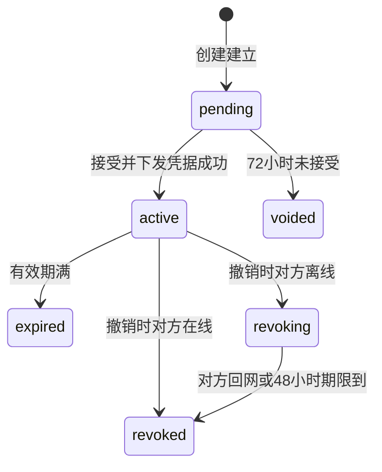
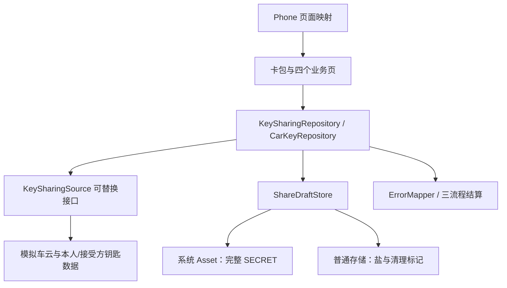

# 数字车钥匙分享：钱包端整体设计

> ISSUE-206 · 部件候选 `wallet-main` · 施工单元候选 `wallet-key-sharing`。
> 这是待审定的人读目标稿，与 `component-blueprint.yaml` 候选共同表达设计意图；不是 Framework 带签名的原生投影。尚未独立质询、施工准入、接受 CU、闭包或设备验证，不据本稿声称其中任何一项通过。

## 1. 分享能做什么，谁负责什么

车主在卡包的本人车钥匙卡片上发起分享，选择对象、权限和有效期；对方在自己的卡包看到待添加钥匙，接受后取得可用卡片。车主从分享管理查看状态，对生效分享逐条撤销。卡包原先只有不可点的车钥匙分类，因此本单同时补齐本人钥匙卡片、收到的钥匙及分享入口。

产品目标是上线三个月内车钥匙用户中发起过分享比例不低于 15%，借车送钥匙类客服咨询下降一半；两者由运营侧统计，不由钱包三流程埋点直接作成功承诺。材料未给页面时延数值，本期不增加时延阈值。

钱包端负责页面、请求编排、本地草稿、状态展示和观察性输出；分享关系由车云裁定，凭据签发与车辆侧是否认可钥匙由车厂云负责。钱包不签发或保存车辆凭据，不把卡片仍显示解释为车辆仍允许使用。

本期按公开模拟前提验证钱包行为。六个车云接口按系统设计 2.1 的字段建立可替换数据源；本人钥匙、接受方账号查询、稳定账号标识、联系人、车型类别与创建恢复也由模拟源提供，后几项不能说成六接口已有。真实车云联调、系统联系人、推送点击入口与真机 Asset 验证不在本次情景终点内。

工程范围是 WalletMain 和 Phone。WalletMain 承担完整业务，Phone 只增加四个页面映射；AccountManager、CommUI、CommFunc 只读复用，不新增公共模块、架构 DSL 或模块依赖边。

设计依据与已审定情景输入见 [source-inputs](../source-inputs.md)。它区分原始材料、宿主立场、旧金样设计前提与真实未决；旧金样头部“已确认”不移签为当前候选的人签。

## 2. 车主与接受方怎样走完一次分享

| 场景 | 页面和操作 | 决定下一步的事实 |
|---|---|---|
| 进入卡包 | 本人钥匙卡片显示车型、车辆；待接受的显示待添加；生效与撤销中的收到钥匙显示卡片 | 按当前账号重新取数；未登录或没有本人钥匙不显示本人分享入口 |
| 车主设置 | 给谁、权限、有效期三段；选定对象后才查权限，换对象作废旧档位 | 返回的可读档位原样展示和传回；不可分享、空档位或无法解释时说明原因，不猜权限 |
| 车主发出 | 三项齐、开关开、配额未满且草稿保存成功才发送新请求 | 配额统计生效与待接受；已有原请求的结果确认不被端侧满额阻断 |
| 接受方添加 | 从待添加卡片进入接受页，先看车型、车主昵称、权限与有效期，再点添加到钱包 | 不设拒绝按钮；只在当前状态仍为待接受时允许再次添加 |
| 车主管理 | 进页拉配额与列表；生效条目撤销，作废或到期条目重新发起 | 待接受撤回未决；其他状态只展示，不发送无效撤销 |
| 查看详情 | 本人钥匙按车辆标识读取；收到的钥匙按分享标识读取 | 权限外功能不出现；已不可用或当前账号没有此钥匙时提示并回卡包 |

参考图保留在需求根 `ux-reference/`：设置、管理、接受、钥匙详情四屏；卡包分区沿用既有卡片样式。四个新页面分别导出 builder，经 WalletMain 的 `index.ets` 和 Phone 的 `navDestinationMap` 接入。推送未达不改变创建结果，接受方进入卡包可补拉；本期不实现推送点击跳转。

有效期提供 7 天、30 天与自定义（至多 180 天）；权限档位由车云根据对象与车辆关系给出，钱包不凭本地联系人推断谁是家庭成员。选联系人取消、联系人服务不可用或缺有效账号时保留当前选择并解释，不发权限查询；可改手输账号。开关默认关闭，放开后才可新建，关闭不阻断已有分享的接受、管理和撤销。

## 3. 分享状态与车辆权限分开表达

六态以车云返回为准，钱包不后台计时推算终态。72 小时是待接受期限；48 小时是对方设备上的卡片收回期限，不是车辆继续可用期。车云受理成功撤销起车辆立即拒绝这把钥匙；离线接受方的卡片可以仍处于撤销中，收回完成才从卡包移除。已作废、已到期、已撤销不列入收到的钥匙；从旧入口进入按已不可用处理。

接受返回 `credentialStatus=failed` 且 `status=pending` 时保持待接受。其他失败或无回应都重取当前账号下该分享：待接受才可重试，生效显示卡片，撤销中保留卡片但不再提供添加，终态或不存在移除。查询失败和不存在分开，查询失败显示结果待确认且不让再次添加。

撤销失败或无回应后重拉管理列表；只有重拉后仍是生效才再次提供撤销。不能把陈旧状态覆盖车云的新状态。管理页和卡包网络失败显示可重试失败态，不展示陈旧列表。

## 4. 创建不确定时，先找回原请求

同账号同车辆只有一个创建编排入口，串行完成“读取—恢复—保存—创建或确认”；不同车辆互不阻塞。草稿带原请求和幂等标识时，对象、权限、有效期只读，用原请求确认同一分享，不生成新标识。新建发出前先持久化完整原请求和幂等标识，写失败不发请求。

| 本地读取 | 本次允许动作 | 恢复责任 |
|---|---|---|
| 有选择、无原请求 | 恢复选择，重查配额与对象权限 | 设置页与仓储；换对象清旧权限 |
| 有原请求 | 只读展示并确认该请求；满额仍能确认 | 仓储沿用请求与幂等标识 |
| 不可访问或服务失败 | 显示恢复失败、可重试；不新建 | 草稿存储明确失败，不伪装不存在 |
| 明确不存在或损坏 | 先做按账号、车辆的创建恢复；损坏原件隔离 | 模拟车云给出下表结果，仓储消费 |

| 创建恢复结果 | 页面、存储怎样处理 |
|---|---|
| pending，带原请求与幂等标识 | 受保护保存成功后只确认同一请求；保存失败继续受限 |
| established，带分享标识与当前状态 | 显示已建立，不自动再发；清本车旧草稿 |
| clear | 只有原创建已终结、迟到也建不出分享才成立；清旧稿成功后开放空表单 |
| unknown 或查询失败 | 当前账号这辆车暂停新发起；管理只读、可重查，不提供删除后重建 |

首次进入、成功发出并清稿后再次发起、退出重登、换号或清数据后回来，只要本地无稿，均先创建恢复。列表为空、打码昵称相同或“暂未看到请求”都不能推出 clear。模拟车云记录独立于钱包进程，并在受理新建时再次检查未终结创建；clear 覆盖迟到请求，防止“先查无、后晚到”的双建。

创建已建立后删本车草稿；删失败仍显示已建立并待清理，只能确认同请求或重试清理。明确拒绝（含满额、签发失败）后持久清掉原请求与幂等标识才恢复编辑。无回应保留原请求。签发失败时关系回滚由车云负责，钱包不自作成功或本地造关系。

这是旧金样公开的模拟业务合同，不是系统设计六接口已承诺的能力。真实对端缺少等价回查与迟到终结保证时，所有依赖创建恢复的新建都不能正式开放；带完整原请求的确认、接受、撤销与管理按自身条件处理。

## 5. 草稿保护、账号切换与进程恢复

每账号每车辆一条系统 Asset，完整草稿放在一个 SECRET：账号车辆绑定、真实对象标识、打码展示值、权限、有效期，以及发出前加入的原请求和幂等标识。普通键值存储只留随机盐、初始化与待清理账号摘要，不留账号、车辆原值或请求副本。Asset ALIAS 与标签只放加盐摘要和业务功能标签；设备首次解锁后可访问、不同步、不设卸载保留。

保存时机是对象、档位、有效期各自选择完成及发出前，不按逐字输入或重绘写盘。Asset 不可用、数据损坏与不存在分别返回。超过 1024 字节按保存失败，不截断、不分片、不改存明文。API 12、`SystemCapability.Security.Asset`、完整模拟草稿不超过 1024 字节都是场景建设前提，未在真机证实。

主动退出或换号先持久标记旧账号不可恢复、更新会话使旧页面失效，再删除旧账号全部车辆草稿。清理失败照常退出旧会话，分享入口受限并可重试清理；连标记都写不进去则先清理，不开放下一个分享会话。普通冷启动未登录不等于主动退出，同一模拟账号登录后仍能恢复草稿；登录前不回填、不发送。

初始化标记缺失时按功能标签清理遗留 Asset，成功后建立盐与标记；失败显示初始化失败。模拟身份源的 `accountKey` 跨重开稳定，展示相同的不同账号必须不同；每次登录会话还有独立 `sessionId`。旧回调按发起时账号与会话匹配，换号后不改新页面、不重建已清草稿。尝试结果照实结算，不因丢弃页面更新就丢统计。

## 6. 接口、对象与数据所有者

| 对象 | 主责及消费关系 |
|---|---|
| `KeySharingSource` / 模拟实现 | 承接六个冻结接口；额外模拟创建恢复、幂等记录与迟到终结。真实替换只换数据来源，不改页面、仓储的状态语义 |
| `SimulatedIdentitySource` | 稳定账号、会话、模拟联系人与身份事件；AccountManager 仍只提供已有登录态 |
| `KeySharingRepository` | 配额、权限、管理列表、创建恢复与创建、接受、撤销的业务入口；同车串行、展示组装、失败映射与三次尝试结算 |
| `CarKeyRepository` | 本人钥匙及当前账号收到的钥匙；单条当前状态供接受、详情及失败恢复共用 |
| `ShareDraftStore` | Asset 原子完整草稿、读取四分、选择与原请求保存、退出/初始化清理；不负责判断车云终态 |
| 设置页交互五角色 | `ShareSetupActions` 动作枚举、`ShareSetupPageOperates` 动作表、`ShareSetupPageInteraction` 交互封装、`ShareSetupContext` 上下文、`ShareSetupPage` 页面组件 |
| 其他页面与卡片分区 | 展示当前账号状态并触发仓储操作；不自造幂等、清理或后台同步协议 |

| 车云接口 | 输入 → 输出及关键语义 |
|---|---|
| `queryKeySharingQuota` | vehicleId → canShare、remaining、reason?、shares(shareId/status)；满额给原因 |
| `queryGranteePermission` | vehicleId、granteeId → shareable、permissionLevels、reason?；对象不可分享时为空，不复用上一对象结果 |
| `createKeySharing` | vehicleId、granteeId、permissionLevel、validUntil、idempotencyKey → shareId、pending；同标识同一条，签发失败不留关系 |
| `acceptKeySharing` | shareId → credentialStatus(issued/failed)、status(active/pending)；其他失败按重新取数处理 |
| `revokeKeySharing` | shareId → status(revoked/revoking)、graceHours?；revoking 时返回期限，失败按重拉结果 |
| `queryKeySharingList` | vehicleId → items(shareId/status/permissionLevel/validUntil/granteeMasked)；每次进管理页拉取、不落地缓存 |

六个接口都是新增调用，字段不删、不改类型，必有和可空遵守系统设计；沿用车云错误码，不新增云错误码。收到的分享查询及按分享标识重取、稳定身份、本人钥匙与创建恢复属于显式模拟扩展，不以换名混入六接口。

## 7. 知识怎样改变这套设计

安全规约把业务身份与展示身份分开：查权限、创建用真实 `granteeId`，打码值不能承担业务身份。展示组装复用 MaskUtil，管理列表用车云打码值；长度不超过四位导致 `maskAccount` 原样返回时只显示昵称。草稿因此必须受保护跨重启存储，不能只保内存或写明文；日志和事件不带账号、打码账号、车牌、位置及原始错误内容。

环境与幂等义务落在 `ShareDraftStore` 和仓储创建入口：读失败不当没有、同车串行、原请求保存先于发送、换号旧回调隔离、缺稿先创建恢复。性能规约约束拉取和保存时机，端侧不轮询、不设后台写，不给材料没有的页面时延承诺。

设置页存在“读取结果决定起点、选对象后查档位、等待用户再恢复动作”的页内协作，因此选 page-interaction 五角色。主发起过程的失败分支各在一次判断或请求后收敛，签发回滚属于云侧，不选 decision-tree；管理页不强套模式。

方向性、资源与交付义务落到四页和卡片：start/end、TextAlign.Start/End；图标先系统符号再已有归档；中文资源复用优先，新增中文和英文齐备。CU Plan 需给待翻译清单与新增资源条数、UTF-8 体积，不增加图片或 SDK。这里只解释实际改变设计的知识；未命中的业务不逐条生成空取舍。

## 8. 只统计三个钱包流程

发起、接受、撤销各一步，分别以建立为待接受、生效、撤销已受理作为成功；在线立即撤销和离线撤销中都算已受理。每次调用独立尝试标识，由 `settleCreate`、`settleAccept`、`settleRevoke` 只结算一次。创建确认沿用幂等标识但属于新尝试；重复回调不重复报，页面退出不取消已发送请求的统计。

前置配额/权限查询、草稿读写、卡包补拉与失败后重取只记必要定位日志，不进入流程统计；不上报失效事件。车型类别直接取模拟输入、缺失记未知；失败说明经 `KeySharingErrorMapper` 的已知错误码映射，未知码给通用分类，外码校验格式，不读任意 message 拼描述。上报失败不改变分享结果。

分享被接受比例按 D7 由车云分享记录统计，钱包不跨账号关联。三个流程号与内码在 CU Plan 中保留候选身份，编码前登记并核冲突，不把候选号说成已经分配。

## 9. 交给一个施工单元，止于 Plan

`wallet-key-sharing` 完整承担本蓝图的钱包端改动，模块归属仍是 WalletMain；Phone 页面映射列为其窄范围伴随改动。一个 CU 能闭合卡包、发起、草稿恢复、接受、管理和退出的共同状态责任，当前没有独立交付或不同授权要求，不按技术层另拆单元。

CU Spec 承接本单位的可见行为、边界和验收，尤其原请求未知不重复建、跨重启恢复与换号保护、撤销受理车辆立即拒绝、接受撤销失败重取。CU Plan 再把这些义务落实到具体实体、方法、存储、动作表、页面映射与验证；共同状态与接口不另行定案。五角色、方法级 must、三流程统计点均需到真实实体，不能只写“遵守知识”。

本候选只做完整设计交接到 Plan，不启动编码或真实运行。原生 CU 接受、设计质询、readiness 与施工闭包实际尚未执行；机器字段存在不代替它们。

验收沿旧有效业务范围：卡包与入口、对象权限/配额、三项选择、72 小时作废、48 小时卡片回收与车辆立即拒绝、跨四个进程中断时点续办、原请求冻结、同车并发、账号/车辆隔离、Asset 失败/损坏/超限/清理、缺稿创建恢复及迟到请求、接受与撤销重取、深色大字与方向性、观察性脱敏和三流程去重。具体条目由 CU Spec 承载，未运行，不勾选通过。

## 10. 未决和正式接入依赖

| 项目 | 保留的边界 |
|---|---|
| D2 被分享人再转第三人 | 未定；本期不设计、不宣称支持 |
| D5 极端断网强制下线 | 未定；48 小时卡片收回规则不代替这项安全裁决 |
| D8 待接受能否撤回 | 未定；当前只完整设计生效撤销，待接受只展示，不能凭“随时可撤”擅自补接口边 |
| 创建恢复真实对端 | 六接口未声明；正式新建需等价回查及迟到终结保证 |
| 稳定账号、接受侧查询、本人钥匙、联系人、推送 | 当前是模拟或明确后续，真实提供方与契约待接入时核实 |
| Asset 与编译环境 | API 12、能力、完整草稿上限属于公开建设前提；设备能力、部署与生命周期未验证 |
| 候选与原生出版 | N24ea6aeb 的正式 renderer、同根目录支持及当前 canonical/CU 结构需分别核；不能手改签名投影或伪造质询通过 |
