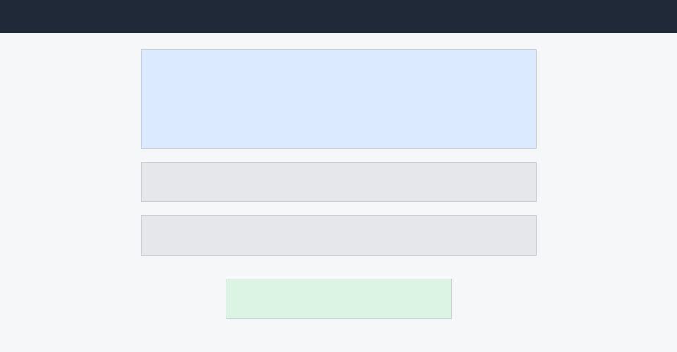
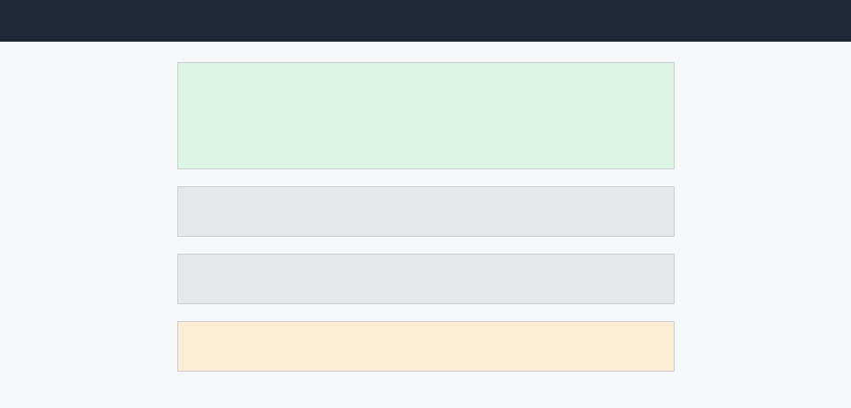

# 车钥匙接受侧界面说明

> 原件的确定性阅读转写。仅转换段落、表格及图片位置，不裁决原文冲突；本候选的有效人答与模拟前提见需求根 source-inputs.md。

车钥匙接受侧界面说明

撰写：出行产品组。补充给开发：被分享人那一侧的界面与交互，配合主需求稿一起看。

一、接受页

被分享人收到推送，点进来看到的是一张车辆信息卡：车型与车主昵称、给到的权限范围、有效期到哪天。页面只有一个主动作「添加到钱包」（图 1）：

图 1　接受页

暂不添加就保持待接受，72 小时后自动作废——接受页不设「拒绝」按钮，不想要就放着。

二、添加之后

添加成功后钥匙卡片进入对方的钱包卡包，卡片详情里能看到权限范围和有效期（图 2）；权限之外的功能不出现在对方的操作面上，而不是置灰。

图 2　添加后的钥匙卡片详情

三、可读性要求

| 位置 | 要求 |
| --- | --- |
| 车辆信息卡 | 先讲清这是谁分享的、能用到什么时候，再给添加按钮 |
| 权限范围 | 写人话：「能开门、能开走」而不是档位代号 |
| 全局 | 深色主题与大字体下，车辆信息与主按钮保持可读可点 |

