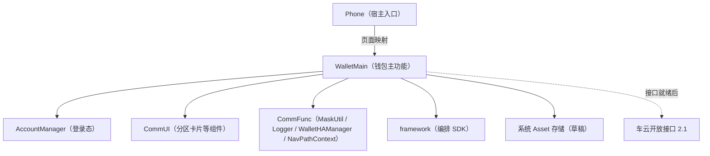
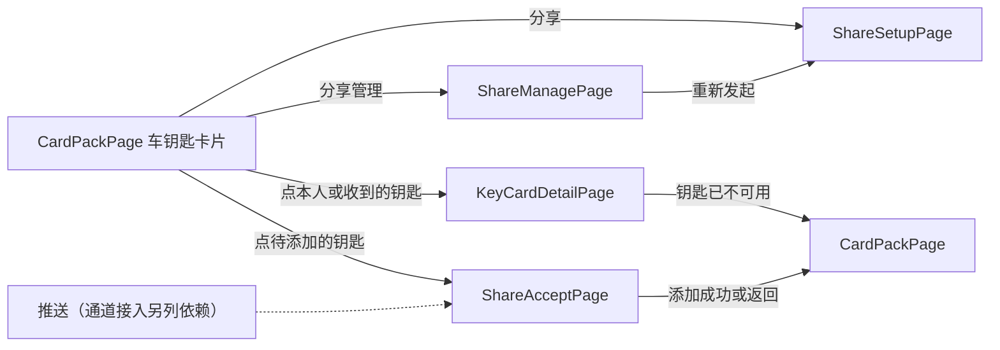

# 车钥匙分享钱包端 — CU Plan

> 本文是钱包端实现设计，拟建实体不代表工程已有能力。

对应[本单位 Spec](../spec/spec.md)、[共同蓝图](../../blueprint/blueprint.target.md)、[Story](../../AR/story.md)及[Review](../../AR/review.md)。

## Scope 声明与继承

### Scope 概览

| 字段 | 取值 | 说明 |
|------|------|------|
| 继承自蓝图/CU与本单位Spec | `true` | 承担 WalletMain 与 Phone 的既定改动，未扩展 |
| 本计划允许修改的模块 | `WalletMain`、`Phone` | Phone 只在宿主页面映射里加四个页面分支 |
| 明确不修改的模块 | `AccountManager`、`CommUI`、`CommFunc` | 只复用登录态、分区卡片等组件、`MaskUtil`、`Logger`、`WalletHAManager`、`NavPathContext` |
| 已获用户批准的扩展 | `[]` | 无 |

不新增模块、不改模块依赖方向；新增页面、数据源、仓储与草稿存储都在既有模块内，跨模块只经各模块 `index.ets` 出口。

## 1. 模块架构图



| Module | 变更类型 | 说明 |
|--------|----------|------|
| WalletMain | 修改 | 新增分享数据源（接口与模拟实现）、模拟身份源、仓储、草稿存储、错误说明映射、车钥匙卡片分区与四个页面；卡包页嵌入分区；「我的」页退出时衔接草稿清理 |
| Phone | 修改 | `navDestinationMap` 增加四个页面名分支 |

钱包端经一个分享数据源接口取数，经一个身份源取当前账号与联系人。本单提供两者的模拟实现（Review D3），接口就绪后换成真实实现，页面与仓储不改。

## 2. 目录/文件结构规划

| 路径（`02-Feature/WalletMain/src/main/ets/` 下，另注明的除外） | 职责 | 新增/修改 |
|------|------|-----------|
| `data/model/KeySharing.ets` | 分享领域模型：本人钥匙、被分享人收到的分享、权限视图、配额视图、分享条目、草稿、六态枚举、草稿读取结果 | 新增 |
| `data/model/WalletIdentity.ets` | 身份模型：`AccountSession`（`accountKey`、`sessionId`）、`ShareContact`（联系人名、可空的可识别账号） | 新增 |
| `data/source/KeySharingSource.ets` | 分享数据源接口：本人钥匙列表、按当前账号取收到的分享与创建恢复（这两项六个车云接口里没有），以及六个车云接口的同名方法 | 新增 |
| `data/source/SimulatedKeySharingSource.ets` | 数据源的模拟实现：模拟本人钥匙（带 `modelCategory`）、分享关系与车云返回，覆盖签发失败、凭据下发失败、其他接受与撤销错误、满额、对象不可分享、撤销中等分支；按幂等标识的分享记录与按账号加车辆的未终结创建存在模拟对端自己的文件里，钱包进程重建后仍在；给出创建恢复结果，受理新的创建时再核未决请求 | 新增 |
| `data/source/SimulatedIdentitySource.ets` | 模拟身份源：模拟账号的稳定 `accountKey`（重开相同、展示相同的不同账号不同）、身份选择与角色切换、冷启动后取得同一身份；模拟联系人列表（含缺账号的联系人）；发出登录、主动退出、切换账号事件 | 新增 |
| `data/repository/KeySharingRepository.ets` | 分享仓储：经数据源调用六个接口与创建恢复，组装页面视图；打码在组装展示内容时做；同账号同车辆的创建与恢复串行；三个流程的尝试持有与结算 | 新增 |
| `data/repository/CarKeyRepository.ets` | 卡包车钥匙卡片的数据：本人钥匙与收到的分享（待接受、生效与撤销中列入卡包，已结束的不列入）；按分享标识取一条的当前状态 | 新增 |
| `data/repository/ShareDraftStore.ets` | 发起草稿的受保护存储：每账号每车辆一条 Asset，完整草稿放在一个 SECRET；普通键值只存盐、初始化与待清理标记；读取结果分不存在、有草稿、不可访问、损坏；退出清理与遗留清理 | 新增 |
| `data/repository/KeySharingErrorMapper.ets` | 失败说明映射：已知车云错误码映射为安全说明，未知码给通用分类，外码按协议格式校验；不读取 message 原文 | 新增 |
| `presentation/components/CarKeyCardSection.ets` | 卡包里的车钥匙卡片分区：本人钥匙卡片（含「分享」「分享管理」入口）、待添加的钥匙与收到的钥匙卡片 | 新增 |
| `presentation/pages/CardPackPage.ets` | 卡包页嵌入车钥匙卡片分区；每次进入或回到卡包按当前账号重新获取 | 修改 |
| `presentation/pages/MineTabPage.ets` | 退出登录时先调 `ShareDraftStore.closeAccount`，再调既有的 `AccountService.logout` | 修改 |
| `presentation/interaction/ShareSetupPageOperates.ets` | 设置页动作表与动作枚举 `ShareSetupActions`（两个角色位于同一文件） | 新增 |
| `presentation/interaction/ShareSetupPageInteraction.ets` | 设置页交互封装：构建动作表、提供 `doOperator` 入口（page-interaction 交互封装角色） | 新增 |
| `presentation/interaction/ShareSetupContext.ets` | 设置页交互上下文：对象、档位、有效期、配额、草稿读取结果与发起时的会话（page-interaction 上下文角色） | 新增 |
| `presentation/pages/ShareSetupPage.ets` | 分享设置页：给谁、权限、有效期、发出；进页按当前身份读草稿并按读取结果展示；导出 builder（page-interaction 页面组件角色） | 新增 |
| `presentation/pages/ShareManagePage.ets` | 分享管理页：配额、列表；生效条目可撤销，撤销失败后重拉；已作废与已到期条目可重新发起；导出 builder | 新增 |
| `presentation/pages/ShareAcceptPage.ets` | 接受页：按分享标识取收到的分享展示车辆信息卡、添加到钱包，失败后按重取的状态分流；导出 builder | 新增 |
| `presentation/pages/KeyCardDetailPage.ets` | 钥匙卡片详情：本人钥匙按车辆标识取、展示车型车辆与分享入口；收到的钥匙按分享标识取当前状态、展示权限范围与有效期；取不到时提示并回卡包；导出 builder | 新增 |
| `shared/constant/ShareConstants.ets` | 分享功能开关（默认关闭，先例 `HomeConstants.SHOW_LOCAL_CARD_SECTION`）、有效期档位、草稿功能标签与 SECRET 上限 | 新增 |
| `shared/constant/KeySharingChartCodes.ets` | 分享埋点登记：发起、接受、撤销三个流程的流程号、步骤号与内码常量 | 新增 |
| `index.ets` | 导出四个新页面的 builder | 修改 |
| `resources/base/element/string.json` | 分享相关中文文案 | 修改 |
| `resources/en_US/element/string.json` | 分享相关英文文案（工程现在只有 base 资源目录，按 RES-02 新建） | 新增 |
| `doc/features/ISSUE-206/wallet-key-sharing/plan/translation-list.md`（工程根下） | 待翻译字符串清单：每条资源键、中文、英文、回稿状态；编码新增文案时同步写，提交测试前完成首版 | 新增 |
| `01-Product/Phone/src/main/ets/pages/index.ets`（宿主页面映射） | `navDestinationMap` 增加四个页面名分支 | 修改 |

上表列出本单位拟新增与修改的文件。配额上限、待接受期限与宽限由车云判定和返回，端侧不设常量。

## 3. 数据模型定义

| 模型 | 字段（摘要） | 说明 |
|------|--------------|------|
| `AccountSession` | `accountKey: string`, `sessionId: string` | 当前登录身份与本次登录会话；每次登录、退出、换账号换新 `sessionId`；`accountKey` 不展示、不进日志与事件 |
| `ShareContact` | `name`, `granteeId?` | 模拟联系人；`granteeId` 缺失表示没有有效账号 |
| `OwnerCarKey` | `vehicleId: string`, `modelName: string`, `modelCategory?: string` | 车主本人的钥匙；本单来自模拟数据；类别缺失按未知 |
| `ReceivedCarKey` | `shareId`, `vehicleId`, `modelName`, `modelCategory?`, `ownerNickname`, `permissionLevel`, `validUntil`, `status: ShareState`, `recallDeadline?` | 被分享人收到的一条分享；`permissionLevel` 与 `permissionLevels` 同一语义；卡包、接受页与详情共用 |
| `GrantPermissionView` | `granteeId`, `shareable: boolean`, `permissionLevels: string[]`, `reason?` | 某对象在这辆车上可用的权限档位，对应 `queryGranteePermission`；选项原样显示、原样传回 |
| `QuotaView` | `canShare: boolean`, `remaining: number`, `reason?` | 配额，对应 `queryKeySharingQuota` |
| `ShareItem` | `shareId`, `status: ShareState`, `permissionLevel`, `validUntil`, `granteeMasked` | 管理页一条分享，打码标识取车云返回 |
| `ShareDraft` | `accountKey`, `vehicleId`, `granteeId`, `granteeDisplay`, `permissionLevel`, `validUntil`, `request?`, `idempotencyKey?` | 一个 SECRET 的完整内容；`request` 与 `idempotencyKey` 在发出前一起写入，留着就表示上次发出结果未知，此时其余字段就是那次请求的原样，确认之前不改；车云明确拒绝时一起清掉 |
| `DraftReadResult` | `absent` / `found(ShareDraft)` / `unavailable(原因)` / `corrupted` | 草稿读取结果；`absent` 与 `corrupted` 先经创建恢复，结果为 clear 才从空表单开始 |
| `CreationRecovery` | `pending(request, idempotencyKey)` / `established(shareId, status)` / `clear` / `unknown(原因)` | 创建恢复结果，由模拟车云按账号与车辆给出；多条可能相关、数据不完整或对应不上当前账号车辆都是 `unknown` |
| `ShareState` | `pending` / `active` / `voided` / `expired` / `revoking` / `revoked` | 六态，取值与车云返回一致 |

## 4. 页面组件树

### 4.1 CardPackPage（修改）

```
CardPackPage
└── CarKeyCardSection
    ├── 本人钥匙卡片：车型、车辆；「分享」→ ShareSetupPage；「分享管理」→ ShareManagePage
    ├── 待添加的钥匙：车型、车主昵称、「待添加」；点击 → ShareAcceptPage
    └── 收到的钥匙卡片：车型、车主昵称；撤销中保留到收回完成；点击 → KeyCardDetailPage（带 shareId）
```

未登录或没有车钥匙时不显示本人钥匙卡片与入口；开关关闭时「分享」不可发起，「分享管理」照常；上一个账号的草稿清理没完成时「分享」不可用并说明原因。

### 4.2 ShareSetupPage

交互按 page-interaction 编排：页面经 `ShareSetupPageInteraction.doOperator` 触发动作，等待用户选择处停机。

```
ShareSetupPage
├── 给谁：模拟联系人列表或手输账号，展示昵称与打码账号；取消、不可用或缺账号时说明且不查权限
├── 权限：随对象查得的选项原样单选；对象不可分享时不呈现并给原因；为空或无法解释时提示重新获取
├── 有效期：7 天 / 30 天 / 自定义至多 180 天
├── 原因提示条：对象不可分享、配额已满、原档位不可用、草稿恢复失败、草稿损坏、确认上次创建、上次已建立、恢复受限、保存失败、待清理、进行中
└── 发出：新建时三项齐且配额未满才可点、满额置灰；草稿留着原请求时三项只读，按钮用来确认上次发出，不受满额置灰；请求中、保存中或同车进行中禁用
```

### 4.3 ShareManagePage

```
ShareManagePage
├── 顶部：车辆与剩余可分享数
├── 列表：对象（打码）、权限、有效期、状态；生效、过程中与已结束三类样式可区分
│   ├── 生效：「撤销」；失败或没得到回应后重拉列表
│   ├── 待接受：只展示（能否撤回待 Review D8）
│   └── 已作废、已到期：「重新发起」→ ShareSetupPage
└── 网络失败态：可重试，不展示陈旧列表
```

### 4.4 ShareAcceptPage

```
ShareAcceptPage
├── 车辆信息卡：车型、车主昵称
├── 权限范围（与分享记录同一语义的可读说明，不写档位代号）与有效期
├── 添加到钱包（不设拒绝按钮）
└── 结果待确认提示：重取状态也失败时出现，不让再点添加
```

### 4.5 KeyCardDetailPage

```
KeyCardDetailPage（参数二选一：vehicleId 为本人钥匙，shareId 为收到的钥匙）
├── 本人钥匙：车型、车辆；「分享」→ ShareSetupPage；「分享管理」→ ShareManagePage（门槛同卡片入口）
├── 收到的钥匙：车型、车主昵称；权限范围与有效期（只读，权限外功能不出现）
└── 状态提示条：本人钥匙已不在当前账号下，或收到的钥匙已撤销、已到期、找不到时，提示这把钥匙已不可用并回到卡包
```

## 5. 状态管理方案

| 状态域 | 存储位置 | 生命周期 | 说明 |
|--------|----------|----------|------|
| 分享功能开关 | `ShareConstants` 的 `static readonly` 常量 | 随版本 | 默认关闭 |
| 登录态 | `AccountManager` 在 `AppStorage` 里的登录键（只读） | 既有 | 未登录不显示入口、不发起、不接受、不恢复草稿 |
| 当前身份与会话 | `SimulatedIdentitySource` 提供的 `AccountSession` | 每次登录 | 冷启动的初始未登录不清草稿；同一模拟账号登录后取回同一 `accountKey` |
| 发起草稿 | `ShareDraftStore`：每账号每车辆一条 Asset | 选择完成时写；发出前写原请求；创建成功删；明确拒绝清原请求；退出与换账号删本账号全部 | 读取先取当前身份；读取结果按 `DraftReadResult` 分流，`absent` 与 `corrupted` 先经 `recoverCreation`，结果为 clear 才从空表单开始 |
| 草稿索引与标记 | 普通键值存储：盐、`initialized`、待清理的账号摘要 | 随应用，不参与备份恢复 | 不放请求副本或任何账号、车辆原值 |
| 同车进行中 | `KeySharingRepository` 内按 `accountKey` + `vehicleId` 的串行队列 | 一次「读原请求—创建恢复—保存—发起或确认」 | 不同车辆不同队列 |
| 设置页表单 | `ShareSetupContext`（页面级 `@State`） | 页面内 | 换对象时作废旧档位并重查 |
| 分享列表与配额 | `ShareManagePage` 页面级状态，不落地缓存 | 每次进页 | 断网给网络失败态 |
| 本人钥匙与收到的分享 | `CardPackPage` 页面级状态，每次进入或回到卡包从 `CarKeyRepository` 取 | 每次进入；账号变化后重新获取 | 不串账号 |
| 三个流程的尝试标识 | `KeySharingRepository` 方法内局部，连同发起时的 `AccountSession` | 一次调用 | 与创建分享的幂等标识分开；回调只更新会话仍匹配的页面 |

### 5.1 草稿保存、恢复与清除

| 时点 | 动作 | 失败时 |
|---|---|---|
| 一项选择完成（对象确认、档位选定、有效期选定） | 读改写这辆车的 SECRET | 停在本页提示保存失败；不影响已选值的显示，发出不可用直到保存成功 |
| 点发出（新建） | 进同车串行队列：读草稿 → 生成幂等标识 → 把 `request` 与 `idempotencyKey` 写进 SECRET → 写入成功才调 `createKeySharing` | 写入失败不发送；序列化超过 1024 字节（本期公开模拟前提，设备能力另核）按保存失败处理，不截断、不分片、不改存明文 |
| 进设置页 | 取当前 `AccountSession` → 按 `accountKey` + `vehicleId` 读 | `found` 无原请求恢复选择并重查配额与权限；`found` 有原请求三项只读、用同一请求确认；`unavailable` 恢复失败、可重试；`absent` 与 `corrupted` 先调 `KeySharingRepository.recoverCreation`（`corrupted` 的原件隔离、不复制进日志）：`pending` 经 `saveRequest` 受保护写回原请求，成功后三项只读、用同一请求确认，失败保持受限；`established` 显示已建立与当前状态，并 `remove` 本车旧草稿；`clear` 先 `remove` 旧草稿，成功才开放空表单，失败保持受限；`unknown` 或查询失败这辆车暂停新发起、管理页照常、可重查；不提供删除后重建 |
| 创建已建立 | 删除这辆车的 Asset | 删除失败：显示已建立并写待清理标记；之后只能确认同一请求或重试清理，不把旧草稿当新请求 |
| 车云明确拒绝（含满额、签发失败） | 把 `request` 与 `idempotencyKey` 从 SECRET 里删掉并写回 | 写回成功才开放编辑；失败保持只读并提示，可重试 |
| 没得到回应 | 原请求保留 | —— |
| 主动退出、切换账号 | 先写旧账号摘要的待清理标记，换掉会话（旧页面与请求失效），再按功能标签与账号摘要删除旧账号全部 Asset，成功后去掉标记 | 删除失败：退出照常，旧账号的待清理标记保留，分享入口不可用并给可重试的清理错误；标记都写不进去：不开放下一个分享会话，先重试清理 |
| 应用启动 | 没有 `initialized` 标记时按功能标签删除遗留 Asset，成功后写盐与标记 | 失败显示初始化失败，不当成没有草稿 |

Asset 属性：ALIAS 为本机随机盐加 `accountKey` 与 `vehicleId` 的摘要；`DATA_LABEL_NORMAL_1` 为功能标签，`DATA_LABEL_NORMAL_2` 为账号摘要，用于按账号批量删除；访问策略设备首次解锁后可访问；不同步；`IS_PERSISTENT` 取默认 false。系统能力与部署要求沿 Spec 的公开模拟前提（API 12、设备具备 `SystemCapability.Security.Asset`）；实际部署时核实权限、配置和设备能力。

## 6. 服务层接口定义

| 接口 | 入参（摘要） | 出参（摘要） | 说明 |
|------|--------------|--------------|------|
| `SimulatedIdentitySource.currentSession` | — | `AccountSession` 或空 | 未登录为空 |
| `SimulatedIdentitySource.listContacts` | — | `ShareContact[]`，或不可用 | 模拟联系人；真实系统联系人接入另列依赖 |
| `SimulatedIdentitySource.onSessionChanged` | 回调 | — | 登录、主动退出、切换账号时通知 |
| `CarKeyRepository.listOwnerKeys` | — | `OwnerCarKey[]` | 本人钥匙；本单来自模拟数据 |
| `CarKeyRepository.listReceivedKeys` | 当前会话 | `ReceivedCarKey[]` | 待接受、生效与撤销中的分享；已撤销、已到期、已作废的不列入卡包；对应的车云查询不在六个接口内，本单由模拟数据源提供 |
| `CarKeyRepository.getReceivedKey` | `shareId` | `ReceivedCarKey`（六态之一）、不存在（当前账号下没有这条）或查询失败，三种结果分开返回 | 接受页与详情页取一条分享的当前状态；接受失败或没得到回应后也用它重取，按与 `listReceivedKeys` 同一套六态分流，不存在按已不可用、查询失败按结果待确认 |
| `CarKeyRepository.getOwnerKey` | `vehicleId` | `OwnerCarKey` 或空 | 详情页取本人钥匙；当前账号下没有这辆车返回空 |
| `KeySharingRepository.queryQuota` | `vehicleId` | `QuotaView` | 对应 `queryKeySharingQuota` |
| `KeySharingRepository.queryGranteePermission` | `vehicleId`, `granteeId` | `GrantPermissionView` | `granteeId` 传可识别的对方账号标识，不传打码值；联系人缺账号时不调用 |
| `KeySharingRepository.recoverCreation` | `AccountSession`, `vehicleId` | `CreationRecovery` | 在同车串行队列里经数据源取这个账号这辆车的创建恢复结果；不读管理列表、不按打码昵称匹配、不依赖已丢失的本地幂等标识；多条可能相关返回 `unknown`；会话已不匹配的晚到响应丢弃 |
| `KeySharingRepository.createSharing` | `AccountSession`, `vehicleId`, 表单或原请求 | `shareId`, `status`，或明确拒绝，或结果未知，或进行中 | 在同车串行队列里执行 §5.1 的点发出与确认；模拟车云受理新的创建时再核这个账号这辆车的未决创建，有就明确拒绝，设置页随后改走 `recoverCreation`；草稿留着原请求时直接用它确认，不做端侧满额前置；已有进行中的同车请求时返回进行中；每次调用新建尝试标识，结果经 `settleCreate` 结算；回调到达时会话不匹配就只结算、不改页面与草稿 |
| `KeySharingRepository.acceptSharing` | `shareId` | `credentialStatus`, `status`，或失败，或结果未知 | 对应 `acceptKeySharing`；`failed` 加 `pending` 保持待接受；其他失败与没得到回应由接受页随后经 `getReceivedKey` 重取，按六态分流（撤销中保留卡片到收回完成、不再添加），不存在按已不可用，查询失败为结果待确认；每次调用新建尝试标识，结果经 `settleAccept` 结算 |
| `KeySharingRepository.revokeSharing` | `shareId` | `status`, `graceHours`，或失败，或结果未知 | 对应 `revokeKeySharing`；只对状态为生效的条目调用；失败与没得到回应由管理页随后经 `listSharings` 重拉，按车云状态显示，仍是生效才再提供撤销；每次调用新建尝试标识，结果经 `settleRevoke` 结算 |
| `KeySharingRepository.listSharings` | `vehicleId` | `ShareItem[]` | 对应 `queryKeySharingList`；打码标识取车云返回的 `granteeMasked` |
| `KeySharingRepository.settleCreate` / `settleAccept` / `settleRevoke` | 尝试标识、业务结果、描述关键值、外码 | — | 一次尝试只结算一次：已结算即返回，否则置位后按 `KeySharingChartCodes` 报一条 Chart；取值见「9.4 埋点」 |
| `KeySharingErrorMapper.describe` | 车云错误码 | 安全说明与分类 | 已知码映射，未知码给通用分类；外码不合协议格式时按无外码上报 |
| `ShareDraftStore.read` | `AccountSession`, `vehicleId` | `DraftReadResult` | 只读当前账号这辆车 |
| `ShareDraftStore.saveSelection` / `saveRequest` / `clearRequest` / `remove` | 账号、`vehicleId`、草稿或请求 | 成功或失败 | 对应 §5.1 各时点；`saveSelection` 在留着原请求时拒绝改对象、权限、有效期 |
| `ShareDraftStore.closeAccount` | `AccountSession` | 成功或失败 | 主动退出、切换账号时按 §5.1 先标记、换会话、再删除 |
| `ShareDraftStore.initialize` | — | 成功或失败 | 应用启动时清遗留并写标记 |
| `ShareSetupPageInteraction.doOperator` | `ShareSetupActions` | — | 设置页动作入口；等待用户选择处停机，用户动作恢复 |

六个车云接口字段继承共同蓝图，并与本稿§10「端云接口」一致；沿用车云错误码，不新增。

## 7. 路由/导航设计



| 页面 | 路由名 | 参数 | 说明 |
|------|--------|------|------|
| 分享设置页 | `ShareSetupPage` | `vehicleId` | 进页只读当前账号、这辆车的草稿 |
| 分享管理页 | `ShareManagePage` | `vehicleId` | 每次进页拉取 |
| 接受页 | `ShareAcceptPage` | `shareId` | 本单从卡包待添加的钥匙进入 |
| 钥匙卡片详情 | `KeyCardDetailPage` | `vehicleId` 或 `shareId`（二选一） | 本人钥匙带 vehicleId，收到的钥匙带 shareId；进入时按带来的身份取当前状态，两样都带或都不带按取不到处理 |

每个新页面改三处：页面文件导出 builder、`WalletMain/index.ets` 导出、宿主 `navDestinationMap` 加分支；页面内用 `NavPathContext.stack().pushPath({ name, param })` 跳转。页面销毁不撤销已经发给车云的请求。推送点击进入接受页要等推送通道接入，本单不改宿主入口。

## 8. spec 功能映射表

| spec 编号 | 功能名称 | 优先级 | 实现模块 | 实现层级 | 关键文件 | 实现说明 |
|-----------|----------|--------|----------|----------|----------|----------|
| F1 | 卡包车钥匙卡片 | P0 | WalletMain | presentation、data | `CarKeyCardSection.ets`、`CardPackPage.ets`、`CarKeyRepository.ets` | 卡包嵌入分区；本人钥匙来自模拟数据 |
| F2 | 分享入口与门槛 | P0 | WalletMain | presentation、shared | `CarKeyCardSection.ets`、`ShareConstants.ets` | 已登录且有车钥匙才显示；开关关闭或上一个账号待清理时发起入口不可用 |
| F3 | 分享设置 | P0 | WalletMain | presentation、data | `ShareSetupPage.ets`、`ShareSetupPageInteraction.ets`、`KeySharingRepository.ets`、`SimulatedIdentitySource.ets` | 模拟联系人或手输；对象选定后查档位，换对象作废并重查；档位原样显示与传回；满额置灰 |
| F4 | 创建分享与草稿续办 | P0 | WalletMain | data | `KeySharingRepository.ets`、`ShareDraftStore.ets` | 幂等创建；草稿每账号每车辆一条 Asset，发出前持久化原请求；同车串行；读写失败、损坏、待清理、退出与初始化按 §5.1，本地没有或损坏草稿时先 `recoverCreation`；跨应用关闭续办交付 |
| F5 | 分享管理与撤销 | P0 | WalletMain | presentation、data | `ShareManagePage.ets`、`KeySharingRepository.ets` | 进页拉取；仅生效条目撤销，失败后重拉；已作废与已到期可重新发起；待接受撤回待 D8 |
| F6 | 接受页 | P0 | WalletMain | presentation | `ShareAcceptPage.ets` | 凭据下发失败保持待接受；其他失败重取后分流 |
| F7 | 钥匙卡片详情 | P1 | WalletMain | presentation、data | `KeyCardDetailPage.ets`、`CarKeyRepository.ets` | 本人钥匙按 vehicleId 经 `getOwnerKey` 取，收到的钥匙按 shareId 经 `getReceivedKey` 取；权限外功能不出现；不可用时回卡包 |
| F8 | 状态、身份与隐私 | P0 | WalletMain | data、presentation | `KeySharing.ets`、`WalletIdentity.ets`、`KeySharingRepository.ets`、`MineTabPage.ets` | 业务请求用 `granteeId`，展示用打码值；草稿与回调按 `accountKey` 与会话匹配；退出时衔接清理 |
| F9 | 被分享人收到的钥匙 | P0 | WalletMain | data、presentation | `CarKeyRepository.ets`、`CarKeyCardSection.ets`、`ShareAcceptPage.ets`、`KeyCardDetailPage.ets` | 进卡包按当前账号取收到的分享；待接受进接受页；已结束的不列入 |

**覆盖率检查**：
- P0: 8/8
- P1: 1/1

## 9. 宿主扩展

### 9.1 项目知识

项目可复用入口与缺口如下；具体 API 与部署能力在真实接入时核实。

| 新增能力 | 复用了什么 | 未复用的理由 | 与登记不符之处 |
|---|---|---|---|
| 对方账号打码 | `CommFunc.MaskUtil` | — | — |
| 定位日志 | `CommFunc.Logger` | — | — |
| 三个流程的事件上报 | `CommFunc.WalletHAManager` 上报封装 | — | 仓内只有通用事件模板，三个流程的流程、步骤与内码新增登记到 `KeySharingChartCodes` |
| 页面导航 | `NavPathContext`、宿主 `navDestinationMap` | — | — |
| 登录态 | `AccountManager` | — | 只有登录布尔值与脱敏展示账号，没有稳定账号标识；本单在 `SimulatedIdentitySource` 提供 `accountKey`，真实来源列为依赖 |
| 退出事件 | `MineTabPage` 既有的退出调用 | — | 在它调用 `AccountService.logout` 之前衔接 `ShareDraftStore.closeAccount` |
| 设置页交互编排 | 编排 SDK `framework`（`PageInteractionBuilderV3`、`DefaultPageInteractionContext`） | — | — |
| 分区卡片等组件 | `CommUI` | — | — |
| 分享功能开关 | 先例 `HomeConstants.SHOW_LOCAL_CARD_SECTION` | — | — |
| 发起草稿存储 | 系统 Asset 存储（`@kit.AssetStoreKit`，异步 add / query / update / remove 自 API 11 起） | 工程里没有受保护的持久化封装，也没有 Asset 用法 | 新增本业务的 `ShareDraftStore`，不造通用加密或草稿框架；API 12 与设备能力是本期模拟前提，未在目标设备验证 |
| 联系人 | — | 工程里没有联系人能力 | 本单用模拟联系人承载原需求的「通讯录选择」路径，不读设备通讯录、不申请权限；真实系统联系人接入列为依赖 |
| 英文文案 | — | 工程只有 base 资源目录，按 RES-02 新建 `en_US` | 与「中英文齐备」的现状不符，按新建承接 |
| 创建恢复 | — | 车云六个接口没有按账号与车辆回查创建的能力 | 本单在 `SimulatedKeySharingSource` 按 spec §5.3 的模拟业务合同提供；真实接入需要车云的等价能力；缺它时，凡读到 `absent` 或 `corrupted`、要先 `recoverCreation` 的新建都不能正式开放（含首次进入与成功发出清稿后再次发起） |

### 9.2 规约落实到实体

| 条目编号 | 本次要落实成什么 | 落点实体 | 承载设计章 | 验证责任 |
|---|---|---|---|---|
| UX-01 | 方向与对齐参数用 start/end，文本对齐用 TextAlign.Start/End | `ShareSetupPage`、`ShareManagePage`、`ShareAcceptPage`、`KeyCardDetailPage`、`CarKeyCardSection` | 4. 页面组件树 | AC-22、AC-G1；方向性与界面检查 |
| SEC-01 | 业务接口传可识别的 `granteeId`，只给车云的查权限与创建分享；展示内容在组装处另生成打码值，列表用车云返回的 `granteeMasked`，短于 5 位的账号只显示昵称；日志与事件不带对方账号与 `accountKey`；失败说明只用映射后的安全说明；草稿按 §5.1 存进 Asset、按账号与车辆隔离、按事件清除 | `KeySharingRepository` 的展示组装与结算方法、`KeySharingErrorMapper`、`ShareDraft`、`ShareDraftStore` | 3. 数据模型定义、5. 状态管理方案、6. 服务层接口定义 | AC-13/14/23/28/33/40；隔离、敏感出口与受保护存储 |
| DFX-01 | 车云调用：配额与列表每次进页拉一次，换对象查一次权限，无轮询。草稿读写：进设置页恢复时读一次，一项选择完成时写一次，点发出时保存原请求一次，建立后删除、明确拒绝后成对清原请求与幂等标识、主动退出与换账号时删本账号全部各一次 | `KeySharingRepository.queryQuota` / `queryGranteePermission` / `listSharings`、`ShareDraftStore` | 5. 状态管理方案、6. 服务层接口定义 | AC-24/42；调用与写入时机 |
| DFX-02 | 新增的 base 与 en_US 字符串资源按条数与 UTF-8 字节数给出体积增量，随待翻译清单产出；不新增图片与 SDK | `string.json`（base、en_US）、`translation-list.md` | 2. 目录/文件结构规划 | AC-26、AC-G1；实际资源清单 |
| OBS-02 | 创建、接受、撤销失败经 `Logger` 写到失败步骤；草稿读写失败只写定位日志 | `KeySharingRepository.createSharing` / `acceptSharing` / `revokeSharing`、`ShareDraftStore` | 6. 服务层接口定义 | AC-23/25；失败定位与安全日志 |
| OBS-03 | 三个流程每种结果在结算方法里结算一次，同次不重复 | `KeySharingRepository.settleCreate` / `settleAccept` / `settleRevoke` | 9. 宿主扩展 | AC-25/37；重复回调不重复结算 |
| OBS-05 | 五项值按上报协议：外码只取车云失败响应并校验格式，说明取自 `KeySharingErrorMapper`，车型类别取 `modelCategory`、缺失记未知 | `KeySharingRepository` 的三个结算方法、`KeySharingErrorMapper` | 9. 宿主扩展 | AC-23/25；安全映射与字段来源 |
| OBS-06 | 三个流程的编号登记到 `KeySharingChartCodes`，核冲突后定稿 | `KeySharingChartCodes` | 2. 目录/文件结构规划、9. 宿主扩展 | AC-25；编号登记和冲突核对 |
| RES-01 | 图标按系统符号、已归档、新引入的顺序取 | 四个新页面与 `CarKeyCardSection` | 4. 页面组件树 | AC-26、AC-G1；图标来源 |
| RES-02 | 文案复用已有一致的中文资源，新增的中英文齐备 | `string.json`（base、en_US） | 2. 目录/文件结构规划 | AC-26；中英文对应 |
| COMPAT-01 | 四问结论：不删旧字段（新增调用）；类型不变；必有与可空按系统设计，`acceptKeySharing` 只有 failed 加 pending 表示凭据下发失败，其他错误按重取处理；不改车云字段，模拟能力不算车云接口 | `KeySharingSource` 接口定义、`KeySharingRepository.acceptSharing` | 6. 服务层接口定义 | AC-27/31/39/41/43；接口字段与状态分流 |
| ENV-01 | 清除数据后先清遗留草稿再开放；草稿读不出或损坏不当成没有；本地没有或损坏草稿时先做创建恢复；列表不落盘 | `ShareDraftStore.initialize` / `read`、`KeySharingRepository.recoverCreation`、`ShareSetupPage` | 5. 状态管理方案 | AC-30/32/33/35–37/40–43；恢复、清理及实际 Asset 能力 |
| ENV-02 | 幂等标识防重复创建，发出请求中禁用；同账号同车辆串行；旧会话回调不写新页面、不重建草稿 | `KeySharingRepository.createSharing`、`ShareSetupPageOperates` 的发出动作 | 5. 状态管理方案、6. 服务层接口定义 | AC-30/34/36/37/41/43；幂等、串行和旧会话回调 |
| DLV-01 | 新增文案进待翻译清单 `doc/features/ISSUE-206/wallet-key-sharing/plan/translation-list.md`：每条资源键、中文、英文与回稿状态；编码新增文案时同步写，提交测试前完成首版，回稿后合入 `en_US` | `translation-list.md`、`string.json` 新增条目 | 2. 目录/文件结构规划 | AC-26；翻译清单与资源对应 |

本表说明蓝图交给本单位的义务由谁实现、如何验证；具体实现细节按“承载设计章”定位。


### 9.3 设计模式

| 适用单元 | 候选 | 选 / 不选 | 实例名 | 理由 |
|---|---|---|---|---|
| 分享设置页（选对象 → 查权限档位 → 选有效期 → 发出） | page-interaction | 选 | `ShareSetupPageInteraction`（动作表 `ShareSetupPageOperates`、动作枚举 `ShareSetupActions`、交互封装 `ShareSetupPageInteraction`、上下文 `ShareSetupContext`、页面组件 `ShareSetupPage`） | 页内交互由业务结果驱动下一步：草稿读取结果决定页面从哪一态开始，选定对象后才查权限，换对象重查、原档位不可用时请车主重选，满额时发出置灰；等待用户选择处停机，由用户动作恢复 |
| 发起分享主链路（门槛 → 设置 → 创建 → 签发结果） | decision-tree | 不选 | — | 反证：门槛不满足、对象不可分享、配额已满、签发失败都是一次请求或一次前置判断的结果，每支一步收敛；草稿读取的四种结果在设置页进入时一次分流，由页面交互承接；签发与回滚在车云完成。这一判断按业务过程本身成立，接入真实车云后不变 |

管理页（撤销 / 重新发起）沿蓝图与 Spec 的范围，不引入模式。

设置页的动作链：读草稿（按结果进入空表单、恢复选择、确认原请求或失败态）→ 选对象 → 查权限（等待用户选档时停机）→ 选有效期 → 发出（请求中停机，返回后按结果回到设置页或回卡包）。换对象重新进入「查权限」，原档位不可用时请车主重选。角色及其实际调用如下：

| page-interaction 角色 | 实体 | 协作责任 |
|---|---|---|
| 动作表 | ShareSetupPageOperates | 分派进入、选对象、选权限、选期限、发出或确认、重试恢复 |
| 动作枚举 | ShareSetupActions（与动作表同文件） | 表达页内动作，不把动作编号当成业务状态 |
| 交互封装 | ShareSetupPageInteraction.doOperator | 组装动作链，等待用户或服务结果时停机，输入到达后恢复 |
| 上下文 | ShareSetupContext | 保存当前会话、车辆、有效选择、权限配额、恢复态和只读原请求 |
| 页面组件 | ShareSetupPage | 经 doOperator 触发动作，显示表单、只读、受限与错误；不绕过仓储直接创建 |

验证角色实际参与调用，并核换对象后权限刷新、原权限失效时重选、未知原请求只读与重试恢复；对应 Spec AC-1/11/30/32/38。不能仅凭文件或角色名称存在认定模式已落实。

### 9.4 埋点

本节落实共同蓝图交给本CU的三个流程指标：分享发起成功率、分享接受成功率、分享撤销成功率。分享被接受比例由车云按分享记录统计（Review D7），本单不为它上报、不记失效事件。

#### 9.4.1 共同约定

| 项 | 约定 |
|---|---|
| 尝试持有者 | `createSharing`、`acceptSharing`、`revokeSharing` 每次调用新建一个尝试标识，与创建分享的幂等标识分开；中断后续办沿用草稿的幂等标识，但算新的一次尝试 |
| 结算方法 | `settleCreate`、`settleAccept`、`settleRevoke`：一次尝试只结算一个结果；正常响应、车云返回失败、通信异常与重复回调都经它，已结算即返回；会话已不匹配的晚到回调照样结算，但不改页面与草稿 |
| 登记文件 | `shared/constant/KeySharingChartCodes.ets`；仓内没有流程、步骤与内码登记，下表编号按分配规则取未用号（业务模块 `01`，发起、接受、撤销依次为流程 `001`–`003`），编码前写入登记文件并核冲突 |
| 结果分类 | 三个流程都只有一步，这一步成功就是流程整体成功，记 `SUCCESS`；失败都是普通失败，记 `STEP_ERROR_BY_ERROR`；请求发出后不能取消，没有用户取消这一结果 |
| 描述字段 | 车型类别取本人钥匙或收到的分享的 `modelCategory`，缺失写「未知」；失败说明取 `KeySharingErrorMapper.describe`，不拼接响应 message、原始错误对象、账号或车牌 |
| 渠道 | 表内结果只报 Chart，要本地日志时直接调 `Logger`；查配额、查权限、读写草稿与卡包补拉失败只写 `Logger`，不进统计 |
| 边界 | 退出页面不取消已发出的请求，按它自己的结果结算；接受后车主再撤销，是撤销流程的一次新尝试，接受那条不变；两侧钱包各自只报本端发起的流程 |

#### 9.4.2 逐点实现

| 统计点 | 结果 | 责任方法 | 事件 ID | 内码 | 结果分类 | 描述 | 外码来源 | 去重与验证 |
|---|---|---|---|---|---|---|---|---|
| 发起流程 / 创建分享 | 已建立 | `KeySharingRepository.createSharing` | `Wallet_COMMON` / `001` / `001` | `0101010000`（候选，待登记：KeySharingChartCodes） | SUCCESS | 「分享已建立」，拼车型类别、权限档与有效期档位（取自本次请求）、是否续办（草稿里有没有沿用的幂等标识） | 无 | `settleCreate`；单测：建立报一条，重复回调不再报 |
| 发起流程 / 创建分享 | 车云返回失败（含签发失败） | `KeySharingRepository.createSharing` | `Wallet_COMMON` / `001` / `001` | `0101010001`（候选，待登记：KeySharingChartCodes） | STEP_ERROR_BY_ERROR | 「创建分享失败」，拼映射后的安全说明与车型类别 | 创建失败响应里的车云错误码（校验格式） | `settleCreate`；单测：签发失败、满额返回各报一条，不留关系；响应里含账号或车牌的 message 不进描述 |
| 发起流程 / 创建分享 | 通信失败 | `KeySharingRepository.createSharing` | `Wallet_COMMON` / `001` / `001` | `0101010002`（候选，待登记：KeySharingChartCodes） | STEP_ERROR_BY_ERROR | 「创建分享没得到回应，结果未知」，拼异常类型（超时或断网，取自请求异常） | 无 | `settleCreate`；单测：超时报一条，草稿留着原请求；之后用同一标识确认拿回同一条分享，另记一条「已建立」；满额时确认的那次也照发，车云返回满额就记一条「车云返回失败」 |
| 接受流程 / 接受 | 生效 | `KeySharingRepository.acceptSharing` | `Wallet_COMMON` / `002` / `001` | `0102010000`（候选，待登记：KeySharingChartCodes） | SUCCESS | 「接受成功，钥匙生效」，拼车型类别（取自收到的分享） | 无 | `settleAccept`；单测：生效报一条，重复回调不再报 |
| 接受流程 / 接受 | 凭据下发失败 | `KeySharingRepository.acceptSharing` | `Wallet_COMMON` / `002` / `001` | `0102010001`（候选，待登记：KeySharingChartCodes） | STEP_ERROR_BY_ERROR | 「凭据下发失败，保持待接受」，拼接受响应里的 `credentialStatus` 与 `status` | 无（接受响应正常返回，不带错误码） | `settleAccept`；单测：报一条；再点记新的一条 |
| 接受流程 / 接受 | 车云返回失败 | `KeySharingRepository.acceptSharing` | `Wallet_COMMON` / `002` / `001` | `0102010002`（候选，待登记：KeySharingChartCodes） | STEP_ERROR_BY_ERROR | 「接受分享失败」，拼映射后的安全说明 | 接受失败响应里的车云错误码（校验格式） | `settleAccept`；单测：报一条；随后重取到已作废或已生效时按重取结果显示，不写回待接受 |
| 接受流程 / 接受 | 通信失败 | `KeySharingRepository.acceptSharing` | `Wallet_COMMON` / `002` / `001` | `0102010003`（候选，待登记：KeySharingChartCodes） | STEP_ERROR_BY_ERROR | 「接受没得到回应，结果未知」，拼异常类型（超时或断网，取自请求异常） | 无 | `settleAccept`；单测：报一条；重取状态不再报；重取到生效就显示钥匙卡片，不再发接受 |
| 撤销流程 / 撤销 | 已受理 | `KeySharingRepository.revokeSharing` | `Wallet_COMMON` / `003` / `001` | `0103010000`（候选，待登记：KeySharingChartCodes） | SUCCESS | 「撤销已受理」，拼撤销响应里的 `status`（`revoked` 立即失效 / `revoking` 撤销中）与 `graceHours` | 无 | `settleRevoke`；单测：立即失效与撤销中各报一条 |
| 撤销流程 / 撤销 | 车云返回失败 | `KeySharingRepository.revokeSharing` | `Wallet_COMMON` / `003` / `001` | `0103010001`（候选，待登记：KeySharingChartCodes） | STEP_ERROR_BY_ERROR | 「撤销失败」，拼映射后的安全说明 | 撤销失败响应里的车云错误码（校验格式） | `settleRevoke`；单测：报一条；随后重拉到已到期时显示已到期，不写回生效 |
| 撤销流程 / 撤销 | 通信失败 | `KeySharingRepository.revokeSharing` | `Wallet_COMMON` / `003` / `001` | `0103010002`（候选，待登记：KeySharingChartCodes） | STEP_ERROR_BY_ERROR | 「撤销没得到回应，结果未知」，拼异常类型（超时或断网，取自请求异常） | 无 | `settleRevoke`；单测：报一条；重拉列表不再报；重拉到撤销中或已撤销就不再提供撤销 |

#### 9.4.3 待登记与缺依据

- 上表事件 ID 与内码都是按分配规则取的候选值，编码前写进 `KeySharingChartCodes` 并在 `CommFunc` 既有事件登记处核冲突后定稿。
- 三个尝试持有方法负责建立本次调用身份；三个结算方法承担一次结算与防重复上报，统计责任不能只停留在事件表里。
- 业务扩展字段（`setChannel`、`setSource` 等）本仓没有含义依据，本需求不启用，只用标准字段。
- `KeySharingErrorMapper` 的已知错误码清单要等车云给出错误码表；本期模拟数据源声明的几个码先入表，真实接入时补齐。


## 10. 本单位消费的共同接口与存储边界

本节继承蓝图对外合同，供实施者逐字段核对；若共同接口变化先回蓝图。以下“新增”指待建客户端/模拟能力，并非已具备真实对接。

### 10.1 端云接口

本设计采用的工程基线中，WalletMain、Phone 没有现成的车钥匙端云调用封装；按 D3 用可替换的模拟数据源承载。六个接口都由钱包端调用车云开放接口 2.1；失败返回车云错误码与可读信息，本需求不新增错误码。

| 云侧接口 | 新增·复用·变更 | 入参 → 出参 | 错误码 | 代码现状 |
|---|---|---|---|---|
| `queryKeySharingQuota` | 新增 | vehicleId → canShare、remaining、reason（可空，满额时给原因）、shares（每项 shareId、status） | 车云错误码与可读信息，不新增 | 检索端云接口封装于 in_scope 模块零命中 |
| `queryGranteePermission` | 新增 | vehicleId、granteeId（可识别的对方账号标识）→ shareable、permissionLevels（可读选项，不可分享时为空列表）、reason（可空） | 同上 | 同上 |
| `createKeySharing` | 新增 | vehicleId、granteeId、permissionLevel、validUntil、idempotencyKey → shareId、status（固定 pending）；同一幂等标识重复请求返回同一条，签发失败返回失败且不留关系 | 同上 | 同上 |
| `acceptKeySharing` | 新增 | shareId → credentialStatus（issued / failed）、status（active / pending）；`failed` 且 `pending` 为凭据下发失败，保持待接受 | 同上；其他错误不保证状态未变，按重取结果处理 | 同上 |
| `revokeKeySharing` | 新增 | shareId → status（revoked / revoking）、graceHours（可空，revoking 时给出宽限小时数，D1） | 同上；失败按重拉列表的状态处理 | 同上 |
| `queryKeySharingList` | 新增 | vehicleId → items（每项 shareId、status、permissionLevel、validUntil、granteeMasked） | 同上 | 同上 |

六个接口之外，本期由 WalletMain 的模拟数据源提供下列能力，标为新增模拟能力，不说成既有接口已有：

| 能力 | 本期字段 | 缺失或不可用时 | 真实接入依赖 |
|---|---|---|---|
| 当前账号身份 | `accountKey`（不透明，模拟账号重开后相同，展示相同的不同账号不同）；登录、主动退出、切换账号事件 | 取不到时按未登录处理，不发起、不恢复草稿 | 账号能力提供稳定账号标识 |
| 联系人 | 联系人名、可识别账号；账号可能缺失 | 取消、不可用或缺账号时不发权限查询 | 真实系统联系人接入，按需申请权限 |
| 本人钥匙 | `vehicleId`、`modelName`、`modelCategory`（可空） | 类别缺失按未知，不从车型名称猜 | 车钥匙本人能力 |
| 收到的分享 | `shareId`、`vehicleId`、`modelName`、`modelCategory`（可空）、车主昵称、`permissionLevel`（与 `permissionLevels` 同一语义）、`validUntil`、`status`、撤销中时的收回期限 | 查询失败给网络失败态，不展示陈旧列表 | 车云按接受方账号查询的接口 |
| 模拟车云的幂等记录 | 按幂等标识保存已建立的分享，独立于钱包进程重建保留 | —— | 真实车云自带；这是模拟对端的状态，不是钱包端缓存 |
| 创建恢复 | 输入当前登录会话与 `vehicleId`；结果 pending（带原请求与幂等标识）、established（带 shareId 与当前状态）、clear、unknown；模拟车云按账号与车辆记录未终结的创建，独立于钱包进程保留，受理新的创建时再核一次 | 查询失败、数据不完整、对应不上当前账号车辆，或多条可能相关而不能唯一对应，都按 unknown，不当 clear | 车云按账号与车辆回查创建并终结迟到请求的等价能力；缺这项时，本地无草稿或草稿损坏的新建都不能正式开放 |

本地没有草稿或草稿损坏时，「上次请求是否已建成」由上表的创建恢复确定（Spec §5.3）。六个车云接口没有这项，本期由模拟车云提供；真实接入需要车云的等价能力；缺它时，所有本地读到无草稿或草稿损坏、要先经创建恢复的新建都不能正式开放：首次进入、成功发出清稿后再次发起、退出登录、换号或清除应用数据之后，以及草稿损坏；带原请求的续办只确认同一请求，接受、撤销与管理不消费创建恢复，按各自条件开放。

### 10.2 数据存储

| 键名/表名 | 介质 | 值结构 | 有效期 | 用途 | 代码现状 |
|---|---|---|---|---|---|
| `key_sharing_draft` | 系统 Asset，每账号每车辆一条（D6） | SECRET：`{ accountKey, vehicleId, granteeId, granteeDisplay, permissionLevel, validUntil, request, idempotencyKey }`，UTF-8 序列化不超过 1024 字节（本期公开模拟前提，设备能力另核）；ALIAS 为账号与车辆的加盐不可逆摘要，标签只放功能标签与账号摘要 | 创建成功清这一条；明确拒绝只清 `request` 与 `idempotencyKey`；主动退出、切换账号清本账号全部；初始化标记缺失时按功能标签清遗留；损坏的原件隔离，拿到创建恢复的明确结果并安全替换或清理后才去掉 | 发起途中退出页面、断网或应用关闭后续办；留着 `idempotencyKey` 表示上次发出结果未知，确认时沿用它不发出第二条；本地没有或损坏时，原请求由创建恢复找回后受保护写回 | WalletMain 无本地持久化封装；工程无 Asset 用法，属新增 |
| `key_sharing_draft_index` | 系统轻量键值存储 | `{ salt, initialized, pendingCleanup }`（待清理只记账号摘要） | 随应用；不参与备份恢复 | 加盐、初始化与待清理标记；不放请求副本或任何账号、车辆原值 | 属新增 |
| 分享列表与配额 | 不落盘 | — | 每次进页从车云拉取 | 管理页展示；车云是唯一真源 | — |

草稿里的 `granteeId` 只用于续办请求，不进入页面、日志与事件；`granteeDisplay` 是打码后的展示值。保存、读取、删除的实现见本篇 §5.1；业务边界见 Spec §5.3 与 E13b、E17–E20。

### 10.3 配置项

| 配置项 | 默认值 | 关闭态行为 | 历史版本兼容 | 代码现状 |
|---|---|---|---|---|
| 分享功能开关 | 关，随版本放开（系统设计约定） | 不能发起新分享；已生效分享的管理、接受、撤销与到期照常 | 旧版本没有分享入口 | 本地常量先例 `WalletMain/src/main/ets/shared/constant/HomeConstants.ets` 的 `SHOW_LOCAL_CARD_SECTION`，新增同类常量 |
| 权限档位文案 | 云侧随 `permissionLevels` 返回 | 端侧不写死档位名；无法解释时提示重新获取 | — | 随 `queryGranteePermission` 返回承载 |

### 10.4 依赖变更

| 依赖 | 变更 | 体积影响 | 兼容风险 | 代码现状 |
|---|---|---|---|---|
| 编排 SDK `framework`（页面交互） | 复用（WalletMain 已声明依赖） | 无 | 无 | 分享设置页按 page-interaction 编排时使用 |
| 系统 Asset 存储（`@kit.AssetStoreKit`） | 新增使用系统能力 | 无，系统能力不进包 | 设备须具备 `SystemCapability.Security.Asset`；不具备时按草稿保存失败处理，不发送、不改存明文 | 工程里没有用法；能力与部署要求按本期模拟前提，未在目标设备验证 |

Scope 内模块依赖声明无新增边（`WalletMain` → `AccountManager`/`CommUI`/`CommFunc` 均为既有只读复用），不新增、不升级 SDK。


## 11. 实施顺序与验证责任

1. 先建立领域类型、数据源接口与模拟实现，核六接口字段及模拟恢复的分界；模拟对端状态独立于钱包进程。
2. 实现 ShareDraftStore、身份源和仓储，按 §5.1 与 §9.2 验证保护、账号车辆隔离、幂等、恢复及清理；请求必须在原请求持久化成功后发送。
3. 实现 §9.3 的五个角色、卡包分区、四个页面、退出清理与页面映射，对照 Spec F1–F9、S1–S9 验证业务链。
4. 完成中英文资源、翻译清单、安全错误映射与 §9.4 三流程统计；编号先登记，重复回调只结算一次，资源增量据实际结果填写。
5. 按 Spec 的全部 AC 与边界场景核对结果。拟建测试位置为 `02-Feature/WalletMain/src/test/WalletKeySharing.test.ets`；接口模拟、独立代码审查、真实设备与端云联调分别承担适用检查，不相互代替。

代码必须让 §9.2 的责任实体实际承担义务，让 §9.3 的角色实际参与调用。实现发现共同接口或设计决定不成立时回蓝图修正；不得自行改变 D2、D5、D8 未决。真实 Asset 能力与云端接口按接入依赖另验，本篇不记录尚未发生的验证结论。
