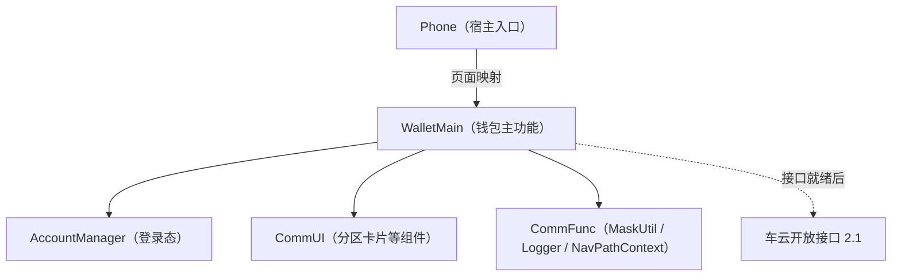
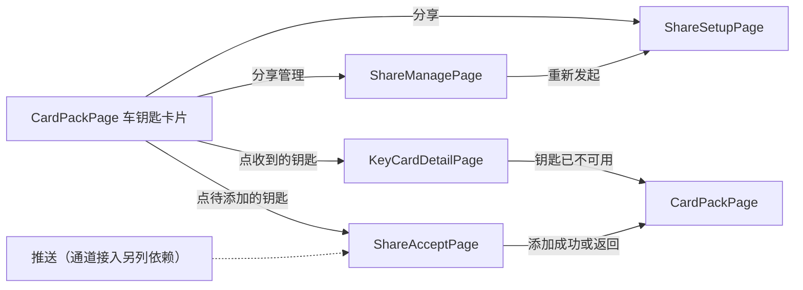

# 数字车钥匙分享（钱包端）— 实现计划（plan）

> **模块标识**: sharing-wallet-slice（蓝图 bp-ISSUE-206）
> **对应 spec**: `sharing-wallet-slice/spec/spec.md`
> **版本**: v1.1
> **创建日期**: 2026-10-03
> **最后更新**: 2026-10-03
> **状态**: 已确认（目标情景终点的示例状态，止于 plan，不进入编码；随评审回流修订撤销宽限）
>
> **真源说明**：`plan.md` 是契约草案；`contracts.yaml` / `use-cases.yaml` 是机器契约真源，coding、review、UT 与门禁优先读它们。

---

## Scope 声明与继承

### Scope 概览

| 字段 | 取值 | 说明 |
|------|------|------|
| 继承自 spec | `true` | 完全继承 spec 的 in_scope_modules，未扩展 |
| 本计划允许修改的模块 | `WalletMain`、`Phone` | Phone 只在页面映射里加分支 |
| 明确不修改的模块 | `AccountManager`、`CommUI`、`CommFunc` | 只复用登录态、分区卡片组件、`MaskUtil`、`Logger`、`NavPathContext` |
| 已获用户批准的扩展 | `[]` | 无 |

### Scope 结构化字段（供 Harness 校验，必填）

```yaml
inherited_from_prd: true
in_scope_modules:
  - WalletMain
  - Phone
out_of_scope_modules:
  - AccountManager
  - CommUI
  - CommFunc
rationale: |
  本计划完全继承 spec 的 scope 声明，未发起扩展。推送点击进入接受页要改宿主入口，属于推送接入的后续依赖，届时另发 scope 扩展提议。
expansions_with_user_approval: []
```

### 架构影响声明 (architecture_impact)

```yaml
architecture_impact:
  impact: none
  affected_items: []
  architecture_md_updates: []
  catalog_updates: []
```

不新增模块；跨模块只经各模块 `index.ets` 出口。

---

## 1. 模块架构图



| Module | 格式 | 变更类型 | 说明 |
|--------|------|----------|------|
| WalletMain | HAR | 修改 | 新增分享数据源、仓储、草稿存储、车钥匙卡片分区与四个页面，卡包页嵌入分区 |
| Phone | HAP | 修改 | `navDestinationMap` 增加四个页面分支 |

钱包端经一个分享数据源接口取数。本单元提供它的模拟实现，接口就绪后换成真实实现，页面与仓储不改。

---

## 2. 目录/文件结构规划

| 路径（`02-Feature/WalletMain/src/main/ets/` 下，另注明的除外） | 职责 | 新增/修改 |
|------|------|-----------|
| `data/model/KeySharing.ets` | 分享领域模型：本人钥匙、被分享人收到的分享（含状态）、权限视图、配额视图、分享条目、草稿、六态枚举 | 新增 |
| `data/source/KeySharingSource.ets` | 分享数据源接口：本人钥匙列表、按当前账号取收到的分享（六个车云接口里没有对应接口），以及六个车云接口的同名方法 | 新增 |
| `data/source/SimulatedKeySharingSource.ets` | 数据源的模拟实现：模拟本人钥匙（车辆标识、车型）、分享关系与车云返回，覆盖签发失败、凭据下发失败、满额、对象不可分享、撤销中等分支；收到的分享覆盖六个状态；撤销中按 36 小时返回宽限值 | 新增 |
| `data/repository/KeySharingRepository.ets` | 分享仓储：经数据源调用六个接口，组装页面视图；打码在组装展示内容时做 | 新增 |
| `data/repository/CarKeyRepository.ets` | 卡包车钥匙卡片的数据：本人钥匙与收到的分享（待接受、生效与撤销中列入卡包，已结束的不列入）；按 shareId 取一条的当前状态 | 新增 |
| `data/repository/ShareDraftStore.ets` | 发起草稿的本地存储：落盘以扛过应用关闭，按账号分键，发出成功、退出登录、切换账号时清除 | 新增 |
| `presentation/components/CarKeyCardSection.ets` | 卡包里的车钥匙卡片分区：本人钥匙卡片（含「分享」「分享管理」入口）、待添加的钥匙（点击进接受页）与收到的钥匙卡片（撤销中显示「正在收回」） | 新增 |
| `presentation/pages/CardPackPage.ets` | 卡包页嵌入车钥匙卡片分区；门槛（已登录且有车钥匙）不满足时不显示分享入口；每次进入或回到卡包按当前账号重新获取 | 修改 |
| `presentation/interaction/ShareSetupPageOperates.ets` | 设置页动作表与动作枚举 `ShareSetupActions`（page-interaction 动作表、动作枚举角色） | 新增 |
| `presentation/interaction/ShareSetupPageInteraction.ets` | 设置页交互封装：构建动作表、提供 `doOperator` 入口（page-interaction 交互封装角色） | 新增 |
| `presentation/interaction/ShareSetupContext.ets` | 设置页交互上下文：对象、档位、有效期、配额与草稿（page-interaction 上下文角色） | 新增 |
| `presentation/pages/ShareSetupPage.ets` | 分享设置页：给谁、权限、有效期、发出；进页回填草稿；导出 builder | 新增 |
| `presentation/pages/ShareManagePage.ets` | 分享管理页：配额、列表；生效条目可撤销，已作废与已到期条目可重新发起；导出 builder | 新增 |
| `presentation/pages/ShareAcceptPage.ets` | 接受页：按 shareId 取收到的分享展示车辆信息卡、添加到钱包，结束后回卡包；导出 builder | 新增 |
| `presentation/pages/KeyCardDetailPage.ets` | 钥匙卡片详情：按 shareId 取当前状态，展示权限范围与有效期，不可用时提示并回卡包；导出 builder | 新增 |
| `shared/constant/ShareConstants.ets` | 分享功能开关（默认关闭，先例 `HomeConstants.SHOW_LOCAL_CARD_SECTION`）、配额上限 5、待接受 72 小时、宽限 36 小时、有效期档位 | 新增 |
| `shared/constant/KeySharingChartCodes.ets` | 分享埋点登记：发起、接受、撤销三个流程的流程号、步骤号与内码常量（候选号，编码前核冲突） | 新增 |
| `index.ets` | 导出四个新页面的 builder | 修改 |
| `resources/base/element/string.json` | 分享相关中文文案 | 修改 |
| `resources/en_US/element/string.json` | 分享相关英文文案（工程现在只有 base 资源目录，按 RES-02 中英文齐备新建） | 新增 |
| `01-Product/Phone/src/main/ets/pages/index.ets`（宿主页面映射） | `navDestinationMap` 增加四个页面名分支 | 修改 |

> 完整签名与类型以 `contracts.yaml` 为准；上表文件都列入 `contracts.files`。

---

## 3. 数据模型定义

| 模型 | 字段（摘要） | 说明 |
|------|--------------|------|
| `OwnerCarKey` | vehicleId, modelName | 车主本人的钥匙；本单元来自模拟数据 |
| `ReceivedCarKey` | shareId, vehicleId, modelName, ownerNickname, permissionLevel, validUntil, status, recallDeadline | 被分享人收到的一条分享；status 取六态，recallDeadline 在撤销中时由数据源给出卡片收回期限；卡包、接受页与详情共用 |
| `GrantPermissionView` | granteeId, shareable, permissionLevels, reason | 某对象在这辆车上可用的权限档位 |
| `QuotaView` | canShare, remaining, reason | 配额 |
| `ShareItem` | shareId, status, permissionLevel, validUntil, granteeMasked | 管理页一条分享，打码标识取车云返回 |
| `ShareDraft` | accountKey, vehicleId, granteeId, granteeDisplay, permissionLevel, validUntil, idempotencyKey | 发起草稿；granteeId 是可识别的对方账号标识，只用于续办请求；granteeDisplay 是打码后的展示值 |
| `ShareState` | pending / active / voided / expired / revoking / revoked | 六态 |

---

## 4. 页面组件树

### 4.1 CardPackPage（修改）

```
CardPackPage
└── CarKeyCardSection
    ├── 本人钥匙卡片：车型、车辆；「分享」→ ShareSetupPage；「分享管理」→ ShareManagePage
    ├── 待添加的钥匙：车型、车主昵称、「待添加」；点击 → ShareAcceptPage
    └── 收到的钥匙卡片：车型、车主昵称；撤销中显示「正在收回」；点击 → KeyCardDetailPage
```

### 4.2 ShareSetupPage

交互按 page-interaction 编排：页面经 `ShareSetupPageInteraction.doOperator` 触发动作，等待用户选择处停机。

```
ShareSetupPage
├── 给谁：通讯录选择或输入账号，展示昵称与打码账号
├── 权限：随对象查得的档位单选；对象不可分享时不呈现档位并给原因
├── 有效期：7 天 / 30 天 / 自定义至多 180 天
├── 原因提示条：对象不可分享、配额已满或原档位不可用时显示接口给的原因
└── 发出：三项齐且配额未满才可点；请求中禁用
```

### 4.3 ShareManagePage

```
ShareManagePage
├── 顶部：车辆与剩余可分享数
└── 列表：对象（打码）、权限、有效期、状态，生效、过程中与已结束三类样式可区分；生效的条目有「撤销」，已作废、已到期的条目有「重新发起」，其余只展示
```

### 4.4 ShareAcceptPage

```
ShareAcceptPage
├── 车辆信息卡：车型、车主昵称
├── 权限范围（人话描述，不写档位代号）与有效期
└── 添加到钱包（不设拒绝按钮）
```

### 4.5 KeyCardDetailPage

```
KeyCardDetailPage
├── 钥匙卡片：车型、车主昵称
├── 权限范围与有效期（只读，权限外功能不出现）
└── 状态提示条：撤销中显示「正在收回」；进入时按 shareId 取当前状态，已撤销、已到期或找不到时提示这把钥匙已不可用并回到卡包
```

---

## 5. 状态管理方案

| 数据 | 作用域 | 装饰器/机制 | 持有者 | 生命周期 | 说明 |
|------|--------|-------------|--------|----------|------|
| 分享功能开关 | 全局 | `static readonly` 常量 | ShareConstants | 随版本 | 默认关闭 |
| 登录态与账号 | 全局 | 读 `AccountConstants` 在 `AppStorage` 里的登录键 | AccountManager | 既有 | 只读 |
| 发起草稿 | 账号级 | 本地落盘：工程里没有现成的持久化封装，在 `ShareDraftStore` 里用系统轻量键值存储，按账号分键 | ShareDraftStore | 发出成功、退出登录、切换账号时清除 | 清除数据后不存在则从头选；回到设置页时先查配额，满额按满额处理 |
| 设置页表单 | 页面级 | `@State` | ShareSetupPage | 页面内 | 换对象时重查权限并作废旧档位 |
| 分享列表与配额 | 页面级 | 进页拉取，不落地缓存 | ShareManagePage | 每次进页 | 断网给网络失败态 |
| 本人钥匙与收到的分享 | 页面级 | 每次进入或回到卡包从 CarKeyRepository 按当前账号取，不落地缓存 | CardPackPage | 每次进入；账号变化后重新获取 | 不串账号 |

账号变化时：`ShareDraftStore` 在登录态变化时清除当前账号以外的草稿；读草稿只读当前账号的键，不会串号。

---

## 6. 服务层接口定义

| 接口 | 入参（摘要） | 出参（摘要） | 说明 |
|------|--------------|--------------|------|
| `CarKeyRepository.listOwnerKeys` | — | OwnerCarKey[] | 本人钥匙；本单元来自模拟数据 |
| `CarKeyRepository.listReceivedKeys` | 当前账号 | ReceivedCarKey[] | 待接受、生效与撤销中的分享；已撤销、已到期、已作废的不列入卡包。对应的车云查询不在六个接口内，本单元由模拟数据源提供 |
| `CarKeyRepository.getReceivedKey` | shareId | ReceivedCarKey 或空 | 接受页与详情页取一条分享的当前状态 |
| `KeySharingRepository.queryQuota` | vehicleId | QuotaView | 对应 queryKeySharingQuota |
| `KeySharingRepository.queryGranteePermission` | vehicleId, granteeId | GrantPermissionView | granteeId 传可识别的对方账号标识，不传打码值 |
| `KeySharingRepository.createSharing` | ShareDraft | shareId, status | 对应 createKeySharing，带幂等标识；签发失败返回失败、不留关系；每次调用新建尝试标识，结果经 `settleCreate` 结算 |
| `KeySharingRepository.acceptSharing` | shareId | credentialStatus, status | 凭据下发失败保持待接受；每次调用新建尝试标识，结果经 `settleAccept` 结算 |
| `KeySharingRepository.revokeSharing` | shareId | status, graceHours | 对方离线返回撤销中；钱包端按 36 小时展示，车云接口现返回 48，调整前联调口径不一致；只对 status 为 active 的条目调用，其他状态不发请求；每次调用新建尝试标识，结果经 `settleRevoke` 结算 |
| `KeySharingRepository.listSharings` | vehicleId | ShareItem[] | 打码标识取车云返回的 granteeMasked |
| `KeySharingRepository.settleCreate` / `settleAccept` / `settleRevoke` | 尝试标识、业务结果、描述关键值、外码 | — | 一次尝试只结算一次：已结算即返回，否则置位后按 `KeySharingChartCodes` 报一条 Chart；编号与五项值见宿主扩展「埋点」 |
| `ShareDraftStore.load` / `save` / `clear` | 账号 | ShareDraft / — | 草稿续办与清除 |

六个车云接口的字段与系统设计说明的接口约定一致；沿用车云错误码，不新增。

---

## 7. 路由/导航设计



| 页面 | NavDestination / 路由名 | 参数 | 说明 |
|------|-------------------------|------|------|
| 分享设置页 | `ShareSetupPage` | vehicleId | 进页回填当前账号的草稿 |
| 分享管理页 | `ShareManagePage` | vehicleId | 每次进页拉取 |
| 接受页 | `ShareAcceptPage` | shareId | 本单元从卡包待添加的钥匙进入 |
| 钥匙卡片详情 | `KeyCardDetailPage` | shareId | 进入时取当前状态 |

推送点击进入接受页要等推送通道接入，本单元不改宿主入口；被分享人在本单元的接受入口是卡包里待添加的钥匙。

每个新页面改三处：页面文件导出 builder、`WalletMain/index.ets` 导出、宿主 `navDestinationMap` 加分支；页面内用 `NavPathContext.stack().pushPath({ name, param })` 跳转。

---

## 8. spec 功能映射表

| spec 编号 | 功能名称 | 优先级 | 实现模块 | 实现层级 | 关键文件 | 实现说明 |
|-----------|----------|--------|----------|----------|----------|----------|
| F0 | 卡包车钥匙卡片 | P0 | WalletMain | presentation、data | `CarKeyCardSection.ets`、`CardPackPage.ets`、`CarKeyRepository.ets` | 卡包嵌入分区；本人钥匙来自模拟数据 |
| F1 | 分享入口与门槛 | P0 | WalletMain | presentation、shared | `CarKeyCardSection.ets`、`ShareConstants.ets` | 已登录且有车钥匙才显示；开关关闭时发起入口不可用 |
| F2 | 分享设置 | P0 | WalletMain | presentation、data | `ShareSetupPage.ets`、`KeySharingRepository.ets` | 对象选定后查档位，换对象重查；满额置灰 |
| F3 | 创建分享与草稿续办 | P0 | WalletMain | data | `KeySharingRepository.ets`、`ShareDraftStore.ets` | 幂等创建；草稿落盘、按账号隔离；续办前查配额 |
| F4 | 分享管理与撤销 | P0 | WalletMain | presentation、data | `ShareManagePage.ets`、`KeySharingRepository.ets` | 进页拉取；仅生效条目撤销，已作废与已到期可重新发起 |
| F5 | 接受页 | P0 | WalletMain | presentation | `ShareAcceptPage.ets` | 下发失败保持待接受 |
| F6 | 钥匙卡片详情 | P1 | WalletMain | presentation | `KeyCardDetailPage.ets` | 权限外功能不出现；不可用时回卡包 |
| F7 | 状态、身份与隐私 | P0 | WalletMain | data | `KeySharing.ets`、`KeySharingRepository.ets` | 业务请求用 granteeId，展示用打码值 |
| F8 | 被分享人收到的钥匙 | P0 | WalletMain | data、presentation | `CarKeyRepository.ets`、`CarKeyCardSection.ets`、`ShareAcceptPage.ets`、`KeyCardDetailPage.ets` | 进卡包按当前账号取收到的分享；待接受进接受页；已结束的不列入 |

**覆盖率检查**：
- P0：8/8
- P1：1/1

---

## 宿主扩展（可选）

### 项目知识复用

| 新增能力 | 复用了什么 | 未复用的理由 | 与登记不符之处 |
|----------|------------|--------------|----------------|
| 对方账号打码 | `CommFunc.MaskUtil` | — | — |
| 定位日志 | `CommFunc.Logger` | — | — |
| 三个流程的事件上报 | `CommFunc.WalletHAManager` 上报封装 | — | 仓内只有通用事件模板，三个流程的流程、步骤与内码新增登记到 `KeySharingChartCodes` |
| 页面导航 | `NavPathContext`、宿主 `navDestinationMap` | — | — |
| 登录态 | `AccountManager` | — | — |
| 设置页交互编排 | 编排 SDK `framework`（`PageInteractionBuilderV3`、`DefaultPageInteractionContext`） | — | — |
| 分区卡片等组件 | `CommUI` | — | — |
| 发起草稿存储 | — | 工程里没有本地草稿能力，`ShareDraftStore` 新增 | — |
| 英文文案 | — | 工程只有 base 资源目录，按 RES-02 新建 `en_US` | 与「中英文齐备」的现状不符，按新建承接 |

### 规约落实到实体

| 编号 | 落实成什么 | 落点实体 | 验证 |
|------|------------|----------|------|
| UX-01 | 方向与对齐参数用 start/end | `ShareSetupPage`、`ShareManagePage`、`ShareAcceptPage`、`KeyCardDetailPage`、`CarKeyCardSection` | 设备 |
| SEC-01 | 展示内容在组装处打码；日志与事件不带账号；业务接口传可识别标识 | `KeySharingRepository` 的展示组装、`ShareDraftStore`、日志与上报调用 | 单测 + 设备 |
| DFX-01 | 每次进页拉一次，换对象查一次，无轮询 | `KeySharingRepository` 的六个方法 | 单测 |
| OBS-02 | 创建、接受、撤销失败写定位日志 | `KeySharingRepository.createSharing` / `acceptSharing` / `revokeSharing` | 单测 |
| OBS-03 / OBS-05 / OBS-06 | 三个流程指标的每种结果在责任方法里结算一次，五项值按上报协议，编号登记到 `KeySharingChartCodes` | 本章「埋点」表里的责任方法与结算方法 | 单测 |
| RES-01 / RES-02 | 图标与文案按复用顺序取；新增文案中英文齐备 | 四个新页面；`string.json`（base、en_US） | 设备 |
| COMPAT-01 | 六个接口字段与含义不变 | `KeySharingSource` 接口定义 | 单测 |
| ENV-01 | 草稿清除后从头选，不崩溃 | `ShareDraftStore`、`ShareSetupPage` 回填 | 单测 |
| ENV-02 | 幂等标识防重复创建，发出请求中禁用 | `KeySharingRepository.createSharing`、`ShareSetupPageOperates` 的发出动作 | 单测 |
| DLV-01 | 新增文案进待翻译清单 | `string.json` 新增条目 | 人工跟踪 |

不适用的四条（DFX-02、OBS-07、COMPAT-02、DLV-02）不挂实体。

### 设计模式选型与角色

| 单元 | 模式 | 选 / 不选 | 角色与实体 |
|------|------|-----------|------------|
| 分享设置页三段交互 | page-interaction | 选 | 动作表 `ShareSetupPageOperates`；动作枚举 `ShareSetupActions`（同文件）；交互封装 `ShareSetupPageInteraction`；上下文 `ShareSetupContext`；页面组件 `ShareSetupPage` |
| 发起分享主链路 | decision-tree | 不选 | 分支都是一次请求的结果判断，由 `KeySharingRepository.createSharing` 承担 |

设置页的动作链：选对象 → 查权限（等待用户选档时停机）→ 选有效期 → 发出（请求中停机，返回后按结果回到设置页或回卡包）。换对象重新进入「查权限」，原档位不可用时请车主重选。

### 埋点

蓝图 detail-share-events 的三个流程指标在这里落到责任方法与具体编号；分享被接受比例由车云按分享记录统计（D7），本单元不为它上报、不记失效事件。

- 尝试持有者：`createSharing`、`acceptSharing`、`revokeSharing` 每次调用新建一个尝试标识，与创建分享的幂等标识分开；中断后续办沿用草稿的幂等标识，但算新的一次尝试。
- 结算方法：`settleCreate`、`settleAccept`、`settleRevoke`，一次尝试只结算一个结果；正常响应、车云返回失败、通信异常与重复回调都经它，已结算即返回。
- 登记文件：`shared/constant/KeySharingChartCodes.ets`。仓内没有流程、步骤与内码登记，下表编号按分配规则取未用号（业务模块 `01`，发起、接受、撤销依次为流程 `001`–`003`），编码前写入登记文件并核冲突。
- 结果分类：三个流程都只有一步，这一步成功就是流程整体成功，记 `SUCCESS`；失败都是普通失败，记 `STEP_ERROR_BY_ERROR`；请求发出后不能取消，没有用户取消这一结果。
- 渠道：表内结果只报 Chart，要本地日志时直接调 `Logger`；查配额、查权限与卡包补拉失败只写 `Logger`，不进统计。
- 边界：退出页面不取消已发出的请求，按它自己的结果结算；接受后车主再撤销，是撤销流程的一次新尝试，接受那条不变；两侧钱包各自只报本端发起的流程。

| 统计点 | 业务结果 | 责任方法 | 事件ID（模板/流程/步骤） | 内码 | SDK结果分类 | 描述及关键值来源 | 外码来源 | 结算与验证 |
|---|---|---|---|---|---|---|---|---|
| 发起流程 / 创建分享 | 已建立 | `KeySharingRepository.createSharing` | `Wallet_COMMON` / `001` / `001` | `0101010000`（候选，待登记：KeySharingChartCodes） | SUCCESS | 「分享已建立」，拼车型类别（取自本人钥匙）、权限档与有效期档位（取自本次草稿）、是否续办（草稿里有没有沿用的幂等标识） | 无 | `settleCreate`；单测：建立报一条，重复回调不再报 |
| 发起流程 / 创建分享 | 车云返回失败（含签发失败） | `KeySharingRepository.createSharing` | `Wallet_COMMON` / `001` / `001` | `0101010001`（候选，待登记：KeySharingChartCodes） | STEP_ERROR_BY_ERROR | 「创建分享失败」，拼失败响应里的可读信息与车型类别 | 创建失败响应里的车云错误码 | `settleCreate`；单测：签发失败、满额返回各报一条，不留关系 |
| 发起流程 / 创建分享 | 通信失败 | `KeySharingRepository.createSharing` | `Wallet_COMMON` / `001` / `001` | `0101010002`（候选，待登记：KeySharingChartCodes） | STEP_ERROR_BY_ERROR | 「创建分享请求未完成」，拼异常类型（超时或断网，取自请求异常） | 无 | `settleCreate`；单测：超时报一条；之后续办拿回同一条分享，另记一次「已建立」 |
| 接受流程 / 接受 | 生效 | `KeySharingRepository.acceptSharing` | `Wallet_COMMON` / `002` / `001` | `0102010000`（候选，待登记：KeySharingChartCodes） | SUCCESS | 「接受成功，钥匙生效」，拼车型类别（取自收到的分享） | 无 | `settleAccept`；单测：生效报一条，重复回调不再报 |
| 接受流程 / 接受 | 凭据下发失败 | `KeySharingRepository.acceptSharing` | `Wallet_COMMON` / `002` / `001` | `0102010001`（候选，待登记：KeySharingChartCodes） | STEP_ERROR_BY_ERROR | 「凭据下发失败，保持待接受」，拼接受响应里的 `credentialStatus` 与 `status` | 无（接受响应正常返回，不带错误码） | `settleAccept`；单测：报一条；再点记新的一次 |
| 接受流程 / 接受 | 车云返回失败 | `KeySharingRepository.acceptSharing` | `Wallet_COMMON` / `002` / `001` | `0102010002`（候选，待登记：KeySharingChartCodes） | STEP_ERROR_BY_ERROR | 「接受分享失败」，拼失败响应里的可读信息 | 接受失败响应里的车云错误码 | `settleAccept`；单测：报一条，保持待接受 |
| 接受流程 / 接受 | 通信失败 | `KeySharingRepository.acceptSharing` | `Wallet_COMMON` / `002` / `001` | `0102010003`（候选，待登记：KeySharingChartCodes） | STEP_ERROR_BY_ERROR | 「接受请求未完成」，拼异常类型（超时或断网，取自请求异常） | 无 | `settleAccept`；单测：报一条，保持待接受 |
| 撤销流程 / 撤销 | 已受理 | `KeySharingRepository.revokeSharing` | `Wallet_COMMON` / `003` / `001` | `0103010000`（候选，待登记：KeySharingChartCodes） | SUCCESS | 「撤销已受理」，拼撤销响应里的 `status`（`revoked` 立即失效 / `revoking` 撤销中）与 `graceHours` | 无 | `settleRevoke`；单测：立即失效与撤销中各报一条 |
| 撤销流程 / 撤销 | 车云返回失败 | `KeySharingRepository.revokeSharing` | `Wallet_COMMON` / `003` / `001` | `0103010001`（候选，待登记：KeySharingChartCodes） | STEP_ERROR_BY_ERROR | 「撤销失败」，拼失败响应里的可读信息 | 撤销失败响应里的车云错误码 | `settleRevoke`；单测：报一条，条目保持生效 |
| 撤销流程 / 撤销 | 通信失败 | `KeySharingRepository.revokeSharing` | `Wallet_COMMON` / `003` / `001` | `0103010002`（候选，待登记：KeySharingChartCodes） | STEP_ERROR_BY_ERROR | 「撤销请求未完成」，拼异常类型（超时或断网，取自请求异常） | 无 | `settleRevoke`；单测：报一条，条目保持生效 |

### 验证责任

| 验证 | 覆盖 | 方式 |
|------|------|------|
| 业务单元测试 | 六态迁移；幂等创建不重复；签发失败与凭据下发失败；满额与对象不可分享；草稿落盘、续办、清除，以及有草稿时配额已满按满额处理；撤销中 36 小时与被分享人一侧「正在收回」；收到的分享：卡包补拉待接受、接受成功转为钥匙卡片、接受失败保持待接受、撤销中显示「正在收回」、撤销完成与到期移除、旧入口打开详情提示不可用、换账号只取新账号；仅生效态可撤销；打码相同的两个账号各自正确 | 用模拟数据源构造各分支 |
| 埋点单元测试 | 三个流程每种结果预期的事件（编号、内码、分类）与次数；重复回调不再报；通信失败后续办沿用幂等标识、另记一次；再点接受、重新发起都是新的一次；统计点上不出现 VOC | 用模拟数据源构造各结果，记录上报封装的调用 |
| 界面检查 | 卡包车钥匙卡片、四个页面的展示、深色与大字、从右到左镜像 | 设备或预览按界面参考图核 |
| 真实联调 | 六个车云接口与本人钥匙真实来源；撤销宽限值是否已由车云调整为 36 小时；被分享人一侧钥匙查询的真实接口；推送通道接入与点击进入接受页 | 不在本单元；接口就绪后换真实数据源再验 |

### 不承载

被分享人再转给第三人（D2）、撤销后极端断网强制下线（D5）、真车开锁与凭据签发（D4）不在本单元。分享被接受比例由车云按分享记录统计（D7），本单元不为它上报。
