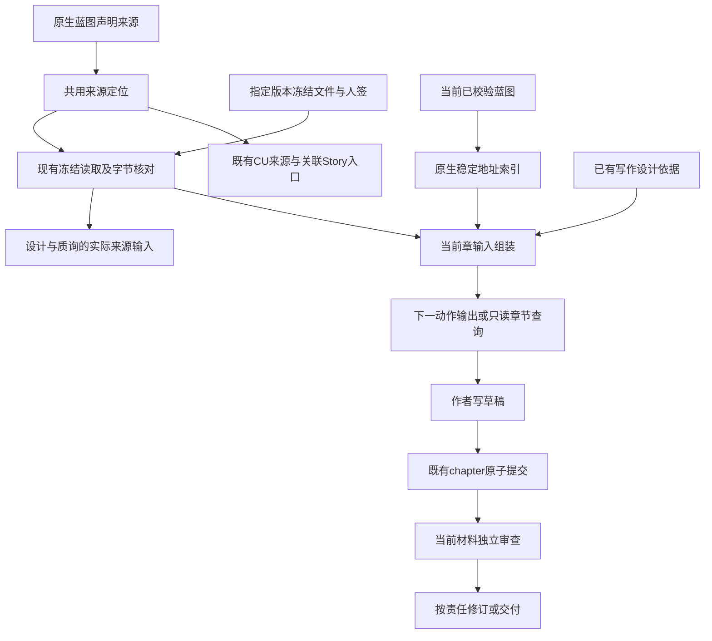

# 2.0.4 机制重构方案：来源交付、章节输入与审查返修

2026-10-11，维护设计者。用户要求整理分析并给执行者明确下一步。本文是已定案的局部机制重构方案，承接用户继续解决问题的指令；不整体重写已经实施的上一轮方案。当前五项返修和update路径漏项继续按[上一轮评审](../2026-10-11-整体评审与职责收敛/评审意见/2026-10-11-四步骤交回评审.md)执行；新增质量接线按本轮设计复核进入本仓实施；新CLI等外部动作仍遵循各自授权。未完成项不因新目录消失，不宣告上一轮已完成。

## 1. 实际要改变什么

| 已知问题 | 现有做法的不足 | 本轮机制动作 |
|---|---|---|
| 原件条件在提取/蓝图遗漏 | 冻结原件可取得，但质询任务重点列候选和知识，没有独立组织本次来源检查 | 步骤1把实际采用来源身份送进设计/质询任务，先从来源找承担关系，再核原生scope |
| 蓝图未决在章稿丢失 | skeleton主要交图、原件清单，下一章INPUT给全篇路径和骨架 | 步骤2在既有入口交本章原生对象原文、决定/未决及来源定位，不让模型从章名重猜 |
| 原报告被作者改写 | 磁盘dispatch一致不能证明实际派发和首次落盘原样 | 步骤3沿已核宿主边界保持直接写路径，补复审职责；可信生产者关联交U02，不用更多提示自证 |
| 复审反复找来源、改建议 | 原报告参考已实现，但格式错误与业务变化的处理仍混在全审路径 | 步骤3限定同键格式修复的任务；新键仍保持完整责任，不提前启用diff审查 |
| 质量和成本未成立 | 离线全绿与最终稿掩盖首稿和返修 | 步骤4按实际输入→动作→内容变化核效果，授权边界和可比条件明确 |

已有正确能力继续使用：冻结输入与原生当前性、知识义务、章节原子写入、图源解析、原报告参考和同材料复用、人工区与恢复保护。它们不是本轮新增成果。禁止新建统一内容模型、覆盖账本、阶段调度、审查状态中心；不强迫固定图数、逐条复述材料或按关键词判语义。

## 2. 重构边界与目标结构

本次重构改变实际生产者、消费者和调用关系，不以换文件名、拆函数或追加提示作为完成。范围限定在内容交付与审查返修；Framework阶段、蓝图权威、CU调度、需求流程状态、安装体系和人工保护保持。具体字段与失败处理分别在01–03维护，本节是它们的职责总图，不产生第二套协议。

### 模块职责迁移

| 对象 | 当前不足 | 重构后的唯一职责 | 保留/退出 |
|---|---|---|---|
| framework-access中的来源定位 | 来源定位藏在CU relatedStories入口，设计/质询不能直接复用同一采用集合 | 从指定蓝图声明来源派生文件身份和冻结需求；CU关联与蓝图任务共用 | 保留原生路径与身份校验，退出各消费者按当前flow猜旧候选来源 |
| design-source中的冻结读取 | 普通读取默认当前flow版本，候选指定版本缺少显式消费 | 读取指定snapshot_ref并核原始字节，缺省调用保留现有当前Story行为 | 保留冻结版本权威，不新建材料登记 |
| knowledge-task蓝图任务 | 知识与候选scope齐全，不等于来源条件完整进入质询 | 先交实际采用来源/人签/派生身份，再交原生scope和知识 | 原生scope不复制，来源遗漏不靠候选自证 |
| writing-plan | 已有章/节原生依据地址主要用于检查和CU表达定位 | 继续只保存表达安排，同时作为章节输入的显式取用依据 | 不成为业务权威，不追加覆盖台账 |
| story-inputs | 主要输出图片、来源图和原件清单 | 增加当前章的原生对象、关联决定/缺口与来源定位的即时只读输出 | 图源与材料能力保留，不持久化另一份设计正文 |
| nextSteps与skeleton | 下一章只有骨架及全篇路径，作者再找、再猜 | 下一动作前交章节输入；skeleton --chapter提供已存在章的只读取用 | 退出每章一律重读全篇/倾倒全部图体的默认要求，整体理解及最终全审保留 |
| drafts与chapter提交 | 可靠的草稿和原子替换能力 | 继续只保存作者草稿、核结构/引用并原子提交 | 不把动态对象副本塞入草稿；提交后接续失败不反称写入失败 |
| independent-review与reader任务 | 原件参考已有，但格式返修与业务修订阅读责任未充分分开 | 依当前材料键、原报告状态生成对应审查任务；业务变化仍有当前完整范围的新结论 | 保留绑定和原件历史，退出不必要的纯格式全量重读及建议清零式循环 |

### 调用关系

图中的来源与章节输入都是即时视图，业务决定仍只在原件/人签及原生蓝图的各自权威位置。图不是新增执行器：现有Skill、命令、hook和宿主继续调用，不引入自动阶段循环。

### 实施切换规则

1. 来源定位提取时，同一改动中切换relatedStories和blueprintTask的实际消费者；不能长期保留新旧两个解析器。
2. 章节输入组装接入nextSteps及skeleton只读分支后，同包撤下旧的泛指INPUT与重复大输出要求；`basis`的机器JSON协议不改，既有chapter写入规则不改。
3. 报告任务按格式修复/同键失败/新键修订/有效warn分工，读法只维护一份；不并存“所有变化都从头读”与新的分类处理要求。
4. 运行中旧文件只读保护、手改草稿不覆盖、人工区和冻结件不回写。既有设计引用、报告/材料键和CU身份不为迁就新输入而改造。
5. 只服务被替代路径的断言随消费者切换退出；来源真实性、整体语义、跨章一致性、CU承接及恢复覆盖保留。没有实际消费者的新导出不交付。

### 重构的验收差别

“代码实现存在”不是本次终点。执行者必须交旧/新实际任务输出对比：原先只有路径的章，现在在动作前拿到对应原文与未决；原先候选遗漏的来源条件，现在质询能够从来源发现；格式返修不无故重建全需求，业务修订不丢整体责任。机器只签输入、身份和确定性行为，理解、成文与成本按步骤4真实证据签。

不宣称脚本能保证模型不误解；也不允许用“模型可能误解”豁免错误的上下文装配。已正确送达后仍失败的，保留具体行为证据回设计者，而不是继续加相同提醒。

## 3. 四步与交付

1. [来源到设计](01-来源到设计的完整交接.md)：以真实来源组织独立检查，替换候选自证式输入。
2. [设计到章节](02-把当前设计交到章节作者.md)：现有写作设计地址用于动作前的输入，而不只用于事后检查/CU片段过滤。
3. [独立审查与返修成本](03-原件交接与复审收敛.md)：能力边界明确、格式返修与业务修订分开、真实修改合并处理。
4. [验证与交回](04-验证与交回.md)：内容、行为、证据和成本分别签收。

每一步都有明确输入输出和失败责任；局部函数拆分留实施者。新事实推翻合同回维护设计者，不临场选择另一种架构。每步交回，独立工作可继续，受上游或授权限制的动作保持待验。

本稿承接上一轮R03的机制效果目标及R01/R10尚未成立的行为部分；上一轮对应文字整理保留为已实施事实，不能单独用来签整体质量。所有新接线都替换原模块的任务输出，不保留两种并行作者流程。执行范围由本轮复核和原启动记录同步，已实施工作不重做；本地任务不再等待一次额外的笼统方案审核。

## 4. 现有返修先完成

F1当前键格式错误优先、F2回复幂等、F3混合投递重名、F4人工区重复三态、F5部分IO结果，以及D1 update原生报告路径，仍按上一轮已定合同与复现验收。先完成直接相关返修，避免新质量工作建立在错误证据上；不要重复重做已通过的职责。V01真实离线恢复链、材料图引用核对仍是必交，不能改成仅等CLI。

本方案的来源及章节组装可在独立隔离fixture上推进；正式行为评价须使用修正后的交付物。无CLI授权不是不做离线接线的理由，也不是允许构造模型行为证据的理由。

## 5. 预算和开工权限

观察基线为当前在途产品14572有效行，历史B13993/A3100与总峰17093保持。上一轮待返修估G40/X20另记，不并入本轮新增假装归零。

| 新工作 | 预计G | 预计X | 净增 | 替换对象 |
|---|---:|---:|---:|---|
| 来源交付 | 100 | 45 | +55 | CU独占的来源定位抽为既有两入口共用，替换只列候选scope的任务组织 |
| 章节输入 | 150 | 35 | +115 | 全篇泛指INPUT/重复大输出替换为当前章实际对象与未决 |
| 复审职责 | 35 | 25 | +10 | 格式返修整轮重查话术、重复读法与作者转述路径 |
| 验证 | 0 | 0 | 0 | 复用测试域与已有证据 |
| 合计 | 285 | 105 | +180 | 不以删有效覆盖凑X |

含上一轮预估返修，预计完成14772，先增后退保守峰14897；仍在历史总峰内。新增是补已证实的动作前信息交付，不是用行数证明优化。维护设计者核认本轮具体职责与估算，skills脚本分类峰值签为5000（原4830保留历史），实施者开工时同步既有台账。其他分类及总B/A保持，不以总余量扩大范围。本稿不代实施者改台账或产品。实际G/X与返修累计分别交回。

测试沿现有文件，预估新增300–500行、退出80–160行，非产品额度，不为凑数写语义关键词测试。新CLI、新消费评价、用户配置修改、上游发布件接入、demo发布与提交推送均不由本稿自动授权。

## 6. 完成不是“改了几行”

要分别证明：有效来源的条件有承担者；本章实际拿到决定/未知边界；独立审查原件有真实生产证据；必要返修回正确责任；无关读取/无实质建议循环减少；正常CU仍承接整体承诺。没有这些证据不签本版优化完成。若规则和实际输入都正确而仍失败，保留消费效果失败，不再追加同义句宣告修复。

设计依据为上一轮[内容调查](../2026-10-11-整体评审与职责收敛/调查/02-内容审查与更新调查.md)、[职责复核](../2026-10-11-整体评审与职责收敛/调查/05-职责增长与方案偏离复核.md)及本轮源码核对。原生有固定app_lens范围，不能写成“原生只能审已有对象”；要修的是扩展实际任务中来源驱动的送达与检查，不新造质询scope。

## 7. 设计核对记录

两个显式gpt-6.1-sol子代理只读核对实际输入入口、原生对象API、审查与宿主边界。设计者已核`currentScopeItems`、`stableAddressIndex`、快照files[].role、basisSections与chapter写入后接续异常合同；补齐候选冻结版本、角色、一次有界正反向引用、自由文字不猜路径、跨章索引非穷尽、写入前后失败语义、report_invalid分类及U02调查完成不等于能力成立。

五份文件的本地引用和定向测试路径已核存在。本次没有产品实现或新CLI证据，不宣称质量与成本已改善。本轮已具备本地机制实施条件，现有返修先收口，随后执行来源与章节接线、复审职责和离线验证；U02可信原件能力不虚报完成，也不阻断已定本地工作。执行交接见[定案与执行交接](评审意见/2026-10-11-定案与执行交接.md)。
