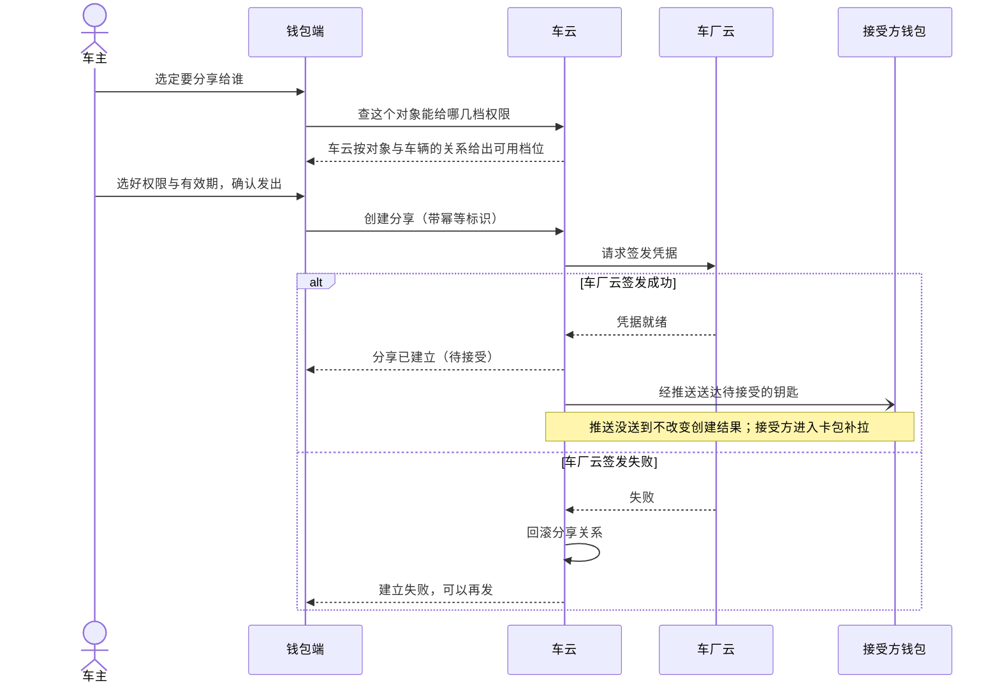
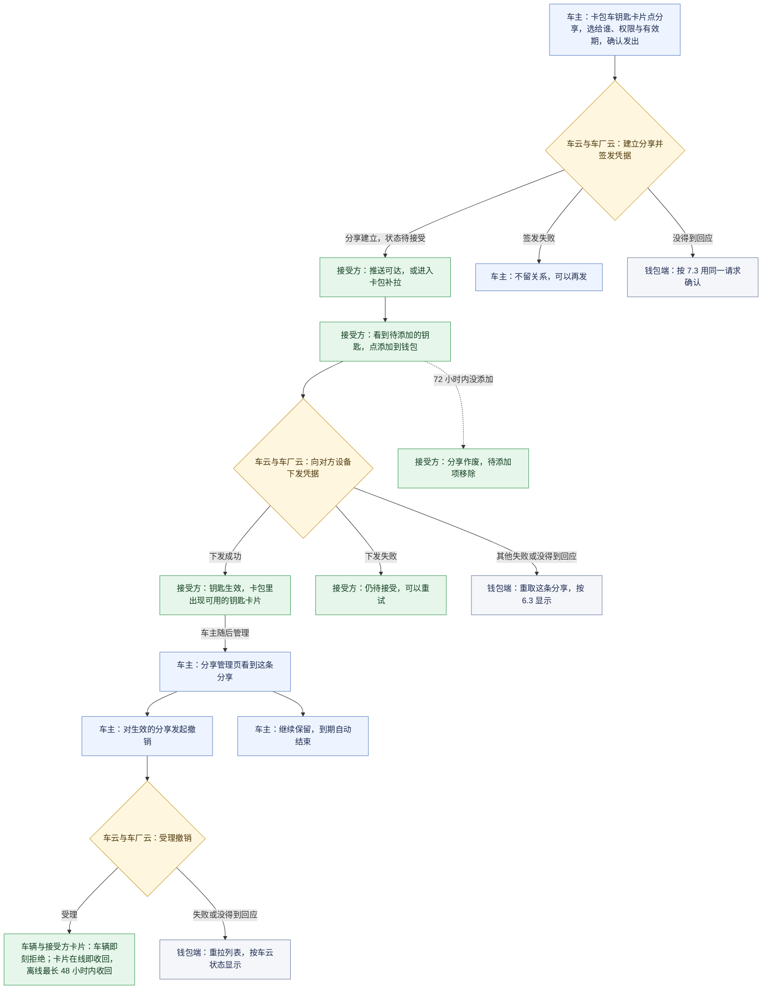
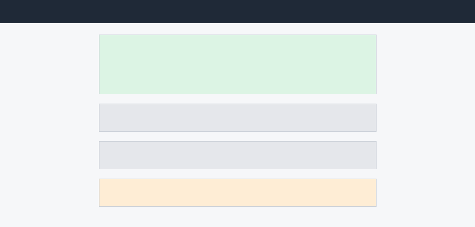
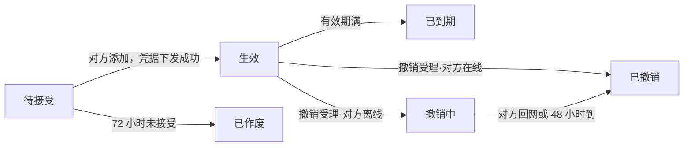

# ISSUE-206 数字车钥匙分享（钱包端）

## 1. 背景

### 1.1 现在的做法与问题

一辆车全家用是常态，但实体钥匙通常只有一两把。家人临时用车，车主要么专程送一趟钥匙，要么把钥匙提前藏在某处，这是数字车钥匙用户反馈最集中的一条。

本人使用的数字钥匙已经上线，「把钥匙给别人用」还没有打开，借车仍然绑在实体钥匙的交接上：

- 对家庭成员：人在外地或临时有事，家人就到不了车、用不了车；
- 对钱包业务：这是数字车钥匙从「本人用」走向「全家用」缺的一块，也是「借车送钥匙」类客服咨询的主要来源。

### 1.2 这次要改变什么

这次做**车钥匙分享**：车主把钥匙分享给家人或联系人，对方钱包里直接多出一把能用的钥匙，车主可以收回。

- 车主选好给谁、什么权限、多长时间就能发出分享；本工程还没有车钥匙卡片，这次一并补上（D4）。
- 对方在钱包里收到一把待接受的钥匙，接受后就能用。
- 车主可以撤销生效中的分享，也可以重新发起；还没被接受的分享能不能撤回，待裁定（D8）。

### 1.3 成功标准

| 目标 | 怎么算达到 |
|---|---|
| 分享能力上线三个月内，车钥匙用户中发起过分享的比例不低于 15% | 上线三个月内发起过分享的车钥匙用户 ÷ 车钥匙用户，由运营侧按产品需求的口径统计 |
| 「借车送钥匙」类客服咨询量下降一半 | 上线后该类咨询量相对上线前减半 |

- 发起比例衡量分享是否被用起来，咨询量下降衡量它是否真的替代了旧的借车交接方式；两个数字都由运营侧统计，钱包端以分享链路的顺畅支撑，不直接承诺。
- 钱包端上报分享发起、接受、撤销三个流程的结果，用来观察分享链路质量，随功能一同交付；分享被接受比例由车云按分享记录统计（D7），口径见第 8 章。

### 1.4 还没定的三件事

这次都不下结论，方案里依赖它们的行为不写成已定：

- 被分享人能不能把钥匙再转给第三人：倾向禁止，等安全评审（D2）；
- 撤销后对方长期不联网时要不要请车厂强制下线：还在和车厂谈（D5）；
- 还没被接受的分享能不能撤回：产品原文说车主「随时」可以撤销，车云的状态机只给出生效分享的撤销；推荐支持，但要车云补齐能力，待裁定（D8）。

## 2. 术语

### 2.1 术语表

| 术语 | 在本需求里的意思 |
|---|---|
| 车钥匙分享 | 车主把钥匙的可用性分享给家人或联系人：对方钱包里多一把能用的钥匙，车主可以撤销生效中的分享 |
| 车钥匙卡片 | 卡包里展示的车钥匙：车主本人的钥匙，以及当前账号收到并添加成功的钥匙；本次一并补上（D4） |
| 权限档位 | 分享时给对方的钥匙能力范围：全功能（解闭锁、启动、后备箱）或仅解闭锁；可选哪几档由车云按对方与车辆的关系判定，取值见 4.2 |
| 分享状态 | 一条分享当前所处的阶段：待接受、生效、已作废、已到期、撤销中、已撤销，六态互斥，真源在车云 |
| 待接受有效期 | 分享发出后对方必须在 72 小时内接受，逾期自动作废；与车主的发起草稿无关 |
| 发起草稿 | 按账号与车辆保存的未完成分享：已作的选择，发出前再加上原请求与幂等标识（D6）；保存与清除见 6.5 |
| 创建恢复 | 本地没有草稿或草稿损坏时，钱包端按当前账号和车辆向车云确认上次创建的去向：还在处理、已经建立、已经结束，或确认不了；本期由模拟车云提供 |
| 账号标识 | 当前登录账号的稳定标识，用来把草稿和请求分到账号。现有账号能力只给出打码后的展示账号，展示相同的两个账号可能不同；本期由钱包端的模拟身份提供 |
| 配额 | 同车可同时存在的分享人数上限，生效加待接受合计；取值见 4.2 |
| 宽限 | 撤销时对方离线，对方设备上的卡片收回的最长期限（48 小时，D1）；只影响卡片消失的时间，规则见 6.3 |

最容易读混的几处：

- 一条分享的成败不由钱包端裁决：关系的建立与状态真源在车云，钥匙能不能用的最终裁决在车厂云，钱包端只展示与操作；
- 推送不决定创建成功：车云返回已建立，分享就建立了；推送没送到，接受方进卡包也能补拉；
- 分享建立不等于对方已添加：建立后是待接受，对方添加且凭据下发成功才生效，这是两个时刻；
- 卡片还在不等于还能用车：撤销被车云受理后车辆侧就拒绝，撤销中只是对方卡片还没收回；
- 本地没有草稿不等于上次没发过：退出、换号、清数据或成功发出后草稿都会被删，车云那边的请求不跟着消失；
- 72 小时与 48 小时是两种计时：72 小时管待接受的分享多久没人接受就作废，48 小时管撤销后离线手机上的卡片最长多久收回。

### 2.2 六个分享状态的含义

| 状态 | 含义 | 容易误读的地方 |
|---|---|---|
| 待接受 | 车厂云已签发，分享已建立，对方还没添加 | 建立不等于对方已添加；72 小时内不添加就作废 |
| 生效 | 对方添加且凭据下发成功，钥匙能用 | —— |
| 已作废 | 待接受期内对方没有添加 | 车主没做任何操作，与撤销不同 |
| 已到期 | 分享的有效期到了 | —— |
| 撤销中 | 车云已受理撤销，对方离线，手机上的卡片还没收回 | 卡片还在，但车辆侧已拒绝这把钥匙 |
| 已撤销 | 撤销完成，对方卡片已收回 | —— |

管理列表与卡包都按车云返回的状态显示；状态之间怎样迁移、双方各能做什么见 6.3。

## 3. 范围

本需求交付钱包端的完整分享链路；车云与车厂云作为钱包调用的对端，不在本次交付范围。范围确认时需求方定为整单承载、不拆单。

| 参与方 | 在这项业务里负责什么 | 本期怎么承载 |
|---|---|---|
| 钱包端（本次交付） | 卡包车钥匙卡片（本人与收到的钥匙）与分享入口；分享设置页（给谁、权限、有效期）、创建与发起草稿保护；分享管理页（列表、状态、撤销、重新发起）；接受页、添加到钱包与钥匙卡片详情；状态展示、隐私打码、功能开关、退出登录时清理草稿。不签发凭据，不裁决钥匙可用性 | 本需求交付；卡包里的车钥匙卡片与分享入口一并补上，真车开锁、凭据签发与设备能力不在本次（D4） |
| 车云 | 分享关系的建立与唯一真源、状态维护、配额判定与对象可用权限的判定；按幂等标识防止重复建立 | 车云开放接口在工程里还不可用，六个接口按冻结契约用模拟数据承载（D3）；按接受方账号查询收到的分享、按账号与车辆做创建恢复，这两项不在六个接口里，本期同样由模拟车云提供 |
| 车厂云 | 签发钥匙凭据、下发失效指令，是钥匙能不能用的最终裁决方 | 签发与下发结果来自模拟数据（D3） |
| 消息推送 | 把待接受与失效通知送到接受方；推送失败不改变分享关系 | 推送点击进入接受页本次不接，被分享人从卡包里待添加的钥匙进入（D3） |
| 账号能力 | 登录态；未登录不允许发起或接受 | 现有能力只给打码后的展示账号，稳定账号标识由钱包端模拟身份提供：同一模拟账号重开后不变，展示相同的不同账号各不相同 |

本期还用钱包端的模拟数据承载：

- 车主本人钥匙的车辆标识、钥匙信息与统计要用的车型类别；
- 通讯录：通讯录选人这条路径用一份模拟联系人列表演示，含没有有效账号的联系人，不读设备通讯录、不申请权限。

草稿跨应用关闭保存时用系统的受保护存储（Asset）。它要求 API 12 和设备具备对应的系统能力，这是本次设计的前提，随这份方案一起审定，还没有在目标设备上验证。

本次不做：

- 车云与车厂云的实现；推送到达率的保障（由对方主动打开钱包补拉兜底）；
- 被分享人把钥匙再转给第三人（D2）、撤销后极端断网强制下线（D5）；
- 改权限：要换权限就撤销重发。

与车云的真实联调另行验收，本需求不算验过（D3）。各项能力正式开放的条件见第 9 章。

## 4. 业务方案

### 4.1 整体做法

分享关系的**真源在车云**，钥匙最终能不能开的**裁决在车厂云**，车辆只认车厂云签发的凭据。

不采用「钱包端自己判断谁是家庭成员、自己决定给哪档权限」：对象与车辆的关系由车主在车机或 App 上维护，那份关系不在端上，端上判会与车云对不齐。

一条分享要车云建立关系、车厂云签发凭据两边都成，**一成一败必须回滚**，不留「关系建了、凭据没发」的半生效状态；两朵云与推送按下面的顺序交接：

<!-- story-figure:fig-d087d97f:begin -->

<!-- story-figure:fig-d087d97f:end -->

同一个幂等标识重复请求，车云返回同一条分享，不会建出第二条；换对象怎样重查权限见 6.2。

钱包端按冻结的接口契约向车云做六件事：查配额、查对象可用的权限、创建分享、接受分享、撤销分享、查分享列表；各自在哪一页、什么时候调见第 5 章，结果怎么用落在 6.2、6.3 与第 7 章，接口名与字段见 10.1.1。

### 4.2 业务规则与数据

| 规则项 | 取值 | 适用范围 | 真源 |
|---|---|---|---|
| 同车分享上限 | 5 人 | 生效加待接受合计；满额时的发出条件见 6.2 | 车云配额判定 |
| 待接受有效期 | 72 小时 | 逾期自动作废，作废条目列表可见、可重新发起 | 车云状态机 |
| 权限档位 | 家庭成员可选全功能或仅解闭锁；其他联系人仅解闭锁 | 按对象与车辆的关系定（6.2）；本期不做改权限（4.3） | 车云关系判定 |
| 有效期 | 7 天 / 30 天 / 自定义至多 180 天 | 到期自动失效 | 车云状态机 |
| 撤销宽限 | 48 小时（D1） | 只对生效的分享；指对方离线时卡片收回的最长期限，撤销规则见 6.3；待接受的分享能否撤回待 D8 | 车云与车厂云 |
| 隐私 | 页面与记录只显示对方昵称与打码账号 | 对方账号以可识别的值交给车云，展示一律打码；完整边界见 6.6 | 钱包端在展示处打码，列表用车云返回的打码标识 |

钱包端的数据口径：

- **发起草稿**每个账号每辆车一份，整份存进系统的受保护存储（为什么见 4.3，保存与清除见 6.5，字段见 10.1.2）。
- 草稿与请求都按稳定账号标识隔离：展示相同的两个账号可能是两个人，草稿不会串过去。
- 普通存储里只放不含账号和车辆原值的索引与清理标记。
- **分享列表不做本地缓存**：钥匙类数据不落盘，每次进页从车云拉取。

### 4.3 取舍与边界

| 取舍 | 结论 | 没选的做法为什么不行 |
|---|---|---|
| 改权限怎么做 | 本期不做改权限，要换权限就撤销这条、重新分享 | 改权限需要车云与车厂云两侧联动变更，本期不引入新的契约面 |
| 撤销宽限按多久 | 48 小时，指对方设备上的卡片收回期限；车辆侧自撤销起即拒绝（D1） | 产品需求写「离线的 24 小时内失效」，系统设计与车云接口按 48 小时计；问过需求方后按卡片收回期限定案 |
| 草稿要扛到哪一层、放在哪 | 退出页面、断网、应用关闭后重开都能续办（D6）；放进系统受保护存储，每账号每车辆一份 | 只放在页面内存：应用关掉就丢；放普通键值存储：对方账号与原请求没有保护；分开存：可能只剩半份请求 |
| 发出与保存谁先谁后 | 先把原请求与幂等标识保存成功，再发出 | 先发后存：发出后应用被关，回来不知道发过什么，只能再发一条 |
| 本地没有草稿时能不能直接新建 | 先按账号与车辆向车云做创建恢复，确认上次创建的去向才开放 | 本地没有就当没发过：草稿被退出、清数据或损坏删掉后，在路上的旧请求可能晚到，再建就多出一条分享；看管理列表猜：列表只有打码对象，证明不了旧请求不会晚到 |
| 同一辆车两个入口同时发 | 同账号同车辆的「读原请求、创建恢复、保存新请求、发出或确认」排队执行，已有请求时复用它 | 只靠按钮禁用：两个入口各自读到空草稿，各发一条 |
| 被分享人的接受入口 | 本次是卡包里待添加的钥匙，推送点击进入另列依赖（D3） | 等推送接入再做接受：推送到达率本就不保证，补拉是兜底的唯一入口 |

三件上游未定的事（D2、D5、D8）不承载，依赖它们的行为只写共同要求，不写成已定。

## 5. 业务流程

车主在卡包里发出一条分享，车云与车厂云共同把它建立为待接受；接受方在卡包里找到待添加的钥匙，添加后生效；车主随后在分享管理里继续保留，或撤销生效的分享，车辆随即拒绝、对方卡片随后收回。

- [跨角色旅程](#51-跨角色旅程)：车主、两朵云与接受方怎样交接；
- [车主发起与续办](#52-车主发起与续办)：从卡包进分享设置，选人、权限、有效期并发出，中途离开后回来接着办；
- [接受方添加与查看](#53-接受方添加与查看)：在卡包找到待添加的钥匙、添加到钱包、查看钥匙；
- [车主管理、撤销与重新发起](#54-车主管理撤销与重新发起)：看分享列表、撤销生效的分享、对已结束的重新发起。

分享状态怎样变化、车主与接受方各能做什么，完整规则在 6.3。

### 5.1 跨角色旅程

车主、两朵云和接受方之间按下面的顺序交接，节点前的角色名与底色标出由谁做；所有新建都先满足 6.1、6.2 的发起条件，本地没有草稿或草稿损坏时还要先经创建恢复（7.3）：

<!-- story-figure:fig-0169f210:begin -->

<!-- story-figure:fig-0169f210:end -->

- 图里「选给谁、权限与有效期，确认发出」是一个概括节点；车主在页面上的每一步见 5.2，接受方的每一步见 5.3，车主管理与撤销见 5.4。
- 分享建立与钥匙生效是两个时刻：车云返回已建立时状态是待接受，接受方添加且凭据下发成功后才生效。
- 推送没送到不回写创建失败；本期不接推送点击进入接受页，接受方进入卡包时按当前账号补拉到待添加的钥匙。签发与下发结果来自模拟数据源（D3）。
- 待接受的分享能否由车主撤回待 D8，旅程里没有这条路。

### 5.2 车主发起与续办

车主从本人车钥匙卡片的「分享」进分享设置页，选好给谁、什么权限、多长时间并发出，分享建立后回到卡包；中途离开后回来、上次发出没得到回应时怎样接着办，都在下面的表里。

分享设置页分三段自上而下：给谁、权限、有效期，原因提示条在「发出」之上：

| 页面 | 来路/入口 | 用户操作 | 正常结果 | 异常提示与去向 |
|---|---|---|---|---|
| 卡包 | 钱包卡包 Tab | 在本人车钥匙卡片上点「分享」 | 进分享设置页 | 未登录或没有本人车钥匙：没有卡片与入口；功能开关关闭：有卡片与「分享管理」，不能发起新分享；上一个账号的草稿还没清理完：提示正在清理，清理完成前不能发起（6.1） |
| 分享设置页 | 卡包「分享」；分享管理「重新发起」 | 进入页面 | 第一次进来、上次成功后再发、退出或清数据之后：钱包端先向车云确认上次的创建，确认期间「发出」不可用，确认后空表单可选 | 上次那条已经建立：显示它与当前状态，不自动再发；车云还在处理上次那条：只能确认那一条；确认不了：这辆车暂停新发起，可以去分享管理查看、稍后重查（7.3） |
| 分享设置页 | 退出页面、断网或关掉应用后回来 | 进入页面 | 没发出过的选择回填，接着选 | 上次发出没得到回应：对象、权限、有效期按那次原样只读，「发出」用来确认那次发出；草稿读不出：提示恢复失败、可以重试；草稿损坏：说明上次可能已发出、正在确认，不提供删掉重来（7.3） |
| 分享设置页 | 同上 | 选给谁：从联系人列表选，或直接输入对方账号 | 显示昵称与打码账号，按这个对象查可用的权限档位 | 取消选择、联系人列表不可用或这位联系人没有有效账号：停在原对象上说明原因，可以改为手输账号 |
| 分享设置页 | 同上 | 选给谁，对方不可分享（例如没开通车钥匙） | —— | 权限区不呈现档位并给原因，请换一个人 |
| 分享设置页 | 同上 | 选权限 | 按车云返回的档位原样呈现，选中一项 | 换了对象后原档位对新对象不可用：请车主重选，不静默降级；选项为空或看不懂：提示重新获取 |
| 分享设置页 | 同上 | 选有效期：7 天、30 天或自定义（至多 180 天） | 记下选择 | 自定义有效期照做；日期用什么控件材料没有给，待产品补交互 |
| 分享设置页 | 同上，三项选齐 | 点「发出」 | 车云建立分享，回到卡包（维护设计细化，依据 Plan 的页面导航）；对方收到待接受的钥匙 | 三项没选齐：「发出」不可点；请求中或这辆车已有一份请求在处理：「发出」不可点 |
| 分享设置页 | 同上，新建时配额已满 | 看「发出」 | —— | 「发出」置灰，显示配额接口给的原因；上次发出没得到回应时，确认那次发出不受这条限制（6.2） |
| 分享设置页 | 同上 | 点「发出」，发出前保存失败 | —— | 留在本页提示保存失败，不发送（6.5、7.4） |
| 分享设置页 | 同上 | 点「发出」，车厂云签发失败 | —— | 留在本页提示可以再发 |
| 分享设置页 | 同上 | 点「发出」，没得到回应 | —— | 提示结果待确认；下次进来三项只读，先确认那次发出（7.2） |
| 分享设置页 | 上次发出没得到回应，回来后 | 点「发出」确认那次发出 | 车云返回已建立：同发出成功，回到卡包 | 车云明确拒绝（含满额）：留在本页显示原因，那次请求清掉后可以重新编辑再发；仍没得到回应：保持结果待确认，下次再确认 |
| 分享设置页 | 同一辆车的另一个入口 | 同时点「发出」 | —— | 只形成一份请求，这一处提示进行中 |
| 卡包 | 退出登录或切换账号之后 | 看车钥匙卡片 | 新账号看不到旧账号的草稿 | 旧账号的草稿清理没完成：分享入口暂不可用（7.4） |

- 从分享管理点「重新发起」进来的，走的是同一张设置页与同样的发出结果（5.4）。

### 5.3 接受方添加与查看

接受方从卡包里待添加的钥匙进接受页，添加到钱包后回到卡包，钥匙变成可用的钥匙卡片；推送点击进入接受页本期不接（D3）。

| 页面 | 来路/入口 | 用户操作 | 正常结果 | 异常提示与去向 |
|---|---|---|---|---|
| 卡包 | 钱包卡包 Tab | 进入卡包 | 按当前账号取回收到的分享：待接受的显示为待添加，生效的显示为可用的钥匙卡片，撤销中的卡片保留到收回完成；换账号不带出上一个账号的钥匙 | 断网：网络失败态，不展示陈旧的钥匙列表；已作废、已到期、已撤销的不显示（6.3） |
| 卡包 | 同上 | 点待添加的钥匙 | 进接受页 | —— |

接受页是一张车辆信息卡，只有一个主动作：

| 页面 | 来路/入口 | 用户操作 | 正常结果 | 异常提示与去向 |
|---|---|---|---|---|
| 接受页 | 卡包里待添加的钥匙 | 看车型、车主昵称、权限范围与有效期，点「添加到钱包」 | 凭据下发成功，回到卡包，待添加项变成可用的钥匙卡片 | 页面没有「拒绝」：不想要就离开，72 小时后自动作废，待添加项移除 |
| 接受页 | 同上 | 点「添加到钱包」，凭据下发失败、仍是待接受 | —— | 留在本页提示可以重试，重试不产生新分享 |
| 接受页 | 同上 | 点「添加到钱包」，其他失败或没得到回应 | 钱包端重新取这条分享 | 仍是待接受：留在本页可以再点；已生效：回卡包显示钥匙卡片；撤销中：回卡包，卡片保留到收回完成 |
| 接受页 | 同上，重新取到已作废、已撤销、已到期，或当前账号下取不到这条 | —— | —— | 提示已不可用，回到卡包，这一项移除 |
| 接受页 | 同上，重新取这条也失败 | —— | —— | 显示结果待确认，不让再点添加，可以稍后再看 |

添加成功后，收到的钥匙卡片详情里能看到权限范围和有效期：

| 页面 | 来路/入口 | 用户操作 | 正常结果 | 异常提示与去向 |
|---|---|---|---|---|
| 钥匙卡片详情 | 卡包里收到的钥匙卡片 | 查看 | 显示权限范围与有效期，权限之外的功能不出现 | 已撤销、已到期或找不到：提示这把钥匙已不可用，回到卡包 |

- 车主点自己的钥匙卡片进的是同一个详情页，看的是本人钥匙，没有权限范围与有效期，规则见 6.4。

### 5.4 车主管理、撤销与重新发起

车主从本人车钥匙卡片的「分享管理」进管理页，查看这辆车的分享，撤销生效的一条，或对已结束的重新发起。

分享管理页顶部是车辆与剩余可分享数，下方逐条列出分享：

| 页面 | 来路/入口 | 用户操作 | 正常结果 | 异常提示与去向 |
|---|---|---|---|---|
| 卡包 | 钱包卡包 Tab | 在本人车钥匙卡片上点「分享管理」 | 进分享管理页 | 未登录或没有本人车钥匙：没有这一入口 |
| 分享管理页 | 卡包「分享管理」 | 进入页面 | 每次进页从车云拉取：顶部车辆与剩余可分享数，下方每条显示对象（打码）、权限、有效期与状态 | 断网：网络失败态，不展示陈旧列表 |
| 分享管理页 | 同上，某条生效 | 点「撤销」 | 车云受理后：对方在线，这条显示已撤销；对方离线，显示撤销中（6.3） | —— |
| 分享管理页 | 同上 | 点「撤销」，车云返回失败 | —— | 重新拉列表，按车云返回的状态显示；仍是生效才再提供撤销，不因这次失败写回生效（7.2） |
| 分享管理页 | 同上 | 点「撤销」，没得到回应 | —— | 车云可能已经受理：同样重新拉列表，按真实状态显示（7.2） |
| 分享管理页 | 同上，某条已作废或已到期 | 点「重新发起」 | 进分享设置页新建一条，配额照常计算（5.2） | —— |
| 分享管理页 | 同上，某条待接受、撤销中或已撤销 | 看这一条 | 只展示状态，不提供撤销 | 待接受能否撤回待 D8 |

撤销这一件事同时改变三样东西：车云里的分享状态、车辆还认不认这把钥匙、接受方手机上的卡片。三者在撤销受理、对方回网和 48 小时期限上有先后：撤销中卡片还在，车辆却已经拒绝。

<!-- story-reading:car-key-revocation-responsibility:begin -->
<!-- story-reading:car-key-revocation-responsibility:end -->

## 6. 功能说明

钱包端在分享里提供六项能力：身份与入口、设置与发出条件、分享状态与双方可用动作、钥匙身份与权限展示、草稿保存与生命周期、隐私与安全展示。用户在页面上怎样走见第 5 章；这里写每项能力成立的条件与规则。

### 6.1 身份与入口

入口在卡包里的车钥匙卡片上：「分享」进分享设置页，「分享管理」进管理页。本工程还没有车钥匙卡片，这次一并补上，车主本人的钥匙与接受成功的钥匙都在卡包展示（D4）。

| 条件 | 不满足时 |
|---|---|
| 已登录，且有本人车钥匙 | 卡包里没有本人钥匙卡片与「分享」「分享管理」入口 |
| 分享功能开关开启 | 有卡片与「分享管理」，不能发起新分享；已生效的分享照常 |
| 上一个账号的草稿已清理完 | 有卡片与入口，提示正在清理，清理完成前不能发起 |
| 本地没有草稿或草稿损坏时，创建恢复允许新建 | 按 7.3 处理 |

- 入口与发起都认当前登录身份与这次登录；冷启动后还没登录时草稿怎样处理见 6.5。

### 6.2 设置与发出条件

| 条件 | 不满足时 |
|---|---|
| 选中的联系人有有效账号 | 取消选择、联系人列表不可用或联系人缺账号时，停在原对象上说明原因，不查权限；可以改为手输账号 |
| 对象可分享，且已选档位对这个对象可用 | 对象不可分享时权限区不呈现档位并给原因、请换人；换对象后原档位不可用时请车主重选，不静默降级；选项为空或看不懂时提示重新获取，不猜更大的权限 |
| 对象、权限、有效期三项选齐 | 「发出」不可点 |
| 配额未满（新建时；进设置页时向车云查一次） | 「发出」置灰，显示配额接口给的原因 |
| 同一辆车没有另一个入口正在发 | 提示进行中；同账号同车辆排队执行，已有请求时复用它，不同车辆互不影响 |

- 给谁：联系人本期是一份模拟列表，含没有有效账号的联系人；也可以直接输入对方账号。显示昵称与打码账号。
- 权限：选定对象后查这个对象在这辆车上可用的档位，按车云返回的选项原样呈现，选中的那一项原样交回车云；换对象时上一个对象的选择作废，跟着重新确定。
- 有效期：7 天、30 天或自定义，至多 180 天。
- 发出：请求中、保存中或这辆车已有一份请求在处理时不可点。确认上次结果未知的发出不受端侧满额拦截，满额由车云对这次请求判定：最后一个名额可能正是这次请求占的，按端侧查到的「已满」挡住就再也拿不回它；没发出过或上次被明确拒绝的草稿不绕过配额。

### 6.3 分享状态与双方可用动作

一条分享只在六个互斥状态之间迁移；撤销被受理时对方在线直接到已撤销，离线先进撤销中：

<!-- story-figure:fig-b533fea2:begin -->

<!-- story-figure:fig-b533fea2:end -->

- 已作废、已到期、已撤销是终态，不再迁出；要再用就重新发起一条新的分享。
- 撤销中只表示对方卡片的收回还没完成，不能据此认为车辆还能用：车辆侧的拒绝以撤销受理为起点，不等宽限结束。
- 72 小时未接受作废、有效期满到期都由车云计时自动发生。
- 待接受能不能直接撤回，图里没有这条边：车云的状态机只给出生效分享的撤销，是否补上待 D8。

车主的管理页和接受方的卡包读的是同一份车云状态，但各自展示、各自能做的事不同：

| 车云状态或读取结果 | 车主的分享管理页 | 接受方的卡包与接受页 |
|---|---|---|
| 待接受 | 显示待接受；能否撤回待 D8，裁定前只展示 | 显示待添加，可以添加到钱包 |
| 生效 | 显示生效，可以撤销 | 可用的钥匙卡片，详情显示权限范围与有效期 |
| 撤销中 | 显示撤销中，不再提供撤销 | 卡片保留到收回完成，不能再添加；车辆侧已经拒绝 |
| 已撤销 | 显示已撤销，只展示 | 从卡包移除 |
| 已作废 | 仍在列表里显示已作废，可以重新发起 | 从卡包移除 |
| 已到期 | 仍在列表里显示已到期，可以重新发起 | 从卡包移除 |
| 明确不存在：当前账号下取不到这条 | —— | 按已不可用移除 |
| 查询失败 | 网络失败态，不展示陈旧列表 | 网络失败态，不展示陈旧的钥匙列表；添加后重取失败时显示结果待确认，不让再点添加 |

- 进入卡包时的初次读取和添加失败后的重取，共用这一张表。
- 添加时只有凭据下发失败且仍是待接受，能确定保持待接受、可以重试；其他失败与没得到回应都重取这条分享，按上表显示（为什么见 7.2）。
- 明确不存在只针对这一条分享，不能推导车主本人的钥匙也不存在（6.4）。
- 只有生效的分享能撤销。待接受的分享在 D8 有结论前只展示状态：误发的分享要么等对方接受后撤销，要么等 72 小时作废。
- 撤销被车云受理后，车辆侧从那一刻起拒绝这把钥匙；对方在线时卡片立即移除，离线时卡片在对方回网时收回，最长不超过 48 小时（D1）。
- 撤销失败或没得到回应时，以重新拉到的状态为准，不因这次失败写回生效（为什么见 7.2）。
- 重新发起是新建一条，占用配额照常计算，按 6.1、6.2 的条件走。
- 列表里生效、过程中（待接受、撤销中）与已结束（已撤销、已作废、已到期）三类在样式上可区分；列表与配额每次进页从车云按车辆拉取，不在本地缓存。

### 6.4 钥匙身份与权限展示

- 收到的钥匙按分享标识取数，车主本人的钥匙按车辆标识取数；本人钥匙不是一条分享，不借用分享标识。
- 收到的钥匙：接受页先讲清是谁分享的、能用到什么时候，再给添加按钮；接受页与卡片详情写车型、车主昵称、权限范围、有效期到哪天；权限范围写人话，如「能开门、能开走」，不写档位代号，和车主选的那一项是同一个意思；权限之外的功能不出现在操作面上，而不是置灰。接受页不设「拒绝」按钮。
- 本人钥匙：进同一个详情页，看车型与车辆，以及「分享」「分享管理」入口，没有权限范围与有效期这两项；已不在当前账号下时提示已不可用并回到卡包。材料只给了收到的钥匙那一种的图，本人钥匙那一种沿用同页样式。
- 进入详情时取这把钥匙的当前状态；已撤销、已到期或找不到时提示已不可用。
- 深色主题与大字体下，车辆信息与主按钮保持可读可点。

### 6.5 草稿保存与生命周期

发起途中草稿怎样保存和清除：

| 什么时候 | 本地做什么 | 对端与依据 | 失败时 |
|---|---|---|---|
| 完成一项选择：对象、权限或有效期 | 按账号与车辆把选择存进受保护存储 | —— | 停在本页提示保存失败（7.4） |
| 点发出 | 先把原请求与新幂等标识写进同一份草稿 | 写入成功才发出创建 | 停在本页提示，不发送 |
| 创建没得到回应 | 原请求与幂等标识留着，三项只读 | 回来或再点时用同一请求确认；车云对同一标识返回同一条分享，没收到过就当作第一次 | 不换新标识重发 |
| 车云返回已建立 | 删除这辆车的草稿 | —— | 删除失败：显示已建立并待清理（7.4） |
| 车云明确拒绝，含满额与签发失败 | 先持久清掉原请求与幂等标识，才开放编辑 | 再发是一次新的请求，满额照常判定 | —— |
| 主动退出或切换账号 | 先记下旧账号的草稿不可恢复、隔离旧页面与在途请求，再删除旧账号全部车辆的草稿 | 车云那边的请求不跟着撤销 | 删除失败照样退出，清理完成前不能发起（7.4） |
| 清除应用数据后首次启动 | 初始化标记缺失时先按功能标签清理遗留草稿，再开放 | —— | 提示初始化失败（7.4） |
| 冷启动后还没登录 | 不回填、不发送，也不清草稿 | —— | 同一账号登录后接着办 |

- 先存后发的理由见 4.3。
- 草稿按账号与车辆各存一份：从另一辆车进来看不到这辆车的草稿，也不把它当成这辆车的请求。
- 读到什么草稿、本地没有或读坏了怎样恢复，见 7.3。

### 6.6 隐私与安全展示

- 页面与记录只显示对方昵称与打码后的账号，不出现完整账号或手机号；打码在组装展示内容处做，管理列表直接用车云返回的打码标识。
- 查权限与创建分享时把可识别的对方账号标识交给车云，打码值不承担业务身份；两个打码后相同的账号仍要能区分。
- 草稿里的对方账号只用于续办请求，不出现在页面、日志与事件里。
- 发起、接受、撤销三个流程的事件只带车型类别、阶段与结果分类，不带车牌、账号、位置；车型类别取模拟数据给出的分类，没有就记未知，不按车型名称猜；失败说明按错误码换成安全的说法，不把车云返回的原文、账号或车牌带进事件与日志。

## 7. 异常与恢复

### 7.1 设计内的受限条件

下面这些是需求设计成的受限结果，不是执行失败；条件与责任在各自的主落点，用户看到的反馈在第 5 章：

- 配额已满、联系人选不成、权限档位不可用或对象不可分享：发出条件见 6.2，配额与可用权限由车云判定、钱包端展示，联系人由钱包端处理；页面见 5.2。
- 待接受逾期作废、撤销时对方离线、对非生效条目撤销：状态与撤销规则见 6.3，计时与撤销受理在车云，失效下发在车厂云；页面见 5.4。
- 功能开关关闭：只管能不能发起，见 6.1。
- 确认不了上次的创建：这辆车暂停新发起，见 7.3。

### 7.2 远端失败与结果未知

| 情形 | 触发与依据 | 钱包端怎么做 | 责任 |
|---|---|---|---|
| 车厂云签发失败 | 车云明确返回建立失败，已当场回滚 | 提示可以再发；清掉原请求与幂等标识后开放编辑，再发换新的幂等标识 | 车云回滚，钱包端提示 |
| 接受时凭据下发失败 | 回包为凭据下发失败且仍是待接受 | 保持待接受、可以重试，不产生新分享 | 车云、车厂云 |
| 接受的其他失败 | 其他错误不保证状态未变：对方可能在接受页停了超过 72 小时、分享已经作废，也可能已在另一台设备上接受，甚至接受后车主马上撤销、此刻是撤销中 | 重取这条分享，按 6.3 的表显示；已作废、已被接受的不会显示成待接受 | 钱包端重取 |
| 撤销失败 | 车云返回失败；车云可能已经受理，也可能这条早已不是生效，例如在旧的管理页上撤销一条其实已经到期的分享 | 重新拉列表按车云状态显示；已到期、已撤销的不会因为这次失败显示成生效 | 钱包端重拉 |
| 创建、接受或撤销没得到回应 | 请求可能已被车云受理 | 不按失败也不按成功下结论：创建用同一幂等标识确认（6.5），接受重取这条分享，撤销重新拉列表；按车云状态显示后才决定能不能再点 | 钱包端 |
| 推送失败 | 推送没送到接受方 | 不改变分享关系；接受方进入卡包时按当前账号补拉待接受的钥匙 | 推送；推送到达率不作为验收项，补拉要验 |
| 打开已不可用的钥匙 | 进入详情时取到已撤销、已到期或找不到 | 提示这把钥匙已不可用，回到卡包 | 钱包端 |

### 7.3 发起中断与权威恢复

回到设置页时，先取当前登录身份，再按账号与车辆读草稿；读到什么决定能做什么，本地没有或读坏了就先向车云做创建恢复：

| 读到的草稿或创建恢复结果 | 依据的事实 | 允许做什么 |
|---|---|---|
| 有选择，没有原请求 | 上次没有发出过 | 恢复选择，重新查配额与权限后发出；不绕过配额 |
| 有原请求与幂等标识 | 上次发出没得到回应，请求可能已在车云建成，也可能没到 | 三项只读，用同一请求确认 |
| 读不出：不可访问或服务失败 | 存储暂时打不开 | 提示恢复失败、可重试；不当成没有草稿，不自动换新标识重发 |
| 明确不存在：首次进入、成功发出清稿后再次发起、退出换号或清数据之后 | 只说明这台设备上没有记录 | 先做创建恢复，按下面四种结果 |
| 内容损坏 | 原请求与幂等标识可能都丢了 | 隔离损坏原件、不复制进日志，再做创建恢复；不提供删除后重建 |
| 创建恢复：pending | 车云仍有这个账号这辆车未结束的创建，返回原请求与幂等标识 | 原请求受保护保存成功后，只确认那一条；保存失败保持受限 |
| 创建恢复：established | 车云明确对应此前那次创建的分享与当前状态 | 显示已建立与当前状态，清掉本地旧草稿，不自动再发；之后有新的分享意图按正常新建 |
| 创建恢复：clear | 原创建都已结束或作废，旧请求迟到也建不出新分享 | 清掉旧草稿成功后开放空表单；清除失败保持受限 |
| 创建恢复：unknown 或查询失败 | 证明不了终态、对不上当前账号车辆、数据不完整，或多条可能相关而不能唯一对应 | 这辆车暂停新发起，管理页照常可看、可重查 |

- 本地没有可用草稿时先问车云，不按管理列表为空推断 clear（理由见 4.3）。
- clear 包含迟到请求：车云只在确认旧请求已结束、或它迟到也建不出分享时才回答 clear；受理新的创建时车云再核一次未决请求，页面检查之后的变化绕不过这条约束。
- 草稿、请求与创建恢复都认当前账号与这次登录：退出或换账号后才到的旧回调只记下结果，不改新账号的页面，也不把已经删掉的草稿写回来。
- 创建恢复本期由模拟车云提供，车云六个接口里没有它，真实接入时要车云补上同等能力（第 9 章）。

### 7.4 环境异常与清理失败

| 情形 | 触发与依据 | 钱包端怎么做 | 责任 |
|---|---|---|---|
| 草稿保存失败 | 受保护存储写入失败或超过存储上限 | 停在本页提示；发出前那一次保存失败就不发送，不截断、不改存普通存储 | 钱包端 |
| 草稿读不出或损坏 | 受保护存储暂时打不开、服务出错，或内容无法解析、绑定的账号车辆与当前不一致 | 按 7.3 的读取与恢复表处理；都不当成没有草稿、不换新标识重发，损坏也不靠退出或清数据解除 | 钱包端、车云 |
| 建立后草稿没删掉 | 删除草稿失败 | 显示已建立、待清理；只能确认同一请求或重试清理，不把旧草稿当新请求；下次进入时重试删除 | 钱包端 |
| 同一辆车两个入口同时发出 | 两个入口读到同一份草稿 | 只有一份请求，另一个入口提示进行中；同账号同车辆排队处理，不同车辆互不影响 | 钱包端 |
| 断网进入管理页或卡包 | 拉不到列表 | 网络失败态，不展示陈旧列表；分享列表不落地缓存 | 钱包端 |
| 账号切换或退出登录 | 主动退出或账号变化 | 先记下旧账号不可恢复再删除草稿，旧回调不写新页面；列表与收到的钥匙按新账号获取；删除失败照样退出，分享在清理完成前不可用；连「不可恢复」的标记都写不进时先重试清理，不开放下一个分享会话；同一账号再登录后，每辆车第一次进设置页先做创建恢复 | 钱包端 |
| 清除应用数据 | 本地数据被清除 | 先清理系统存储里遗留的草稿再开放，回到未选状态；每辆车第一次发起前先做创建恢复；清理失败时提示初始化失败 | 钱包端 |
| 重复点发出 | 请求还在进行中 | 请求中不可再点，幂等标识收敛，只会有一条分享 | 钱包端、车云 |

冷启动后还没登录、换一辆车发起属于草稿的正常生命周期，见 6.5。

## 8. 验收

按要验的事分组，每条原始验收编号独立一行；主责指由谁验，产品验收看端侧行为，接口联调验收看端云对账。

| 分组 | 编号 | 验收点 | 可观察的通过条件 | 主责 |
|---|---|---|---|---|
| 发起分享 | AC-K1 | 发起分享 | 车主在卡包里的车钥匙卡片上点分享，对象、权限、有效期三项都不选齐前「发出」不可点；三项选齐后发出，对方收到待接受的钥匙 | 产品 |
| 发起分享 | AC-K4 | 配额 | 生效加待接受合计到 5 人后不能再发起，能看到原因 | 产品 |
| 发起分享 | AC-K6 | 中断续办 | 发起途中退出页面、断网或关掉应用再打开，回来接着办，同一幂等标识，不会发出第二条（D6） | 产品 |
| 发起分享 | AC-K11 | 权限随对象定 | 选家庭成员时全功能可选；换成其他联系人后全功能不再可选，已选的全功能请车主重选；换回家庭成员又可选 | 产品 |
| 接受生效 | AC-K2 | 接受生效 | 对方接受后钥匙可用，权限与车主所选一致，钥匙作为车钥匙卡片出现在对方卡包 | 产品 |
| 生命周期 | AC-K3 | 逾期作废 | 分享发出后 72 小时未接受，自动作废；作废条目在列表可见，可重新发起 | 产品 |
| 生命周期 | AC-K5 | 撤销 | 对方在线撤销立即失效；离线的进入撤销中，对方设备上的卡片最长 48 小时内收回（D1），撤销起车辆侧就不认这把钥匙 | 产品 |
| 状态与隐私 | AC-K7 | 状态一致 | 管理列表状态与实际一致：待接受、生效、已作废、已到期、撤销中、已撤销 | 产品 |
| 状态与隐私 | AC-K8 | 隐私 | 全程页面与记录不出现对方完整账号或手机号，只显示昵称与打码账号 | 产品 |
| 入口与开关 | AC-K9 | 入口门槛 | 未登录或没有车钥匙的用户看不到分享入口 | 产品 |
| 入口与开关 | AC-K10 | 功能开关 | 开关关闭后不能发起新分享，已生效的分享不受影响 | 产品 |

撤销宽限的验收口径：产品需求写 24 小时，系统设计与车云接口按 48 小时计；问过需求方后按 48 小时卡片收回期限验收，车辆侧自撤销起即拒绝这把钥匙（D1）。

本次另验这几件产品需求没有编号的事：

| 要验的事 | 可观察的通过条件 |
|---|---|
| 卡包车钥匙卡片与入口 | 卡包里有本人钥匙卡片与分享、分享管理入口（D4）；本人钥匙与收到的钥匙各自进详情 |
| 草稿在四个中断时点 | 保存选择后、原请求存好还没发、已发还没回包、已建立还没删草稿，四个时点关掉应用回来，各自按 6.5 的保存表与 7.3 的恢复表恢复，不出现第二条分享 |
| 草稿读写失败 | 原请求存不进去时不发送；读不出或损坏时不当成没有草稿、不换新标识重发；超过存储上限时提示保存失败；原请求已发出时草稿损坏，按创建恢复处理，不提供删除后重建 |
| 首次进入也先做创建恢复 | 这辆车本地从没有过草稿，或上次成功发出后草稿已清，进设置页时先做创建恢复：clear 才开放空表单，pending 只确认原请求，unknown 或查询失败时这辆车暂停新发起、管理页照常可看（Spec AC-43） |
| 退出或清数据后再发起 | 原请求已发出、草稿损坏、退出并清掉本地后同一账号再登录：车云还在处理就只确认原请求；已建成就显示那条；确认已结束才能重新填，旧请求晚到也不出第二条；确认不了保持受限。完整草稿续办、取消或换对象、另一辆车与另一个账号都照原样工作（Spec AC-41、AC-42） |
| 结果未知时确认 | 创建、接受、撤销没得到回应时按车云状态确认、不重复执行，含满额时确认最后一个名额是不是这次请求占的 |
| 接受与撤销失败不复活旧状态 | 在接受页停留超过 72 小时后再点添加、另一台设备已接受后再点添加、在旧管理页撤销一条已到期的分享：都显示重新取到的状态 |
| 同车两个入口 | 同账号同一辆车两个入口同时发出，只形成一份请求；两辆车各自发出互不影响 |
| 账号隔离 | 展示账号相同的两个模拟账号草稿互不可见；退出登录后旧请求的回调才到，不写新账号的页面、不重建草稿；冷启动未登录不清草稿，同一账号登录后能接着办 |
| 联系人与权限 | 取消选择或联系人缺账号时不查权限；换对象后上一个对象的权限作废；权限选项为空时提示重新获取 |
| 被分享人的钥匙 | 推送没到时在卡包补拉到待添加的钥匙、接受后变成钥匙卡片、撤销中保留到收回完成、已结束的移除 |
| 撤销范围 | 只有生效的分享显示撤销；待接受的撤回待 D8，裁定前不验 |

车云开放接口在工程里还不可用，以上结论只到本地模拟（D3）；草稿保护按本次设计前提验，没有在目标设备上验证；与车云的真实联调、推送点击进入接受页另行验收。

上线后观察两类指标。成功标准由运营侧统计：

| 指标 | 怎么算 | 谁来统计 |
|---|---|---|
| 发起分享比例 | 三个月内发起过分享的车钥匙用户 ÷ 全部车钥匙用户，目标不低于 15% | 运营侧 |
| 「借车送钥匙」客服咨询量 | 上线后相对上线前下降一半 | 运营侧 |

流程指标不作为验收判据：

| 指标 | 怎么算 | 谁来统计 |
|---|---|---|
| 分享发起成功率 | 车主确认发出后分享建立起来的尝试 ÷ 全部发出尝试 | 钱包端上报 |
| 分享接受成功率 | 点「添加到钱包」后钥匙生效的尝试 ÷ 全部添加尝试 | 钱包端上报 |
| 分享撤销成功率 | 撤销被车云受理的尝试 ÷ 全部撤销尝试 | 钱包端上报 |
| 分享被接受比例 | 按创建时间把分享分成批次；一个批次里每条分享的接受期限都结束后再算：曾被接受的分享 ÷ 这个批次成功创建的分享。接受后又被撤销的仍算曾被接受；还没到完整观察期的批次单列为未结算，不进比例 | 车云按分享记录统计（D7） |

- 分享被接受比例的批次口径是维护设计对需求方答复的深化：需求方只定了「按车云的分享记录统计」，批次怎么划、撤销与未结算怎么算是这里补的。
- 推送到达率不作为本需求的验收项。

## 9. 交付与上线

本次交付停在本地模拟验证的钱包端。车云接口就绪后按系统设计的顺序联调：先创建与接受两条链路，再撤销与失效；观察三个流程的失败分类后放开分享功能开关。开关只决定能不能发起新分享，各项能力是否正式开放还按自己的条件判断：

| 能力 | 本期怎么承载 | 正式开放还要什么 | 谁负责 | 缺了怎样 |
|---|---|---|---|---|
| 卡包车钥匙卡片与分享入口 | 本次补上（D4）；本人钥匙的车辆标识、钥匙信息与车型类别来自模拟数据（D3） | 车钥匙本人能力给出真实来源 | 车钥匙本人能力 | 卡片与分享用的车辆标识只能来自模拟数据 |
| 发起新分享：凡要先做创建恢复的新建 | 模拟车云的创建接口与创建恢复（D3） | 创建链路联调；车云提供按账号与车辆回查创建、并终结迟到请求的等价能力；稳定账号标识；在目标设备核实受保护存储与系统版本 | 车云、账号能力、钱包端 | 首次进入、成功发出清稿后再次发起、退出换号或清数据之后、草稿损坏，这些新建都不能正式开放 |
| 带原请求的续办确认 | 模拟车云按幂等标识返回同一条分享 | 创建链路联调；目标设备核实受保护存储 | 车云、钱包端 | 草稿存不进去时不发送 |
| 通讯录选人 | 模拟联系人列表，不读设备通讯录 | 接入系统联系人，按需申请权限 | 钱包端 | 只能手输账号或从模拟列表选 |
| 接受：卡包补拉与添加到钱包 | 模拟收到的分享与接受结果（D3） | 车云提供按接受方账号查询的接口；接受链路联调 | 车云、车厂云 | 被分享人看不到收到的分享 |
| 推送点击进入接受页 | 本次不接（D3） | 推送通道接入 | 消息推送 | 只能从卡包进入接受页 |
| 撤销与失效 | 模拟撤销结果与收回期限（D3） | 撤销接口与车厂云失效下发联调，排在创建与接受之后 | 车云、车厂云 | —— |
| 分享管理列表与配额 | 模拟列表与配额（D3） | 查列表、查配额接口联调 | 车云 | —— |
| 待接受分享的撤回 | 不提供（D8） | D8 有结论，且车云补齐能力 | 产品、车云 | 管理页只展示待接受的分享 |
| 分享被接受比例 | 不在本次交付（D7） | 车云按分享记录统计 | 车云 | —— |

- 车云开放接口在本工程内不可用，接口契约已冻结；交付与验收分开写本地模拟验证与车云联调两种结论，后者本需求不算验过（D3）。
- 分享功能开关默认关闭，随版本放开；关闭后已生效的分享不受影响，接受、撤销、到期照常。材料没有约定分批放量。
- 端侧版本回退后没有分享入口；已产生的分享关系由车云维护，不随端侧回退撤销。撤销是终态动作，不会因为关开关或回退版本而恢复。

### 9.1 交付物

| 交付物 | 给谁 | 做什么用 | 什么时候要 |
|---|---|---|---|
| 卡包车钥匙卡片与分享入口 | 车主、被分享人 | 展示本人与收到的钥匙，进入分享 | 首次发布分享能力时 |
| 分享设置页、草稿保护与创建恢复 | 车主 | 发起新分享、中断后接着办 | 首次发布分享能力时 |
| 分享管理页 | 车主 | 查看每条分享状态、撤销生效的分享 | 首次发布分享能力时 |
| 接受页、卡包里待接受与已接受的钥匙、钥匙卡片详情 | 被分享人 | 补拉待接受的钥匙、添加到钱包、查看权限与有效期 | 首次发布分享能力时 |
| 发起、接受、撤销三个流程的事件埋点 | 运营、端侧质量观察 | 观察分享链路质量与失败分类 | 与功能一同交付 |
| 待翻译字符串清单 | 翻译、端侧 | 新增中英文文案的翻译跟踪与回稿合入 | 编码新增文案时同步，提交测试前完成首版 |

## 10. 附录

接口、数据、配置、统计点与规约判断的精确名称在这里，正文用中文名。

### 10.1 技术契约

#### 10.1.1 端云接口

<!-- story-build:begin 技术契约·端云接口 · 由spec 「宿主扩展治理项 › 技术契约 › 端云接口」生成，改它请改真源 · sha256:acd08676ca58e511 -->
| 接口 | 性质 | 输入 → 输出 | 错误码 |
|---|---|---|---|
| `queryKeySharingQuota` | 新增 | vehicleId → canShare、remaining、reason（可空，满额时给原因）、shares（每项 shareId、status） | 车云错误码与可读信息，不新增 |
| `queryGranteePermission` | 新增 | vehicleId、granteeId（可识别的对方账号标识）→ shareable、permissionLevels（可读选项，不可分享时为空列表）、reason（可空） | 同上 |
| `createKeySharing` | 新增 | vehicleId、granteeId、permissionLevel、validUntil、idempotencyKey → shareId、status（固定 pending）；同一幂等标识重复请求返回同一条，签发失败返回失败且不留关系 | 同上 |
| `acceptKeySharing` | 新增 | shareId → credentialStatus（issued / failed）、status（active / pending）；`failed` 且 `pending` 为凭据下发失败，保持待接受 | 同上；其他错误不保证状态未变，按重取结果处理 |
| `revokeKeySharing` | 新增 | shareId → status（revoked / revoking）、graceHours（可空，revoking 时给出宽限小时数，D1） | 同上；失败按重拉列表的状态处理 |
| `queryKeySharingList` | 新增 | vehicleId → items（每项 shareId、status、permissionLevel、validUntil、granteeMasked） | 同上 |

| 能力 | 本期字段 | 缺失或不可用时 | 真实接入依赖 |
|---|---|---|---|
| 当前账号身份 | `accountKey`（不透明，模拟账号重开后相同，展示相同的不同账号不同）；登录、主动退出、切换账号事件 | 取不到时按未登录处理，不发起、不恢复草稿 | 账号能力提供稳定账号标识 |
| 联系人 | 联系人名、可识别账号；账号可能缺失 | 取消、不可用或缺账号时不发权限查询 | 真实系统联系人接入，按需申请权限 |
| 本人钥匙 | `vehicleId`、`modelName`、`modelCategory`（可空） | 类别缺失按未知，不从车型名称猜 | 车钥匙本人能力 |
| 收到的分享 | `shareId`、`vehicleId`、`modelName`、`modelCategory`（可空）、车主昵称、`permissionLevel`（与 `permissionLevels` 同一语义）、`validUntil`、`status`、撤销中时的收回期限 | 查询失败给网络失败态，不展示陈旧列表 | 车云按接受方账号查询的接口 |
| 模拟车云的幂等记录 | 按幂等标识保存已建立的分享，独立于钱包进程重建保留 | —— | 真实车云自带；这是模拟对端的状态，不是钱包端缓存 |
| 创建恢复 | 输入当前登录会话与 `vehicleId`；结果 pending（带原请求与幂等标识）、established（带 shareId 与当前状态）、clear、unknown；模拟车云按账号与车辆记录未终结的创建，独立于钱包进程保留，受理新的创建时再核一次 | 查询失败、数据不完整、对应不上当前账号车辆，或多条可能相关而不能唯一对应，都按 unknown，不当 clear | 车云按账号与车辆回查创建并终结迟到请求的等价能力；缺这项时，本地无草稿或草稿损坏的新建都不能正式开放 |
<!-- story-build:end -->

六个接口都由钱包端调用车云开放接口 2.1，主叙事里的「查配额、查对象可用的权限、创建分享、接受分享、撤销分享、查分享列表」依次对应第一张表的六行；第二张表是不在这六个接口里、本期由模拟数据提供的能力（D3）。

#### 10.1.2 数据存储

<!-- story-build:begin 技术契约·数据存储 · 由spec 「宿主扩展治理项 › 技术契约 › 数据存储」生成，改它请改真源 · sha256:f9d815030072c528 -->
| 键名/表名 | 介质 | 值结构 | 有效期 | 用途 |
|---|---|---|---|---|
| `key_sharing_draft` | 系统 Asset，每账号每车辆一条（D6） | SECRET：`{ accountKey, vehicleId, granteeId, granteeDisplay, permissionLevel, validUntil, request, idempotencyKey }`，UTF-8 序列化不超过 1024 字节（本工程设定，无上游依据：按 Asset SECRET 上限设的 Case 前提）；ALIAS 为账号与车辆的加盐不可逆摘要，标签只放功能标签与账号摘要 | 创建成功清这一条；明确拒绝只清 `request` 与 `idempotencyKey`；主动退出、切换账号清本账号全部；初始化标记缺失时按功能标签清遗留；损坏的原件隔离，拿到创建恢复的明确结果并安全替换或清理后才去掉 | 发起途中退出页面、断网或应用关闭后续办；留着 `idempotencyKey` 表示上次发出结果未知，确认时沿用它不发出第二条；本地没有或损坏时，原请求由创建恢复找回后受保护写回 |
| `key_sharing_draft_index` | 系统轻量键值存储 | `{ salt, initialized, pendingCleanup }`（待清理只记账号摘要） | 随应用；不参与备份恢复 | 加盐、初始化与待清理标记；不放请求副本或任何账号、车辆原值 |
| 分享列表与配额 | 不落盘 | — | 每次进页从车云拉取 | 管理页展示；车云是唯一真源 |
<!-- story-build:end -->

主叙事里的「发起草稿」对应上面第一行。

#### 10.1.3 配置项

<!-- story-build:begin 技术契约·配置项 · 由spec 「宿主扩展治理项 › 技术契约 › 配置项」生成，改它请改真源 · sha256:6708316b44e13f85 -->
| 配置项 | 默认值 | 关闭态行为 | 历史版本兼容 |
|---|---|---|---|
| 分享功能开关 | 关，随版本放开（系统设计约定） | 不能发起新分享；已生效分享的管理、接受、撤销与到期照常 | 旧版本没有分享入口 |
| 权限档位文案 | 云侧随 `permissionLevels` 返回 | 端侧不写死档位名；无法解释时提示重新获取 | — |
<!-- story-build:end -->

#### 10.1.4 依赖变更

<!-- story-build:begin 技术契约·依赖变更 · 由spec 「宿主扩展治理项 › 技术契约 › 依赖变更」生成，改它请改真源 · sha256:7f55167ff0cec2af -->
| 依赖 | 变更 | 体积影响 | 兼容风险 |
|---|---|---|---|
| 编排 SDK `framework`（页面交互） | 复用（WalletMain 已声明依赖） | 无 | 无 |
| 系统 Asset 存储（`@kit.AssetStoreKit`） | 新增使用系统能力 | 无，系统能力不进包 | 设备须具备 `SystemCapability.Security.Asset`；不具备时按草稿保存失败处理，不发送、不改存明文 |
<!-- story-build:end -->

### 10.2 规约

<!-- story-build:begin 规约 · 由spec/knowledge-use.yaml生成，改它请改真源 · sha256:81bb3124740a8a6c -->
| 规约域 | 编号 | 判定 | 依据 |
|---|---|---|---|
| UX 一致性 | UX-01 | 命中 | 分享设置页、管理页、接受页、钥匙卡片详情与卡包车钥匙分区的方向性参数用 start/end，文本对齐用 TextAlign.Start/End，不用 left/right |
| 安全隐私 | SEC-01 | 命中 | 业务处理：granteeId 按车云开放接口 2.1 以可识别形式只传给 queryGranteePermission 与 createKeySharing，用于判定权限与建立分享；打码值不当请求身份，两个打码后相同的账号按 granteeId 区分；分享结果里的对方标识按业务原样保留，不为脱敏改写 |
|  | SEC-01 |  | 展示：对方账号在组装展示内容处另生成打码值（MaskUtil.maskAccount），管理列表用车云返回的 granteeMasked，不改写分享对象；账号不超过 4 位时 maskAccount 原样返回，这种账号只显示昵称 |
|  | SEC-01 |  | 观察性输出：日志与发起、接受、撤销三个流程的事件只带车型类别、阶段与结果分类，不带 granteeId、accountKey、打码账号、车牌与位置；失败说明在业务仓储按已知错误码映射为安全说明，未知码给通用分类，外码按协议格式校验，不拼接原始 message 或错误对象 |
|  | SEC-01 |  | 跨重启存储：发起草稿每账号每车辆一条系统 Asset，完整草稿（账号车辆绑定、granteeId 与打码展示值、权限档、有效期、原请求与幂等标识）放在一个 SECRET，设备首次解锁后可访问、不同步、不设卸载保留；ALIAS 与标签只放加盐摘要与功能标签；普通键值存储只放盐、初始化与待清理标记，不参与备份恢复；创建成功、主动退出、切换账号清除，清除失败保留可重试错误并禁止恢复与发起 |
|  | SEC-01 |  | 缺依据：API 12 与设备具备 SystemCapability.Security.Asset 是本 Case 的建设前提，未在目标设备验证；稳定账号标识、联系人与车型类别本期由 WalletMain 模拟数据源提供，真实来源列为依赖 |
| DFX 基线（性能/功耗/ROM/RAM） | DFX-01 | 命中 | 车云调用：配额与列表每次进页拉取一次，选定或换对象时查一次权限档位，本地没有或损坏草稿时进设置页做一次创建恢复，没有定时任务或后台轮询 |
|  | DFX-01 |  | 草稿读写：进设置页恢复时读一次；一项选择完成时写一次；点发出时保存原请求与幂等标识写一次；建立后删除、明确拒绝后清标识、主动退出与换账号时删除本账号全部各一次；不在重绘或逐字输入时写盘 |
| DFX 基线（性能/功耗/ROM/RAM） | DFX-02 | 命中 | 新增 base 与 en_US 字符串资源（含新建 en_US 资源目录），编码时随待翻译清单给出条数与 UTF-8 字节数作为体积增量；不新增图片资源与 SDK，Asset 是系统能力不进包 |
| 可观测性 | OBS-02 | 命中 | 创建、接受、撤销失败经 CommFunc.Logger 记录到失败步骤，不另造日志封装、不发独立定位事件 |
| 可观测性 | OBS-03 | 命中 | 发起、接受、撤销三个流程的统计点记录实际适用结果，同一次尝试只记一次，重新发起与再点一次都是新尝试 |
| 可观测性 | OBS-05 | 命中 | 上报字段（流程、步骤、结果分类、外码与安全说明、车型类别）各有真实来源：外码只取车云失败响应里的错误码，说明取自错误码映射，车型类别取自 modelCategory，缺失记未知 |
| 可观测性 | OBS-06 | 命中 | 三个流程的事件编码核对既有登记、新编码唯一；沿用既有上报模板 Wallet_COMMON |
| 可观测性 | OBS-07 | 不命中 | 命中条件是有独立运营采集诉求；成功标准由运营侧统计，分享被接受比例由车云按分享记录统计，钱包端没有运营采集诉求 |
| 资源使用 | RES-01 | 命中 | 新页面图标按系统符号、已归档图片、新引入的顺序取，新引入的写明依据；界面参考图只作视觉参考，不进运行资源 |
| 资源使用 | RES-02 | 命中 | 新页面文案优先复用已有中文一致的 string 资源，新增的中英文齐备 |
| 兼容性检查表 | COMPAT-01 | 命中 | 删除旧版依赖的字段：否，六个接口都是钱包端新增调用，没有旧版消费者 |
|  | COMPAT-01 |  | 类型变更：无，按系统设计的字段类型消费 |
|  | COMPAT-01 |  | 新增字段默认值或可空：按系统设计的必有与可空处理，reason、graceHours 可空，不可分享时 permissionLevels 为空列表；acceptKeySharing 只有 failed 加 pending 表示凭据下发失败，其他错误不假定状态未变，按重取结果处理 |
|  | COMPAT-01 |  | 改变现有字段含义或触发服务端新校验：不改车云字段，只新增客户端调用；accountKey、联系人、modelCategory 与收到的分享查询是本期模拟能力，不属于车云六个接口 |
| 兼容性检查表 | COMPAT-02 | 不命中 | 命中条件是新增、删除或修改错误码；系统设计写明沿用车云错误码，本需求不新增 |
| 环境异常标准场景库 | ENV-01 | 命中 | 清除数据后初始化标记缺失，先按功能标签清理遗留草稿，成功才开放，失败报初始化失败；草稿读不出或损坏不当成没有草稿；本地没有或损坏草稿时先按账号与车辆做创建恢复，确认旧请求后才开放新建；分享列表不落盘，照常从车云拉取 |
| 环境异常标准场景库 | ENV-02 | 命中 | 发出请求中禁用按钮；创建分享用幂等标识，重复触发与续办都不发出第二条，受理新的创建时模拟车云再核未决请求；同账号同车辆的读原请求、保存新请求与发起确认串行执行，不同车辆互不阻塞；回调按发起时的账号与会话匹配，账号变化后旧回调不写新页面、不重建已清除的草稿 |
| 资料交付 | DLV-01 | 命中 | 新增用户可见文案梳理成待翻译字符串清单，跟踪回稿并合入资源 |
| 资料交付 | DLV-02 | 不命中 | 命中条件是新增或改动对外开放的入口或接口；新页面都是钱包应用内页面，车云接口由本部件作为客户端调用 |
<!-- story-build:end -->

### 10.3 埋点

<!-- story-build:begin 埋点 · 由spec 「宿主扩展治理项 › 埋点」生成，改它请改真源 · sha256:cbb061d15b29580c -->
本需求观察发起、接受、撤销三个流程的结果，为失败定位与链路复盘提供口径。项目既有上报入口为公共能力模块导出的 Chart/VOC 上报封装（模板枚举当前仅 Wallet_COMMON），仓内目前无业务调用（建设差距）；本需求在既有封装之上新增流程级统计点，不另造上报通道，实现层的取值由 plan 落实。

统计边界：
- 一次尝试从流程开始到结果确定，重新发起、再点一次都是新的一次；同一次尝试只结算一次，重复回调不再计。
- 查配额、查权限、读写草稿与进入卡包补拉收到的分享属于前置查询、本地存储或页面加载，失败只写定位记录、不进统计。
- 事件只带车型类别（取自模拟数据的 `modelCategory`，缺失记未知）、阶段与结果分类；失败说明是按错误码映射的安全说明，不带车牌、账号、位置或原始错误信息；上报失败不改变分享关系。

分享被接受比例由车云按分享记录统计（D7），钱包端不上报失效事件、不做跨账号关联；口径见 Story 的观察指标。成功标准里的两个业务指标由运营侧统计，不在这里。

#### 10.3.1 分享发起成功率

衡量车主确认发出后分享建立起来的比例。怎么算：发起流程以「分享建立（待接受）」结束的尝试 ÷ 全部尝试；车厂云签发失败、车云返回其他失败与通信失败（结果未知）都在分母里；结果未知后用同一幂等标识确认，也算新的一次。随事件带失败时车云返回的错误码与映射后的安全说明。发起流程只有创建分享一步，这一步的结果就是流程的结果。

| 统计点 | 业务动作 | 实际适用结果 | 本端获知时机 | 已有覆盖或新增 |
|---|---|---|---|---|
| 发起流程 / 创建分享 | 确认发出，车云建关系并请车厂云签发 | 已建立 / 车云返回失败（含签发失败）/ 通信失败 | createKeySharing 返回或通信失败 | 新增 |

#### 10.3.2 分享接受成功率

衡量被分享人点「添加到钱包」后钥匙生效的比例。怎么算：接受流程以「生效」结束的尝试 ÷ 全部尝试；凭据下发失败保持待接受，再点算新的一次；其他失败与没得到回应按这次的结果结算，之后重取状态不进统计。随事件带凭据状态，车云返回失败时的错误码与映射后的安全说明。接受流程只有接受一步，这一步的结果就是流程的结果。

| 统计点 | 业务动作 | 实际适用结果 | 本端获知时机 | 已有覆盖或新增 |
|---|---|---|---|---|
| 接受流程 / 接受 | 点「添加到钱包」，车厂云下发凭据 | 生效 / 凭据下发失败 / 车云返回失败 / 通信失败 | acceptKeySharing 返回或通信失败 | 新增 |

#### 10.3.3 分享撤销成功率

衡量车主撤销一条生效分享后车云受理的比例；受理后车辆侧即刻拒绝这把钥匙。怎么算：撤销流程以「已受理」结束的尝试 ÷ 全部尝试；对方在线的立即失效与离线的进入撤销中都算受理。随事件带受理结果（立即失效 / 撤销中），车云返回失败时的错误码与映射后的安全说明。撤销流程只有撤销一步；没得到回应记为通信失败（结果未知），之后重拉列表不进统计；撤销中何时变成已撤销由车云决定，本端不计时。

| 统计点 | 业务动作 | 实际适用结果 | 本端获知时机 | 已有覆盖或新增 |
|---|---|---|---|---|
| 撤销流程 / 撤销 | 车主撤销一条生效分享 | 已受理 / 车云返回失败 / 通信失败 | revokeKeySharing 返回或通信失败 | 新增 |
<!-- story-build:end -->

### 10.4 材料清单

| 材料 | 来源 | 贡献 |
|---|---|---|
| 产品需求 [prd.md](../RR/prd.md) | [数字车钥匙分享.docx](../inbox/数字车钥匙分享.docx)（产品需求说明 v0.4） | 背景与目标（发起比例不低于 15%、咨询量减半）、用户旅程、规则表（配额、待接受 72 小时、权限档位、有效期、撤销 24 小时、隐私）、还没定的两件事与验收意图 AC-K1 至 AC-K11；设置页与管理页两张界面图。撤销宽限与系统设计不一致，问过需求方后按 48 小时卡片收回期限定案（D1） |
| 系统设计 [design.md](../SR/design.md) | [design.md](../SR/design.md)（车云侧系统设计说明，摘要 68ff916d） | 五方分工、发起时序与分享状态机两张图、六个接口（车云开放接口 2.1 字段，撤销宽限 48 小时）、数据与存储、配置与事件、失败与恢复、交付顺序；事件里的失效一类改由车云按分享记录统计被接受比例（D7） |
| 开发需求 [design.md](design.md) | [design.md](design.md)（本单初析提交的提取件） | 本单整单承载、不拆单的范围说明 |
| 接受侧界面说明 [README.md](../ux-reference/README.md) | [车钥匙接受侧界面说明.docx](../inbox/车钥匙接受侧界面说明.docx)（摘要 fbc813c5） | 接受页与钥匙卡片详情的界面、交互与可读性要求（先讲清谁分享、能用到何时；权限写人话；深色与大字可读），两张界面图 |
