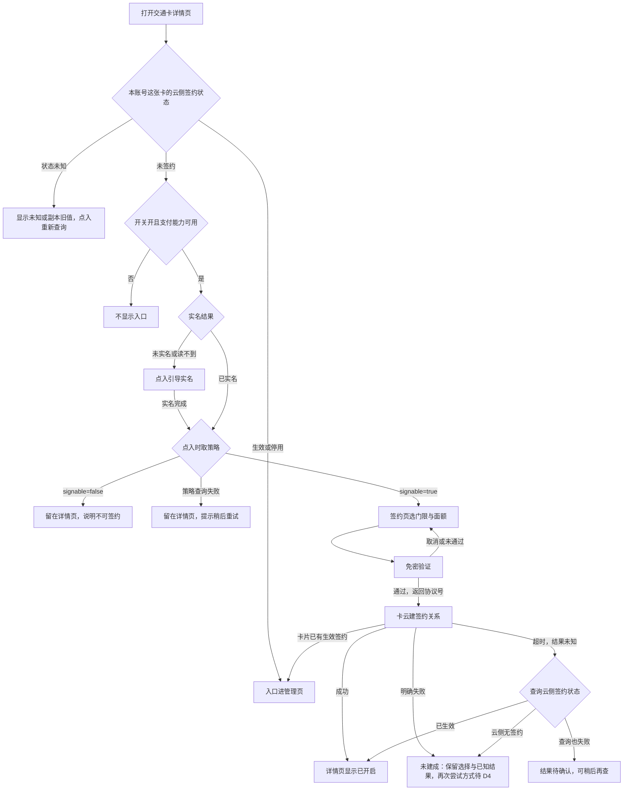
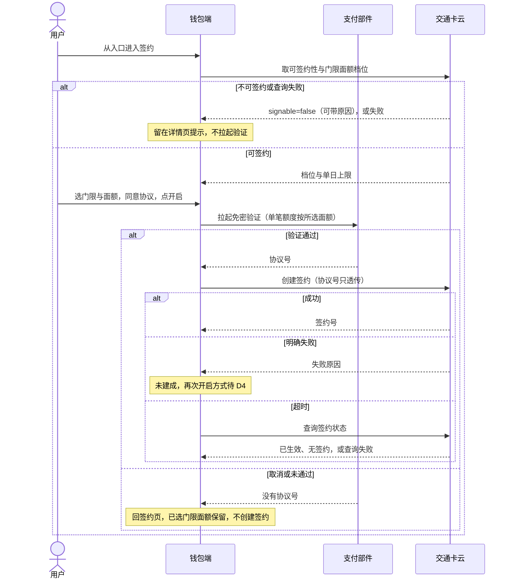
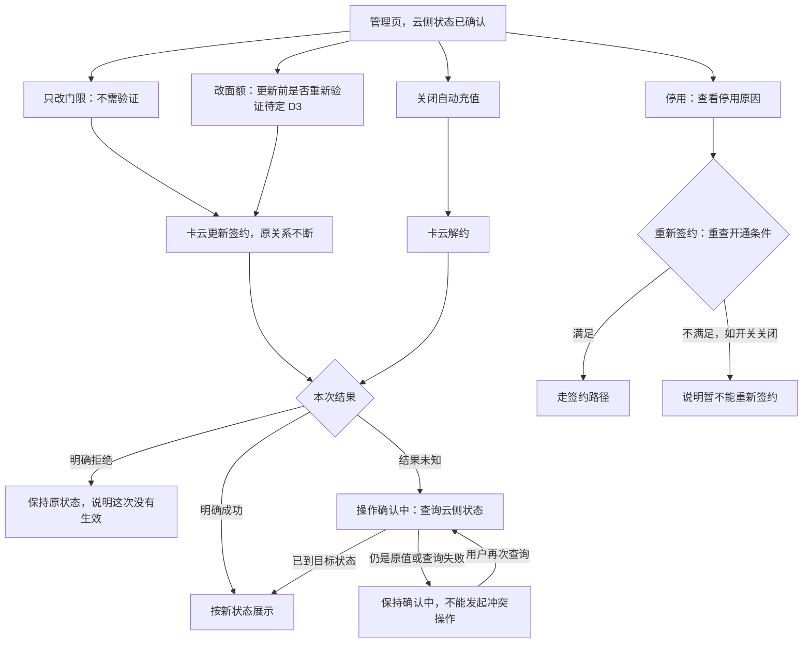
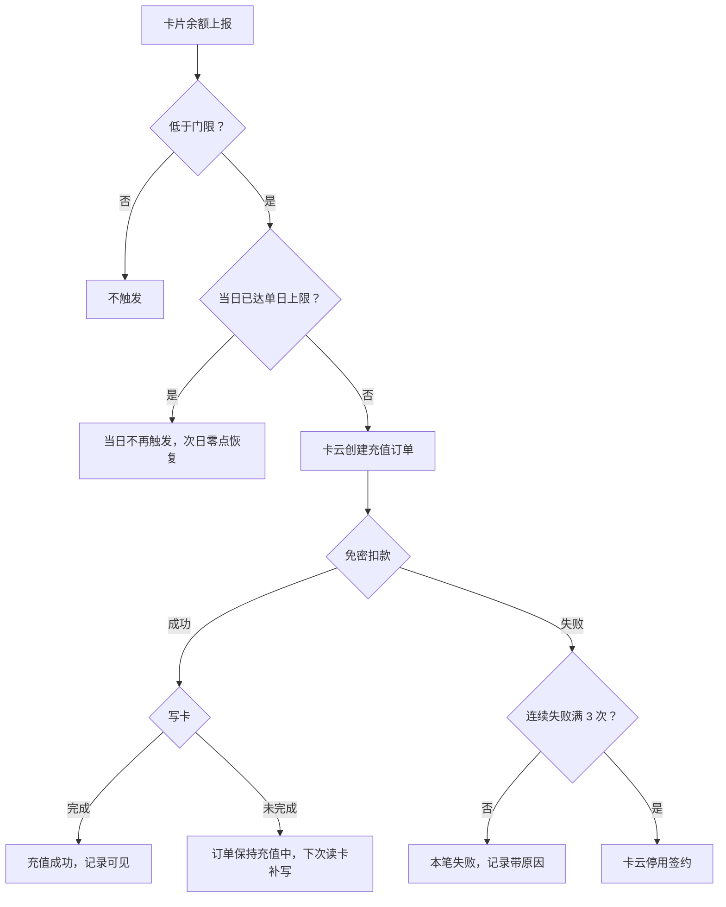
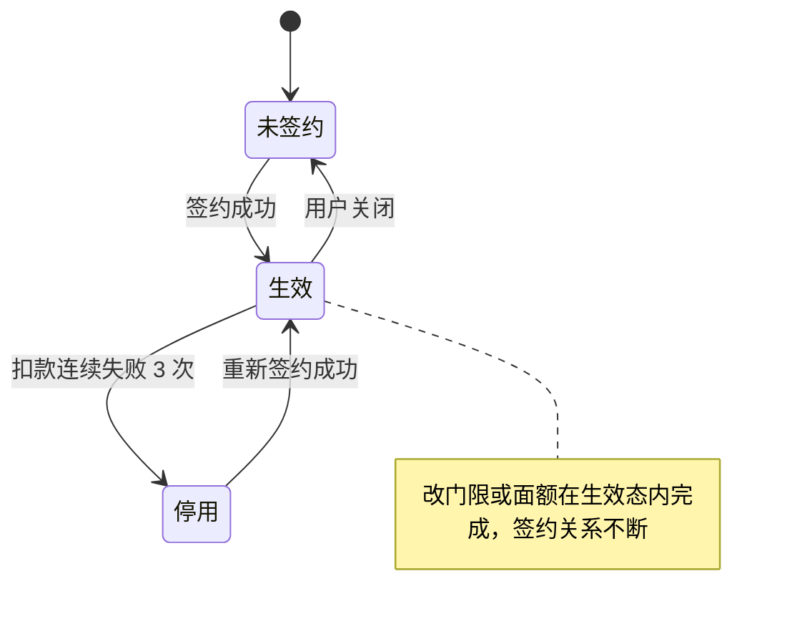
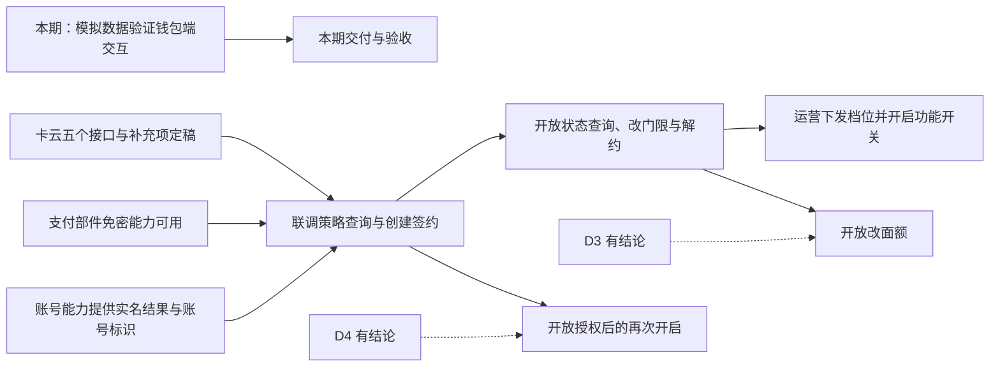

# AR90006 交通卡自动充值（钱包端）

## 1. 背景

交通卡余额用尽，用户往往在闸机前才发现，只能在人流中当场充值，这是交通卡用户最集中的投诉点。难点不在充值本身，而在时机：余额还有富余时，用户没有理由想起这件事。

本需求让用户对一张交通卡签约一次，之后余额低于自己设的门限时由系统自动充值，把「想起来充值」从用户身上移走。

成功标准来自产品需求，由服务端按全局口径统计：

- 签约用户的闸机余额不足发生率降到万分之五以下；
- 签约转化率不低于交通卡月活的 8%。

钱包端以入口露出和签约流程的顺畅支撑这两个目标，不直接承诺这两个线上数值。

整套方案分签约、触发、扣款、入账、停用五段，钱包端只承担用户看得见的那部分：

- 交通卡详情页上的自动充值入口；
- 签约：选触发门限与单笔面额、同意免密扣款协议、过一次免密验证；
- 签约后在同一入口查看充值记录、修改门限面额、关闭自动充值。

余额判定、扣款、入账与停用都在服务端完成，用户侧没有「发起自动充值」的动作。

## 2. 术语

| 术语 | 在本需求里的意思 |
|---|---|
| 自动充值 | 交通卡详情页上的一项功能：用户签约后，余额低于门限时由系统自动完成充值 |
| 签约 | 用户在签约页选好触发门限、单笔面额并同意免密扣款协议，通过一次免密验证后建立的自动充值关系 |
| 触发门限 | 余额低于多少（5 / 10 / 20 / 30 元）时触发一次自动充值，签约时单选，之后可修改 |
| 单笔面额 | 每次自动充值充多少（20 / 50 / 100 元），签约时单选，之后可修改 |
| 免密扣款协议 | 用户授权系统在满足条件时自动扣款的协议；协议文案写明单笔上限与单日上限，协议号由支付部件返回 |
| 管理页 | 开启自动充值后，同一入口对应的页面：查看签约状态、充值记录、修改门限面额、关闭或处理停用 |
| 停用 | 扣款连续失败 3 次后，签约被服务端停用，管理页展示停用状态与原因，需重新签约才能恢复 |
| 签约状态未知 | 这次没有取到这张卡在云侧的签约状态；页面只显示未知或本地旧值，可以重新查询 |

容易读混的几组说法：

| 说法 | 怎么分 |
|---|---|
| 触发门限 与 单笔面额 | 门限是余额低到多少就触发，面额是触发后充多少；方向相反，互不换算 |
| 停用 与 关闭 | 停用由服务端在扣款连续失败 3 次后做出，用户只能重新签约；关闭是用户主动解约，之后想用要重新签约 |
| 单笔上限 与 单日上限 | 单笔上限随所选面额设置；单日上限本期 200 元，达到后当日不再触发 |
| 「看不到入口」与「可见并引导实名」 | 按澄清会，未实名用户的入口可见、点进去先实名；产品需求原验收句「看不到入口」是旧版遗留，不采用（D2） |
| 状态未知 与 未签约 | 未签约是云侧明确返回没有签约；本地没有副本、查询又失败时只是不知道，不能当成未签约去签约 |
| 能管理 与 能重新签约 | 停用后用户照常能看原因与记录；重新签约是一次新签约，要重新满足开通条件 |

## 3. 范围

整套自动充值由五方共同完成：

| 参与方 | 做什么 | 在本需求里 |
|---|---|---|
| 钱包端（本次交付） | 详情页自动充值入口、签约页（门限/面额选择、协议、拉起免密验证）、管理页（状态、记录、改档、关闭、停用重签）、实名引导回跳、端侧暂存签约选择 | 本需求交付 |
| 交通卡云 | 余额上报、门限判定、自动扣款与入账、写卡；签约关系、门限面额与充值订单的唯一真源 | 接口对端，按定好的接口协作 |
| 支付部件 | 免密协议签订、协议号、单笔额度校验；拉起免密验证界面 | 既有能力，只用不改 |
| 账号能力 | 登录实名结果，以及卡云接口要用的账号标识 | 既有能力，提供身份判定 |
| 运营管理台 | 下发自动充值功能开关、门限与面额档位 | 配置与本需求同版本上线；配置页面与逻辑不在钱包端 |

钱包端在这份需求里不做：

- 不判断余额是否低于门限，不发起任何自动充值；
- 不保存支付凭据，免密协议号只透传；
- 不实现运营管理台的页面与配置逻辑；
- 不改变余额的判定口径：判定输入是服务端记录的余额，不是用户手机上显示的余额。

本期不做：

- 按日期或按行程预约充值、一张签约覆盖多张卡、家庭成员代充：都需要新的账户模型；
- 充值记录按月筛选：会上没定挂在哪张单，会后需求方确认不算这张单；导出本期不做（D6）；
- 交通卡余额提醒：另立需求单，与自动充值不共用门限档位。

范围确认时需求方定为整单承载、不拆分。

工程里还没有任何自动充值的实现，也没有交通卡详情页；交通卡云与支付部件的接口在工程里接不上，账号能力也只给出登录态。本期交付是按定好的接口、用模拟数据验证过的钱包端签约与管理交互，验收不等真实云端；与卡云、支付的真实联调另行验收，本需求不算验过（D7）。正式向用户开放另有条件，见第 9 章。

| 事 | 本期怎么承担 | 换成正式能力的条件 |
|---|---|---|
| 交通卡详情页 | 工程里没有，本需求新增一个交通卡详情页承载自动充值入口，从哪里进入由实现方案定 | —— |
| 交通卡云的五个接口 | 按定好的接口契约用模拟数据承载（D7）；更新接口的响应、请求终态、失败记录原因与「解约返回未解约」的含义由模拟数据源声明 | 卡云五个接口与这些补充项定稿并联调后换真实数据源，页面与状态语义不变 |
| 支付部件的免密验证 | 模拟拉起与返回结果（D7） | 支付部件能力在工程内可用 |
| 账号的实名结果与账号标识 | 模拟数据源提供（D7），不从脱敏展示账号反推 | 账号能力暴露实名结果与账号标识 |
| 运营下发的开关与档位 | 模拟配置，档位取现行值（D7） | 运营管理台配置随版本上线 |

依赖关系：

- 交通卡云是最外层依赖，签约、改档、关闭与状态展示都依赖它的接口；
- 支付部件能力不可用时，隐藏新签约入口，已签约用户照常自动充值。

## 4. 业务方案

签约关系、余额门限与充值订单的唯一真源是交通卡云，判定与扣款都在服务端；钱包端只负责签约入口、签约交互、状态展示与记录查看。

不采用「端侧监测余额并直接发起扣款」：用户离线刷卡后手机上显示的余额会长期不准，按它判定会扣出用户预期之外的钱。

钱包端调用交通卡云发起签约与查询，支付部件向用户拉起免密验证并返回协议号：

| 参与方 | 输入 | 输出 | 责任 | 失败时 |
|---|---|---|---|---|
| 钱包端 | 用户动作、卡片与云侧状态 | 签约请求、状态页与提示 | 收集确认、拉起签约、展示结果 | 不判断是否该扣款，不保存支付凭据 |
| 交通卡云 | 卡片、账号、余额上报、协议号 | 签约、触发、订单与扣款结果 | 门限判定、订单创建、失败停用 | 是签约与扣款结论的唯一真源 |
| 支付部件 | 协议号、订单和金额 | 签约与扣款结果 | 免密协议和扣款 | 不改变签约关系，不重复扣款 |
| 账号能力 | 登录实名请求 | 合格身份或失败结果 | 提供既有身份能力 | 未实名不允许签约 |
| 运营管理台 | 运营配置 | 开关、门限和面额档位 | 配置下发 | 配置不可用按关闭处理 |

几个关键取舍：

| 取舍 | 结论 | 没选的做法为什么不行 |
|---|---|---|
| 改门限或面额怎么改 | 走更新接口，原签约关系不断（D1） | 先解约再重签：中间有空窗，那几分钟余额掉下去不会充，还要再拉一次免密验证 |
| 入口怎么分流 | 先看这张卡在云侧的签约状态；未签约时再逐项看功能开关、支付能力、实名结果和卡云的可签约判断（D2、D5） | 把开关或实名折进可签约性：未实名（应可见并引导实名）与开关关闭（应隐藏入口）分不开；只看本地副本：副本缺失会被当成未签约，把已签约用户送去重复签约 |
| 不可签约怎么提示 | 按卡云的「能否签约」判断分流，原因文字只拿来显示，为空时给通用提示 | 按原因文字猜是不是未实名：文字没有分类编码，猜错会把用户引到错误的页面 |
| 档位从哪来 | 取策略接口返回的档位，运营调整即时生效 | 写死在端侧：运营想调调不动 |
| 同一张卡重复签约 | 卡云按「卡片 + 生效状态」判重，返回既有签约号，端侧转管理页 | 端侧自己判重：签约关系的真源在卡云，端侧判不全 |
| 改档、关闭结果不明时怎么解锁 | 只有明确成功、明确拒绝，或查到目标状态才解除；其他情况保持确认中 | 查几次还是旧值就当失败放开：原请求可能稍后才生效，放开后用户再改会互相覆盖 |

改档的验证要求：

- 只改门限不涉及免密额度，不需要重新验证（澄清会已定），即时生效；
- 改面额（调高或调低）要不要重新免密验证，待支付侧与风控确认（D3），未定前改面额不开放。

签约与扣款按这几条规则取值：

| 规则项 | 取值 | 适用与来源 |
|---|---|---|
| 触发门限档位 | 5 / 10 / 20 / 30 元 | 策略接口返回的现行值，运营可调 |
| 单笔面额档位 | 20 / 50 / 100 元 | 策略接口返回的现行值，运营可调 |
| 免密单笔上限 | 等于所选面额 | 不设固定值：选 20 元面额却签出 100 元的免密额度说不过去 |
| 单日充值上限 | 200 元 | 产品需求；澄清会确认本期不动，协议文案写明 |
| 连续扣款失败停用 | 3 次 | 产品需求；单日达到上限不计入 |
| 单日达到上限 | 当日不再触发，次日零点恢复 | 产品需求与系统设计 |
| 跨上限的一笔 | 由卡云定 | 已充 180 元、面额 50 元这种情况材料没有说明；钱包端只展示卡云的结果，不拆额、不改面额 |

这套划分要防住六类风险：

| 风险 | 触发条件 | 影响 | 已有控制 |
|---|---|---|---|
| 判定扣错金额 | 按用户端显示余额判定 | 扣出用户预期之外的钱 | 判定输入是服务端记录余额，端侧不参与判定 |
| 免密额度与所选面额不符 | 面额与免密额度解绑 | 用户质疑扣款 | 单笔上限随所选面额设置 |
| 改档重建签约造成空窗 | 改档走解约重签 | 空窗期余额下降不自动充；重复拉验证 | 改档走更新接口，原关系不断 |
| 签约页档位与运营下发不一致 | 档位写死 | 运营想调调不动 | 档位取自策略接口 |
| 状态不明时重复操作 | 把查询失败当未签约，或把改档结果未知当失败 | 重复签约，或两次改档互相覆盖 | 状态未知不进签约页；改档、关闭只按明确结果或查到目标状态解除 |
| 端云能力需本地承载 | 工程里没有自动充值实现，卡云与支付接口接不上 | 签约与管理链路没有真实数据源，验收只到本地模拟 | 按接口契约建模、数据源可替换，用模拟数据验证（D7）；真实联调另行验收 |

改面额是否要重新免密验证（D3）、授权后创建签约没有建成时怎样再次开启（D4）尚未对齐，依赖它们的行为只写两边都成立的共同要求，这两处在结论前不开放。

## 5. 业务流程

钱包端参与两条路径，都从交通卡详情页的同一个自动充值入口进入：

- 签约路径：把这张卡的自动充值关系建立起来；
- 管理路径：建立之后的查看、修改、关闭与停用重签。

入口去向先看这张卡在云侧的签约状态：已签约（含停用）进管理页，状态未知只能重新查询，未签约再看开通条件（D2、D5）。签约之后的每一次充值在服务端完成，钱包端只展示结果。

### 5.1 签约路径

入口先按这张卡在云侧的签约状态分流，未签约时逐项检查开关与支付能力、实名、卡云的可签约判断；授权之前的失败回签约页重试，授权之后没有建成的停在 D4 待定的边界上：

- 回到签约页的几条分支，门限与面额都按暂存值保留，不必重选（D2）。
- 卡云判定不可签约时，原因文字为空就显示通用提示「这张卡暂不能开通自动充值」；不按文字内容去猜是不是没实名。
- 授权之后没有建成，不留半签约状态；用户再点开启时是复用协议号还是重新验证，等 D4 的结论，结论前这一步不开放。
- 超时的那一次，页面既不显示成功，也不当作没签成，以云侧签约状态为准；创建的回包缺少签约号也按超时处理。
- 中途退出签约页时，已选的门限与面额按账号加卡片暂存，换一张卡不会带出这张卡的选择，退出登录清除。

免密验证只在策略判定可签约之后拉起，拿到协议号才创建签约；协议号只透传给卡云，超时后由钱包端向卡云查询确认：

- 实名结果与账号标识来自账号能力（本期由模拟数据源提供，D7）：未实名时钱包端引导实名，不取策略、不拉起免密验证。
- 卡云按「卡片 + 生效状态」判重，已有生效签约时返回既有签约号，钱包端转管理页，不建第二份签约。

用户在签约路径上依次经过这几个页面：

| 页面 | 来路/入口 | 用户操作 | 正常结果 | 异常提示与去向 |
|---|---|---|---|---|
| 交通卡详情页 | 用户打开某张交通卡 | 点「自动充值」入口 | 已签约（含停用）进管理页；未签约、已实名且卡云判定可签约时进签约页 | 未签约且开关关闭或支付不可用时不显示入口；未实名进实名引导；卡云判定不可签约时留在本页显示原因；状态未知时只能重新查询，不进签约页 |
| 实名引导 | 详情页入口（未实名） | 完成实名认证 | 回来后取策略，可签约时进签约页，此前选的门限面额回填 | 实名未完成就返回：仍签不成，入口照旧可见 |
| 签约页 | 详情页入口；实名回来；验证取消或未通过回来 | 选门限与面额、勾选协议、点「开启」 | 拉起免密验证 | 协议没勾时「开启」不可点；中途退出暂存已选值，下次回填；授权后没有建成时说明这次没有开通、选择保留，再次开启方式待 D4 |
| 免密验证页 | 签约页点「开启」 | 确认或取消 | 返回协议号，钱包端创建签约，成功后回详情页显示已开启 | 取消或没通过回签约页、选择保留；超时显示结果确认中，查询失败提示结果待确认 |

### 5.2 管理路径

改档、关闭与停用重签都从云侧状态已确认的管理页出发；改档和关闭各有明确成功、明确拒绝、结果未知三种结果，结果未知只有查到目标状态或拿到明确结果才解除，停用后重新签约要重新满足开通条件：

- 改门限即时生效；改面额在 D3 有结论前不开放（D1、D3）。
- 解约不回滚正在进行中的订单，也不撤销已完成订单；解约回包说「未解约」时按关闭没有生效提示，具体原因要卡云说明。
- 签约号、门限、面额、状态和未确认的操作在端侧按账号加卡片存一份副本，用于先行展示、离线展示和恢复确认中：进入管理页先显示副本，同时向云侧确认一次，同一次页面内复用确认结果；服务端停用与新增的记录以这次确认为准。
- 云侧查询失败时：有副本就显示副本旧值并标明「未能确认最新状态」，没有副本显示未知；两种情况都可以重新查询，改档、关闭、重新签约暂不可用，也不把缓存缺失当成未签约。
- 改档、关闭的回包丢失时页面显示确认中。查询能证明目标已经达到，却证明不了原请求已经终止；所以连续查到原值、或查询失败，都保持确认中，不按查询次数或等待时长判失败。用户可以离开，再进来仍从这项操作恢复；确认中不能提交新的改档或关闭。卡云补齐「原请求是否已终止」的查询之前，原值长期不变的情形没有安全的解锁方式，这是正式开放前要补的依赖；本期模拟数据按成功、拒绝、未知三种演示。
- 停用后照常能看原因和记录；重新签约是一次新签约，开关、支付能力、实名和卡云的可签约判断都要满足。D5 只定了开关不影响已签约用户的入口与管理，没说停用用户在开关关闭时能否重新签约；这里按新签约处理，随评审确认。

| 页面 | 来路/入口 | 用户操作 | 正常结果 | 异常提示与去向 |
|---|---|---|---|---|
| 管理页 | 详情页入口（已签约，含停用；或状态未知但有副本） | 查看状态与最近记录；改门限；关闭自动充值；停用时点重新签约 | 改门限按新值即时生效；关闭后入口回到未签约；重新签约满足开通条件时进签约页 | 状态查询失败显示副本旧值并标明未确认、可重新查询，操作暂不可用；改面额等 D3；改档或关闭被明确拒绝时留在管理页提示；回包丢失显示确认中，解除前不能再次操作；重新签约条件不满足时说明原因 |

### 5.3 签约之后的自动充值与停用

一笔自动充值是否发生，取决于余额是否低于门限和当日是否已到上限；扣款失败连续累计到 3 次时卡云停用签约。钱包端在其中没有任何动作，只在管理页最近记录里展示结果：

- 单日达到上限是正常受限，不计入连续失败；当日已充额度加本笔面额超过上限时怎样处理由卡云定，钱包端只展示结果。
- 写卡未完成时端侧不提供重试，也不重复下单。

签约关系只在未签约、生效、停用三个状态间迁移，生效到停用由卡云触发，其余由用户的签约、关闭与重新签约触发：

- 停用由卡云做出，用户只能重新签约恢复；重新签约前要再满足开通条件。
- 关闭由用户发起，之后想用要重新走一遍签约。
- 「状态未知」不是签约关系的状态，只是钱包端这次没取到云侧结果。

## 6. 功能说明

钱包端在自动充值里提供六项能力：详情页入口、签约、免密验证拉起、实名引导、端侧暂存与管理页。

### 6.1 交通卡详情页入口

交通卡详情页在余额行之下、充值记录之上展示一整行「自动充值」入口；是否可见、点进去去哪，先看这张卡在云侧的签约状态，未签约时再看开通条件（D2、D5）。

入口在详情页上的位置如下：

| 这张卡的云侧状态 | 开通条件 | 入口 | 点进去 |
|---|---|---|---|
| 生效或停用 | 不看开关 | 始终可见 | 管理页 |
| 状态未知 | —— | 可见，显示未知或本地旧值（标明未确认） | 重新查询；查清前不进签约页，也不开放管理操作 |
| 未签约 | 开关关、读不到，或支付能力不可用 | 不可见 | —— |
| 未签约 | 开关开、支付可用、未实名 | 可见 | 引导实名 |
| 未签约 | 开关开、支付可用、已实名，卡云判定可签约 | 可见 | 签约页 |
| 未签约 | 开关开、支付可用、已实名，卡云判定不可签约 | 可见 | 留在详情页显示原因，原因为空时显示通用提示 |
| 未签约 | 取开通条件时查询失败 | 可见 | 留在详情页，提示稍后重试 |

### 6.2 签约页

签约页让用户为这张卡建立自动充值关系：

- 触发门限单选：可选值来自策略接口返回的档位，现行值为 5 / 10 / 20 / 30 元；
- 单笔面额单选：可选值同样来自策略接口，现行值为 20 / 50 / 100 元；
- 协议勾选：协议文案写明单笔上限等于所选面额、单日最多充 200 元，勾选后「开启」按钮才可点击。

签约页一屏内完成选择与同意，视觉沿用钱包现有卡片页面样式，不新增控件类型：

### 6.3 免密验证拉起

点「开启」后拉起支付部件的免密验证，验证页说明单笔额度。

- 验证通过：返回协议号，钱包端带着它去创建签约；
- 用户取消或没通过：留在签约页，不建立任何签约关系，也不留下半签约状态；
- 验证通过后签约没有建成：留在签约页说明这次没有开通，选择保留；再次开启的方式等 D4。

验证页由支付部件提供，说明这次授权的单笔额度：

### 6.4 实名引导

未实名用户的入口照常可见，点进去先完成实名认证；实名完成后再取一次卡云的可签约判断，可签约时回到签约页，此前选好的门限与面额都还在（D2）。

### 6.5 端侧暂存

用户中途退出签约页、去实名、验证取消或没通过时，已选的门限与面额暂存，下次从入口进来按暂存值回填。暂存按账号加卡片保存：同一账号的两张卡各存各的，换卡不会带出别的卡的选择；退出登录清除这个账号的全部暂存。它只覆盖「退出签约页后再进来」，应用关闭后不保留。

### 6.6 管理页

开启自动充值后，入口点进去是管理页：顶部为当前签约状态，下方为最近的自动充值记录。

管理页提供五件事：

- 查看签约状态与门限面额；
- 查看最近记录：每条有时间、金额、结果；失败的记录展示失败原因，卡云没给原因时显示「原因暂不可用」，不拿停用原因代替；卡号取当前这张卡的卡号按现有规则脱敏，4 位及以下的卡号不展示，签约号不当卡号显示；
- 修改门限面额：走更新接口，原签约关系不断（D1）；
- 关闭自动充值：二次确认后解约，关闭后不再触发；
- 处理停用：扣款连续失败 3 次后签约被卡云停用，管理页顶部换成停用横幅并给出停用原因，用户可以从这里重新签约。

停用时管理页顶部的样子：

每个操作只在对应的签约状态下成立：

| 操作 | 成立条件 | 结果 |
|---|---|---|
| 修改门限 | 签约生效中，云侧状态已确认，没有确认中的操作 | 卡云更新签约关系，不需要重新验证，新门限即时生效 |
| 修改面额 | 同上 | 是否要重新免密验证待支付侧与风控确认（D3），结论前不开放 |
| 关闭自动充值 | 同上 | 卡云解约，不再触发自动充值 |
| 查看停用原因与记录 | 签约被停用 | 展示停用原因与最近记录 |
| 重新签约 | 签约被停用，且开关、支付能力、实名与卡云的可签约判断都满足 | 重新走一遍签约流程；条件不满足时说明暂不能重新签约 |

## 7. 异常与恢复

异常分两类：设计内的正常受限结果，和没被设计接住的真正异常。

### 7.1 正常受限结果

这些场景在设计里各有去处，用户不会停在没有出路的页面上：

| 场景 | 用户看到什么 | 接下来怎么走 | 责任人 |
|---|---|---|---|
| 免密验证取消或没通过 | 留在签约页，门限与面额仍在 | 可直接再试一次，不必重选 | 钱包端 |
| 未完成实名 | 提示先完成实名认证 | 引导去实名，回来后可签约时回签约页继续 | 钱包端、账号能力 |
| 卡云判定这张卡不可签约 | 详情页显示原因；没有原因时显示通用提示 | 不进签约页、不拉起验证 | 交通卡云判定、钱包端展示 |
| 同一张卡已有生效签约 | 不重复签约 | 直接进管理页，在那里改门限面额或关掉 | 交通卡云判重、钱包端分流 |
| 用户中途退出签约页 | —— | 下次从入口进来时，此前选的门限面额仍在 | 钱包端（端侧暂存） |
| 单日达到充值上限 | 当日不再触发 | 当日不再充，次日零点恢复；不计入连续失败 | 交通卡云 |
| 扣款连续失败 3 次 | 管理页顶部停用横幅与停用原因 | 查看原因；开通条件满足时可重新签约 | 交通卡云停用、钱包端展示 |
| 扣款成功但写卡未完成 | 订单保持充值中 | 卡云下次读卡补写；端侧不重试、不重复下单 | 交通卡云 |
| 功能开关关闭 | 未签约用户看不到入口 | 已签约用户不受影响，照常自动充值；停用用户暂不能重新签约 | 运营管理台、钱包端 |

### 7.2 真正异常

真正异常指设计上没有具体兜底、走通用逻辑的场景，用户要看到失败结果，而不是假装成功：

| 场景 | 可观察结果 | 恢复方式 | 责任人 |
|---|---|---|---|
| 免密授权后创建签约明确失败 | 留在签约页，说明这次没有开通，门限与面额仍在，不显示成功 | 不留半签约状态；再次开启的方式（复用协议号或重新验证）等 D4，结论前不开放 | 钱包端、交通卡云、支付部件 |
| 创建签约超时、结果未知 | 不显示成功，也不显示未签约 | 查询云侧签约状态：已生效按已开启展示；云侧无签约按未建成处理（同上，等 D4）；查询失败保持待确认、可稍后再查 | 钱包端、交通卡云 |
| 云侧状态查询失败或回包无效 | 有副本时显示副本旧值并标明未确认；没有副本显示状态未知 | 可重新查询；旧值不当作当前生效，不按本地缓存缺失推断未签约；查清前不进签约页、不开放管理操作 | 钱包端 |
| 取开通条件时查询失败 | 留在详情页提示稍后重试 | 不进签约页 | 钱包端 |
| 改档或关闭结果未知 | 页面显示确认中，不显示成功也不显示失败 | 查到目标值或已解约、或拿到明确结果才解除；仍是原值或查询失败保持确认中，不自动重发、不判失败；离开再进来仍显示确认中 | 钱包端、交通卡云 |
| 解约回包说未解约 | 关闭没有生效 | 保持原状态，可以稍后再试；具体原因要卡云说明 | 钱包端、交通卡云 |
| 失败记录没有原因 | 显示「原因暂不可用」 | 不用停用原因代替；卡云补齐原因字段后照实显示 | 钱包端、交通卡云 |
| 免密验证拉不起来 | 拉不起来验证页 | 用户可重试，已选门限面额保留 | 钱包端 |

### 7.3 未定的两条边界

这两件两端尚未对齐，已定与待定分开写。

**改面额是否要重新免密验证（D3）**

- 已定：只改门限不涉及额度，不用验证。
- 未定：面额与免密单笔额度绑定，调高会放大额度；调低会上只说「应该不用」，也要等风控确认，风控也可能要求调低同样验证。
- 本期写法：改面额在结论前不开放；改门限即时生效、关闭照常；验收只覆盖改门限路径与关闭路径。

**授权后创建签约没有建成时怎样再次开启（D4）**

- 已定：明确失败或确认云侧无签约时留在签约页、保留已选门限与面额、不留半签约状态；结果未知时以云侧签约状态为准，不把超时当成没签成。
- 未定：卡云说协议号十分钟内可复用；支付侧认为有效期可能随验证会话走、未必十分钟；能否复用要卡云和支付两边都成立，产品要求等两端对齐，不按十分钟写。
- 本期写法：复用协议号还是重新验证，等结论再写；结论前授权后的再次开启不开放，验证取消或没通过后的重试照常。

两条边界解除前，受影响的行为都不能写成已定；解除后由本单评审回流更新。

### 7.4 恢复路径

- **清除数据或缓存缺失**：签约关系以云侧查询为准恢复。生效、停用照云侧显示，云侧无签约才看开通条件，查询失败显示未知、可重试。
- **签约过程被打断**：退出签约页时按账号加卡片暂存已选的门限与面额，下次从这张卡的入口进来回填；去实名回来同样回填（D2）。
- **改档、关闭确认中被打断**：确认中的操作和目标值存在本地副本里，离开再进入管理页时先恢复这项确认，再向云侧查询。
- **退出登录或换账号**：清除这个账号所有卡片的副本与暂存，换账号后读不到旧数据。
- **防重复**：在途的创建请求不二次提交；卡云对已有生效签约的卡返回既有签约号，重复进入最终都收敛到管理页；确认中不能提交冲突的改档或关闭。

## 8. 验收

通过条件按澄清会修订后的口径，主责是谁来验：

| 分组 | 编号 | 验收点 | 可观察的通过条件 | 主责 |
|---|---|---|---|---|
| 入口与实名 | AC-R1 | 未实名用户 | 能看到自动充值入口，点进去被引导去实名，完成实名前无法签约（按澄清会修订，原「看不到入口」作废，D2） | 端侧 + 测试 |
| 入口与实名 | AC-R8 | 实名后续办 | 未实名用户被引导去实名，完成后可签约时回到签约页继续，此前的选择仍在 | 端侧 + 测试 |
| 入口与实名 | AC-R9 | 已签约再进入 | 已有生效签约的卡再点入口，进入的是管理页而不是重新签约 | 端侧 + 测试 |
| 入口与实名 | —— | 卡云判定不可签约 | 未签约、已实名、开关开时卡云判定不可签约：留在详情页显示原因，原因为空显示通用提示；不进签约页、不拉起验证（Spec AC-1b） | 端侧 + 测试 |
| 入口与实名 | —— | 状态未知 | 没有本地副本且状态查询失败：入口显示未知，点进去只能重新查询，不进签约页、不开放管理操作（Spec AC-1c） | 端侧 + 测试 |
| 签约 | AC-R7 | 验证取消后重试 | 用户在支付验证界面取消，回到签约页时刚才选的门限与面额仍在，可直接再次开启 | 端侧 + 测试 |
| 签约 | AC-R10 | 创建签约结果未知 | 免密验证通过后创建签约超时：页面不显示成功也不显示未签约；云侧已生效时按已开启展示，云侧无签约时说明未开通且门限面额仍在（再次开启等 D4），查询失败时提示结果待确认 | 端侧 + 交通卡云测试 |
| 自动充值与停用 | AC-R2 | 签约后自动充值 | 余额低于门限时用户不做任何操作即可完成充值，并能在记录里看到这笔 | 端侧 + 交通卡云测试 |
| 自动充值与停用 | AC-R3 | 连续失败停用 | 扣款连续失败 3 次后自动停用，用户打开管理页能看到停用状态与停用原因；开通条件满足时可从停用横幅重新签约，开关关闭时说明暂不能重新签约 | 端侧 + 交通卡云测试 |
| 管理 | AC-R6 | 修改与关闭 | 签约后可修改门限并按新值生效；关闭后不再触发自动充值。改门限不需要重新验证；改面额是否要重新免密验证待 D3，结论前只验改门限路径与关闭路径 | 端侧 + 交通卡云测试 |
| 管理 | —— | 修改与关闭结果未知 | 改门限、关闭的回包丢失时页面显示确认中；只有查到目标状态或拿到明确结果才解除；确认查询连续查到原值、之后原请求才生效时，页面在生效前一直保持确认中、不能发起新操作，离开再进来仍是确认中（Spec AC-8b） | 端侧 + 交通卡云测试 |
| 管理 | AC-R5 | 记录展示 | 充值记录中的卡号按现有规则脱敏展示，失败记录展示失败原因；只有时间、金额、结果的失败记录显示「原因暂不可用」 | 端侧 + 测试 |
| 管理 | —— | 回包缺字段 | 状态回包缺签约状态按未知、不当未签约；创建回包缺签约号不当成功；解约回包说未解约按关闭没有生效（Spec AC-9b） | 端侧 + 测试 |
| 开关 | AC-R4 | 功能开关关闭 | 未签约用户看不到入口；已签约用户入口不隐藏、直达管理页，自动充值照常发生（按澄清会：开关只管新签约，D5） | 端侧 + 运营测试 |
| 本地数据 | AC-R11 | 本地缓存缺失 | 清除应用数据后进入：云侧生效时显示已开启并进管理页，云侧停用时显示停用与原因，云侧无签约时按开通条件分流，云侧查询失败时显示状态未知且可重试 | 端侧 + 测试 |
| 本地数据 | —— | 按账号与卡片隔离 | 同账号 A 卡生效、B 卡未签约，先看 A 卡再离线进 B 卡，B 卡不显示 A 卡的签约与选择；退出登录换账号后读不到旧数据（Spec AC-11） | 端侧 + 测试 |

AC-R10、AC-R11 是本单按系统设计「失败与恢复」补的两条，沿用上游编号顺延。以上结论只到本地模拟（D7）；与卡云、支付的真实联调另行验收。

上线后观察两项本端流程指标，由本需求设定，不作为验收判据。两项都按「一次尝试」计：从点「开启」或确认改档、关闭开始，按本端看到的结果结算一次，结果未知与中途离开单独列出，稍后再查到的结果只记一次恢复观测，不改写前一次：

- **签约尝试观测成功占比**：点「开启」的尝试里，本端在这次尝试中看到签约生效的占比，观察签约链路是否顺畅。它不是背景里的「签约转化率」（那一项按交通卡月活计，由服务端统计），也不是最终签约成功率。
- **管理操作观测成功占比**：确认改档与关闭的尝试里，本端在这次尝试中看到生效的占比。

## 9. 交付与上线

本期交付按定好的接口、用模拟数据验证过的钱包端交互与产物，验收不等真实云端（D7）。正式向用户开放是另一件事：真实接入的各方就绪、对应的待定事项有结论，相应功能才开放。

正式开放的前置分三层：卡云接口与补充项、支付和账号能力就绪后才能联调签约；签约联调通过后开放状态查询、改档与解约；最后由运营下发档位并打开开关。D3、D4 各自只挡住改面额和授权后的再次开启：

- 卡云要补齐的不只是接口本身：更新接口的成功与拒绝回包、原请求是否已终止的查询、失败记录的原因字段，以及「解约返回未解约」的含义。补齐之前，对应场景在真实环境里只能按未知或「原因暂不可用」处理。
- 单日上限的执行在卡云，钱包端只消费卡云给出的结果；跨上限的一笔怎么处理由卡云定，钱包端不拆额、不改面额。
- 只有卡云接口和支付就绪，不足以开放全部功能：账号的实名结果与账号标识、运营开关与档位、D3 与 D4 的结论都还影响各自那部分。

能单独开关的对象，以及开关时进行中的业务怎样：

| 对象 | 启用 | 停用 | 进行中的业务受什么影响 |
|---|---|---|---|
| 自动充值功能开关 | 运营管理台开启后，未签约用户可见签约入口 | 运营管理台关闭后，未签约用户看不到入口；停用用户暂不能重新签约 | 已签约用户的自动充值照常发生，管理入口也不隐藏（D5） |
| 策略接口返回的档位 | 运营下发门限与面额档位 | 配置不可用时按关闭处理 | 新签约入口隐藏 |
| 支付部件能力 | 能力可用时拉起免密验证 | 能力不可用时隐藏新签约入口 | 已签约用户继续自动充值，不受影响 |
| 创建签约、状态查询等接口 | 与交通卡云联调完成后开放 | 接口异常时签约页、管理页走通用失败处理 | 已签约用户的服务端自动充值不受影响 |
| 端侧版本回退 | —— | 回退版本没有自动充值入口 | 云侧已有签约照常自动充值，不随端侧回退解除；再进入时以云侧查询为准 |

关闭与回退：

- 用户关闭自动充值即解除签约，之后想用要重新签约；关闭不回滚进行中的订单，也不撤销已完成的订单。
- 上线后如需回退，关闭功能开关即可让未签约用户不再看到入口；已签约用户继续由服务端执行自动充值。

### 9.1 交付物

| 交付物 | 给谁 | 做什么用 | 什么时候要 |
|---|---|---|---|
| 钱包端自动充值功能（交通卡详情页与入口、签约页、管理页、免密验证拉起、实名引导、端侧暂存），以模拟数据源承载 | 钱包产品组、测试 | 按定好的接口验证签约、管理、失败与结果未知各分支 | 本期交付 |
| 真实接入与正式开放 | 钱包产品组、交通卡云、支付部件、账号能力、运营 | 换真实数据源、联调并按上面的前置分段开放 | 各方就绪、D3 与 D4 有结论后另行验收 |
| 免密扣款协议文案（单笔上限等于所选面额、单日最多充 200 元） | 钱包端签约页 | 用户勾选前阅读确认 | 与功能同版本上线 |
| 端侧事件统计（签约与管理流程） | 钱包产品组、运营 | 观察签约与管理两项本端观测成功占比 | 上线后随功能生效 |

## 10. 附录

接口、数据、配置、统计点与规约判断的精确名称在这里，正文用中文名。

### 10.1 技术契约

#### 10.1.1 端云接口

<!-- story-build:begin 技术契约·端云接口 · 由spec 「宿主扩展治理项 › 技术契约 › 端云接口」生成，改它请改真源 · sha256:39f52c0bbb90a041 -->
| 接口 | 性质 | 输入 → 输出 | 错误码 |
|---|---|---|---|
| `getAutoTopupPolicy` | 新增 | accountId、cardId → signable、unsignableReason（可空）、thresholdOptions、amountOptions、dailyLimit、agreementText；signable 只表示这张卡能否签约，不承载功能开关，unsignableReason 是可读文字、没有分类编码，不作分流依据 | 卡云统一错误结构，不新增 |
| `createAutoTopupContract` | 新增 | accountId、cardId、agreementNo、threshold、amount → contractNo、existed（true 表示返回既有生效签约） | 同上；超时结果未知，以 `getAutoTopupStatus` 确认 |
| `getAutoTopupStatus` | 新增 | accountId、cardId → contractStatus（none / active / disabled）、contractNo、threshold、amount（未签约时为空）、recentRecords（每项 time、amount、result）、consecutiveFailures、disabledReason | 同上；查询失败按未知展示 |
| `updateAutoTopupContract` | 新增（澄清会，D1） | contractNo、threshold、amount → 更新结果，原签约关系不断（响应字段待卡云定稿） | 同上 |
| `cancelAutoTopupContract` | 新增 | contractNo → cancelled；不回滚进行中订单 | 同上 |

| 接口 | 必需（缺失即无效） | 按状态可空 | 待补充（本期模拟字段，真实接入依赖卡云） | 无效或未定义时 |
|---|---|---|---|---|
| `getAutoTopupPolicy` | signable、thresholdOptions、amountOptions、dailyLimit、agreementText | unsignableReason：`signable=true` 时为空；`false` 时也可为空，用通用提示 | —— | 按策略查询失败：留在详情页，不进签约页 |
| `createAutoTopupContract` | contractNo、existed | —— | —— | 缺任一项不当成功，按结果未知以状态查询确认 |
| `getAutoTopupStatus` | contractStatus（三值之一）、recentRecords、consecutiveFailures；`active` / `disabled` 时 contractNo、threshold、amount 也必需 | `none` 时 contractNo、threshold、amount 为空是合法响应；disabledReason 未停用时为空 | 每条失败记录的失败原因 `failReason`（缺值显示「原因暂不可用」） | 按状态查询失败（状态未知），不当未签约 |
| `updateAutoTopupContract` | 待卡云定稿（D1 只定了入参） | —— | 明确成功、明确拒绝的响应字段；原请求终态的查询或等价保证 | 本期模拟只声明成功、拒绝、未知三种；真实响应定稿前不按任何字段推断成功 |
| `cancelAutoTopupContract` | cancelled | —— | `cancelled=false` 的业务原因 | `true` 才按已解约；`false` 按关闭没有生效；字段缺失按结果未知 |
<!-- story-build:end -->

五个接口都由钱包端调用交通卡云，金额一律以「分」为单位的整数。主叙事里的「策略查询、创建签约、状态查询、更新签约、解约」依次对应上面五行；更新签约是澄清会新增的接口，响应字段还要卡云定稿。回包里哪些字段必需、哪些按状态可空、哪些待卡云补充，以及缺了按什么处理，见规格 9.1.1 的字段处理表。

#### 10.1.2 数据存储

<!-- story-build:begin 技术契约·数据存储 · 由spec 「宿主扩展治理项 › 技术契约 › 数据存储」生成，改它请改真源 · sha256:d27ebbb11ecc1f29 -->
| 键名/表名 | 介质 | 值结构 | 有效期 | 用途 |
|---|---|---|---|---|
| `wallet_auto_topup_contract` | PersistentStorage | 按账号标识分区、每张卡一条：`{ cardId, contractNo, threshold, amount, status, confirmedAt, pendingOp }`；`pendingOp` 为未确认的改档或关闭 `{ type, target }`，没有时为空 | 读取、覆盖、删除都以账号加卡片定位；退出登录清除本账号全部卡片；不参与备份恢复；每次云侧确认后刷新，未确认操作在拿到明确结果或查到目标状态时清除 | 先行与离线展示签约状态；恢复未确认操作；不作当前生效的依据，缺失或与云侧不一致以云侧为准 |
| `wallet_auto_topup_draft` | AppStorage | 按账号标识分区、每张卡一条：`{ cardId, threshold, amount }` | 应用进程内；只按同账号同卡片读取，换卡不回填别的卡；退出登录清除本账号全部暂存 | 验证取消、未通过、去实名或中途退出签约页后回填 |
<!-- story-build:end -->

主叙事里的「签约关系副本」与「签约暂存」对应上面两个键；免密协议号不在任何一项里。

#### 10.1.3 配置项

<!-- story-build:begin 技术契约·配置项 · 由spec 「宿主扩展治理项 › 技术契约 › 配置项」生成，改它请改真源 · sha256:2d0377aa1471e2a2 -->
| 配置项 | 默认值 | 关闭态行为 | 历史版本兼容 |
|---|---|---|---|
| 自动充值功能开关（运营管理台下发；本期按 D7 由模拟配置承载，与策略接口相互独立） | 开 | 只管新签约：关闭后未签约用户看不到入口；已签约用户入口、管理与自动充值照常（D5）；停用用户重新签约按新签约处理，关闭时不可用；配置不可用按关闭处理 | 端侧不新增本地开关常量 |
| 门限档位 / 面额档位 / 单日上限 | 现行 5 / 10 / 20 / 30 元、20 / 50 / 100 元、200 元（上游约束：产品需求） | 由策略接口下发，影响签约页选项与协议文案 | 端侧不作第二真源 |
<!-- story-build:end -->

#### 10.1.4 依赖变更

<!-- story-build:begin 技术契约·依赖变更 · 由spec 「宿主扩展治理项 › 技术契约 › 依赖变更」生成，改它请改真源 · sha256:934815a398ba9149 -->
| 依赖 | 变更 | 体积影响 | 兼容风险 |
|---|---|---|---|
| 支付部件免密验证 | 复用（既有跨应用交互面，只用不改） | 无 | 能力不可用时隐藏新签约入口；协议号再次使用方式待 D4 |
| 运营管理台功能开关下发 | 新增消费（真实接入依赖） | 无 | 通道未接入前按模拟值；读不到按关闭处理 |
| 账号能力实名结果与账号标识 | 新增消费（真实接入依赖） | 无 | 实名结果读不到时不判已实名，按未实名引导；账号标识取不到时不调卡云接口 |
| 交通卡云接口补充 | 新增消费（真实接入依赖） | 无 | 更新接口的成功与拒绝响应、原请求终态的查询或等价保证、失败记录原因字段、`cancelled=false` 的含义未定稿前，对应结果按未知、「原因暂不可用」或关闭没有生效处理 |
<!-- story-build:end -->

### 10.2 规约

<!-- story-build:begin 规约 · 由spec/knowledge-use.yaml生成，改它请改真源 · sha256:5a5294e327e74b39 -->
| 规约域 | 编号 | 判定 | 依据 |
|---|---|---|---|
| UX 一致性 | UX-01 | 命中 | 新增交通卡详情页入口、签约页、管理页的方向性参数用 HorizontalAlign.Start/End 与 TextAlign.Start/End，不用 left/right |
| 安全隐私 | SEC-01 | 命中 | 业务处理：accountId 与 cardId 按卡云接口以可识别形式只传给交通卡云五个接口，用于签约、改档、解约与状态查询；accountId 真实来源为账号能力、本期由模拟数据源提供，不从脱敏展示串反推；agreementNo 只透传给 createAutoTopupContract，不持久化 |
|  | SEC-01 |  | 展示：管理页记录的卡号取当前卡片的卡号，在组装展示内容处另生成展示值（MaskUtil.maskAccount），不改写记录对象；卡号不超过 4 位时 maskAccount 原样返回，这种卡号不展示；签约号不当作卡号展示 |
|  | SEC-01 |  | 观察性输出：日志与端侧事件只带去标识账号、卡片类型、阶段与结果分类，不带卡号、cardId、协议号、金额明细或支付参数 |
|  | SEC-01 |  | 跨重启存储：签约关系副本按账号加卡片定位，只存卡片标识、签约号、门限、面额、状态、确认时刻与未确认操作，不存卡号展示值、协议号与支付参数；退出登录清除本账号全部卡片，不参与备份恢复；副本落盘保护方式与访问边界由 Plan 给出，不认定普通持久化已满足 |
|  | SEC-01 |  | 进程内暂存：签约暂存按账号加卡片定位，只存卡片标识、门限与面额，换卡不回填别的卡，退出登录清除本账号全部暂存 |
| DFX 基线（性能/功耗/ROM/RAM） | DFX-01 | 命中 | 端云接口只在打开详情页、点入口、进入管理页与用户操作时调用，创建、改档、关闭结果未知时查询状态、用户可再次查询，不设定时拉取或后台轮询 |
|  | DFX-01 |  | 签约关系副本只作先行与离线展示：进入管理页以一次状态查询确认，同一次页面内的消费者复用这次结果，不为副本删掉必要确认 |
| DFX 基线（性能/功耗/ROM/RAM） | DFX-02 | 命中 | 新增签约页、管理页与详情页入口的中英文字符串资源，编码时随待翻译清单给出条数与 UTF-8 字节数作为体积增量；图标走系统符号，不新增图片资源与 SDK |
| 可观测性 | OBS-02 | 命中 | 签约、创建、改档、关闭、停用重签的关键过程用 CommFunc.Logger 记录定位信息，不另造日志封装、不发独立定位事件 |
| 可观测性 | OBS-03 | 命中 | 签约尝试从点「开启」起、管理尝试从确认改档或关闭起，验证、创建与紧接着的状态确认属于同一次；每次按实际观测结果结算一次，结果未知与中断另列，晚到回调不重复结算，稍后重查只记恢复观测，进程被终止而没有结束事件的不补造结果 |
| 可观测性 | OBS-05 | 命中 | 上报字段（流程、步骤、结果分类、结束分类）取自验证回调、接口响应或状态查询；结果未知不记成失败，用户离开不作云侧未执行的依据 |
| 可观测性 | OBS-06 | 命中 | 新增事件编码核对既有登记，复用同语义已有值，新编码唯一；沿用既有上报模板 Wallet_COMMON |
| 可观测性 | OBS-07 | 不命中 | 命中条件是有独立运营采集诉求；产品需求、系统设计与澄清会只要求端侧去标识事件，没有运营采集诉求 |
| 资源使用 | RES-01 | 命中 | 新页面图标取系统符号；界面参考图只作视觉参考，不进运行资源 |
| 资源使用 | RES-02 | 命中 | 新页面文案优先复用已有中文一致的 string 资源，新增的中英文齐备 |
| 兼容性检查表 | COMPAT-01 | 命中 | 删除旧版依赖的字段：否，五个接口都是钱包端新增调用，没有旧版消费者 |
|  | COMPAT-01 |  | 类型变更：无，金额按系统设计以分为单位的整数消费 |
|  | COMPAT-01 |  | 新增字段默认值或可空：按系统设计的能否为空逐项处理，必需字段缺失视为无效响应（状态缺失不当未签约、创建缺签约号不当成功），按状态可空的未签约空签约号为合法；失败原因等待补充字段缺值时显示原因暂不可用 |
|  | COMPAT-01 |  | 改变现有字段含义或触发服务端新校验：updateAutoTopupContract 为澄清会新增接口，不改既有四个接口的字段含义；其响应字段与 cancelled=false 的含义待卡云定稿，定稿前不按字段推断成功 |
| 兼容性检查表 | COMPAT-02 | 不命中 | 命中条件是新增、删除或修改错误码；系统设计写明本需求沿用卡云统一错误结构、不新增错误码 |
| 环境异常标准场景库 | ENV-01 | 命中 | 清除数据后签约关系按云侧查询恢复：云侧无签约才走新签约准入，查询失败或响应无效按未知展示，不推断未签约，不崩溃不死循环 |
| 环境异常标准场景库 | ENV-02 | 命中 | 入口、开启、关闭与改档防重入，在途请求不二次提交；改档或关闭结果未知未解除前不能发起冲突操作，离开再进入从未确认操作恢复；创建签约依赖卡云按卡片加生效状态判重 |
| 资料交付 | DLV-01 | 命中 | 新增用户可见文案梳理成待翻译字符串清单，跟踪回稿并合入资源 |
| 资料交付 | DLV-02 | 不命中 | 命中条件是新增或改动对外开放的入口或接口；新页面都是钱包应用内页面，卡云接口由本部件作为客户端调用 |
<!-- story-build:end -->

### 10.3 埋点

<!-- story-build:begin 埋点 · 由spec 「宿主扩展治理项 › 埋点」生成，改它请改真源 · sha256:f0313008de9aad3a -->
本需求观察签约与管理两条流程在本端的结果，为失败定位与链路复盘提供口径。项目既有上报入口为公共能力模块导出的 Chart/VOC 上报封装（模板枚举当前仅 Wallet_COMMON），仓内目前无业务调用（建设差距）；本需求在既有封装之上新增流程级统计点，不另造上报通道，实现层的取值由 plan 落实。

统计边界：
- 一次尝试从用户点「开启」（签约）或确认改档、关闭（管理）开始；同一次尝试里的验证、创建与紧接着的状态确认都属于这一次，重新发起是新的一次。
- 每次尝试按本端实际观测到的结果结算一次：观测成功、明确拒绝或失败、验证取消、验证未通过、拉起异常、结果未知（当前确认链走完仍未知）、中断（用户退出当前操作）。结果未知单列，不叫失败；用户离开不能证明云侧没有执行。
- 进程被直接终止、没有结束事件的尝试不补造结果，不进已结算总数。
- 晚到的回调不重复结算。用户稍后再次查询得到的结果记为恢复观测，不改写前一次结算，也不算一次新的成功尝试。
- 进入签约页取档位、进入详情页或管理页取状态属于页面加载，失败只写定位记录、不进统计。
- 事件只带去标识账号、卡片类型、阶段与结果分类；上报失败不改变业务结果。

两项指标都是本端观测口径，不代表最终业务成功率，也不是全部用户点击的转化；背景里的签约转化率按交通卡月活计，由服务端统计。若以后要最终成功率，需要另行确认的对端关联机制，本需求不提供。

#### 10.3.1 签约尝试观测成功占比

衡量用户点「开启」后，本端在这次尝试里观测到签约生效的比例，观察签约链路是否顺畅。怎么算：签约流程中结算为观测成功的尝试数 ÷ 签约流程已结算的尝试数；创建成功、卡云返回已有生效签约、超时后同一确认链查到已生效，都算观测成功。每次结算随事件带结束分类（明确失败 / 验证取消 / 验证未通过 / 拉起异常 / 结果未知 / 中断），结果未知与中断在报表中另列。

| 统计点 | 业务动作 | 实际适用结果 | 本端获知时机 | 已有覆盖或新增 |
|---|---|---|---|---|
| 签约流程 / 免密验证 | 拉起支付部件的免密验证 | 通过 / 用户取消 / 未通过 / 拉起异常 | 验证回调或拉起失败 | 新增 |
| 签约流程 / 创建签约 | 带协议号请卡云建立签约 | 成功 / 已有生效签约 / 明确失败 / 超时或响应无效 | createAutoTopupContract 返回或超时 | 新增 |
| 签约流程 / 状态确认 | 创建结果未知后查询云侧签约状态 | 已生效 / 无签约 / 查询失败 | getAutoTopupStatus 返回 | 新增 |
| 签约流程 / 全流程 | 一次签约尝试结算 | 观测成功 / 未成功（带结束分类） | 尝试结束、用户退出或确认链走完时 | 新增 |
| 签约流程 / 恢复观测 | 结果未知后用户再次查询 | 已生效 / 无签约 / 查询失败 | 用户再次查询的 getAutoTopupStatus 返回 | 新增 |

#### 10.3.2 管理操作观测成功占比

衡量用户在管理页确认的改档与关闭，本端在这次尝试里观测到生效的比例。怎么算：改档流程与关闭流程中结算为观测成功的尝试数 ÷ 两条流程已结算的尝试数；明确成功、结果未知后同一确认链查到目标状态，都算观测成功。每次结算随事件带操作类型（改门限 / 改面额 / 关闭）与结束分类（明确拒绝 / 结果未知 / 中断）；结果未知未解除时不能开始冲突的新操作，因而同一张卡不会同时有并行的管理尝试。

| 统计点 | 业务动作 | 实际适用结果 | 本端获知时机 | 已有覆盖或新增 |
|---|---|---|---|---|
| 改档流程 / 更新签约 | 确认修改门限或面额，卡云更新签约 | 生效 / 明确拒绝 / 结果未知 | updateAutoTopupContract 返回或超时 | 新增 |
| 关闭流程 / 解约 | 确认关闭，卡云解约 | 生效 / 明确拒绝（含 `cancelled=false`） / 结果未知 | cancelAutoTopupContract 返回或超时 | 新增 |
| 改档流程、关闭流程 / 状态确认 | 结果未知后查询云侧签约状态 | 已到目标 / 仍为原值 / 查询失败 | getAutoTopupStatus 返回 | 新增 |
| 改档流程、关闭流程 / 全流程 | 一次操作尝试结算 | 观测成功 / 未成功（带结束分类） | 尝试结束、用户退出或确认链走完时 | 新增 |
| 改档流程、关闭流程 / 恢复观测 | 确认中时用户再次查询 | 已到目标 / 仍为原值 / 查询失败 | 用户再次查询的 getAutoTopupStatus 返回 | 新增 |

几种情形按上面的口径结算如下：

| 情形 | 已结算尝试 | 观测成功 | 另列 | 恢复观测 |
|---|---|---|---|---|
| 点「开启」后免密验证拉不起来 | 签约 1 | 0 | 拉起异常 1 | —— |
| 创建超时，紧接的确认查询仍失败；稍后用户再查到已生效 | 签约 1 | 0 | 结果未知 1 | 1（已生效），不增加尝试与成功 |
| 关闭超时，确认查到旧状态；稍后用户再查到已解约 | 关闭 1 | 0 | 结果未知 1 | 1（已到目标），不增加尝试与成功 |
| 同一次创建的成功回调重复到达 | 签约 1 | 1 | —— | —— |
| 点「开启」后进程被系统直接终止，没有结束事件 | 0 | 0 | —— | —— |
<!-- story-build:end -->

### 10.4 改动边界

钱包主 feature 承载新增的交通卡详情页与入口、签约页、管理页、自动充值数据仓库、签约关系副本与签约暂存；宿主只为新增页面登记路由。账号能力、公共组件与公共工具只读复用。

<!-- story-build:begin 改动边界 · 由spec 的 Scope 声明生成，改它请改真源 · sha256:f9ec397b5a591e61 -->
| 模块 | 本单怎么动 |
|---|---|
| WalletMain | 改动 |
| Phone | 改动 |
| AccountManager | 不改 |
| CommUI | 不改 |
| CommFunc | 不改 |
<!-- story-build:end -->

### 10.5 材料清单

| 材料 | 来源 | 贡献 |
|---|---|---|
| 产品需求 [prd.md](../RR/prd.md) | [prd.md](../RR/prd.md)（需求系统 RR90006 v1.0） | 背景与目标（签约转化率按交通卡月活计）、用户旅程、签约情形表、产品规则（单日上限 200 元）、验收意图 AC-R1 至 AC-R9 |
| 系统设计 [design.md](../SR/design.md) | [design.md](../SR/design.md)（需求系统 SR90006） | 五方分工、四个原有接口的字段与统一错误结构、失败与恢复、缓存边界、数据保护与交付顺序；签约与管理两张流程图，在业务流程章补齐分支 |
| 开发需求 [design.md](design.md) | [design.md](design.md)（需求系统 AR90006 上游预填版） | 上游预填的端侧边界 |
| 澄清会记录 [raw.md](story-src/meetings/交通卡澄清会记录-0903/23fdc64d/raw.md) | [original.docx](story-src/meetings/交通卡澄清会记录-0903/23fdc64d/original.docx)（会议版本 23fdc64d） | 新增更新接口、只改门限不需验证；AC-R1 与开关两条按会上改；单日上限本期 200 元并写进协议文案，上调到 300 的提议被否决；改面额验证（D3）与授权后建约失败（D4）保持待定；余额提醒另立单、不共用档位；按月筛选会上未定归属，会后确认不属本单（D6） |
| 产品原稿 [交通卡自动充值.docx](../inbox/交通卡自动充值.docx) | [交通卡自动充值.docx](../inbox/交通卡自动充值.docx)（产品原稿 v0.4，摘要 3fe17f79） | 只取界面图：详情页入口、签约页、免密验证页、管理页与停用态五张用于功能说明；余额提醒设置、竞品对照、运营管理台与两张签约页旧稿不用，理由随图片登记；正文比需求系统的产品需求单旧，不采用 |
