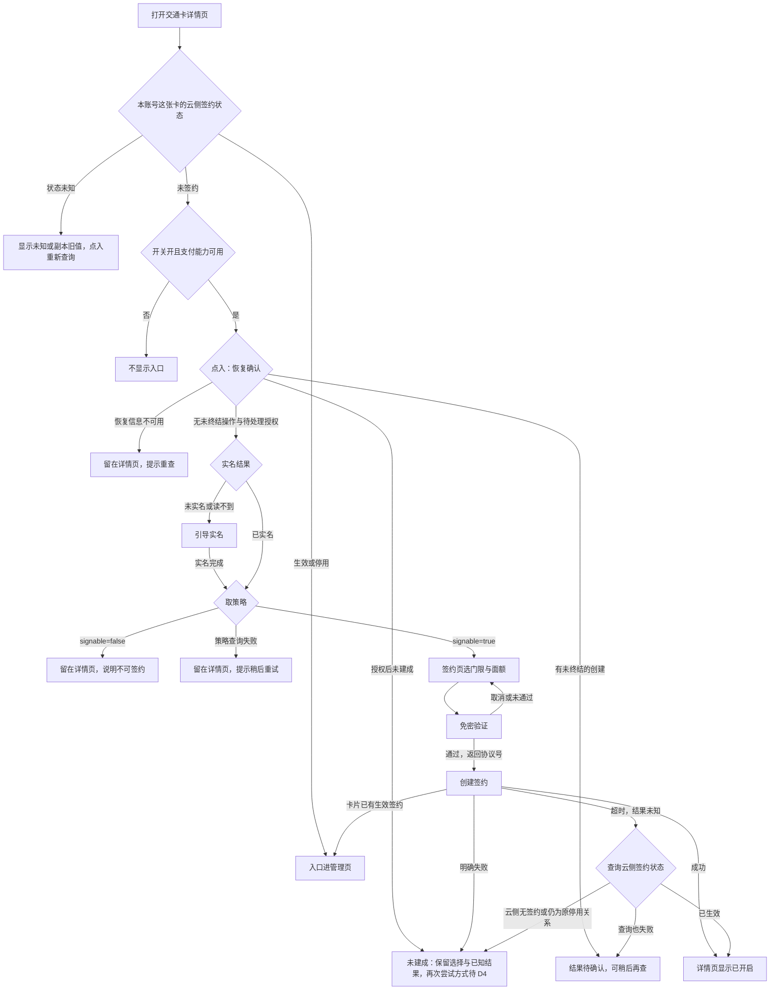
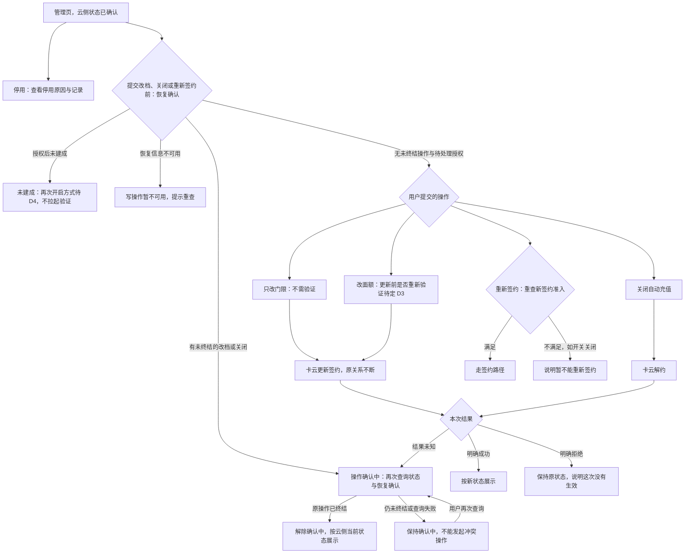
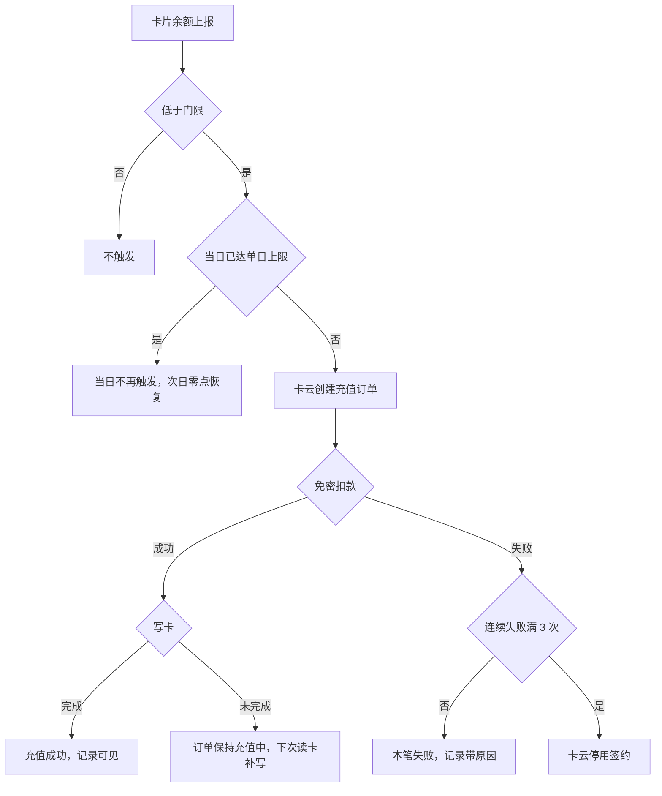

# 交通卡自动充值（钱包端）— 需求规格（Spec）

> **模块标识**: `AR90006`
> **版本**: v1.3
> **创建日期**: 2026-09-29
> **最后更新**: 2026-10-16
> **状态**: 评审中

## 0. 术语映射表（Terminology Mapping Table）

| 原始术语 | 权威模块 | 所属层 | 置信度（high / medium / low） | 易混项（必须亮出） | 用户确认 | 解释 |
|---------|---------|--------|-------------------------------|-------------------|---------|------|
| 自动充值 | WalletMain | 02-Feature | high | 交通卡余额提醒（RR90007，另一单，不共用门限档位） | [x] | 用户签约后余额低于门限时由交通卡云自动充值；钱包端只做入口、签约交互与状态展示 |
| 触发门限 | WalletMain | 02-Feature | high | 单日充值上限（另一条规则） | [x] | 余额低于多少元触发一次充值，签约时单选，签约后可修改 |
| 单笔面额 | WalletMain | 02-Feature | high | 免密扣款单笔额度（随面额设置） | [x] | 每次自动充入多少元，签约时单选，签约后可修改 |
| 签约 | WalletMain | 02-Feature | high | 签约关系的真源是交通卡云，钱包端只承担签约交互 | [x] | 用户选好门限面额、同意协议并通过免密验证后建立的自动充值关系 |
| 签约状态未知 | WalletMain | 02-Feature | high | 本地副本缺失不等于未签约；副本旧值不等于当前生效 | [x] | 本账号这张卡的云侧签约状态这次没有取得（查询失败或响应无效），只显示未知或副本旧值并提供重新查询 |
| 免密验证 | WalletMain | 02-Feature | high | 验证界面由支付部件拉起，钱包端只承接拉起与授权结果 | [x] | 首次签约时由支付部件拉起、用户本人当场确认的授权，通过后返回协议号 |
| 未实名 / 实名认证 | AccountManager | 04-BusinessBase | high | 账号能力现只暴露登录态，实名结果为新增消费（D7） | [x] | 未实名用户入口可见，点入引导完成实名，完成实名前签不成 |
| 管理页 / 停用态 | WalletMain | 02-Feature | high | 停用的判定与原因来自交通卡云，钱包端只展示；停用后能管理不等于能重新签约 | [x] | 承载签约状态、最近记录与改档、关闭、重签入口的页面；停用态顶部为停用横幅 |
| 卡号脱敏 | CommFunc | 05-SystemBase | high | 只用于展示；接口里的卡片标识是业务身份，不脱敏；签约号不是卡号 | [x] | 管理页展示卡号时取当前卡片的卡号，复用公共脱敏能力，不在业务内手写算法 |
| 观测成功占比 | WalletMain | 02-Feature | high | 不是背景里的签约转化率，也不是最终业务成功率 | [x] | 本端已结算的尝试里观测到成功的占比；结果未知与中断另列 |

**回写约定**：所有新增 / 修正的条目在用户批准后必须同步追加到 `doc/glossary.yaml`。

## 1. 功能概述

交通卡自动充值让用户对一张交通卡签约一次，之后余额低于自设门限时由交通卡云自动充值，把「想起来充值」从用户身上移走。产品目标（上游约束：产品需求）：签约用户的闸机余额不足发生率降到万分之五以下；签约转化率不低于交通卡月活的 8%。两项都是服务端按全局口径统计的业务目标，钱包端以入口露出和签约顺畅支撑，不直接承诺。

本 AR 承担钱包端：交通卡详情页的自动充值入口、签约页（门限、面额、协议）、免密验证拉起、实名引导、创建签约、管理页（状态、记录、改档、关闭、停用重签）与端侧暂存。判定与扣款全部在服务端，钱包端没有「发起自动充值」的动作；**判定输入是服务端记录的余额，不是手机显示的余额**——离线刷卡后手机余额长时间不准，按它判定会扣出用户预期之外的钱。

本期交付是按已定接口契约、以可替换模拟数据验证的钱包端交互与产物（D7）；正式向用户开放另有真实接入条件，见 §9.1.4 与 §8 的开放说明。

## Scope 声明

> plan（Design）必须继承本节的 `in_scope_modules`；coding 的 git diff 不得越界到本节之外的模块。

### Scope 模块清单

| 字段 | 取值 | 说明 |
|------|------|------|
| 本需求允许修改的模块 | `WalletMain`、`Phone` | WalletMain 承载交通卡详情页与入口、签约页、管理页、自动充值数据仓库、签约关系副本与签约暂存；Phone 只做新增页面的宿主路由登记 |
| 本需求明确不修改的模块 | `AccountManager`、`CommUI`、`CommFunc` | 只读消费既有能力（登录态、组件、导航、日志、脱敏） |

### Scope 结构化字段（供 Spec 提取，必填）

```yaml
in_scope_modules:
  - WalletMain
  - Phone
out_of_scope_modules:
  - AccountManager
  - CommUI
  - CommFunc
rationale: |
  交通卡详情页、自动充值入口、签约页、管理页与端侧数据仓库承载在钱包主 feature（WalletMain）。
  工程里没有交通卡详情页：卡包页的本地卡区只有空态，首页卡片堆叠里的交通卡是展示用卡面，
  本单在 WalletMain 新增交通卡详情页承载入口，挂载路径由 plan 定。
  Phone 必须在 in_scope：宿主 Phone/src/main/ets/pages/index.ets 的 navDestinationMap 是硬编码
  if/else 分支（现仅登记 CardPackPage/AddCardEntryPage），新增页面要在该分支加名字映射。
  AccountManager 只提供登录态；实名结果与卡云接口要的账号标识它都没有暴露，
  本期按 D7 由 WalletMain 的模拟数据源提供，不从脱敏展示串反推账号；三项真实来源列为接入依赖。
  CommUI/CommFunc 只做组件与工具复用（NavPathContext/Logger/MaskUtil），三者均不改。
  若下游想把逻辑提到公共模块，须先发起 scope 扩展提议。
```

### Visual Handoff（视觉交接，供 check-spec 读取）

```yaml
ui_change: new_or_changed
visual_handoff:
  kind: repo_assets
  fidelity_target: semantic_layout
  asset_acquisition_mode: approximate
  authoritative_refs:
    - id: detail_entry
      path: doc/features/AR90006/ux-reference/detail-entry.png
      caption: 交通卡详情页的自动充值入口：余额行之下、充值记录之上的一整行入口
    - id: signup_page
      path: doc/features/AR90006/ux-reference/signup-page.png
      caption: 自动充值签约页：门限与面额单选，协议勾选后开启才可点
    - id: verify_page
      path: doc/features/AR90006/ux-reference/verify-page.png
      caption: 免密验证页：首次签约过一次免密验证，说明单笔额度
    - id: manage_page
      path: doc/features/AR90006/ux-reference/manage-page.png
      caption: 自动充值管理页与记录列表：顶部签约状态、下方最近记录、失败展示原因
    - id: disabled_state
      path: doc/features/AR90006/ux-reference/disabled-state.png
      caption: 停用态：连续扣款失败停用后顶部为停用横幅并给出失败原因
```

### 最小改动原则

1. **默认就地实现**：自动充值逻辑实现在 WalletMain 内（页面、数据仓库、副本与暂存），不向上提公共层。
2. **禁止默默扩展**：若发现需在 AccountManager/CommUI/CommFunc 新增公共接口，停下发起 scope 扩展提议给用户确认。
3. **公共能力优先复用**：导航取栈用 CommFunc `NavPathContext`、日志用 `Logger`、展示脱敏用 `MaskUtil`、组件与主题色用 CommUI 既有资产。

## 2. 目标用户与使用场景

### 2.1 目标用户

| 用户角色 | 描述 |
|----------|------|
| 交通卡持卡人 | 钱包里有可刷乘交通卡、不想在闸机前才发现余额不足的用户 |
| 未实名用户 | 已登录但账号未完成实名的用户；能看到入口，完成实名前签不成 |
| 已签约用户 | 已建立自动充值签约（含被停用）的持卡人，要看记录、改档、关闭或重新签约 |

### 2.2 使用场景

| 场景编号 | 场景名称 | 场景描述 | 前置条件 |
|----------|----------|----------|----------|
| S1 | 入口与开通准入 | 用户在交通卡详情页看到「自动充值」入口；未实名点入被引导去实名；已实名但卡云判定这张卡不可签约时看到原因，不进签约页 | 打开交通卡详情页，这张卡云侧未签约 |
| S2 | 首次签约 | 选门限与面额、同意免密扣款协议、过免密验证、创建签约 | 已实名、该卡云侧未签约、开关开、支付能力可用、策略可签约 |
| S3 | 自动充值发生 | 余额低于门限时由交通卡云完成充值，用户无操作，记录可见 | 已签约、未停用、当日未达单日上限 |
| S4 | 管理签约 | 改门限（即时生效）、改面额（验证要求待定 D3）、关闭自动充值、看最近记录 | 已签约进入管理页，云侧状态已确认 |
| S5 | 已签约再进入 | 已有生效签约时再点入口，进入管理页而不是重新签约 | 已有生效签约 |
| S6 | 停用后查看与重签 | 扣款连续失败停用后看失败原因；重新签约时重新检查新签约准入 | 签约已被交通卡云停用 |
| S7 | 验证中断与重试 | 免密验证取消或未通过，留在签约页、已选门限面额保留，可直接再试 | 已点开启 |
| S8 | 创建结果未知 | 创建签约超时，以云侧签约状态确认结果 | 免密验证已通过 |
| S9 | 开关关闭 | 运营关闭开关后未签约用户看不到入口；已签约用户入口照常、自动充值照常 | 运营侧关闭功能开关 |
| S10 | 状态未知 | 云侧状态取不到时只显示未知或副本旧值，可重新查询，不进签约页也不开放管理操作 | 状态查询失败或响应无效 |
| S11 | 管理操作结果未知 | 改档或关闭的响应丢失，页面保持确认中，确认解除前不能发起冲突操作 | 已提交改档或关闭 |
| S12 | 退出或清数据后再操作 | 退出登录、换号或清除应用数据后，同一账号再次签约、重新签约、改档或关闭，先由对端的恢复确认决定能否写入 | 本地副本已清除 |

## 3. 功能清单

| 编号 | 功能名称 | 优先级 | 描述 | 关联场景 |
|------|----------|--------|------|----------|
| F1 | 详情页自动充值入口 | P0 | 交通卡详情页余额行之下、充值记录之上的一整行入口。先按本账号这张卡的云侧签约状态分流：生效、停用进管理页；状态未知只显示未知或副本旧值、点入重新查询。未签约时再按新签约准入决定可见与去向：开关关、读不到或支付能力不可用不显示；点入时先取恢复确认（§5.3），有授权后未建成进未建成说明，有未终结的创建显示结果待确认，恢复信息不可用留在详情页提示重查；可以写入时未实名引导实名，已实名取策略，`signable=true` 才进签约页，`false` 留在详情页说明原因（D2、D5，见 §4.3） | S1, S5, S9, S10, S12 |
| F2 | 签约页 | P0 | 门限、面额单选，选项取策略接口返回的档位；协议勾选后「开启」才可点；中途离开暂存已选值 | S2, S7 |
| F3 | 免密验证拉起 | P0 | 点「开启」拉起支付部件验证，单笔额度等于所选面额，协议文案写明单日最多充 200 元（上游约束：产品需求）；协议号只透传不持久化 | S2, S7 |
| F4 | 创建签约 | P0 | 验证通过后创建签约；成功显示已开启；已有生效签约返回既有签约号、转管理页；明确失败或超时后确认云侧无签约时，保留已选值与已知结果、说明这次没有开通，并按账号加卡片记下这次授权后未建成，首次签约与停用重签同样记；离开签约页、重进或应用重启后再进这张卡仍是未建成状态，退出登录或清数据后由恢复确认重建，原有停用关系不证明这次授权已经建成；再次开启的方式待 D4；超时以云侧签约状态确认 | S2, S5, S6, S8, S12 |
| F5 | 实名引导 | P0 | 未实名点入引导去账号能力完成实名，完成实名前签不成；实名回来后取策略，可签约时进签约页、已选值仍在（D2） | S1 |
| F6 | 签约暂存 | P1 | 验证取消、未通过、去实名或中途退出时暂存已选门限面额，下次进入回填；按账号加卡片绑定，换卡不回填别的卡，退出登录清除本账号全部暂存 | S2, S7 |
| F7 | 管理页 | P0 | 顶部签约状态与当前门限面额、最近记录（时间、金额、结果；失败原因取记录的原因字段，缺值显示「原因暂不可用」；卡号取当前卡片并脱敏）、停用横幅与原因 | S3, S4, S6 |
| F8 | 修改门限面额 | P0 | 走更新接口，原签约关系不断（D1）；只改门限不需验证、即时生效；改面额的验证要求待定（D3）；结果未知按 §5.2 的解除条件 | S4, S11 |
| F9 | 关闭自动充值 | P0 | 二次确认后解约；之后不再触发；不回滚进行中订单、不撤销已完成订单；结果未知按 §5.2 的解除条件 | S4, S11 |
| F10 | 停用重签 | P1 | 停用横幅给出失败原因与重新签约入口；点重新签约时先取恢复确认、再重新检查新签约准入：上次重签授权后未建成时停在 D4 边界、不拉起验证，有未终结操作或恢复信息不可用时暂不能重签；都满足才走签约路径，准入不满足（如开关关闭）说明暂不能重新签约 | S6, S12 |
| F11 | 签约关系副本 | P1 | 按账号加卡片保存签约号、门限、面额、状态、未确认操作与授权后未建成记录，用于先行展示、离线展示与同一次登录内的恢复，不作能否写入的唯一依据；进入管理页与做出状态相关操作前以一次云侧查询确认，同一次页面内复用这次结果；查询失败展示副本旧值并标明未确认，不凭旧值判定当前生效，也不推断未签约 | S3, S4, S10, S11 |
| F12 | 写操作前的恢复确认 | P0 | 首次签约点入、停用重签、改档与关闭提交前，向模拟对端取一次本账号本卡的恢复确认（§5.3），同一次动作内复用；对端明确没有未终结操作、也没有待处理的成功授权才开放写操作；退出登录、换号与清数据只清钱包端，不改变这条规则 | S2, S4, S6, S11, S12 |

> **新增端云域声明**：F1 依赖的交通卡详情页，F2–F11 依赖的五个端云接口（`getAutoTopupPolicy`/`createAutoTopupContract`/`getAutoTopupStatus`/`updateAutoTopupContract`/`cancelAutoTopupContract`）与支付部件免密拉起、账号实名结果、卡云接口要的账号标识，工程里都不存在（in_scope 模块检索 HTTP/RPC 封装零命中；无交通卡详情页；AccountManager 只有登录态与脱敏展示账号）。按 D7：钱包端按已定接口契约实现，用可替换的模拟数据验证签约、管理、失败与结果未知各分支；与卡云、支付的真实联调另行验收，本需求不算验过。写操作前的恢复确认（§5.3）是本轮维护设计给模拟对端补的业务事实，卡云与支付目前没有对应接口，真实接入依赖见 §9.1.4。

## 4. 页面/界面描述

视觉规范沿用钱包现有卡片页面样式（白卡片分隔、顶栏返回、系统图标），不新增控件类型；参考图见 `ux-reference/` 五屏，以语义布局为准。

### 4.1 页面总览

```
交通卡详情页（F1）: [余额行] / [自动充值入口行] / [充值记录]
签约页（F2/F3/F5/F6）: [门限单选组] / [面额单选组] / [协议勾选] / [开启按钮]
免密验证页（支付部件拉起，F3）: [单笔额度说明] / [确认/取消]
管理页（F7–F10）: [签约状态区或停用横幅] / [最近记录列表] / [修改/关闭/重签入口]
```

### 4.2 UI 组件详细描述

#### 区域 1: 交通卡详情页入口区（F1，detail_entry）

| 组件 | 类型 | 内容/数据 | 交互行为 |
|------|------|-----------|----------|
| 自动充值入口行 | 列表行 | 「自动充值」+ 行内状态（未开启 / 已开启·当前门限面额 / 已停用 / 状态未知或旧值·未确认） | 去向按 §4.3；防重入 |
| 余额行 | 展示 | 卡片余额（展示用，不参与判定） | 无 |
| 充值记录 | 列表 | 自动充值最近记录（同管理页，取状态查询的最近记录） | 点击进入管理页 |
| 开通提示 | 提示 | 不可签约原因（`unsignableReason`，为空时显示通用「这张卡暂不能开通自动充值」）；策略取不到时「暂时无法开通，请稍后重试」 | 留在详情页，不进签约页、不拉起验证 |

#### 区域 2: 签约页（F2/F3/F5/F6，signup_page）

| 组件 | 类型 | 内容/数据 | 交互行为 |
|------|------|-----------|----------|
| 返回 | 图标按钮 | 系统符号 | 返回详情页，暂存已选门限面额 |
| 门限单选组 | 单选 | 取 `getAutoTopupPolicy.thresholdOptions`（现行 5 / 10 / 20 / 30 元，上游约束：产品需求） | 选中高亮 |
| 面额单选组 | 单选 | 取 `getAutoTopupPolicy.amountOptions`（现行 20 / 50 / 100 元，上游约束：产品需求） | 选中高亮 |
| 免密扣款协议 | 勾选框 | `agreementText`，写明单笔上限等于所选面额、单日最多充 200 元（上游约束：产品需求） | 勾选后「开启」才可点 |
| 开启按钮 | 按钮 | 「开启」 | 门限面额已选且协议勾选后可用；拉起免密验证；处理中不重复提交 |
| 结果说明 | 提示 | 未建成：「这次没有开通成功，已选的门限和面额已保留」；待确认：「开通结果确认中」 | 未建成后再次开启的处理待 D4；待确认可稍后再查 |

#### 区域 3: 免密验证页（支付部件拉起，F3，verify_page）

| 组件 | 类型 | 内容/数据 | 交互行为 |
|------|------|-----------|----------|
| 验证页 | 外部能力页 | 单笔额度说明 + 确认/取消 | 确认返回协议号；取消或未通过回签约页、已选值保留 |

#### 区域 4: 管理页（F7–F10，manage_page / disabled_state）

| 组件 | 类型 | 内容/数据 | 交互行为 |
|------|------|-----------|----------|
| 签约状态区 | 展示 | 「自动充值已开启」+ 当前门限与面额；停用时换成停用横幅；查询失败显示副本旧值并标明未确认，或状态未知 | 未确认时可重新查询，改档、关闭、重新签约不可用 |
| 停用横幅 | 展示/入口 | 「自动充值已停用」+ 停用原因（`disabledReason`）；上次重新签约授权后未建成时加一句「上次重新签约没有开通成功」 | 重新签约入口：点击时先取恢复确认再重查新签约准入；上次重签授权后未建成时说明再次开启待 D4，不拉起验证 |
| 最近记录列表 | 列表 | 时间、金额、结果；失败记录带失败原因（记录的原因字段，缺值显示「原因暂不可用」，不用停用原因代替）；卡号取当前卡片的卡号用 `MaskUtil.maskAccount` 生成展示值，不超过 4 位的卡号不展示 | 滚动查看最近记录 |
| 修改门限面额 | 入口 | 当前门限与面额 | 提交前取恢复确认，可以写入才调更新接口，原签约不断；改面额交互按 D3 结论定；有未确认操作时不可提交 |
| 关闭自动充值 | 按钮 | 「关闭自动充值」 | 二次确认、取恢复确认后解约；进行中订单不回滚、已完成订单不撤销；有未确认操作时不可提交 |
| 操作确认中 | 提示 | 待确认的操作与目标值（「修改确认中」「关闭确认中」） | 可再次查询云侧状态与恢复确认；离开后再进入仍从这项操作恢复，退出登录后由恢复确认重建 |

### 4.3 页面状态

入口与页面的去向先看本账号这张卡的云侧签约状态，未签约时再看新签约准入；准入四项（功能开关、支付能力、实名结果、策略可签约性）相互独立，`unsignableReason` 只作提示文字，不按它的内容分流。

| 状态 | 描述 | 触发条件 |
|------|------|----------|
| 详情页-入口·去管理 | 入口显示已开启或已停用，点入进管理页 | 云侧 `active` 或 `disabled`，与开关无关（D5） |
| 详情页-入口·状态未知 | 无副本时显示状态未知；有副本时显示副本旧值并标明未确认；点入重新查询，查清后按结果分流，查询仍失败时有副本进管理页未确认态、无副本停在详情页 | 状态查询失败或响应无效 |
| 详情页-入口隐藏 | 不显示入口 | 云侧 `none`，且开关关或读不到（D5），或支付能力不可用 |
| 详情页-入口·去实名 | 入口显示，点入引导实名 | 云侧 `none`、开关开、支付可用，实名结果为未实名或读不到（D2） |
| 详情页-入口·去签约 | 入口显示，点入取策略后进签约页 | 云侧 `none`、开关开、支付可用，点入时恢复确认为无未终结操作与待处理授权，已实名且策略 `signable=true` |
| 详情页-不可签约提示 | 留在详情页，显示不可签约原因或通用提示 | 同上但策略 `signable=false`（原因为空用通用提示） |
| 详情页-开通条件待确认 | 留在详情页，提示稍后重试 | 点入时策略查询失败或响应无效 |
| 详情页-恢复待确认 | 留在详情页，提示稍后重查；不进签约页、不拉起验证 | 点入时恢复确认失败、缺字段或对应不上当前账号与卡片 |
| 签约页-回填 | 按暂存回填已选值 | 实名返回、验证取消或未通过、中途退出后再进 |
| 签约页-验证中 / 创建中 | 「开启」处理中，不重复提交 | 已点开启 |
| 签约页-结果待确认 | 不显示成功也不显示未签约，提示稍后再查 | 创建超时且状态查询也失败；或点入时恢复确认返回这张卡有未终结的创建 |
| 签约页-未建成 | 说明上次授权后没有开通，保留已选值与已知结果；再次开启的方式待 D4，「开启」不可用，不重新拉起免密验证 | 授权后创建明确失败或超时后确认云侧无签约；之后离开签约页、重进或应用重启，再从这张卡的入口进入（云侧仍为未签约）；或点入时恢复确认返回授权后未建成（含退出登录、清数据后同账号重登） |
| 管理页-未确认 | 显示副本旧值并标明未确认或状态未知，可重新查询；改档、关闭、重新签约不可用 | 状态查询失败或响应无效 |
| 管理页-操作确认中 | 显示待确认的操作与目标值，可查询；不能提交新的改档或关闭 | 改档或关闭结果未知且未按 §5.2 解除；或写操作前恢复确认返回有未终结的改档或关闭（含退出登录、清数据后同账号重登） |
| 管理页-停用·重签不可用 | 可看停用原因与最近记录；重新签约不可用并说明原因 | 云侧 `disabled`，重新检查新签约准入不满足（如开关关闭、未实名、`signable=false`） |
| 管理页-停用·重签未建成 | 可看停用原因与最近记录，说明上次重新签约授权后没有建成、已选值保留；再次开启待 D4，重新签约不可用、不拉起验证 | 云侧仍为 `disabled`，这张卡有停用后重签授权后未建成的记录，或点重新签约时恢复确认返回授权后未建成 |
| 管理页-恢复待确认 | 按云侧状态展示；改档、关闭、重新签约不提交，提示重查 | 写操作前恢复确认失败、缺字段或对应不上当前账号与卡片 |

## 5. 业务流程图

### 5.1 签约路径

入口先按这张卡在云侧的签约状态分流，未签约时检查开关与支付能力，点入时先取恢复确认（§5.3），再检查实名与策略可签约性；授权之前的失败回签约页重试，授权之后没有建成的停在 D4 待定的边界上：



- 回到签约页的分支都按暂存回填已选门限面额。
- 授权之后没有建成（明确失败，或超时后确认云侧无签约、重签时仍为原停用关系）时不留半签约状态，按账号加卡片记下这次未建成；再次开启是复用协议号还是重新验证，等 D4，本图不画再次尝试的去向。首次签约与停用重签同样适用，原有停用关系不能证明这次授权已经建成。
- 这条记录只在恢复确认表明这次授权已由对端对应到建立的签约关系时清除；退出登录或清数据清掉本地记录后，点入时由恢复确认重建，不因记录丢失重新拉起验证。验证取消或未通过没有形成成功授权，照常可以再次开启。
- 超时不当成没签成，以云侧签约状态为准。
- 判重由交通卡云按「卡片 + 生效状态」完成，钱包端按返回的既有签约号转管理页。

### 5.2 管理路径

改档、关闭与停用重签都从云侧状态已确认的管理页出发，提交前先取恢复确认（§5.3）；改档和关闭各有明确成功、明确拒绝、结果未知三种结果，结果未知只有拿到明确结果或恢复确认表明原操作已终结才解除，停用重签要重查新签约准入：



- 解约不回滚进行中的订单，也不撤销已完成订单。
- 状态以云侧查询为准；进入管理页查询失败时显示未确认，改档、关闭、重新签约都不可用。
- 结果未知的解除条件：拿到这次操作的明确成功或明确拒绝，或恢复确认表明这张卡已没有未终结的操作。状态查询看到目标状态（改档后门限面额等于目标值、关闭后为未签约）时页面按目标状态展示，冲突操作的限制仍等恢复确认；连续查到原值、查询失败或只是本地没有未确认记录，都不是解除依据。不按查询次数或等待时长推断失败。
- 确认中可以再次查询、离开页面，再进入时仍从这项未确认操作恢复；退出登录或清数据清掉本地记录后，同一账号再提交写操作时由恢复确认重建确认中。确认中不能提交新的改档或关闭。本期由模拟对端给出恢复确认；真实卡云补齐请求终态的查询或等价保证之前，原值长期不变的情形没有安全的解除方式，这是正式开放的依赖（§9.1.4）。
- 停用后能看原因和记录，但重新签约是一次新签约，要重新满足开关、支付能力、实名与策略可签约性。上次重签授权后没有建成时，原有的停用关系不能证明这次授权已建成，重新签约停在 D4 边界、不再拉起验证。D5 只定了开关不影响已签约用户的入口与管理，没有明确停用用户在开关关闭时能否重新签约；本规格按新签约处理，随评审确认。

### 5.3 写操作前的恢复确认

钱包端的本地记录会随退出登录、换号和清除应用数据被清掉，对端已受理的操作和支付已形成的授权却不会随之消失；本地没有记录，证明不了没有仍可能晚到的请求。所以首次签约点入、停用重签、改档与关闭提交前，钱包端向模拟对端取一次本账号本卡的恢复确认，同一次动作内复用这次结果，按下表决定能否写入。这是本轮维护设计给模拟交付补的前提，随具体稿待用户审定，不是卡云与支付已有的接口。

| 恢复结果 | 对端给出的事实 | 钱包端动作 |
|---|---|---|
| 有未终结操作 | 模拟卡云保留已受理的创建、改档或关闭及其对象、类型与目标；处理中或判定不了终态的都算未终结 | 重建这张卡的未确认操作，显示确认中；只能查看和再次查询，不发冲突的新操作 |
| 授权后未建成 | 模拟支付保留成功授权，模拟卡云给出这次授权的建约结果为未建成；原有停用关系不算建成 | 重建未建成记录，停在 D4 边界：再次开启不开放，不重新拉起验证 |
| 无未终结操作与待处理授权 | 对端明确：已受理的请求都已终结、迟到也不会生效，此前的成功授权都已对应到建立的签约关系，或从未有这类操作 | 清除本地对应记录，按云侧当前状态、开关、支付能力、实名与策略走正常路径 |
| 恢复信息不可用 | 查询失败、缺字段，或结果对应不上当前账号与卡片 | 只读内容照常展示；创建、重新签约、改档、关闭不开放，提示重查 |

- 「无未终结操作」覆盖已经发出、还没到达对端的请求：对端只在确认旧尝试已终结、或它迟到也会被拒绝时给出这个结果，否则返回有未终结操作。支付的成功授权也不因卡云暂未看到建约请求而消失。
- 模拟卡云受理创建、更新与解约时自己再核一次未终结操作与未建成授权，冲突就明确拒绝；钱包端收到这类拒绝后重取恢复确认并按结果展示，页面此前查过一次不能绕过这条限制。
- 恢复确认在登录后按当前账号取得；旧账号的晚到响应和回调不写入新账号，也不重建已清除的副本。
- 退出登录与清数据照常清除钱包端的副本和暂存（§7.3）；清除不撤销、不删除对端已受理的操作和授权，清除与重新允许写入是两个动作，由恢复确认接起来。
- 查看不受影响：签约状态、停用原因、最近记录照常展示；验证取消或未通过没有形成成功授权，照常可以再次开启。

### 5.4 服务端触发子流程（钱包端只承接结果）

一笔自动充值是否发生取决于余额是否低于门限、当日是否已到上限；扣款失败连续累计到 3 次时卡云停用签约（上游约束：产品需求）。钱包端在其中没有任何动作，只承接结果：



- 单日达到上限是正常受限，不计入连续失败（上游约束：系统设计）。
- 当日已充额度加本笔面额会超过单日上限时怎样处理，材料没有说明，由卡云定规则；钱包端只展示卡云给出的结果，不拆额、不改面额。
- 写卡未完成时端侧不重试、不重复下单。

### 5.5 不建模声明

不采用「端侧监测余额并直接发起扣款」：离线刷卡后端侧余额失真，扣款职责在服务端。本节只建模钱包端参与的两条用户路径，服务端子流程仅作端侧承接结果的对照。

## 6. 异常/边界场景处理

| 编号 | 异常场景 | 触发条件 | 处理方式 | 用户提示 | 关联功能 |
|------|----------|----------|----------|----------|----------|
| E1 | 免密验证取消或未通过 | 用户取消或验证未通过 | 不建立签约关系、不留半签约状态，已选值保留 | 留在签约页，可直接再次开启 | F3, F6 |
| E2 | 未实名 | 账号能力的实名结果为未实名或读不到（本期由模拟实名结果承载，D7） | 入口可见，引导实名；实名前签不成；实名回来后取策略，可签约时进签约页并回填 | 请先完成实名认证 | F1, F5 |
| E3 | 已有生效签约 | 入口状态为生效 / 创建签约返回 `existed=true` | 进管理页，不重复建约 | 已开启自动充值 | F1, F4 |
| E4 | 授权后创建签约明确失败 | 创建返回错误 | 留在签约页、已选值与已知结果保留、不显示成功；按账号加卡片记下授权后未建成，离开、重进或应用重启后仍按未建成显示，不重新拉起验证；再次开启的方式待 D4，本规格不写死。首次签约与停用重签同样记录；退出登录或清除数据清掉本地记录后，点入或点重新签约时由恢复确认重建（§5.3），不因记录丢失重新拉起验证 | 这次没有开通成功，已选的门限和面额已保留 | F4, F10, F12 |
| E5 | 创建签约超时 | 创建请求超时，或响应缺少 `contractNo` / `existed` | 不当成功，调状态查询确认：已生效按已开启；云侧无签约、或停用重签时仍为原停用关系，按未建成（同 E4，再次尝试待 D4）；查询失败保持「结果待确认」 | 开通结果确认中 / 结果待确认，可稍后再查 | F4, F11 |
| E6 | 云侧状态查询失败 | 进入详情页或管理页取状态失败，或响应无效（`contractStatus` 缺失或不在三值内；生效、停用时缺签约号、门限或面额） | 有副本时展示副本旧值并标明未确认，旧值不作当前生效的依据；无副本时显示状态未知；都可重新查询；不进签约页，改档、关闭、重新签约不可用；不按副本缺失推断未签约 | 状态暂时获取不到，可重试 | F1, F7, F11 |
| E7 | 本地副本缺失 | 清除应用数据、首次进入 | 以云侧查询恢复展示：生效、停用照云侧显示，云侧无签约才走新签约准入；未确认操作与授权后未建成不因副本缺失当作没有，写操作前由恢复确认重建（§5.3） | 按云侧状态展示 | F11, F12 |
| E8 | 单日达到上限 | 当日累计充值达 200 元（上游约束：产品需求） | 当日不再触发、不计入连续失败、次日零点恢复；跨上限的一笔怎样处理由卡云定，端侧只展示结果 | 记录正常展示，不显示失败 | F7 |
| E9 | 连续失败停用 | 扣款连续失败 3 次（上游约束：产品需求） | 交通卡云停用签约；管理页展示停用横幅、停用原因与重签入口 | 已停用 + 原因 | F7, F10 |
| E10 | 扣款成功但写卡未完成 | 写卡中断 | 订单保持充值中，卡云下次读卡补写；端侧不重试、不重复下单 | 记录显示充值中 | F7 |
| E11 | 开关关闭 | 运营关闭功能开关（本期由模拟配置承载，D7）；开关读不到按关闭处理 | 未签约用户隐藏入口；已签约用户入口、管理与自动充值照常（D5）；停用用户重新签约按新签约准入，开关关闭时不可用 | 已签约用户无感知；停用用户看到「暂不能重新签约」 | F1, F10 |
| E12 | 支付部件能力不可用 | 免密能力不可用 | 隐藏新签约入口，已签约用户照常；停用用户重新签约不可用 | 未签约用户看不到入口 | F1, F3, F10 |
| E13 | 改面额的验证要求未定 | 用户在管理页改面额 | 只改门限的路径照常；改面额交互按 D3 结论定，结论前不写死 | — | F8 |
| E14 | 重复快速点击 | 入口、开启、关闭被连续触发 | 防重入；在途请求不二次提交 | 单次响应 | F1, F2, F9 |
| E15 | 本期不做 | 预约充值、多卡共用签约、家庭代充、记录按月筛选与导出（D6） | 不提供入口 | 不展示 | F7 |
| E16 | 改档或关闭结果未知 | 更新或解约请求超时、响应丢失或响应无法判定 | 页面保持确认中，按 §5.2 的解除条件：拿到明确成功、明确拒绝，或恢复确认表明原操作已终结才解除；查到目标状态只更新展示，仍是原值或查询失败保持确认中，不判失败、不自动重发、不能发起冲突操作；离开再进入从这项操作恢复 | 修改确认中 / 关闭确认中 | F8, F9, F12 |
| E17 | 策略判定不可签约 | 云侧未签约、已实名、开关开、支付可用，策略返回 `signable=false` | 留在详情页说明原因；原因为空给通用提示；不按原因文字推断实名或其他状态；不进签约页、不拉起免密验证 | 原因文字 / 这张卡暂不能开通自动充值 | F1 |
| E18 | 策略查询失败 | 点入口取策略失败或响应无效 | 留在详情页，不进签约页 | 暂时无法开通，请稍后重试 | F1 |
| E19 | 记录缺失败原因 | 失败记录没有原因字段或为空 | 显示「原因暂不可用」，不用停用原因代替 | 原因暂不可用 | F7 |
| E20 | 解约返回未解约 | `cancelAutoTopupContract` 返回 `cancelled=false` | 按明确未生效处理：保持原状态、说明关闭没有成功；业务原因待卡云说明（依赖） | 关闭没有成功，请稍后再试 | F9 |
| E21 | 停用后重新签约准入不满足 | 停用态点重新签约，开关关、支付不可用、未实名或 `signable=false` | 不进签约页，说明原因；停用原因与记录照常可看 | 暂不能重新签约 + 原因 | F10 |
| E22 | 写操作前恢复确认不可用 | 恢复确认查询失败、缺字段或对应不上当前账号与卡片 | 不当作没有未终结操作；创建、重新签约、改档、关闭不开放，只读内容照常，可以重查 | 暂时无法确认上次的操作，请稍后重试 | F12 |
| E23 | 退出或清数据后同账号再操作 | 本地副本已清除，同一账号重新登录后点入签约、重新签约、改档或关闭 | 先取恢复确认：有未终结操作显示确认中、不能第二次提交；授权后未建成显示未建成、不重新拉起验证；对端明确无未终结操作与待处理授权才按正常准入继续 | 按恢复结果展示 | F4, F8, F9, F10, F12 |
| E24 | 旧账号的晚到结果 | 退出登录或换号后，旧会话的创建、更新、解约响应或回调才到达 | 不写入新账号的页面与副本，不重建已清除的记录；新账号按自己的恢复确认与云侧状态展示 | 无 | F11, F12 |

## 7. 非功能性需求

### 7.1 性能要求

| 指标 | 要求 | 说明 |
|------|------|------|
| 端云请求时机 | 只在打开详情页、点入口、进入管理页或做出操作时调用；进入管理页确认一次云侧状态，同一次页面内复用；创建、改档、关闭结果未知时查询状态，用户可再次查询；首次签约点入、停用重签、改档与关闭提交前取一次恢复确认，同一次动作内复用 | 不设定时拉取与后台轮询（DFX-01）；本地副本只作先行与离线展示 |
| 页面时延 | 材料未给时延数值，本期不设端侧时延阈值 | 上线后按 §9.4 观察流程结果，不以时延作验收判据 |

### 7.2 兼容性要求

| 维度 | 要求 |
|------|------|
| 系统版本 | HarmonyOS API 12 及以上（平台基线） |
| 设备类型 | 手机形态 |
| 屏幕适配 | 沿用钱包现有卡片页面样式与尺寸资源，不新增控件类型 |
| RTL | 新页面方向性参数用 start/end，语言切换镜像正确（平台基线） |
| 数据兼容 | 五个接口都是钱包端的新调用：既有四个接口按系统设计的字段消费，`updateAutoTopupContract` 为澄清会新增；响应字段按 §9.1.1 逐项区分必需、按状态可空与待补充；不新增、不修改错误码，未知码按通用失败处理 |

### 7.3 安全性要求

| 要求 | 说明 |
|------|------|
| 展示脱敏 | 管理页记录的卡号取当前卡片的卡号，在组装展示内容处用 `MaskUtil.maskAccount` 生成展示值，不改写记录对象；不超过 4 位的卡号不展示；签约号不当作卡号展示 |
| 接口身份 | 接口请求里的账号标识与卡片标识是业务身份，按卡云接口原样使用，不脱敏、不进日志与事件；账号标识真实来源为账号能力，本期由模拟数据源提供，不从脱敏展示串反推 |
| 协议号不持久化 | `agreementNo` 只透传给创建签约，不写入本地存储、日志与事件 |
| 事件去标识 | 端侧事件只含去标识账号、卡片类型、阶段与结果分类；不含卡号、卡片标识、金额明细与支付参数 |
| 本地数据最小化 | 签约关系副本与签约暂存按账号加卡片绑定，字段见 §9.1.2；退出登录清除本账号全部卡片的副本与暂存（含未确认操作与授权后未建成记录），不参与备份恢复；清除只清钱包端，不撤销对端已受理的操作，之后的写操作以恢复确认为准（§5.3）。副本含签约号与卡片标识，落盘保护方式与访问边界由 Plan 给出，本规格不认定普通持久化已满足 SEC-01 |

## 8. 验收标准

> 本期交付按已定接口契约以模拟数据验证（D7），以下结论只到本地模拟；与卡云、支付的真实联调另行验收。正式开放的条件见 §9.1.4，未满足时不开放对应功能。

### P0 功能验收标准

- [ ] **AC-1** (F1): 入口按云侧签约状态分流：生效、停用始终可见并进管理页，与开关无关；未签约时开关开且支付可用才可见，开关关不可见（承接：AC-R4、AC-R9）。
- [ ] **AC-1b** (F1): 云侧未签约、已实名、开关开、支付可用而策略返回 `signable=false`：留在详情页显示原因，原因为空时显示通用提示；不进签约页、不拉起免密验证。
- [ ] **AC-1c** (F1, F11): 没有本地副本且状态查询失败：入口显示状态未知，点入重新查询；查清前不进签约页、也不开放管理操作。
- [ ] **AC-2** (F1, F5): 未实名用户能看到入口，点进去被引导实名，完成实名前无法签约；实名回来后可签约时回到签约页，此前的选择仍在（承接：AC-R1、AC-R8）。
- [ ] **AC-3** (F2, F3): 门限、面额选项取策略接口返回的档位；协议勾选后「开启」才可点；点「开启」拉起免密验证，单笔额度等于所选面额，协议文案写明单日最多充 200 元（上游约束：产品需求）。
- [ ] **AC-4** (F3, F6): 在验证界面取消，回到签约页时刚才选的门限与面额仍在，可直接再次开启（承接：AC-R7）。
- [ ] **AC-5** (F4): 创建签约成功后详情页显示已开启与当前门限面额；余额低于门限时用户不做任何操作即完成充值，并能在记录里看到（承接：AC-R2）。
- [ ] **AC-6** (F4): 创建签约超时或响应缺签约号：页面不显示成功也不显示未签约；云侧已生效时按已开启展示，云侧无签约时显示未建成且门限面额仍在（再次开启方式待 D4），查询失败时提示结果待确认（承接：AC-R10）。
- [ ] **AC-6b** (F4, F11): 免密验证通过、创建明确失败后离开签约页，再从这张卡的入口进入（包括关掉应用再打开）：仍显示上次授权后未建成与保留的选择，「开启」不可用，不重新拉起免密验证；之后恢复确认表明这次授权已对应到生效的签约时，按已开启展示并清除记录。
- [ ] **AC-6c** (F4, F10, F12): 签约已停用，点重新签约、验证通过、创建明确失败后离开再进入（云侧仍为原来的停用关系）：管理页照常显示停用原因与最近记录，并说明上次重新签约没有开通成功；重新签约不可用、不重新拉起免密验证，原有停用关系不让这条记录解除。验证取消或未通过后的重签照常。
- [ ] **AC-6d** (F4, F12): 免密授权成功但创建回调丢失或建约失败，之后退出登录（或清除应用数据）再以同一账号登录：点入口或重新签约时恢复确认返回授权后未建成，按未建成显示、不重新拉起验证；恢复确认失败时不当作可以新签约，提示重查。
- [ ] **AC-7** (F7, F10): 扣款连续失败 3 次（上游约束：产品需求）后自动停用，打开管理页能看到停用状态与停用原因；点重新签约时重新检查新签约准入，满足时进签约路径，开关关闭等不满足时说明暂不能重新签约，停用原因与记录照常可看（承接：AC-R3）。
- [ ] **AC-8** (F8, F9): 改门限按新值即时生效、原签约不断、不需重新验证；关闭后不再触发自动充值。改面额的验证要求待 D3，结论前不验改面额（承接：AC-R6）。
- [ ] **AC-8b** (F8, F9): 改门限、关闭的请求响应丢失时页面显示确认中；只有明确成功、明确拒绝或恢复确认表明原操作已终结才解除；确认查询连续查到原值、之后原请求才生效的，页面在生效前一直保持确认中、不能发起新的改档或关闭；离开再进入仍显示这项确认中。
- [ ] **AC-8c** (F8, F9, F12): 改档响应丢失后退出登录，以同一账号重新登录，卡云仍在处理、状态仍为原值：发起改档或关闭时恢复确认返回有未终结操作，页面显示确认中，不能第二次改档；原请求明确终结后恢复确认表明已终结，再按正常准入可以操作。
- [ ] **AC-9** (F7): 记录中的卡号取当前卡片按现有规则脱敏展示；失败记录展示失败原因，记录只有时间、金额、结果三项时显示「原因暂不可用」，不显示停用原因（承接：AC-R5）。
- [ ] **AC-9b** (F7, F11): 状态响应缺 `contractStatus` 按状态未知、不当未签约；未签约时签约号为空按合法响应；创建响应缺签约号不当成功；解约返回 `cancelled=false` 按关闭没有生效。

### P1 功能验收标准

- [ ] **AC-10** (F11): 清除应用数据后进入：云侧生效时显示已开启并进管理页，云侧停用时显示停用与原因，云侧无签约时按新签约准入分流，云侧查询失败时显示状态未知且可重试（承接：AC-R11）。
- [ ] **AC-10b** (F11, F12): 清除应用数据后，写操作前的恢复确认失败或缺字段：不当作没有未终结操作，创建、重新签约、改档、关闭都不开放，可以重查；恢复确认明确无未终结操作与待处理授权时按正常准入继续。
- [ ] **AC-11** (F6, F11): 中途退出签约页，下次从入口进来门限与面额回填；同账号 A 卡生效、B 卡未签约时，先看 A 卡再离线进 B 卡，B 卡不显示 A 卡的签约与选择；退出登录后本账号全部卡片的副本与暂存清除，换账号登录读不到旧数据；旧账号会话的晚到响应与回调不写入新账号的页面与副本。

### P2 规约与合规验收标准

- [ ] **AC-12** (F2, F7): 新页面方向性参数用 start/end、文本对齐用 TextAlign.Start/End，阿语下镜像正确（UX-01）。
- [ ] **AC-13** (F3, F7): 卡号任何出口脱敏；`agreementNo` 不持久化、不进日志与事件；事件去标识；副本与暂存只含 §9.1.2 所列字段（SEC-01）。
- [ ] **AC-14** (F11): 端云调用只在进入与操作时发生，无定时轮询；进入管理页先用副本展示、再以一次状态查询确认，同一次页面内不重复查询；本地副本为生效而云侧已停用时，按云侧显示停用与原因，云侧有新记录时显示新记录；断网时展示副本旧值并标明未确认（DFX-01）。
- [ ] **AC-15** (F11): 清除数据后按云侧恢复、不崩溃不死循环（ENV-01）；入口、开启、改档与关闭防重入，结果未知未解除前、恢复确认表明可以写入前，不能发起冲突操作（ENV-02）。
- [ ] **AC-16** (F2, F7): 图标取系统符号与既有资源；文案经资源键引用、中英文齐备，新增文案进待翻译清单；新增字符串资源的条数与体积给出数值（RES-01、RES-02、DLV-01、DFX-02）。
- [ ] **AC-17** (F4, F9): 关键步骤经统一日志入口记录定位信息；统计按 §9.4 的单次尝试口径结算，同一次尝试只结算一次、晚到回调不重复计、稍后重查只记恢复观测，字段来源真实、事件编码无冲突（OBS-02、OBS-03、OBS-05、OBS-06）。

### 通用验收标准

- [ ] **AC-G1**: 页面在 HarmonyOS API 12+ 设备上正常显示，无布局错乱。
- [ ] **AC-G2**: 网络异常有明确提示，不出现白屏或崩溃。
- [ ] **AC-G3**: 支付部件能力不可用时新签约入口隐藏，已签约用户入口与自动充值照常。

### 上游验收编号承接

- 承接：AC-R1 → AC-2（按澄清会改写为「入口可见、点入引导实名、完成实名前签不成」，D2）；AC-R2 → AC-5；AC-R3 → AC-7；AC-R4 → AC-1（按澄清会改写为「开关只管新签约」，D5）；AC-R5 → AC-9；AC-R6 → AC-8；AC-R7 → AC-4；AC-R8 → AC-2；AC-R9 → AC-1。
- 顺延：AC-R10（创建结果未知）→ AC-6；AC-R11（本地副本缺失）→ AC-10。两条是本单按系统设计「失败与恢复」补的验收，沿用上游编号体系顺延。
- 不承接：AC-R1 原文「未实名用户看不到签约入口」——澄清会确认为旧版遗留（D2）。

## 9. 宿主扩展治理项

| 扩展项 | 是否涉及 | 承载位置 |
|---|---|---|
| 技术契约 | 是（走 /story） | 9.1 |
| 规约 | 是 | 9.2 |
| 设计模式 | 是 | 9.3 |
| 埋点 | 是（走 /story） | 9.4 |
| 改面额是否重新免密验证（open） | 是 | 《决策与评审记录》D3 |
| 授权后创建签约失败或结果未知时怎样再次尝试（open） | 是 | 《决策与评审记录》D4 |
| 端云能力用模拟数据承载、真实联调另行验收（settled） | 是 | 《决策与评审记录》D7 |

### 9.1 技术契约

#### 9.1.1 端云接口

现状依据：in_scope 模块（`WalletMain`、`Phone`）检索 HTTP/RPC 封装零命中，端云交互为新增域；按 D7 用可替换的模拟数据源承载。接口均由钱包端调用交通卡云，金额一律以「分」为单位的整数；失败返回卡云统一错误结构（错误码 + 可读信息），本需求不新增错误码。

| 云侧接口 | 新增·复用·变更 | 入参 → 出参 | 错误码 | 代码现状 |
|---|---|---|---|---|
| `getAutoTopupPolicy` | 新增 | accountId、cardId → signable、unsignableReason（可空）、thresholdOptions、amountOptions、dailyLimit、agreementText；signable 只表示这张卡能否签约，不承载功能开关，unsignableReason 是可读文字、没有分类编码，不作分流依据 | 卡云统一错误结构，不新增 | 检索端云接口封装于 in_scope 模块零命中 |
| `createAutoTopupContract` | 新增 | accountId、cardId、agreementNo、threshold、amount → contractNo、existed（true 表示返回既有生效签约） | 同上；超时结果未知，以 `getAutoTopupStatus` 确认 | 同上 |
| `getAutoTopupStatus` | 新增 | accountId、cardId → contractStatus（none / active / disabled）、contractNo、threshold、amount（未签约时为空）、recentRecords（每项 time、amount、result）、consecutiveFailures、disabledReason | 同上；查询失败按未知展示 | 同上 |
| `updateAutoTopupContract` | 新增（澄清会，D1） | contractNo、threshold、amount → 更新结果，原签约关系不断（响应字段待卡云定稿） | 同上 | 同上 |
| `cancelAutoTopupContract` | 新增 | contractNo → cancelled；不回滚进行中订单 | 同上 | 同上 |
| 恢复确认 | 新增（本轮维护设计的模拟能力，由模拟卡云与模拟支付提供；卡云与支付目前没有对应接口） | accountId、cardId → 恢复结果（有未终结操作 / 授权后未建成 / 无未终结操作与待处理授权）；有未终结操作时带操作对象、类型与目标，授权后未建成时带那次的门限与面额 | 查询失败、缺字段或对应不上当前账号与卡片按恢复信息不可用 | 同上 |

响应字段按下表处理；必需字段缺失视为无效响应，不能把它解释成某个业务结果：

| 接口 | 必需（缺失即无效） | 按状态可空 | 待补充（本期模拟字段，真实接入依赖卡云） | 无效或未定义时 |
|---|---|---|---|---|
| `getAutoTopupPolicy` | signable、thresholdOptions、amountOptions、dailyLimit、agreementText | unsignableReason：`signable=true` 时为空；`false` 时也可为空，用通用提示 | —— | 按策略查询失败：留在详情页，不进签约页 |
| `createAutoTopupContract` | contractNo、existed | —— | —— | 缺任一项不当成功，按结果未知以状态查询确认 |
| `getAutoTopupStatus` | contractStatus（三值之一）、recentRecords、consecutiveFailures；`active` / `disabled` 时 contractNo、threshold、amount 也必需 | `none` 时 contractNo、threshold、amount 为空是合法响应；disabledReason 未停用时为空 | 每条失败记录的失败原因 `failReason`（缺值显示「原因暂不可用」） | 按状态查询失败（状态未知），不当未签约 |
| `updateAutoTopupContract` | 待卡云定稿（D1 只定了入参） | —— | 明确成功、明确拒绝的响应字段；原请求终态的查询或等价保证 | 本期模拟只声明成功、拒绝、未知三种；真实响应定稿前不按任何字段推断成功 |
| `cancelAutoTopupContract` | cancelled | —— | `cancelled=false` 的业务原因 | `true` 才按已解约；`false` 按关闭没有生效；字段缺失按结果未知 |
| 恢复确认 | 恢复结果（三值之一）及其对应的 accountId、cardId；有未终结操作时的对象、类型与目标；授权后未建成时的门限与面额 | —— | 真实接入的等价可核语义由卡云与支付补齐 | 按恢复信息不可用：写操作不开放，不当作没有操作 |

#### 9.1.2 数据存储

| 键名/表名 | 介质 | 值结构 | 有效期 | 用途 | 代码现状 |
|---|---|---|---|---|---|
| `wallet_auto_topup_contract` | PersistentStorage | 按账号标识分区、每张卡一条：`{ cardId, contractNo, threshold, amount, status, confirmedAt, pendingOp, unbuiltAttempt }`；`pendingOp` 为未确认的改档或关闭 `{ type, target }`；`unbuiltAttempt` 为授权后未建成的那次尝试 `{ entry, threshold, amount, outcome }`（`entry` 为首次签约或停用重签；明确失败，或超时后确认云侧无签约、仍为原停用关系）；没有时为空 | 读取、覆盖、删除都以账号加卡片定位；退出登录清除本账号全部卡片；不参与备份恢复；每次云侧确认后刷新，未确认操作在拿到明确结果或恢复确认表明已终结时清除，授权后未建成记录在恢复确认表明这次授权已对应到建立的签约关系时清除，原有停用关系不作清除依据 | 先行与离线展示签约状态；同一次登录内恢复未确认操作与未建成；不作当前生效与能否写入的依据，缺失或与云侧不一致以云侧与恢复确认为准 | in_scope 模块无同类持久化封装；键于 WalletMain 常量新增 |
| `wallet_auto_topup_draft` | AppStorage | 按账号标识分区、每张卡一条：`{ cardId, threshold, amount }` | 应用进程内；只按同账号同卡片读取，换卡不回填别的卡；退出登录清除本账号全部暂存 | 验证取消、未通过、去实名或中途退出签约页后回填 | 同上 |

签约暂存只需覆盖「退出签约页后再从入口进来」（上游约束：产品需求），应用进程结束后不保留，因而用进程内存储；签约关系副本要支撑离线展示、未确认操作的恢复，以及授权后未建成在离开、重进与应用重启后仍然生效，用持久存储；退出登录、换号与清除数据会清掉它，之后由恢复确认重建（§5.3），本地没有记录不作可以写入的依据。副本含签约号与卡片标识，Plan 须给出落盘保护方式与访问边界，本规格不认定普通持久化已满足安全要求。账号标识的真实来源是账号能力，本期由模拟数据源提供；分区键不使用脱敏展示账号。

#### 9.1.3 配置项

| 配置项 | 默认值 | 关闭态行为 | 历史版本兼容 | 代码现状 |
|---|---|---|---|---|
| 自动充值功能开关（运营管理台下发；本期按 D7 由模拟配置承载，与策略接口相互独立） | 开 | 只管新签约：关闭后未签约用户看不到入口；已签约用户入口、管理与自动充值照常（D5）；停用用户重新签约按新签约处理，关闭时不可用；配置不可用按关闭处理 | 端侧不新增本地开关常量 | 真实下发通道工程里没有，按 D7 与端云接口的模拟数据源放在一起、可替换；接入通道见依赖变更 |
| 门限档位 / 面额档位 / 单日上限 | 现行 5 / 10 / 20 / 30 元、20 / 50 / 100 元、200 元（上游约束：产品需求） | 由策略接口下发，影响签约页选项与协议文案 | 端侧不作第二真源 | 经策略接口承载，本地无对应常量 |

#### 9.1.4 依赖变更

| 依赖 | 变更 | 体积影响 | 兼容风险 | 代码现状 |
|---|---|---|---|---|
| 支付部件免密验证 | 复用（既有跨应用交互面，只用不改） | 无 | 能力不可用时隐藏新签约入口；协议号再次使用方式待 D4；成功授权事实供恢复确认使用，真实接入的等价语义待支付提供 | 按 D7 先以模拟拉起承载 |
| 运营管理台功能开关下发 | 新增消费（真实接入依赖） | 无 | 通道未接入前按模拟值；读不到按关闭处理 | 工程里没有下发通道，按 D7 模拟承载；真实通道与字段由运营管理台定，钱包端不自拟字段 |
| 账号能力实名结果与账号标识 | 新增消费（真实接入依赖） | 无 | 实名结果读不到时不判已实名，按未实名引导；账号标识取不到时不调卡云接口 | AccountManager 只暴露登录态与脱敏展示账号，按 D7 由模拟数据源提供；真实字段由账号能力提供 |
| 交通卡云接口补充 | 新增消费（真实接入依赖） | 无 | 更新接口的成功与拒绝响应、原请求终态的查询或等价保证、失败记录原因字段、`cancelled=false` 的含义未定稿前，对应结果按未知、「原因暂不可用」或关闭没有生效处理；写操作前恢复确认（未终结操作与授权后未建成）的等价可核语义未具备前，相关写操作不能按「清除后可安全新建」对外承诺 | 本期模拟数据源声明这些字段与恢复确认；真实字段由卡云定稿 |

正式向用户开放的条件：
- 交通卡云五个接口与上表补充项就绪并联调；
- 支付部件免密能力可用；
- 账号能力提供实名结果与账号标识；
- 交通卡云与支付对写操作前的恢复确认提供等价可核的语义（§5.3）；
- 运营管理台下发开关与档位。

D3 未定前，改面额不开放；D4 未定前，授权之后未建成时的再次开启不开放。只有接口与支付就绪，不足以开放全部功能。

Scope 内模块依赖声明无新增边（`WalletMain` → `AccountManager`/`CommUI`/`CommFunc` 均为既有只读复用）。

### 9.2 规约

<!-- knowledge-use:begin 规约 · 由 spec/knowledge-use.yaml 生成，手改会被门禁拒绝 -->
| 编号 | 强制力 | 本需求的要求 | 落点契约名 | 验法 |
|---|---|---|---|---|
| UX-01 | 基线 | 新增交通卡详情页入口、签约页、管理页的方向性参数用 HorizontalAlign.Start/End 与 TextAlign.Start/End，不用 left/right | 影响 · 交通卡详情页入口、签约页、管理页 | 模型 / 实机 |
| SEC-01 | 红线 | 业务处理：accountId 与 cardId 按卡云接口以可识别形式只传给交通卡云五个接口与写操作前的恢复确认（本期模拟对端），用于签约、改档、解约、状态查询与恢复确认；accountId 真实来源为账号能力、本期由模拟数据源提供，不从脱敏展示串反推；agreementNo 只透传给 createAutoTopupContract，不持久化 | 影响 · 卡云接口调用、管理页最近记录、日志与端侧事件、签约关系副本与签约暂存 | 模型 / 实机 |
| SEC-01 | 红线 | 展示：管理页记录的卡号取当前卡片的卡号，在组装展示内容处另生成展示值（MaskUtil.maskAccount），不改写记录对象；卡号不超过 4 位时 maskAccount 原样返回，这种卡号不展示；签约号不当作卡号展示 | 影响 · 卡云接口调用、管理页最近记录、日志与端侧事件、签约关系副本与签约暂存 | 模型 / 实机 |
| SEC-01 | 红线 | 观察性输出：日志与端侧事件只带去标识账号、卡片类型、阶段与结果分类，不带卡号、cardId、协议号、金额明细或支付参数 | 影响 · 卡云接口调用、管理页最近记录、日志与端侧事件、签约关系副本与签约暂存 | 模型 / 实机 |
| SEC-01 | 红线 | 跨重启存储：签约关系副本按账号加卡片定位，只存卡片标识、签约号、门限、面额、状态、确认时刻、未确认操作与授权后未建成记录，不存卡号展示值、协议号与支付参数；退出登录清除本账号全部卡片，不参与备份恢复，清除只清钱包端、之后的写操作以恢复确认为准；副本落盘保护方式与访问边界由 Plan 给出，不认定普通持久化已满足 | 影响 · 卡云接口调用、管理页最近记录、日志与端侧事件、签约关系副本与签约暂存 | 模型 / 实机 |
| SEC-01 | 红线 | 进程内暂存：签约暂存按账号加卡片定位，只存卡片标识、门限与面额，换卡不回填别的卡，退出登录清除本账号全部暂存 | 影响 · 卡云接口调用、管理页最近记录、日志与端侧事件、签约关系副本与签约暂存 | 模型 / 实机 |
| DFX-01 | 基线 | 端云接口只在打开详情页、点入口、进入管理页与用户操作时调用，创建、改档、关闭结果未知时查询状态、用户可再次查询；首次签约点入、停用重签、改档与关闭提交前取一次恢复确认、同一次动作内复用；不设定时拉取或后台轮询 | 技术契约 · getAutoTopupStatus | 模型 |
| DFX-01 | 基线 | 签约关系副本只作先行与离线展示：进入管理页以一次状态查询确认，同一次页面内的消费者复用这次结果，不为副本删掉必要确认 | 技术契约 · getAutoTopupStatus | 模型 |
| DFX-02 | 基线 | 新增签约页、管理页与详情页入口的中英文字符串资源，编码时随待翻译清单给出条数与 UTF-8 字节数作为体积增量；图标走系统符号，不新增图片资源与 SDK | 影响 · WalletMain 字符串资源 | 模型 |
| OBS-02 | 基线 | 签约、创建、改档、关闭、停用重签的关键过程用 CommFunc.Logger 记录定位信息，不另造日志封装、不发独立定位事件 | 影响 · 签约页、管理页 | 模型 / 实机 |
| OBS-03 | 基线 | 签约尝试从点「开启」起、管理尝试从确认改档或关闭起，验证、创建与紧接着的状态确认属于同一次；每次按实际观测结果结算一次，结果未知与中断另列，晚到回调不重复结算，稍后重查只记恢复观测，进程被终止而没有结束事件的不补造结果 | 影响 · 签约流程、改档流程、关闭流程的统计点 | 模型 / 实机 |
| OBS-05 | 基线 | 上报字段（流程、步骤、结果分类、结束分类）取自验证回调、接口响应或状态查询；结果未知不记成失败，用户离开不作云侧未执行的依据 | 影响 · 签约流程、改档流程、关闭流程的统计点 | 模型 / 实机 |
| OBS-06 | 基线 | 新增事件编码核对既有登记，复用同语义已有值，新编码唯一；沿用既有上报模板 Wallet_COMMON | 影响 · 签约流程、改档流程、关闭流程的统计点 | 模型 / 实机 |
| RES-01 | 基线 | 新页面图标取系统符号；界面参考图只作视觉参考，不进运行资源 | 影响 · 交通卡详情页入口、签约页、管理页 | 模型 |
| RES-02 | 基线 | 新页面文案优先复用已有中文一致的 string 资源，新增的中英文齐备 | 影响 · 签约页、管理页用户可见文案 | 模型 |
| COMPAT-01 | 基线 | 删除旧版依赖的字段：否，五个接口都是钱包端新增调用，没有旧版消费者 | 影响 · 钱包端对交通卡云五个接口的调用 | 模型 |
| COMPAT-01 | 基线 | 类型变更：无，金额按系统设计以分为单位的整数消费 | 影响 · 钱包端对交通卡云五个接口的调用 | 模型 |
| COMPAT-01 | 基线 | 新增字段默认值或可空：按系统设计的能否为空逐项处理，必需字段缺失视为无效响应（状态缺失不当未签约、创建缺签约号不当成功），按状态可空的未签约空签约号为合法；失败原因等待补充字段缺值时显示原因暂不可用 | 影响 · 钱包端对交通卡云五个接口的调用 | 模型 |
| COMPAT-01 | 基线 | 改变现有字段含义或触发服务端新校验：updateAutoTopupContract 为澄清会新增接口，不改既有四个接口的字段含义；其响应字段与 cancelled=false 的含义待卡云定稿，定稿前不按字段推断成功 | 影响 · 钱包端对交通卡云五个接口的调用 | 模型 |
| ENV-01 | 基线 | 清除数据后签约关系按云侧查询恢复展示：云侧无签约才走新签约准入，查询失败或响应无效按未知展示，不推断未签约，不崩溃不死循环；未确认操作与授权后未建成由写操作前的恢复确认重建，恢复信息不可用时写操作不开放 | 技术契约 · wallet_auto_topup_contract | 模型 / 实机 |
| ENV-02 | 基线 | 入口、开启、关闭与改档防重入，在途请求不二次提交；改档或关闭结果未知时只有拿到明确结果或恢复确认表明原操作已终结才解除，未解除前不能发起冲突操作，离开再进入从未确认操作恢复；创建签约依赖卡云按卡片加生效状态判重 | 技术契约 · createAutoTopupContract | 模型 / 实机 |
| DLV-01 | 基线 | 新增用户可见文案梳理成待翻译字符串清单，跟踪回稿并合入资源 | 影响 · 签约页、管理页用户可见文案 | 模型 / 人工 |

不命中的依据：
- OBS-07：命中条件是有独立运营采集诉求；产品需求、系统设计与澄清会只要求端侧去标识事件，没有运营采集诉求
- COMPAT-02：命中条件是新增、删除或修改错误码；系统设计写明本需求沿用卡云统一错误结构、不新增错误码
- DLV-02：命中条件是新增或改动对外开放的入口或接口；新页面都是钱包应用内页面，卡云接口由本部件作为客户端调用
<!-- knowledge-use:end -->

### 9.3 设计模式

<!-- knowledge-use:begin 设计模式 · 由 spec/knowledge-use.yaml 生成，手改会被门禁拒绝 -->
| 适用单元 | 候选 | 命中信号或反证 |
|---|---|---|
| 签约建立流程（云侧状态分流 → 新签约准入 → 实名引导 → 策略可签约性 → 免密验证 → 创建签约 → 结果确认） | decision-tree | 链路含状态未知、开关或支付不可用、未实名、不可签约、已有签约、验证取消或未通过、明确失败、超时结果未知等分支，各分支多步且各自有失败处理 |
| 签约页交互（选门限面额 → 勾协议 → 点开启 → 拉起验证 → 结果回到页面） | page-interaction | 页面内交互有先后依赖，由业务结果驱动下一个动作（验证通过才创建，取消停留并回填） |
| 管理页（改档 / 关闭 / 停用重签三入口） | 无候选 | 三个入口相互独立；结果未知的确认属于各自操作内部，停用重签转入签约建立流程，管理页没有由业务结果驱动的跨动作编排 |
<!-- knowledge-use:end -->

### 9.4 埋点

本需求观察签约与管理两条流程在本端的结果，为失败定位与链路复盘提供口径。项目既有上报入口为公共能力模块导出的 Chart/VOC 上报封装（模板枚举当前仅 Wallet_COMMON），仓内目前无业务调用（建设差距）；本需求在既有封装之上新增流程级统计点，不另造上报通道，实现层的取值由 plan 落实。

统计边界：
- 一次尝试从用户点「开启」（签约）或确认改档、关闭（管理）开始；同一次尝试里的验证、创建与紧接着的状态确认都属于这一次，重新发起是新的一次。
- 每次尝试按本端实际观测到的结果结算一次：观测成功、明确拒绝或失败、验证取消、验证未通过、拉起异常、结果未知（当前确认链走完仍未知）、中断（用户退出当前操作）。结果未知单列，不叫失败；用户离开不能证明云侧没有执行。
- 进程被直接终止、没有结束事件的尝试不补造结果，不进已结算总数。
- 晚到的回调不重复结算。用户稍后再次查询得到的结果记为恢复观测，不改写前一次结算，也不算一次新的成功尝试。
- 进入签约页取档位、进入详情页或管理页取状态属于页面加载，失败只写定位记录、不进统计。
- 事件只带去标识账号、卡片类型、阶段与结果分类；上报失败不改变业务结果。

两项指标都是本端观测口径，不代表最终业务成功率，也不是全部用户点击的转化；背景里的签约转化率按交通卡月活计，由服务端统计。若以后要最终成功率，需要另行确认的对端关联机制，本需求不提供。

#### 签约尝试观测成功占比

衡量用户点「开启」后，本端在这次尝试里观测到签约生效的比例，观察签约链路是否顺畅。怎么算：签约流程中结算为观测成功的尝试数 ÷ 签约流程已结算的尝试数；创建成功、卡云返回已有生效签约、超时后同一确认链查到已生效，都算观测成功。每次结算随事件带结束分类（明确失败 / 验证取消 / 验证未通过 / 拉起异常 / 结果未知 / 中断），结果未知与中断在报表中另列。

| 统计点 | 业务动作 | 实际适用结果 | 本端获知时机 | 已有覆盖或新增 | 代码现状 |
|---|---|---|---|---|---|
| 签约流程 / 免密验证 | 拉起支付部件的免密验证 | 通过 / 用户取消 / 未通过 / 拉起异常 | 验证回调或拉起失败 | 新增 | 检索 Chart/VOC 调用于 in_scope 模块零命中，建设差距 |
| 签约流程 / 创建签约 | 带协议号请卡云建立签约 | 成功 / 已有生效签约 / 明确失败 / 超时或响应无效 | createAutoTopupContract 返回或超时 | 新增 | 同上 |
| 签约流程 / 状态确认 | 创建结果未知后查询云侧签约状态 | 已生效 / 无签约 / 查询失败 | getAutoTopupStatus 返回 | 新增 | 同上 |
| 签约流程 / 全流程 | 一次签约尝试结算 | 观测成功 / 未成功（带结束分类） | 尝试结束、用户退出或确认链走完时 | 新增 | 同上 |
| 签约流程 / 恢复观测 | 结果未知后用户再次查询 | 已生效 / 无签约 / 查询失败 | 用户再次查询的 getAutoTopupStatus 返回 | 新增 | 同上 |

#### 管理操作观测成功占比

衡量用户在管理页确认的改档与关闭，本端在这次尝试里观测到生效的比例。怎么算：改档流程与关闭流程中结算为观测成功的尝试数 ÷ 两条流程已结算的尝试数；明确成功、结果未知后同一确认链查到目标状态，都算观测成功。每次结算随事件带操作类型（改门限 / 改面额 / 关闭）与结束分类（明确拒绝 / 结果未知 / 中断）；结果未知未解除时不能开始冲突的新操作，因而同一张卡不会同时有并行的管理尝试。

| 统计点 | 业务动作 | 实际适用结果 | 本端获知时机 | 已有覆盖或新增 | 代码现状 |
|---|---|---|---|---|---|
| 改档流程 / 更新签约 | 确认修改门限或面额，卡云更新签约 | 生效 / 明确拒绝 / 结果未知 | updateAutoTopupContract 返回或超时 | 新增 | 同一建设差距 |
| 关闭流程 / 解约 | 确认关闭，卡云解约 | 生效 / 明确拒绝（含 `cancelled=false`） / 结果未知 | cancelAutoTopupContract 返回或超时 | 新增 | 同上 |
| 改档流程、关闭流程 / 状态确认 | 结果未知后查询云侧签约状态 | 已到目标 / 仍为原值 / 查询失败 | getAutoTopupStatus 返回 | 新增 | 同上 |
| 改档流程、关闭流程 / 全流程 | 一次操作尝试结算 | 观测成功 / 未成功（带结束分类） | 尝试结束、用户退出或确认链走完时 | 新增 | 同上 |
| 改档流程、关闭流程 / 恢复观测 | 确认中时用户再次查询 | 已到目标 / 仍为原值 / 查询失败 | 用户再次查询的 getAutoTopupStatus 返回 | 新增 | 同上 |

几种情形按上面的口径结算如下：

| 情形 | 已结算尝试 | 观测成功 | 另列 | 恢复观测 |
|---|---|---|---|---|
| 点「开启」后免密验证拉不起来 | 签约 1 | 0 | 拉起异常 1 | —— |
| 创建超时，紧接的确认查询仍失败；稍后用户再查到已生效 | 签约 1 | 0 | 结果未知 1 | 1（已生效），不增加尝试与成功 |
| 关闭超时，确认查到旧状态；稍后用户再查到已解约 | 关闭 1 | 0 | 结果未知 1 | 1（已到目标），不增加尝试与成功 |
| 同一次创建的成功回调重复到达 | 签约 1 | 1 | —— | —— |
| 点「开启」后进程被系统直接终止，没有结束事件 | 0 | 0 | —— | —— |

## 附录

### A. 术语表

业务名词解释见 §0 术语映射表的「解释」列。

### B. 参考资料

- 产品需求：RR90006《交通卡自动充值 产品需求》v1.0（`doc/features/AR90006/RR/prd.md`）
- 系统设计：SR90006《交通卡自动充值 系统设计》（`doc/features/AR90006/SR/design.md`）
- 开发需求：AR90006（`doc/features/AR90006/AR/design.md`）
- 澄清会：交通卡相关需求澄清会（第 2 次，2026-09-03），留存版本 `AR/story-src/meetings/交通卡澄清会记录-0903/23fdc64d/`
- 界面参考：产品原稿《交通卡自动充值 产品需求说明》v0.4 抽出的五张界面图（`doc/features/AR90006/ux-reference/`），业务口径以产品需求单为准

### C. 变更记录

| 日期 | 版本 | 变更内容 | 变更人 |
|------|------|----------|--------|
| 2026-10-16 | v1.3 | 写操作前的恢复确认：首次签约、停用重签、改档、关闭先由模拟对端确认没有未终结操作与待处理授权，退出登录与清数据只清钱包端；授权后未建成同样覆盖停用重签，原有停用关系不作建成证据；结果未知改为拿到明确结果或恢复确认表明已终结才解除 | 维护设计 |
| 2026-10-16 | v1.2 | 入口先按云侧签约状态（未签约 / 生效 / 停用 / 未知）分流，未签约再按开关、支付能力、实名与策略可签约性准入，停用重签重查准入；授权后未建成停在 D4 边界、不画再次验证；最近记录的卡号与失败原因来源、响应字段必需性；副本与暂存按账号加卡片绑定；统计改为本端单次尝试观测口径；管理结果未知只按明确结果或查到目标状态解除；本期模拟交付与正式开放条件分开 | 维护设计 |
| 2026-10-14 | v1.1 | 转正前修订：入口按签约状态、功能开关、实名结果三项独立输入分流，开关与实名列为真实接入依赖（G01）；签约关系副本只作先行与离线展示，进入管理页确认一次云侧（G02）；改档与关闭补结果未知（G03） | AI |
| 2026-10-13 | v1.0 | 初始版本：澄清会采纳更新接口（D1）、未实名口径（D2）、开关只管新签约（D5）、单日上限写进协议文案；改面额验证（D3）与授权后建约失败（D4）待定；按月筛选不属本单（D6）；端云能力模拟承载（D7） | AI |
