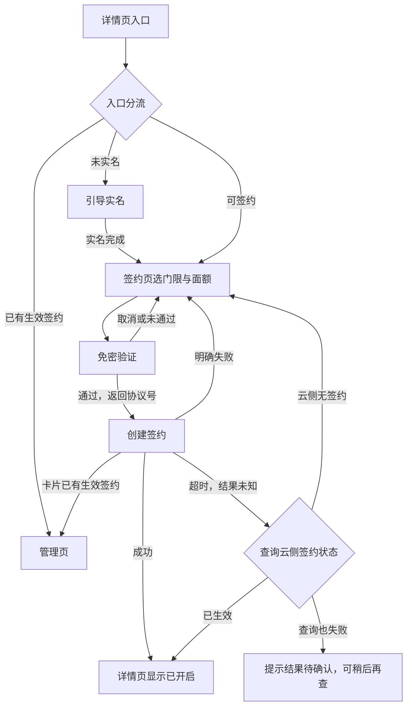
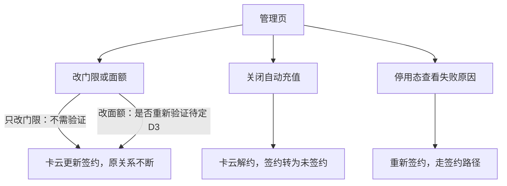
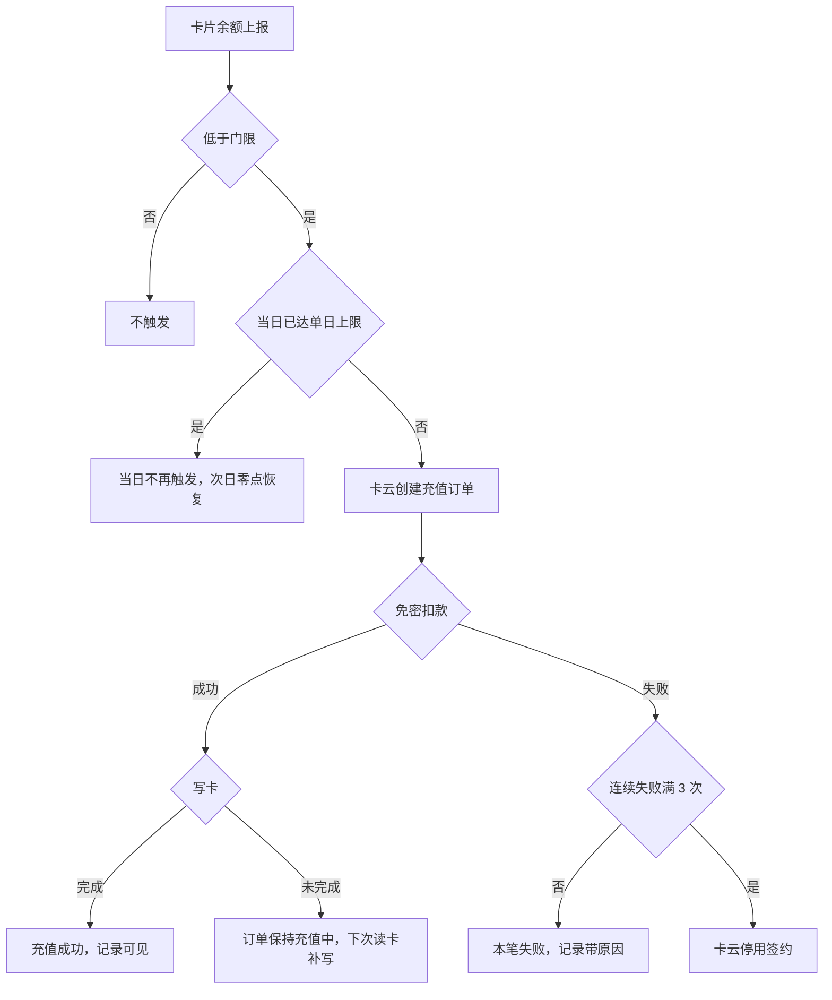

# 交通卡自动充值（钱包端）— 需求规格（Spec）

> **模块标识**: `AR90006`
> **版本**: v1.0
> **创建日期**: 2026-09-29
> **最后更新**: 2026-10-13
> **状态**: 评审中

## 0. 术语映射表（Terminology Mapping Table）

| 原始术语 | 权威模块 | 所属层 | 置信度（high / medium / low） | 易混项（必须亮出） | 用户确认 | 解释 |
|---------|---------|--------|-------------------------------|-------------------|---------|------|
| 自动充值 | WalletMain | 02-Feature | high | 交通卡余额提醒（RR90007，另一单，不共用门限档位） | [x] | 用户签约后余额低于门限时由交通卡云自动充值；钱包端只做入口、签约交互与状态展示 |
| 触发门限 | WalletMain | 02-Feature | high | 单日充值上限（另一条规则） | [x] | 余额低于多少元触发一次充值，签约时单选，签约后可修改 |
| 单笔面额 | WalletMain | 02-Feature | high | 免密扣款单笔额度（随面额设置） | [x] | 每次自动充入多少元，签约时单选，签约后可修改 |
| 签约 | WalletMain | 02-Feature | high | 签约关系的真源是交通卡云，钱包端只承担签约交互 | [x] | 用户选好门限面额、同意协议并通过免密验证后建立的自动充值关系 |
| 免密验证 | WalletMain | 02-Feature | high | 验证界面由支付部件拉起，钱包端只承接拉起与授权结果 | [x] | 首次签约时由支付部件拉起、用户本人当场确认的授权，通过后返回协议号 |
| 未实名 / 实名认证 | AccountManager | 04-BusinessBase | high | 账号能力现只暴露登录态，实名结果为新增消费（D7） | [x] | 未实名用户入口可见，点入引导完成实名，完成实名前签不成 |
| 管理页 / 停用态 | WalletMain | 02-Feature | high | 停用的判定与原因来自交通卡云，钱包端只展示 | [x] | 承载签约状态、最近记录与改档、关闭、重签入口的页面；停用态顶部为停用横幅 |
| 卡号脱敏 | CommFunc | 05-SystemBase | high | 只用于展示；接口里的卡片标识是业务身份，不脱敏 | [x] | 充值记录展示时复用公共脱敏能力，不在业务内手写算法 |

**回写约定**：所有新增 / 修正的条目在用户批准后必须同步追加到 `doc/glossary.yaml`。

## 1. 功能概述

交通卡自动充值让用户对一张交通卡签约一次，之后余额低于自设门限时由交通卡云自动充值，把「想起来充值」从用户身上移走。产品目标（上游约束：产品需求）：签约用户的闸机余额不足发生率降到万分之五以下；签约转化率不低于交通卡月活的 8%。两项都是服务端按全局口径统计的业务目标，钱包端以入口露出和签约顺畅支撑，不直接承诺。

本 AR 承担钱包端：交通卡详情页的自动充值入口、签约页（门限、面额、协议）、免密验证拉起、实名引导、创建签约、管理页（状态、记录、改档、关闭、停用重签）与端侧暂存。判定与扣款全部在服务端，钱包端没有「发起自动充值」的动作；**判定输入是服务端记录的余额，不是手机显示的余额**——离线刷卡后手机余额长时间不准，按它判定会扣出用户预期之外的钱。

## Scope 声明

> plan（Design）必须继承本节的 `in_scope_modules`；coding 的 git diff 不得越界到本节之外的模块。

### Scope 模块清单

| 字段 | 取值 | 说明 |
|------|------|------|
| 本需求允许修改的模块 | `WalletMain`、`Phone` | WalletMain 承载交通卡详情页与入口、签约页、管理页、自动充值数据仓库、签约关系副本与签约暂存；Phone 只做新增页面的宿主路由登记 |
| 本需求明确不修改的模块 | `AccountManager`、`CommUI`、`CommFunc` | 只读消费既有能力（登录态、组件、导航、日志、脱敏） |

### Scope 结构化字段（供 Spec 提取，必填）

```yaml
in_scope_modules:
  - WalletMain
  - Phone
out_of_scope_modules:
  - AccountManager
  - CommUI
  - CommFunc
rationale: |
  交通卡详情页、自动充值入口、签约页、管理页与端侧数据仓库承载在钱包主 feature（WalletMain）。
  工程里没有交通卡详情页：卡包页的本地卡区只有空态，首页卡片堆叠里的交通卡是展示用卡面，
  本单在 WalletMain 新增交通卡详情页承载入口，挂载路径由 plan 定。
  Phone 必须在 in_scope：宿主 Phone/src/main/ets/pages/index.ets 的 navDestinationMap 是硬编码
  if/else 分支（现仅登记 CardPackPage/AddCardEntryPage），新增页面要在该分支加名字映射。
  AccountManager 只提供登录与实名结果消费（现无实名字段暴露，按 D7 用模拟数据承载），
  CommUI/CommFunc 只做组件与工具复用（NavPathContext/Logger/MaskUtil），三者均不改。
  若下游想把逻辑提到公共模块，须先发起 scope 扩展提议。
```

### Visual Handoff（视觉交接，供 check-spec 读取）

```yaml
ui_change: new_or_changed
visual_handoff:
  kind: repo_assets
  fidelity_target: semantic_layout
  asset_acquisition_mode: approximate
  authoritative_refs:
    - id: detail_entry
      path: doc/features/AR90006/ux-reference/detail-entry.png
      caption: 交通卡详情页的自动充值入口：余额行之下、充值记录之上的一整行入口
    - id: signup_page
      path: doc/features/AR90006/ux-reference/signup-page.png
      caption: 自动充值签约页：门限与面额单选，协议勾选后开启才可点
    - id: verify_page
      path: doc/features/AR90006/ux-reference/verify-page.png
      caption: 免密验证页：首次签约过一次免密验证，说明单笔额度
    - id: manage_page
      path: doc/features/AR90006/ux-reference/manage-page.png
      caption: 自动充值管理页与记录列表：顶部签约状态、下方最近记录、失败展示原因
    - id: disabled_state
      path: doc/features/AR90006/ux-reference/disabled-state.png
      caption: 停用态：连续扣款失败停用后顶部为停用横幅并给出失败原因
```

### 最小改动原则

1. **默认就地实现**：自动充值逻辑实现在 WalletMain 内（页面、数据仓库、副本与暂存），不向上提公共层。
2. **禁止默默扩展**：若发现需在 AccountManager/CommUI/CommFunc 新增公共接口，停下发起 scope 扩展提议给用户确认。
3. **公共能力优先复用**：导航取栈用 CommFunc `NavPathContext`、日志用 `Logger`、展示脱敏用 `MaskUtil`、组件与主题色用 CommUI 既有资产。

## 2. 目标用户与使用场景

### 2.1 目标用户

| 用户角色 | 描述 |
|----------|------|
| 交通卡持卡人 | 钱包里有可刷乘交通卡、不想在闸机前才发现余额不足的用户 |
| 未实名用户 | 已登录但账号未完成实名的用户；能看到入口，完成实名前签不成 |
| 已签约用户 | 已建立自动充值签约的持卡人，要看记录、改档或关闭 |

### 2.2 使用场景

| 场景编号 | 场景名称 | 场景描述 | 前置条件 |
|----------|----------|----------|----------|
| S1 | 入口与实名引导 | 用户在交通卡详情页看到「自动充值」入口；未实名点入被引导去实名，完成后回签约页 | 打开交通卡详情页 |
| S2 | 首次签约 | 选门限与面额、同意免密扣款协议、过免密验证、创建签约 | 已实名、该卡无生效签约、开关开 |
| S3 | 自动充值发生 | 余额低于门限时由交通卡云完成充值，用户无操作，记录可见 | 已签约、未停用、当日未达单日上限 |
| S4 | 管理签约 | 改门限（即时生效）、改面额（验证要求待定 D3）、关闭自动充值、看记录 | 已签约进入管理页 |
| S5 | 已签约再进入 | 已有生效签约时再点入口，进入管理页而不是重新签约 | 已有生效签约 |
| S6 | 停用后查看与重签 | 扣款连续失败停用后看失败原因，从停用横幅重新签约 | 签约已被交通卡云停用 |
| S7 | 验证中断与重试 | 免密验证取消或未通过，留在签约页、已选门限面额保留，可直接再试 | 已点开启 |
| S8 | 创建结果未知 | 创建签约超时，以云侧签约状态确认结果 | 免密验证已通过 |
| S9 | 开关关闭 | 运营关闭开关后未签约用户看不到入口；已签约用户入口照常、自动充值照常 | 运营侧关闭功能开关 |

## 3. 功能清单

| 编号 | 功能名称 | 优先级 | 描述 | 关联场景 |
|------|----------|--------|------|----------|
| F1 | 详情页自动充值入口 | P0 | 交通卡详情页余额行之下、充值记录之上的一整行入口；按签约状态、功能开关、实名结果三项独立输入分流：已签约始终可见、进管理页；未签约时开关开才可见，未实名可见并引导实名（D2、D5） | S1, S5, S9 |
| F2 | 签约页 | P0 | 门限、面额单选，选项取策略接口返回的档位；协议勾选后「开启」才可点；中途离开暂存已选值 | S2, S7 |
| F3 | 免密验证拉起 | P0 | 点「开启」拉起支付部件验证，单笔额度等于所选面额，协议文案写明单日最多充 200 元（上游约束：产品需求）；协议号只透传不持久化 | S2, S7 |
| F4 | 创建签约 | P0 | 验证通过后创建签约；成功显示已开启；已有生效签约返回既有签约号、转管理页；明确失败留在签约页；超时以云侧签约状态确认（D4） | S2, S5, S8 |
| F5 | 实名引导 | P0 | 未实名点入引导去账号能力完成实名，完成实名前签不成；实名回来回签约页、已选值仍在（D2） | S1 |
| F6 | 签约暂存 | P1 | 验证取消、未通过或中途退出时暂存已选门限面额，下次进入回填；只在本账号本卡有效，退出登录清除 | S2, S7 |
| F7 | 管理页 | P0 | 顶部签约状态与当前门限面额、最近记录（失败展示原因、卡号脱敏）、停用横幅与原因 | S3, S4, S6 |
| F8 | 修改门限面额 | P0 | 走更新接口，原签约关系不断（D1）；只改门限不需验证、即时生效；改面额的验证要求待定（D3） | S4 |
| F9 | 关闭自动充值 | P0 | 二次确认后解约；之后不再触发；不回滚进行中订单、不撤销已完成订单 | S4 |
| F10 | 停用重签 | P1 | 停用横幅给出失败原因与重新签约入口，重签走签约路径 | S6 |
| F11 | 签约关系副本 | P1 | 端侧保存签约号、门限、面额、状态，用于先行展示与离线展示；进入管理页与做出状态相关操作前以一次云侧查询确认，同一次页面内的展示与操作复用这次结果；查询失败展示副本旧值并标明未能确认最新状态，不凭旧值判定当前生效，也不推断未签约 | S3, S4 |

> **新增端云域声明**：F1 依赖的交通卡详情页，F2–F11 依赖的五个端云接口（`getAutoTopupPolicy`/`createAutoTopupContract`/`getAutoTopupStatus`/`updateAutoTopupContract`/`cancelAutoTopupContract`）与支付部件免密拉起、账号实名结果，工程里都不存在（in_scope 模块检索 HTTP/RPC 封装零命中；无交通卡详情页；AccountManager 无实名字段）。按 D7：钱包端按已定接口契约实现，用可替换的模拟数据验证签约、管理、失败与结果未知各分支；与卡云、支付的真实联调另行验收，本需求不算验过。

## 4. 页面/界面描述

视觉规范沿用钱包现有卡片页面样式（白卡片分隔、顶栏返回、系统图标），不新增控件类型；参考图见 `ux-reference/` 五屏，以语义布局为准。

### 4.1 页面总览

```
交通卡详情页（F1）: [余额行] / [自动充值入口行] / [充值记录]
签约页（F2/F3/F5/F6）: [门限单选组] / [面额单选组] / [协议勾选] / [开启按钮]
免密验证页（支付部件拉起，F3）: [单笔额度说明] / [确认/取消]
管理页（F7–F10）: [签约状态区或停用横幅] / [最近记录列表] / [修改/关闭/重签入口]
```

### 4.2 UI 组件详细描述

#### 区域 1: 交通卡详情页入口区（F1，detail_entry）

| 组件 | 类型 | 内容/数据 | 交互行为 |
|------|------|-----------|----------|
| 自动充值入口行 | 列表行 | 「自动充值」+ 行内状态（未开启 / 已开启·当前门限面额 / 已停用 / 状态未知） | 去向按 §4.3 入口矩阵；防重入 |
| 余额行 | 展示 | 卡片余额（展示用，不参与判定） | 无 |
| 充值记录 | 列表 | 最近记录，卡号脱敏 | 进管理页看全部 |

#### 区域 2: 签约页（F2/F3/F5/F6，signup_page）

| 组件 | 类型 | 内容/数据 | 交互行为 |
|------|------|-----------|----------|
| 返回 | 图标按钮 | 系统符号 | 返回详情页，暂存已选门限面额 |
| 门限单选组 | 单选 | 取 `getAutoTopupPolicy.thresholdOptions`（现行 5 / 10 / 20 / 30 元，上游约束：产品需求） | 选中高亮 |
| 面额单选组 | 单选 | 取 `getAutoTopupPolicy.amountOptions`（现行 20 / 50 / 100 元，上游约束：产品需求） | 选中高亮 |
| 免密扣款协议 | 勾选框 | `agreementText`，写明单笔上限等于所选面额、单日最多充 200 元（上游约束：产品需求） | 勾选后「开启」才可点 |
| 开启按钮 | 按钮 | 「开启」 | 门限面额已选且协议勾选后可用；拉起免密验证；处理中不重复提交 |
| 实名引导 | 提示/导航 | 「请先完成实名认证」 | 未实名点入时出现；去实名，回来回填已选值 |

#### 区域 3: 免密验证页（支付部件拉起，F3，verify_page）

| 组件 | 类型 | 内容/数据 | 交互行为 |
|------|------|-----------|----------|
| 验证页 | 外部能力页 | 单笔额度说明 + 确认/取消 | 确认返回协议号；取消或未通过回签约页、已选值保留 |

#### 区域 4: 管理页（F7–F10，manage_page / disabled_state）

| 组件 | 类型 | 内容/数据 | 交互行为 |
|------|------|-----------|----------|
| 签约状态区 | 展示 | 「自动充值已开启」+ 当前门限与面额；停用时换成停用横幅；云侧查询失败显示状态未知 | 状态未知时可重试 |
| 停用横幅 | 展示/入口 | 「自动充值已停用」+ 失败原因 | 内含重新签约入口，进入签约路径 |
| 最近记录列表 | 列表 | 时间、金额、结果；失败带原因；卡号脱敏 | 滚动查看 |
| 修改门限面额 | 入口 | 当前门限与面额 | 提交调更新接口，原签约不断；改面额交互按 D3 结论定 |
| 关闭自动充值 | 按钮 | 「关闭自动充值」 | 二次确认后解约；进行中订单不回滚、已完成订单不撤销 |

### 4.3 页面状态

| 状态 | 描述 | 触发条件 |
|------|------|----------|
| 详情页-入口可见·去签约 | 入口显示，点入进签约页 | 未签约、开关开、已实名 |
| 详情页-入口可见·去实名 | 入口显示，点入引导实名 | 未签约、开关开、未实名（D2） |
| 详情页-入口隐藏 | 不显示入口 | 未签约且开关关（D5） |
| 详情页-入口可见·去管理 | 入口显示，点入进管理页 | 已签约（含停用），与开关无关（D5） |
| 签约页-回填 | 按暂存回填已选值 | 实名返回、验证取消或未通过、中途退出后再进 |
| 签约页-验证中 / 创建中 | 「开启」处理中，不重复提交 | 已点开启 |
| 签约页-结果待确认 | 不显示成功也不显示未签约，提示稍后再查 | 创建超时且状态查询也失败（D4） |
| 管理页-状态未知 | 显示状态未知、可重试 | 云侧状态查询失败（无论有无本地副本都不推断未签约） |

## 5. 业务流程图

### 5.1 签约路径

看这张图要看出：从入口分流到签约生效的主线，以及验证取消、明确失败、已有签约、结果未知各回到哪里。



- 回到签约页的分支都按暂存回填已选门限面额。
- 明确失败不留半签约状态；再次尝试复用协议号还是重新验证，等 D4。
- 超时不当成没签成，以云侧签约状态为准。
- 判重由交通卡云按「卡片 + 生效状态」完成，钱包端按返回的既有签约号转管理页。

### 5.2 管理路径

看这张图要看出：改档、关闭、停用重签三件事都从管理页出发，以及改门限和改面额在验证要求上的区别。



- 解约不回滚进行中的订单，也不撤销已完成订单。
- 状态以云侧查询为准；查询失败显示未知、可重试。
- 改档、关闭各有三种结果：卡云明确生效、卡云明确拒绝、响应丢失结果未知。结果未知时页面保持「待确认」，用 `getAutoTopupStatus` 确认：查到目标值（或已解约）就按已生效展示；查到仍是原值、或查询失败，提示结果未确认，不判失败、不自动重发；用户刷新确认后才能再次操作。

### 5.3 服务端触发子流程（钱包端只承接结果）

看这张图要看出：一笔自动充值在哪些条件下发生、失败怎样累计到停用；钱包端在其中没有任何动作。



- 单日达到上限是正常受限，不计入连续失败（上游约束：系统设计）。
- 写卡未完成时端侧不重试、不重复下单。

### 5.4 不建模声明

不采用「端侧监测余额并直接发起扣款」：离线刷卡后端侧余额失真，扣款职责在服务端。本节只建模钱包端参与的两条用户路径，服务端子流程仅作端侧承接结果的对照。

## 6. 异常/边界场景处理

| 编号 | 异常场景 | 触发条件 | 处理方式 | 用户提示 | 关联功能 |
|------|----------|----------|----------|----------|----------|
| E1 | 免密验证取消或未通过 | 用户取消或验证未通过 | 不建立签约关系、不留半签约状态，已选值保留 | 留在签约页，可直接再次开启 | F3, F6 |
| E2 | 未实名 | 账号能力的实名结果为未实名（本期由模拟实名结果承载，D7） | 入口可见，引导实名；实名前签不成，回来回签约页回填；策略接口此时也返回不可签约，其原因文字只作提示，不作分流依据 | 请先完成实名认证 | F1, F5 |
| E3 | 已有生效签约 | 再点入口 / 创建签约返回 `existed=true` | 进管理页，不重复建约 | 已开启自动充值 | F1, F4 |
| E4 | 创建签约明确失败 | 创建返回错误 | 留在签约页、已选值保留、不显示成功；再次尝试方式待 D4 | 开启失败，可再试 | F4 |
| E5 | 创建签约超时 | 创建请求超时，结果未知 | 调状态查询确认：已生效按已开启；云侧无签约按未建成、留在签约页；查询失败保持「结果待确认」 | 结果确认中 / 结果待确认，可稍后再查 | F4, F11 |
| E6 | 云侧状态查询失败 | 进管理页或入口取状态失败 | 有副本时展示副本旧值并标明未确认、可重试，旧值不作当前生效的依据（停用与新记录以云侧为准）；无副本时显示状态未知、可重试；不按副本缺失推断未签约 | 状态暂时获取不到，可重试 | F7, F11 |
| E7 | 本地副本缺失 | 清除应用数据、首次进入 | 以云侧查询恢复：生效、停用照云侧显示，云侧无签约才进签约引导 | 按云侧状态展示 | F11 |
| E8 | 单日达到上限 | 当日累计充值达 200 元（上游约束：产品需求） | 当日不再触发、不计入连续失败、次日零点恢复 | 记录正常展示，不显示失败 | F7 |
| E9 | 连续失败停用 | 扣款连续失败 3 次（上游约束：产品需求） | 交通卡云停用签约；管理页展示停用横幅、失败原因与重签入口 | 已停用 + 原因 | F7, F10 |
| E10 | 扣款成功但写卡未完成 | 写卡中断 | 订单保持充值中，卡云下次读卡补写；端侧不重试、不重复下单 | 记录显示充值中 | F7 |
| E11 | 开关关闭 | 运营关闭功能开关（本期由模拟配置承载，D7）；开关读不到按关闭处理 | 未签约用户隐藏入口；已签约用户入口、管理与自动充值照常（D5） | 已签约用户无感知 | F1 |
| E12 | 支付部件能力不可用 | 免密能力不可用 | 隐藏新签约入口，已签约用户照常 | 未签约用户看不到入口 | F1, F3 |
| E13 | 改面额的验证要求未定 | 用户在管理页改面额 | 只改门限的路径照常；改面额交互按 D3 结论定，结论前不写死 | — | F8 |
| E14 | 重复快速点击 | 入口、开启、关闭被连续触发 | 防重入；在途请求不二次提交 | 单次响应 | F1, F2, F9 |
| E16 | 改档或关闭结果未知 | 更新或解约请求超时、响应丢失 | 页面保持待确认，查询云侧状态：已到目标值或已解约按已生效；仍是原值或查询失败提示结果未确认，不判失败、不自动重发，确认后才可再次操作；更新接口的响应字段与并发判重待卡云定稿（依赖） | 修改结果确认中 / 关闭结果确认中 | F8, F9 |
| E15 | 本期不做 | 预约充值、多卡共用签约、家庭代充、记录按月筛选与导出（D6） | 不提供入口 | 不展示 | F7 |

## 7. 非功能性需求

### 7.1 性能要求

| 指标 | 要求 | 说明 |
|------|------|------|
| 端云请求时机 | 只在用户进入入口、进入管理页或做出操作时调用；进入管理页确认一次云侧状态，同一次页面内复用；创建、改档、关闭结果未知时补一次状态查询 | 不设定时拉取与后台轮询（DFX-01）；本地副本只作先行与离线展示 |
| 页面时延 | 材料未给时延数值，本期不设端侧时延阈值 | 上线后按 §8.6 观察流程结果，不以时延作验收判据 |

### 7.2 兼容性要求

| 维度 | 要求 |
|------|------|
| 系统版本 | HarmonyOS API 12 及以上（平台基线） |
| 设备类型 | 手机形态 |
| 屏幕适配 | 沿用钱包现有卡片页面样式与尺寸资源，不新增控件类型 |
| RTL | 新页面方向性参数用 start/end，语言切换镜像正确（平台基线） |
| 数据兼容 | 五个接口都是钱包端的新调用：既有四个接口按系统设计的字段消费，`updateAutoTopupContract` 为澄清会新增；不新增、不修改错误码，未知码按通用失败处理 |

### 7.3 安全性要求

| 要求 | 说明 |
|------|------|
| 展示脱敏 | 充值记录里的卡号在组装展示内容处用 `MaskUtil.maskAccount` 脱敏；接口请求里的卡片标识是业务身份，按卡云接口原样使用，不脱敏、不进日志与事件（SEC-01） |
| 协议号不持久化 | `agreementNo` 只透传给创建签约，不写入本地存储、日志与事件（SEC-01） |
| 事件去标识 | 端侧事件只含去标识账号、卡片类型、阶段与结果分类；不含卡号、金额明细与支付参数（SEC-01） |
| 本地数据最小化 | 签约关系副本与签约暂存只存签约号、门限、面额、状态，按账号隔离、退出登录清除、不参与备份恢复 |

## 8. 验收标准

> 交通卡云与支付部件的接口在工程里接不上，以下结论只到本地模拟（D7）；与卡云、支付的真实联调另行验收。

### P0 功能验收标准

- [ ] **AC-1** (F1): 入口按矩阵显示：已签约始终可见并进管理页；未签约开关开可见，开关关不可见（承接：AC-R4、AC-R9）。
- [ ] **AC-2** (F1, F5): 未实名用户能看到入口，点进去被引导实名，完成实名前无法签约；实名回来回到签约页，此前的选择仍在（承接：AC-R1、AC-R8）。
- [ ] **AC-3** (F2, F3): 门限、面额选项取策略接口返回的档位；协议勾选后「开启」才可点；点「开启」拉起免密验证，单笔额度等于所选面额，协议文案写明单日最多充 200 元（上游约束：产品需求）。
- [ ] **AC-4** (F3, F6): 在验证界面取消，回到签约页时刚才选的门限与面额仍在，可直接再次开启（承接：AC-R7）。
- [ ] **AC-5** (F4): 创建签约成功后详情页显示已开启与当前门限面额；余额低于门限时用户不做任何操作即完成充值，并能在记录里看到（承接：AC-R2）。
- [ ] **AC-6** (F4): 创建签约超时：页面不显示成功也不显示未签约；云侧已生效时按已开启展示，云侧无签约时留在签约页且门限面额仍在，查询失败时提示结果待确认（承接：AC-R10）。
- [ ] **AC-7** (F7, F10): 扣款连续失败 3 次（上游约束：产品需求）后自动停用，打开管理页能看到停用状态与失败原因，并可从停用横幅重新签约（承接：AC-R3）。
- [ ] **AC-8** (F8, F9): 改门限按新值即时生效、原签约不断、不需重新验证；关闭后不再触发自动充值。改面额的验证要求待 D3，结论前不验改面额（承接：AC-R6）。
- [ ] **AC-8b** (F8, F9): 改门限、关闭的请求响应丢失时页面显示确认中，不显示成功也不显示失败；云侧已到目标值或已解约按已生效展示，仍是原值或查询失败提示结果未确认、不自动重发，确认后才可再次操作。
- [ ] **AC-9** (F7): 记录中的卡号按现有规则脱敏展示，失败记录展示失败原因（承接：AC-R5）。

### P1 功能验收标准

- [ ] **AC-10** (F11): 清除应用数据后进入：云侧生效时显示已开启并进管理页，云侧停用时显示停用与原因，云侧无签约时进入签约引导，云侧查询失败时显示状态未知且可重试（承接：AC-R11）。
- [ ] **AC-11** (F6): 中途退出签约页，下次从入口进来门限与面额回填；退出登录后暂存清除。

### P2 规约与合规验收标准

- [ ] **AC-12** (F2, F7): 新页面方向性参数用 start/end、文本对齐用 TextAlign.Start/End，阿语下镜像正确（UX-01）。
- [ ] **AC-13** (F3, F7): 卡号任何出口脱敏；`agreementNo` 不持久化、不进日志与事件；事件去标识（SEC-01）。
- [ ] **AC-14** (F11): 端云调用只在进入与操作时发生，无定时轮询；进入管理页先用副本展示、再以一次状态查询确认，同一次页面内不重复查询；本地副本为生效而云侧已停用时，按云侧显示停用与原因，云侧有新记录时显示新记录；断网时展示副本旧值并标明未确认（DFX-01）。
- [ ] **AC-15** (F11): 清除数据后按云侧恢复、不崩溃不死循环（ENV-01）；入口、开启与关闭防重入（ENV-02）。
- [ ] **AC-16** (F2, F7): 图标取系统符号与既有资源；文案经资源键引用、中英文齐备，新增文案进待翻译清单（RES-01、RES-02、DLV-01）。
- [ ] **AC-17** (F4, F9): 关键步骤经统一日志入口记录定位信息；统计点覆盖完整、同一次尝试只记一次、字段来源真实、事件编码无冲突（OBS-02、OBS-03、OBS-05、OBS-06）。

### 通用验收标准

- [ ] **AC-G1**: 页面在 HarmonyOS API 12+ 设备上正常显示，无布局错乱。
- [ ] **AC-G2**: 网络异常有明确提示，不出现白屏或崩溃。
- [ ] **AC-G3**: 支付部件能力不可用时新签约入口隐藏，已签约用户入口与自动充值照常。

### 上游验收编号承接

- 承接：AC-R1 → AC-2（按澄清会改写为「入口可见、点入引导实名、完成实名前签不成」，D2）；AC-R2 → AC-5；AC-R3 → AC-7；AC-R4 → AC-1（按澄清会改写为「开关只管新签约」，D5）；AC-R5 → AC-9；AC-R6 → AC-8；AC-R7 → AC-4；AC-R8 → AC-2；AC-R9 → AC-1。
- 顺延：AC-R10（创建结果未知）→ AC-6；AC-R11（本地副本缺失）→ AC-10。两条是本单按系统设计「失败与恢复」补的验收，沿用上游编号体系顺延。
- 不承接：AC-R1 原文「未实名用户看不到签约入口」——澄清会确认为旧版遗留（D2）。

## 9. 宿主扩展治理项

| 扩展项 | 是否涉及 | 承载位置 |
|---|---|---|
| 技术契约 | 是（走 /story） | 9.1 |
| 规约 | 是 | 9.2 |
| 设计模式 | 是 | 9.3 |
| 埋点 | 是（走 /story） | 9.4 |
| 改面额是否重新免密验证（open） | 是 | 《决策与评审记录》D3 |
| 授权后创建签约失败或结果未知时怎样再次尝试（open） | 是 | 《决策与评审记录》D4 |
| 端云能力用模拟数据承载、真实联调另行验收（settled） | 是 | 《决策与评审记录》D7 |

### 9.1 技术契约

#### 9.1.1 端云接口

现状依据：in_scope 模块（`WalletMain`、`Phone`）检索 HTTP/RPC 封装零命中，端云交互为新增域；按 D7 用可替换的模拟数据源承载。接口均由钱包端调用交通卡云，金额一律以「分」为单位的整数；失败返回卡云统一错误结构（错误码 + 可读信息），本需求不新增错误码。

| 云侧接口 | 新增·复用·变更 | 入参 → 出参 | 错误码 | 代码现状 |
|---|---|---|---|---|
| `getAutoTopupPolicy` | 新增 | accountId、cardId → signable、unsignableReason（可空）、thresholdOptions、amountOptions、dailyLimit、agreementText；signable 只表示这张卡能否签约，不承载功能开关，unsignableReason 是可读文字、没有分类编码，不作入口分流依据 | 卡云统一错误结构，不新增 | 检索端云接口封装于 in_scope 模块零命中 |
| `createAutoTopupContract` | 新增 | accountId、cardId、agreementNo、threshold、amount → contractNo、existed（true 表示返回既有生效签约） | 同上；超时结果未知，以 `getAutoTopupStatus` 确认 | 同上 |
| `getAutoTopupStatus` | 新增 | accountId、cardId → contractStatus（none / active / disabled）、contractNo、threshold、amount（未签约时为空）、recentRecords、consecutiveFailures、disabledReason | 同上；查询失败按未知展示 | 同上 |
| `updateAutoTopupContract` | 新增（澄清会，D1） | contractNo、threshold、amount → 更新结果，原签约关系不断（响应字段待卡云定稿） | 同上 | 同上 |
| `cancelAutoTopupContract` | 新增 | contractNo → cancelled；不回滚进行中订单 | 同上 | 同上 |

#### 9.1.2 数据存储

| 键名/表名 | 介质 | 值结构 | 有效期 | 用途 | 代码现状 |
|---|---|---|---|---|---|
| `wallet_auto_topup_contract` | PersistentStorage | `{ contractNo, threshold, amount, status }` | 按账号隔离；退出登录清除；不参与备份恢复；每次云侧确认后刷新 | 先行与离线展示签约状态；不作当前生效的依据，缺失或与云侧不一致以云侧为准 | in_scope 模块无同类持久化封装；键于 WalletMain 常量新增 |
| `wallet_auto_topup_draft` | AppStorage | `{ cardId, threshold, amount }` | 应用进程内；只在本账号本卡有效，退出登录清除 | 验证取消、未通过、去实名或中途退出签约页后回填 | 同上 |

签约暂存只需覆盖「退出签约页后再从入口进来」（上游约束：产品需求），应用进程结束后不保留，因而用进程内存储；签约关系副本要支撑离线展示，用持久存储。

#### 9.1.3 配置项

| 配置项 | 默认值 | 关闭态行为 | 历史版本兼容 | 代码现状 |
|---|---|---|---|---|
| 自动充值功能开关（运营管理台下发；本期按 D7 由模拟配置承载，与策略接口相互独立） | 开 | 只管新签约：关闭后未签约用户看不到入口；已签约用户入口、管理与自动充值照常（D5）；配置不可用按关闭处理 | 端侧不新增本地开关常量 | 真实下发通道工程里没有，按 D7 与端云接口的模拟数据源放在一起、可替换；接入通道见依赖变更 |
| 门限档位 / 面额档位 / 单日上限 | 现行 5 / 10 / 20 / 30 元、20 / 50 / 100 元、200 元（上游约束：产品需求） | 由策略接口下发，影响签约页选项与协议文案 | 端侧不作第二真源 | 经策略接口承载，本地无对应常量 |

#### 9.1.4 依赖变更

| 依赖 | 变更 | 体积影响 | 兼容风险 | 代码现状 |
|---|---|---|---|---|
| 支付部件免密验证 | 复用（既有跨应用交互面，只用不改） | 无 | 能力不可用时隐藏新签约入口；协议号再次使用方式待 D4 | 按 D7 先以模拟拉起承载 |
| 运营管理台功能开关下发 | 新增消费（真实接入依赖） | 无 | 通道未接入前按模拟值；读不到按关闭处理 | 工程里没有下发通道，按 D7 模拟承载；真实通道与字段由运营管理台定，钱包端不自拟字段 |
| 账号能力实名结果 | 新增消费（真实接入依赖） | 无 | 结果读不到时不判已实名，按未实名引导 | AccountManager 只暴露登录态，按 D7 模拟承载；真实字段由账号能力提供 |

Scope 内模块依赖声明无新增边（`WalletMain` → `AccountManager`/`CommUI`/`CommFunc` 均为既有只读复用）。

### 9.2 规约

<!-- knowledge-use:begin 规约 · 由 spec/knowledge-use.yaml 生成，手改会被门禁拒绝 -->
| 编号 | 强制力 | 本需求的要求 | 落点契约名 | 验法 |
|---|---|---|---|---|
| UX-01 | 基线 | 新增交通卡详情页入口、签约页、管理页的方向性参数用 HorizontalAlign.Start/End 与 TextAlign.Start/End，不用 left/right | 影响 · 交通卡详情页入口、签约页、管理页 | 模型 / 实机 |
| SEC-01 | 红线 | 业务处理：accountId 与 cardId 按卡云接口以可识别形式只传给交通卡云五个接口，用于签约、改档、解约与状态查询；agreementNo 只透传给 createAutoTopupContract，不持久化 | 影响 · 卡云接口调用、管理页充值记录、日志与端侧事件、签约关系副本 | 模型 / 实机 |
| SEC-01 | 红线 | 展示：充值记录的卡号在组装展示内容处另生成展示值（MaskUtil.maskAccount），不改写记录对象；卡号不超过 4 位时 maskAccount 原样返回，这种卡号不展示 | 影响 · 卡云接口调用、管理页充值记录、日志与端侧事件、签约关系副本 | 模型 / 实机 |
| SEC-01 | 红线 | 观察性输出：日志与端侧事件只带去标识账号、卡片类型、阶段与结果分类，不带卡号、cardId、协议号、金额明细或支付参数 | 影响 · 卡云接口调用、管理页充值记录、日志与端侧事件、签约关系副本 | 模型 / 实机 |
| SEC-01 | 红线 | 跨重启存储：签约关系副本只存签约号、门限、面额与状态，不存卡号、协议号与支付参数；按账号隔离，退出登录清除，不参与备份恢复；签约暂存只在进程内 | 影响 · 卡云接口调用、管理页充值记录、日志与端侧事件、签约关系副本 | 模型 / 实机 |
| DFX-01 | 基线 | 端云接口只在进入入口、进入管理页与用户操作时调用，创建、改档、关闭结果未知时补一次状态查询，不设定时拉取或后台轮询 | 技术契约 · getAutoTopupStatus | 模型 |
| DFX-01 | 基线 | 签约关系副本只作先行与离线展示：进入管理页以一次状态查询确认，同一次页面内的消费者复用这次结果，不为副本删掉必要确认 | 技术契约 · getAutoTopupStatus | 模型 |
| OBS-02 | 基线 | 签约、创建、改档、关闭、停用重签的关键过程用 CommFunc.Logger 记录定位信息，不另造日志封装、不发独立定位事件 | 影响 · 签约页、管理页 | 模型 / 实机 |
| OBS-03 | 基线 | 免密验证、创建签约、状态确认、改档、关闭各步骤记录实际结果，同一次尝试只记一次，重新发起是新尝试 | 影响 · 签约流程、改档流程、关闭流程的统计点 | 模型 / 实机 |
| OBS-05 | 基线 | 上报字段（流程、步骤、结果分类、结束原因）各有真实来源，不虚构远端未发生的结果 | 影响 · 签约流程、改档流程、关闭流程的统计点 | 模型 / 实机 |
| OBS-06 | 基线 | 新增事件编码核对既有登记，复用同语义已有值，新编码唯一；沿用既有上报模板 Wallet_COMMON | 影响 · 签约流程、改档流程、关闭流程的统计点 | 模型 / 实机 |
| RES-01 | 基线 | 新页面图标取系统符号；界面参考图只作视觉参考，不进运行资源 | 影响 · 交通卡详情页入口、签约页、管理页 | 模型 |
| RES-02 | 基线 | 新页面文案优先复用已有中文一致的 string 资源，新增的中英文齐备 | 影响 · 签约页、管理页用户可见文案 | 模型 |
| COMPAT-01 | 基线 | 五个接口都是钱包端新增调用，按系统设计字段消费；新增出参兼容缺失场景，端侧按可空处理 | 影响 · 钱包端对交通卡云五个接口的调用 | 模型 |
| ENV-01 | 基线 | 清除数据后签约关系按云侧查询恢复：云侧无签约才进签约引导，查询失败按未知展示，不推断未签约，不崩溃不死循环 | 技术契约 · wallet_auto_topup_contract | 模型 / 实机 |
| ENV-02 | 基线 | 入口、开启、关闭与改档防重入，在途请求不二次提交；创建签约依赖卡云按卡片加生效状态判重 | 技术契约 · createAutoTopupContract | 模型 / 实机 |
| DLV-01 | 基线 | 新增用户可见文案梳理成待翻译字符串清单，跟踪回稿并合入资源 | 影响 · 签约页、管理页用户可见文案 | 模型 / 人工 |

不命中的依据：
- DFX-02：命中条件是新增预置资源或 SDK 依赖；新页面图标走系统符号，无新增图片资源与 SDK
- OBS-07：命中条件是有独立运营采集诉求；产品需求、系统设计与澄清会只要求端侧去标识事件，没有运营采集诉求
- COMPAT-02：命中条件是新增、删除或修改错误码；系统设计写明本需求沿用卡云统一错误结构、不新增错误码
- DLV-02：命中条件是新增或改动对外开放的入口或接口；新页面都是钱包应用内页面，卡云接口由本部件作为客户端调用
<!-- knowledge-use:end -->

### 9.3 设计模式

<!-- knowledge-use:begin 设计模式 · 由 spec/knowledge-use.yaml 生成，手改会被门禁拒绝 -->
| 适用单元 | 候选 | 命中信号或反证 |
|---|---|---|
| 签约建立流程（入口分流 → 策略查询 → 实名判断 → 免密验证 → 创建签约 → 结果确认） | decision-tree | 链路含未实名、已有签约、验证取消或未通过、明确失败、超时结果未知等分支，各分支多步且各自有失败处理 |
| 签约页交互（选门限面额 → 勾协议 → 点开启 → 拉起验证 → 结果回到页面） | page-interaction | 页面内交互有先后依赖，由业务结果驱动下一个动作（验证通过才创建，取消停留并回填） |
| 管理页（改档 / 关闭 / 停用重签三入口） | 无候选 | 三个入口相互独立、没有由业务结果驱动的跨动作编排 |
<!-- knowledge-use:end -->

### 9.4 埋点

本需求观察签约与管理两条流程的结果，为失败定位与链路复盘提供口径。项目既有上报入口为公共能力模块导出的 Chart/VOC 上报封装（模板枚举当前仅 Wallet_COMMON），仓内目前无业务调用（建设差距）；本需求在既有封装之上新增流程级统计点，不另造上报通道，实现层的取值由 plan 落实。统计边界：一次尝试从流程开始到结果确定，重新发起是新的一次；进入签约页取档位、进入管理页取状态属于页面加载，失败只写定位记录、不进统计；事件只带去标识账号、卡片类型、阶段与结果分类，上报失败不改变业务结果。

#### 签约成功率

衡量用户点「开启」后这张卡最终签上自动充值的比例，观察签约链路是否顺畅；它不是背景里的「签约转化率」（那一项按交通卡月活计，由服务端统计）。怎么算：签约流程以「生效」结束的尝试 ÷ 签约流程的全部尝试；超时后查询确认已生效、卡云返回已有生效签约，都算生效。随事件带未生效时的结束原因（用户取消验证 / 验证未通过 / 创建明确失败 / 结果仍未知）。

| 统计点 | 业务动作 | 实际适用结果 | 本端获知时机 | 已有覆盖或新增 | 代码现状 |
|---|---|---|---|---|---|
| 签约流程 / 免密验证 | 拉起支付部件的免密验证 | 通过 / 用户取消 / 未通过 | 验证回调 | 新增 | 检索 Chart/VOC 调用于 in_scope 模块零命中，建设差距 |
| 签约流程 / 创建签约 | 带协议号请卡云建立签约 | 成功 / 已有生效签约 / 明确失败 / 超时 | createAutoTopupContract 返回或超时 | 新增 | 同上 |
| 签约流程 / 状态确认 | 创建超时后查询云侧签约状态 | 已生效 / 无签约 / 查询失败 | getAutoTopupStatus 返回 | 新增 | 同上 |
| 签约流程 / 全流程 | 一次签约尝试结束 | 生效 / 未生效（带结束原因） | 最后一个走到的步骤得知结果时 | 新增 | 同上 |

#### 管理操作成功率

衡量用户在管理页确认的改档与关闭最终生效的比例。怎么算：改档流程与关闭流程以「生效」结束的尝试 ÷ 两条流程的全部尝试；结果未知后经状态确认已生效的算生效；随事件带操作类型（改门限 / 改面额 / 关闭）与未生效原因（明确拒绝 / 结果仍未知），结果未知不记成失败。

| 统计点 | 业务动作 | 实际适用结果 | 本端获知时机 | 已有覆盖或新增 | 代码现状 |
|---|---|---|---|---|---|
| 改档流程 / 更新签约 | 确认修改门限或面额，卡云更新签约 | 生效 / 明确拒绝 / 结果未知 | updateAutoTopupContract 返回或超时 | 新增 | 同一建设差距 |
| 关闭流程 / 解约 | 确认关闭，卡云解约 | 生效 / 明确拒绝 / 结果未知 | cancelAutoTopupContract 返回或超时 | 新增 | 同上 |
| 改档流程、关闭流程 / 状态确认 | 结果未知后查询云侧签约状态 | 已到目标 / 仍为原状态 / 查询失败 | getAutoTopupStatus 返回 | 新增 | 同上 |
| 改档流程、关闭流程 / 全流程 | 一次操作尝试结束 | 生效 / 未生效（带原因） | 最后一个走到的步骤得知结果时 | 新增 | 同上 |

## 附录

### A. 术语表

业务名词解释见 §0 术语映射表的「解释」列。

### B. 参考资料

- 产品需求：RR90006《交通卡自动充值 产品需求》v1.0（`doc/features/AR90006/RR/prd.md`）
- 系统设计：SR90006《交通卡自动充值 系统设计》（`doc/features/AR90006/SR/design.md`）
- 开发需求：AR90006（`doc/features/AR90006/AR/design.md`）
- 澄清会：交通卡相关需求澄清会（第 2 次，2026-09-03），留存版本 `AR/story-src/meetings/交通卡澄清会记录-0903/23fdc64d/`
- 界面参考：产品原稿《交通卡自动充值 产品需求说明》v0.4 抽出的五张界面图（`doc/features/AR90006/ux-reference/`），业务口径以产品需求单为准

### C. 变更记录

| 日期 | 版本 | 变更内容 | 变更人 |
|------|------|----------|--------|
| 2026-10-14 | v1.1 | 转正前修订：入口按签约状态、功能开关、实名结果三项独立输入分流，开关与实名列为真实接入依赖（G01）；签约关系副本只作先行与离线展示，进入管理页确认一次云侧（G02）；改档与关闭补结果未知（G03） | AI |
| 2026-10-13 | v1.0 | 初始版本：澄清会采纳更新接口（D1）、未实名口径（D2）、开关只管新签约（D5）、单日上限写进协议文案；改面额验证（D3）与授权后建约失败（D4）待定；按月筛选不属本单（D6）；端云能力模拟承载（D7） | AI |
