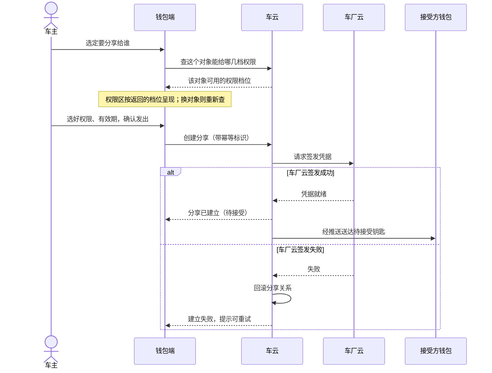
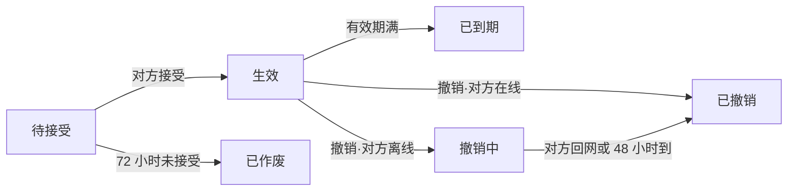
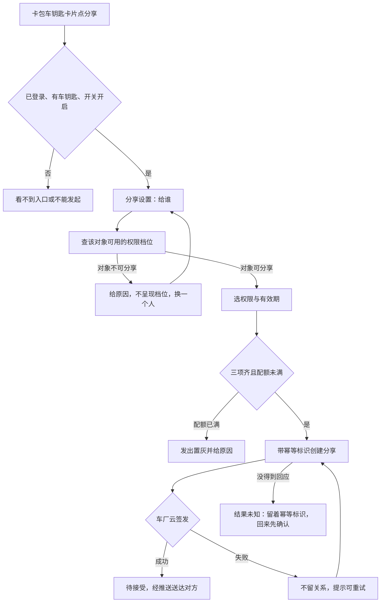
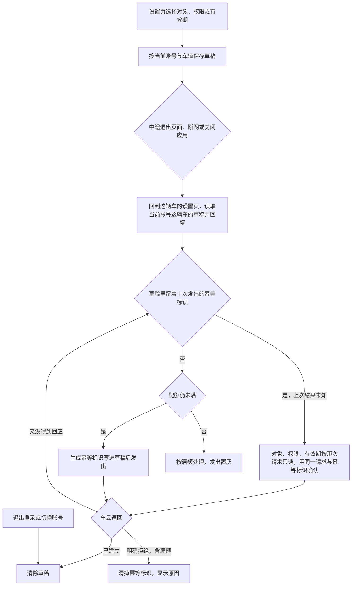
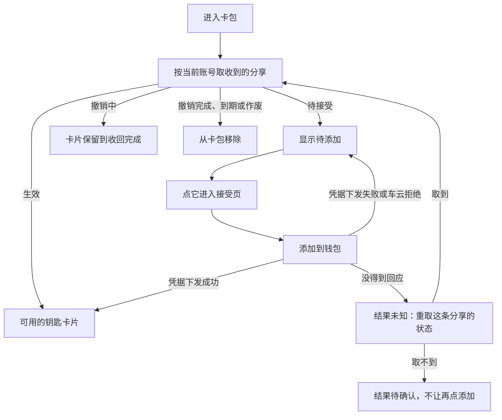
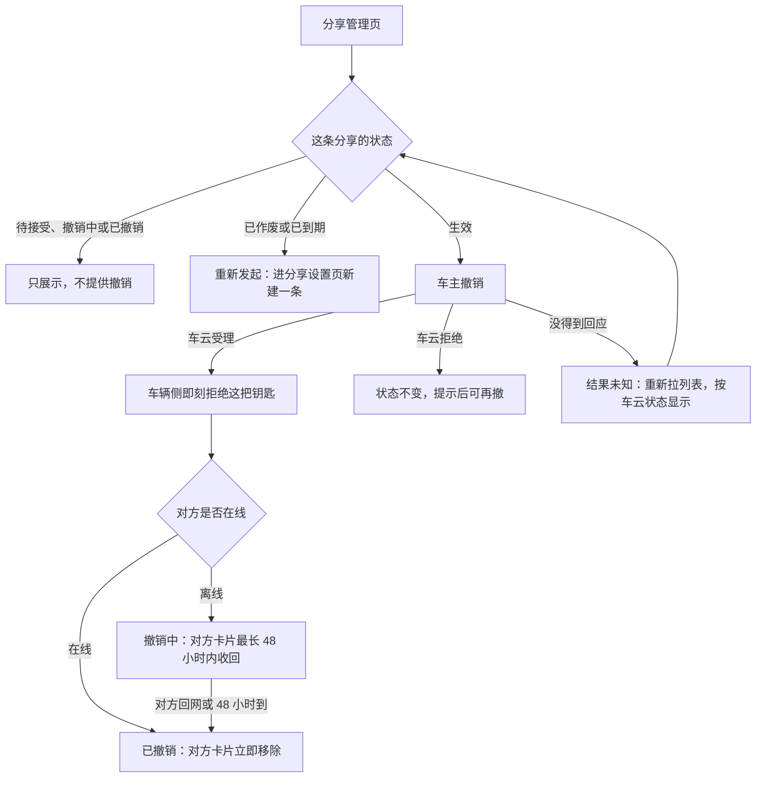

# ISSUE-206 数字车钥匙分享（钱包端）

## 1. 背景

### 1.1 现在的做法与问题

一辆车全家用是常态，但实体钥匙通常只有一两把。家人临时用车，车主要么专程送一趟钥匙，要么把钥匙提前藏在某处，这是数字车钥匙用户反馈最集中的一条。

本人使用的数字钥匙已经上线，「把钥匙给别人用」还没有打开，借车仍然绑在实体钥匙的交接上：

- 对家庭成员：人在外地或临时有事，家人就到不了车、用不了车；
- 对钱包业务：这是数字车钥匙从「本人用」走向「全家用」缺的一块，也是「借车送钥匙」类客服咨询的主要来源。

### 1.2 这次要改变什么

这次做**车钥匙分享**：车主把钥匙分享给家人或联系人，对方钱包里直接多出一把能用的钥匙，车主随时收回。

- 车主在卡包里的车钥匙卡片上点「分享」，选好给谁、什么权限、多长时间，确认发出。本工程还没有车钥匙卡片，这次一并补上（D4）。
- 对方在钱包里收到一把待接受的钥匙，72 小时内接受后生效，逾期未接受自动作废。
- 车主可以重新发起，也可以随时在分享管理里撤销。

### 1.3 成功标准

| 目标 | 怎么算达到 |
|---|---|
| 分享能力上线三个月内，车钥匙用户中发起过分享的比例不低于 15% | 上线三个月内发起过分享的车钥匙用户 ÷ 车钥匙用户，由运营侧按产品需求的口径统计 |
| 「借车送钥匙」类客服咨询量下降一半 | 上线后该类咨询量相对上线前减半 |

- 发起比例衡量分享是否被用起来，咨询量下降衡量它是否真的替代了旧的借车交接方式；两个数字都由运营侧统计，钱包端以分享链路的顺畅支撑，不直接承诺。
- 钱包端上报分享发起、接受、撤销三个流程的结果，用来观察分享链路质量，随功能一同交付；分享被接受比例由车云按分享记录统计（D7）。

### 1.4 还没定的两件事

这次都不下结论，方案里依赖它们的行为不写成已定：

- 被分享人能不能把钥匙再转给第三人：倾向禁止，等安全评审（D2）；
- 撤销后对方长期不联网时要不要请车厂强制下线：还在和车厂谈（D5）。

## 2. 术语

### 2.1 术语表

| 术语 | 在本需求里的意思 |
|---|---|
| 车钥匙分享 | 车主把钥匙的可用性分享给家人或联系人：对方钱包里多一把能用的钥匙，车主可随时撤销 |
| 车钥匙卡片 | 卡包里展示的车钥匙：车主本人的钥匙，以及当前账号收到并添加成功的钥匙；本次一并补上（D4） |
| 权限档位 | 分享时给对方的钥匙能力范围。家庭成员可给全功能（解闭锁、启动、后备箱）或仅解闭锁，其他联系人只有仅解闭锁；按对方与车辆的关系由车云判定，钱包端不自己判断谁是家庭成员 |
| 分享状态 | 一条分享当前所处的阶段：待接受、生效、已作废、已到期、撤销中、已撤销，六态互斥 |
| 待接受有效期 | 分享发出后对方必须在 72 小时内接受，逾期自动作废；与车主的发起草稿无关 |
| 发起草稿 | 发起分享未完成时的本地记录（对象、权限档位、有效期、幂等标识）。发起途中退出页面、断网或应用关闭后重开都能接着办，发出成功、退出登录或切换账号时清除，按账号隔离（D6） |
| 配额 | 同车可同时存在的分享人数上限（生效加待接受合计 5 人），满额后不能再发起、要给出原因 |
| 宽限 | 撤销时对方离线，对方设备上的卡片最长 48 小时内收回（D1）；车辆侧拒绝立即生效，宽限只影响对方卡片消失的时间 |

最容易读混的两处：

- 一条分享的成败不由钱包端裁决：关系的建立与状态真源在车云，钥匙能不能用的最终裁决在车厂云，钱包端只展示与操作；
- 「撤销中」不等于钥匙还能用：车辆侧自撤销起就拒绝，撤销中只是对方卡片还没收回。

### 2.2 六个分享状态怎么分

| 状态 | 判别条件 | 由什么促成 |
|---|---|---|
| 待接受 | 车厂云已签发，对方还没接受，在 72 小时内 | 车主发出 |
| 生效 | 对方接受且凭据下发成功 | 被分享人接受 |
| 已作废 | 发出后 72 小时内没接受 | 车云计时 |
| 已到期 | 有效期到 | 车云计时 |
| 撤销中 | 车主撤销时对方离线，对方设备上的卡片还没收回 | 车主撤销 |
| 已撤销 | 撤销时对方在线；或对方回网、宽限到 | 车主撤销 |

管理列表与卡包都按车云返回的状态显示。

## 3. 范围

### 3.1 本次做与不做

本需求交付钱包端的完整分享链路；车云与车厂云作为钱包调用的对端，不在本次交付范围。范围确认时需求方定为整单承载、不拆单。

| 钱包端做 | 各参与方做 | 本次不做 |
|---|---|---|
| 卡包车钥匙卡片（本人与接受成功的钥匙）与分享入口、设置页（给谁/权限/有效期）、创建、草稿续办 | 车云建立并维护分享关系、状态与配额判定（真源） | 车云与车厂云的实现 |
| 分享管理页（列表、状态、撤销、重新发起） | 车厂云签发钥匙凭据、下发失效指令、裁决可用性 | 推送到达率的保障（由对方主动打开钱包补拉兜底） |
| 接受页、添加到钱包、钥匙卡片详情 | 消息推送送达待接受与失效通知 | 被分享人把钥匙再转给第三人（D2）、撤销后极端断网强制下线（D5） |
| 状态展示、隐私打码、功能开关 | 账号能力（未登录不允许发起或接受） | 改权限（要换权限就撤销重发） |

本次交付的边界：

- 卡包里的车钥匙卡片与分享入口一并补上；真车开锁、凭据签发与设备能力不在本次（D4）。
- 车主本人钥匙的车辆标识与钥匙信息，材料里没有接口约定，本次先用模拟数据，真实来源另列依赖（D3）。
- 被分享人这次可执行的接受入口是卡包里待添加的钥匙；推送点击进入接受页没有接入、没有验证，是后续接入依赖（D3）。

### 3.2 各参与方分工

| 参与方 | 输入 | 输出 | 责任 | 失败边界 |
|---|---|---|---|---|
| 钱包端 | 用户动作、车辆与联系人选择 | 分享请求、状态展示、撤销请求 | 收集分享三要素、展示状态、发起撤销 | 不签发凭据，不裁决钥匙可用性 |
| 账号能力 | 登录请求 | 登录态与账号标识 | 提供既有身份能力 | 未登录不允许发起或接受 |
| 车云 | 分享三要素、幂等标识 | 分享关系、状态、配额 | 分享关系的建立、状态维护与配额判定 | 分享关系的唯一真源 |
| 车厂云 | 车云的签发请求 | 钥匙凭据、失效指令 | 凭据签发与车辆侧失效下发 | 钥匙可用性的最终裁决方 |
| 消息推送 | 分享与撤销事件 | 到达接受方的通知 | 送达待接受与失效通知 | 推送失败不改变分享关系 |

### 3.3 依赖与先行交付

先联调**创建与接受**两条链路，再联调**撤销与失效**。端云接口按冻结的契约对接：

- 车云开放接口在本工程里还不可用，接口就绪前钱包端用模拟数据验证交互与状态；与车云的真实联调另行验收，本需求不算验过（D3）。
- 推送到达率不作为验收项：推送没到时，被分享人进入卡包，钱包端按当前账号补拉发给他的分享。
- 系统设计的六个接口都是车主侧按车辆调用，没有按接受方账号查询的接口；这项查询本次同样由模拟数据提供，真实接口要由车云提供，另列依赖（D3）。

| 事 | 本期怎么承担 | 换成正式能力的条件 |
|---|---|---|
| 车云的六个分享接口 | 按冻结契约用模拟数据承载（D3） | 车云接口就绪后换真实数据源，页面与状态语义不变 |
| 车主本人钥匙信息与车辆标识 | 模拟数据（D3） | 车钥匙本人能力给出真实来源 |
| 被分享人一侧收到的分享 | 模拟数据（D3） | 车云提供按接受方账号查询的接口 |
| 推送点击进入接受页 | 本次不接；被分享人从卡包里待添加的钥匙进入（D3） | 推送通道接入 |
| 卡包里的车钥匙卡片与分享入口 | 本次一并补上（D4） | —— |

## 4. 业务方案

### 4.1 整体做法

分享关系的**真源在车云**，钥匙最终能不能开的**裁决在车厂云**，车辆只认车厂云签发的凭据。

- 发起一条分享要两边都点头：车云建立分享关系，车厂云给接受方签发凭据；
- **一成一败必须回滚**，不允许「关系建了、凭据没发」的半生效状态；
- 消息推送只负责把分享与撤销事件送到接受方，推送失败不改变分享关系。

不采用「钱包端自己判断谁是家庭成员、自己决定给哪档权限」：对象与车辆的关系由车主在车机或 App 上维护，那份关系不在端上，端上判会与车云对不齐。

看这张图要看出：权限为什么要等选定对象后才定，以及签发失败时由谁回滚、钱包端看到什么。

- 签发成功后才回「分享已建立（待接受）」；签发失败时车云当场回滚，钱包端只看到「建立失败、可重试」。
- 换一个分享对象，要重新查一次权限，上一次的结果不再作数。
- 同一个幂等标识重复请求，车云返回同一条分享，不会建出第二条。

钱包端在分享链路上向车云做六件事，都按冻结的接口契约调用：

| 业务动作 | 什么时候做 | 结果怎么用 |
|---|---|---|
| 查配额 | 进入分享设置页与管理页时 | 新建时满额，发出置灰并显示原因；不挡确认上次结果未知的发出 |
| 查对象可用的权限 | 选定或换一个对象时 | 权限区按返回的档位呈现，上一次的结果不再作数 |
| 创建分享 | 三项选齐、确认发出时 | 签发成功回待接受，签发失败不留关系 |
| 接受分享 | 被分享人点「添加到钱包」时 | 凭据下发成功即生效，失败保持待接受 |
| 撤销分享 | 车主撤销生效中的一条时 | 对方在线即已撤销，离线进入撤销中 |
| 查分享列表 | 每次进入管理页时 | 显示每条分享的状态、权限、有效期与打码对象 |

被分享人一侧按账号查收到的分享不在这六件里，本次由模拟数据提供（D3）。

### 4.2 业务规则与数据

| 规则项 | 取值 | 适用范围 | 真源 |
|---|---|---|---|
| 同车分享上限 | 5 人 | 生效加待接受合计算；到上限后不能再发起，要给用户看得懂的原因 | 车云配额判定 |
| 待接受有效期 | 72 小时 | 逾期自动作废，作废条目列表可见、可重新发起 | 车云状态机 |
| 权限档位 | 家庭成员可选全功能或仅解闭锁；其他联系人仅解闭锁 | 按对象与车辆的关系定；本期不做改权限，要换权限就撤销重发 | 车云关系判定 |
| 有效期 | 7 天 / 30 天 / 自定义至多 180 天 | 到期自动失效 | 车云状态机 |
| 撤销 | 对方在线立即失效；离线进入撤销中，对方设备上的卡片最长 48 小时内收回，回网即收回（D1） | 车辆侧自撤销起就拒绝这把钥匙，宽限只影响对方卡片消失时间 | 车云与车厂云 |
| 隐私 | 页面与记录只显示对方昵称与打码账号 | 页面、日志与事件不出现对方完整账号或手机号；查权限与创建分享时，对方账号标识以可识别的值交给车云 | 钱包端在展示处打码，列表用车云返回的打码标识 |

钱包端的数据口径：

- **发起草稿**（对象、权限档位、有效期、幂等标识）存在本地：发起途中退出页面、断网或应用关闭后重开都能接着办；按账号与车辆各存一份，发出成功即清这一份，退出登录或切换账号清本账号全部（D6）。草稿里可识别的对方账号标识只用于续办请求，不出现在页面、日志与事件里；它跨重启保存要放进受保护的存储，在工程里还没有依据，确认之前跨应用关闭的续办不交付。
- **分享列表不做本地缓存**：钥匙类数据不落盘，每次进页从车云拉取，断网时管理页给网络失败态。

### 4.3 取舍与边界

| 取舍 | 结论 | 没选的做法为什么不行 |
|---|---|---|
| 改权限怎么做 | 本期不做改权限，要换权限就撤销这条、重新分享 | 改权限需要车云与车厂云两侧联动变更，本期不引入新的契约面 |
| 撤销宽限按多久 | 48 小时，指对方设备上的卡片收回期限；车辆侧自撤销起即拒绝（D1） | 产品需求写「离线的 24 小时内失效」，系统设计与车云接口按 48 小时计；问过需求方后按卡片收回期限定案 |
| 草稿要扛到哪一层 | 退出页面、断网、应用关闭后重开都能续办（D6） | 只放在页面内存：应用关掉再打开就丢，「回来接着办」做不到 |
| 被分享人的接受入口 | 本次是卡包里待添加的钥匙，推送点击进入另列依赖（D3） | 等推送接入再做接受：推送到达率本就不保证，补拉是兜底的唯一入口 |

两件上游未定的事（D2、D5）不承载，依赖它们的行为只写共同要求，不写成已定。

### 4.4 风险

| 风险 | 触发条件 | 影响 | 已有控制 |
|---|---|---|---|
| 端云接口未就绪 | 车云开放接口在工程内不可用 | 端侧分享链路无真实数据源，验收时序受影响 | 接口契约先冻结，钱包端用模拟数据验证；真实联调另行验收，不算验过（D3） |
| 车主本人钥匙没有真实数据来源 | 材料只约定了分享六个接口，没有本人钥匙的查询 | 卡片与分享用的车辆标识只能来自模拟数据 | 本次用模拟数据验证，真实来源与联调另列依赖（D3） |
| 被分享人一侧没有查询接口 | 六个接口都由车主侧按车辆调用 | 推送未达时的补拉、接受后的卡片与撤销后的收回都没有真实数据来源 | 本次用模拟数据验证，真实接口由车云提供，另列依赖（D3） |
| 车厂云签发失败 | 创建分享时签发失败 | 分享无法建立 | 车云回滚、钱包端提示可重试；按幂等标识防重复建立 |
| 接受时凭据下发失败 | 对方接受时下发失败 | 钥匙暂不可用 | 保持待接受、可重试；重试不产生新分享 |
| 推送失败 | 推送未达接受方 | 对方收不到待接受通知 | 不改变分享关系；对方主动打开钱包补拉待接受的钥匙兜底 |

## 5. 业务流程

钱包端参与三条路径，状态都落在同一张生命周期上：

- 车主发起：从卡包里的车钥匙卡片进入分享设置页，发出一条待接受的分享；
- 被分享人接受：从卡包里待添加的钥匙进入接受页，添加成功后钥匙生效；
- 车主管理与撤销：从车钥匙卡片进入分享管理页，撤销生效的分享或重新发起已结束的分享。

### 5.1 分享生命周期总览

看这张图要看出：一条分享只在六个互斥状态之间迁移，以及撤销时对方在线与离线走向不同。

- 待接受 → 已作废：计时到自动发生，作废条目在列表里可见，车主可重新发起。
- 撤销中 → 已撤销：对方回网或宽限到，都落「已撤销」（D1）。
- 车辆侧的拒绝以撤销发起为起点，不等宽限结束。
- 已作废、已到期、已撤销是终态，不再迁出；要再用就重新发起一条新的分享。

### 5.2 车主发起

看这张图要看出：从卡片入口到对方收到待接受钥匙的主线，以及门槛不满足、对象不可分享、满额、签发失败各停在哪里。

- 门槛里的三件事去向不同：未登录或没有车钥匙时卡片上不出现入口；开关关闭时有卡片与「分享管理」，但不能发起新分享。
- 换对象后原档位对新对象不可用时，请车主重选，不静默降级。
- 本次签发结果来自模拟数据源，用来验证钱包端在各分支下的表现（D3）。

车主在发起路径上依次经过这几个页面：

| 页面 | 来路/入口 | 用户操作 | 正常结果 | 异常提示与去向 |
|---|---|---|---|---|
| 卡包 | 钱包卡包 Tab | 在本人钥匙卡片上点「分享」 | 进入分享设置页 | 未登录或没有车钥匙：卡片与入口都不出现；开关关闭：入口不可发起 |
| 分享设置页 | 卡包车钥匙卡片「分享」；管理页「重新发起」；中断后回来 | 选给谁、选权限、选有效期、点「发出」 | 发出成功回卡包，对方收到待接受的钥匙 | 对象不可分享：权限区给原因、请换人；满额（新建时）：发出置灰并显示原因，草稿里上次发出结果未知的仍可确认那次发出；签发失败：留在本页提示可重试；没得到回应：提示结果待确认，先确认那次发出再说 |

发起被打断时，回来要能接着办：

看这张图要看出：草稿在哪些时点保存，回来后上次发出结果未知的先确认、其余才过配额，以及什么时候清除。

- 幂等标识在发出前写进草稿，留着就说明上次发出没得到回应：那次请求可能已在车云建成，也可能没到。回来先用同一标识确认，车云对同一标识返回同一条分享，不会建出第二条。
- 确认那一步不受端侧满额前置拦截：最后一个名额可能正是这次请求占的，按端侧查到的「已满」挡住就再也拿不回它；满额与否由车云对这次请求判定。
- 没发出过或上次车云明确拒绝的草稿不绕过配额：回来时满额，就按满额处理。
- 草稿按账号与车辆各存一份：从另一辆车进来看不到这辆车的草稿。上次发出结果未知时，对象、权限、有效期就是那次请求的原样，确认之前不能改，不会出现改成另一个人再借旧标识发出、页面却显示已分享给新对象的情况。

### 5.3 被分享人接受

被分享人有两条路走到接受页：点推送进入，或进入卡包后点补拉到的待添加钥匙。本次推送点击进入还没有接入，可执行的是卡包这条（D3）。

看这张图要看出：卡包按当前账号取回的分享各显示成什么，以及凭据下发失败、没得到回应后各去哪里。

- 点「添加到钱包」后，车云请车厂云向对方设备下发凭据；下发失败保持待接受、可重试，不产生新分享。
- 暂不添加就保持待接受，72 小时后自动作废，卡包里的待添加项随之移除。
- 卡包里的钥匙与状态每次进入卡包时按当前账号重新获取，换账号不带出上一个账号的钥匙。

| 页面 | 来路/入口 | 用户操作 | 正常结果 | 异常提示与去向 |
|---|---|---|---|---|
| 卡包 | 钱包卡包 Tab | 点待添加的钥匙；点已添加的钥匙卡片 | 进入接受页；进入钥匙卡片详情 | 断网：网络失败态，不展示陈旧的钥匙列表 |
| 接受页 | 卡包里待添加的钥匙 | 点「添加到钱包」 | 回到卡包，待添加项变成可用的钥匙卡片 | 凭据下发失败或车云拒绝：留在本页提示可重试，仍是待接受；没得到回应：先重取这条分享的状态，已生效就按钥匙卡片显示，仍是待接受才可再点；不想要就离开，到期自动作废 |
| 钥匙卡片详情 | 卡包里收到的钥匙卡片；卡包里本人的钥匙卡片 | 收到的钥匙：查看权限范围与有效期；本人钥匙：查看车型与车辆、进分享或分享管理 | 只读展示；本人钥匙可进分享 | 钥匙已撤销、已到期、找不到，或本人钥匙已不在当前账号下：提示已不可用并回到卡包 |

### 5.4 撤销与失效

看这张图要看出：只有生效的分享能撤销，车辆侧从撤销那一刻起拒绝，对方离线时卡片在宽限内收回。

- 待接受的分享等对方接受，或到期作废；本期不提供撤回待接受的分享。
- 车云明确拒绝撤销时，这条分享状态不变，留在管理页提示，可以再撤一次。
- 撤销请求没得到回应时结果未知：车云可能已经受理。重新拉列表，以车云返回的状态为准，仍是生效才再提供撤销，避免把已受理的撤销当成没发生。
- 重新发起是新建一条分享，占用配额照常计算。

| 页面 | 来路/入口 | 用户操作 | 正常结果 | 异常提示与去向 |
|---|---|---|---|---|
| 分享管理页 | 卡包本人钥匙卡片「分享管理」 | 查看每条状态；对生效的一条点「撤销」；对已作废或已到期的一条点「重新发起」 | 撤销后该条显示已撤销或撤销中；重新发起进入分享设置页 | 车云拒绝撤销：留在本页提示，可再撤一次；没得到回应：重新拉列表按车云状态显示；断网：网络失败态，不展示陈旧列表 |

## 6. 功能说明

钱包端在分享里提供五项能力：卡包车钥匙卡片与入口、分享设置、分享管理、接受侧，以及贯穿各页的状态与隐私。

### 6.1 分享入口与门槛

入口在卡包里的车钥匙卡片上，点击进入分享设置页；卡片上另有「分享管理」进入管理页。本工程还没有车钥匙卡片，这次一并补上，车主本人的钥匙与接受成功的钥匙都在卡包展示（D4）。

| 情形 | 卡包里看到什么 | 能不能发起 |
|---|---|---|
| 未登录，或没有车钥匙 | 没有本人钥匙卡片与分享入口 | 不能 |
| 已登录有钥匙，功能开关关闭 | 有卡片与「分享管理」，不能发起新分享 | 不能；已生效的分享照常 |
| 已登录有钥匙，开关开启，配额已满 | 有卡片与入口 | 新建时进设置页后发出置灰，显示配额接口给的原因；草稿里上次发出结果未知的仍可确认 |
| 已登录有钥匙，开关开启，配额未满 | 有卡片与入口 | 能 |

### 6.2 分享设置

分享设置页分三段：给谁、什么权限、多长时间。三段自上而下排列，原因提示条在发出按钮之上：

- **给谁**：通讯录选人或直接输入对方账号，显示昵称与打码账号。
- **权限**：选定对象后查这个对象在这辆车上可用的档位，按返回的档位呈现，档位文案由云侧下发；换对象跟着重新确定，此前选的档新对象用不了时请车主重选。
- **对象不可分享**（例如对方没开通车钥匙）：权限区不呈现档位并给原因，车主换一个人。
- **有效期**：7 天、30 天或自定义（至多 180 天）。
- **发出**：新建时三项选齐且配额未满才可点击，满额时置灰并给原因；草稿里留着上次没得到回应的发出时，按钮用来确认那次发出，不因满额置灰；请求中不可重复点。
- 发起途中离开，回来时三项沿用上次的选择（D6）。

### 6.3 分享管理

分享管理页顶部是车辆与剩余可分享数，下方逐条列出分享，条目底色随状态不同：

- 每条显示对象（车云给的打码标识）、权限、有效期和状态；生效、过程中（待接受、撤销中）与已结束（已撤销、已作废、已到期）三类在样式上可区分。
- 生效的条目可以单独撤销；已作废、已到期的条目可以重新发起；其余只展示。
- 列表不在本地缓存，每次进页从车云按车辆拉取；断网时给网络失败态，不展示陈旧列表。

### 6.4 接受侧

接受页本次从卡包里待添加的钥匙进入，是一张车辆信息卡，只有一个主动作。卡上先讲清是谁分享的、能用到什么时候，再给添加按钮：

- 卡上是车型与车主昵称、给到的权限范围、有效期到哪天；权限范围写人话，如「能开门、能开走」，不写档位代号。
- 不设「拒绝」按钮：不想要就放着，到期自动作废。
- 卡包车钥匙分区里，待接受的钥匙显示为待添加；添加成功后变成钥匙卡片。

添加成功后，钥匙卡片详情里能看到权限范围和有效期：

- 权限之外的功能不出现在操作面上，而不是置灰。
- 进入详情时取这把钥匙的当前状态；已撤销、已到期或找不到时提示这把钥匙已不可用，并回到卡包。

车主点自己的钥匙卡片，也进同一个详情页，但看的是本人钥匙：车型、车辆，以及「分享」「分享管理」入口，没有权限范围与有效期这两项。两种钥匙各按自己的身份取数——本人钥匙按车辆标识取，收到的钥匙按分享标识取，本人钥匙不是一条分享，不借用分享标识。本人钥匙已不在当前账号下时，同样提示已不可用并回到卡包；材料只给了收到的钥匙那一种的图，本人钥匙那一种沿用同页样式。
- 深色主题与大字体下，车辆信息与主按钮保持可读可点。

### 6.5 状态与隐私

- 六态（待接受、生效、已作废、已到期、撤销中、已撤销）与车云返回一致，管理列表与卡包写的都是车云侧的真实状态。
- 页面与记录只显示对方昵称与打码后的账号，不出现完整账号或手机号；打码在组装展示内容处做，管理列表直接用车云返回的打码标识。
- 查权限与创建分享时把可识别的对方账号标识交给车云，打码值不承担业务身份；两个打码后相同的账号仍要能区分。
- 发起、接受、撤销三个流程的事件只带车型类别、阶段与结果分类，不带车牌、账号、位置。

## 7. 异常与恢复

### 7.1 设计内的受限结果

这些不是事故，是需求设计成的结果，各自给用户一个看得懂、有去路的交代。

| 受限结果 | 用户表现 | 系统处理 | 要点 |
|---|---|---|---|
| 配额已满 | 新建时发出置灰并给原因 | 不发新建请求，原因来自配额接口返回；上次发出结果未知的确认照发 | 同车生效加待接受合计 5 人到上限 |
| 待接受逾期 | 72 小时未接受自动作废 | 列表可见作废条目 | 可重新发起 |
| 权限档位不可用 | 已选档位请重选 | 换对象重查权限 | 权限区按对象与车辆关系定 |
| 对象不可分享 | 权限区不呈现档位并给原因 | 不发创建请求 | 车主换一个人 |
| 撤销时对方离线 | 显示撤销中 | 宽限内对方回网即收回 | 车辆侧自撤销起即拒绝该钥匙 |
| 对非生效条目撤销 | 只看到状态，没有撤销 | 不发撤销请求 | 只有生效的分享能撤销 |
| 功能开关关闭 | 不能发起新分享 | 已生效的分享照常 | 开关只管能不能发起 |

### 7.2 可恢复的异常

| 异常 | 用户表现 | 系统处理 | 要点 |
|---|---|---|---|
| 车厂云签发失败 | 发出失败、可重试 | 车云回滚分享关系 | 不留半生效状态；车云已明确拒绝，重试换新的幂等标识 |
| 接受时凭据下发失败 | 保持待接受、可重试 | 不改变分享关系 | 重试不产生新分享 |
| 推送失败 | 对方未收到待接受通知 | 不改变分享关系；对方进入卡包时按当前账号补拉待接受的钥匙 | 推送到达率不作为验收项，补拉要验 |
| 撤销被车云拒绝 | 留在管理页提示 | 这条分享状态不变 | 可以再撤一次 |
| 创建、接受或撤销没得到回应 | 提示结果待确认 | 不按失败也不按成功下结论：创建用同一幂等标识确认；接受重取这条分享的状态；撤销重新拉列表 | 按车云状态显示后，才决定能不能再点 |
| 打开已不可用的钥匙 | 提示这把钥匙已不可用 | 回到卡包 | 按当前状态处理，不展示过期的详情 |

### 7.3 环境异常

| 异常 | 用户表现 | 系统处理 | 要点 |
|---|---|---|---|
| 发起中断（退出页面 / 断网 / 应用关闭） | 回来接着上次的选择 | 草稿续办；上次发出结果未知时用同一幂等标识确认 | 不发出第二条（D6） |
| 断网进入管理页或卡包 | 网络失败态 | 不展示陈旧列表 | 分享列表不落地缓存 |
| 账号切换 | 草稿清空，列表与收到的钥匙按新账号获取 | 按账号隔离 | 不跨账号带出草稿、列表或钥匙 |
| 换一辆车发起 | 只看到这辆车自己的草稿 | 草稿按账号与车辆定位 | 不把另一辆车的草稿当成这辆车的请求 |
| 清除应用数据 | 回到未选状态 | 草稿丢失不崩溃 | 从头选 |
| 重复点发出 | 只出现一条分享 | 请求中不可再点，幂等标识收敛 | 同一请求只会有一条分享 |

- 草稿续办不绕过新建的配额：没发出过或上次明确失败的草稿，回到设置页先查配额，满额就按满额处理；上次发出结果未知的，先用同一幂等标识确认那次发出，满额由车云对这次请求判定。

## 8. 验收

按要验的事分组，每条原始验收编号独立一行；主责指由谁验，产品验收看端侧行为，接口联调验收看端云对账。

| 分组 | 编号 | 验收点 | 可观察的通过条件 | 主责 |
|---|---|---|---|---|
| 发起分享 | AC-K1 | 发起分享 | 车主在卡包里的车钥匙卡片上点分享，对象、权限、有效期三项都不选齐前「发出」不可点；三项选齐后发出，对方收到待接受的钥匙 | 产品 |
| 发起分享 | AC-K4 | 配额 | 生效加待接受合计到 5 人后不能再发起，能看到原因 | 产品 |
| 发起分享 | AC-K6 | 中断续办 | 发起途中退出页面、断网或关掉应用再打开，回来接着办，同一幂等标识，不会发出第二条（D6） | 产品 |
| 发起分享 | AC-K11 | 权限随对象定 | 选家庭成员时全功能可选；换成其他联系人后全功能不再可选，已选的全功能请车主重选；换回家庭成员又可选 | 产品 |
| 接受生效 | AC-K2 | 接受生效 | 对方接受后钥匙可用，权限与车主所选一致，钥匙作为车钥匙卡片出现在对方卡包 | 产品 |
| 生命周期 | AC-K3 | 逾期作废 | 分享发出后 72 小时未接受，自动作废；作废条目在列表可见，可重新发起 | 产品 |
| 生命周期 | AC-K5 | 撤销 | 对方在线撤销立即失效；离线的进入撤销中，对方设备上的卡片最长 48 小时内收回（D1），撤销起车辆侧就不认这把钥匙 | 产品 |
| 状态与隐私 | AC-K7 | 状态一致 | 管理列表状态与实际一致：待接受、生效、已作废、已到期、撤销中、已撤销 | 产品 |
| 状态与隐私 | AC-K8 | 隐私 | 全程页面与记录不出现对方完整账号或手机号，只显示昵称与打码账号 | 产品 |
| 入口与开关 | AC-K9 | 入口门槛 | 未登录或没有车钥匙的用户看不到分享入口 | 产品 |
| 入口与开关 | AC-K10 | 功能开关 | 开关关闭后不能发起新分享，已生效的分享不受影响 | 产品 |

撤销宽限的验收口径：产品需求写 24 小时，系统设计与车云接口按 48 小时计；问过需求方后按 48 小时卡片收回期限验收，车辆侧自撤销起即拒绝这把钥匙（D1）。

本次另验这几件产品需求没有编号的事：卡包里的车钥匙卡片与分享入口（D4）；本人钥匙与收到的钥匙各自进详情；创建、接受、撤销没得到回应时按车云状态确认、不重复执行（含满额时确认最后一个名额是不是这次请求占的）；发出成功、退出登录或切换账号后草稿清除（D6）；打码后相同的两个账号各自拿到正确的对象；被分享人在卡包里补拉待添加的钥匙、接受后变成钥匙卡片、撤销中保留到收回完成、已结束的移除；只有生效的分享显示撤销。

车云开放接口在工程里还不可用，以上结论只到本地模拟（D3）；与车云的真实联调、推送点击进入接受页另行验收。

上线后观察两类指标：

| 指标 | 怎么算 | 谁来统计 |
|---|---|---|
| 发起分享比例 | 三个月内发起过分享的车钥匙用户 ÷ 全部车钥匙用户，目标不低于 15% | 运营侧 |
| 「借车送钥匙」客服咨询量 | 上线后相对上线前下降一半 | 运营侧 |

- 另观察四个流程指标：分享发起成功率、接受成功率、撤销成功率由钱包端上报，不作为验收判据；分享被接受比例由车云按分享记录统计（D7）。口径在附录的埋点里。
- 推送到达率不作为本需求的验收项。

## 9. 交付与上线

### 9.1 依赖与联调顺序

本次先交付本地模拟验证的钱包端；车云接口就绪后按系统设计的顺序联调，最后放开开关。推送点击进入接受页是另一条后续依赖。

看这张图要看出：本次交付停在哪一步，之后的联调先后，以及推送这条依赖为什么单独一条线。

- 车云开放接口在本工程内不可用，接口契约已冻结；交付与验收分开写本地模拟验证与车云联调两种结论，后者本需求不算验过（D3）。
- 卡包里的车钥匙卡片与分享入口随本次交付（D4）；本人钥匙信息的真实来源与车云联调另列依赖（D3）。
- 分享被接受比例由车云按分享记录统计，这项统计不在本次交付，是车云侧的后续依赖（D7）。

### 9.2 开关与放量

| 控制对象 | 怎样启用 | 关闭或回退时进行中的业务 | 控制到哪为止 |
|---|---|---|---|
| 分享功能开关 | 默认关闭，随版本放开 | 已生效的分享不受影响，接受、撤销、到期照常 | 只管能不能发起新分享 |
| 端侧版本回退 | —— | 已产生的分享关系由车云维护，不随端侧回退撤销；回退后的版本没有分享入口 | 端侧页面与入口 |

- 撤销是终态动作，不会因为关开关或回退版本而恢复。
- 材料没有约定分批放量，开关随版本放开。

### 9.3 交付物

| 交付物 | 给谁 | 做什么用 | 什么时候要 |
|---|---|---|---|
| 卡包车钥匙卡片与分享入口 | 车主、被分享人 | 展示本人与收到的钥匙，进入分享 | 首次发布分享能力时 |
| 分享设置页（给谁/权限/有效期） | 车主 | 发起新分享、草稿续办 | 首次发布分享能力时 |
| 分享管理页（状态列表、撤销、重新发起） | 车主 | 查看每条分享状态、撤销生效的分享 | 首次发布分享能力时 |
| 接受页、卡包里待接受与已接受的钥匙、钥匙卡片详情 | 被分享人 | 补拉待接受的钥匙、添加到钱包、查看权限与有效期 | 首次发布分享能力时 |
| 发起、接受、撤销三个流程的事件埋点 | 运营、端侧质量观察 | 观察分享链路质量与失败分类 | 与功能一同交付 |

## 10. 附录

接口、数据、配置、统计点与规约判断的精确名称在这里，正文用中文名。

### 10.1 技术契约

#### 10.1.1 端云接口

<!-- story-build:begin 技术契约·端云接口 · 由spec 「宿主扩展治理项 › 技术契约 › 端云接口」生成，改它请改真源 · sha256:cdff625f75c5a84d -->
| 接口 | 性质 | 输入 → 输出 | 错误码 |
|---|---|---|---|
| `queryKeySharingQuota` | 新增 | vehicleId → canShare、remaining、reason（可空，满额时给原因）、shares（每项 shareId、status） | 车云错误码与可读信息，不新增 |
| `queryGranteePermission` | 新增 | vehicleId、granteeId（可识别的对方账号标识）→ shareable、permissionLevels（不可分享时为空列表）、reason（可空） | 同上 |
| `createKeySharing` | 新增 | vehicleId、granteeId、permissionLevel、validUntil、idempotencyKey → shareId、status（固定 pending）；同一幂等标识重复请求返回同一条，签发失败返回失败且不留关系 | 同上 |
| `acceptKeySharing` | 新增 | shareId → credentialStatus（issued / failed）、status（active / pending） | 同上 |
| `revokeKeySharing` | 新增 | shareId → status（revoked / revoking）、graceHours（可空，revoking 时给出宽限小时数，D1） | 同上 |
| `queryKeySharingList` | 新增 | vehicleId → items（每项 shareId、status、permissionLevel、validUntil、granteeMasked） | 同上 |
<!-- story-build:end -->

六个接口都由钱包端调用车云开放接口 2.1，主叙事里的「查配额、查对象可用的权限、创建分享、接受分享、撤销分享、查分享列表」依次对应上面六行。被分享人一侧按账号查收到的分享、车主本人钥匙的车辆标识与车型，都不在这六个接口里，本次由模拟数据提供，真实接口另列依赖（D3）。

#### 10.1.2 数据存储

<!-- story-build:begin 技术契约·数据存储 · 由spec 「宿主扩展治理项 › 技术契约 › 数据存储」生成，改它请改真源 · sha256:d972874ae50c6ba4 -->
| 键名/表名 | 介质 | 值结构 | 有效期 | 用途 |
|---|---|---|---|---|
| `key_sharing_draft` | 本地持久存储（扛过应用关闭；granteeId 要受保护，封装选型与取证由 plan 定，D6） | `{ vehicleId, granteeId, granteeDisplay, permissionLevel, validUntil, idempotencyKey }` | 按账号与车辆定位；发出成功清这一条；退出登录或切换账号清本账号全部；车云明确拒绝时只清 `idempotencyKey` | 发起途中退出页面、断网或应用关闭后续办；`idempotencyKey` 在发出前写入，留着就表示上次发出结果未知，确认时沿用它不发出第二条 |
| 分享列表与配额 | 不落盘 | — | 每次进页从车云拉取 | 管理页展示；车云是唯一真源 |
<!-- story-build:end -->

主叙事里的「发起草稿」对应上面第一行，草稿里可识别的对方账号标识只用于续办请求；分享列表与配额不落盘。

#### 10.1.3 配置项

<!-- story-build:begin 技术契约·配置项 · 由spec 「宿主扩展治理项 › 技术契约 › 配置项」生成，改它请改真源 · sha256:d7a395923e7279dd -->
| 配置项 | 默认值 | 关闭态行为 | 历史版本兼容 |
|---|---|---|---|
| 分享功能开关 | 关，随版本放开（系统设计约定） | 不能发起新分享；已生效分享的管理、接受、撤销与到期照常 | 旧版本没有分享入口 |
| 权限档位文案 | 云侧配置下发 | 端侧不写死档位名 | — |
<!-- story-build:end -->

#### 10.1.4 依赖变更

<!-- story-build:begin 技术契约·依赖变更 · 由spec 「宿主扩展治理项 › 技术契约 › 依赖变更」生成，改它请改真源 · sha256:4ac993fbc66b8f81 -->
| 依赖 | 变更 | 体积影响 | 兼容风险 |
|---|---|---|---|
| 编排 SDK `framework`（页面交互） | 复用（WalletMain 已声明依赖） | 无 | 无 |
<!-- story-build:end -->

### 10.2 规约

<!-- story-build:begin 规约 · 由spec/knowledge-use.yaml生成，改它请改真源 · sha256:f52efb2d24a3ab2d -->
| 规约域 | 编号 | 判定 | 依据 |
|---|---|---|---|
| UX 一致性 | UX-01 | 命中 | 分享设置页、管理页、接受页、钥匙卡片详情与卡包车钥匙分区的方向性参数用 start/end，文本对齐用 TextAlign.Start/End，不用 left/right |
| 安全隐私 | SEC-01 | 命中 | 业务处理：granteeId 按车云开放接口 2.1 以可识别形式只传给 queryGranteePermission 与 createKeySharing，用于判定权限与建立分享；打码值不当请求身份，两个打码后相同的账号按 granteeId 区分 |
|  | SEC-01 |  | 展示：对方账号在组装展示内容处另生成打码值（MaskUtil.maskAccount），管理列表用车云返回的 granteeMasked，不改写分享对象；账号不超过 4 位时 maskAccount 原样返回，这种账号只显示昵称 |
|  | SEC-01 |  | 观察性输出：日志与发起、接受、撤销三个流程的事件只带车型类别、阶段与结果分类，不带 granteeId、打码账号、车牌与位置 |
|  | SEC-01 |  | 跨重启存储：发起草稿只存续办要的车辆标识、granteeId、打码展示值、权限档、有效期与幂等标识，按账号与车辆定位，发出成功、退出登录、切换账号清除；草稿里的 granteeId 不进页面、日志与事件，跨重启要放在受保护的存储里，普通键值存储不算；实现与取证见 plan，依据取不到时跨重启续办阻断 |
| DFX 基线（性能/功耗/ROM/RAM） | DFX-01 | 命中 | 配额与列表每次进页拉取一次，选定或换对象时查一次权限档位，没有定时任务或后台轮询 |
| DFX 基线（性能/功耗/ROM/RAM） | DFX-02 | 不命中 | 命中条件是新增预置资源或 SDK 依赖；新页面图标走系统符号，不新增图片资源与 SDK |
| 可观测性 | OBS-02 | 命中 | 创建、接受、撤销失败经 CommFunc.Logger 记录到失败步骤，不另造日志封装、不发独立定位事件 |
| 可观测性 | OBS-03 | 命中 | 发起、接受、撤销三个流程的统计点记录实际适用结果，同一次尝试只记一次，重新发起与再点一次都是新尝试 |
| 可观测性 | OBS-05 | 命中 | 上报字段（流程、步骤、结果分类、错误码与可读信息）各有真实来源，外码只取车云失败响应里的错误码 |
| 可观测性 | OBS-06 | 命中 | 三个流程的事件编码核对既有登记、新编码唯一；沿用既有上报模板 Wallet_COMMON |
| 可观测性 | OBS-07 | 不命中 | 命中条件是有独立运营采集诉求；成功标准由运营侧统计，分享被接受比例由车云按分享记录统计，钱包端没有运营采集诉求 |
| 资源使用 | RES-01 | 命中 | 新页面图标按系统符号、已归档图片、新引入的顺序取，新引入的写明依据；界面参考图只作视觉参考，不进运行资源 |
| 资源使用 | RES-02 | 命中 | 新页面文案优先复用已有中文一致的 string 资源，新增的中英文齐备 |
| 兼容性检查表 | COMPAT-01 | 命中 | 六个车云接口都是钱包端新增调用，逐个核字段删除、类型、默认值与含义不变；可空出参按可空处理 |
| 兼容性检查表 | COMPAT-02 | 不命中 | 命中条件是新增、删除或修改错误码；系统设计写明沿用车云错误码，本需求不新增 |
| 环境异常标准场景库 | ENV-01 | 命中 | 清除数据后发起草稿丢失不崩溃、从头选；分享列表不落盘，清除数据后照常从车云拉取 |
| 环境异常标准场景库 | ENV-02 | 命中 | 发出请求中禁用按钮；创建分享用幂等标识，重复触发与续办都不发出第二条 |
| 资料交付 | DLV-01 | 命中 | 新增用户可见文案梳理成待翻译字符串清单，跟踪回稿并合入资源 |
| 资料交付 | DLV-02 | 不命中 | 命中条件是新增或改动对外开放的入口或接口；新页面都是钱包应用内页面，车云接口由本部件作为客户端调用 |
<!-- story-build:end -->

### 10.3 埋点

<!-- story-build:begin 埋点 · 由spec 「宿主扩展治理项 › 埋点」生成，改它请改真源 · sha256:15a4a5196e819082 -->
本需求观察发起、接受、撤销三个流程的结果，为失败定位与链路复盘提供口径。项目既有上报入口为公共能力模块导出的 Chart/VOC 上报封装（模板枚举当前仅 Wallet_COMMON），仓内目前无业务调用（建设差距）；本需求在既有封装之上新增流程级统计点，不另造上报通道，实现层的取值由 plan 落实。统计边界：一次尝试从流程开始到结果确定，重新发起、再点一次都是新的一次；查配额、查权限与进入卡包补拉收到的分享属于前置查询或页面加载，失败只写定位记录、不进统计；事件只带车型类别、阶段与结果分类，不带车牌、账号、位置，上报失败不改变分享关系。分享被接受比例由车云按分享记录统计（D7），钱包端不上报失效事件、不做跨账号关联；成功标准里的两个业务指标由运营侧统计，不在这里。

#### 10.3.1 分享发起成功率

衡量车主确认发出后分享建立起来的比例。怎么算：发起流程以「分享建立（待接受）」结束的尝试 ÷ 全部尝试；车厂云签发失败、车云返回其他失败与通信失败（结果未知）都在分母里；结果未知后用同一幂等标识确认，也算新的一次。随事件带失败时车云返回的错误码与可读信息。发起流程只有创建分享一步，这一步的结果就是流程的结果。

| 统计点 | 业务动作 | 实际适用结果 | 本端获知时机 | 已有覆盖或新增 |
|---|---|---|---|---|
| 发起流程 / 创建分享 | 确认发出，车云建关系并请车厂云签发 | 已建立 / 车云返回失败（含签发失败）/ 通信失败 | createKeySharing 返回或通信失败 | 新增 |

#### 10.3.2 分享接受成功率

衡量被分享人点「添加到钱包」后钥匙生效的比例。怎么算：接受流程以「生效」结束的尝试 ÷ 全部尝试；明确失败保持待接受，再点算新的一次；没得到回应记为通信失败（结果未知），重取状态不进统计。随事件带凭据状态，车云返回失败时的错误码与可读信息。接受流程只有接受一步，这一步的结果就是流程的结果。

| 统计点 | 业务动作 | 实际适用结果 | 本端获知时机 | 已有覆盖或新增 |
|---|---|---|---|---|
| 接受流程 / 接受 | 点「添加到钱包」，车厂云下发凭据 | 生效 / 凭据下发失败 / 车云返回失败 / 通信失败 | acceptKeySharing 返回或通信失败 | 新增 |

#### 10.3.3 分享撤销成功率

衡量车主撤销一条生效分享后车云受理的比例；受理后车辆侧即刻拒绝这把钥匙。怎么算：撤销流程以「已受理」结束的尝试 ÷ 全部尝试；对方在线的立即失效与离线的进入撤销中都算受理。随事件带受理结果（立即失效 / 撤销中），车云返回失败时的错误码与可读信息。撤销流程只有撤销一步；没得到回应记为通信失败（结果未知），重拉列表不进统计；撤销中何时变成已撤销由车云决定，本端不计时。

| 统计点 | 业务动作 | 实际适用结果 | 本端获知时机 | 已有覆盖或新增 |
|---|---|---|---|---|
| 撤销流程 / 撤销 | 车主撤销一条生效分享 | 已受理 / 车云返回失败 / 通信失败 | revokeKeySharing 返回或通信失败 | 新增 |
<!-- story-build:end -->

### 10.4 改动边界

钱包主 feature 承载卡包车钥匙卡片分区、分享设置页、分享管理页、接受页、钥匙卡片详情、分享数据源与仓储、发起草稿存储；宿主只为新增页面登记路由。账号能力、公共组件与公共工具只读复用。

<!-- story-build:begin 改动边界 · 由spec 的 Scope 声明生成，改它请改真源 · sha256:f9ec397b5a591e61 -->
| 模块 | 本单怎么动 |
|---|---|
| WalletMain | 改动 |
| Phone | 改动 |
| AccountManager | 不改 |
| CommUI | 不改 |
| CommFunc | 不改 |
<!-- story-build:end -->

### 10.5 材料清单

| 材料 | 来源 | 贡献 |
|---|---|---|
| 产品需求 [prd.md](../RR/prd.md) | [数字车钥匙分享.docx](../inbox/数字车钥匙分享.docx)（产品需求说明 v0.4） | 背景与目标（发起比例不低于 15%、咨询量减半）、用户旅程、规则表（配额、待接受 72 小时、权限档位、有效期、撤销 24 小时、隐私）、还没定的两件事与验收意图 AC-K1 至 AC-K11；设置页与管理页两张界面图。撤销宽限与系统设计不一致，问过需求方后按 48 小时卡片收回期限定案（D1） |
| 系统设计 [design.md](../SR/design.md) | [design.md](../SR/design.md)（车云侧系统设计说明，摘要 68ff916d） | 五方分工、发起时序与分享状态机两张图、六个接口（车云开放接口 2.1 字段，撤销宽限 48 小时）、数据与存储、配置与事件、失败与恢复、交付顺序；事件里的失效一类改由车云按分享记录统计被接受比例（D7） |
| 开发需求 [design.md](design.md) | [design.md](design.md)（本单初析提交的提取件） | 本单整单承载、不拆单的范围说明 |
| 接受侧界面说明 [README.md](../ux-reference/README.md) | [车钥匙接受侧界面说明.docx](../inbox/车钥匙接受侧界面说明.docx)（摘要 fbc813c5） | 接受页与钥匙卡片详情的界面、交互与可读性要求（先讲清谁分享、能用到何时；权限写人话；深色与大字可读），两张界面图 |
