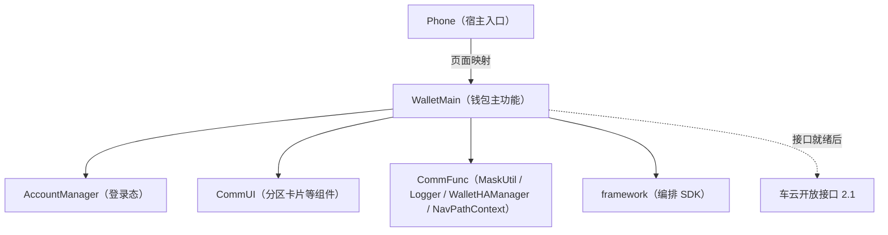
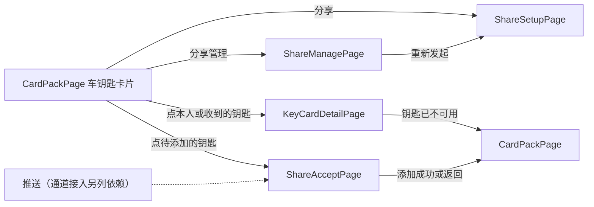

# 数字车钥匙分享（钱包端） — 实现计划（plan）

> **模块标识**: `ISSUE-206`
> **对应 spec**: `doc/features/ISSUE-206/spec/spec.md`
> **版本**: v1.1
> **创建日期**: 2026-10-13
> **最后更新**: 2026-10-14
> **状态**: 已确认（F4 草稿跨重启续办阻断，待端侧负责人确认受保护存储，见 9.1）
>
> **真源说明**：`plan.md` = 契约草案/来源（ephemeral）；`contracts.yaml` / `use-cases.yaml` = **机器契约真源**（coding / review / UT / harness 优先读取）。

## Scope 声明与继承

### Scope 概览

| 字段 | 取值 | 说明 |
|------|------|------|
| 继承自 spec | `true` | 完全继承 spec 的 in_scope_modules，未扩展 |
| 本计划允许修改的模块 | `WalletMain`、`Phone` | Phone 只在宿主页面映射里加四个页面分支 |
| 明确不修改的模块 | `AccountManager`、`CommUI`、`CommFunc` | 只复用登录态、分区卡片等组件、`MaskUtil`、`Logger`、`WalletHAManager`、`NavPathContext` |
| 已获用户批准的扩展 | `[]` | 无 |

### Scope 结构化字段（供 Harness 校验，必填）

```yaml
inherited_from_prd: true
in_scope_modules:
  - WalletMain
  - Phone
out_of_scope_modules:
  - AccountManager
  - CommUI
  - CommFunc
rationale: |
  本计划完全继承 spec 的 scope 声明，未发起扩展。
  推送点击进入接受页要改宿主入口，属于推送接入的后续依赖，届时另发 scope 扩展提议。
expansions_with_user_approval: []
```

### 架构影响声明 (architecture_impact)

```yaml
architecture_impact:
  impact: none
  affected_items: []
  architecture_md_updates: []
  catalog_updates: []
```

不新增模块、不改模块依赖方向；新增页面、数据源与仓储都在既有模块内，跨模块只经各模块 `index.ets` 出口。

## 1. 模块架构图



| Module | 变更类型 | 说明 |
|--------|----------|------|
| WalletMain | 修改 | 新增分享数据源（接口与模拟实现）、仓储、草稿存储、车钥匙卡片分区与四个页面，卡包页嵌入分区 |
| Phone | 修改 | `navDestinationMap` 增加四个页面名分支 |

钱包端经一个分享数据源接口取数。本单提供它的模拟实现（spec D3），接口就绪后换成真实实现，页面与仓储不改。

## 2. 目录/文件结构规划

| 路径（`02-Feature/WalletMain/src/main/ets/` 下，另注明的除外） | 职责 | 新增/修改 |
|------|------|-----------|
| `data/model/KeySharing.ets` | 分享领域模型：本人钥匙、被分享人收到的分享、权限视图、配额视图、分享条目、草稿、六态枚举 | 新增 |
| `data/source/KeySharingSource.ets` | 分享数据源接口：本人钥匙列表、按当前账号取收到的分享（六个车云接口里没有对应接口），以及六个车云接口的同名方法 | 新增 |
| `data/source/SimulatedKeySharingSource.ets` | 数据源的模拟实现：模拟本人钥匙、分享关系与车云返回，覆盖签发失败、凭据下发失败、满额、对象不可分享、撤销中等分支；收到的分享覆盖六个状态 | 新增 |
| `data/repository/KeySharingRepository.ets` | 分享仓储：经数据源调用六个接口，组装页面视图；打码在组装展示内容时做；三个流程的尝试持有与结算 | 新增 |
| `data/repository/CarKeyRepository.ets` | 卡包车钥匙卡片的数据：本人钥匙与收到的分享（待接受、生效与撤销中列入卡包，已结束的不列入）；按分享标识取一条的当前状态 | 新增 |
| `data/repository/ShareDraftStore.ets` | 发起草稿的本地存储：落盘以扛过应用关闭，按账号分键，发出成功、退出登录、切换账号时清除 | 新增 |
| `presentation/components/CarKeyCardSection.ets` | 卡包里的车钥匙卡片分区：本人钥匙卡片（含「分享」「分享管理」入口）、待添加的钥匙与收到的钥匙卡片 | 新增 |
| `presentation/pages/CardPackPage.ets` | 卡包页嵌入车钥匙卡片分区；每次进入或回到卡包按当前账号重新获取 | 修改 |
| `presentation/interaction/ShareSetupPageOperates.ets` | 设置页动作表与动作枚举 `ShareSetupActions`（page-interaction 动作表角色） | 新增 |
| `presentation/interaction/ShareSetupPageInteraction.ets` | 设置页交互封装：构建动作表、提供 `doOperator` 入口（page-interaction 交互封装角色） | 新增 |
| `presentation/interaction/ShareSetupContext.ets` | 设置页交互上下文：对象、档位、有效期、配额与草稿（page-interaction 上下文角色） | 新增 |
| `presentation/pages/ShareSetupPage.ets` | 分享设置页：给谁、权限、有效期、发出；进页回填草稿；导出 builder（page-interaction 页面组件角色） | 新增 |
| `presentation/pages/ShareManagePage.ets` | 分享管理页：配额、列表；生效条目可撤销，已作废与已到期条目可重新发起；导出 builder | 新增 |
| `presentation/pages/ShareAcceptPage.ets` | 接受页：按分享标识取收到的分享展示车辆信息卡、添加到钱包，结束后回卡包；导出 builder | 新增 |
| `presentation/pages/KeyCardDetailPage.ets` | 钥匙卡片详情：本人钥匙按车辆标识取、展示车型车辆与分享入口；收到的钥匙按分享标识取当前状态、展示权限范围与有效期；取不到时提示并回卡包；导出 builder | 新增 |
| `shared/constant/ShareConstants.ets` | 分享功能开关（默认关闭，先例 `HomeConstants.SHOW_LOCAL_CARD_SECTION`）与有效期档位 | 新增 |
| `shared/constant/KeySharingChartCodes.ets` | 分享埋点登记：发起、接受、撤销三个流程的流程号、步骤号与内码常量 | 新增 |
| `index.ets` | 导出四个新页面的 builder | 修改 |
| `resources/base/element/string.json` | 分享相关中文文案 | 修改 |
| `resources/en_US/element/string.json` | 分享相关英文文案（工程现在只有 base 资源目录，按 RES-02 新建） | 新增 |
| `01-Product/Phone/src/main/ets/pages/index.ets`（宿主页面映射） | `navDestinationMap` 增加四个页面名分支 | 修改 |

上表文件逐项列入 `contracts.files`；完整签名与类型以 `contracts.yaml` 为准。配额上限、待接受期限与宽限都由车云判定和返回，端侧不设常量。

## 3. 数据模型定义

| 模型 | 字段（摘要） | 说明 |
|------|--------------|------|
| `OwnerCarKey` | `vehicleId: string`, `modelName: string` | 车主本人的钥匙；本单来自模拟数据 |
| `ReceivedCarKey` | `shareId`, `vehicleId`, `modelName`, `ownerNickname`, `permissionLevel`, `validUntil`, `status: ShareState`, `recallDeadline?` | 被分享人收到的一条分享；撤销中时由数据源给出卡片收回期限；卡包、接受页与详情共用 |
| `GrantPermissionView` | `granteeId`, `shareable: boolean`, `permissionLevels: string[]`, `reason?` | 某对象在这辆车上可用的权限档位，对应 `queryGranteePermission` |
| `QuotaView` | `canShare: boolean`, `remaining: number`, `reason?` | 配额，对应 `queryKeySharingQuota` |
| `ShareItem` | `shareId`, `status: ShareState`, `permissionLevel`, `validUntil`, `granteeMasked` | 管理页一条分享，打码标识取车云返回 |
| `ShareDraft` | `accountKey`, `vehicleId`, `granteeId`, `granteeDisplay`, `permissionLevel`, `validUntil`, `idempotencyKey` | 发起草稿，按 `accountKey` + `vehicleId` 定位；`granteeId` 是可识别的对方账号标识，只用于续办请求；`granteeDisplay` 是打码后的展示值；`idempotencyKey` 发出前写入，留着表示上次发出结果未知——此时其余字段就是那次请求的原样，确认之前不改；车云明确拒绝时清掉 |
| `ShareState` | `pending` / `active` / `voided` / `expired` / `revoking` / `revoked` | 六态，取值与车云返回一致 |

## 4. 页面组件树

### 4.1 CardPackPage（修改）

```
CardPackPage
└── CarKeyCardSection
    ├── 本人钥匙卡片：车型、车辆；「分享」→ ShareSetupPage；「分享管理」→ ShareManagePage
    ├── 待添加的钥匙：车型、车主昵称、「待添加」；点击 → ShareAcceptPage
    └── 收到的钥匙卡片：车型、车主昵称；撤销中保留到收回完成；点击 → KeyCardDetailPage（带 shareId）
```

未登录或没有车钥匙时不显示本人钥匙卡片与入口；开关关闭时「分享」不可发起，「分享管理」照常。

### 4.2 ShareSetupPage

交互按 page-interaction 编排：页面经 `ShareSetupPageInteraction.doOperator` 触发动作，等待用户选择处停机。

```
ShareSetupPage
├── 给谁：通讯录选择或输入账号，展示昵称与打码账号
├── 权限：随对象查得的档位单选；对象不可分享时不呈现档位并给原因
├── 有效期：7 天 / 30 天 / 自定义至多 180 天
├── 原因提示条：对象不可分享、配额已满或原档位不可用时显示接口给的原因
└── 发出：新建时三项齐且配额未满才可点、满额置灰；草稿留着幂等标识时三项按上次请求只读，按钮用来确认上次发出，不受满额置灰；请求中禁用
```

### 4.3 ShareManagePage

```
ShareManagePage
├── 顶部：车辆与剩余可分享数
├── 列表：对象（打码）、权限、有效期、状态；生效、过程中与已结束三类样式可区分
│   ├── 生效：「撤销」
│   └── 已作废、已到期：「重新发起」→ ShareSetupPage
└── 网络失败态：可重试，不展示陈旧列表
```

### 4.4 ShareAcceptPage

```
ShareAcceptPage
├── 车辆信息卡：车型、车主昵称
├── 权限范围（人话描述，不写档位代号）与有效期
└── 添加到钱包（不设拒绝按钮）
```

### 4.5 KeyCardDetailPage

```
KeyCardDetailPage（参数二选一：vehicleId 为本人钥匙，shareId 为收到的钥匙）
├── 本人钥匙：车型、车辆；「分享」→ ShareSetupPage；「分享管理」→ ShareManagePage（门槛同卡片入口）
├── 收到的钥匙：车型、车主昵称；权限范围与有效期（只读，权限外功能不出现）
└── 状态提示条：本人钥匙已不在当前账号下，或收到的钥匙已撤销、已到期、找不到时，提示这把钥匙已不可用并回到卡包
```

## 5. 状态管理方案

| 状态域 | 存储位置 | 生命周期 | 说明 |
|--------|----------|----------|------|
| 分享功能开关 | `ShareConstants` 的 `static readonly` 常量 | 随版本 | 默认关闭 |
| 登录态与账号 | `AccountManager` 在 `AppStorage` 里的登录键（只读） | 既有 | 未登录不显示入口、不发起、不接受 |
| 发起草稿 | `ShareDraftStore`：每个账号一条记录、内按车辆分草稿。非敏感字段用系统轻量键值存储；`granteeId` 与 `idempotencyKey` 用受保护存储，候选与阻断见 9.1 | 发出成功清这辆车的草稿；退出登录、切换账号清本账号全部；车云明确拒绝时只清幂等标识 | 清除数据后不存在则从头选；进设置页只读当前账号、当前车辆的草稿；留着幂等标识的先用原请求确认上次发出、不做端侧满额前置，确认前三项只读，其余先查配额、满额按满额处理 |
| 设置页表单 | `ShareSetupContext`（页面级 `@State`） | 页面内 | 换对象时重查权限并作废旧档位 |
| 分享列表与配额 | `ShareManagePage` 页面级状态，不落地缓存 | 每次进页 | 断网给网络失败态 |
| 本人钥匙与收到的分享 | `CardPackPage` 页面级状态，每次进入或回到卡包从 `CarKeyRepository` 取 | 每次进入；账号变化后重新获取 | 不串账号 |
| 三个流程的尝试标识 | `KeySharingRepository` 方法内局部 | 一次调用 | 与创建分享的幂等标识分开 |

## 6. 服务层接口定义

| 接口 | 入参（摘要） | 出参（摘要） | 说明 |
|------|--------------|--------------|------|
| `CarKeyRepository.listOwnerKeys` | — | `OwnerCarKey[]` | 本人钥匙；本单来自模拟数据 |
| `CarKeyRepository.listReceivedKeys` | 当前账号 | `ReceivedCarKey[]` | 待接受、生效与撤销中的分享；已撤销、已到期、已作废的不列入卡包；对应的车云查询不在六个接口内，本单由模拟数据源提供 |
| `CarKeyRepository.getReceivedKey` | `shareId` | `ReceivedCarKey` 或空 | 接受页与详情页取一条分享的当前状态；接受没得到回应后也用它重取 |
| `CarKeyRepository.getOwnerKey` | `vehicleId` | `OwnerCarKey` 或空 | 详情页取本人钥匙；本单来自模拟数据，当前账号下没有这辆车返回空 |
| `KeySharingRepository.queryQuota` | `vehicleId` | `QuotaView` | 对应 `queryKeySharingQuota` |
| `KeySharingRepository.queryGranteePermission` | `vehicleId`, `granteeId` | `GrantPermissionView` | `granteeId` 传可识别的对方账号标识，不传打码值 |
| `KeySharingRepository.createSharing` | `ShareDraft` | `shareId`, `status`，或明确拒绝，或结果未知 | 对应 `createKeySharing`，调用前把幂等标识写进草稿；已建立清草稿，明确拒绝（含签发失败、满额）只清幂等标识，没得到回应留着标识、返回结果未知；草稿留着标识时调用方直接用它确认，不做端侧满额前置；每次调用新建尝试标识，结果经 `settleCreate` 结算 |
| `KeySharingRepository.acceptSharing` | `shareId` | `credentialStatus`, `status`，或结果未知 | 对应 `acceptKeySharing`；凭据下发失败或车云拒绝保持待接受；没得到回应返回结果未知，接受页随后经 `getReceivedKey` 重取状态，仍是待接受才允许再点；每次调用新建尝试标识，结果经 `settleAccept` 结算 |
| `KeySharingRepository.revokeSharing` | `shareId` | `status`, `graceHours`，或明确拒绝，或结果未知 | 对应 `revokeKeySharing`；只对状态为生效的条目调用；没得到回应返回结果未知，管理页随后经 `listSharings` 重拉，仍是生效才再提供撤销；每次调用新建尝试标识，结果经 `settleRevoke` 结算 |
| `KeySharingRepository.listSharings` | `vehicleId` | `ShareItem[]` | 对应 `queryKeySharingList`；打码标识取车云返回的 `granteeMasked` |
| `KeySharingRepository.settleCreate` / `settleAccept` / `settleRevoke` | 尝试标识、业务结果、描述关键值、外码 | — | 一次尝试只结算一次：已结算即返回，否则置位后按 `KeySharingChartCodes` 报一条 Chart；取值见「9.4 埋点」 |
| `ShareDraftStore.load` / `save` / `clear` | 账号、`vehicleId` | `ShareDraft` / — | 草稿续办与这辆车的清除；`save` 在留着幂等标识时拒绝改对象、权限、有效期 |
| `ShareDraftStore.clearAccount` | 账号 | — | 退出登录、切换账号时清本账号全部车辆的草稿 |
| `ShareSetupPageInteraction.doOperator` | `ShareSetupActions` | — | 设置页动作入口；等待用户选择处停机，用户动作恢复 |

六个车云接口的字段与 spec「端云接口」一致；沿用车云错误码，不新增。

## 7. 路由/导航设计



| 页面 | 路由名 | 参数 | 说明 |
|------|--------|------|------|
| 分享设置页 | `ShareSetupPage` | `vehicleId` | 进页只回填当前账号、这辆车的草稿 |
| 分享管理页 | `ShareManagePage` | `vehicleId` | 每次进页拉取 |
| 接受页 | `ShareAcceptPage` | `shareId` | 本单从卡包待添加的钥匙进入 |
| 钥匙卡片详情 | `KeyCardDetailPage` | `vehicleId` 或 `shareId`（二选一） | 本人钥匙带 vehicleId，收到的钥匙带 shareId；进入时按带来的身份取当前状态，两样都带或都不带按取不到处理 |

每个新页面改三处：页面文件导出 builder、`WalletMain/index.ets` 导出、宿主 `navDestinationMap` 加分支；页面内用 `NavPathContext.stack().pushPath({ name, param })` 跳转。推送点击进入接受页要等推送通道接入，本单不改宿主入口。

## 8. spec 功能映射表

| spec 编号 | 功能名称 | 优先级 | 实现模块 | 实现层级 | 关键文件 | 实现说明 |
|-----------|----------|--------|----------|----------|----------|----------|
| F1 | 卡包车钥匙卡片 | P0 | WalletMain | presentation、data | `CarKeyCardSection.ets`、`CardPackPage.ets`、`CarKeyRepository.ets` | 卡包嵌入分区；本人钥匙来自模拟数据 |
| F2 | 分享入口与门槛 | P0 | WalletMain | presentation、shared | `CarKeyCardSection.ets`、`ShareConstants.ets` | 已登录且有车钥匙才显示；开关关闭时发起入口不可用 |
| F3 | 分享设置 | P0 | WalletMain | presentation、data | `ShareSetupPage.ets`、`ShareSetupPageInteraction.ets`、`KeySharingRepository.ets` | 对象选定后查档位，换对象重查；满额置灰 |
| F4 | 创建分享与草稿续办 | P0 | WalletMain | data | `KeySharingRepository.ets`、`ShareDraftStore.ets` | 幂等创建；草稿按账号与车辆定位；没发出过或上次明确失败的草稿续办前查配额，留着幂等标识的按原请求确认上次发出；**跨重启落盘阻断**：受保护存储确认前不落盘 granteeId，跨应用关闭的续办与确认不交付 |
| F5 | 分享管理与撤销 | P0 | WalletMain | presentation、data | `ShareManagePage.ets`、`KeySharingRepository.ets` | 进页拉取；仅生效条目撤销，已作废与已到期可重新发起 |
| F6 | 接受页 | P0 | WalletMain | presentation | `ShareAcceptPage.ets` | 下发失败保持待接受 |
| F7 | 钥匙卡片详情 | P1 | WalletMain | presentation、data | `KeyCardDetailPage.ets`、`CarKeyRepository.ets` | 本人钥匙按 vehicleId 经 `getOwnerKey` 取，收到的钥匙按 shareId 经 `getReceivedKey` 取；权限外功能不出现；不可用时回卡包 |
| F8 | 状态、身份与隐私 | P0 | WalletMain | data | `KeySharing.ets`、`KeySharingRepository.ets` | 业务请求用 `granteeId`，展示用打码值 |
| F9 | 被分享人收到的钥匙 | P0 | WalletMain | data、presentation | `CarKeyRepository.ets`、`CarKeyCardSection.ets`、`ShareAcceptPage.ets`、`KeyCardDetailPage.ets` | 进卡包按当前账号取收到的分享；待接受进接受页；已结束的不列入 |

**覆盖率检查**：
- P0: 8/8
- P1: 1/1

## 9. 宿主扩展

### 9.1 项目知识

| 新增能力 | 复用了什么 | 未复用的理由 | 与登记不符之处 |
|---|---|---|---|
| 对方账号打码 | `CommFunc.MaskUtil` | — | — |
| 定位日志 | `CommFunc.Logger` | — | — |
| 三个流程的事件上报 | `CommFunc.WalletHAManager` 上报封装 | — | 仓内只有通用事件模板，三个流程的流程、步骤与内码新增登记到 `KeySharingChartCodes` |
| 页面导航 | `NavPathContext`、宿主 `navDestinationMap` | — | — |
| 登录态 | `AccountManager` | — | — |
| 设置页交互编排 | 编排 SDK `framework`（`PageInteractionBuilderV3`、`DefaultPageInteractionContext`） | — | — |
| 分区卡片等组件 | `CommUI` | — | — |
| 分享功能开关 | 先例 `HomeConstants.SHOW_LOCAL_CARD_SECTION` | — | — |
| 发起草稿存储 | — | 工程里没有本地草稿能力，`ShareDraftStore` 新增 | 工程里没有受保护的持久化封装，仓内也没有 Asset 或密钥存储的用法。候选是系统的关键资产存储 Asset Store Kit（`@kit.AssetStoreKit`，首批接口 API 11 起，要求 SystemCapability.Security.Asset，设备不支持时返回 24000017）：`granteeId` 与 `idempotencyKey` 作为关键资产按账号与车辆存，可访问性取设备首次解锁后、不设卸载保留，清除时同步删除。本仓 spec 的平台基线是 API 12，接口版本够用；目标设备是否具备该系统能力、模块是否已声明依赖都没有取到依据。**定案前阻断**：不落盘 `granteeId`，F4 跨应用关闭的续办与上次结果未知的确认不交付（AC-13 中跨重启部分、AC-30），由端侧负责人按目标设备与仓内安全规范确认后解除；不改用普通键值存储顶替，也不删 `granteeId` |
| 英文文案 | — | 工程只有 base 资源目录，按 RES-02 新建 `en_US` | 与「中英文齐备」的现状不符，按新建承接 |

### 9.2 规约

| 条目编号 | 本次要落实成什么 | 落点实体 | 承载设计章 |
|---|---|---|---|
| UX-01 | 方向与对齐参数用 start/end，文本对齐用 TextAlign.Start/End | `ShareSetupPage`、`ShareManagePage`、`ShareAcceptPage`、`KeyCardDetailPage`、`CarKeyCardSection` | 4. 页面组件树 |
| SEC-01 | 业务接口传可识别的 `granteeId`，只给车云的查权限与创建分享；展示内容在组装处另生成打码值，列表用车云返回的 `granteeMasked`，短于 5 位的账号只显示昵称；日志与事件不带对方账号；草稿只存续办字段、按账号与车辆定位并按时清除，`granteeId` 只进受保护存储，定案前不落盘（见 9.1） | `KeySharingRepository` 的展示组装与结算方法、`ShareDraft`、`ShareDraftStore` | 3. 数据模型定义、6. 服务层接口定义 |
| DFX-01 | 配额与列表每次进页拉一次，换对象查一次权限，无轮询 | `KeySharingRepository.queryQuota` / `queryGranteePermission` / `listSharings` | 6. 服务层接口定义 |
| OBS-02 | 创建、接受、撤销失败经 `Logger` 写到失败步骤 | `KeySharingRepository.createSharing` / `acceptSharing` / `revokeSharing` | 6. 服务层接口定义 |
| OBS-03 | 三个流程每种结果在结算方法里结算一次，同次不重复 | `KeySharingRepository.settleCreate` / `settleAccept` / `settleRevoke` | 9. 宿主扩展 |
| OBS-05 | 五项值按上报协议，关键值与外码各有真实来源 | `KeySharingRepository` 的三个结算方法 | 9. 宿主扩展 |
| OBS-06 | 三个流程的编号登记到 `KeySharingChartCodes`，核冲突后定稿 | `KeySharingChartCodes` | 2. 目录/文件结构规划、9. 宿主扩展 |
| RES-01 | 图标按系统符号、已归档、新引入的顺序取 | 四个新页面与 `CarKeyCardSection` | 4. 页面组件树 |
| RES-02 | 文案复用已有一致的中文资源，新增的中英文齐备 | `string.json`（base、en_US） | 2. 目录/文件结构规划 |
| COMPAT-01 | 六个接口字段与含义不变，可空出参按可空处理 | `KeySharingSource` 接口定义 | 6. 服务层接口定义 |
| ENV-01 | 草稿清除后从头选，不崩溃；列表不落盘 | `ShareDraftStore`、`ShareSetupPage` 回填 | 5. 状态管理方案 |
| ENV-02 | 幂等标识防重复创建，发出请求中禁用 | `KeySharingRepository.createSharing`、`ShareSetupPageOperates` 的发出动作 | 6. 服务层接口定义 |
| DLV-01 | 新增文案进待翻译清单并跟踪回稿 | `string.json` 新增条目 | 2. 目录/文件结构规划 |

不命中的四条（DFX-02、OBS-07、COMPAT-02、DLV-02）不挂实体。

### 9.3 设计模式

| 适用单元 | 候选 | 选 / 不选 | 实例名 | 理由 |
|---|---|---|---|---|
| 分享设置页（选对象 → 查权限档位 → 选有效期 → 发出） | page-interaction | 选 | `ShareSetupPageInteraction`（动作表 `ShareSetupPageOperates`、动作枚举 `ShareSetupActions`、交互封装 `ShareSetupPageInteraction`、上下文 `ShareSetupContext`、页面组件 `ShareSetupPage`） | 页内交互由业务结果驱动下一步：选定对象后才查权限，换对象重查、原档位不可用时请车主重选，满额时发出置灰；等待用户选择处停机，由用户动作恢复 |
| 发起分享主链路（门槛 → 设置 → 创建 → 签发结果） | decision-tree | 不选 | — | 反证：门槛不满足、对象不可分享、配额已满、签发失败都是一次请求或一次前置判断的结果，每支一步收敛，没有「分支自身多步、各有失败处理」的编排；签发与回滚在车云完成。这一判断按业务过程本身成立，接入真实车云后不变 |

管理页（撤销 / 重新发起）在 spec 登记为无候选，本阶段保持无模式。

设置页的动作链：选对象 → 查权限（等待用户选档时停机）→ 选有效期 → 发出（请求中停机，返回后按结果回到设置页或回卡包）。换对象重新进入「查权限」，原档位不可用时请车主重选。角色投到契约：四个角色文件在 `contracts.files` 标 `pattern: page-interaction` 与各自 role，`doOperator` 声明进 `contracts.interfaces`，发出等用户动作进 `use-cases` 的 `ui_bindings.user_actions[].calls`。

### 9.4 埋点

本节实现 spec 埋点的三个流程指标：分享发起成功率、分享接受成功率、分享撤销成功率。分享被接受比例由车云按分享记录统计（spec D7），本单不为它上报、不记失效事件。

#### 9.4.1 共同约定

| 项 | 约定 |
|---|---|
| 尝试持有者 | `createSharing`、`acceptSharing`、`revokeSharing` 每次调用新建一个尝试标识，与创建分享的幂等标识分开；中断后续办沿用草稿的幂等标识，但算新的一次尝试 |
| 结算方法 | `settleCreate`、`settleAccept`、`settleRevoke`：一次尝试只结算一个结果；正常响应、车云返回失败、通信异常与重复回调都经它，已结算即返回 |
| 登记文件 | `shared/constant/KeySharingChartCodes.ets`；仓内没有流程、步骤与内码登记，下表编号按分配规则取未用号（业务模块 `01`，发起、接受、撤销依次为流程 `001`–`003`），编码前写入登记文件并核冲突 |
| 结果分类 | 三个流程都只有一步，这一步成功就是流程整体成功，记 `SUCCESS`；失败都是普通失败，记 `STEP_ERROR_BY_ERROR`；请求发出后不能取消，没有用户取消这一结果 |
| 渠道 | 表内结果只报 Chart，要本地日志时直接调 `Logger`；查配额、查权限与卡包补拉失败只写 `Logger`，不进统计 |
| 边界 | 退出页面不取消已发出的请求，按它自己的结果结算；接受后车主再撤销，是撤销流程的一次新尝试，接受那条不变；两侧钱包各自只报本端发起的流程 |

#### 9.4.2 逐点实现

| 统计点 | 结果 | 责任方法 | 事件 ID | 内码 | 结果分类 | 描述 | 外码来源 | 去重与验证 |
|---|---|---|---|---|---|---|---|---|
| 发起流程 / 创建分享 | 已建立 | `KeySharingRepository.createSharing` | `Wallet_COMMON` / `001` / `001` | `0101010000`（候选，待登记：KeySharingChartCodes） | SUCCESS | 「分享已建立」，拼车型类别（取自本人钥匙）、权限档与有效期档位（取自本次草稿）、是否续办（草稿里有没有沿用的幂等标识） | 无 | `settleCreate`；单测：建立报一条，重复回调不再报 |
| 发起流程 / 创建分享 | 车云返回失败（含签发失败） | `KeySharingRepository.createSharing` | `Wallet_COMMON` / `001` / `001` | `0101010001`（候选，待登记：KeySharingChartCodes） | STEP_ERROR_BY_ERROR | 「创建分享失败」，拼失败响应里的可读信息与车型类别 | 创建失败响应里的车云错误码 | `settleCreate`；单测：签发失败、满额返回各报一条，不留关系 |
| 发起流程 / 创建分享 | 通信失败 | `KeySharingRepository.createSharing` | `Wallet_COMMON` / `001` / `001` | `0101010002`（候选，待登记：KeySharingChartCodes） | STEP_ERROR_BY_ERROR | 「创建分享没得到回应，结果未知」，拼异常类型（超时或断网，取自请求异常） | 无 | `settleCreate`；单测：超时报一条，草稿留着幂等标识；之后用同一标识确认拿回同一条分享，另记一条「已建立」；满额时确认的那次也照发，车云返回满额就记一条「车云返回失败」 |
| 接受流程 / 接受 | 生效 | `KeySharingRepository.acceptSharing` | `Wallet_COMMON` / `002` / `001` | `0102010000`（候选，待登记：KeySharingChartCodes） | SUCCESS | 「接受成功，钥匙生效」，拼车型类别（取自收到的分享） | 无 | `settleAccept`；单测：生效报一条，重复回调不再报 |
| 接受流程 / 接受 | 凭据下发失败 | `KeySharingRepository.acceptSharing` | `Wallet_COMMON` / `002` / `001` | `0102010001`（候选，待登记：KeySharingChartCodes） | STEP_ERROR_BY_ERROR | 「凭据下发失败，保持待接受」，拼接受响应里的 `credentialStatus` 与 `status` | 无（接受响应正常返回，不带错误码） | `settleAccept`；单测：报一条；再点记新的一条 |
| 接受流程 / 接受 | 车云返回失败 | `KeySharingRepository.acceptSharing` | `Wallet_COMMON` / `002` / `001` | `0102010002`（候选，待登记：KeySharingChartCodes） | STEP_ERROR_BY_ERROR | 「接受分享失败」，拼失败响应里的可读信息 | 接受失败响应里的车云错误码 | `settleAccept`；单测：报一条，保持待接受 |
| 接受流程 / 接受 | 通信失败 | `KeySharingRepository.acceptSharing` | `Wallet_COMMON` / `002` / `001` | `0102010003`（候选，待登记：KeySharingChartCodes） | STEP_ERROR_BY_ERROR | 「接受没得到回应，结果未知」，拼异常类型（超时或断网，取自请求异常） | 无 | `settleAccept`；单测：报一条；重取状态不再报；重取到生效就显示钥匙卡片，不再发接受 |
| 撤销流程 / 撤销 | 已受理 | `KeySharingRepository.revokeSharing` | `Wallet_COMMON` / `003` / `001` | `0103010000`（候选，待登记：KeySharingChartCodes） | SUCCESS | 「撤销已受理」，拼撤销响应里的 `status`（`revoked` 立即失效 / `revoking` 撤销中）与 `graceHours` | 无 | `settleRevoke`；单测：立即失效与撤销中各报一条 |
| 撤销流程 / 撤销 | 车云返回失败 | `KeySharingRepository.revokeSharing` | `Wallet_COMMON` / `003` / `001` | `0103010001`（候选，待登记：KeySharingChartCodes） | STEP_ERROR_BY_ERROR | 「撤销失败」，拼失败响应里的可读信息 | 撤销失败响应里的车云错误码 | `settleRevoke`；单测：报一条，条目保持生效 |
| 撤销流程 / 撤销 | 通信失败 | `KeySharingRepository.revokeSharing` | `Wallet_COMMON` / `003` / `001` | `0103010002`（候选，待登记：KeySharingChartCodes） | STEP_ERROR_BY_ERROR | 「撤销没得到回应，结果未知」，拼异常类型（超时或断网，取自请求异常） | 无 | `settleRevoke`；单测：报一条；重拉列表不再报；重拉到撤销中或已撤销就不再提供撤销 |

#### 9.4.3 待登记与缺依据

- 上表事件 ID 与内码都是按分配规则取的候选值，编码前写进 `KeySharingChartCodes` 并在 `CommFunc` 既有事件登记处核冲突后定稿。
- 三个结算方法与三个尝试持有方法都声明进 `contracts.interfaces`，`OBS-03` 的统计义务挂在结算方法的 `must` 上。
- 业务扩展字段（`setChannel`、`setSource` 等）本仓没有含义依据，本需求不启用，只用标准字段。

## 附录

### A. 变更记录

| 日期 | 版本 | 变更内容 | 变更人 |
|------|------|----------|--------|
| 2026-10-14 | v1.1 | 转正前修订：草稿按账号与车辆定位、待确认请求冻结（G05）；受保护存储取证，候选 Asset Store Kit，定案前阻断 F4 跨重启续办（G04） | AI |
| 2026-10-13 | v1.0 | 初始版本：继承 spec Scope（WalletMain、Phone，无扩展）；数据源接口加模拟实现承载六个车云接口与被分享人一侧查询（spec D3）；草稿用系统轻量键值存储、按账号分键（spec D6）；设计模式选 page-interaction、decision-tree 不选；三个流程的埋点编号以候选值登记 | AI |
