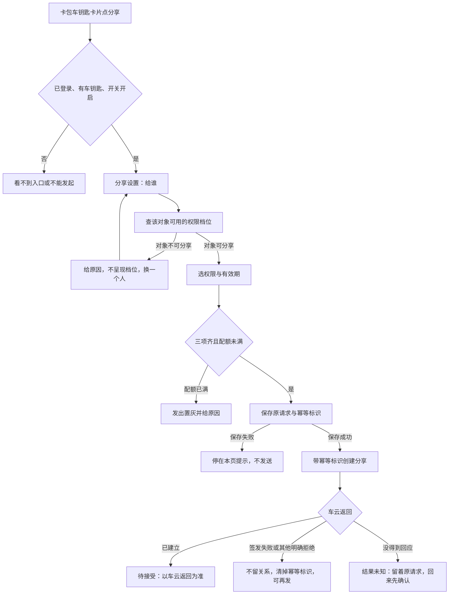
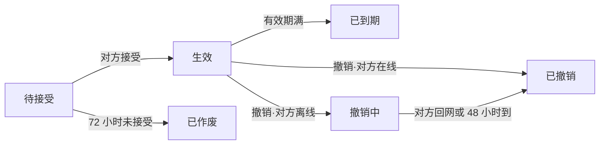
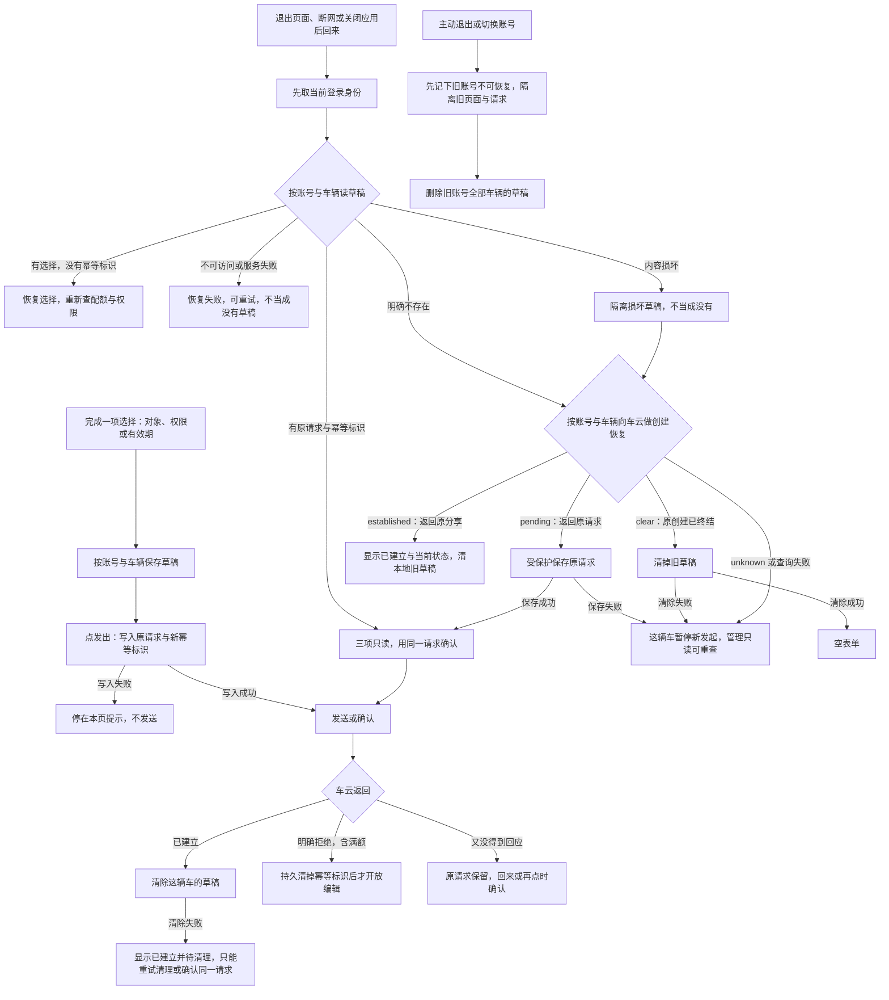
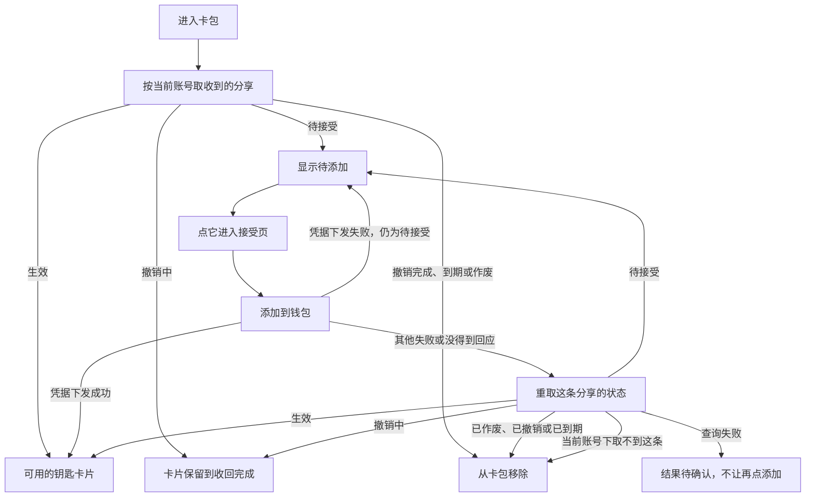
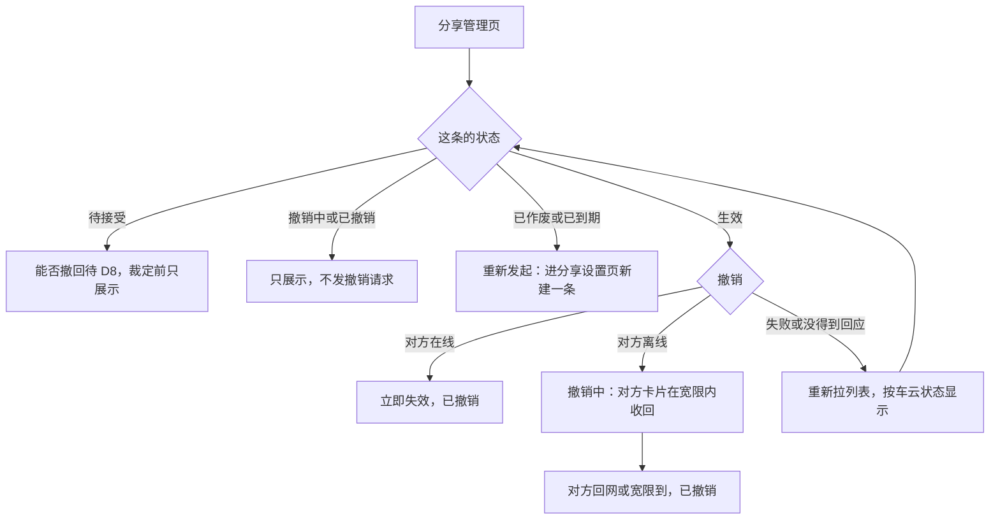

# 数字车钥匙分享（钱包端）— 需求规格（Spec）

> **模块标识**: `ISSUE-206`
> **版本**: v1.3
> **创建日期**: 2026-10-13
> **最后更新**: 2026-10-16
> **状态**: 评审中

## 0. 术语映射表（Terminology Mapping Table）

| 原始术语 | 权威模块 | 所属层 | 置信度（high / medium / low） | 易混项（必须亮出） | 用户确认 | 解释 |
|---------|---------|--------|-------------------------------|-------------------|---------|------|
| 车钥匙分享 | WalletMain | 02-Feature | medium | Phone——只负责应用壳与页面映射，分享的页面、数据与草稿都在钱包主功能 | [x] | 车主把钥匙的可用性分享给家人或联系人：对方钱包里多一把能用的钥匙，车主可撤销生效中的分享 |
| 车钥匙卡片 | WalletMain | 02-Feature | medium | 添加卡片页的「车钥匙」分类——那只是不可点的类别，没有卡片本体；本单在卡包里补上卡片（D4） | [x] | 卡包里展示的车钥匙：车主本人的钥匙，以及当前账号收到并添加成功的钥匙 |
| 权限档位 | WalletMain | 02-Feature | medium | AccountManager——持有登录与账号，对象与车辆的关系由车云判定，钱包端不判断谁是家庭成员 | [x] | 给对方的钥匙能力范围，取车云 `permissionLevels` 返回的可读选项，选中后原样传回 |
| 分享状态 | WalletMain | 02-Feature | medium | 钥匙可用性——「撤销中」时车辆侧已经拒绝，只是对方卡片还没收回 | [x] | 一条分享所处的阶段：待接受、生效、已作废、已到期、撤销中、已撤销，六态互斥，以车云返回为准 |
| 发起草稿 | WalletMain | 02-Feature | medium | AccountManager——草稿是分享业务的本地记录，只是按账号隔离 | [x] | 发起分享未完成时的本地记录（对象、权限档、有效期，发出前加上原请求与幂等标识），按账号与车辆各一份，用于中断后续办 |
| 账号标识（accountKey） | WalletMain | 02-Feature | medium | AccountManager 的脱敏展示账号——展示值相同的两个账号可以不同；accountKey 不展示 | [x] | 当前登录账号的不透明稳定标识，本期由 WalletMain 的模拟身份源提供，用于草稿隔离、会话匹配与退出清理 |
| 车型类别 | WalletMain | 02-Feature | medium | 车型名称——统计不按名称猜类别 | [x] | 本人钥匙与收到的分享上的非个人分类，本期由模拟数据源给出，缺失按未知 |
| 打码账号 | CommFunc | 05-SystemBase | high | 对方账号标识——业务请求用可识别的标识，打码值只用于展示 | [x] | 页面与记录里展示的对方账号形态，在组装展示内容处用公共脱敏能力生成或取车云返回值 |

**回写约定**：上表新增业务词（车钥匙分享、车钥匙卡片、分享状态、发起草稿、账号标识、车型类别）在用户批准后同步追加到 `doc/glossary.yaml`。

## 1. 功能概述

车主在钱包卡包的车钥匙卡片上把钥匙分享给家人或联系人，对方钱包里多一把可用的钥匙；车主在分享管理页看到每条分享的状态，可以撤销生效中的分享。产品目标（上游约束：产品需求）：分享能力上线三个月内，车钥匙用户中发起过分享的比例不低于 15%，「借车送钥匙」类客服咨询量下降一半。两项都由运营侧统计，钱包端以分享链路的顺畅支撑，不直接承诺。

本 AR 承担钱包端：卡包车钥匙卡片与分享入口、分享设置、创建分享与草稿续办、分享管理与撤销、接受页、钥匙卡片详情与被分享人收到的钥匙。分享关系的真源在车云，钥匙能不能用的最终裁决在车厂云，钱包端只展示与操作。

本工程还没有车钥匙卡片，本单一并补上（D4）。车云开放接口在工程里还不可用，以下都由可替换的模拟数据源承接（D3）：
- 车主本人钥匙信息与车辆标识；
- 分享关系；
- 被分享人一侧按账号查收到的分享；
- 稳定账号标识、联系人与车型类别。

与车云的真实联调、推送点击进入接受页另列依赖，不算本单验过。

草稿跨应用关闭的保护按本轮维护设计采用系统 Asset 存储，设计前提是 API 12 与设备具备 `SystemCapability.Security.Asset`，随具体稿待用户审定，尚未在目标设备上验证。

上游未定、本单不承载的：被分享人能否再转给第三人（D2）、撤销后极端断网是否强制下线（D5）。待接受的分享能否撤回待裁定（D8），本单只完整设计生效分享的撤销。

## Scope 声明

> plan（Design）必须继承本节的 `in_scope_modules`；coding 的 git diff 不得越界到本节之外的模块。

### Scope 模块清单

| 字段 | 取值 | 说明 |
|------|------|------|
| 本需求允许修改的模块 | `WalletMain`、`Phone` | 分享的页面、数据源、仓储、草稿与卡包车钥匙卡片落在 WalletMain；Phone 只在宿主页面映射里登记新页面 |
| 本需求明确不修改的模块 | `AccountManager`、`CommUI`、`CommFunc` | 只复用登录态、界面组件、脱敏、日志与导航 |

### Scope 结构化字段（供 Spec 提取，必填）

```yaml
in_scope_modules:
  - WalletMain
  - Phone
out_of_scope_modules:
  - AccountManager
  - CommUI
  - CommFunc
rationale: |
  分享相关的页面、数据源、仓储、草稿存储与卡包车钥匙卡片都属于钱包主功能模块。
  工程的页面登记要改三处：页面文件导出 builder、WalletMain 的 index.ets 导出、宿主 Phone 的 navDestinationMap 加分支，
  所以 Phone 列入可修改范围，且只改页面映射。
  AccountManager 只有登录布尔值与脱敏展示账号，没有可用于隔离的稳定账号标识；本单不改它，
  在 WalletMain 的模拟身份源提供稳定的 accountKey 与模拟联系人，退出登录的清理衔接在 WalletMain 已有的退出调用处（MineTabPage）。
  CommUI、CommFunc 是基线能力，只复用不修改。
  推送点击进入接受页需要宿主入口读取分享参数，属于推送接入的后续依赖；那时若要改宿主入口，先发 scope 扩展提议。
```

### Visual Handoff（视觉交接，供 check-spec 读取）

四张界面参考图来自产品需求稿与接受侧界面说明；卡包里的车钥匙卡片没有参考图，沿用卡包现有卡片样式与 `CommUI` 的分区卡片。

```yaml
ui_change: new_or_changed
visual_handoff:
  kind: repo_assets
  fidelity_target: semantic_layout
  asset_acquisition_mode: approximate
  authoritative_refs:
    - id: share_setup_page
      path: doc/features/ISSUE-206/ux-reference/share-setup.png
      caption: 分享设置页：给谁、权限、有效期三段，先选对象权限区才确定，三项选好发出才可点击
    - id: share_manage_page
      path: doc/features/ISSUE-206/ux-reference/share-manage.png
      caption: 分享管理页：顶部车辆与剩余可分享数，下方逐条对象、权限、有效期与状态，生效的可撤销
    - id: accept_page
      path: doc/features/ISSUE-206/ux-reference/accept-page.png
      caption: 接受页：车辆信息卡（车型、车主昵称、权限、有效期），唯一主动作是添加到钱包
    - id: key_card_detail_page
      path: doc/features/ISSUE-206/ux-reference/key-card-detail.png
      caption: 添加后的钥匙卡片详情：显示权限范围与有效期，权限之外的功能不出现
```

### 最小改动原则

1. **默认就地实现**：页面、数据源、仓储与草稿都在 `WalletMain` 内实现。
2. **禁止默默扩展**：发现需要在 `AccountManager`/`CommUI`/`CommFunc` 新增公共接口时，停下发起 scope 扩展提议给用户确认。
3. **公共能力优先复用**：脱敏用 `CommFunc` 的 `MaskUtil`，日志用 `Logger`，导航用 `NavPathContext`，登录态取 `AccountManager`；草稿保护复用系统 Asset 能力，不造通用加密或草稿框架。

## 2. 目标用户与使用场景

### 2.1 目标用户

| 用户角色 | 描述 |
|----------|------|
| 车主 | 持有车钥匙，想把钥匙临时给家人或联系人用的钱包用户 |
| 家庭成员 | 由车主在车机或 App 上加入的家人，可拿到全功能或仅解闭锁 |
| 其他联系人 | 临时借车的非家庭成员，只能拿到仅解闭锁 |

### 2.2 使用场景

| 场景编号 | 场景名称 | 场景描述 | 前置条件 |
|----------|----------|----------|----------|
| S1 | 车主发起分享 | 卡包车钥匙卡片点「分享」→ 选对象、权限、有效期 → 发出，对方收到待接受的钥匙 | 已登录、持有车钥匙、功能开关开启、配额未满 |
| S2 | 发起被打断后续办 | 退出页面、断网或关掉应用后回来，同一账号同一辆车接着上次的选择或确认上次发出 | 有未完成的草稿，仍是同一账号 |
| S3 | 配额已满 | 生效加待接受合计到上限，新建时发出置灰并显示原因；草稿里上次发出结果未知的，仍可确认那次发出 | 车主进入分享设置页 |
| S4 | 对象不可分享 | 选定的对象没开通车钥匙等，权限区不呈现档位并给原因，车主换一个人 | 车主已选定对象 |
| S5 | 被分享人接受 | 在卡包点待添加的钥匙进接受页 → 添加到钱包 → 钥匙生效，作为车钥匙卡片出现在卡包 | 分享为待接受且未逾期 |
| S6 | 车主管理与撤销 | 从车钥匙卡片进分享管理页，查看每条状态，撤销生效中的某一条 | 至少有一条生效的分享 |
| S7 | 被分享人查看收到的钥匙 | 进入卡包看到待接受与可用的钥匙；车主撤销后，撤销中的卡片保留到收回完成，收回完成后移除 | 已登录 |
| S8 | 退出登录与换账号 | 主动退出时清除本账号全部车辆的草稿，旧页面与晚到的回调不写到新账号 | 有草稿或在途请求 |
| S9 | 本地没有可用草稿时再发起 | 首次进入、退出重登、清除应用数据之后或草稿损坏时，同一账号同一辆车再进设置页，先由车云确认上次的创建再开放新建 | 本地没有草稿或草稿损坏 |

## 3. 功能清单

| 编号 | 功能名称 | 优先级 | 描述 | 关联场景 |
|------|----------|--------|------|----------|
| F1 | 卡包车钥匙卡片 | P0 | 卡包里展示车主本人的钥匙（车型、车辆）；点卡片按车辆标识进本人钥匙详情（D4） | S1, S6 |
| F2 | 分享入口与门槛 | P0 | 本人钥匙卡片上有「分享」「分享管理」；未登录或没有车钥匙看不到入口；功能开关关闭时不能发起新分享，已生效的分享不受影响 | S1, S6 |
| F3 | 分享设置 | P0 | 给谁（模拟联系人列表或手输账号）、权限、有效期三段；选定对象后查可用档位，换对象作废旧档位并重查；对象不可分享时不呈现档位并给原因；档位按返回原样显示与传回，空或未知时提示重新获取；新建要三项选齐且配额未满才能发出（确认上次结果未知的发出见 F4） | S1, S3, S4 |
| F4 | 创建分享与草稿续办 | P0 | 带幂等标识创建；签发成功回待接受，签发失败不留关系、可重试；草稿按账号与车辆存进系统 Asset，扛过退出页面、断网与应用关闭（D6）；发出前先把原请求与幂等标识持久化，保存成功才发送；回来先用同一请求确认上次结果未知的发出；读不出、损坏或服务失败不当成没有草稿；本地没有草稿或草稿损坏时，先按账号与车辆向车云做创建恢复（§5.3），确认旧请求的去向后才开放新建；同账号同车辆的创建由一个业务入口串行完成 | S1, S2, S3, S9 |
| F5 | 分享管理与撤销 | P0 | 顶部车辆与剩余可分享数；逐条列出对象（打码）、权限、有效期、状态；生效的条目可撤销，撤销失败后按重新取得的车云状态显示；已作废与已到期的可重新发起；待接受条目能否撤回待 D8 | S6 |
| F6 | 接受页 | P0 | 车辆信息卡（车型、车主昵称、权限、有效期）与「添加到钱包」；不设拒绝按钮；凭据下发失败保持待接受，其他失败按重新取得的状态分流 | S5 |
| F7 | 钥匙卡片详情 | P1 | 同一页按进入身份分两种：本人钥匙按车辆标识取，显示车型、车辆与分享、分享管理入口；收到的钥匙按分享标识取当前状态，显示权限范围与有效期，权限之外的功能不出现而不是置灰；取不到时提示已不可用并回卡包 | S1, S5, S7 |
| F8 | 状态、身份与隐私 | P0 | 六态与车云返回一致；页面与记录只显示对方昵称与打码账号；业务请求用可识别的对方账号标识；草稿、请求与回调按 accountKey 和会话匹配，账号变化后旧回调不写新账号的页面 | S1, S6, S8 |
| F9 | 被分享人收到的钥匙 | P0 | 进入卡包时按当前账号取收到的分享：待接受的显示为待添加、点它进接受页；生效的显示为钥匙卡片；撤销中的卡片保留到收回完成；撤销完成、到期或作废的移除；换账号重新获取 | S5, S7 |

> **新增端云域声明**：F1、F3–F9 依赖的六个车云接口（`queryKeySharingQuota`/`queryGranteePermission`/`createKeySharing`/`acceptKeySharing`/`revokeKeySharing`/`queryKeySharingList`），以及车主本人钥匙信息、被分享人一侧按账号查收到的分享、稳定账号标识、联系人与车型类别，工程里都不存在。依据：in_scope 模块检索端云调用封装零命中；车钥匙只是添加卡片页里的不可点分类；AccountManager 只有登录布尔值与脱敏展示账号。
>
> 按 D3：钱包端按冻结契约实现，用可替换的模拟数据源验证交互、状态与失败分支；换成真实接口时只换数据来源，不改页面、仓储与状态语义。创建恢复（§5.3）是本轮维护设计给模拟车云补的业务合同，车云六个接口没有声明，随具体稿待用户审定。

## 4. 页面/界面描述

视觉规范沿用钱包现有卡片页面样式与 `CommUI` 组件，不新增控件类型；参考图见 `ux-reference/` 四屏，以语义布局为准。

### 4.1 页面总览

本单改一个页面、新增四个页面：卡包页（修改）嵌入车钥匙卡片分区；分享设置页与分享管理页给车主用；接受页与钥匙卡片详情给被分享人用。四个新页面都从卡包车钥匙卡片进入，推送点击进入接受页另列依赖（D3）。

| 页面 | 谁用 | 从哪进入 | 参考图 |
|------|------|----------|--------|
| 卡包页（修改） | 车主、被分享人 | 钱包卡包 Tab | 沿用卡包现有样式 |
| 分享设置页 | 车主 | 本人钥匙卡片「分享」；管理页「重新发起」 | share_setup_page |
| 分享管理页 | 车主 | 本人钥匙卡片「分享管理」 | share_manage_page |
| 接受页 | 被分享人 | 卡包里待添加的钥匙 | accept_page |
| 钥匙卡片详情 | 车主、被分享人 | 卡包里的钥匙卡片 | key_card_detail_page |

### 4.2 UI 组件详细描述

#### 区域 1: 卡包车钥匙分区（F1、F2、F9）

| 组件 | 类型 | 内容/数据 | 交互行为 |
|------|------|-----------|----------|
| 本人钥匙卡片 | 卡片 | 车型、车辆（模拟本人钥匙数据，D3） | 点卡片进详情；「分享」进设置页；「分享管理」进管理页；门槛不满足时不显示这两个入口 |
| 待添加的钥匙 | 卡片 | 车型、车主昵称、「待添加」 | 点它进接受页 |
| 收到的钥匙卡片 | 卡片 | 车型、车主昵称 | 点卡片进详情；撤销中保留到收回完成 |

#### 区域 2: 分享设置页（F3、F4，share_setup_page）

参考图自上而下：给谁、两档权限、三档有效期、原因提示条、发出按钮。

| 组件 | 类型 | 内容/数据 | 交互行为 |
|------|------|-----------|----------|
| 给谁 | 选择/输入 | 模拟联系人列表（联系人名与账号，本期新增模拟能力，真实系统联系人接入另列依赖）或手输对方账号；展示昵称与打码账号 | 选定后查可用权限档位；选择取消、联系人不可用或联系人没有有效账号时保留当前对象并说明，不发权限查询；换对象作废旧权限选择 |
| 权限 | 单选 | `permissionLevels` 返回的可读选项原样显示（全功能 / 仅解闭锁一类），选中值原样作为 `permissionLevel` 传回 | 换对象重查；旧档位不可用时请车主重选；返回为空或无法解释时不猜更大权限、不沿用上一对象的选项，提示重新获取 |
| 有效期 | 单选 | 7 天 / 30 天 / 自定义（至多 180 天）（上游约束：产品需求） | 选值 |
| 草稿恢复 | 隐式 | 当前账号、当前车辆的草稿 | 进页先取当前登录身份再读草稿；本地没有草稿或草稿损坏时先做创建恢复（§5.3），车云确认原创建已终结才从空表单开始；上次发出结果未知时，对象、权限、有效期按那次请求原样只读；读不出、损坏或服务失败时显示恢复失败，不当成没有草稿 |
| 原因提示 | 提示条 | 对象不可分享、配额已满、原档位对新对象不可用、草稿恢复或保存失败、上次创建确认中或确认不了、清理待完成的原因 | 有原因时显示在发出按钮之上，原因消除后隐藏 |
| 发出 | 主按钮 | 「发出」 | 新建：三项齐且配额未满可点，满额置灰并显示配额接口给的原因；草稿留着上次发出的请求时，按钮用来确认那次发出，不受满额置灰；请求中、草稿保存中或同车已有进行中的请求时禁用 |

#### 区域 3: 分享管理页（F5，share_manage_page）

参考图：顶部车辆与剩余可分享数，其下逐条列出分享，条目底色随状态不同。

| 组件 | 类型 | 内容/数据 | 交互行为 |
|------|------|-----------|----------|
| 顶部配额 | 文本 | 车辆与剩余可分享数 | 每次进页拉取 |
| 分享列表 | 列表 | 每条对象（车云给的打码标识）、权限、有效期、状态；生效、过程中（待接受、撤销中）与已结束（已撤销、已作废、已到期）三类在样式上可区分 | 生效的条目有「撤销」；已作废、已到期的有「重新发起」；待接受条目能否撤回待 D8，裁定前只展示状态；其余只展示 |
| 网络失败态 | 提示 | 网络异常说明与重试 | 断网时显示，不展示陈旧列表 |

#### 区域 4: 接受页（F6，accept_page）

参考图：车辆信息卡、权限范围、有效期、添加到钱包。先讲清是谁分享的、能用到什么时候，再给添加按钮（上游约束：车钥匙接受侧界面说明）。

| 组件 | 类型 | 内容/数据 | 交互行为 |
|------|------|-----------|----------|
| 车辆信息卡 | 卡片 | 车型、车主昵称 | — |
| 权限范围 | 文本 | 与分享记录相同语义的可读权限说明（如「能开门、能开走」），不写档位代号；无法解释时提示重新获取 | — |
| 有效期 | 文本 | 有效到哪天 | — |
| 添加到钱包 | 主按钮 | 「添加到钱包」 | 触发接受；成功回卡包；凭据下发失败（`credentialStatus=failed`、`status=pending`）保持待接受、可重试；其他失败与没得到回应先重取这条分享，按待接受、生效、已结束分流，重取也失败时显示结果待确认；页面不设拒绝按钮 |

#### 区域 5: 钥匙卡片详情（F7，key_card_detail_page）

参考图是收到的钥匙那一种；本人钥匙那一种材料没给图，沿用同页样式。进入时只带一种身份：本人钥匙带车辆标识，收到的钥匙带分享标识。

| 组件 | 类型 | 内容/数据 | 交互行为 |
|------|------|-----------|----------|
| 钥匙卡片 | 卡片 | 本人钥匙：车型、车辆；收到的钥匙：车型、车主昵称 | — |
| 分享入口 | 入口 | 只在本人钥匙一种：「分享」「分享管理」，门槛同卡片入口 | 进分享设置页、分享管理页 |
| 权限范围 | 只读 | 只在收到的钥匙一种：用人话写能做什么 | 权限外的功能不出现在操作面上，不做置灰 |
| 有效期 | 只读 | 只在收到的钥匙一种：有效到哪天 | — |
| 状态提示 | 提示条 | 按进入身份取的当前状态 | 本人钥匙已不在当前账号下，或收到的钥匙已撤销、已到期、找不到时，提示这把钥匙已不可用并回到卡包 |

### 4.3 页面状态

| 状态 | 描述 | 触发条件 |
|------|------|----------|
| 卡包-无入口 | 本人钥匙卡片与分享入口不显示 | 未登录或没有车钥匙 |
| 卡包-不能发起 | 有卡片与「分享管理」，不能发起新分享 | 功能开关关闭 |
| 卡包-待添加 | 卡包里显示待接受的钥匙 | 当前账号有待接受的分享 |
| 设置页-查档位中 | 权限区等待返回 | 选定或换对象后 |
| 设置页-满额 | 发出置灰并给原因 | 生效加待接受合计到上限，且草稿里没有结果未知的上次发出 |
| 设置页-确认上次发出 | 三项按原请求只读，发出用来确认那次请求 | 草稿里留着原请求与幂等标识 |
| 设置页-进行中 | 发出不可用，说明这辆车已有一份请求在处理 | 同账号同车辆另一个入口正在发出或确认 |
| 设置页-恢复失败 | 不回填、不允许新建，提示草稿暂时读不出，可重试 | Asset 不可访问、服务失败 |
| 设置页-草稿损坏 | 说明这份草稿无法读取、上次发出可能已经建立；损坏原件隔离，按创建恢复的结果确认原请求、显示已建立的分享，或清掉损坏草稿后开放新建；不提供删除后重建 | 草稿内容无法解析或账号车辆绑定不一致 |
| 设置页-确认上次创建 | 发出不可用，正在向车云确认这辆车上次的创建 | 本地没有草稿或草稿损坏，创建恢复还没返回 |
| 设置页-上次已建立 | 显示上次的分享已建立及当前状态，不自动再发；之后有新的分享意图按正常新建 | 创建恢复返回 established |
| 设置页-恢复受限 | 这辆车暂停新发起，管理页只读、可重查 | 创建恢复返回 unknown 或查询失败，或找回的原请求保存失败 |
| 设置页-保存失败 | 停在本页提示，不发送 | 草稿或原请求写入失败，或草稿超过存储上限 |
| 设置页-待清理 | 分享已建立，草稿清理没完成；只能重试清理或确认同一请求 | 创建成功后删除草稿失败 |
| 设置页-初始化失败 | 不当成没有草稿，提示稍后重试 | 首次初始化清理遗留草稿失败 |
| 管理页-空 | 本车没有任何分享 | 列表为空 |
| 管理页-网络失败 | 网络失败态，可重试，不展示陈旧列表 | 断网或接口失败 |
| 撤销中 | 车主侧列表显示撤销中；被分享人卡包里的卡片保留到收回完成 | 撤销时对方离线 |
| 接受页-结果待确认 | 不让再点添加 | 接受失败或没得到回应后，重取状态也失败 |

## 5. 业务流程图

### 5.1 发起主路径

从卡片入口到对方收到待接受钥匙的主线：门槛、对象可分享性、配额依次决定能否发出；创建结果由车云返回决定，推送是否送达不改变创建结果：



- 换一个对象要重新查档位，上一次的结果不再作数；原档位对新对象不可用时请车主重选。
- 完整业务里，车云建立分享后经推送把待接受钥匙送到对方；推送没送到不回写创建失败。本期推送不接入，对方从卡包经模拟数据源补拉到待添加的钥匙（D3）。
- 明确拒绝后再发是一次新的请求，生成新的幂等标识。

### 5.2 分享状态机

一条分享只在六个互斥状态之间迁移，撤销时对方在线与离线走向不同：



- 待接受有效期 72 小时（上游约束：产品需求），逾期自动作废，作废条目列表可见、可重新发起。
- 撤销中的卡片收回期限 48 小时（上游约束：系统设计），需求方确认指对方设备上卡片的收回期限（D1）。
- 车辆侧从撤销发起那一刻起就拒绝这把钥匙，不等宽限结束。
- 产品需求写车主「随时」可以撤销、每条可以单独撤销，车云状态机只给出生效条目的撤销迁移；待接受能否撤回待 D8 裁定，本图不画这条边。

### 5.3 子流程

**中断续办与草稿保护**：草稿在选择完成时保存，发出前先把原请求与幂等标识写进去；回来时先取当前登录身份，再按账号与车辆读草稿，读取结果决定是恢复选择、确认原请求、报恢复失败，还是先向车云做创建恢复：



- 保存时机是一项选择完成时，不在每次重绘或每输入一个字符时写盘；发出前那一次写入包含完整原请求。
- 读到原请求时用同一幂等标识确认，不被端侧「配额已满」拦住，不生成新请求。
- 本地明确没有草稿，只说明这台设备上没有记录：首次进入、退出重登、清除应用数据之后，或草稿损坏时，先按当前账号和车辆向车云做一次创建恢复，确认旧请求的去向后才开放新建。完整草稿用自己的幂等标识确认，不做创建恢复。
- 主动退出时清除失败，旧账号的会话照样退出，但不能恢复或发起分享，保留可重试的清理错误；连「不可恢复」的标记都写不进去时，先重试清理，不开放下一个分享会话。
- 普通冷启动时还没有登录不等于主动退出：同一模拟账号登录后可以恢复它的草稿，登录前不回填也不发送。

**创建恢复**：由 `KeySharingRepository` 的恢复方法按当前登录会话和车辆向模拟车云取结果，页面与草稿存储按结果动作；不读脱敏的管理列表去猜原请求，也不依赖已经丢失的本地幂等标识：

| 恢复结果 | 车云给出的事实 | 允许的后续 |
|---|---|---|
| pending | 这个账号这辆车仍有未终结的创建，返回同一原请求与幂等标识 | 完整原请求受保护保存成功后，只确认同一请求；保存失败仍受限，不新建 |
| established | 明确对应此前那次创建的 shareId 与当前状态，不按打码昵称匹配 | 显示已建立与当前状态、清本地旧草稿，不自动再发；之后有新的分享意图走正常新建 |
| clear | 原创建都已终结或已作废，旧请求不会再建出新分享 | 清掉损坏或旧草稿成功后开放空表单，不复用损坏内容；列表为空或「尚未看到请求」不算 clear |
| unknown / 查询失败 | 证明不了终态、账号车辆对不上、数据不完整，或多条可能相关而不能唯一对应 | 这辆车保持发起受限，管理只读、可重查；不因退出或删文件自动新建 |

- clear 包含迟到请求：旧请求可能还在传输或排队时不报 clear；模拟车云要么返回 pending 或 unknown，要么明确终结旧尝试，让它迟到也建不出新分享。新的创建在受理时由同一模拟数据源再核一次未决请求，页面检查之后的状态变化绕不过这条约束。
- 创建恢复只在登录后按当前账号取得，晚到的响应仍按发起时的会话匹配；损坏的 Asset 原件在拿到明确结果并安全替换或清理之前保持隔离，不复制进日志。
- 这是本轮维护设计给模拟车云补的业务合同，随具体稿待用户审定；车云六个接口没有声明它。真实接入需要车云提供等价的回查与迟到请求终结保证，缺这项时受影响的新建不能正式开放。

**被分享人接受**：卡包按当前账号取回的分享各显示成什么；接受后凭据下发失败、其他失败和没得到回应各自依据什么重新确定状态：



**管理与撤销**：只有生效的条目能撤销；撤销失败或没得到回应时，按重新取得的车云状态显示，不凭旧列表写回生效；待接受条目能否撤回待 D8：



- 推送点击进入接受页要等推送通道接入，本单不实现也不验证（D3）。
- 撤销失败后重拉到的状态可能已经不是生效（对方已撤销、已到期）；只有重拉后仍是生效，才再提供撤销。

### 5.4 不建模声明

车厂云签发凭据、车辆侧失效下发与消息推送送达在钱包端之外，本节只画钱包端参与的路径与钱包端看到的结果；被分享人再转第三人（D2）与撤销后极端断网强制下线（D5）本期不承载，不建模。

## 6. 异常/边界场景处理

| 编号 | 异常场景 | 触发条件 | 处理方式 | 用户提示 | 关联功能 |
|------|----------|----------|----------|----------|----------|
| E1 | 配额已满 | 新建时生效加待接受合计到上限（草稿里上次发出结果未知的不在此列，见 E11a） | 不发新建请求 | 发出置灰，显示配额接口给的原因 | F3 |
| E2 | 对象不可分享 | 对方没开通车钥匙等 | 不呈现档位 | 显示原因，请车主换一个人 | F3 |
| E3 | 换对象后旧档位不可用 | 新对象不支持已选档位 | 作废旧档位，不静默降级 | 请车主重选 | F3 |
| E3a | 档位无法解释 | `permissionLevels` 为空或返回的选项无法作为可读权限显示 | 不猜更大权限，不沿用上一对象的选项 | 提示重新获取可用权限 | F3 |
| E3b | 联系人选择不成 | 取消选择、模拟联系人不可用，或选中的联系人没有有效账号 | 保留当前对象，不发权限查询 | 说明原因，可改为手输账号 | F3 |
| E4 | 车厂云签发失败 | 创建时签发失败 | 车云回滚，不留关系；清掉这次的幂等标识 | 发出失败，可再发 | F4 |
| E5 | 重复触发发出 | 连点或重试 | 请求中禁用按钮；幂等标识让同一请求返回同一条分享 | 不出现第二条 | F4 |
| E5a | 两个入口同时发出 | 同账号同车辆从两个入口几乎同时发出或确认 | 同账号同车辆的「读原请求—生成并保存新请求—发起或确认」串行执行；已有请求时复用它的确认或提示进行中；不同车辆互不阻塞 | 这辆车已有一份请求在处理 | F4 |
| E6 | 待接受逾期 | 对方在期限内没接受 | 自动作废 | 列表可见作废条目，可重新发起 | F5 |
| E7 | 接受时凭据下发失败 | 接受返回 `credentialStatus=failed`、`status=pending` | 保持待接受 | 可重试，重试不产生新分享 | F6 |
| E7a | 接受结果未知或其他失败 | 接受请求没得到回应，或返回凭据下发失败以外的错误 | 不按失败也不按成功下结论：按当前账号重取这条分享，与进入卡包时用同一套状态分流——生效就显示钥匙卡片；仍是待接受才允许再点；撤销中保留卡片到收回完成、不再提供添加；已作废、已撤销或已到期就移除；当前账号下取不到这条按已不可用移除；查询失败显示结果待确认，不写回待接受 | 结果待确认，可稍后再看 | F6, F9 |
| E8 | 撤销时对方离线 | 撤销请求时对方离线 | 进入撤销中，对方卡片在宽限内收回（D1）；车辆侧自撤销起即拒绝 | 车主侧显示撤销中 | F5 |
| E9 | 对非生效条目撤销 | 条目为撤销中、已作废、已到期或已撤销 | 不提供撤销，不发撤销请求 | 只看到状态；已作废、已到期的可重新发起 | F5 |
| E9a | 待接受条目撤回 | 条目为待接受 | 能否撤回待 D8；裁定前只展示状态，不发撤销请求 | 只看到待接受 | F5 |
| E10 | 撤销失败或结果未知 | 车云返回失败，或撤销请求没得到回应 | 重新拉分享列表，按车云返回的状态显示；仍是生效才再提供撤销；已到期、已撤销的不因这次失败恢复成生效；列表拉不到给网络失败态 | 按刷新后的状态显示 | F5 |
| E11 | 发起被打断 | 退出页面、断网或应用关闭 | 草稿保留；没发出过或上次明确拒绝的，回来时配额已满按满额处理；上次发出结果未知的按 E11a 先确认 | 回来接着办 | F4 |
| E11a | 创建结果未知 | 发出后超时、断网或应用被关，没得到回应 | 草稿留着原请求与幂等标识，对象、权限、有效期冻结；回来或再点时用同一请求确认，不受端侧满额前置拦截 | 结果待确认；确认到已建立就清草稿，车云明确拒绝就持久清掉标识、恢复可编辑并显示原因 | F4 |
| E12 | 断网进管理页或卡包 | 无网络 | 不展示陈旧列表 | 网络失败态，可重试 | F5, F9 |
| E13 | 退出登录或切换账号 | 主动退出或账号变化 | 先持久记下旧账号不可恢复，隔离旧页面与在途请求，再删除旧账号全部车辆的草稿；列表与收到的分享按新账号获取；同一账号再登录后，每辆车第一次进设置页先做创建恢复 | 不带出上一个账号的草稿、列表或钥匙 | F4, F8, F9 |
| E13a | 换一辆车进设置页 | 同一账号从另一辆车进入 | 只读这辆车的草稿，另一辆车的草稿原样保留、不回填 | 这辆车没有草稿就从头选 | F4 |
| E13b | 退出时清理失败 | 删除旧账号草稿失败，或不可恢复标记写不进去 | 照样退出旧会话，禁止恢复与发起分享，保留可重试的清理错误；标记都写不进去时先重试清理，不开放下一个分享会话 | 分享暂不可用，正在清理上一个账号的数据 | F4, F8 |
| E13c | 晚到的回调 | 退出或换账号后，旧账号的请求才返回 | 回调只更新发起时的账号与会话；不写新账号的页面，不重建已清除的草稿 | 无 | F4, F8 |
| E14 | 清除应用数据 | 本地数据被清除 | 初始化标记缺失时先按功能标签清理遗留草稿，成功后重建索引再开放；之后每辆车第一次进设置页先做创建恢复，不把清空当作没有旧请求；不崩溃 | 回到未选状态；清理失败时提示初始化失败 | F4 |
| E15 | 打开已不可用的钥匙 | 从旧入口打开已撤销、已到期或已作废的钥匙详情；或换账号后打开不属于当前账号的本人钥匙 | 按当前状态处理 | 提示这把钥匙已不可用，回到卡包 | F7 |
| E16 | 推送未达 | 推送没送到被分享人 | 不改变分享关系；对方进入卡包时按当前账号补拉 | 卡包里看到待添加的钥匙 | F9 |
| E17 | 草稿保存失败 | Asset 写入失败、不可访问，或草稿序列化后超过 1024 字节（本工程设定，无上游依据：按 Asset SECRET 上限设的 Case 前提） | 不截断、不分片、不改存明文；发出前那次写入失败时不发送 | 草稿没保存成功，请重试 | F4 |
| E18 | 草稿读取失败 | Asset 不可访问或服务失败 | 不当成没有草稿，不自动换标识重发 | 草稿暂时读不出，可重试 | F4 |
| E19 | 草稿损坏 | 内容无法解析，或绑定的账号车辆与当前不一致 | 原请求与幂等标识可能已丢，管理列表和人工删除都证明不了原请求没有执行或不会晚到；损坏原件隔离，先做创建恢复（§5.3）：pending 找回原请求只确认同一请求，established 显示原分享，clear 清掉损坏草稿后开放新建，unknown 或查询失败这辆车在当前账号下保持受限、管理页照常可看；不提供删除后重建，退出登录、换号或清数据后再登录仍按创建恢复处理 | 这份草稿无法读取，正在确认上次发出 / 这辆车暂时不能新发起 | F4 |
| E20 | 建立成功后清理失败 | 删除草稿失败 | 显示分享已建立并标记待清理；不把旧草稿当新请求；下次只能确认同一请求或重试清理 | 分享已发出，草稿待清理 | F4 |
| E21 | 创建恢复确认不了 | 本地没有草稿或草稿损坏，创建恢复查询失败、数据不完整、对应不上当前账号车辆，或多条可能相关 | 按 unknown：这辆车不开放新建，管理页只读、可重查；不按管理列表为空推断没有旧请求 | 暂时无法确认上次的分享，请稍后重试 | F4 |
| E22 | 确认之后旧请求晚到 | 创建恢复已返回 clear，旧请求之后才到达车云 | 车云已终结或作废这次尝试，晚到也不建立新分享；管理列表只有车主之后新建的那条 | 无 | F4 |

## 7. 非功能性需求

### 7.1 性能要求

| 指标 | 要求 | 说明 |
|------|------|------|
| 分享列表与配额 | 每次进入管理页拉取一次，不落地缓存 | 上游约束：系统设计；原文「分享列表不做本地缓存」 |
| 权限档位 | 选定或换对象时查一次，以最近一次结果为准 | 上游约束：系统设计；原文「上一次的结果不再作数」 |
| 草稿读写 | 进设置页读一次；一项选择完成时写一次，发出前写一次原请求；成功、明确拒绝、退出各删改一次；不在重绘或逐字输入时写盘 | DFX-01 |
| 后台调用 | 不设定时任务或后台轮询 | DFX-01 |
| 页面时延 | 材料未给时延数值，本期不设端侧时延阈值 | 不以时延作验收判据 |

### 7.2 兼容性要求

| 维度 | 要求 |
|------|------|
| 系统版本 | HarmonyOS API 12 及以上（平台基线；本 Case 的建设前提，工程里没有 `build-profile.json5` 可核实际编译 SDK） |
| 系统能力 | 设备具备 `SystemCapability.Security.Asset`（Asset 接口自 API 11 提供）；本 Case 的建设前提，未在目标设备验证 |
| 设备类型 | 手机形态 |
| 深色与大字 | 车辆信息与主按钮可读可点（上游约束：车钥匙接受侧界面说明） |
| 方向性 | 新页面与卡片用 start/end，从右到左语言下镜像正确（UX-01） |
| 数据兼容 | 六个车云接口都是钱包端的新调用，按系统设计的字段消费，不改车云字段；沿用车云既有错误码，不新增，未知码按通用失败处理 |

### 7.3 安全性要求

| 要求 | 说明 |
|------|------|
| 输出面脱敏 | 页面与记录只显示对方昵称与打码账号；打码值在组装展示内容处另生成（`MaskUtil`），不改写分享对象，列表用车云返回的打码标识；账号不超过 4 位时 `maskAccount` 原样返回，这种账号只显示昵称（SEC-01） |
| 业务身份 | 查权限与创建分享传可识别的对方账号标识；打码值不承担业务身份；打码后相同的两个账号仍要能区分；分享结果里的对方标识按业务原样保留，不为脱敏改写 |
| 草稿保护 | 每账号每车辆一条 Asset，完整草稿（账号车辆绑定、对象标识与展示值、权限、有效期、原请求与幂等标识）放在一个 SECRET 里；访问策略为设备首次解锁后可访问、不同步；不设卸载保留；ALIAS 与标签只放不可逆的索引与功能标签，不放账号、手机号或车辆原值；普通键值存储只放盐、初始化与待清理标记，不放请求副本，不参与备份恢复 |
| 草稿清除 | 创建成功清这一条；明确拒绝只清幂等标识；主动退出、切换账号清本账号全部车辆；清除失败按 E13b、E20 处理，不当成功 |
| 错误说明 | 失败说明在业务仓储里按已知错误码映射成安全说明，未知码给通用分类；外码按协议格式校验后才上报；不把任意 message、原始错误对象、账号或车牌拼进事件或日志 |
| 凭据边界 | 钱包端不签发、不保存凭据，不自行扩大权限或有效期 |
| 调用前置 | 未登录不发起、不接受 |
| 事件字段 | 发起、接受、撤销三个流程的事件只带车型类别、阶段与结果分类，不带车牌、账号、位置（SEC-01） |

## 8. 验收标准

> 车云开放接口在工程里还不可用，以下结论只到本地模拟数据（D3）；与车云的真实联调、推送点击进入接受页不在本单验收内。草稿保护按本轮设计前提（API 12、设备具备 Asset 能力）验，尚未在目标设备验证。

### P0 功能验收标准

- [ ] **AC-1** (F2, F3): 卡包车钥匙卡片点分享，对象、权限、有效期三项都选齐前不能发出；选齐后发出，对方收到待接受的钥匙（承接：AC-K1）。
- [ ] **AC-2** (F6, F7): 对方接受后钥匙可用，权限与车主所选一致，钥匙作为车钥匙卡片出现在对方卡包（承接：AC-K2）。
- [ ] **AC-4** (F3, F5): 生效加待接受合计到上限后不能再发起，能看到原因（承接：AC-K4）。
- [ ] **AC-5** (F5): 撤销时对方在线立即失效；对方离线进入撤销中，对方设备上的卡片在宽限内收回（D1）；撤销起车辆侧就不认这把钥匙（承接：AC-K5）。
- [ ] **AC-6** (F4): 发起途中退出页面、断网或关掉应用再打开，同一账号同一辆车回来接着上次的选择发出，沿用同一幂等标识，不发出第二条（承接：AC-K6，D6）。
- [ ] **AC-7** (F5): 管理列表的状态与车云返回一致：待接受、生效、已作废、已到期、撤销中、已撤销（承接：AC-K7）。
- [ ] **AC-9** (F2): 未登录或没有车钥匙的用户看不到分享入口（承接：AC-K9）。
- [ ] **AC-10** (F2): 开关关闭后不能发起新分享，已生效的分享不受影响（承接：AC-K10）。
- [ ] **AC-11** (F3): 选家庭成员时全功能可选；换成其他联系人后全功能不可选，已选的全功能请车主重选；换回家庭成员又可选（承接：AC-K11）。
- [ ] **AC-12** (F1): 卡包展示车主本人的车钥匙卡片，卡片上有分享与分享管理入口（D4）。
- [ ] **AC-13** (F4, F8): 发出成功、主动退出或切换账号后草稿被清除，换账号后看不到上一个账号的草稿或列表；退出时清除失败，旧会话照样退出，分享在清理完成前不可用（D6）。
- [ ] **AC-14** (F8): 两个打码后相同的合法账号，查权限与创建分享时各自拿到正确的对象；两个展示账号相同的模拟账号，草稿互不可见。
- [ ] **AC-15** (F9): 推送没送到时，对方进入卡包能看到待添加的钥匙，点它进入接受页并能添加。
- [ ] **AC-16** (F9): 接受成功后，卡包里的待添加项变为可用的钥匙卡片；凭据下发失败时仍保持待接受。
- [ ] **AC-17** (F9): 车主撤销且对方离线时，被分享人卡包里的卡片保留到收回完成后移除；车辆侧从撤销起已拒绝这把钥匙。
- [ ] **AC-18** (F7, F9): 撤销完成、到期或作废的钥匙从卡包移除；从旧入口打开它的详情时提示已不可用并回到卡包。
- [ ] **AC-19** (F8, F9): 切换账号后，卡包只显示新账号收到的待添加与可用钥匙。
- [ ] **AC-20** (F5): 只有生效的分享显示撤销；撤销中、已作废、已到期、已撤销的条目不显示撤销，也不发撤销请求；待接受条目的撤回待 D8，裁定前不验。
- [ ] **AC-21** (F3, F4): 草稿没发出过或上次明确拒绝时配额已满，回到设置页按满额处理，不因草稿绕过配额。
- [ ] **AC-29** (F1, F7): 点本人钥匙卡片进入详情，看到车型、车辆与分享入口；点收到的钥匙卡片进入详情，看到权限范围与有效期；两种都不借用对方的身份取数。
- [ ] **AC-30** (F4): 原有 4 条分享，发第 5 条时没得到回应而车云其实已建立：回来时配额显示已满，仍用同一幂等标识确认到这一条并清草稿，不出现第二条；若名额实际被另一次发起占满，车云返回满额，按满额提示并清掉标识。
- [ ] **AC-31** (F5, F6, F9): 接受或撤销请求失败或没得到回应时，端侧不按旧状态下结论：重取状态后按车云状态显示，只有仍是待接受才可再点添加、仍是生效才可再撤；重取时当前账号下取不到这条，按已不可用移除，与查询失败（结果待确认）分开。
- [ ] **AC-32** (F4): 发给对象 A 没得到回应后回到设置页：对象、权限、有效期按那次请求只读展示，点发出确认的是给 A 的那一条；页面不能先改成对象 B 再借这个幂等标识发出，确认前也不显示「已分享给 B」。
- [ ] **AC-33** (F4): 同一账号先在甲车设置页留下草稿，再从乙车进入：乙车设置页不回填甲车的草稿，回到甲车时草稿仍在。
- [ ] **AC-34** (F4): 分别在四个时点关掉应用后回来：保存选择后、写入原请求后发送前、发送后回包前、建立成功后清除草稿前。每一次都能确定要恢复的请求、允许的操作和清除责任：保存选择后恢复选择；写入原请求之后、回包之前都用同一请求确认；建立之后只能确认同一请求或重试清理。
- [ ] **AC-35** (F4): 原请求写入失败时不发送；草稿读取失败或损坏时不当成没有草稿、不自动换标识重发；草稿超过存储上限时提示保存失败，不截断、不改存明文。原请求已发出、回包未到时草稿损坏：先做创建恢复，不提供删除后重建；原请求稍后建成时管理列表只有这一条。
- [ ] **AC-36** (F4): 同账号同车辆从两个入口同时发出，只形成一份原请求；同账号两辆车各自发出互不阻塞。
- [ ] **AC-37** (F4, F8): 退出登录后旧账号请求的回调才到达，不写到新账号的页面，也不重建已清除的草稿；同一次请求的重复回调只结算一次。
- [ ] **AC-38** (F3): 取消选择联系人、联系人没有有效账号时不发权限查询；换对象后上一个对象的权限选择作废；权限选项为空或无法解释时提示重新获取。
- [ ] **AC-39** (F6, F5): 在接受页停留超过待接受有效期（72 小时，上游约束：产品需求）后再点添加、另一端已接受后再点添加、分享已到期后在旧管理页撤销：都按重新取得的状态显示已作废、已生效或已到期，不因这次错误恢复成待接受或生效。接受已生效但回应丢失、车主随即撤销且对方离线：重取为撤销中，卡片保留到收回完成，不再显示添加。
- [ ] **AC-40** (F8): 冷启动时还没有登录不清除草稿；同一模拟账号登录后能恢复它的草稿，登录前不回填、不发送。
- [ ] **AC-41** (F4, F8): 原创建已发出 → 草稿损坏 → 退出登录并清掉本地 → 同一账号再登录进这辆车的设置页：创建恢复返回 pending 时不能新建、找回原请求后只确认那一条；返回 established 时显示原来那条分享及当前状态；返回 clear 时允许新建，旧请求之后晚到也不出现第二条；查询失败时这辆车保持发起受限、管理页可看可重查。
- [ ] **AC-42** (F4): 创建恢复不影响已有能力：完整草稿仍用自己的幂等标识续办，不做创建恢复；取消或换对象照常作废旧档位；另一辆车、另一个账号各自独立恢复，互不阻塞、互不串数据。

### P1 功能验收标准

- [ ] **AC-3** (F5): 分享发出后对方在期限内未接受即自动作废，作废条目在列表可见，可重新发起（承接：AC-K3）。
- [ ] **AC-8** (F8): 全程页面与记录不出现对方完整账号或手机号，只显示昵称与打码账号（承接：AC-K8）。

### P2 规约与合规验收标准

- [ ] **AC-22** (F1, F3): 新增页面与卡片的方向性参数用 start/end，从右到左语言下镜像正确（UX-01）。
- [ ] **AC-23** (F8): 输出面打码、业务接口传可识别标识、草稿按 7.3 保护与清除（SEC-01）。
- [ ] **AC-24** (F4, F5): 分享相关调用每次进页拉取一次，草稿只在选择完成、发出前与结束时读写，没有定时任务或后台轮询（DFX-01）。
- [ ] **AC-25** (F4, F5, F6): 创建、接受、撤销可定位到失败步骤；三个流程的事件结果完整、同次不重复、字段来源真实、编码无冲突；车型类别缺失按未知，失败说明是映射后的安全说明，不含账号与车牌（OBS-02、OBS-03、OBS-05、OBS-06）。
- [ ] **AC-26** (F3, F6): 图标复用优先，新引入的写明依据；文案复用优先，新增的中英文齐备并进待翻译清单；新增字符串资源的条数与体积给出数值（RES-01、RES-02、DLV-01、DFX-02）。
- [ ] **AC-27** (F4): 六个车云接口按四问逐个给出兼容结论（COMPAT-01）。
- [ ] **AC-28** (F4): 清除数据后先清遗留草稿再开放、不崩溃；重复触发发出不会创建第二条（ENV-01、ENV-02）。

### 通用验收标准

- [ ] **AC-G1** (F1, F6): 新页面与卡包车钥匙卡片在深色、大字下可读可点。
- [ ] **AC-G2** (F2, F5): 网络异常时有明确错误提示，不白屏、不崩溃。
- [ ] **AC-G3** (F5, F9): 断网进管理页或卡包给网络失败态，不展示陈旧列表。

### 上游验收编号承接

- 承接：AC-K1 → AC-1；AC-K2 → AC-2；AC-K3 → AC-3；AC-K4 → AC-4；AC-K5 → AC-5（按 D1 的卡片收回期限验）；AC-K6 → AC-6（按 D6 扩到应用关闭）；AC-K7 → AC-7；AC-K8 → AC-8；AC-K9 → AC-9；AC-K10 → AC-10；AC-K11 → AC-11。
- 本单补充：AC-12 起承接本单新增的卡包车钥匙卡片（D4）、草稿保护与清除（D6）、对方身份与被分享人收到的钥匙，产品需求稿没有对应编号。
- 不承接：无。

## 9. 宿主扩展治理项

| 扩展项 | 是否涉及 | 承载位置 |
|---|---|---|
| 技术契约 | 是（走 /story） | 9.1 |
| 规约 | 是 | 9.2 |
| 设计模式 | 是 | 9.3 |
| 埋点 | 是（走 /story） | 9.4 |
| 被分享人再转第三人（open） | 是 | 《决策与评审记录》D2 |
| 撤销后极端断网强制下线（open） | 是 | 《决策与评审记录》D5 |
| 待接受的分享能否撤回（open） | 是 | 《决策与评审记录》D8 |
| 端云能力用模拟数据承载、真实联调另行验收（settled） | 是 | 《决策与评审记录》D3 |

### 9.1 技术契约

#### 9.1.1 端云接口

现状依据：in_scope 模块（`WalletMain`、`Phone`）检索端云调用封装零命中，端云交互为新增域；按 D3 用可替换的模拟数据源承载。六个接口都由钱包端调用车云开放接口 2.1；失败返回车云错误码与可读信息，本需求不新增错误码。

| 云侧接口 | 新增·复用·变更 | 入参 → 出参 | 错误码 | 代码现状 |
|---|---|---|---|---|
| `queryKeySharingQuota` | 新增 | vehicleId → canShare、remaining、reason（可空，满额时给原因）、shares（每项 shareId、status） | 车云错误码与可读信息，不新增 | 检索端云接口封装于 in_scope 模块零命中 |
| `queryGranteePermission` | 新增 | vehicleId、granteeId（可识别的对方账号标识）→ shareable、permissionLevels（可读选项，不可分享时为空列表）、reason（可空） | 同上 | 同上 |
| `createKeySharing` | 新增 | vehicleId、granteeId、permissionLevel、validUntil、idempotencyKey → shareId、status（固定 pending）；同一幂等标识重复请求返回同一条，签发失败返回失败且不留关系 | 同上 | 同上 |
| `acceptKeySharing` | 新增 | shareId → credentialStatus（issued / failed）、status（active / pending）；`failed` 且 `pending` 为凭据下发失败，保持待接受 | 同上；其他错误不保证状态未变，按重取结果处理 | 同上 |
| `revokeKeySharing` | 新增 | shareId → status（revoked / revoking）、graceHours（可空，revoking 时给出宽限小时数，D1） | 同上；失败按重拉列表的状态处理 | 同上 |
| `queryKeySharingList` | 新增 | vehicleId → items（每项 shareId、status、permissionLevel、validUntil、granteeMasked） | 同上 | 同上 |

六个接口之外，本期由 WalletMain 的模拟数据源提供下列能力，标为新增模拟能力，不说成既有接口已有：

| 能力 | 本期字段 | 缺失或不可用时 | 真实接入依赖 |
|---|---|---|---|
| 当前账号身份 | `accountKey`（不透明，模拟账号重开后相同，展示相同的不同账号不同）；登录、主动退出、切换账号事件 | 取不到时按未登录处理，不发起、不恢复草稿 | 账号能力提供稳定账号标识 |
| 联系人 | 联系人名、可识别账号；账号可能缺失 | 取消、不可用或缺账号时不发权限查询 | 真实系统联系人接入，按需申请权限 |
| 本人钥匙 | `vehicleId`、`modelName`、`modelCategory`（可空） | 类别缺失按未知，不从车型名称猜 | 车钥匙本人能力 |
| 收到的分享 | `shareId`、`vehicleId`、`modelName`、`modelCategory`（可空）、车主昵称、`permissionLevel`（与 `permissionLevels` 同一语义）、`validUntil`、`status`、撤销中时的收回期限 | 查询失败给网络失败态，不展示陈旧列表 | 车云按接受方账号查询的接口 |
| 模拟车云的幂等记录 | 按幂等标识保存已建立的分享，独立于钱包进程重建保留 | —— | 真实车云自带；这是模拟对端的状态，不是钱包端缓存 |
| 创建恢复 | 输入当前登录会话与 `vehicleId`；结果 pending（带原请求与幂等标识）、established（带 shareId 与当前状态）、clear、unknown；模拟车云按账号与车辆记录未终结的创建，独立于钱包进程保留，受理新的创建时再核一次 | 查询失败、数据不完整、对应不上当前账号车辆，或多条可能相关而不能唯一对应，都按 unknown，不当 clear | 车云按账号与车辆回查创建并终结迟到请求的等价能力；缺这项时清除后的新建不能正式开放 |

本地没有草稿或草稿损坏时，「上次请求是否已建成」由上表的创建恢复确定（§5.3）。六个车云接口没有这项，本期由模拟车云按本轮维护设计提供；真实接入需要车云的等价能力，缺它时受影响的新建不能正式开放。

#### 9.1.2 数据存储

| 键名/表名 | 介质 | 值结构 | 有效期 | 用途 | 代码现状 |
|---|---|---|---|---|---|
| `key_sharing_draft` | 系统 Asset，每账号每车辆一条（D6） | SECRET：`{ accountKey, vehicleId, granteeId, granteeDisplay, permissionLevel, validUntil, request, idempotencyKey }`，UTF-8 序列化不超过 1024 字节（本工程设定，无上游依据：按 Asset SECRET 上限设的 Case 前提）；ALIAS 为账号与车辆的加盐不可逆摘要，标签只放功能标签与账号摘要 | 创建成功清这一条；明确拒绝只清 `request` 与 `idempotencyKey`；主动退出、切换账号清本账号全部；初始化标记缺失时按功能标签清遗留；损坏的原件隔离，拿到创建恢复的明确结果并安全替换或清理后才去掉 | 发起途中退出页面、断网或应用关闭后续办；留着 `idempotencyKey` 表示上次发出结果未知，确认时沿用它不发出第二条；本地没有或损坏时，原请求由创建恢复找回后受保护写回 | WalletMain 无本地持久化封装；工程无 Asset 用法，属新增 |
| `key_sharing_draft_index` | 系统轻量键值存储 | `{ salt, initialized, pendingCleanup }`（待清理只记账号摘要） | 随应用；不参与备份恢复 | 加盐、初始化与待清理标记；不放请求副本或任何账号、车辆原值 | 属新增 |
| 分享列表与配额 | 不落盘 | — | 每次进页从车云拉取 | 管理页展示；车云是唯一真源 | — |

草稿里的 `granteeId` 只用于续办请求，不进入页面、日志与事件；`granteeDisplay` 是打码后的展示值。保存、读取、删除的状态与失败处理见 §5.3 与 E13b、E17–E20。

#### 9.1.3 配置项

| 配置项 | 默认值 | 关闭态行为 | 历史版本兼容 | 代码现状 |
|---|---|---|---|---|
| 分享功能开关 | 关，随版本放开（系统设计约定） | 不能发起新分享；已生效分享的管理、接受、撤销与到期照常 | 旧版本没有分享入口 | 本地常量先例 `WalletMain/src/main/ets/shared/constant/HomeConstants.ets` 的 `SHOW_LOCAL_CARD_SECTION`，新增同类常量 |
| 权限档位文案 | 云侧随 `permissionLevels` 返回 | 端侧不写死档位名；无法解释时提示重新获取 | — | 随 `queryGranteePermission` 返回承载 |

#### 9.1.4 依赖变更

| 依赖 | 变更 | 体积影响 | 兼容风险 | 代码现状 |
|---|---|---|---|---|
| 编排 SDK `framework`（页面交互） | 复用（WalletMain 已声明依赖） | 无 | 无 | 分享设置页按 page-interaction 编排时使用 |
| 系统 Asset 存储（`@kit.AssetStoreKit`） | 新增使用系统能力 | 无，系统能力不进包 | 设备须具备 `SystemCapability.Security.Asset`；不具备时按草稿保存失败处理，不发送、不改存明文 | 工程里没有用法；能力与部署要求按本 Case 前提，未在目标设备验证 |

Scope 内模块依赖声明无新增边（`WalletMain` → `AccountManager`/`CommUI`/`CommFunc` 均为既有只读复用），不新增、不升级 SDK。

### 9.2 规约

<!-- knowledge-use:begin 规约 · 由 spec/knowledge-use.yaml 生成，手改会被门禁拒绝 -->
| 编号 | 强制力 | 本需求的要求 | 落点契约名 | 验法 |
|---|---|---|---|---|
| UX-01 | 基线 | 分享设置页、管理页、接受页、钥匙卡片详情与卡包车钥匙分区的方向性参数用 start/end，文本对齐用 TextAlign.Start/End，不用 left/right | 影响 · 分享设置页、分享管理页、接受页、钥匙卡片详情、卡包车钥匙分区 | 模型 / 实机 |
| SEC-01 | 红线 | 业务处理：granteeId 按车云开放接口 2.1 以可识别形式只传给 queryGranteePermission 与 createKeySharing，用于判定权限与建立分享；打码值不当请求身份，两个打码后相同的账号按 granteeId 区分；分享结果里的对方标识按业务原样保留，不为脱敏改写 | 影响 · 车云接口调用、分享仓储的展示组装、日志与事件、发起草稿 | 模型 / 实机 |
| SEC-01 | 红线 | 展示：对方账号在组装展示内容处另生成打码值（MaskUtil.maskAccount），管理列表用车云返回的 granteeMasked，不改写分享对象；账号不超过 4 位时 maskAccount 原样返回，这种账号只显示昵称 | 影响 · 车云接口调用、分享仓储的展示组装、日志与事件、发起草稿 | 模型 / 实机 |
| SEC-01 | 红线 | 观察性输出：日志与发起、接受、撤销三个流程的事件只带车型类别、阶段与结果分类，不带 granteeId、accountKey、打码账号、车牌与位置；失败说明在业务仓储按已知错误码映射为安全说明，未知码给通用分类，外码按协议格式校验，不拼接原始 message 或错误对象 | 影响 · 车云接口调用、分享仓储的展示组装、日志与事件、发起草稿 | 模型 / 实机 |
| SEC-01 | 红线 | 跨重启存储：发起草稿每账号每车辆一条系统 Asset，完整草稿（账号车辆绑定、granteeId 与打码展示值、权限档、有效期、原请求与幂等标识）放在一个 SECRET，设备首次解锁后可访问、不同步、不设卸载保留；ALIAS 与标签只放加盐摘要与功能标签；普通键值存储只放盐、初始化与待清理标记，不参与备份恢复；创建成功、主动退出、切换账号清除，清除失败保留可重试错误并禁止恢复与发起 | 影响 · 车云接口调用、分享仓储的展示组装、日志与事件、发起草稿 | 模型 / 实机 |
| SEC-01 | 红线 | 缺依据：API 12 与设备具备 SystemCapability.Security.Asset 是本 Case 的建设前提，未在目标设备验证；稳定账号标识、联系人与车型类别本期由 WalletMain 模拟数据源提供，真实来源列为依赖 | 影响 · 车云接口调用、分享仓储的展示组装、日志与事件、发起草稿 | 模型 / 实机 |
| DFX-01 | 基线 | 车云调用：配额与列表每次进页拉取一次，选定或换对象时查一次权限档位，本地没有或损坏草稿时进设置页做一次创建恢复，没有定时任务或后台轮询 | 影响 · 车云接口 queryKeySharingQuota、queryGranteePermission、queryKeySharingList 的调用时机；发起草稿存储 key_sharing_draft 的读写时机 | 模型 |
| DFX-01 | 基线 | 草稿读写：进设置页恢复时读一次；一项选择完成时写一次；点发出时保存原请求与幂等标识写一次；建立后删除、明确拒绝后清标识、主动退出与换账号时删除本账号全部各一次；不在重绘或逐字输入时写盘 | 影响 · 车云接口 queryKeySharingQuota、queryGranteePermission、queryKeySharingList 的调用时机；发起草稿存储 key_sharing_draft 的读写时机 | 模型 |
| DFX-02 | 基线 | 新增 base 与 en_US 字符串资源（含新建 en_US 资源目录），编码时随待翻译清单给出条数与 UTF-8 字节数作为体积增量；不新增图片资源与 SDK，Asset 是系统能力不进包 | 影响 · WalletMain 字符串资源 | 模型 |
| OBS-02 | 基线 | 创建、接受、撤销失败经 CommFunc.Logger 记录到失败步骤，不另造日志封装、不发独立定位事件 | 影响 · 分享仓储的创建、接受、撤销 | 模型 / 实机 |
| OBS-03 | 基线 | 发起、接受、撤销三个流程的统计点记录实际适用结果，同一次尝试只记一次，重新发起与再点一次都是新尝试 | 影响 · 发起流程、接受流程、撤销流程的统计点 | 模型 / 实机 |
| OBS-05 | 基线 | 上报字段（流程、步骤、结果分类、外码与安全说明、车型类别）各有真实来源：外码只取车云失败响应里的错误码，说明取自错误码映射，车型类别取自 modelCategory，缺失记未知 | 影响 · 发起流程、接受流程、撤销流程的统计点 | 模型 / 实机 |
| OBS-06 | 基线 | 三个流程的事件编码核对既有登记、新编码唯一；沿用既有上报模板 Wallet_COMMON | 影响 · 发起流程、接受流程、撤销流程的统计点 | 模型 / 实机 |
| RES-01 | 基线 | 新页面图标按系统符号、已归档图片、新引入的顺序取，新引入的写明依据；界面参考图只作视觉参考，不进运行资源 | 影响 · 分享设置页、分享管理页、接受页、钥匙卡片详情 | 模型 |
| RES-02 | 基线 | 新页面文案优先复用已有中文一致的 string 资源，新增的中英文齐备 | 影响 · 四个新页面与卡包车钥匙分区的用户可见文案 | 模型 |
| COMPAT-01 | 基线 | 删除旧版依赖的字段：否，六个接口都是钱包端新增调用，没有旧版消费者 | 影响 · 钱包端对车云六个分享接口的调用 | 模型 |
| COMPAT-01 | 基线 | 类型变更：无，按系统设计的字段类型消费 | 影响 · 钱包端对车云六个分享接口的调用 | 模型 |
| COMPAT-01 | 基线 | 新增字段默认值或可空：按系统设计的必有与可空处理，reason、graceHours 可空，不可分享时 permissionLevels 为空列表；acceptKeySharing 只有 failed 加 pending 表示凭据下发失败，其他错误不假定状态未变，按重取结果处理 | 影响 · 钱包端对车云六个分享接口的调用 | 模型 |
| COMPAT-01 | 基线 | 改变现有字段含义或触发服务端新校验：不改车云字段，只新增客户端调用；accountKey、联系人、modelCategory 与收到的分享查询是本期模拟能力，不属于车云六个接口 | 影响 · 钱包端对车云六个分享接口的调用 | 模型 |
| ENV-01 | 基线 | 清除数据后初始化标记缺失，先按功能标签清理遗留草稿，成功才开放，失败报初始化失败；草稿读不出或损坏不当成没有草稿；本地没有或损坏草稿时先按账号与车辆做创建恢复，确认旧请求后才开放新建；分享列表不落盘，照常从车云拉取 | 技术契约 · key_sharing_draft | 模型 / 实机 |
| ENV-02 | 基线 | 发出请求中禁用按钮；创建分享用幂等标识，重复触发与续办都不发出第二条，受理新的创建时模拟车云再核未决请求；同账号同车辆的读原请求、保存新请求与发起确认串行执行，不同车辆互不阻塞；回调按发起时的账号与会话匹配，账号变化后旧回调不写新页面、不重建已清除的草稿 | 技术契约 · createKeySharing | 模型 / 实机 |
| DLV-01 | 基线 | 新增用户可见文案梳理成待翻译字符串清单，跟踪回稿并合入资源 | 影响 · 四个新页面与卡包车钥匙分区的用户可见文案 | 模型 / 人工 |

不命中的依据：
- OBS-07：命中条件是有独立运营采集诉求；成功标准由运营侧统计，分享被接受比例由车云按分享记录统计，钱包端没有运营采集诉求
- COMPAT-02：命中条件是新增、删除或修改错误码；系统设计写明沿用车云错误码，本需求不新增
- DLV-02：命中条件是新增或改动对外开放的入口或接口；新页面都是钱包应用内页面，车云接口由本部件作为客户端调用
<!-- knowledge-use:end -->

### 9.3 设计模式

<!-- knowledge-use:begin 设计模式 · 由 spec/knowledge-use.yaml 生成，手改会被门禁拒绝 -->
| 适用单元 | 候选 | 命中信号或反证 |
|---|---|---|
| 分享设置页（选对象 → 查权限档位 → 选有效期 → 发出） | page-interaction | 页内交互由业务结果驱动下一步：选定对象后才查权限，换对象要重查、原档位不可用时请车主重选，满额时发出置灰 |
| 发起分享主链路（门槛 → 设置 → 创建 → 签发结果） | decision-tree | 链路有门槛不满足、对象不可分享、配额已满、草稿恢复结果与签发结果等分支，需要判断是否构成多步编排 |
| 分享管理页（撤销 / 重新发起） | 无候选 | 撤销与重新发起各是一次独立操作，没有由业务结果驱动的跨动作编排 |
<!-- knowledge-use:end -->

### 9.4 埋点

本需求观察发起、接受、撤销三个流程的结果，为失败定位与链路复盘提供口径。项目既有上报入口为公共能力模块导出的 Chart/VOC 上报封装（模板枚举当前仅 Wallet_COMMON），仓内目前无业务调用（建设差距）；本需求在既有封装之上新增流程级统计点，不另造上报通道，实现层的取值由 plan 落实。

统计边界：
- 一次尝试从流程开始到结果确定，重新发起、再点一次都是新的一次；同一次尝试只结算一次，重复回调不再计。
- 查配额、查权限、读写草稿与进入卡包补拉收到的分享属于前置查询、本地存储或页面加载，失败只写定位记录、不进统计。
- 事件只带车型类别（取自模拟数据的 `modelCategory`，缺失记未知）、阶段与结果分类；失败说明是按错误码映射的安全说明，不带车牌、账号、位置或原始错误信息；上报失败不改变分享关系。

分享被接受比例由车云按分享记录统计（D7），钱包端不上报失效事件、不做跨账号关联；口径见 Story 的观察指标。成功标准里的两个业务指标由运营侧统计，不在这里。

#### 分享发起成功率

衡量车主确认发出后分享建立起来的比例。怎么算：发起流程以「分享建立（待接受）」结束的尝试 ÷ 全部尝试；车厂云签发失败、车云返回其他失败与通信失败（结果未知）都在分母里；结果未知后用同一幂等标识确认，也算新的一次。随事件带失败时车云返回的错误码与映射后的安全说明。发起流程只有创建分享一步，这一步的结果就是流程的结果。

| 统计点 | 业务动作 | 实际适用结果 | 本端获知时机 | 已有覆盖或新增 | 代码现状 |
|---|---|---|---|---|---|
| 发起流程 / 创建分享 | 确认发出，车云建关系并请车厂云签发 | 已建立 / 车云返回失败（含签发失败）/ 通信失败 | createKeySharing 返回或通信失败 | 新增 | 检索 Chart/VOC 调用于 in_scope 模块零命中，建设差距 |

#### 分享接受成功率

衡量被分享人点「添加到钱包」后钥匙生效的比例。怎么算：接受流程以「生效」结束的尝试 ÷ 全部尝试；凭据下发失败保持待接受，再点算新的一次；其他失败与没得到回应按这次的结果结算，之后重取状态不进统计。随事件带凭据状态，车云返回失败时的错误码与映射后的安全说明。接受流程只有接受一步，这一步的结果就是流程的结果。

| 统计点 | 业务动作 | 实际适用结果 | 本端获知时机 | 已有覆盖或新增 | 代码现状 |
|---|---|---|---|---|---|
| 接受流程 / 接受 | 点「添加到钱包」，车厂云下发凭据 | 生效 / 凭据下发失败 / 车云返回失败 / 通信失败 | acceptKeySharing 返回或通信失败 | 新增 | 同一建设差距 |

#### 分享撤销成功率

衡量车主撤销一条生效分享后车云受理的比例；受理后车辆侧即刻拒绝这把钥匙。怎么算：撤销流程以「已受理」结束的尝试 ÷ 全部尝试；对方在线的立即失效与离线的进入撤销中都算受理。随事件带受理结果（立即失效 / 撤销中），车云返回失败时的错误码与映射后的安全说明。撤销流程只有撤销一步；没得到回应记为通信失败（结果未知），之后重拉列表不进统计；撤销中何时变成已撤销由车云决定，本端不计时。

| 统计点 | 业务动作 | 实际适用结果 | 本端获知时机 | 已有覆盖或新增 | 代码现状 |
|---|---|---|---|---|---|
| 撤销流程 / 撤销 | 车主撤销一条生效分享 | 已受理 / 车云返回失败 / 通信失败 | revokeKeySharing 返回或通信失败 | 新增 | 同一建设差距 |

## 附录

### A. 术语表

业务名词解释见 §0 术语映射表的「解释」列。

### B. 参考资料

- 产品需求：《数字车钥匙分享 产品需求说明》v0.4，由收件箱原件导入（`doc/features/ISSUE-206/RR/prd.md`），验收意图 AC-K1–AC-K11
- 系统设计：车云侧《数字车钥匙分享 系统设计说明》（`doc/features/ISSUE-206/SR/design.md`）
- 开发需求：本地问题单 ISSUE-206 的提取件（`doc/features/ISSUE-206/AR/design.md`）
- 界面说明：《车钥匙接受侧界面说明》，由收件箱原件导入（`doc/features/ISSUE-206/ux-reference/README.md`）；四张界面参考图在 `doc/features/ISSUE-206/ux-reference/`
- 系统 Asset 存储：OpenHarmony 官方文档的 [Asset 接口](https://github.com/openharmony/docs/blob/master/zh-cn/application-dev/reference/apis-asset-store-kit/js-apis-asset.md)、[新增指南](https://github.com/openharmony/docs/blob/master/zh-cn/application-dev/security/AssetStoreKit/asset-js-add.md)与[能力与删除时机](https://github.com/openharmony/docs/blob/master/zh-cn/application-dev/security/AssetStoreKit/asset-store-kit-overview.md)

### C. 变更记录

| 日期 | 版本 | 变更内容 | 变更人 |
|------|------|----------|--------|
| 2026-10-16 | v1.3 | 创建恢复：本地没有草稿或草稿损坏时，先按账号与车辆由模拟车云给出 pending / established / clear / unknown，确认旧请求去向后才开放新建；clear 覆盖迟到请求，受理新创建时车云再核；退出、换号、清数据只清本地；取代「受限随清除结束、晚到多出一条留真实接入」 | 维护设计 |
| 2026-10-16 | v1.2 | 草稿保护按系统 Asset 完成设计：每账号每车辆一条 SECRET，发出前持久化原请求，读写失败、损坏、清理失败、退出与冷启动分别处理，应用关闭后续办交付（D6）；稳定账号标识、模拟联系人、权限选项原样传回；接受与撤销失败按重取的状态显示；同账号同车辆串行创建、旧回调不串号；车型类别来源与失败说明安全映射；待接受能否撤回列为待裁定（D8）；推送描述区分完整协作与本期补拉；COMPAT-01 按四问、DFX-01 覆盖草稿读写、DFX-02 量化新增字符串资源 | 维护设计 |
| 2026-10-14 | v1.1 | 转正前修订：草稿按账号与车辆定位，结果未知时冻结原请求（G05，AC-32/33）；草稿 granteeId 跨重启要受保护存储，实现与取证交 plan（G04） | AI |
| 2026-10-13 | v1.0 | 初始版本：撤销宽限按卡片收回期限定案（D1）；被分享人再转第三人（D2）与极端断网强制下线（D5）不承载；端云能力模拟承载（D3）；补卡包车钥匙卡片（D4）；草稿续办边界（D6）；被接受比例由车云统计（D7） | AI |
