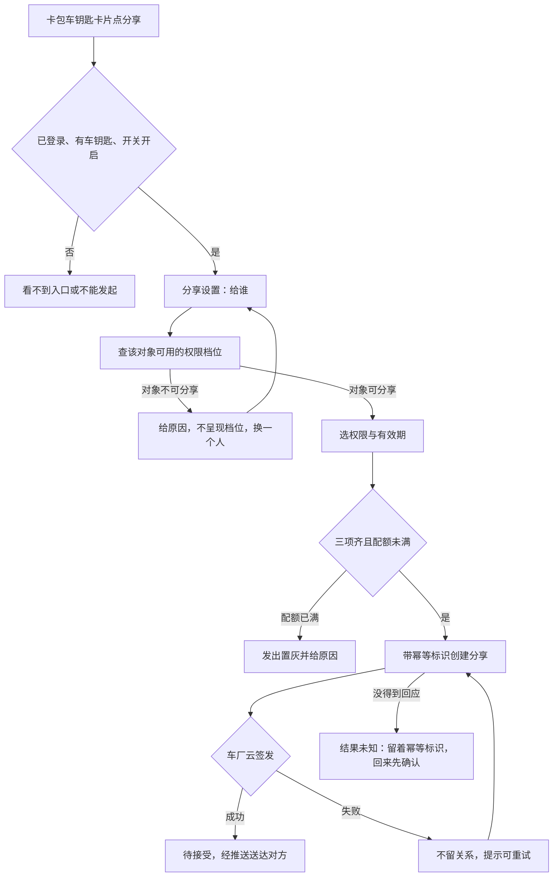
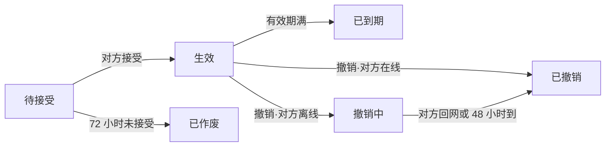
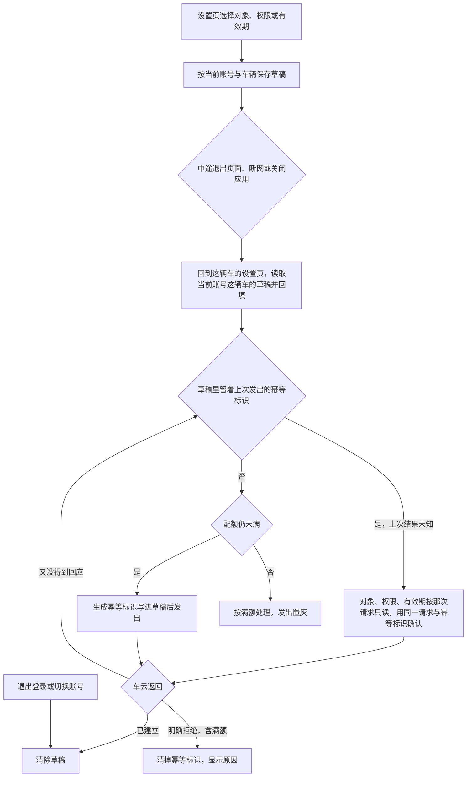
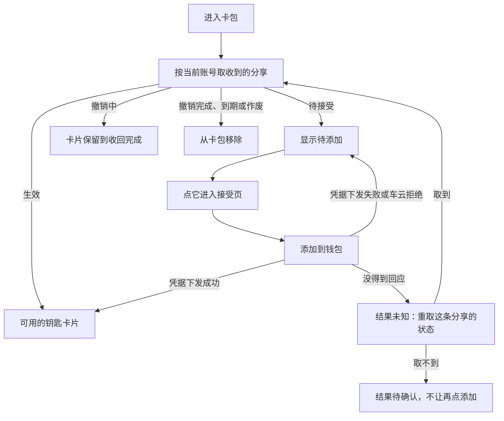
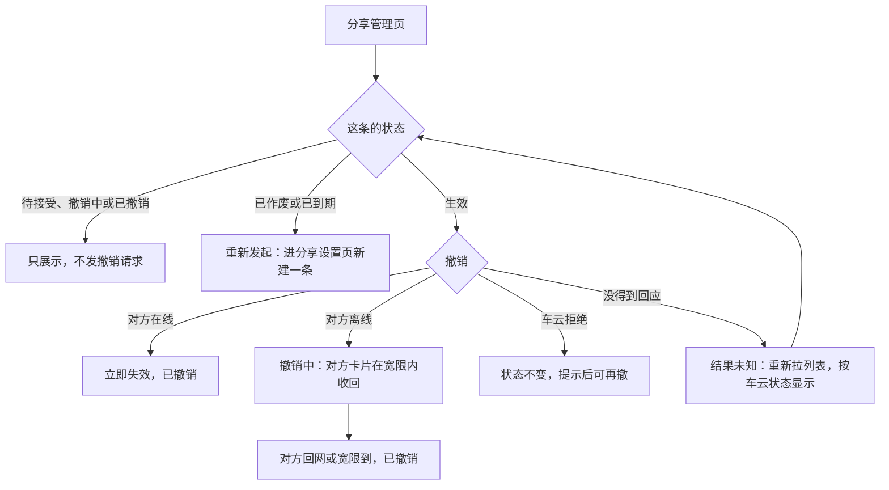

# 数字车钥匙分享（钱包端）— 需求规格（Spec）

> **模块标识**: `ISSUE-206`
> **版本**: v1.0
> **创建日期**: 2026-10-13
> **最后更新**: 2026-10-13
> **状态**: 评审中

## 0. 术语映射表（Terminology Mapping Table）

| 原始术语 | 权威模块 | 所属层 | 置信度（high / medium / low） | 易混项（必须亮出） | 用户确认 | 解释 |
|---------|---------|--------|-------------------------------|-------------------|---------|------|
| 车钥匙分享 | WalletMain | 02-Feature | medium | Phone——只负责应用壳与页面映射，分享的页面、数据与草稿都在钱包主功能 | [x] | 车主把钥匙的可用性分享给家人或联系人：对方钱包里多一把能用的钥匙，车主可随时撤销 |
| 车钥匙卡片 | WalletMain | 02-Feature | medium | 添加卡片页的「车钥匙」分类——那只是不可点的类别，没有卡片本体；本单在卡包里补上卡片（D4） | [x] | 卡包里展示的车钥匙：车主本人的钥匙，以及当前账号收到并添加成功的钥匙 |
| 权限档位 | WalletMain | 02-Feature | medium | AccountManager——持有登录与账号，对象与车辆的关系由车云判定，钱包端不判断谁是家庭成员 | [x] | 给对方的钥匙能力范围：全功能（解闭锁、启动、后备箱）或仅解闭锁，按对象由车云给出可选档 |
| 分享状态 | WalletMain | 02-Feature | medium | 钥匙可用性——「撤销中」时车辆侧已经拒绝，只是对方卡片还没收回 | [x] | 一条分享所处的阶段：待接受、生效、已作废、已到期、撤销中、已撤销，六态互斥，以车云返回为准 |
| 发起草稿 | WalletMain | 02-Feature | medium | AccountManager——草稿是分享业务的本地记录，只是按账号隔离 | [x] | 发起分享未完成时的本地记录（对象、权限档、有效期、幂等标识），用于中断后续办 |
| 打码账号 | CommFunc | 05-SystemBase | high | 对方账号标识——业务请求用可识别的标识，打码值只用于展示 | [x] | 页面与记录里展示的对方账号形态，在组装展示内容处用公共脱敏能力生成或取车云返回值 |

**回写约定**：上表新增业务词（车钥匙分享、车钥匙卡片、分享状态、发起草稿）在用户批准后同步追加到 `doc/glossary.yaml`。

## 1. 功能概述

车主在钱包卡包的车钥匙卡片上把钥匙分享给家人或联系人，对方钱包里多一把可用的钥匙；车主在分享管理页看到每条分享的状态，可以随时撤销生效中的分享。产品目标（上游约束：产品需求）：分享能力上线三个月内，车钥匙用户中发起过分享的比例不低于 15%，「借车送钥匙」类客服咨询量下降一半。两项都由运营侧统计，钱包端以分享链路的顺畅支撑，不直接承诺。

本 AR 承担钱包端：卡包车钥匙卡片与分享入口、分享设置、创建分享与草稿续办、分享管理与撤销、接受页、钥匙卡片详情与被分享人收到的钥匙。分享关系的真源在车云，钥匙能不能用的最终裁决在车厂云，钱包端只展示与操作。

本工程还没有车钥匙卡片，本单一并补上（D4）。车云开放接口在工程里还不可用：车主本人钥匙信息、车辆标识、分享关系，以及被分享人一侧按账号查收到的分享，都由可替换的模拟数据源承接（D3）；与车云的真实联调、推送点击进入接受页另列依赖，不算本单验过。被分享人能否再转给第三人、撤销后极端断网是否强制下线，上游未定，本单不承载（D2、D5）。

## Scope 声明

> plan（Design）必须继承本节的 `in_scope_modules`；coding 的 git diff 不得越界到本节之外的模块。

### Scope 模块清单

| 字段 | 取值 | 说明 |
|------|------|------|
| 本需求允许修改的模块 | `WalletMain`、`Phone` | 分享的页面、数据源、仓储、草稿与卡包车钥匙卡片落在 WalletMain；Phone 只在宿主页面映射里登记新页面 |
| 本需求明确不修改的模块 | `AccountManager`、`CommUI`、`CommFunc` | 只复用登录态、界面组件、脱敏、日志与导航 |

### Scope 结构化字段（供 Spec 提取，必填）

```yaml
in_scope_modules:
  - WalletMain
  - Phone
out_of_scope_modules:
  - AccountManager
  - CommUI
  - CommFunc
rationale: |
  分享相关的页面、数据源、仓储、草稿存储与卡包车钥匙卡片都属于钱包主功能模块。
  工程的页面登记要改三处：页面文件导出 builder、WalletMain 的 index.ets 导出、宿主 Phone 的 navDestinationMap 加分支，
  所以 Phone 列入可修改范围，且只改页面映射。
  AccountManager、CommUI、CommFunc 是基线能力，只复用不修改。
  推送点击进入接受页需要宿主入口读取分享参数，属于推送接入的后续依赖；那时若要改宿主入口，先发 scope 扩展提议。
```

### Visual Handoff（视觉交接，供 check-spec 读取）

四张界面参考图来自产品需求稿与接受侧界面说明；卡包里的车钥匙卡片没有参考图，沿用卡包现有卡片样式与 `CommUI` 的分区卡片。

```yaml
ui_change: new_or_changed
visual_handoff:
  kind: repo_assets
  fidelity_target: semantic_layout
  asset_acquisition_mode: approximate
  authoritative_refs:
    - id: share_setup_page
      path: doc/features/ISSUE-206/ux-reference/share-setup.png
      caption: 分享设置页：给谁、权限、有效期三段，先选对象权限区才确定，三项选好发出才可点击
    - id: share_manage_page
      path: doc/features/ISSUE-206/ux-reference/share-manage.png
      caption: 分享管理页：顶部车辆与剩余可分享数，下方逐条对象、权限、有效期与状态，生效的可撤销
    - id: accept_page
      path: doc/features/ISSUE-206/ux-reference/accept-page.png
      caption: 接受页：车辆信息卡（车型、车主昵称、权限、有效期），唯一主动作是添加到钱包
    - id: key_card_detail_page
      path: doc/features/ISSUE-206/ux-reference/key-card-detail.png
      caption: 添加后的钥匙卡片详情：显示权限范围与有效期，权限之外的功能不出现
```

### 最小改动原则

1. **默认就地实现**：页面、数据源、仓储与草稿都在 `WalletMain` 内实现。
2. **禁止默默扩展**：发现需要在 `AccountManager`/`CommUI`/`CommFunc` 新增公共接口时，停下发起 scope 扩展提议给用户确认。
3. **公共能力优先复用**：脱敏用 `CommFunc` 的 `MaskUtil`，日志用 `Logger`，导航用 `NavPathContext`，登录态取 `AccountManager`。

## 2. 目标用户与使用场景

### 2.1 目标用户

| 用户角色 | 描述 |
|----------|------|
| 车主 | 持有车钥匙，想把钥匙临时给家人或联系人用的钱包用户 |
| 家庭成员 | 由车主在车机或 App 上加入的家人，可拿到全功能或仅解闭锁 |
| 其他联系人 | 临时借车的非家庭成员，只能拿到仅解闭锁 |

### 2.2 使用场景

| 场景编号 | 场景名称 | 场景描述 | 前置条件 |
|----------|----------|----------|----------|
| S1 | 车主发起分享 | 卡包车钥匙卡片点「分享」→ 选对象、权限、有效期 → 发出，对方收到待接受的钥匙 | 已登录、持有车钥匙、功能开关开启、配额未满 |
| S2 | 发起被打断后续办 | 退出页面、断网或关掉应用后回来，接着上次的选择发出 | 有未发出的草稿，仍是同一账号 |
| S3 | 配额已满 | 生效加待接受合计到上限，新建时发出置灰并显示原因；草稿里上次发出结果未知的，仍可确认那次发出 | 车主进入分享设置页 |
| S4 | 对象不可分享 | 选定的对象没开通车钥匙等，权限区不呈现档位并给原因，车主换一个人 | 车主已选定对象 |
| S5 | 被分享人接受 | 在卡包点待添加的钥匙进接受页 → 添加到钱包 → 钥匙生效，作为车钥匙卡片出现在卡包 | 分享为待接受且未逾期 |
| S6 | 车主管理与撤销 | 从车钥匙卡片进分享管理页，查看每条状态，撤销生效中的某一条 | 至少有一条生效的分享 |
| S7 | 被分享人查看收到的钥匙 | 进入卡包看到待接受与可用的钥匙；车主撤销后，撤销中的卡片保留到收回完成，收回完成后移除 | 已登录 |

## 3. 功能清单

| 编号 | 功能名称 | 优先级 | 描述 | 关联场景 |
|------|----------|--------|------|----------|
| F1 | 卡包车钥匙卡片 | P0 | 卡包里展示车主本人的钥匙（车型、车辆）；点卡片按车辆标识进本人钥匙详情（D4） | S1, S6 |
| F2 | 分享入口与门槛 | P0 | 本人钥匙卡片上有「分享」「分享管理」；未登录或没有车钥匙看不到入口；功能开关关闭时不能发起新分享，已生效的分享不受影响 | S1, S6 |
| F3 | 分享设置 | P0 | 给谁、权限、有效期三段；选定对象后查可用档位，换对象重查、旧档位不可用时请车主重选；对象不可分享时不呈现档位并给原因；新建要三项选齐且配额未满才能发出（确认上次结果未知的发出见 F4） | S1, S3, S4 |
| F4 | 创建分享与草稿续办 | P0 | 带幂等标识创建；签发成功回待接受，签发失败不留关系、可重试；草稿扛过退出页面、断网与应用关闭（D6）；上次发出没得到回应时，回来先用同一幂等标识确认那次发出，不受端侧满额前置拦截；没发出过或上次明确失败的草稿，回来时配额已满按满额处理 | S1, S2, S3 |
| F5 | 分享管理与撤销 | P0 | 顶部车辆与剩余可分享数；逐条列出对象（打码）、权限、有效期、状态；只有生效的条目可撤销，已作废与已到期的可重新发起，其余只展示 | S6 |
| F6 | 接受页 | P0 | 车辆信息卡（车型、车主昵称、权限、有效期）与「添加到钱包」；不设拒绝按钮，不添加就保持待接受直到作废 | S5 |
| F7 | 钥匙卡片详情 | P1 | 同一页按进入身份分两种：本人钥匙按车辆标识取，显示车型、车辆与分享、分享管理入口；收到的钥匙按分享标识取当前状态，显示权限范围与有效期，权限之外的功能不出现而不是置灰；取不到时提示已不可用并回卡包 | S1, S5, S7 |
| F8 | 状态、身份与隐私 | P0 | 六态与车云返回一致；页面与记录只显示对方昵称与打码账号；业务请求用可识别的对方账号标识，打码相同的两个账号仍能区分 | S1, S6 |
| F9 | 被分享人收到的钥匙 | P0 | 进入卡包时按当前账号取收到的分享：待接受的显示为待添加、点它进接受页；生效的显示为钥匙卡片；撤销中的卡片保留到收回完成；撤销完成、到期或作废的移除；换账号重新获取 | S5, S7 |

> **新增端云域声明**：F1、F3–F9 依赖的六个车云接口（`queryKeySharingQuota`/`queryGranteePermission`/`createKeySharing`/`acceptKeySharing`/`revokeKeySharing`/`queryKeySharingList`）、车主本人钥匙信息与被分享人一侧按账号查收到的分享，工程里都不存在（in_scope 模块检索端云调用封装零命中；车钥匙只是添加卡片页里的不可点分类）。按 D3：钱包端按冻结契约实现，用可替换的模拟数据源验证交互、状态与失败分支；换成真实接口时只换数据来源，不改页面、仓储与状态语义。

## 4. 页面/界面描述

视觉规范沿用钱包现有卡片页面样式与 `CommUI` 组件，不新增控件类型；参考图见 `ux-reference/` 四屏，以语义布局为准。

### 4.1 页面总览

本单改一个页面、新增四个页面：卡包页（修改）嵌入车钥匙卡片分区；分享设置页与分享管理页给车主用；接受页与钥匙卡片详情给被分享人用。四个新页面都从卡包车钥匙卡片进入，推送点击进入接受页另列依赖（D3）。

| 页面 | 谁用 | 从哪进入 | 参考图 |
|------|------|----------|--------|
| 卡包页（修改） | 车主、被分享人 | 钱包卡包 Tab | 沿用卡包现有样式 |
| 分享设置页 | 车主 | 本人钥匙卡片「分享」；管理页「重新发起」 | share_setup_page |
| 分享管理页 | 车主 | 本人钥匙卡片「分享管理」 | share_manage_page |
| 接受页 | 被分享人 | 卡包里待添加的钥匙 | accept_page |
| 钥匙卡片详情 | 车主、被分享人 | 卡包里的钥匙卡片 | key_card_detail_page |

### 4.2 UI 组件详细描述

#### 区域 1: 卡包车钥匙分区（F1、F2、F9）

| 组件 | 类型 | 内容/数据 | 交互行为 |
|------|------|-----------|----------|
| 本人钥匙卡片 | 卡片 | 车型、车辆（模拟本人钥匙数据，D3） | 点卡片进详情；「分享」进设置页；「分享管理」进管理页；门槛不满足时不显示这两个入口 |
| 待添加的钥匙 | 卡片 | 车型、车主昵称、「待添加」 | 点它进接受页 |
| 收到的钥匙卡片 | 卡片 | 车型、车主昵称 | 点卡片进详情；撤销中保留到收回完成 |

#### 区域 2: 分享设置页（F3、F4，share_setup_page）

参考图自上而下：给谁、两档权限、三档有效期、原因提示条、发出按钮。

| 组件 | 类型 | 内容/数据 | 交互行为 |
|------|------|-----------|----------|
| 给谁 | 选择/输入 | 通讯录选择或输入对方账号，展示昵称与打码账号 | 选定后查可用权限档位；不可分享时显示原因 |
| 权限 | 单选 | 车云返回的档位（全功能 / 仅解闭锁），文案由云侧下发 | 换对象重查；旧档位不可用时请车主重选 |
| 有效期 | 单选 | 7 天 / 30 天 / 自定义（至多 180 天）（上游约束：产品需求） | 选值 |
| 草稿恢复 | 隐式 | 上次未发出的对象、权限、有效期 | 进页时按当前账号与当前车辆回填；别的车辆的草稿不回填；上次发出结果未知时，对象、权限、有效期按那次请求原样只读展示，确认之前不能改 |
| 原因提示 | 提示条 | 对象不可分享、配额已满或原档位对新对象不可用的原因，取接口返回 | 有原因时显示在发出按钮之上，原因消除后隐藏 |
| 发出 | 主按钮 | 「发出」 | 新建：三项齐且配额未满可点，满额置灰并显示配额接口给的原因；草稿留着上次发出的幂等标识时，按钮用来确认那次发出，不受满额置灰（满额由车云对这次请求判定）；请求中禁用，防重复提交 |

#### 区域 3: 分享管理页（F5，share_manage_page）

参考图：顶部车辆与剩余可分享数，其下逐条列出分享，条目底色随状态不同。

| 组件 | 类型 | 内容/数据 | 交互行为 |
|------|------|-----------|----------|
| 顶部配额 | 文本 | 车辆与剩余可分享数 | 每次进页拉取 |
| 分享列表 | 列表 | 每条对象（车云给的打码标识）、权限、有效期、状态；生效、过程中（待接受、撤销中）与已结束（已撤销、已作废、已到期）三类在样式上可区分 | 生效的条目有「撤销」；已作废、已到期的有「重新发起」；其余只展示 |
| 网络失败态 | 提示 | 网络异常说明与重试 | 断网时显示，不展示陈旧列表 |

#### 区域 4: 接受页（F6，accept_page）

参考图：车辆信息卡、权限范围、有效期、添加到钱包。先讲清是谁分享的、能用到什么时候，再给添加按钮（上游约束：车钥匙接受侧界面说明）。

| 组件 | 类型 | 内容/数据 | 交互行为 |
|------|------|-----------|----------|
| 车辆信息卡 | 卡片 | 车型、车主昵称 | — |
| 权限范围 | 文本 | 用人话写能做什么（如「能开门、能开走」），不写档位代号 | — |
| 有效期 | 文本 | 有效到哪天 | — |
| 添加到钱包 | 主按钮 | 「添加到钱包」 | 触发接受；成功回卡包；车云明确返回失败或凭据下发失败保持待接受、可重试；请求没得到回应时先重取这条分享的状态，仍是待接受才能再点；页面不设拒绝按钮 |

#### 区域 5: 钥匙卡片详情（F7，key_card_detail_page）

参考图是收到的钥匙那一种；本人钥匙那一种材料没给图，沿用同页样式。进入时只带一种身份：本人钥匙带车辆标识，收到的钥匙带分享标识。

| 组件 | 类型 | 内容/数据 | 交互行为 |
|------|------|-----------|----------|
| 钥匙卡片 | 卡片 | 本人钥匙：车型、车辆；收到的钥匙：车型、车主昵称 | — |
| 分享入口 | 入口 | 只在本人钥匙一种：「分享」「分享管理」，门槛同卡片入口 | 进分享设置页、分享管理页 |
| 权限范围 | 只读 | 只在收到的钥匙一种：用人话写能做什么 | 权限外的功能不出现在操作面上，不做置灰 |
| 有效期 | 只读 | 只在收到的钥匙一种：有效到哪天 | — |
| 状态提示 | 提示条 | 按进入身份取的当前状态 | 本人钥匙已不在当前账号下，或收到的钥匙已撤销、已到期、找不到时，提示这把钥匙已不可用并回到卡包 |

### 4.3 页面状态

| 状态 | 描述 | 触发条件 |
|------|------|----------|
| 卡包-无入口 | 本人钥匙卡片与分享入口不显示 | 未登录或没有车钥匙 |
| 卡包-不能发起 | 有卡片与「分享管理」，不能发起新分享 | 功能开关关闭 |
| 卡包-待添加 | 卡包里显示待接受的钥匙 | 当前账号有待接受的分享 |
| 设置页-查档位中 | 权限区等待返回 | 选定或换对象后 |
| 设置页-满额 | 发出置灰并给原因 | 生效加待接受合计到上限，且草稿里没有结果未知的上次发出 |
| 管理页-空 | 本车没有任何分享 | 列表为空 |
| 管理页-网络失败 | 网络失败态，可重试，不展示陈旧列表 | 断网或接口失败 |
| 撤销中 | 车主侧列表显示撤销中；被分享人卡包里的卡片保留到收回完成 | 撤销时对方离线 |

## 5. 业务流程图

### 5.1 发起主路径

看这张图要看出：从卡片入口到对方收到待接受钥匙的主线，以及门槛不满足、对象不可分享、满额、签发失败各停在哪里。



- 换一个对象要重新查档位，上一次的结果不再作数；原档位对新对象不可用时请车主重选。
- 本单里「车厂云签发」的结果来自模拟数据源，用来验证钱包端在各分支下的表现（D3）。

### 5.2 分享状态机

看这张图要看出：一条分享只在六个互斥状态之间迁移，以及撤销时对方在线与离线走向不同。



- 待接受有效期 72 小时（上游约束：产品需求），逾期自动作废，作废条目列表可见、可重新发起。
- 撤销中的卡片收回期限 48 小时（上游约束：系统设计），需求方确认指对方设备上卡片的收回期限（D1）。
- 车辆侧从撤销发起那一刻起就拒绝这把钥匙，不等宽限结束。

### 5.3 子流程

**中断续办**——看这张图要看出：草稿在哪些时点保存，回来后上次发出结果未知的先确认、其余才过配额，以及什么时候清除。



**被分享人接受**——看这张图要看出：本单可执行的接受入口是卡包里待添加的钥匙，以及凭据下发失败、没得到回应后各去哪里。



**管理与撤销**——看这张图要看出：只有生效的条目能撤销，已作废与已到期的可以重新发起。



- 推送点击进入接受页要等推送通道接入，本单不实现也不验证（D3）。
- 车云明确拒绝撤销时，这条分享状态不变，留在管理页提示，可以再撤一次；撤销请求没得到回应时结果未知，重新拉列表以车云状态为准，仍是生效才再提供撤销。

### 5.4 不建模声明

车厂云签发凭据、车辆侧失效下发与消息推送送达在钱包端之外，本节只画钱包端参与的路径与钱包端看到的结果；被分享人再转第三人（D2）与撤销后极端断网强制下线（D5）本期不承载，不建模。

## 6. 异常/边界场景处理

| 编号 | 异常场景 | 触发条件 | 处理方式 | 用户提示 | 关联功能 |
|------|----------|----------|----------|----------|----------|
| E1 | 配额已满 | 新建时生效加待接受合计到上限（草稿里上次发出结果未知的不在此列，见 E11a） | 不发新建请求 | 发出置灰，显示配额接口给的原因 | F3 |
| E2 | 对象不可分享 | 对方没开通车钥匙等 | 不呈现档位 | 显示原因，请车主换一个人 | F3 |
| E3 | 换对象后旧档位不可用 | 新对象不支持已选档位 | 作废旧档位，不静默降级 | 请车主重选 | F3 |
| E4 | 车厂云签发失败 | 创建时签发失败 | 车云回滚，不留关系 | 发出失败，可重试 | F4 |
| E5 | 重复触发发出 | 连点或重试 | 请求中禁用按钮；幂等标识让同一请求返回同一条分享 | 不出现第二条 | F4 |
| E6 | 待接受逾期 | 对方在期限内没接受 | 自动作废 | 列表可见作废条目，可重新发起 | F5 |
| E7 | 接受时凭据下发失败 | 接受时下发失败 | 保持待接受 | 可重试，重试不产生新分享 | F6 |
| E7a | 接受结果未知 | 接受请求超时或断网，没得到回应 | 不当成失败也不当成成功：按当前账号重取这条分享的状态，生效就显示钥匙卡片，仍是待接受才允许再点添加；取不到时提示结果待确认，不让再点 | 结果待确认，可稍后再看 | F6, F9 |
| E8 | 撤销时对方离线 | 撤销请求时对方离线 | 进入撤销中，对方卡片在宽限内收回（D1）；车辆侧自撤销起即拒绝 | 车主侧显示撤销中 | F5 |
| E9 | 对非生效条目撤销 | 条目为待接受、撤销中、已作废、已到期或已撤销 | 不提供撤销，不发撤销请求 | 只看到状态；已作废、已到期的可重新发起 | F5 |
| E10 | 撤销被拒绝 | 车云明确返回失败 | 这条分享状态不变 | 留在管理页提示，可再撤一次 | F5 |
| E10a | 撤销结果未知 | 撤销请求超时或断网，没得到回应 | 不当成失败：重新拉分享列表，以车云返回的状态为准；仍是生效才再提供撤销；列表拉不到给网络失败态 | 结果待确认，按刷新后的状态显示 | F5 |
| E11 | 发起被打断 | 退出页面、断网或应用关闭 | 草稿保留；没发出过或上次明确失败的，回来时配额已满按满额处理；上次发出结果未知的按 E11a 先确认 | 回来接着办 | F4 |
| E11a | 创建结果未知 | 发出后超时、断网或应用被关，没得到回应 | 不当成失败也不当成成功：草稿留着这次的幂等标识，对象、权限、有效期冻结为那次请求的原样；回来或再点时用同一请求与标识确认——车云对同一标识返回同一条分享；确认之前不能改对象或权限，改动不能借旧标识发出；这一步不受端侧满额前置拦截，满额由车云判定 | 结果待确认；确认到已建立就清草稿，车云明确拒绝就清掉标识、恢复可编辑并显示原因 | F4 |
| E12 | 断网进管理页或卡包 | 无网络 | 不展示陈旧列表 | 网络失败态，可重试 | F5, F9 |
| E13 | 退出登录或切换账号 | 账号变化 | 清除本账号全部车辆的草稿；列表与收到的分享按新账号获取 | 不带出上一个账号的草稿、列表或钥匙 | F4, F9 |
| E13a | 换一辆车进设置页 | 同一账号从另一辆车进入 | 只读这辆车的草稿，另一辆车的草稿原样保留、不回填 | 这辆车没有草稿就从头选 | F4 |
| E14 | 清除应用数据 | 本地数据被清除 | 草稿丢失不崩溃，从头选 | 回到未选状态 | F4 |
| E15 | 打开已不可用的钥匙 | 从旧入口打开已撤销、已到期或已作废的钥匙详情；或换账号后打开不属于当前账号的本人钥匙 | 按当前状态处理 | 提示这把钥匙已不可用，回到卡包 | F7 |
| E16 | 推送未达 | 推送没送到被分享人 | 不改变分享关系；对方进入卡包时按当前账号补拉 | 卡包里看到待添加的钥匙 | F9 |

## 7. 非功能性需求

### 7.1 性能要求

| 指标 | 要求 | 说明 |
|------|------|------|
| 分享列表与配额 | 每次进入管理页拉取一次，不落地缓存 | 上游约束：系统设计；原文「分享列表不做本地缓存」 |
| 权限档位 | 选定或换对象时查一次，以最近一次结果为准 | 上游约束：系统设计；原文「上一次的结果不再作数」 |
| 后台调用 | 不设定时任务或后台轮询 | DFX-01 |
| 页面时延 | 材料未给时延数值，本期不设端侧时延阈值 | 不以时延作验收判据 |

### 7.2 兼容性要求

| 维度 | 要求 |
|------|------|
| 系统版本 | HarmonyOS API 12 及以上（平台基线） |
| 设备类型 | 手机形态 |
| 深色与大字 | 车辆信息与主按钮可读可点（上游约束：车钥匙接受侧界面说明） |
| 方向性 | 新页面与卡片用 start/end，从右到左语言下镜像正确（UX-01） |
| 数据兼容 | 六个车云接口都是钱包端的新调用，按系统设计的字段消费；沿用车云既有错误码，不新增，未知码按通用失败处理 |

### 7.3 安全性要求

| 要求 | 说明 |
|------|------|
| 输出面脱敏 | 页面与记录只显示对方昵称与打码账号；打码值在组装展示内容处另生成（`MaskUtil`），不改写分享对象，列表用车云返回的打码标识；账号不超过 4 位时 `maskAccount` 原样返回，这种账号只显示昵称；日志与事件不带对方账号（SEC-01） |
| 业务身份 | 查权限与创建分享传可识别的对方账号标识；打码值不承担业务身份；打码后相同的两个账号仍要能区分 |
| 草稿中的身份 | 草稿里的对方账号标识只用于续办请求，不进入页面、日志与事件；草稿只存续办要的字段，按账号与车辆定位，发出成功清这一条，退出登录、切换账号清本账号全部 |
| 草稿落盘的保护 | 跨重启保存的 granteeId 要放在受保护的存储里，普通键值存储不算受保护；实现选择与取证在 plan，依据取不到时草稿跨重启续办随之阻断，不降成只在内存、也不删 granteeId（SEC-01） |
| 凭据边界 | 钱包端不签发、不保存凭据，不自行扩大权限或有效期 |
| 调用前置 | 未登录不发起、不接受 |
| 事件字段 | 发起、接受、撤销三个流程的事件只带车型类别、阶段与结果分类，不带车牌、账号、位置（SEC-01） |

## 8. 验收标准

> 车云开放接口在工程里还不可用，以下结论只到本地模拟数据（D3）；与车云的真实联调、推送点击进入接受页不在本单验收内。

### P0 功能验收标准

- [ ] **AC-1** (F2, F3): 卡包车钥匙卡片点分享，对象、权限、有效期三项都选齐前不能发出；选齐后发出，对方收到待接受的钥匙（承接：AC-K1）。
- [ ] **AC-2** (F6, F7): 对方接受后钥匙可用，权限与车主所选一致，钥匙作为车钥匙卡片出现在对方卡包（承接：AC-K2）。
- [ ] **AC-4** (F3, F5): 生效加待接受合计到上限后不能再发起，能看到原因（承接：AC-K4）。
- [ ] **AC-5** (F5): 撤销时对方在线立即失效；对方离线进入撤销中，对方设备上的卡片在宽限内收回（D1）；撤销起车辆侧就不认这把钥匙（承接：AC-K5）。
- [ ] **AC-6** (F4): 发起途中退出页面、断网或关掉应用再打开，回来接着上次的选择发出，沿用同一幂等标识，不发出第二条（承接：AC-K6，D6）。
- [ ] **AC-7** (F5): 管理列表的状态与车云返回一致：待接受、生效、已作废、已到期、撤销中、已撤销（承接：AC-K7）。
- [ ] **AC-9** (F2): 未登录或没有车钥匙的用户看不到分享入口（承接：AC-K9）。
- [ ] **AC-10** (F2): 开关关闭后不能发起新分享，已生效的分享不受影响（承接：AC-K10）。
- [ ] **AC-11** (F3): 选家庭成员时全功能可选；换成其他联系人后全功能不可选，已选的全功能请车主重选；换回家庭成员又可选（承接：AC-K11）。
- [ ] **AC-12** (F1): 卡包展示车主本人的车钥匙卡片，卡片上有分享与分享管理入口（D4）。
- [ ] **AC-13** (F4, F8): 发出成功、退出登录或切换账号后草稿被清除，换账号后看不到上一个账号的草稿或列表（D6）。
- [ ] **AC-14** (F8): 两个打码后相同的合法账号，查权限与创建分享时各自拿到正确的对象。
- [ ] **AC-15** (F9): 推送没送到时，对方进入卡包能看到待添加的钥匙，点它进入接受页并能添加。
- [ ] **AC-16** (F9): 接受成功后，卡包里的待添加项变为可用的钥匙卡片；车云明确返回失败或凭据下发失败时仍保持待接受。
- [ ] **AC-17** (F9): 车主撤销且对方离线时，被分享人卡包里的卡片保留到收回完成后移除；车辆侧从撤销起已拒绝这把钥匙。
- [ ] **AC-18** (F7, F9): 撤销完成、到期或作废的钥匙从卡包移除；从旧入口打开它的详情时提示已不可用并回到卡包。
- [ ] **AC-19** (F8, F9): 切换账号后，卡包只显示新账号收到的待添加与可用钥匙。
- [ ] **AC-20** (F5): 只有生效的分享显示撤销；待接受、撤销中、已作废、已到期、已撤销的条目不显示撤销，也不发撤销请求。
- [ ] **AC-21** (F3, F4): 草稿没发出过或上次明确失败时配额已满，回到设置页按满额处理，不因草稿绕过配额。
- [ ] **AC-29** (F1, F7): 点本人钥匙卡片进入详情，看到车型、车辆与分享入口；点收到的钥匙卡片进入详情，看到权限范围与有效期；两种都不借用对方的身份取数。
- [ ] **AC-30** (F4): 原有 4 条分享，发第 5 条时没得到回应而车云其实已建立：回来时配额显示已满，仍用同一幂等标识确认到这一条并清草稿，不出现第二条；若名额实际被另一次发起占满，车云返回满额，按满额提示并清掉标识。
- [ ] **AC-31** (F4): 同一账号先在甲车设置页留下草稿，再从乙车进入：乙车设置页不回填甲车的草稿，回到甲车时草稿仍在。
- [ ] **AC-32** (F4): 发给对象 A 没得到回应后回到设置页：对象、权限、有效期按那次请求只读展示，点发出确认的是给 A 的那一条；页面不能先改成对象 B 再借这个幂等标识发出，确认前也不显示「已分享给 B」。
- [ ] **AC-31** (F5, F6, F9): 接受或撤销请求没得到回应时，端侧不按失败或成功下结论：重取状态后按车云状态显示，只有仍是待接受才可再点添加、仍是生效才可再撤。

### P1 功能验收标准

- [ ] **AC-3** (F5): 分享发出后对方在期限内未接受即自动作废，作废条目在列表可见，可重新发起（承接：AC-K3）。
- [ ] **AC-8** (F8): 全程页面与记录不出现对方完整账号或手机号，只显示昵称与打码账号（承接：AC-K8）。

### P2 规约与合规验收标准

- [ ] **AC-22** (F1, F3): 新增页面与卡片的方向性参数用 start/end，从右到左语言下镜像正确（UX-01）。
- [ ] **AC-23** (F8): 输出面打码、业务接口传可识别标识，按 7.3 落实（SEC-01）。
- [ ] **AC-24** (F5): 分享相关调用每次进页拉取一次，没有定时任务或后台轮询（DFX-01）。
- [ ] **AC-25** (F4, F5, F6): 创建、接受、撤销可定位到失败步骤；三个流程的事件结果完整、同次不重复、字段来源真实、编码无冲突（OBS-02、OBS-03、OBS-05、OBS-06）。
- [ ] **AC-26** (F3, F6): 图标复用优先，新引入的写明依据；文案复用优先，新增的中英文齐备并进待翻译清单（RES-01、RES-02、DLV-01）。
- [ ] **AC-27** (F4): 六个车云接口逐个核字段删除、类型、默认值与含义（COMPAT-01）。
- [ ] **AC-28** (F4): 清除数据后不崩溃、从头选；重复触发发出不会创建第二条（ENV-01、ENV-02）。

### 通用验收标准

- [ ] **AC-G1** (F1, F6): 新页面与卡包车钥匙卡片在深色、大字下可读可点。
- [ ] **AC-G2** (F2, F5): 网络异常时有明确错误提示，不白屏、不崩溃。
- [ ] **AC-G3** (F5, F9): 断网进管理页或卡包给网络失败态，不展示陈旧列表。

### 上游验收编号承接

- 承接：AC-K1 → AC-1；AC-K2 → AC-2；AC-K3 → AC-3；AC-K4 → AC-4；AC-K5 → AC-5（按 D1 的卡片收回期限验）；AC-K6 → AC-6（按 D6 扩到应用关闭）；AC-K7 → AC-7；AC-K8 → AC-8；AC-K9 → AC-9；AC-K10 → AC-10；AC-K11 → AC-11。
- 本单补充：AC-12 起承接本单新增的卡包车钥匙卡片（D4）、草稿清除（D6）、对方身份与被分享人收到的钥匙，产品需求稿没有对应编号。
- 不承接：无。

## 9. 宿主扩展治理项

| 扩展项 | 是否涉及 | 承载位置 |
|---|---|---|
| 技术契约 | 是（走 /story） | 9.1 |
| 规约 | 是 | 9.2 |
| 设计模式 | 是 | 9.3 |
| 埋点 | 是（走 /story） | 9.4 |
| 被分享人再转第三人（open） | 是 | 《决策与评审记录》D2 |
| 撤销后极端断网强制下线（open） | 是 | 《决策与评审记录》D5 |
| 端云能力用模拟数据承载、真实联调另行验收（settled） | 是 | 《决策与评审记录》D3 |

### 9.1 技术契约

#### 9.1.1 端云接口

现状依据：in_scope 模块（`WalletMain`、`Phone`）检索端云调用封装零命中，端云交互为新增域；按 D3 用可替换的模拟数据源承载。六个接口都由钱包端调用车云开放接口 2.1；失败返回车云错误码与可读信息，本需求不新增错误码。

| 云侧接口 | 新增·复用·变更 | 入参 → 出参 | 错误码 | 代码现状 |
|---|---|---|---|---|
| `queryKeySharingQuota` | 新增 | vehicleId → canShare、remaining、reason（可空，满额时给原因）、shares（每项 shareId、status） | 车云错误码与可读信息，不新增 | 检索端云接口封装于 in_scope 模块零命中 |
| `queryGranteePermission` | 新增 | vehicleId、granteeId（可识别的对方账号标识）→ shareable、permissionLevels（不可分享时为空列表）、reason（可空） | 同上 | 同上 |
| `createKeySharing` | 新增 | vehicleId、granteeId、permissionLevel、validUntil、idempotencyKey → shareId、status（固定 pending）；同一幂等标识重复请求返回同一条，签发失败返回失败且不留关系 | 同上 | 同上 |
| `acceptKeySharing` | 新增 | shareId → credentialStatus（issued / failed）、status（active / pending） | 同上 | 同上 |
| `revokeKeySharing` | 新增 | shareId → status（revoked / revoking）、graceHours（可空，revoking 时给出宽限小时数，D1） | 同上 | 同上 |
| `queryKeySharingList` | 新增 | vehicleId → items（每项 shareId、status、permissionLevel、validUntil、granteeMasked） | 同上 | 同上 |

被分享人一侧按账号查待接受与已接受钥匙、车主本人钥匙的车辆标识与车型，都不在这六个接口里：本单由模拟数据源提供，真实接口由车云与车钥匙本人能力提供，另列依赖（D3）。

#### 9.1.2 数据存储

| 键名/表名 | 介质 | 值结构 | 有效期 | 用途 | 代码现状 |
|---|---|---|---|---|---|
| `key_sharing_draft` | 本地持久存储（扛过应用关闭；granteeId 要受保护，封装选型与取证由 plan 定，D6） | `{ vehicleId, granteeId, granteeDisplay, permissionLevel, validUntil, idempotencyKey }` | 按账号与车辆定位；发出成功清这一条；退出登录或切换账号清本账号全部；车云明确拒绝时只清 `idempotencyKey` | 发起途中退出页面、断网或应用关闭后续办；`idempotencyKey` 在发出前写入，留着就表示上次发出结果未知，确认时沿用它不发出第二条 | WalletMain 无本地持久化封装，属新增 |
| 分享列表与配额 | 不落盘 | — | 每次进页从车云拉取 | 管理页展示；车云是唯一真源 | — |

草稿里的 `granteeId` 只用于续办请求，不进入页面、日志与事件；`granteeDisplay` 是打码后的展示值。

#### 9.1.3 配置项

| 配置项 | 默认值 | 关闭态行为 | 历史版本兼容 | 代码现状 |
|---|---|---|---|---|
| 分享功能开关 | 关，随版本放开（系统设计约定） | 不能发起新分享；已生效分享的管理、接受、撤销与到期照常 | 旧版本没有分享入口 | 本地常量先例 `WalletMain/src/main/ets/shared/constant/HomeConstants.ets` 的 `SHOW_LOCAL_CARD_SECTION`，新增同类常量 |
| 权限档位文案 | 云侧配置下发 | 端侧不写死档位名 | — | 随 `queryGranteePermission` 返回承载 |

#### 9.1.4 依赖变更

| 依赖 | 变更 | 体积影响 | 兼容风险 | 代码现状 |
|---|---|---|---|---|
| 编排 SDK `framework`（页面交互） | 复用（WalletMain 已声明依赖） | 无 | 无 | 分享设置页按 page-interaction 编排时使用 |

Scope 内模块依赖声明无新增边（`WalletMain` → `AccountManager`/`CommUI`/`CommFunc` 均为既有只读复用），不新增、不升级 SDK。

### 9.2 规约

<!-- knowledge-use:begin 规约 · 由 spec/knowledge-use.yaml 生成，手改会被门禁拒绝 -->
| 编号 | 强制力 | 本需求的要求 | 落点契约名 | 验法 |
|---|---|---|---|---|
| UX-01 | 基线 | 分享设置页、管理页、接受页、钥匙卡片详情与卡包车钥匙分区的方向性参数用 start/end，文本对齐用 TextAlign.Start/End，不用 left/right | 影响 · 分享设置页、分享管理页、接受页、钥匙卡片详情、卡包车钥匙分区 | 模型 / 实机 |
| SEC-01 | 红线 | 业务处理：granteeId 按车云开放接口 2.1 以可识别形式只传给 queryGranteePermission 与 createKeySharing，用于判定权限与建立分享；打码值不当请求身份，两个打码后相同的账号按 granteeId 区分 | 影响 · 车云接口调用、分享仓储的展示组装、日志与事件、发起草稿 | 模型 / 实机 |
| SEC-01 | 红线 | 展示：对方账号在组装展示内容处另生成打码值（MaskUtil.maskAccount），管理列表用车云返回的 granteeMasked，不改写分享对象；账号不超过 4 位时 maskAccount 原样返回，这种账号只显示昵称 | 影响 · 车云接口调用、分享仓储的展示组装、日志与事件、发起草稿 | 模型 / 实机 |
| SEC-01 | 红线 | 观察性输出：日志与发起、接受、撤销三个流程的事件只带车型类别、阶段与结果分类，不带 granteeId、打码账号、车牌与位置 | 影响 · 车云接口调用、分享仓储的展示组装、日志与事件、发起草稿 | 模型 / 实机 |
| SEC-01 | 红线 | 跨重启存储：发起草稿只存续办要的车辆标识、granteeId、打码展示值、权限档、有效期与幂等标识，按账号与车辆定位，发出成功、退出登录、切换账号清除；草稿里的 granteeId 不进页面、日志与事件，跨重启要放在受保护的存储里，普通键值存储不算；实现与取证见 plan，依据取不到时跨重启续办阻断 | 影响 · 车云接口调用、分享仓储的展示组装、日志与事件、发起草稿 | 模型 / 实机 |
| DFX-01 | 基线 | 配额与列表每次进页拉取一次，选定或换对象时查一次权限档位，没有定时任务或后台轮询 | 技术契约 · queryKeySharingList | 模型 |
| OBS-02 | 基线 | 创建、接受、撤销失败经 CommFunc.Logger 记录到失败步骤，不另造日志封装、不发独立定位事件 | 影响 · 分享仓储的创建、接受、撤销 | 模型 / 实机 |
| OBS-03 | 基线 | 发起、接受、撤销三个流程的统计点记录实际适用结果，同一次尝试只记一次，重新发起与再点一次都是新尝试 | 影响 · 发起流程、接受流程、撤销流程的统计点 | 模型 / 实机 |
| OBS-05 | 基线 | 上报字段（流程、步骤、结果分类、错误码与可读信息）各有真实来源，外码只取车云失败响应里的错误码 | 影响 · 发起流程、接受流程、撤销流程的统计点 | 模型 / 实机 |
| OBS-06 | 基线 | 三个流程的事件编码核对既有登记、新编码唯一；沿用既有上报模板 Wallet_COMMON | 影响 · 发起流程、接受流程、撤销流程的统计点 | 模型 / 实机 |
| RES-01 | 基线 | 新页面图标按系统符号、已归档图片、新引入的顺序取，新引入的写明依据；界面参考图只作视觉参考，不进运行资源 | 影响 · 分享设置页、分享管理页、接受页、钥匙卡片详情 | 模型 |
| RES-02 | 基线 | 新页面文案优先复用已有中文一致的 string 资源，新增的中英文齐备 | 影响 · 四个新页面与卡包车钥匙分区的用户可见文案 | 模型 |
| COMPAT-01 | 基线 | 六个车云接口都是钱包端新增调用，逐个核字段删除、类型、默认值与含义不变；可空出参按可空处理 | 影响 · 钱包端对车云六个分享接口的调用 | 模型 |
| ENV-01 | 基线 | 清除数据后发起草稿丢失不崩溃、从头选；分享列表不落盘，清除数据后照常从车云拉取 | 技术契约 · key_sharing_draft | 模型 / 实机 |
| ENV-02 | 基线 | 发出请求中禁用按钮；创建分享用幂等标识，重复触发与续办都不发出第二条 | 技术契约 · createKeySharing | 模型 / 实机 |
| DLV-01 | 基线 | 新增用户可见文案梳理成待翻译字符串清单，跟踪回稿并合入资源 | 影响 · 四个新页面与卡包车钥匙分区的用户可见文案 | 模型 / 人工 |

不命中的依据：
- DFX-02：命中条件是新增预置资源或 SDK 依赖；新页面图标走系统符号，不新增图片资源与 SDK
- OBS-07：命中条件是有独立运营采集诉求；成功标准由运营侧统计，分享被接受比例由车云按分享记录统计，钱包端没有运营采集诉求
- COMPAT-02：命中条件是新增、删除或修改错误码；系统设计写明沿用车云错误码，本需求不新增
- DLV-02：命中条件是新增或改动对外开放的入口或接口；新页面都是钱包应用内页面，车云接口由本部件作为客户端调用
<!-- knowledge-use:end -->

### 9.3 设计模式

<!-- knowledge-use:begin 设计模式 · 由 spec/knowledge-use.yaml 生成，手改会被门禁拒绝 -->
| 适用单元 | 候选 | 命中信号或反证 |
|---|---|---|
| 分享设置页（选对象 → 查权限档位 → 选有效期 → 发出） | page-interaction | 页内交互由业务结果驱动下一步：选定对象后才查权限，换对象要重查、原档位不可用时请车主重选，满额时发出置灰 |
| 发起分享主链路（门槛 → 设置 → 创建 → 签发结果） | decision-tree | 链路有门槛不满足、对象不可分享、配额已满、签发失败等分支，需要判断是否构成多步编排 |
| 分享管理页（撤销 / 重新发起） | 无候选 | 撤销与重新发起各是一次独立操作，没有由业务结果驱动的跨动作编排 |
<!-- knowledge-use:end -->

### 9.4 埋点

本需求观察发起、接受、撤销三个流程的结果，为失败定位与链路复盘提供口径。项目既有上报入口为公共能力模块导出的 Chart/VOC 上报封装（模板枚举当前仅 Wallet_COMMON），仓内目前无业务调用（建设差距）；本需求在既有封装之上新增流程级统计点，不另造上报通道，实现层的取值由 plan 落实。统计边界：一次尝试从流程开始到结果确定，重新发起、再点一次都是新的一次；查配额、查权限与进入卡包补拉收到的分享属于前置查询或页面加载，失败只写定位记录、不进统计；事件只带车型类别、阶段与结果分类，不带车牌、账号、位置，上报失败不改变分享关系。分享被接受比例由车云按分享记录统计（D7），钱包端不上报失效事件、不做跨账号关联；成功标准里的两个业务指标由运营侧统计，不在这里。

#### 分享发起成功率

衡量车主确认发出后分享建立起来的比例。怎么算：发起流程以「分享建立（待接受）」结束的尝试 ÷ 全部尝试；车厂云签发失败、车云返回其他失败与通信失败（结果未知）都在分母里；结果未知后用同一幂等标识确认，也算新的一次。随事件带失败时车云返回的错误码与可读信息。发起流程只有创建分享一步，这一步的结果就是流程的结果。

| 统计点 | 业务动作 | 实际适用结果 | 本端获知时机 | 已有覆盖或新增 | 代码现状 |
|---|---|---|---|---|---|
| 发起流程 / 创建分享 | 确认发出，车云建关系并请车厂云签发 | 已建立 / 车云返回失败（含签发失败）/ 通信失败 | createKeySharing 返回或通信失败 | 新增 | 检索 Chart/VOC 调用于 in_scope 模块零命中，建设差距 |

#### 分享接受成功率

衡量被分享人点「添加到钱包」后钥匙生效的比例。怎么算：接受流程以「生效」结束的尝试 ÷ 全部尝试；明确失败保持待接受，再点算新的一次；没得到回应记为通信失败（结果未知），重取状态不进统计。随事件带凭据状态，车云返回失败时的错误码与可读信息。接受流程只有接受一步，这一步的结果就是流程的结果。

| 统计点 | 业务动作 | 实际适用结果 | 本端获知时机 | 已有覆盖或新增 | 代码现状 |
|---|---|---|---|---|---|
| 接受流程 / 接受 | 点「添加到钱包」，车厂云下发凭据 | 生效 / 凭据下发失败 / 车云返回失败 / 通信失败 | acceptKeySharing 返回或通信失败 | 新增 | 同一建设差距 |

#### 分享撤销成功率

衡量车主撤销一条生效分享后车云受理的比例；受理后车辆侧即刻拒绝这把钥匙。怎么算：撤销流程以「已受理」结束的尝试 ÷ 全部尝试；对方在线的立即失效与离线的进入撤销中都算受理。随事件带受理结果（立即失效 / 撤销中），车云返回失败时的错误码与可读信息。撤销流程只有撤销一步；没得到回应记为通信失败（结果未知），重拉列表不进统计；撤销中何时变成已撤销由车云决定，本端不计时。

| 统计点 | 业务动作 | 实际适用结果 | 本端获知时机 | 已有覆盖或新增 | 代码现状 |
|---|---|---|---|---|---|
| 撤销流程 / 撤销 | 车主撤销一条生效分享 | 已受理 / 车云返回失败 / 通信失败 | revokeKeySharing 返回或通信失败 | 新增 | 同一建设差距 |

## 附录

### A. 术语表

业务名词解释见 §0 术语映射表的「解释」列。

### B. 参考资料

- 产品需求：《数字车钥匙分享 产品需求说明》v0.4，由收件箱原件导入（`doc/features/ISSUE-206/RR/prd.md`），验收意图 AC-K1–AC-K11
- 系统设计：车云侧《数字车钥匙分享 系统设计说明》（`doc/features/ISSUE-206/SR/design.md`）
- 开发需求：本地问题单 ISSUE-206 的提取件（`doc/features/ISSUE-206/AR/design.md`）
- 界面说明：《车钥匙接受侧界面说明》，由收件箱原件导入（`doc/features/ISSUE-206/ux-reference/README.md`）；四张界面参考图在 `doc/features/ISSUE-206/ux-reference/`

### C. 变更记录

| 日期 | 版本 | 变更内容 | 变更人 |
|------|------|----------|--------|
| 2026-10-14 | v1.1 | 转正前修订：草稿按账号与车辆定位，结果未知时冻结原请求（G05，AC-31/32）；草稿 granteeId 跨重启要受保护存储，实现与取证交 plan（G04） | AI |
| 2026-10-13 | v1.0 | 初始版本：撤销宽限按卡片收回期限定案（D1）；被分享人再转第三人（D2）与极端断网强制下线（D5）不承载；端云能力模拟承载（D3）；补卡包车钥匙卡片（D4）；草稿续办边界（D6）；被接受比例由车云统计（D7） | AI |
