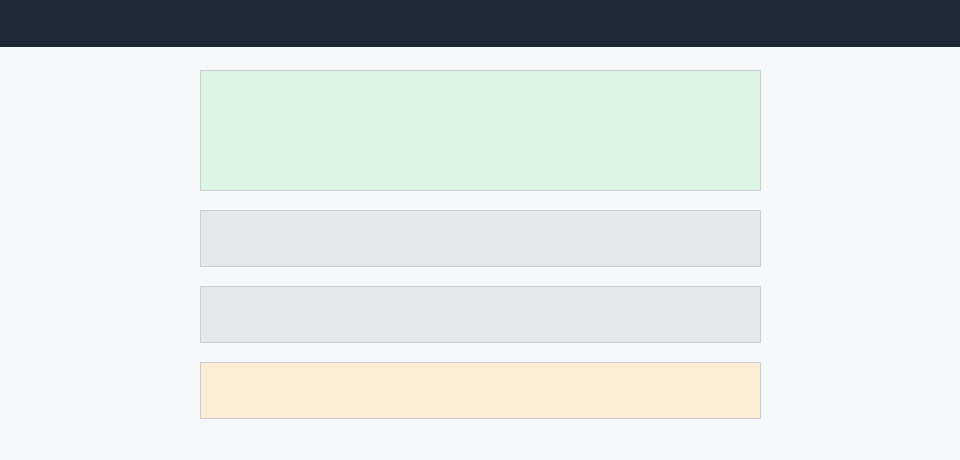
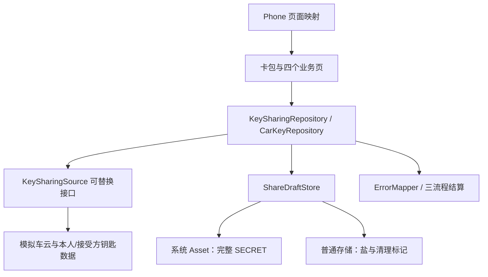
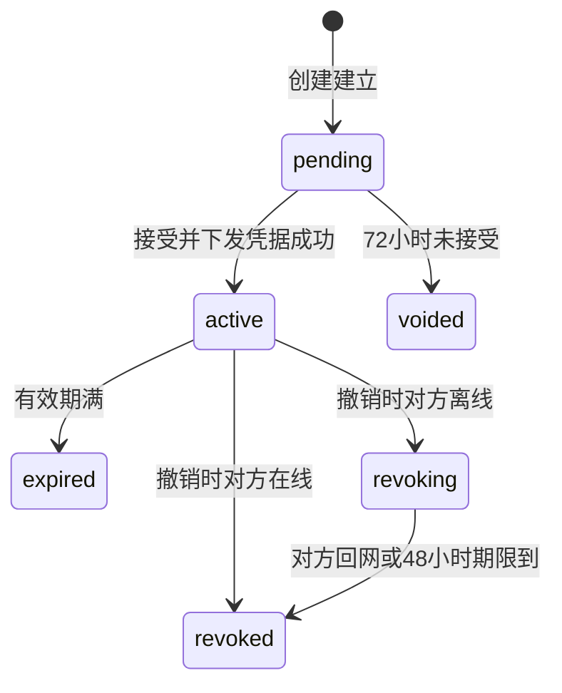
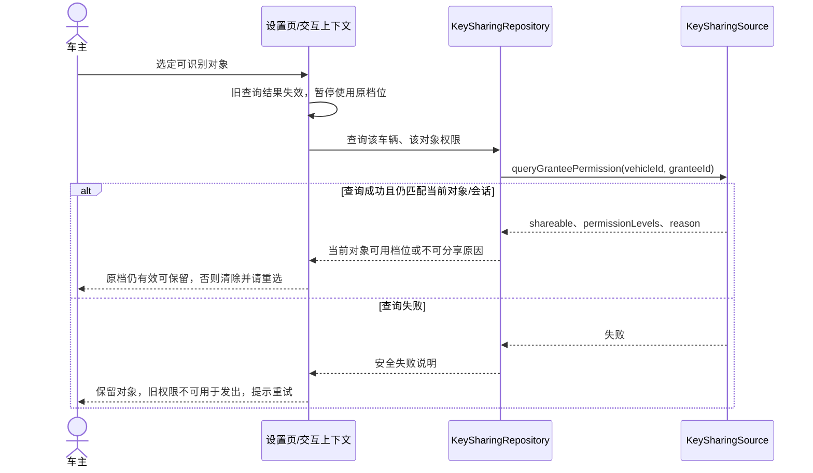
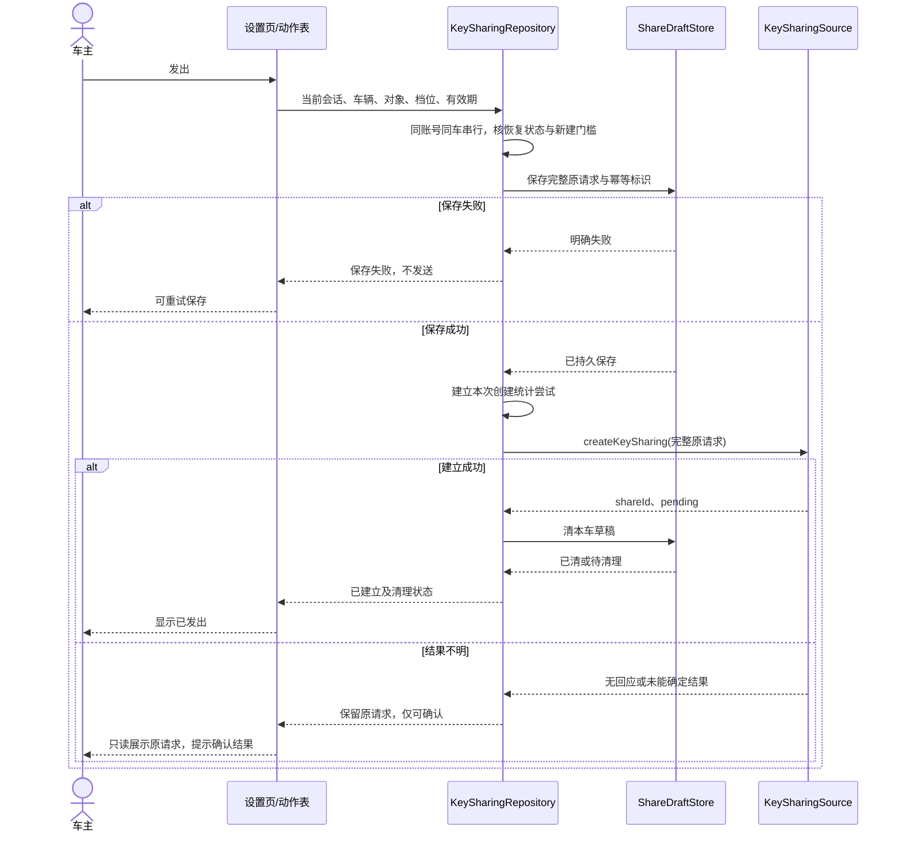
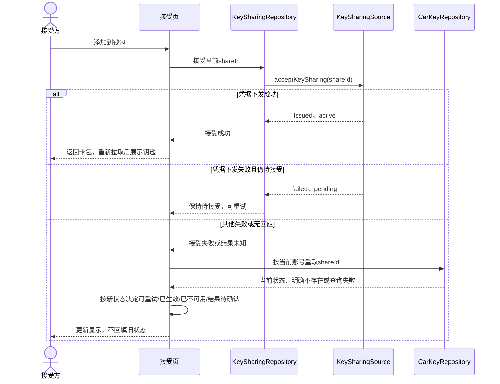

# 数字车钥匙分享：钱包端整体设计

> 人工预期稿：按 Framework 原生 Blueprint 人读组织与目标 Extension 设计内容编写，尚未由 canonical 与 CU 渲染、准入或验证。

阅读入口：正文说明业务、调用、取舍和施工；技术与追溯参考在本页末尾。

## 1 方案摘要

车主在卡包的本人车钥匙卡片上发起分享，选择对象、权限和有效期；对方在自己的卡包看到待添加钥匙，接受后取得可用卡片。车主从分享管理查看状态，对生效分享逐条撤销。卡包原先只有不可点的车钥匙分类，因此本单同时补齐本人钥匙卡片、收到的钥匙及分享入口。

一个施工单元 `wallet-key-sharing` 闭合完整钱包行为；设计中的数据源可替换，当前只交付公开模拟情景。

## 2 背景、目标与边界

一车多人使用时，车主需要把使用权限交给家人或联系人；当前卡包车钥匙分类不可点，尚无本人钥匙、收到的钥匙和管理入口。

产品目标是上线三个月内车钥匙用户中发起过分享比例不低于 15%，借车送钥匙类客服咨询下降一半；两者由运营侧统计，不由钱包三流程埋点直接作成功承诺。材料未给页面时延数值，本期不增加时延阈值。

钱包端负责页面、请求编排、本地草稿、状态展示和观察性输出；分享关系由车云裁定，凭据签发与车辆侧是否认可钥匙由车厂云负责。钱包不签发或保存车辆凭据，不把卡片仍显示解释为车辆仍允许使用。

本期按公开模拟前提验证钱包行为。六个车云接口按系统设计 2.1 的字段建立可替换数据源；本人钥匙、接受方账号查询、稳定账号标识、联系人、车型类别与创建恢复也由模拟源提供，后几项不能说成六接口已有。真实车云联调、系统联系人、推送点击入口与真机 Asset 验证不在本次情景终点内。

工程范围是 WalletMain 和 Phone。WalletMain 承担完整业务，Phone 只增加四个页面映射；AccountManager、CommUI、CommFunc 只读复用，不新增公共模块、架构 DSL 或模块依赖边。

业务依据为产品需求、车云系统设计、接受侧界面说明和已有需求答复；原未决仍由 Review 承载。

## 3 术语

| 术语 | 本需求含义与区别 |
|---|---|
| 本人钥匙 | 当前账号拥有车辆的钥匙，是发起与分享管理入口；与收到的分享钥匙分开查询 |
| 分享关系 | 车云裁定的对象、权限、有效期和六态；不是车辆凭据本身 |
| 待添加 | 接受方对 pending 分享的界面称呼；点击添加后仍须等凭据下发结果 |
| 撤销受理 | 车云已接受撤销，车辆立即拒绝；设备卡片可以继续显示撤销中 |
| 创建恢复 | 本地缺稿时查询模拟对端是否仍有原创建，不以列表空代替确定结果 |
| 原请求 | 发出前已受保护保存的完整创建参数与幂等标识；结果不明时不可编辑后另发 |
| 稳定身份与会话 | accountKey 跨重开识别同一模拟账号；sessionId 只识别本次登录，用于拒绝旧回调 |

## 4 用户旅程与界面

| 场景 | 页面和操作 | 决定下一步的事实 |
|---|---|---|
| 进入卡包 | 本人钥匙卡片显示车型、车辆；待接受的显示待添加；生效与撤销中的收到钥匙显示卡片 | 按当前账号重新取数；未登录或没有本人钥匙不显示本人分享入口 |
| 车主设置 | 给谁、权限、有效期三段；选定对象后才查权限，换对象使旧权限查询结果失效，重查后判断原档位能否保留 | 返回的可读档位原样展示和传回；不可分享、空档位或无法解释时说明原因，不猜权限 |
| 车主发出 | 三项齐、开关开、配额未满且草稿保存成功才发送新请求 | 配额统计生效与待接受；已有原请求的结果确认不被端侧满额阻断 |
| 接受方添加 | 从待添加卡片进入接受页，先看车型、车主昵称、权限与有效期，再点添加到钱包 | 不设拒绝按钮；只在当前状态仍为待接受时允许再次添加 |
| 车主管理 | 进页拉配额与列表；生效条目撤销，作废或到期条目重新发起 | 待接受撤回未决；其他状态只展示，不发送无效撤销 |
| 查看详情 | 在卡包点本人或已添加的收到钥匙卡片进入详情；本人按车辆标识、收到的按分享标识读取 | 收到钥匙展示权限与有效期，权限外功能不出现；本人详情可进入分享/管理；记录不可用则提示并回卡包 |

参考图保留在需求根 `ux-reference/`：设置、管理、接受、钥匙详情四屏；卡包分区沿用既有卡片样式。四个新页面分别导出 builder，经 WalletMain 的 `index.ets` 和 Phone 的 `navDestinationMap` 接入。推送未达不改变创建结果，接受方进入卡包可补拉；本期不实现推送点击跳转。

有效期提供 7 天、30 天与自定义（至多 180 天）；权限档位由车云根据对象与车辆关系给出，钱包不凭本地联系人推断谁是家庭成员。选联系人取消、联系人服务不可用或缺有效账号时保留当前选择并解释，不发权限查询；可改手输账号。开关默认关闭，放开后才可新建，关闭不阻断已有分享的接受、管理和撤销。

设置页三段选择后进入发出结果；管理页撤销后留在本页并重拉，接受成功后回卡包显示收到的卡片，详情无可用记录时提示并回卡包。取消选择返回当前设置，保留此前有效选择；退出页面不取消已发送请求。

### 分享设置

### 分享管理

### 接受分享

### 钥匙详情

## 5 整体方案

| 对象 | 主责及消费关系 |
|---|---|
| `KeySharingSource` / 模拟实现 | 承接六个冻结接口；额外模拟创建恢复、幂等记录与迟到终结。真实替换只换数据来源，不改页面、仓储的状态语义 |
| `SimulatedIdentitySource` | 稳定账号、会话、模拟联系人与身份事件；AccountManager 仍只提供已有登录态 |
| `KeySharingRepository` | 配额、权限、管理列表、创建恢复与创建、接受、撤销的业务入口；同车串行、展示组装、失败映射与三个流程的尝试结算 |
| `CarKeyRepository` | 本人钥匙及当前账号收到的钥匙；单条当前状态供接受、详情及失败恢复共用 |
| `ShareDraftStore` | Asset 原子完整草稿、读取四分、选择与原请求保存、退出/初始化清理；不负责判断车云终态 |
| 设置页交互五角色 | `ShareSetupActions` 动作枚举、`ShareSetupPageOperates` 动作表、`ShareSetupPageInteraction` 交互封装、`ShareSetupContext` 上下文、`ShareSetupPage` 页面组件 |
| 其他页面与卡片分区 | 展示当前账号状态并触发仓储操作；不自造幂等、清理或后台同步协议 |

| 车云接口 | 输入 → 输出及关键语义 |
|---|---|
| `queryKeySharingQuota` | vehicleId → canShare、remaining、reason?、shares(shareId/status)；满额给原因 |
| `queryGranteePermission` | vehicleId、granteeId → shareable、permissionLevels、reason?；对象不可分享时为空，不复用上一对象结果 |
| `createKeySharing` | vehicleId、granteeId、permissionLevel、validUntil、idempotencyKey → shareId、pending；同标识同一条，签发失败不留关系 |
| `acceptKeySharing` | shareId → credentialStatus(issued/failed)、status(active/pending)；其他失败按重新取数处理 |
| `revokeKeySharing` | shareId → status(revoked/revoking)、graceHours?；revoking 时返回期限，失败按重拉结果 |
| `queryKeySharingList` | vehicleId → items(shareId/status/permissionLevel/validUntil/granteeMasked)；每次进管理页拉取、不落地缓存 |

六个接口都是新增调用，字段不删、不改类型，必有和可空遵守系统设计；沿用车云错误码，不新增云错误码。收到的分享查询及按分享标识重取、稳定身份、本人钥匙与创建恢复属于显式模拟扩展，不以换名混入六接口。

## 6 关键流程

六态以车云返回为准，钱包不后台计时推算终态。72 小时是待接受期限；48 小时是对方设备上的卡片收回期限，不是车辆继续可用期。车云受理成功撤销起车辆立即拒绝这把钥匙；离线接受方的卡片可以仍处于撤销中，收回完成才从卡包移除。已作废、已到期、已撤销不列入收到的钥匙；从旧入口进入按已不可用处理。

接受返回 `credentialStatus=failed` 且 `status=pending` 时保持待接受。其他失败或无回应都重取当前账号下该分享：待接受才可重试，生效显示卡片，撤销中保留卡片但不再提供添加，终态或不存在移除。查询失败和不存在分开，查询失败显示结果待确认且不让再次添加。

撤销失败或无回应后重拉管理列表；只有重拉后仍是生效才再次提供撤销。不能把陈旧状态覆盖车云的新状态。管理页和卡包网络失败显示可重试失败态，不展示陈旧列表。

### 进入设置与选择对象

设置页经交互上下文取得当前 accountKey、sessionId 与 vehicleId，等待仓储恢复结果后决定可编辑、原请求只读或恢复受限。选对象先校验可识别账号；仓储调用数据源 queryGranteePermission，返回档位或不可分享原因，页面仅对仍匹配当前会话与对象的结果更新。更换对象先使旧权限查询结果失效，重查完成前不允许用旧权限创建；新结果仍允许原档位时可保留选择，否则清除并请车主重选。查询失败保留对象并提示重试，不让未经新结果确认的档位进入创建。

### 新建：保存并发出

本段说明新建；已有原请求时沿失败与恢复一节确认同一请求，不再生成新请求或受端侧满额阻断。新建动作把对象、档位、有效期交仓储；仓储按账号与车辆串行，先核恢复状态、开关、配额与三项选择，再等待 ShareDraftStore 保存完整原请求与幂等标识成功，才调用数据源 createKeySharing。返回 shareId/pending 后显示已发出，清本车草稿并让管理列表、卡包在再次进入时重新拉取；清稿失败仍显示已建立、保留待清理状态。无回应保留原请求并提示确认结果，禁止重新编辑制造第二请求。

明确拒绝的原请求与幂等标识成对清理后才恢复编辑，具体恢复表见失败与恢复。

### 接受与撤销

接受页先经 CarKeyRepository 按 shareId 取当前账号记录，展示后点添加，经 KeySharingRepository 调 acceptKeySharing。issued/active 才显示成功并返回卡包；failed/pending 保持可重试，其他失败等待重取后再决定按钮和去向。

管理页调用 queryKeySharingQuota 与 queryKeySharingList 后展示；点生效条目的撤销，经仓储调 revokeKeySharing，返回 revoked 或 revoking 都表示撤销已受理，留在管理页重拉当前列表。失败先重拉，确认仍 active 才重新提供撤销。每次尝试在仓储结算一次，旧会话结果不更新新页面。

## 7 数据与存储

请求身份与展示值分开：查权限、创建分享使用真实 `granteeId`，打码值不承担业务身份。展示组装复用 MaskUtil，管理列表使用车云返回的打码标识；长度不超过四位、打码函数会原样返回的账号只显示昵称。草稿保留续办所必需的真实身份，并按下述方式保护。

每账号每车辆一条系统 Asset，完整草稿放在一个 SECRET：账号车辆绑定、真实对象标识、打码展示值、权限、有效期，以及发出前加入的原请求和幂等标识。普通键值存储只留随机盐、初始化与待清理账号摘要，不留账号、车辆原值或请求副本。Asset ALIAS 与标签只放加盐摘要和业务功能标签；设备首次解锁后可访问、不同步、不设卸载保留。

保存时机是对象、档位、有效期各自选择完成及发出前，不按逐字输入或重绘写盘。Asset 不可用、数据损坏与不存在分别返回。超过 1024 字节按保存失败，不截断、不分片、不改存明文。API 12、`SystemCapability.Security.Asset`、完整模拟草稿不超过 1024 字节都是场景建设前提，未在真机证实。

主动退出或换号先持久标记旧账号不可恢复、更新会话使旧页面失效，再删除旧账号全部车辆草稿。清理失败照常退出旧会话，分享入口受限并可重试清理；连标记都写不进去则先清理，不开放下一个分享会话。普通冷启动未登录不等于主动退出，同一模拟账号登录后仍能恢复草稿；登录前不回填、不发送。

初始化标记缺失时按功能标签清理遗留 Asset，成功后建立盐与标记；失败显示初始化失败。模拟身份源的 `accountKey` 跨重开稳定，展示相同的不同账号必须不同；每次登录会话还有独立 `sessionId`。旧回调按发起时账号与会话匹配，换号后不改新页面、不重建已清草稿。尝试结果照实结算，不因丢弃页面更新就丢统计。

## 8 关键取舍

以下说明本方案实际采用的实现方式与代价。已经确定的业务边界、日常保护义务和统计要求分别在其承担章节说明，不另当作待选择事项。

| 选择 | 为什么采用、需要承担什么 | 比较过的其他做法 |
|---|---|---|
| 完整草稿放单条 Asset SECRET | 同时保护真实身份与原请求，保存成功后才发出；受设备能力与1024字节限制，保存失败不得发送且不计创建统计尝试 | 仅内存无法跨进程续办；普通明文存储不能满足身份与请求保护要求 |
| 缺稿先向对端恢复创建 | 本地清数据、重登或丢稿不能证明旧请求未执行；需要对端提供恢复与迟到请求终结保证，unknown时暂停该车新建 | 依据列表为空直接重建，无法排除尚未显示或迟到的请求 |
| 同账号同车串行编排 | 恢复、保存、发出共享顺序；不同车辆仍独立，旧会话回调不能写新页面 | 仅做按钮防抖，不能控制跨页面或重入的创建 |
| 设置页采用 page-interaction | 草稿读取决定起点，选对象后查权限，等待用户或服务返回后继续；五角色分别承担动作、调度、上下文和页面 | 发起主链的分支各在一次判断或请求后收敛，签发回滚归车云，不采用decision-tree；管理页不额外套模式 |
| 一个完整钱包 CU | 页面、草稿、身份与分享状态协同交付并一起验收；内部按依赖安排实现顺序 | 按存储、页面等技术层拆成CU，本例缺少独立可使用的交付边界 |

## 9 失败与恢复

同账号同车辆只有一个创建编排入口，串行完成“读取—恢复—保存—创建或确认”；不同车辆互不阻塞。草稿带原请求和幂等标识时，对象、权限、有效期只读，用原请求确认同一分享，不生成新标识。新建发出前先持久化完整原请求和幂等标识，写失败不发请求。

| 本地读取 | 本次允许动作 | 恢复责任 |
|---|---|---|
| 有选择、无原请求 | 恢复选择，重查配额与对象权限 | 设置页与仓储；换对象重查权限，新结果允许原档时可保留 |
| 有原请求 | 只读展示并确认该请求；满额仍能确认 | 仓储沿用请求与幂等标识 |
| 不可访问或服务失败 | 显示恢复失败、可重试；不新建 | 草稿存储明确失败，不伪装不存在 |
| 明确不存在或损坏 | 先做按账号、车辆的创建恢复；损坏原件隔离 | 模拟车云给出下表结果，仓储消费 |

| 创建恢复结果 | 页面、存储怎样处理 |
|---|---|
| pending，带原请求与幂等标识 | 受保护保存成功后只确认同一请求；保存失败继续受限 |
| established，带分享标识与当前状态 | 显示已建立，不自动再发；清本车旧草稿 |
| clear | 只有原创建已终结、迟到也建不出分享才成立；清旧稿成功后开放空表单 |
| unknown 或查询失败 | 当前账号这辆车暂停新发起；已有分享的查询、接受和撤销按各自状态与条件继续，不提供删除后重建 |

首次进入、成功发出并清稿后再次发起、退出重登、换号或清数据后回来，只要本地无稿，均先创建恢复。列表为空、打码昵称相同或“暂未看到请求”都不能推出 clear。模拟车云记录独立于钱包进程，并在受理新建时再次检查未终结创建；clear 覆盖迟到请求，防止“先查无、后晚到”的双建。

创建已建立后删本车草稿；删失败仍显示已建立并待清理，只能确认同请求或重试清理。明确拒绝（含满额、签发失败）后持久清掉原请求与幂等标识才恢复编辑。无回应保留原请求。签发失败时关系回滚由车云负责，钱包不自作成功或本地造关系。

这是本期采用的模拟业务合同，不是系统设计六接口已承诺的能力。真实对端缺少等价回查与迟到终结保证时，所有依赖创建恢复的新建都不能正式开放；带完整原请求的确认、接受、撤销与管理按自身条件处理。

接受与撤销的失败重取规则见关键流程；查询失败显示结果待确认，不能冒充不存在。联系人取消、服务不可用、账号无效不发权限请求；初始化、主动退出与换号清理规则见数据与存储，它们在允许新的分享会话前生效。

## 10 质量与安全

发起、接受、撤销各一步，分别以建立为待接受、生效、撤销已受理作为成功；在线立即撤销和离线撤销中都算已受理。创建统计尝试在实际调用 `createKeySharing` 之前建立；本地门槛不满足、保存失败或返回进行中均不进入创建尝试或分母。实际调用该接口确认旧请求时另计一次尝试，但沿用原幂等标识。接受和撤销按实际发起的业务调用统计；三个流程分别经 `settleCreate`、`settleAccept`、`settleRevoke` 每次尝试只结算一次。重复回调不重复报，页面退出不取消已发送请求的统计。

前置配额/权限查询、草稿读写、卡包补拉与失败后重取只记必要定位日志，不进入流程统计；不上报失效事件。车型类别直接取模拟输入、缺失记未知；失败说明经 `KeySharingErrorMapper` 的已知错误码映射，未知码给通用分类，外码校验格式，不读任意 message 拼描述。上报失败不改变分享结果。

上报仅使用有来源的非敏感上下文：车型类别、阶段和结果；创建可带本次请求中的权限档、有效期档及续办标志，失败可带异常类型、安全映射说明与合规外码，接受和撤销可带响应中的凭据状态、撤销状态及收回期限。凭据状态不包含凭据内容；账号、车牌、位置、凭据内容及任意原始错误正文不得进入日志或事件。

分享被接受比例按 D7 由车云分享记录统计，钱包不跨账号关联。三个流程号与内码在 CU Plan 中保留候选身份。核现有事件模板枚举和本业务 KeySharingChartCodes 的登记；真实全局分配来源未取得时保留候选，不声称已经全局核准，也不虚构CommFunc已有流程/步骤登记。

四页和卡片使用 start/end 与 TextAlign.Start/End。图标优先系统符号，再用已有归档资源；中文文案复用优先，新增中文与英文齐备并列入翻译清单，交付实际新增条数与UTF-8字节增量。本例不新增图片或SDK。深浅色、大字与可操作性由真实页面检查。

业务失败、隔离、幂等与脱敏按实际承担对象验证。端侧不轮询、不设后台写入，保存限选择完成和发出前；不自造材料未给的页面时延阈值。三流程上报与日志均不包含账号、打码账号、车牌、位置、凭据内容及原始错误文本。

## 11 施工与上线

`wallet-key-sharing` 完整承担本蓝图的钱包端改动，模块归属仍是 WalletMain；Phone 页面映射列为其窄范围伴随改动。一个 CU 能闭合卡包、发起、草稿恢复、接受、管理和退出的共同状态责任，当前没有独立交付或不同授权要求，不按技术层另拆单元。

CU Spec 承接本单位的可见行为、边界和验收，尤其原请求未知不重复建、跨重启恢复与换号保护、撤销受理车辆立即拒绝、接受撤销失败重取。CU Plan 再把这些义务落实到具体实体、方法、存储、动作表、页面映射与验证；共同状态与接口不另行定案。页面交互的五个角色、草稿保护与三个流程统计分别由 Plan 指定实体、调用和验证责任。

以下目录以 `02-Feature/WalletMain/src/main/ets/` 为基准；列出的新对象是目标写集，不能当成已有工程事实。

| 文件 | 动作与职责 |
|---|---|
| data/model/KeySharing.ets、WalletIdentity.ets | 新增分享六态、草稿与恢复结果、稳定账号与会话模型 |
| data/source/KeySharingSource.ets、SimulatedKeySharingSource.ets、SimulatedIdentitySource.ets | 新增冻结六接口和明确模拟扩展；模拟对端独立保存幂等及未终结创建 |
| data/repository/KeySharingRepository.ets | 新增同车编排、恢复、接口调用、展示组装和三流程结算 |
| data/repository/CarKeyRepository.ets | 新增本人/收到钥匙及当前单条状态读取 |
| data/repository/ShareDraftStore.ets、KeySharingErrorMapper.ets | 新增Asset保存、读取分类、隔离清理及安全错误映射 |
| presentation/interaction/ShareSetupPageOperates.ets、ShareSetupPageInteraction.ets、ShareSetupContext.ets | 新增动作枚举/表、交互封装、上下文，承接选择和异步恢复 |
| presentation/pages/ShareSetupPage.ets、ShareManagePage.ets、ShareAcceptPage.ets、KeyCardDetailPage.ets | 新增四页及builder，分别承担选择发出、管理撤销、添加、详情 |
| presentation/components/CarKeyCardSection.ets、presentation/pages/CardPackPage.ets | 新增卡片分区并修改卡包接入、每次返回补拉 |
| presentation/pages/MineTabPage.ets | 修改主动退出，先执行账号关闭/清理再调用既有logout |
| shared/constant/ShareConstants.ets、KeySharingChartCodes.ets | 新增默认关闭的开关、有效期/存储常量及三流程编号登记 |
| index.ets | 修改公开出口，导出四个builder |
| 01-Product/Phone/src/main/ets/pages/index.ets | 只改navDestinationMap四页映射 |
| 02-Feature/WalletMain/src/main/resources/base/element/string.json、en_US/element/string.json | 资源位于src/main/resources；中文复用优先，新增英文资源成对交付并记录条数和UTF-8体积 |
| doc/features/ISSUE-206/wallet-key-sharing/plan/translation-list.md | 编码时形成新增资源键、中文、英文和回稿状态清单，本稿不伪造已完成清单 |

施工先闭合身份、模型、模拟源和Asset恢复，再接三流程编排与五角色，最后接四页、卡包和Phone映射；这是同一CU内部顺序，不是分批上线。功能开关保持关闭直到组合验收；中间状态只允许既有卡包照常工作。真实开放新建前还需真实对端恢复保证与设备Asset证据；真实联系人、推送点击和车云联调不在本次模拟交付终点内。

## 12 验收

本蓝图全部由 `wallet-key-sharing` 认领，下表同时指出设计落点与观察结果；不是仅凭文件存在验收。

| 主题与CU Spec验收编号 | 施工落点 | 必须观察的结果与验证层 |
|---|---|---|
| 卡包与四页（AC-1/2/9/10/12/15–19/29） | 卡片分区、卡包页、四页builder和Phone映射 | 本人、待添加、active/revoking各走正确入口；完成/失效返回正确；真实UI检查导航与显示 |
| 权限、配额与有效期（AC-1/4/11/21/38） | 设置交互、仓储、数据源 | 换对象重查前旧权限不可用，重查仍合法可保留原档，否则重选；档位原样传回；7/30/自定义至多180天；满额不新建但可确认原请求；可控业务验证 |
| 创建与跨重开（AC-6/30/32/34–36/41–43） | 仓储、草稿存储、模拟对端 | 选择完成、发出前、等待响应、建立后清稿四类中断均能续办；原请求不变；unknown受限；迟到请求不双建；业务验证加应用进程重开与真实Asset证据 |
| 账号/车辆隔离（AC-13/14/19/33/36/37/40/42） | 身份源、上下文、closeAccount与Asset | 同车串行、不同车互不阻塞；同显示名不同账号隔离；旧回调不改新页或重建草稿；业务验证 |
| Asset边界（AC-13/23/28/35/40/41/43） | ShareDraftStore | 不存在、不可访问、损坏分别处理；1024字节超限不发请求；清理失败不开放新会话；可控异常与真机能力分别核 |
| 接受与撤销（AC-2/3/5/7/16–20/31/39） | 接受/管理页、两仓储 | 接受失败重取后才重试；撤销受理车辆立即拒绝，离线卡片至多48小时收回；72小时未接受作废；业务验证，真实车辆结论需端云证据 |
| 观察性与质量（AC-8/22–27/37、AC-G1、AC-G2、AC-G3） | ErrorMapper、结算、资源和四页 | 实际发起的三流程每尝试一次，未发送的保存失败不计创建，未知错误安全分类、不泄露身份；深浅色大字方向性；中英文与翻译清单对应；独立审查与设备UI分别核 |

上述为待实施的验收设计，尚无本次真实运行或设备通过结论。精确条件由同目录CU Spec承接，文件和方法由CU Plan细化，二者不得改变这里的状态、恢复与责任边界。

## 13 待补问题

| 项目 | 保留的边界 |
|---|---|
| D2 被分享人再转第三人 | 未定；本期不设计、不宣称支持 |
| D5 极端断网强制下线 | 未定；48 小时卡片收回规则不代替这项安全裁决 |
| D8 待接受能否撤回 | 未定；当前只完整设计生效撤销，待接受只展示，不能凭“随时可撤”擅自补接口边 |
| 创建恢复真实对端 | 六接口未声明；正式新建需等价回查及迟到终结保证 |
| 稳定账号、接受侧查询、本人钥匙、联系人、推送 | 当前是模拟或明确后续，真实提供方与契约待接入时核实 |
| Asset 与编译环境 | API 12、能力、完整草稿上限属于公开建设前提；设备能力、部署与生命周期未验证 |

## 技术与追溯参考

### 设计与来源

本页保留1.9.9业务基线，当前候选的[Story](../AR/story.md)、[Review](../AR/review.md)、[CU Spec](../wallet-key-sharing/spec/spec.md)和[CU Plan](../wallet-key-sharing/plan/plan.md)分别承接需求、裁决、单位验收与施工。原材料、原生投影与上一轮原稿沿主题目录的“参考/2026-10-28-首轮金样”和“参考/2026-10-29-第二轮金样”追溯；本页没有重新签署原确认。

### 必要精确参考

- [CU Spec验收标准](../wallet-key-sharing/spec/spec.md#8-验收标准)：本页验收主题中的 AC 均属于同一 `wallet-key-sharing` 来源，AC-K编号到AC编号承接仍由该节维护。
- [CU Plan](../wallet-key-sharing/plan/plan.md)：具体模型、方法、状态管理、页面组件树和统计编码；本页施工职责与调用是它的上位约束。
- [首轮固定来源分层](../../../../../../../../../archive/2.0.1/2026-10-28-2.x适配收敛/参考/2026-10-28-首轮金样/doc/features/ISSUE-206/source-inputs.md)：原始材料、模拟建设前提及未决的来源分位。历史“已确认”不等于本稿获得新确认。

六个外部操作的输入/输出见整体方案接口表，完整原请求、恢复四态及草稿生命周期见关键流程、失败与恢复、数据与存储。图中“完整原请求”即该表createKeySharing声明的五项参数，不另造接口；未列出的异常仍按恢复表和CU Spec当前状态重取规则处理。
