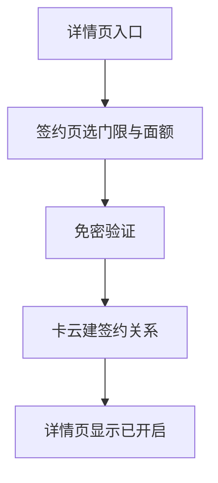
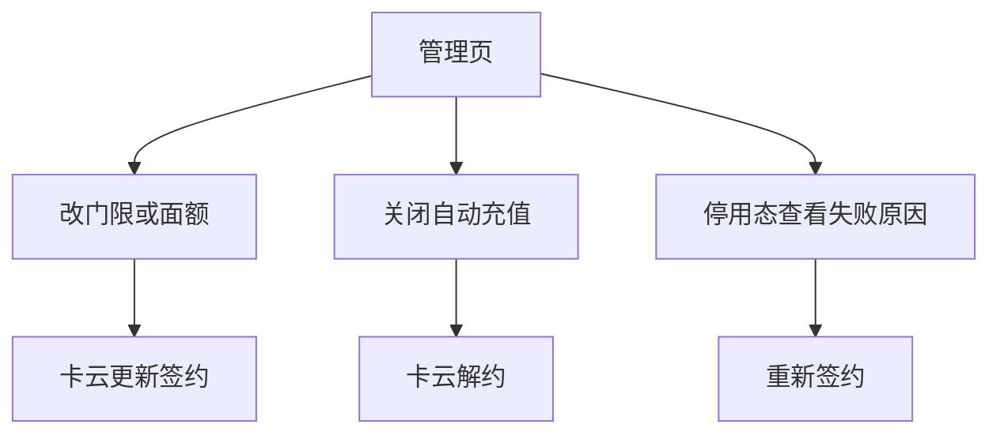

# AR90006 交通卡自动充值（钱包端）

## 1. 背景

交通卡余额用尽只有在闸机前才会被发现，用户被迫在人流中当场充值，这是当前交通卡用户最集中的投诉点。手工充值本身不难，难在触发时机——余额还有富余时，用户没有理由主动打开钱包想起这件事。

本需求让用户对一张交通卡做一次签约之后，余额低于自己设定的门限时由系统自动完成充值，把「想起来充值」从用户身上移走。运营上的目标有两个：签约用户的闸机余额不足发生率降到万分之五以下，签约转化率不低于交通卡月活的 8%。

要做到这一点，整套方案分成签约、触发、扣款、入账和停用五段。钱包端承担其中几段：用户在交通卡详情页看到自动充值入口，进入签约页选好触发门限、单笔面额并同意免密扣款协议，过一次免密验证后建立签约；签约之后，用户在同一个入口能查看充值记录、修改门限面额或关闭自动充值。判定余额够不够、什么时候扣款、怎么入账停用，全部在服务端完成，不经过钱包端——用户侧没有任何「发起自动充值」的动作。

这次改动让用户在闸机前余额不足的场景从「当场掏手机充值」变成「系统早已替他充好」，把一次高频的糟糕体验改成了签约后几乎无感的持续守护。

## 2. 术语

| 术语 | 在本需求里的意思 |
|---|---|
| 自动充值 | 交通卡详情页上的一项功能：用户签约后，余额低于门限时由系统自动完成充值 |
| 签约 | 用户在签约页选好触发门限、单笔面额并同意免密扣款协议，通过一次免密验证后建立的自动充值关系 |
| 触发门限 | 余额低于多少（5 / 10 / 20 / 30 元）时触发一次自动充值，签约时单选，之后可修改 |
| 单笔面额 | 每次自动充值充多少（20 / 50 / 100 元），签约时单选，之后可修改 |
| 免密扣款协议 | 用户授权系统在满足条件时自动扣款的协议；协议文案会写明单笔上限与单日上限，协议号由支付侧返回 |
| 管理页 | 开启自动充值后，同一入口对应的页面：查看签约状态、充值记录、修改门限面额、关闭或处理停用 |
| 停用 | 扣款连续 3 次失败后，签约被服务端停用，管理页展示停用状态与原因，可从停用横幅直接重新签约 |

用户最容易混淆的是「签约」与「开启」之外的两种关系：「触发门限」是触发条件（余额低到多少），「单笔面额」是触发后充多少；二者方向相反、互不换算。另一个容易混的点是「停用」与「关闭」：停用是服务端在扣款连续失败后做出的，用户只能重新签约；关闭是用户主动做出的，之后想用要重新走一遍签约。

## 3. 范围

整套自动充值由钱包端、交通卡云、支付部件、账号能力和运营管理台共同完成，各参与方分工如下：

| 参与方 | 做什么 | 在本需求里 |
|---|---|---|
| 钱包端（本次交付） | 详情页自动充值入口、签约页（门限/面额选择、协议、拉起免密验证）、管理页（状态、记录、改档、关闭、停用重签）、实名引导回跳、端侧暂存签约选择 | 本需求交付 |
| 交通卡云 | 余额上报、门限判定、自动扣款与入账、写卡；签约关系、门限面额与充值订单的唯一真源 | 本需求交付（接口对端） |
| 支付部件 | 免密协议签订、协议号、单笔额度校验；拉起免密验证界面 | 既有能力，只用不改 |
| 账号能力 | 登录实名结果 | 既有能力，提供身份判定 |
| 运营管理台 | 下发自动充值功能开关、门限与面额档位 | 配置与本需求同版本上线；配置页面与逻辑不在钱包端 |

钱包端在这份需求里不做什么：

- 不判断余额是否低于门限，不发起任何自动充值——判定与扣款全在服务端，钱包端不存在「发起自动充值」的动作；
- 不保存支付凭据，免密协议号只透传，不在钱包端持久化；
- 不实现运营管理台的页面与配置逻辑；
- 不改变余额的判定口径——判定输入是服务端记录的余额，不是用户手机上显示的余额。

本期明确不做：按日期或按行程预约充值、一张签约覆盖多张卡、家庭成员代充。这三项都需要新的账户模型，不在本期范围。自动充值的发票开具入口本期不做（税务侧口径未返回，另行排期，见 D10）。

交通卡云是本部件的最外层依赖：签约、改档、关闭与状态展示都依赖它的接口。支付部件能力不可用时，隐藏新签约入口，不影响已签约用户继续自动充值。

## 4. 业务方案

整体做法：用户对一张交通卡做一次免密签约，此后余额低于自己设定的门限时由服务端自动完成充值，钱包端只负责签约入口、签约交互、状态展示与记录查看。签约关系、余额门限与充值订单的唯一真源是交通卡云，判定与扣款都发生在服务端——这份权威划分决定了钱包端的所有边界，也决定了本需求不采用「端侧监测余额并直接发起扣款」的做法：用户离线刷卡后手机上显示的余额会长期不准，按它判定会扣出用户预期之外的钱。

各参与系统之间按分工协作，方向是钱包端调用交通卡云发起签约与查询，支付部件向用户拉起免密验证并返回协议号：

| 参与方 | 输入 | 输出 | 责任 | 失败时 |
|---|---|---|---|---|
| 钱包端 | 用户动作、卡片与云侧状态 | 签约请求、状态页与提示 | 收集确认、拉起签约、展示结果 | 不判断是否该扣款，不保存支付凭据 |
| 交通卡云 | 卡片、账号、余额上报、协议号 | 签约、触发、订单与扣款结果 | 门限判定、订单创建、失败停用 | 是签约与扣款结论的唯一真源 |
| 支付部件 | 协议号、订单和金额 | 签约与扣款结果 | 免密协议和扣款 | 不改变签约关系，不重复扣款 |
| 账号能力 | 登录实名请求 | 合格身份或失败结果 | 提供既有身份能力 | 未实名不允许签约 |
| 运营管理台 | 运营配置 | 开关、门限和面额档位 | 配置下发 | 配置不可用按关闭处理 |

几个关键取舍：

- **改门限或面额走更新接口，不重建签约**。候选方案是「先解约再重新签约」，但那样中间有空窗——刚好那几分钟余额掉下去就不会充，而且要用户再拉一次免密验证；澄清会拍板卡云新增更新接口，原签约关系不断，改档不走重签（D1）。只改门限不涉及免密额度、不需要重新验证（澄清会已定），即时生效；改面额（调高或调低）要不要重新免密验证待支付侧与风控确认（D3），未定前不写死。
- **入口可见性分四档，不把开关折叠进可签约性**。未实名（应可见并引导实名）与开关关闭（应隐藏入口）是同一种「不可签约」，若都折叠成一个布尔值就无法区分。入口按显式矩阵判定：未签约且开关开且可签约，进签约页；未签约且开关开但未实名，可见并引导实名；未签约且开关关，隐藏；已签约，始终可见进管理页（D7）。
- **签约页的门限与面额档位来自策略接口**，不写死。运营侧通过策略接口下发档位（5 / 10 / 20 / 30 元与 20 / 50 / 100 元是现行值），页面单选数据源取接口返回，运营调整即时生效（D6）。
- **同一张卡不重复建约**。创建签约以「卡片 + 生效状态」判重，已有生效签约时返回既有签约号，端侧转到管理页；入口的重复点击由此收敛（D8）。

免密扣款协议的单笔上限按用户选择的面额设置，不设成固定值——用户选 20 元面额却签出 100 元的免密额度说不过去。协议文案写明单日上限；本期上限取 200 元（澄清会）还是 300 元（产品需求 v1.1），待产品负责人裁定（D11）。

全篇风险如下，风险只在业务方案这一章成表：

| 风险 | 触发条件 | 影响 | 已有控制 |
|---|---|---|---|
| 判定扣错金额 | 按用户端显示余额判定 | 扣出用户预期之外的钱 | 判定输入是服务端记录余额，端侧不参与判定 |
| 免密额度与所选面额不符 | 面额与免密额度解绑 | 用户质疑扣款 | 单笔上限随所选面额设置 |
| 改档重建签约造成空窗 | 改档走解约重签 | 空窗期余额下降不自动充；重复拉验证 | 改档走更新接口，原关系不断 |
| 签约页档位与运营下发不一致 | 档位写死 | 运营想调调不动 | 档位取自策略接口 |

改面额是否要重新免密验证（D3）、免密授权后创建签约失败或结果未知时怎样再次尝试（D4）尚未对齐，这两件事的边界写法见异常与恢复章，不在这章下结论。

## 5. 业务流程

自动充值的完整业务分两条路径：签约路径把「这张卡的自动充值关系建立起来」，管理路径处理建立之后的查看、修改、关闭与停用重签。两条路径都从交通卡详情页的同一个自动充值入口进入。

用户在入口点的去向由四档可见性决定：未签约且可签约的，进入签约页开始签约；未签约但未实名的，入口可见、点进去先被引导实名；未签约但功能开关关闭的，入口不可见；已经签约的，入口始终可见，点进去直接是管理页（D7）。

### 5.1 签约路径

签约路径从入口进入签约页，选好触发门限与单笔面额、勾选同意免密扣款协议，然后过一次免密验证，验证通过后由卡云建立签约关系，详情页显示已开启。先讲一遍过程：页面上门限、面额都选好、协议也勾了，「开启」才点得动；点了「开启」才拉起免密验证；验证回来是什么结果，决定这一次是签成了还是留在页面上。

各分支的去向：

- 未实名用户点进入口：先被引导去实名，实名完成后回到签约页继续，此前选好的门限与面额保留（D2）；
- 免密验证被用户取消或没通过：留在签约页，门限与面额仍在，可以直接再点一次「开启」，不必重选；
- 免密验证通过、创建签约这一跳明确失败：留在签约页，门限与面额仍在，不留半签约状态；再次尝试是复用协议号还是重新验证，等 D4 的结论；
- 创建签约超时、结果未知：页面不显示成功，也不当作没签成；先查询云侧签约状态——已生效就按已开启展示，云侧没有签约就当本次没建成、留在签约页，查询也失败就提示结果待确认、可稍后再查；
- 用户中途退出签约页：已选的门限与面额被暂存，下次从入口进来时回填（仅本账号本卡，退出登录清除）；
- 这一次已有生效签约的卡又走创建：创建接口按「卡片 + 生效状态」判重，返回既有签约号，端侧直接转管理页，不建立第二份签约（D8）；

签约链到卡云建立签约关系为止，这一步不产生充值订单。之后的每一次充值是另一条链，全部在服务端完成：卡片余额上报后，卡云判定低于门限就创建一笔充值订单并经支付部件免密扣款；单日达到上限当日不再触发；扣款成功但写卡未完成时，这笔订单保持充值中，卡云下次读卡补写，端侧不提供重试也不重复下单；连续 3 次扣款失败，卡云停用签约。钱包端在管理页的最近记录里展示每一笔的结果。

### 5.2 管理路径

签约建立后，同一入口点进去是管理页。管理页承载三件事：改门限或面额、关闭自动充值、查看停用态与失败原因并决定重新签约。过程先讲一遍：管理页顶部是当前签约状态，下方是最近的自动充值记录；改档或关闭都以用户确认的动作发起，由卡云更新或解除签约关系。

各分支的去向：

- 改门限或面额：走更新接口，原签约关系不断；只改门限不涉及免密额度、不需要重新验证，即时生效；改面额（调高或调低）要不要重新免密验证待支付侧与风控确认（D3），未定前不写死（D1）；
- 关闭自动充值：调解约接口，已签约状态转为未签约；解约不回滚正在进行中的订单，也不撤销已完成订单；
- 停用态查看失败原因：连续 3 次扣款失败后卡云自动停用签约，管理页顶部换成停用横幅并给出失败原因；用户可以从这里重新签约；
- 单日达到充值上限是正常受限分支：当日不再触发，不计入连续失败，次日零点恢复。

两条路径共用同一份签约关系数据：签约号、门限、面额和状态在端侧有副本，仅用于离线时免网展示；缓存缺失或与云侧不一致时以云侧查询结果为准；云侧查询失败时状态显示为未知、可重试，不把缓存缺失当成未签约。

## 6. 功能说明

钱包端在自动充值里提供 6 项能力：详情页入口、签约、免密验证拉起、实名引导、端侧暂存与管理页。各能力的输入、条件与结果如下。

### 6.1 交通卡详情页入口

交通卡详情页在余额行之下、充值记录之上展示一整行「自动充值」入口。入口是否可见、点进去去哪，由四档矩阵决定（D7）：

| 用户状态 | 入口 | 点进去 |
|---|---|---|
| 未签约 + 开关开 + 可签约 | 可见 | 签约页 |
| 未签约 + 开关开 + 未实名 | 可见 | 引导实名 |
| 未签约 + 开关关 | 不可见 | —— |
| 已签约 | 始终可见 | 管理页 |

### 6.2 签约页

签约页让用户为这张卡建立自动充值关系，包含三个要素：触发门限、单笔面额与免密扣款协议。

- 触发门限单选：可选值来自策略接口返回的档位，现行值为 5 / 10 / 20 / 30 元；
- 单笔面额单选：可选值同样来自策略接口，现行值为 20 / 50 / 100 元；
- 协议勾选：勾选并同意免密扣款协议后，「开启」按钮才可点击。

门限与面额都选好、协议也勾了，「开启」才点得动。签约页视觉沿用交通卡详情页现有样式，不新增控件类型。

### 6.3 免密验证拉起

点「开启」后页面拉起支付部件的免密验证，验证页会说明单笔额度。验证通过后返回协议号，钱包端带着协议号去创建签约；验证被用户取消或没通过时，钱包端留在签约页，不建立任何签约关系，也不留下半签约状态。

### 6.4 实名引导

用户未完成实名时，签约页被引导去完成实名认证。实名完成后回到签约页继续，此前选好的门限与面额都还在（D2）。未实名用户看不到签约这件事在本需求不成立——入口可见，只是签不成。

### 6.5 端侧暂存

用户中途退出签约页时，已选的门限与面额会被暂存。下次从入口进来时按暂存值回填，接着往下走。暂存只在本账号本卡有效，退出登录即清除。

### 6.6 管理页

开启自动充值后，入口点进去是管理页，顶部为当前签约状态，下方为最近的自动充值记录。管理页提供五件事：

- 查看签约状态与门限面额：展示当前生效的签约关系；
- 查看最近记录：展示最近的自动充值记录，失败的记录要能展示失败原因，记录中的卡号按现有规则脱敏；
- 修改门限面额：走更新接口，原签约关系不断；只改门限不涉及免密额度、不需要重新验证，即时生效；改面额（调高或调低）要不要重新免密验证待支付侧与风控确认（D3），未定前不写死（D1）；
- 关闭自动充值：调解约接口，关闭后不再触发自动充值；
- 处理停用并重新签约：扣款连续失败 3 次后签约被卡云自动停用，管理页顶部换成停用横幅，横幅展示失败原因并直接给出**重新签约**的去处，用户从横幅即可重新签约。

管理页上的条件组合用一张表汇总：

| 操作 | 成立条件 | 结果 |
|---|---|---|
| 修改门限 | 签约生效中 | 卡云更新签约关系，不需要重新验证，新门限即时生效 |
| 修改面额 | 签约生效中 | 是否要重新免密验证待支付侧与风控确认（D3），结论前不写死改面额的交互 |
| 关闭自动充值 | 签约生效中 | 卡云解约，不再触发自动充值 |
| 查看失败原因 | 签约被停用 | 展示停用原因，横幅内提供重新签约入口 |
| 重新签约 | 签约被停用 | 从停用横幅直接进入，重新走一遍签约流程 |

端侧保存的签约号、门限、面额和状态副本仅用于离线免网展示；缓存缺失时以云侧查询为准，查询失败时状态显示为未知、可重试。

## 7. 异常与恢复

异常分两类：设计内的正常受限结果，和没被设计接住的真正异常。本需求把它们分开讲。

### 7.1 正常受限结果

以下是方案设计上就有的场景，各有明确去处，用户不会停在没有出路的页面上：

| 场景 | 用户看到什么 | 接下来怎么走 | 责任人 |
|---|---|---|---|
| 免密验证取消或没通过 | 留在签约页，门限与面额仍在 | 可直接再试一次，不必重选 | 钱包端 |
| 未完成实名 | 提示先完成实名认证 | 引导去实名，回来后回签约页继续 | 钱包端、账号能力 |
| 同一张卡已有生效签约 | 不重复签约 | 直接进管理页，在那里改门限面额或关掉 | 交通卡云判重、钱包端分流 |
| 用户中途退出签约页 | —— | 下次从入口进来时，此前选的门限面额仍在 | 钱包端（端侧暂存） |
| 单日达到充值上限 | 当日不再触发 | 当日不再充，次日零点恢复；不计入连续失败 | 交通卡云 |
| 扣款连续失败 3 次 | 管理页顶部换成停用横幅，展示失败原因并直接给出重新签约入口 | 从横幅直接重新签约 | 交通卡云停用、钱包端展示 |
| 扣款成功但写卡未完成 | 订单保持充值中 | 卡云下次读卡补写；端侧不重试、不重复下单 | 交通卡云 |
| 功能开关关闭 | 未签约用户看不到入口 | 已签约用户不受影响，照常自动充值 | 运营管理台、钱包端 |

### 7.2 真正异常

真正异常指设计上没有具体兜底、走通用逻辑的场景，用户要看到失败结果而不是假装成功：

| 场景 | 可观察结果 | 恢复方式 | 责任人 |
|---|---|---|---|
| 免密授权后创建签约明确失败 | 留在签约页，门限与面额仍在，不显示成功 | 不留半签约状态；再次尝试的方式（复用协议号或重新验证）等 D4 结论，见下方边界 | 钱包端、交通卡云、支付部件 |
| 创建签约超时、结果未知 | 不显示成功，也不显示未签约 | 查询云侧签约状态：已生效按已开启展示；云侧无签约按本次未建成处理、留在签约页；查询失败保持待确认、可稍后再查 | 钱包端、交通卡云 |
| 云侧状态查询失败 | 入口与管理页显示状态未知 | 可重试；不按本地缓存缺失推断未签约 | 钱包端 |
| 免密验证请求网络失败 | 拉不起来验证页 | 用户可重试，已选门限面额保留 | 钱包端 |

### 7.3 未定的两条边界

这两件两端尚未对齐，正文不替它们下结论，交在这样的边界上：

- **改面额是否要重新免密验证（D3）**：面额与免密单笔额度绑定，调高会放大额度；调低会上只说「应该不用」，也要等风控确认。只改门限不涉及额度、不用验证，这一点已定。本期改面额的交互不写死——只写两分支都成立的共同要求（改门限即时生效、管理页保留现场），不写改面额是否即时生效，验收也只覆盖改门限路径与关闭路径。
- **免密授权后创建签约失败或结果未知时怎样再次尝试（D4）**：卡云说协议号十分钟内可复用，支付侧认为协议号有效期可能随验证会话走、未必十分钟，产品决定等两端对齐，不按十分钟写。本期已定的只有：明确失败时留在签约页、保留已选门限与面额、不留半签约状态；结果未知时以云侧签约状态为准，不把超时当成没签成。用复用协议号还是重新验证来再次尝试，等结论再写。

两条边界解除前，受影响的行为都不能写成已定；解除后由本单评审回流更新。

## 8. 验收

本需求每条原始验收编号一行，通过条件按澄清会修订后的口径写，主责是谁来验：

| 编号 | 验收点 | 可观察的通过条件 | 主责 |
|---|---|---|---|
| AC-R1 | 未实名用户 | 能看到自动充值入口，点进去被引导去实名，完成实名前无法签约（按澄清会修订，原「看不到入口」作废）；实名完成后回到签约页可继续签约 | 端侧 + 测试 |
| AC-R2 | 签约后自动充值 | 余额低于门限时用户不做任何操作即可完成充值，并能在记录里看到这笔 | 端侧 + 交通卡云测试 |
| AC-R3 | 连续失败停用 | 扣款连续失败 3 次后自动停用，用户打开管理页能看到停用状态与失败原因，停用横幅直接给出重新签约入口，从横幅即可重新签约 | 端侧 + 交通卡云测试 |
| AC-R4 | 功能开关关闭 | 未签约用户看到的是隐藏入口；已签约用户入口不隐藏、自动充值照常发生（按澄清会确认：开关只管新签约） | 端侧 + 运营测试 |
| AC-R5 | 记录展示 | 充值记录中的卡号按现有规则脱敏展示 | 端侧 + 测试 |
| AC-R6 | 修改与关闭 | 签约后可修改门限并按新值生效；关闭后不再触发自动充值。改门限不需要重新验证；改面额是否要重新免密验证待支付侧与风控确认（D3），结论前只验改门限路径与关闭路径，不验改面额 | 端侧 + 交通卡云测试 |
| AC-R7 | 验证取消后重试 | 用户在支付验证界面取消，回到签约页时刚才选的门限与面额仍在，可直接再次开启 | 端侧 + 测试 |
| AC-R8 | 实名后续办 | 未实名用户被引导去实名，完成后回到签约页继续，此前的选择仍在 | 端侧 + 测试 |
| AC-R9 | 已签约再进入 | 已有生效签约的卡再点入口，进入的是管理页而不是重新签约 | 端侧 + 测试 |
| AC-R10 | 创建签约结果未知 | 免密验证通过后创建签约超时：页面不显示成功也不显示未签约；云侧已生效时按已开启展示，云侧无签约时留在签约页且门限面额仍在，查询失败时提示结果待确认 | 端侧 + 交通卡云测试 |
| AC-R11 | 本地缓存缺失 | 清除应用数据后进入：云侧生效时显示已开启并进管理页，云侧停用时显示停用与原因，云侧无签约时进入签约引导，云侧查询失败时显示状态未知且可重试 | 端侧 + 测试 |

上线后观察（埋点指标，本文设定，不作为验收判据）：

- **创建签约成功率**：创建签约成功的次数 ÷ 创建签约尝试次数，观察签约链路是否顺畅；它不是背景里的业务目标「签约转化率」——那一项按交通卡月活计，是服务端全局指标；
- **创建签约失败率**：创建签约明确失败 + 结果未知的次数 ÷ 创建签约尝试次数，观察支付侧协议与卡云接口的稳定性。

这两项指标在端侧签约流程的创建签约步骤打点，失败原因随事件带上；指标只是观察口径，不作为本需求的验收判据。

## 9. 交付与上线

本需求交付一套钱包端自动充值功能，上线的联调与开放顺序沿用系统设计的交付口径：先联调策略查询与创建签约，再开放状态查询与解约。前置是交通卡云发布签约、门限面额、状态、更新与解约五类接口，支付部件免密能力可用。

各可独立控制的对象与开关：

| 对象 | 启用 | 停用 | 进行中的业务受什么影响 |
|---|---|---|---|
| 自动充值功能开关 | 运营管理台开启后，未签约用户可见签约入口 | 运营管理台关闭后，未签约用户看不到入口；已签约用户一律不受影响 | 已签约用户的自动充值照常发生，管理入口也不隐藏（D5） |
| 策略接口返回的档位 | 运营下发门限与面额档位 | 配置不可用时按关闭处理 | 新签约入口隐藏 |
| 支付部件能力 | 能力可用时拉起免密验证 | 能力不可用时隐藏新签约入口 | 已签约用户继续自动充值，不受影响 |
| 创建签约 / 状态查询等接口 | 与交通卡云联调完成后开放 | 接口异常时签约页/管理页走通用失败处理 | 失败路径见异常与恢复章 |

### 9.1 交付物

| 交付物 | 给谁 | 做什么用 | 什么时候要 |
|---|---|---|---|
| 钱包端自动充值功能（入口、签约页、管理页、免密验证拉起、实名引导、端侧暂存） | 钱包产品组、测试 | 支撑交通卡自动充值的签约、管理与记录展示 | 与交通卡云五类接口联调通过后 |
| 端侧事件统计（签约与管理流程） | 钱包产品组、运营 | 观察创建签约成功率与失败率 | 上线后随功能生效 |

上线后如需回退：关闭自动充值功能开关即可让未签约用户不再看到入口；已签约用户继续由服务端执行自动充值，不受开关回退影响。

## 10. 附录

附录提供正文里的接口、数据、配置、统计点与规约判断的精确登记，以及据哪几份材料写成这份 Story。

### 10.1 技术契约

这一节列倒查正文中文名的精确接口、数据与配置项。

#### 10.1.1 端云接口

<!-- story-build:begin 技术契约·端云接口 · 由蓝图 contracts（bp-AR90006 r2）生成，改它请改真源 · sha256:c101898eb415c0ab -->
**getAutoTopupPolicy**：getAutoTopupPolicy（outbound，版本 1.0）

| 位置 | 字段 | 类型 | 含义 | 可空 |
|---|---|---|---|---|
| 请求 AutoTopupPolicyRequest | accountId | string | 去标识账号 | 必有 |
| 请求 AutoTopupPolicyRequest | cardId | string | 卡片标识 | 必有 |
| 响应 AutoTopupPolicyResponse | signable | boolean | 是否可签约 | 必有 |
| 响应 AutoTopupPolicyResponse | unsignableReason | string | 不可签约的原因（如未实名），可签约时为空 | 可空 |
| 响应 AutoTopupPolicyResponse | thresholdOptions | int[] | 门限档位 | 必有 |
| 响应 AutoTopupPolicyResponse | amountOptions | int[] | 面额档位 | 必有 |
| 响应 AutoTopupPolicyResponse | dailyLimit | int | 单日限额 | 必有 |
| 响应 AutoTopupPolicyResponse | agreementText | string | 协议文案 | 必有 |

| 映射 | 目标字段 | 方式 | 来源字段 | 规则 |
|---|---|---|---|---|
| policy-req-account | 钱包端账号标识（来自登录态） | direct | accountId | 直取当前登录的去标识账号 |
| policy-req-card | 当前详情页卡片标识 | direct | cardId | 直取当前交通卡卡片标识 |
| policy-resp-signable | 可签约性状态 | direct | signable | 控制入口显示与可点 |
| policy-resp-unsignableReason | 不可签约原因 | direct | unsignableReason | 用于实名引导提示文案 |
| policy-resp-thresholdOptions | 门限档位列表 | direct | thresholdOptions | 签约页单选数据源 |
| policy-resp-amountOptions | 面额档位列表 | direct | amountOptions | 签约页单选数据源 |
| policy-resp-dailyLimit | 单日限额 | direct | dailyLimit | 展示与协议文案引用 |
| policy-resp-agreementText | 协议文案 | direct | agreementText | 签约页展示（含会议 T5 的「单日最多充 200 元」由云侧文案带入） |

- 错误语义：卡云统一错误结构（错误码 + 可读信息），本需求不新增错误码
- 幂等：只读查询，天然幂等
- 非功能：金额一律以「分」为单位的整数、createAutoTopupContract 失败或超时的协议号复用时限待卡云与支付对齐（会议 T6，见蓝图 gap agreement-retry）

**createAutoTopupContract**：createAutoTopupContract（outbound，版本 1.0）

| 位置 | 字段 | 类型 | 含义 | 可空 |
|---|---|---|---|---|
| 请求 CreateAutoTopupContractRequest | accountId | string | 去标识账号 | 必有 |
| 请求 CreateAutoTopupContractRequest | cardId | string | 卡片标识 | 必有 |
| 请求 CreateAutoTopupContractRequest | agreementNo | string | 支付部件返回的协议号 | 必有 |
| 请求 CreateAutoTopupContractRequest | threshold | int | 触发门限 | 必有 |
| 请求 CreateAutoTopupContractRequest | amount | int | 单笔充值面额 | 必有 |
| 响应 CreateAutoTopupContractResponse | contractNo | string | 签约号 | 必有 |
| 响应 CreateAutoTopupContractResponse | existed | boolean | 是否为既有生效签约（true 时没有新建） | 必有 |

| 映射 | 目标字段 | 方式 | 来源字段 | 规则 |
|---|---|---|---|---|
| create-req-account | 钱包端账号标识 | direct | accountId | 直取当前登录去标识账号 |
| create-req-card | 当前卡片标识 | direct | cardId | 直取当前交通卡 |
| create-req-agreementNo | 免密协议号（仅透传，不持久化） | direct | agreementNo | 支付部件验证返回的协议号原样透传 |
| create-req-threshold | 触发门限 | direct | threshold | 签约页所选门限（分） |
| create-req-amount | 单笔面额 | direct | amount | 签约页所选面额（分） |
| create-resp-contractNo | wallet_auto_topup_contract.contractNo | direct | contractNo | 缓存签约号，用于后续状态查询与解约 |
| create-resp-existed | 转管理页判定 | direct | existed | existed=true 时入口与管理页分流，不重复建约 |

- 错误语义：卡云统一错误结构（错误码 + 可读信息），本需求不新增错误码
- 幂等：创建签约以「卡片 + 生效状态」判重，已有生效签约返回既有 contractNo
- 非功能：金额一律以「分」为单位的整数、createAutoTopupContract 失败或超时的协议号复用时限待卡云与支付对齐（会议 T6，见蓝图 gap agreement-retry）

**getAutoTopupStatus**：getAutoTopupStatus（outbound，版本 1.0）

| 位置 | 字段 | 类型 | 含义 | 可空 |
|---|---|---|---|---|
| 请求 GetAutoTopupStatusRequest | accountId | string | 去标识账号 | 必有 |
| 请求 GetAutoTopupStatusRequest | cardId | string | 卡片标识 | 必有 |
| 响应 GetAutoTopupStatusResponse | contractStatus | string | none / active / disabled | 必有 |
| 响应 GetAutoTopupStatusResponse | contractNo | string | 未签约时为空 | 可空 |
| 响应 GetAutoTopupStatusResponse | threshold | int | 当前门限，未签约时为空 | 可空 |
| 响应 GetAutoTopupStatusResponse | amount | int | 当前面额，未签约时为空 | 可空 |
| 响应 GetAutoTopupStatusResponse | recentRecords | object[] | 最近记录，可为空列表；每项含 time、amount、result | 必有 |
| 响应 GetAutoTopupStatusResponse | consecutiveFailures | int | 连续扣款失败次数 | 必有 |
| 响应 GetAutoTopupStatusResponse | disabledReason | string | 停用原因，未停用时为空 | 可空 |

| 映射 | 目标字段 | 方式 | 来源字段 | 规则 |
|---|---|---|---|---|
| status-req-account | 钱包端账号标识 | direct | accountId | 直取登录去标识账号 |
| status-req-card | 当前卡片标识 | direct | cardId | 直取当前交通卡 |
| status-resp-contractStatus | 签约状态（none/active/disabled） | direct | contractStatus | 管理页顶部状态与入口分流依据 |
| status-resp-contractNo | wallet_auto_topup_contract.contractNo | direct | contractNo | 状态查询回填缓存签约号（可为空） |
| status-resp-threshold | 当前门限 | direct | threshold | 管理页展示（可为空） |
| status-resp-amount | 当前面额 | direct | amount | 管理页展示（可为空） |
| status-resp-recentRecords | 最近充值记录列表 | direct | recentRecords | 管理页记录区（每项 time/amount/result），卡号按现有规则脱敏 |
| status-resp-consecutiveFailures | 连续失败次数 | direct | consecutiveFailures | 管理页展示 |
| status-resp-disabledReason | 停用原因 | direct | disabledReason | 停用态横幅展示（可为空） |

- 错误语义：卡云统一错误结构（错误码 + 可读信息），本需求不新增错误码
- 幂等：只读查询，天然幂等
- 非功能：金额一律以「分」为单位的整数、createAutoTopupContract 失败或超时的协议号复用时限待卡云与支付对齐（会议 T6，见蓝图 gap agreement-retry）

**cancelAutoTopupContract**：cancelAutoTopupContract（outbound，版本 1.0）

| 位置 | 字段 | 类型 | 含义 | 可空 |
|---|---|---|---|---|
| 请求 CancelAutoTopupContractRequest | contractNo | string | 签约号 | 必有 |
| 响应 CancelAutoTopupContractResponse | cancelled | boolean | 是否已解约 | 必有 |

| 映射 | 目标字段 | 方式 | 来源字段 | 规则 |
|---|---|---|---|---|
| cancel-req-contractNo | 签约号 | direct | contractNo | 从缓存或状态查询取得后透传 |
| cancel-resp-cancelled | 关闭结果 | direct | cancelled | 关闭成功后在管理页/详情页更新状态，清理缓存 |

- 错误语义：卡云统一错误结构（错误码 + 可读信息），本需求不新增错误码
- 幂等：解约不回滚进行中的订单；重复解约幂等返回已解约结果
- 非功能：金额一律以「分」为单位的整数、createAutoTopupContract 失败或超时的协议号复用时限待卡云与支付对齐（会议 T6，见蓝图 gap agreement-retry）

**updateAutoTopupContract**：updateAutoTopupContract（outbound，版本 1.0）

| 位置 | 字段 | 类型 | 含义 | 可空 |
|---|---|---|---|---|
| 请求 UpdateAutoTopupContractRequest | contractNo | string | 签约号（会议 T1：原签约关系不断） | 必有 |
| 请求 UpdateAutoTopupContractRequest | threshold | int | 触发门限（改动值） | 必有 |
| 请求 UpdateAutoTopupContractRequest | amount | int | 单笔充值面额（改动值） | 必有 |
| 响应 UpdateAutoTopupContractResponse | updated | boolean | 是否已更新（字段为待定占位，细节由卡云定稿；见蓝图 gap update-response） | 必有 |

| 映射 | 目标字段 | 方式 | 来源字段 | 规则 |
|---|---|---|---|---|
| update-req-contractNo | 签约号（原签约关系不断） | direct | contractNo | 会议 T1：改门限/面额走 update 不重签 |
| update-req-threshold | 新门限 | direct | threshold | 管理页改门限后的值（分） |
| update-req-amount | 新面额 | direct | amount | 管理页改面额后的值（分）；面额调高是否需重验待定（会议 T2） |
| update-resp-updated | 更新结果 | direct | updated | 更新成功后在管理页刷新状态；字段待卡云定稿（见蓝图 gap update-response） |

- 错误语义：卡云统一错误结构（错误码 + 可读信息），本需求不新增错误码
- 幂等：按 contractNo 更新门限面额，原签约关系不断；重复提交按目标值收敛
- 非功能：金额一律以「分」为单位的整数、createAutoTopupContract 失败或超时的协议号复用时限待卡云与支付对齐（会议 T6，见蓝图 gap agreement-retry）
<!-- story-build:end -->

钱包端通过以下五个接口与交通卡云交互，金额一律以「分」为单位；失败时返回统一错误结构（错误码 + 可读信息），本需求不新增错误码。

#### 10.1.2 数据存储

<!-- story-build:begin 技术契约·数据存储 · 由蓝图运行视图与数据策略明细（bp-AR90006 r2）生成，改它请改真源 · sha256:da7e3ebb5392af7c -->
| 数据流 | 数据域 | 权威来源 | 状态归属 | 失败与恢复 |
|---|---|---|---|---|
| flow:auto-topup-signup-bind | wallet-auto-topup-contract | 权威：contract:createAutoTopupContract；持久化：view:development/node:auto-topup-repository；投影与缓存：view:runtime/node:contract-cache；对账：端侧缓存缺失以云侧查询为准；写入结果即时刷新缓存 | 归属：view:runtime/node:contract-cache；状态：无签约、已签约 | 恢复编号：signup-failure；写入失败：失败不写半签约状态；免密验证取消/失败保留已选门限面额；订阅失败：无订阅；进程重建：暂存选择（仅本账号本卡）退出登录清除 |
| flow:auto-topup-status-manage | wallet-auto-topup-contract | 权威：contract:getAutoTopupStatus；持久化：view:development/node:auto-topup-repository；投影与缓存：view:runtime/node:contract-cache；对账：端侧缓存缺失以云侧查询为准；写入结果即时刷新缓存 | 归属：view:runtime/node:contract-cache；状态：无签约、生效中、停用 | 恢复编号：manage-failure；写入失败：改档/关闭失败留在管理页并提示；回滚不适用，解约不回滚进行中订单；订阅失败：无订阅；进程重建：缓存缺失以云侧查询为准（管理页重查） |
<!-- story-build:end -->

端侧保存的签约关系副本（签约号、门限、面额、状态）仅用于离线免网展示，按账号隔离，退出登录清除，不参与备份恢复；缓存缺失时以云侧查询为准。

#### 10.1.3 配置项

门限档位、面额档位、单日限额与协议文案由策略接口返回，运营侧下发；功能开关由运营管理台控制新签约入口。

### 10.2 规约

这里列本需求对工程规约的逐条判断与依据，读它的是验收之后的实现与审查。

<!-- story-build:begin 规约 · 由蓝图知识应用决定（bp-AR90006 r2）生成，改它请改真源 · sha256:5ded8c126b083e51 -->
| 知识单元 | 判定 | 要求与理由 | 落点 |
|---|---|---|---|
| SEC-01 | applied | 充值记录卡号属敏感数据，展示在采集/组装处按现有脱敏规则处理（CommFunc MaskUtil 体系），任何出口不得明文；在下列设计对象上落实该规约要求并承接其实施与审查：view:scenarios/node:scenario-record-mask、view:development/node:auto-topup-manage-page | view:scenarios/node:scenario-record-mask、view:development/node:auto-topup-manage-page |
| UX-01 | applied | 新增签约页/管理页/详情入口纳入界面一致性检查：方向性参数用 start/end、不在 Column 上用 .direction()、文本对齐用 TextAlign.Start/End；在下列设计对象上落实该规约要求并承接其实施与审查：view:development/node:auto-topup-signup-page、view:development/node:auto-topup-manage-page | view:development/node:auto-topup-signup-page、view:development/node:auto-topup-manage-page |
| DFX-01 | applied | 端云接口在入口打开/管理页进入/改档关闭等用户动作时机调用（低频），提供 wallet_auto_topup_contract 缓存避免重复拉取；在下列设计对象上落实该规约要求并承接其实施与审查：view:runtime/flow:flow:auto-topup-status-manage、view:runtime/node:contract-cache | view:runtime/flow:flow:auto-topup-status-manage、view:runtime/node:contract-cache |
| DFX-02 | not_applicable | 本需求不新增预置资源、SDK 依赖或 hap 包；两款页面沿用既有控件与资源体系，无体积增量引入；在下列设计对象上落实该规约要求并承接其实施与审查：view:development/node:auto-topup-signup-page、view:development/node:auto-topup-manage-page | view:development/node:auto-topup-signup-page、view:development/node:auto-topup-manage-page |
| OBS-02 | applied | 签约/管理关键过程沿用项目统一入口记录定位（Logger / HA 事件描述带定位信息），不发独立定位事件；在下列设计对象上落实该规约要求并承接其实施与审查：view:runtime/flow:flow:auto-topup-signup-bind、view:runtime/flow:flow:auto-topup-status-manage | view:runtime/flow:flow:auto-topup-signup-bind、view:runtime/flow:flow:auto-topup-status-manage |
| OBS-03 | applied | 运维指标落实到签约与管理两条流程及必要步骤（策略加载、创建签约、状态查询、改档、解约），实际适用结果完整记录且同次不重复；在下列设计对象上落实该规约要求并承接其实施与审查：view:runtime/flow:flow:auto-topup-signup-bind、view:runtime/flow:flow:auto-topup-status-manage | view:runtime/flow:flow:auto-topup-signup-bind、view:runtime/flow:flow:auto-topup-status-manage |
| OBS-05 | applied | 上报身份、结果与参数按项目 HA 协议，字段有准确含义与真实来源（事件只记录去标识账号、卡片类型、阶段和结果分类）；在下列设计对象上落实该规约要求并承接其实施与审查：view:runtime/flow:flow:auto-topup-signup-bind、view:runtime/flow:flow:auto-topup-status-manage | view:runtime/flow:flow:auto-topup-signup-bind、view:runtime/flow:flow:auto-topup-status-manage |
| OBS-06 | applied | 复用同语义事件与编码（模板 Wallet_COMMON、流程/步骤与内码登记）；新增定义唯一，变更保持既有含义与消费方兼容；在下列设计对象上落实该规约要求并承接其实施与审查：view:runtime/flow:flow:auto-topup-signup-bind、view:runtime/flow:flow:auto-topup-status-manage | view:runtime/flow:flow:auto-topup-signup-bind、view:runtime/flow:flow:auto-topup-status-manage |
| OBS-07 | not_applicable | 材料无独立运营采集（BI）诉求：SR 仅要求端侧去标识事件记录，不新增 BI 点位；在下列设计对象上落实该规约要求并承接其实施与审查：view:runtime/flow:flow:auto-topup-signup-bind | view:runtime/flow:flow:auto-topup-signup-bind |
| RES-01 | applied | 页面图片按优先级取（系统图标→已归档→新引入）；新引入单张不超过 10KB 并说明依据；在下列设计对象上落实该规约要求并承接其实施与审查：view:development/node:auto-topup-signup-page、view:development/node:auto-topup-manage-page | view:development/node:auto-topup-signup-page、view:development/node:auto-topup-manage-page |
| RES-02 | applied | 用户可见文案优先复用项目已有中文完全一致资源；确需新增的按项目惯例定义并引用，中英文齐备；在下列设计对象上落实该规约要求并承接其实施与审查：view:development/node:auto-topup-signup-page、view:development/node:auto-topup-manage-page | view:development/node:auto-topup-signup-page、view:development/node:auto-topup-manage-page |
| COMPAT-01 | applied | 接口面有变更：新增第五接口 updateAutoTopupContract（入参 contractNo/threshold/amount）；既有四接口字段不删不改，新增字段语义独立，不改变现有字段含义、不触发服务端新校验；在下列设计对象上落实该规约要求并承接其实施与审查：contract:updateAutoTopupContract | contract:updateAutoTopupContract |
| COMPAT-02 | not_applicable | 本需求不新增/删除/修改错误码（卡云统一错误结构，本需求不新增错误码），本域无 diff 可核；在下列设计对象上落实该规约要求并承接其实施与审查：contract:getAutoTopupPolicy | contract:getAutoTopupPolicy |
| ENV-01 | applied | wallet_auto_topup_contract 缓存与签约暂存属本地状态：清除数据后以云侧查询为准自恢复或重新签约引导，不崩溃不死循环；在下列设计对象上落实该规约要求并承接其实施与审查：view:runtime/node:contract-cache | view:runtime/node:contract-cache |
| ENV-02 | applied | 入口可能被重复触发：创建签约以「卡片+生效状态」判重返回既有 contractNo；改档/关闭为单请求语义，无重复下单；在下列设计对象上落实该规约要求并承接其实施与审查：view:runtime/flow:flow:auto-topup-signup-bind、view:runtime/flow:flow:auto-topup-status-manage | view:runtime/flow:flow:auto-topup-signup-bind、view:runtime/flow:flow:auto-topup-status-manage |
| DLV-01 | applied | 新增签约页/管理页文案梳理为待翻译字符串清单并跟踪回稿合入；在下列设计对象上落实该规约要求并承接其实施与审查：view:development/node:auto-topup-signup-page、view:development/node:auto-topup-manage-page | view:development/node:auto-topup-signup-page、view:development/node:auto-topup-manage-page |
| DLV-02 | not_applicable | 本需求不新增对外开放页面入口或对外开放接口（签约/管理页为钱包应用内页面，卡云接口为本部件作为客户端调用云端，均不构成对外的交付面）；在下列设计对象上落实该规约要求并承接其实施与审查：view:development/node:auto-topup-entry-builder | view:development/node:auto-topup-entry-builder |
<!-- story-build:end -->

### 10.3 埋点

端侧对签约与管理两条流程落运维统计，事件只记录去标识账号、卡片类型、阶段和结果分类（来源：系统设计数据保护），上报失败不改变业务结果。观察指标两项：

- 签约净转化率：签约成功的订单数 ÷ 全部创建签约的尝试数，在创建签约步骤打点；
- 创建签约失败率：创建签约失败 + 超时的次数 ÷ 创建签约尝试次数，失败原因随事件带上。

这两项为本文设定的上线后观察口径，不作为本需求的验收判据（细则见验收章）；具体事件号、内码与分类由实施阶段按项目埋点协议登记。

### 10.4 改动边界

本需求在钱包端的改动范围与既有视图不变的部分。

<!-- story-build:begin 改动边界 · 由蓝图开发视图与架构影响决定（bp-AR90006 r2）生成，改它请改真源 · sha256:a275f4bd29ce503b -->
| 模块 | 本单怎么动 |
|---|---|
| WalletMain | 不存在 → 交通卡详情页自动充值入口 builder（整行，余额行之下、记录之上）；分流到签约页或管理页；未实名引导 |
| WalletMain | 不存在 → 签约页：门限/面额单选数据来自 getAutoTopupPolicy.thresholdOptions/amountOptions（运营下发，现行值 5/10/20/30 与 20/50/100 仅作说明）；协议勾选后「开启」可点；拉起免密验证；失败/取消/退出保留选择 |
| WalletMain | 不存在 → 管理页：顶部签约状态、最近记录（失败展示原因）、停用态横幅与原因；改门限面额与关闭入口；停用重签入口 |
| WalletMain | 不存在 → AutoTopupRepository：getPolicy / createContract / getStatus / updateContract / cancelContract 到卡云，金额以分 |
| WalletMain | 不存在 → wallet_auto_topup_contract 缓存读写；按账号隔离、退出登录清除、不参与备份恢复 |
<!-- story-build:end -->

### 10.5 材料清单

这份 Story 据以下材料写成：

- 产品需求：[prd.md](../RR/prd.md)（采用版本 e90230c22fec）——业务背景、用户旅程、界面说明、情形表、产品规则与验收意图的来源
- 系统设计：[design.md](../SR/design.md)（采用版本 d8a0e00cddf1）——分工表、五类接口、失败恢复、缓存与数据保护、交付顺序的来源
- 开发需求：[design.md](design.md)（采用版本 e3c9a0c6933f）——上游预填的端侧边界（无发起充值、服务端余额判定、免密上限随面额、复用合约、开关只管新入口、连续失败停用）
- 原件：[交通卡澄清会记录-0903.docx](../inbox/交通卡澄清会记录-0903.docx)（会议记录原件在收件箱，结论经读会采用）——会上确认改档走更新接口、AC-R1 修订、开关口径、单日上限协议文案
- 原件：[交通卡自动充值.docx](../inbox/交通卡自动充值.docx)（产品原稿原件在收件箱，界面图已抽取采用）——产品原稿含界面参考图，已抽取登记为界面参考

