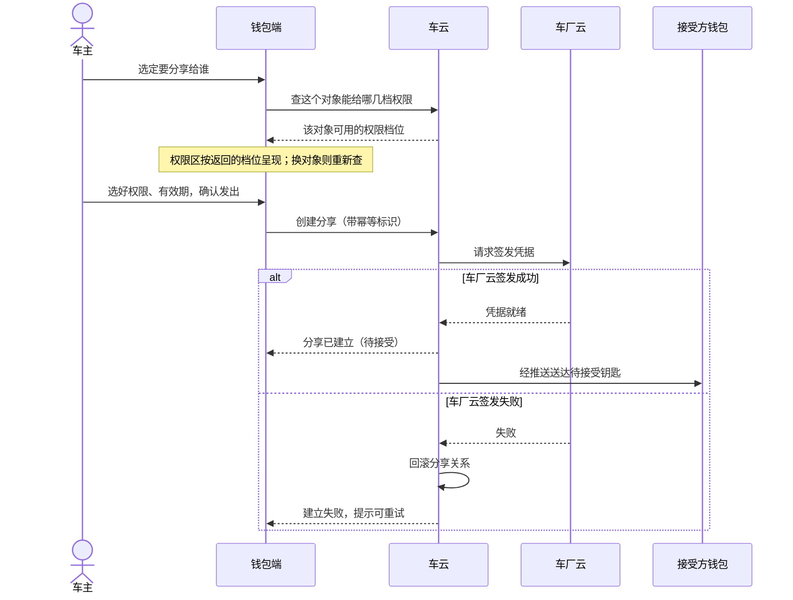
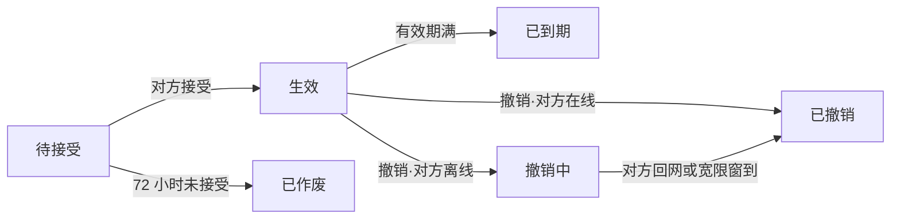

# ISSUE-206 数字车钥匙分享（钱包端）

## 1. 背景

### 1.1 现在的做法与问题

一辆车全家用是常态，但实体钥匙通常只有一两把。家人临时用车，车主要么专程送一趟钥匙，要么把钥匙提前藏在某个地方——这是数字车钥匙用户反馈最集中的一条。车钥匙本人使用的数字钥匙能力已经上线，但「把钥匙给别人用」还没有打开：借车这件事仍然绑在实体钥匙的交接上。

这对家庭成员的使用是持续的摩擦：人在外地或临时有事，家人就到不了车、用不了车。对钱包业务而言，这是数字车钥匙从「本人用」走向「全家用」缺的那一块，也是「借车送钥匙」类客服咨询的主要来源。

### 1.2 这次要改变什么

这次做**车钥匙分享**：车主把钥匙分享给家人或联系人，对方的钱包里会直接多出一把能用的钥匙，用完了车主随时收回。车主在钱包卡包里的车钥匙卡片上点「分享」（本工程还没有车钥匙卡片，这次一并补上，D5），进入分享设置页，选好给谁、什么权限、多长时间，确认发出；对方在钱包里收到一把待接受的钥匙，72 小时内接受后生效，逾期未接受自动作废，车主可以重发、也可以随时在分享管理里撤销。

### 1.3 成功标准

| 目标 | 怎么算达到 |
|---|---|
| 分享能力上线三个月内，车钥匙用户中发起过分享的比例不低于 15% | 上线三个月内发起过分享的车钥匙用户 ÷ 车钥匙用户，由运营侧按产品稿口径统计 |
| 「借车送钥匙」类客服咨询量下降一半 | 上线后该类咨询量相对上线前减半 |

成功不从单一指标看：发起比例衡量分享是否被用起来，咨询量下降衡量它是否真的替代了旧的借车交接方式。这两个数字由运营侧统计，钱包端上报四类分享事件（发起、接受、撤销、失效）的失败分类作为质量观察，具体接入见交付与上线一章。

## 2. 术语

### 2.1 术语表

| 术语 | 在本需求里的意思 |
|---|---|
| 车钥匙分享 | 车主把钥匙的可用性分享给家人或联系人：对方钱包里多一把能用的钥匙，车主可撤销、可随时收回 |
| 权限档位 | 分享时给对方的钥匙能力范围。家庭成员可给全功能（解闭锁、启动、后备箱）或仅解闭锁，其他联系人只有仅解闭锁；按对方与车辆的关系由车云判定，钱包端不自己判断谁是家庭成员 |
| 分享状态 | 一条分享当前所处阶段。六态互斥：待接受（对方还没接受）、生效（已接受可用）、已作废（72 小时未接受）、已到期（有效期到）、撤销中（撤销请求已发、对方离线）、已撤销（对方已失效）。判别时注意区别「撤销中」与「已撤销」：撤销中不代表钥匙还能用——车辆侧自撤销发起就拒绝，宽限窗只影响对方设备上卡片的消失时间 |
| 待接受有效期 | 分享发出后对方必须在 72 小时内接受，逾期自动作废；与发起人的草稿续办无关，草稿是发起途中恢复用的本地记录 |
| 发起草稿 | 发起分享未完成时的本地记录（联系人、权限档位、有效期、幂等标识）。发起途中退出页面、断网或应用关闭后重开都能接着办，发出成功、退出登录或切换账号时清除，按账号隔离（D7） |
| 配额 | 同车可同时存在的分享人数上限（生效加待接受合计 5 人），满额后不能再发起、要给出原因 |
| 宽限窗 | 撤销时对方离线，对方设备上的卡片最长 48 小时内收回（D1）；车辆侧拒绝立即生效，与撤销的即时性相对，只影响对方卡片消失的时间 |

需要特别辨别的两组概念：第一，**对一条分享，钱包端只展示与操作，不裁决成败**——关系的建立与状态真源在车云，钥匙能不能用的最终裁决在车厂云；第二，**「撤销中」≠钥匙还能用**，这是最容易读混的一处。

## 3. 范围

### 3.1 本版做与不做

本需求是**钱包端的车钥匙分享**：卡包里的车钥匙卡片与分享入口、车主发起分享（对象、权限、有效期、配额、草稿续办）、被分享人接受、双方状态管理与撤销的完整端侧链路。本版不包含服务端与车厂云端的能力——它们作为钱包调用的对端存在，不在本版交付范围。

| 钱包端做 | 各参与方做 | 本版不做 |
|---|---|---|
| 卡包车钥匙卡片（本人与接受成功的钥匙）与分享入口、设置页（给谁/权限/有效期）、创建、草稿续办 | 车云建立并维护分享关系、状态与配额判定（真源） | 车云与车厂云的实现 |
| 分享管理页（列表、状态、撤销） | 车厂云签发钥匙凭据、下发失效指令、裁决可用性 | 推送到达率的保障（由对方主动打开钱包补拉兜底） |
| 接受页、添加到钱包、钥匙卡片详情 | 消息推送送达待接受与失效通知 | 被分享人把钥匙再转给第三人（上游未定，决策记录 D2）、撤销后极端断网强制下线（上游未定，决策记录 D6） |
| 状态展示、隐私脱敏、功能开关 | 账号能力（未登录不允许发起或接受） | 改权限（本期要换权限就撤销重发） |

本工程还没有车钥匙卡片，这次钱包端一并补上卡包里的车钥匙卡片与分享入口；真车开锁、凭据签发与设备能力不在本次（D5）。车主本人钥匙的车辆标识与钥匙信息，材料里没有接口约定，本次先用模拟数据，真实来源另列依赖（D3）。

### 3.2 各参与方分工

| 参与方 | 怎么交互 | 承担什么 |
|---|---|---|
| 钱包端 | 用户动作、车辆与联系人选择 → 分享请求、状态展示、撤销请求 | 收集分享三要素、展示状态、发起撤销；不签发凭据、不裁决可用性 |
| 账号能力 | 登录请求 → 登录态与账号标识 | 提供既有身份能力；未登录不允许发起或接受 |
| 车云 | 分享三要素、幂等标识 → 分享关系、状态、配额 | 分享关系建立、状态维护与配额判定；分享关系唯一真源 |
| 车厂云 | 车云签发请求 → 钥匙凭据、失效指令 | 凭据签发、车辆侧失效下发；钥匙可用性最终裁决 |
| 消息推送 | 分享与撤销事件 → 到达接受方通知 | 送达待接受与失效通知；推送失败不改变分享关系 |

### 3.3 依赖与先行交付

先联调**创建与接受**两条链路，再联调**撤销与失效**。推送到达率不作为本需求的验收项——推送失败由对方主动打开钱包时补拉待接受列表兜底。端云接口按本版冻结的契约对接；车云开放接口在本工程里还不可用，接口就绪前钱包端按冻结契约用模拟数据验证交互与状态；与车云的真实联调另行验收，本需求不算验过（D3）。

## 4. 业务方案

### 4.1 整体做法

分享关系的**真源在车云**，钥匙最终能不能开的**裁决在车厂云**——车辆只认车厂云签发的凭据。发起一条分享要两边都点头：车云建立分享关系，车厂云给接受方签发凭据。**一成一败必须回滚**，不允许出现「关系建了、凭据没发」的半生效状态。消息推送只负责把分享与撤销事件送到接受方，推送失败不改变分享关系。

发起一条分享的完整经过：车主选定要分享给谁，钱包端先查这个对象能给哪几档权限，权限区按返回的档位呈现；车主选好权限和有效期、确认发出，钱包端带幂等标识创建分享，车云向车厂云请求签发凭据。车厂云签发成功，分享进入待接受、经推送送达对方；车厂云签发失败，车云回滚分享关系，钱包端提示建立失败可重试。

车厂云签发成功后，才回「分享已建立（待接受）」；签发失败时车云当场回滚，钱包端只看到「建立失败、可重试」，不会出现对方明明收不到钥匙、车主却以为分享建立了的状态。换一个分享对象，钱包端要重新查一次权限，上一次的结果不再作数。

### 4.2 业务规则与数据

| 规则项 | 取值 | 适用范围 | 真源 |
|---|---|---|---|
| 同车分享上限 | 5 人 | 生效加待接受合计算；到上限后不能再发起，要给用户看得懂的原因 | 车云配额判定 |
| 待接受有效期 | 72 小时 | 逾期自动作废，作废条目列表可见、可重新发起 | 车云状态机 |
| 权限档位 | 家庭成员可选全功能或仅解闭锁；其他联系人仅解闭锁 | 按对象与车辆的关系定；本期不做改权限，要换权限就撤销重发 | 车云关系判定 |
| 有效期 | 7 天 / 30 天 / 自定义至多 180 天 | 到期自动失效 | 车云状态机 |
| 撤销 | 对方在线立即失效；离线进入撤销中，对方设备上的卡片最长 48 小时内收回，回网即收回（D1） | 车辆侧自撤销起就拒绝这把钥匙，宽限窗只影响对方卡片消失时间 | 车云 + 车厂云 |
| 隐私 | 页面与记录只显示对方昵称与打码账号 | 页面、日志与事件不出现对方完整账号或手机号；查权限与创建分享时，对方账号标识以可识别的值交给车云 | 钱包端在展示处打码，列表用车云返回的打码标识 |

钱包端的数据口径：**发起草稿**（联系人、权限档位、有效期、幂等标识）在本地，发起途中退出页面、断网或应用关闭后重开都能接着办，发出成功即清，按账号隔离，退出登录或切换账号清除（D7）；**分享列表不做本地缓存**，钥匙类数据不落盘，每次进页从云侧拉取，断网时管理页给网络失败态。

### 4.3 取舍与边界

- **本期不做改权限**：要换权限就撤销这条、重新分享。理由：改权限需要车云与车厂云两侧的联动变更，本期不引入新的契约面。
- **两件上游未定的事不承载**：被分享人能否再转给第三人（倾向禁止，等安全评审，D2）；撤销后极端断网是否强制下线（在和车厂谈，D6）。因此方案里不把这两件事当已定写。
- **撤销宽限按 48 小时**：产品需求稿写「离线的 24 小时内失效」，系统设计稿与车云接口按 48 小时计。问过需求方后，48 小时指对方设备上的卡片收回期限，车辆侧自撤销起即拒绝不变（D1）。

### 4.4 风险

| 风险 | 触发条件 | 影响 | 已有控制 |
|---|---|---|---|
| 端云接口未就绪 | 车云开放接口在工程内不可用 | 端侧分享链路无真实数据源，验收时序受影响 | 接口契约先冻结，钱包端用模拟数据验证；真实联调另行验收，不算验过（D3） |
| 车主本人钥匙没有真实数据来源 | 材料只约定了分享六个接口，没有本人钥匙的查询 | 卡片与分享用的车辆标识只能来自模拟数据 | 本次用模拟数据验证，真实来源与联调另列依赖（D3） |
| 车厂云签发失败 | 创建分享时签发失败 | 分享无法建立 | 车云回滚、钱包端提示可重试；接口按幂等标识防重复建立 |
| 接受时凭据下发失败 | 对方接受时下发失败 | 钥匙暂不可用 | 保持待接受、可重试；重试不产生新分享 |
| 推送失败 | 推送未达接受方 | 对方收不到待接受通知 | 不改变分享关系；对方主动打开钱包补拉待接受列表兜底 |

## 5. 业务流程

### 5.1 分享生命周期总览

一条分享从建立到结束，状态只在六态之间迁移：待接受 →（对方接受）生效 →（撤销·在线）已撤销，或（撤销·离线）撤销中 → 已撤销；待接受 72 小时未接受 → 已作废；生效后有效期到 → 已到期。六态互斥，「撤销中」期间车辆侧已按车厂云下发的失效指令拒绝这把钥匙，宽限窗只影响对方设备上钥匙卡片的消失时间、不影响车辆侧的拒绝。

各条迁移的条件：**待接受 → 生效**由对方在 72 小时内接受触发，接受后钥匙可用、权限与车主所选一致；**待接受 → 已作废**由 72 小时计时到自动发生，作废条目在列表里可见、车主可重新发起；**生效 → 已到期**由有效期到自动发生；**生效 → 已撤销**由车主撤销且对方在线触发，立即失效；**生效 → 撤销中 → 已撤销**由撤销时对方离线触发，宽限窗内对方回网即完成就地失效，回网或宽限窗到都落「已撤销」。车辆侧的拒绝以撤销发起为起点，不等宽限窗结束。

### 5.2 发起链条

车主在卡包里的车钥匙卡片上点「分享」进入分享设置页（须已登录且有车钥匙，功能开关关闭时不能进入新发起；卡片与入口本次一并补上，D5）。设置页分三段：先选给谁（通讯录选人或直接输入对方账号），权限区在选定对象之后才定——查该对象在这辆车上可用的权限档位并按其呈现；再选有效期（7 天、30 天、自定义至多 180 天）；三项都选好「发出」才可点击。换一个对象，已选的权限档位要重新确认，旧档位对方用不了时请车主重选。

确认发出后，钱包端带幂等标识创建分享，车云建关系并请求车厂云签发凭据；签发成功回执「待接受」、经推送送达对方；签发失败车云回滚，钱包端提示可重试、不产生半生效状态。发起途中退出或断网，回来凭发起草稿接着办、用同一幂等标识，不会发出第二条。

### 5.3 接受链条

对方收到推送进入接受页，看到一张车辆信息卡：车型与车主昵称、给到的权限范围、有效期到哪天，页面只有一个主动作「添加到钱包」。暂不添加就保持待接受，72 小时后自动作废——接受页不设「拒绝」按钮，不想要就放着。点「添加到钱包」后，钱包端触发接受、车云让车厂云向对方设备下发凭据；下发成功钥匙生效，作为车钥匙卡片出现在对方卡包里（D5），卡片详情显示权限范围与有效期，权限之外的功能不出现。凭据下发失败保持待接受，可重试，不产生新分享。

### 5.4 撤销与失效链条

车主在分享管理页看到每一条分享的状态，可单独撤销。撤销时对方在线，立即失效并显示已撤销；对方离线，显示撤销中，宽限窗内对方回网即完成失效，回网或宽限窗到都落已撤销。车辆侧从撤销发起起就拒绝这把钥匙——「撤销中」只是对方卡片消失前的一个展示态。自然到期（已到期）、逾期作废（已作废）同样在管理列表里可见，车主可重新发起。

## 6. 功能说明

### 6.1 分享入口与门槛

未登录或没有车钥匙的用户看不到分享入口；功能开关关闭时也不能发起新分享，已生效的分享不受影响。入口在卡包里的车钥匙卡片上，已登录且持有车钥匙时才出现，点击进入分享设置页。本工程还没有车钥匙卡片，这次一并补上卡包里的车钥匙卡片，车主本人的钥匙与接受成功的钥匙都在卡包展示（D5）；本人钥匙信息与车辆标识本次先用模拟数据（D3）。

### 6.2 分享设置

分享设置页分三段：给谁、什么权限、多长时间。**先选给谁**，权限区才定得下来——选定对象后查这个对象在这辆车上可用的权限档位，按返回的档位呈现；换一个对象，权限区跟着重新确定，此前选的那档新对象用不了时，请车主重选。对象不可分享（例如对方没开通车钥匙）时，权限区不呈现任何档位并给出原因，车主换一个人。三项都选好「发出」才可点击；发出的前提还包括配额未满，满额时发起入口置灰并给原因。

发出动作带幂等标识，重复请求返回同一条分享不重复建立；车厂云签发失败时本接口返回失败且不留关系，可重试。发起途中退出或断网，回来凭发起草稿接着办、用同一幂等标识，不会发出第二条。

### 6.3 分享管理

分享管理页顶部是车辆与剩余可分享数，下方按条列出每条分享的对象、权限、有效期和状态，每条可以单独撤销。

列表数据不在本地缓存，每次进页从云端按车辆拉取；断网时管理页给网络失败态，不展示陈旧列表。配额（生效加待接受合计 5 人）到达上限时，管理页顶部展示剩余可分享数与满额原因。

### 6.4 接受侧

被分享人收到推送，点进来看到一张车辆信息卡：车型与车主昵称、给到的权限范围、有效期到哪天，页面只有一个主动作「添加到钱包」。

暂不添加就保持待接受，72 小时后自动作废——接受页不设「拒绝」按钮，不想要就放着。点「添加到钱包」触发接受，车云让车厂云向对方设备下发凭据；下发成功钥匙生效，作为车钥匙卡片出现在对方卡包里（D5），卡片详情里能看到权限范围和有效期；权限之外的功能不出现，而不是置灰。

### 6.5 状态与隐私

六态（待接受、生效、已作废、已到期、撤销中、已撤销）与分享管理的展示一致，列表写的是车云侧真实状态。全程页面与记录只显示对方昵称与打码后的账号，不出现完整账号或手机号；事件（分享发起、接受、撤销、失效）只带车型类别、阶段与结果分类，不带车牌、账号、位置。

## 7. 异常与恢复

### 7.1 设计内的受限结果

这些不是事故，是需求设计成的结果——它们各自给用户一个看得懂、有去路的交代。

| 受限结果 | 用户表现 | 系统处理 | 要点 |
|---|---|---|---|
| 配额已满 | 发起入口置灰并给原因 | 不发请求，原因来自配额接口返回 | 同车生效加待接受合计 5 人到上限 |
| 待接受逾期 | 72 小时未接受自动作废 | 列表可见作废条目 | 可重新发起 |
| 车厂云签发失败 | 发出失败、可重试 | 车云回滚分享关系 | 不留半生效状态 |
| 接受时凭据下发失败 | 保持待接受、可重试 | 不改变分享关系 | 重试不产生新分享 |
| 撤销时对方离线 | 显示撤销中 | 宽限窗内对方回网即失效 | 车辆侧自撤销起即拒绝该钥匙 |
| 权限档位不可用 | 已选档位请重选 | 换对象重查权限 | 权限区按对象与车辆关系定 |

「撤销中」这个状态尤其要分清：它是设计内的展示态，不代表钥匙还活着——车辆侧从撤销发起那一刻起就不认这把钥匙，宽限窗只影响对方设备上卡片消失的时间。

### 7.2 真正的异常

| 异常 | 用户表现 | 系统处理 | 要点 |
|---|---|---|---|
| 发起中断（退出页面 / 断网 / 应用关闭） | 回来接着上次的选择 | 草稿续办，同一幂等标识 | 不发出第二条（D7） |
| 推送失败 | 对方未收到待接受钥匙 | 不改变分享关系；对方主动打开钱包补拉 | 不作为验收项 |
| 断网进入管理页 | 网络失败态 | 不展示陈旧列表 | 分享列表不落地缓存 |
| 账号切换 | 草稿清空，列表按新账号拉取 | 按账号隔离 | 不跨账号带出草稿或列表 |

## 8. 验收

### 8.1 验收清单

逐条验收按「发起分享、接受生效、生命周期、状态一致性、入口与开关」分组，每条原始验收编号独立一行。主责指由谁验：产品验收看端侧行为，接口联调验收看端云对账。

| 编号 | 验收点 | 可观察的通过条件 | 主责 |
|---|---|---|---|
| AC-K1 | 发起分享 | 车主在卡包里的车钥匙卡片上点分享，对象、权限、有效期三项都不选齐前「发出」不可点；三项选齐后发出，对方收到待接受的钥匙。 | 产品 |
| AC-K2 | 接受生效 | 对方接受后钥匙可用，权限与车主所选一致。 | 产品 |
| AC-K3 | 逾期作废 | 分享发出后 72 小时未接受，自动作废；作废条目在列表可见，可重新发起。 | 产品 |
| AC-K4 | 配额 | 生效加待接受合计到 5 人后不能再发起，能看到原因。 | 产品 |
| AC-K5 | 撤销 | 对方在线撤销立即失效；离线的进入撤销中，对方设备上的卡片最长 48 小时内收回（D1），撤销起车辆侧就不认这把钥匙。 | 产品 |
| AC-K6 | 中断续办 | 发起途中退出或断网，回来接着办，同一幂等标识，不会发出第二条。 | 产品 |
| AC-K7 | 状态一致 | 管理列表状态与实际一致：待接受、生效、已作废、已到期、撤销中、已撤销。 | 产品 |
| AC-K8 | 隐私 | 全程页面与记录不出现对方完整账号或手机号，只显示昵称与打码账号。 | 产品 |
| AC-K9 | 入口门槛 | 未登录或没有车钥匙的用户看不到分享入口。 | 产品 |
| AC-K10 | 功能开关 | 开关关闭后不能发起新分享，已生效的分享不受影响。 | 产品 |
| AC-K11 | 权限随对象定 | 选家庭成员时全功能可选；换成其他联系人后全功能不再可选，已选的全功能请车主重选；换回家庭成员又可选。 | 产品 |

> 入口与接受后的钥匙都在卡包的车钥匙卡片上（D5）；本人钥匙信息、车辆标识与分享关系都来自模拟数据，AC-K1–AC-K11 的结论只到本地模拟（D3）。

> 撤销宽限的验收口径：产品需求稿写 24 小时，系统设计稿与车云接口按 48 小时计；问过需求方后按 48 小时卡片收回期限验收，车辆侧自撤销起即拒绝这把钥匙（D1）。

### 8.2 上线后观察指标

上线后观察两类指标，来源都是上游约束：

| 指标 | 怎么算 | 来源 |
|---|---|---|
| 发起分享比例 | 三个月内发起过分享的车钥匙用户 ÷ 全部车钥匙用户，目标 ≥ 15% | 产品需求稿「背景与目标」 |
| 「借车送钥匙」客服咨询量 | 上线后相对上线前下降一半 | 产品需求稿「背景与目标」 |

另按四类分享事件（发起、接受、撤销、失效）的失败分类观察分享链路质量，事件按系统设计稿口径上报（字段定义见附录）。推送到达率不作为本需求的验收项。

## 9. 交付与上线

### 9.1 依赖与联调顺序

按系统设计稿的联调顺序：先联调**创建与接受**两条链路，再联调**撤销与失效**；开关放开前观察四类事件（发起、接受、撤销、失效）的失败分类。

端云接口依赖的排期：车云开放接口在本工程内不可用，接口契约已冻结（见附录·技术契约）。接口就绪前钱包端按契约用模拟数据验证交互与状态，交付与验收分开写本地模拟验证与车云联调两种结论，后者本需求不算验过（D3）。卡包里的车钥匙卡片与分享入口随本次交付（D5）；本人钥匙信息的真实来源与车云联调另列依赖（D3）。

### 9.2 开关与放量

分享功能开关默认关闭、随版本放开。控制到「不能发起新分享」为止：开关关闭时，未登录或没有车钥匙的用户本就看不到入口，已登录且有钥匙的用户也不能发起新的分享；**已生效的分享不受影响**，接受、撤销、到期照常工作。回退方式：需要停用新分享时关开关即可，不进入已生效分享的内部状态；已产生的分享关系由车云维护，不受端侧开关影响。

### 9.3 交付物

| 交付物 | 给谁 | 做什么用 | 什么时候要 |
|---|---|---|---|
| 分享设置页（给谁/权限/有效期） | 车主 | 发起新分享、草稿续办 | 首次发布分享能力时 |
| 分享管理页（状态列表 + 撤销） | 车主 | 查看每条分享状态、单独撤销 | 首次发布分享能力时 |
| 接受页与钥匙卡片详情 | 被分享人 | 添加钥匙到钱包、查看权限与有效期 | 首次发布分享能力时 |
| 车云接口契约落盘（端云接口与映射） | 车云对接方、端侧开发 | 端云按统一契约联调 | 设计定稿时（本版已随设计交付） |
| 四类分享事件埋点 | 运营、端侧质量观察 | 观察分享链路质量与失败分类 | 与功能一同交付 |

## 10. 附录

### 10.1 技术契约

正文里的中文名在这里对应到接口、数据与配置，供实现、测试与维护按名查证；完整字段、类型与映射在随本文一起交付的设计附件里。

#### 10.1.1 端云接口

六个接口都由钱包端调用车云开放接口 2.1；失败返回车云错误码与可读信息，本需求不新增错误码。

| 接口 | 谁在什么时机调用 | 关键输入从哪来 | 成功与失败对业务的后果 |
|---|---|---|---|
| queryKeySharingQuota | 进入分享设置页与管理页时 | 当前车辆标识 | 返回能否发起、剩余可分享数、满额原因与现有分享摘要；满额时发起入口置灰并给原因 |
| queryGranteePermission | 车主选定分享对象后，换对象要重新调 | 车辆标识、对方账号标识（可识别的值，不是展示用的打码账号） | 返回该对象可用的权限档位；不可分享时档位为空并给原因，车主换一个人；上一次结果不再作数 |
| createKeySharing | 三项选齐、确认发出时 | 车辆、对方账号标识、权限档、有效期、幂等标识（续办沿用） | 成功回待接受；车厂云签发失败时不留关系、可重试；同一幂等标识重复请求返回同一条分享 |
| acceptKeySharing | 被分享人点「添加到钱包」时 | 分享标识 | 凭据下发成功钥匙生效；失败保持待接受、可重试，不产生新分享 |
| revokeKeySharing | 车主在管理页撤销某一条时 | 分享标识 | 对方在线立即失效；离线进入撤销中，契约返回宽限小时数 48，与需求方确认的 48 小时卡片收回期限一致（D1）；车辆侧自撤销发起即拒绝 |
| queryKeySharingList | 每次进入管理页时 | 车辆标识 | 返回每条分享的状态、权限、有效期与车云给出的打码对方标识；断网给网络失败态，不展示陈旧列表 |

#### 10.1.2 数据存储

| 数据 | 谁持有、权威在哪 | 用途 | 有效期与清理 | 缺失与恢复 |
|---|---|---|---|---|
| 发起草稿（对象账号标识、权限档、有效期、幂等标识） | 钱包端本地，要扛过应用关闭后重开 | 发起途中退出页面、断网或应用关闭后续办，同一幂等标识不发出第二条（D7） | 按账号隔离；发出成功即清除，退出登录或切换账号清除 | 没有草稿时从头选；草稿里的对方账号标识只用于续办请求，不出现在页面、日志与事件里 |
| 分享列表与配额 | 车云是唯一真源，端侧不落盘 | 管理页展示 | 每次进页从云侧拉取 | 断网给网络失败态，回网重进重拉 |

#### 10.1.3 配置项

**分享功能开关**

默认关闭，随版本放开；关闭后不能发起新分享，已生效分享不受影响。权限档位文案由云侧配置下发，端侧不写死。

（detail-share-flag；view:logical/node:feature-flag）

### 10.2 规约

每条激活规约在本需求上的判定，判断取自蓝图的知识应用决定。

| 规约 | 编号 | 判定 | 依据：本需求的哪项事实使它适用，由谁承担 |
|---|---|---|---|
| UX 一致性 | UX-01 | 适用 | 新增分享设置、管理、接受与钥匙卡片详情四个页面，按方向性参数与对齐方式实现与检查 |
| 安全隐私 | SEC-01 | 适用 | 本需求接触对方账号标识。输出面：页面与记录只显示昵称与打码账号，打码在生成展示内容处做，列表用车云返回的打码标识；日志与事件只带车型类别、阶段与结果分类。业务接口：查权限与创建分享时把可识别的对方账号标识交给车云；草稿保存它供续办，发出成功或退出登录清除。接口的权限依据与传输保护材料未约定，记为未知 |
| DFX 基线 | DFX-01 | 适用 | 新增六个端云接口：列表与配额每次进页拉取一次，草稿续办不重复请求，没有定时任务或后台轮询 |
| DFX 基线 | DFX-02 | 不适用 | 不新增或升级 SDK，不新增预置资源 |
| 可观测性 | OBS-02 | 适用 | 分享创建、接受与撤销要能定位到失败步骤，沿用统一日志入口 |
| 可观测性 | OBS-03 | 适用 | 发起、接受、撤销、失效四类运维指标落到对应流程，实际结果完整记录、同次不重复 |
| 可观测性 | OBS-05 | 适用 | 新增上报按项目上报协议落实字段，含义与来源准确 |
| 可观测性 | OBS-06 | 适用 | 四类分享事件按新增登记，定义唯一 |
| 可观测性 | OBS-07 | 不适用 | 没有独立的运营采集诉求；成功标准由运营侧统计 |
| 资源使用 | RES-01 | 适用 | 新页面图标优先用系统图标，新引入的写明依据 |
| 资源使用 | RES-02 | 适用 | 新页面文案优先复用已有一致的中文资源，新增的中英文齐备 |
| 兼容性检查表 | COMPAT-01 | 适用 | 新接入六个端云接口，逐个核字段删除、类型、默认值与含义不变 |
| 兼容性检查表 | COMPAT-02 | 不适用 | 沿用车云既有错误码，不新增、删除或修改 |
| 环境异常标准场景库 | ENV-01 | 适用 | 发起草稿是本地状态：清除后不崩溃，从头选；分享列表不落盘，不受清除影响 |
| 环境异常标准场景库 | ENV-02 | 适用 | 发出与撤销可能被重复触发：创建用幂等标识不发出第二条，入口门槛挡住无钥匙用户 |
| 资料交付 | DLV-01 | 适用 | 四个新页面有新增文案，梳理待翻译字符串并跟踪回稿 |
| 资料交付 | DLV-02 | 不适用 | 钱包端只作为客户端调用车云开放接口，不对外开放自己的页面或接口 |

### 10.3 埋点

四类分享事件的统计点由下表登记，成功标准里的两个业务指标由运营侧另行统计。

**分享事件统计**

上报分享发起、接受、撤销、失效四类事件，只带车型类别、阶段与结果分类，不带车牌、账号、位置；上报失败不改变分享关系。统计点按 WalletHAManager Chart 登记（现仓仅 Wallet_COMMON 模板，事件 ID 待登记）。

| 统计点 | 业务动作 | 实际适用结果 | 本端获知时机 | 已有覆盖或新增 | 代码现状 |
|---|---|---|---|---|---|
| 分享流程 / 发起 | 提交创建分享 | 成功 / 签发失败 / 请求失败 | 创建响应或通信失败 | 新增 | 检索零命中 |
| 分享流程 / 接受 | 提交接受 | 凭据下发成功 / 失败 | 接受响应 | 新增 | 检索零命中 |
| 分享流程 / 撤销 | 提交撤销 | 立即失效 / 撤销中 / 撤销请求失败 | 撤销响应 | 新增 | 检索零命中 |
| 分享流程 / 失效 | 已生效分享到期、作废、撤销完成等失效 | 自然到期 / 作废 / 已撤销 | 列表拉取或状态刷新 | 新增 | 检索零命中 |

（detail-share-events；view:runtime/flow:share-mutate-flow）

### 10.4 改动边界

| 模块 | 本单怎么动 |
|---|---|
| WalletMain | 卡包页没有车钥匙卡片 → 卡包里展示车钥匙卡片：车主本人的钥匙与接受成功的钥匙（本次数据来自模拟） |
| WalletMain | 车钥匙卡片上没有分享入口 → 卡片上的「分享」入口；未登录或没有车钥匙的用户看不到（AC-K9），开关关闭时不能发起新分享 |
| WalletMain | 无分享设置页 → 分享设置页三段：给谁/权限/有效期；先选对象权限区才确定；三项选好「发出」可点；满额置灰给原因；可复用 MaisonNavBar/MaisonPrimaryButton/MaisonSelector |
| WalletMain | 无分享管理页 → 分享管理页顶部车辆+剩余可分享数，列表逐条对象/权限/有效期/状态，可单独撤销；不缓存、断网给网络失败态 |
| WalletMain | 无接受侧页面 → 接受页车辆信息卡（车型/车主昵称/权限/有效期）+「添加到钱包」；不设拒绝按钮，72 小时未接受作废 |
| WalletMain | 无钥匙卡片详情 → 添加后钥匙卡片进入钱包卡包，详情显示权限范围与有效期；权限之外功能不出现、不置灰 |
| WalletMain | 无分享数据服务与草稿存储 → 分享数据服务（六个车云接口与本人钥匙信息，接口就绪前由模拟数据承接）+ 发起草稿存储（扛过应用关闭，按账号隔离，发出成功、退出登录或切换账号清除）+ 分享功能开关 |

### 10.5 材料清单

#### 10.5.1 本次冻结材料

| 来源文件 | 材料角色 | 本次版本 |
|---|---|---|
| [AR/design.md](story-src/inputs/b665a2a7dfa349eaf9b6b902cb260fa1e6cef5487f53e933af77bf8cdc3c2ce7/files/AR/design.md) | 原件 | 2510a26e1b5c2e73（b665a2a7dfa349eaf9b6b902cb260fa1e6cef5487f53e933af77bf8cdc3c2ce7） |
| [AR/story-src/design-draft.md](story-src/inputs/b665a2a7dfa349eaf9b6b902cb260fa1e6cef5487f53e933af77bf8cdc3c2ce7/files/AR/story-src/design-draft.md) | 派生分析（提取稿） | 762783c47b2368a1（b665a2a7dfa349eaf9b6b902cb260fa1e6cef5487f53e933af77bf8cdc3c2ce7） |
| [AR/story-src/human-decisions.json](story-src/inputs/b665a2a7dfa349eaf9b6b902cb260fa1e6cef5487f53e933af77bf8cdc3c2ce7/files/AR/story-src/human-decisions.json) | 人签记录 | 683937aee6784b9b（b665a2a7dfa349eaf9b6b902cb260fa1e6cef5487f53e933af77bf8cdc3c2ce7） |
| [RR/prd.md](story-src/inputs/b665a2a7dfa349eaf9b6b902cb260fa1e6cef5487f53e933af77bf8cdc3c2ce7/files/RR/prd.md) | 原件 | 08191c0b44384c12（b665a2a7dfa349eaf9b6b902cb260fa1e6cef5487f53e933af77bf8cdc3c2ce7） |
| [SR/design.md](story-src/inputs/b665a2a7dfa349eaf9b6b902cb260fa1e6cef5487f53e933af77bf8cdc3c2ce7/files/SR/design.md) | 原件 | 68ff916dff8a6b00（b665a2a7dfa349eaf9b6b902cb260fa1e6cef5487f53e933af77bf8cdc3c2ce7） |
| [assets/数字车钥匙分享/share-manage.png](story-src/inputs/b665a2a7dfa349eaf9b6b902cb260fa1e6cef5487f53e933af77bf8cdc3c2ce7/files/assets/数字车钥匙分享/share-manage.png) | 图片 | 6353c699bfb9ac48（b665a2a7dfa349eaf9b6b902cb260fa1e6cef5487f53e933af77bf8cdc3c2ce7） |
| [assets/数字车钥匙分享/share-setup.png](story-src/inputs/b665a2a7dfa349eaf9b6b902cb260fa1e6cef5487f53e933af77bf8cdc3c2ce7/files/assets/数字车钥匙分享/share-setup.png) | 图片 | 15056c761f98905d（b665a2a7dfa349eaf9b6b902cb260fa1e6cef5487f53e933af77bf8cdc3c2ce7） |
| [assets/车钥匙接受侧界面说明/accept-page.png](story-src/inputs/b665a2a7dfa349eaf9b6b902cb260fa1e6cef5487f53e933af77bf8cdc3c2ce7/files/assets/车钥匙接受侧界面说明/accept-page.png) | 图片 | 2508945f90164274（b665a2a7dfa349eaf9b6b902cb260fa1e6cef5487f53e933af77bf8cdc3c2ce7） |
| [assets/车钥匙接受侧界面说明/key-card-detail.png](story-src/inputs/b665a2a7dfa349eaf9b6b902cb260fa1e6cef5487f53e933af77bf8cdc3c2ce7/files/assets/车钥匙接受侧界面说明/key-card-detail.png) | 图片 | 87d832fadbce16ad（b665a2a7dfa349eaf9b6b902cb260fa1e6cef5487f53e933af77bf8cdc3c2ce7） |
| [ux-reference/README.md](story-src/inputs/b665a2a7dfa349eaf9b6b902cb260fa1e6cef5487f53e933af77bf8cdc3c2ce7/files/ux-reference/README.md) | 原件 | f70ca30fc6000186（b665a2a7dfa349eaf9b6b902cb260fa1e6cef5487f53e933af77bf8cdc3c2ce7） |

#### 10.5.2 采用与取舍说明

- 产品需求说明 v0.4（原稿 docx 导入转换）：背景与目标、用户旅程、规则表（含撤销 24 小时）、两件还没定的事与验收意图 AC-K1–AC-K10。原文：[prd.md](../RR/prd.md)，原件：[数字车钥匙分享.docx](../inbox/数字车钥匙分享.docx)
- 车钥匙接受侧界面说明（原稿 docx 导入转换）：接受页与钥匙卡片详情的界面参考图。原件：[车钥匙接受侧界面说明.docx](../inbox/车钥匙接受侧界面说明.docx)
- 系统设计说明：分工、发起时序、状态机、六个接口（含撤销宽限 48 小时）、数据与存储、配置与事件、失败与恢复、交付顺序。与产品稿在撤销宽限上不一致，登记为决策记录 D1，不自行选定。原文：[design.md](../SR/design.md)
- 开发需求：本 AR 骨架与需求索引。原文：[design.md](design.md)
- 工程事实：车钥匙在本工程只是添加卡片页里的不可点分类，没有车钥匙卡片与车钥匙数据来源；卡片本次一并补上（D5），本人钥匙信息与车辆标识先用模拟数据（D3）。
