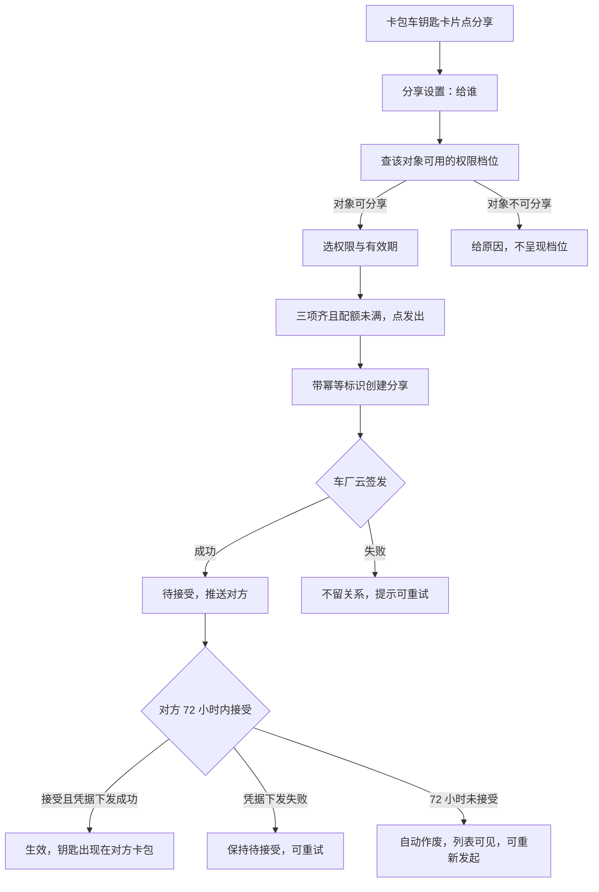
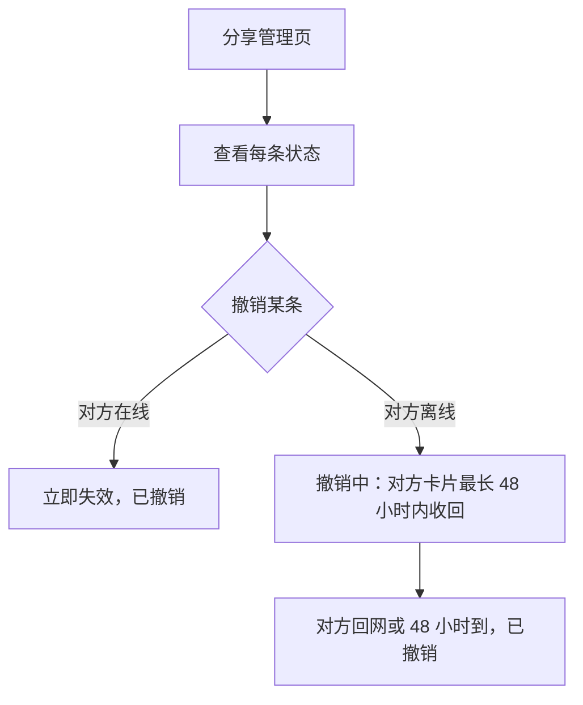

# 数字车钥匙分享（钱包端）— 需求规格（Spec）

> **施工单位**: sharing-wallet-slice（蓝图 bp-ISSUE-206）
> **对应需求**: ISSUE-206 数字车钥匙分享（钱包端）
> **状态**: 已闭环

---

## 0. 术语映射表

| 原始术语 | 权威模块 | 所属层 | 置信度 | 易混项 | 用户确认 |
|---------|---------|--------|-------|--------|---------|
| 车钥匙分享 | WalletMain | 02-Feature | medium | 钥匙卡（不带分享语义的卡片展示） | [x] |
| 权限档位 | WalletMain | 02-Feature | medium | 入口门槛（未登录、无钥匙的判断） | [x] |
| 分享状态 | WalletMain | 02-Feature | medium | 车辆状态（与钥匙可用性无关的云端状态） | [x] |

---

## 1. 功能概述

车主在钱包卡包里的车钥匙卡片上发起分享：选对象、权限与有效期后发出，对方钱包收到待接受的钥匙，72 小时内接受后生效，并作为车钥匙卡片出现在对方卡包里。车主在分享管理页查看每条分享的状态，可以随时撤销。

本工程还没有车钥匙卡片，本单元一并补上卡包里的车钥匙卡片（车主本人的钥匙与接受成功的钥匙）和卡片上的分享入口。车云开放接口在工程里还不可用，车主本人钥匙信息、车辆标识与分享关系都先由可替换的模拟数据承接；与车云的真实联调另列依赖，不算本单元验过。真车开锁、凭据签发与设备能力不在本单元。

被分享人能否再转给第三人、撤销后极端断网是否强制下线，上游仍未定，本单元不承载。

---

## Scope 声明

| 字段 | 取值 | 说明 |
|------|------|------|
| 本需求允许修改的模块 | `WalletMain`、`Phone` | 分享的页面、数据服务、草稿与卡包车钥匙卡片落在 WalletMain；Phone 只在宿主页面映射里登记新页面 |
| 本需求明确不修改的模块 | `AccountManager`、`CommUI`、`CommFunc` | 只复用登录态、界面组件、脱敏、日志与导航 |

```yaml
in_scope_modules:
  - WalletMain
  - Phone
out_of_scope_modules:
  - AccountManager
  - CommUI
  - CommFunc
rationale: |
  分享相关的页面、数据服务、草稿存储与卡包车钥匙卡片都属于钱包主功能模块。
  工程的页面登记要改三处：页面导出 builder、模块 index.ets 导出、宿主 Phone 的页面映射加分支，所以 Phone 列入可修改范围，只改页面映射。
  AccountManager、CommUI、CommFunc 只复用，不修改。
```

### Visual Handoff

```yaml
ui_change: new_or_changed
visual_handoff:
  kind: repo_assets
  authoritative_refs:
    - id: share_setup_page
      path: doc/features/ISSUE-206/ux-reference/share-setup.png
    - id: share_manage_page
      path: doc/features/ISSUE-206/ux-reference/share-manage.png
    - id: accept_page
      path: doc/features/ISSUE-206/ux-reference/accept-page.png
    - id: key_card_detail_page
      path: doc/features/ISSUE-206/ux-reference/key-card-detail.png
```

卡包里的车钥匙卡片没有界面参考图，沿用卡包现有卡片样式与 `CommUI` 的分区卡片，不新增控件类型。

---

## 2. 目标用户与使用场景

| 用户角色 | 描述 |
|----------|------|
| 车主 | 持有车钥匙，想把钥匙临时给家人或联系人用的钱包用户 |
| 被分享人 | 收到待接受钥匙、把钥匙加进钱包的家人或联系人 |

| 场景 | 名称 | 描述 | 前置条件 |
|------|------|------|----------|
| S1 | 车主发起分享 | 卡包车钥匙卡片点「分享」→ 选对象、权限、有效期 → 发出，对方收到待接受的钥匙 | 已登录、持有车钥匙、功能开关开启、配额未满 |
| S2 | 被分享人接受 | 收到推送进接受页 → 添加到钱包 → 钥匙生效，作为车钥匙卡片出现在卡包 | 分享为待接受且未逾期 |
| S3 | 车主管理与撤销 | 从车钥匙卡片进分享管理页，查看每条状态，撤销某一条 | 至少有一条分享 |
| S4 | 发起被打断后续办 | 退出页面、断网或关掉应用后回来，接着上次的选择发出 | 有未发出的草稿，且仍是同一账号 |

---

## 3. 功能清单

| 编号 | 功能 | 优先级 | 描述 | 场景 |
|------|------|--------|------|------|
| F0 | 卡包车钥匙卡片 | P0 | 卡包里展示车钥匙卡片：车主本人的钥匙（来自模拟的本人钥匙数据，含车辆标识与车型）与接受成功的钥匙；点卡片进钥匙卡片详情 | S1, S2, S3 |
| F1 | 分享入口与门槛 | P0 | 车主本人钥匙的卡片上有「分享」和「分享管理」入口；未登录或没有车钥匙的用户看不到；功能开关关闭时不能发起新分享，已生效的分享不受影响 | S1, S3 |
| F2 | 分享设置 | P0 | 三段：给谁、权限、有效期。选定对象后查该对象可用的权限档位；换对象重查，旧档位不可用时请车主重选；三项选齐且配额未满才能发出 | S1 |
| F3 | 创建分享与草稿续办 | P0 | 带幂等标识创建；签发成功回待接受，签发失败不留关系、可重试；发起草稿扛过退出页面、断网与应用关闭，续办沿用同一幂等标识，不发出第二条 | S1, S4 |
| F4 | 分享管理与撤销 | P0 | 顶部车辆与剩余可分享数；逐条列出对象（打码）、权限、有效期、状态；每条可单独撤销 | S3 |
| F5 | 接受页 | P0 | 车辆信息卡（车型、车主昵称、权限、有效期）与「添加到钱包」；不设拒绝按钮，72 小时未接受自动作废 | S2 |
| F6 | 钥匙卡片详情 | P1 | 显示权限范围与有效期；权限之外的功能不出现，而不是置灰 | S2 |
| F7 | 状态、身份与隐私 | P0 | 六态与车云返回一致；页面与记录只显示对方昵称与打码账号；业务请求用可识别的对方账号标识 | S1, S3 |

---

## 4. 页面与界面

| 页面 | 内容 | 交互 |
|------|------|------|
| 卡包页（修改） | 新增车钥匙卡片分区：本人钥匙卡片（车型、车辆）与接受成功的钥匙卡片 | 本人钥匙卡片上「分享」进分享设置页、「分享管理」进分享管理页；点卡片进钥匙卡片详情 |
| 分享设置页 | 给谁（通讯录选择或输入对方账号，展示昵称与打码账号）、权限（档位单选）、有效期（7 天 / 30 天 / 自定义至多 180 天）、发出 | 选定对象后查权限档位；对象不可分享时不呈现档位并给原因；满额时发出置灰并给原因 |
| 分享管理页 | 顶部车辆与剩余可分享数；分享列表 | 每次进页拉取；每条可单独撤销；断网给网络失败态，不展示陈旧列表 |
| 接受页 | 车辆信息卡与「添加到钱包」 | 添加失败保持待接受、可重试 |
| 钥匙卡片详情 | 权限范围、有效期（只读） | — |

| 状态 | 页面表现 |
|------|----------|
| 加载中 | 进页拉取时显示加载 |
| 空数据 | 管理页没有分享时给空态 |
| 网络失败 | 管理页给网络失败态，可重试 |
| 满额 | 设置页发出置灰，显示配额接口给的原因 |
| 撤销中 | 车主侧显示撤销中 |

---

## 5. 业务流程

### 5.1 发起与接受



本单元里「车厂云签发」「凭据下发」的结果都来自模拟的车云返回，用来验证钱包端在各分支下的表现。

### 5.2 管理与撤销



车辆侧从撤销发起那一刻起就拒绝这把钥匙；48 小时只影响对方设备上卡片的收回时间。

---

## 6. 异常与边界

| 编号 | 场景 | 触发条件 | 处理 | 用户看到 |
|------|------|----------|------|----------|
| E1 | 配额已满 | 生效加待接受合计到 5 | 不发请求 | 发出置灰，显示原因 |
| E2 | 待接受逾期 | 72 小时未接受 | 自动作废 | 列表可见作废条目，可重新发起 |
| E3 | 车厂云签发失败 | 创建时签发失败 | 不留关系 | 发出失败，可重试 |
| E4 | 接受时凭据下发失败 | 接受时下发失败 | 保持待接受 | 可重试，重试不产生新分享 |
| E5 | 撤销时对方离线 | 撤销请求时对方离线 | 进入撤销中，对方卡片最长 48 小时内收回 | 车主侧显示撤销中 |
| E6 | 发起被打断 | 退出页面、断网或应用关闭 | 草稿保留，续办沿用同一幂等标识 | 回来接着办，不发出第二条 |
| E7 | 断网进管理页 | 无网络 | 不展示陈旧列表 | 网络失败态，可重试 |
| E8 | 退出登录或切换账号 | 账号变化 | 清除草稿；列表按新账号拉取 | 不带出上一个账号的草稿或列表 |
| E9 | 清除应用数据 | 本地数据被清除 | 草稿丢失不崩溃，从头选 | 回到未选状态 |

---

## 7. 非功能性需求

### 7.1 数据与存储

| 数据 | 要求 |
|------|------|
| 发起草稿（对方账号标识、权限档位、有效期、幂等标识） | 本地保存，扛过应用关闭；按账号隔离；发出成功、退出登录、切换账号时清除 |
| 分享列表与配额 | 不落地缓存，每次进页从（模拟的）车云拉取 |
| 本人钥匙信息、车辆标识 | 本单元由模拟数据提供；真实来源与车云联调另列依赖 |

### 7.2 安全与隐私

| 要求 | 说明 |
|------|------|
| 输出面脱敏 | 页面与记录只显示对方昵称与打码账号；打码在生成展示内容处做（`CommFunc` 的 `MaskUtil`），列表用车云返回的打码标识；日志与事件不带账号 |
| 业务身份 | 查权限与创建分享传可识别的对方账号标识；展示用的打码值不承担业务身份；打码后相同的两个账号仍要能区分 |
| 草稿中的身份 | 草稿里的对方账号标识只用于续办请求，不进入页面、日志与事件 |
| 事件字段 | 发起、接受、撤销、失效四类事件只带车型类别、阶段与结果分类，不带车牌、账号、位置 |

### 7.3 兼容性

| 维度 | 要求 |
|------|------|
| 设备 | 手机 |
| 深色与大字 | 车辆信息与主按钮可读可点 |
| 错误码 | 沿用车云既有错误码，不新增 |

---

## 8. 验收标准

AC-1–AC-11 承接产品稿验收意图 AC-K1–AC-K11。所有结论只到本地模拟数据；与车云的真实联调不在本单元验收内。

### P0

- [ ] **AC-1**（F2/F3）：卡包车钥匙卡片点分享，对象、权限、有效期三项都选齐前不能发出；选齐后发出，对方收到待接受的钥匙
- [ ] **AC-2**（F5/F6）：对方接受后钥匙可用，权限与车主所选一致，钥匙作为车钥匙卡片出现在对方卡包
- [ ] **AC-4**（F2/F4）：生效加待接受合计到 5 后不能再发起，能看到原因
- [ ] **AC-5**（F4）：撤销时对方在线立即失效；对方离线进入撤销中，对方设备上的卡片最长 48 小时内收回；撤销起车辆侧就不认这把钥匙
- [ ] **AC-6**（F3）：发起途中退出页面、断网或关掉应用再打开，回来接着上次的选择发出，沿用同一幂等标识，不发出第二条
- [ ] **AC-7**（F4）：管理列表的状态与车云返回一致：待接受、生效、已作废、已到期、撤销中、已撤销
- [ ] **AC-9**（F1）：未登录或没有车钥匙的用户看不到分享入口
- [ ] **AC-10**（F1）：开关关闭后不能发起新分享，已生效的分享不受影响
- [ ] **AC-11**（F2）：选家庭成员时全功能可选；换成其他联系人后全功能不可选，已选的全功能请车主重选；换回家庭成员又可选
- [ ] **AC-12**（F0）：卡包展示车主本人的车钥匙卡片与接受成功的钥匙卡片，本人钥匙卡片上有分享与分享管理入口
- [ ] **AC-13**（F3/F7）：发出成功、退出登录或切换账号后草稿被清除，换账号后看不到上一个账号的草稿或列表
- [ ] **AC-14**（F7）：两个打码后相同的合法账号，查权限与创建分享时各自拿到正确的对象

### P1

- [ ] **AC-3**（F4）：分享发出后 72 小时未接受自动作废，作废条目在列表可见，可重新发起
- [ ] **AC-8**（F7）：全程页面与记录不出现对方完整账号或手机号，只显示昵称与打码账号

### 通用

- [ ] **AC-G1**（F0/F5）：新页面与卡包车钥匙卡片在深色、大字下可读可点
- [ ] **AC-G2**（F1/F4）：网络异常时有明确错误提示，不白屏、不崩溃
- [ ] **AC-G3**（F4）：断网进管理页给网络失败态，不展示陈旧列表

### 规约落实

- [ ] **AC-15**（UX-01）：新增页面与卡片的方向性参数用 start/end，从右到左语言下镜像正确
- [ ] **AC-16**（SEC-01）：输出面打码、业务接口传可识别标识，按 7.2 落实
- [ ] **AC-17**（DFX-01）：分享相关调用每次进页拉取一次，没有定时任务或后台轮询
- [ ] **AC-18**（OBS-02/03）：创建、接受、撤销可定位到失败步骤；四类事件结果完整且同次不重复
- [ ] **AC-19**（OBS-05/06）：上报字段符合项目上报协议，四类事件定义唯一
- [ ] **AC-20**（RES-01/02）：图标复用优先，新引入的单张不超过 10KB；文案复用优先，新增的中英文齐备
- [ ] **AC-21**（COMPAT-01）：六个车云接口逐个核字段删除、类型、默认值与含义
- [ ] **AC-22**（ENV-01/02）：清除数据后不崩溃、从头选；重复触发发出不会创建第二条
- [ ] **AC-23**（DLV-01）：新增文案进入待翻译清单并跟踪回稿

---

## 9. 不承载与依赖

| 项 | 说明 |
|------|------|
| 被分享人再转给第三人 | 上游待安全评审，不承载（D2） |
| 撤销后极端断网强制下线 | 上游在和车厂谈，不承载（D6） |
| 车云真实接口与本人钥匙真实来源 | 本单元用模拟数据，真实联调另列依赖（D3） |
| 真车开锁、凭据签发与设备能力 | 不在本单元（D5） |

---

## 附录

### A. 术语

| 术语 | 解释 |
|------|------|
| 车钥匙分享 | 车主把钥匙的可用性分享给家人或联系人 |
| 权限档位 | 给对方的钥匙能力范围：仅解闭锁，或全功能（解闭锁、启动、后备箱） |
| 分享状态 | 待接受、生效、已作废、已到期、撤销中、已撤销 |
| 宽限窗 | 撤销时对方离线，对方设备上的卡片最长 48 小时内收回；车辆侧自撤销起即拒绝 |
| 发起草稿 | 发起分享未完成时的本地记录，扛过应用关闭，按账号隔离 |

### B. 参考

- 系统设计说明：`doc/features/ISSUE-206/SR/design.md`
- 产品需求说明：`doc/features/ISSUE-206/RR/prd.md`
- 需求说明（Story）：`doc/features/ISSUE-206/AR/story.md`
