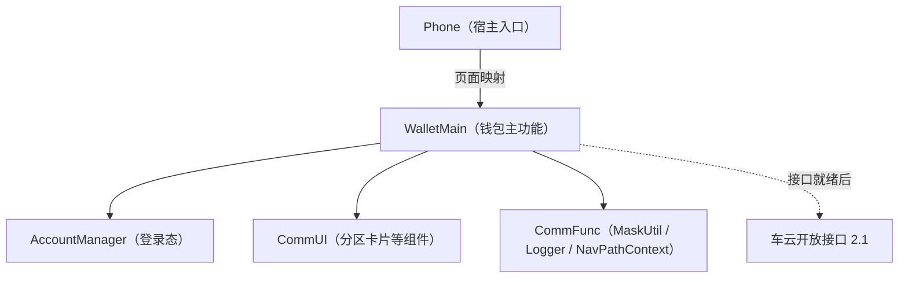
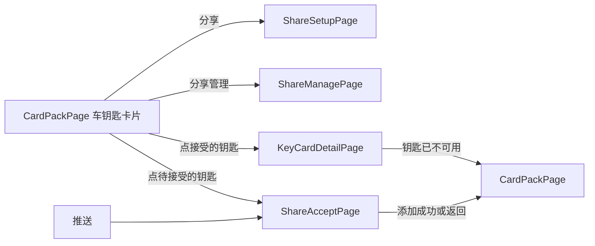

# 数字车钥匙分享（钱包端）— 实现计划（Plan）

> **施工单位**: sharing-wallet-slice（蓝图 bp-ISSUE-206）
> **对应 Spec**: `sharing-wallet-slice/spec/spec.md`
> **状态**: 已闭环，止于 Plan，不进入编码（随评审回流修订撤销宽限）

---

## Scope

| 字段 | 取值 | 说明 |
|------|------|------|
| 允许修改的模块 | `WalletMain`、`Phone` | 与 Spec 一致；Phone 只在页面映射里加分支 |
| 明确不修改的模块 | `AccountManager`、`CommUI`、`CommFunc` | 只复用登录态、分区卡片组件、`MaskUtil`、`Logger`、`NavPathContext` |
| 架构影响 | 无 | 不新增模块，跨模块只经各模块 `index.ets` 出口 |

---

## 1. 模块关系



钱包端经一个分享数据源接口取数。本单元提供它的模拟实现，接口就绪后换成真实实现，页面与仓储不改。

---

## 2. 文件规划

| 路径（`02-Feature/WalletMain/src/main/ets/` 下，另注明的除外） | 职责 | 新增/修改 |
|------|------|-----------|
| `data/model/KeySharing.ets` | 分享领域模型：本人钥匙、被分享人收到的分享（含状态）、权限视图、配额视图、分享条目、草稿、六态枚举 | 新增 |
| `data/source/KeySharingSource.ets` | 分享数据源接口：本人钥匙列表、按当前账号取收到的分享（六个车云接口里没有对应接口），以及六个车云接口的同名方法 | 新增 |
| `data/source/SimulatedKeySharingSource.ets` | 数据源的模拟实现：模拟本人钥匙（车辆标识、车型）、分享关系与车云返回，覆盖签发失败、凭据下发失败、满额、对象不可分享、撤销中等分支；撤销中按 36 小时返回宽限值；收到的分享覆盖待接受、生效、撤销中、已撤销、已到期、已作废各状态 | 新增 |
| `data/repository/KeySharingRepository.ets` | 分享仓储：经数据源调用六个接口，组装页面视图；打码在组装展示内容时做 | 新增 |
| `data/repository/CarKeyRepository.ets` | 卡包车钥匙卡片的数据：本人钥匙与收到的分享（待接受、生效与撤销中列入卡包，已结束的不列入）；按 shareId 取一条的当前状态 | 新增 |
| `data/repository/ShareDraftStore.ets` | 发起草稿的本地存储：落盘以扛过应用关闭，按账号分键，发出成功、退出登录、切换账号时清除 | 新增 |
| `presentation/components/CarKeyCardSection.ets` | 卡包里的车钥匙卡片分区：本人钥匙卡片（含「分享」「分享管理」入口）、待接受的钥匙（点击进接受页）与可用的钥匙卡片（撤销中显示「正在收回」） | 新增 |
| `presentation/pages/CardPackPage.ets` | 卡包页嵌入车钥匙卡片分区；门槛（已登录且有车钥匙）不满足时不显示分享入口；每次进入或回到卡包按当前账号重新获取 | 修改 |
| `presentation/pages/ShareSetupPage.ets` | 分享设置页：给谁、权限、有效期、发出；导出 builder | 新增 |
| `presentation/pages/ShareManagePage.ets` | 分享管理页：配额、列表；生效条目可撤销，已作废与已到期条目可重新发起；导出 builder | 新增 |
| `presentation/pages/ShareAcceptPage.ets` | 接受页：按 shareId 取收到的分享展示车辆信息卡、添加到钱包，结束后回卡包；导出 builder | 新增 |
| `presentation/pages/KeyCardDetailPage.ets` | 钥匙卡片详情：按 shareId 取当前状态，展示权限范围与有效期，不可用时提示并回卡包；导出 builder | 新增 |
| `shared/constant/ShareConstants.ets` | 分享功能开关（默认关闭）、配额上限 5、待接受 72 小时、宽限 36 小时、有效期档位 | 新增 |
| `index.ets` | 导出四个新页面的 builder | 修改 |
| `resources/base/element/string.json` | 分享相关文案 | 修改 |
| `01-Product/Phone/src/main/ets/pages/index.ets`（宿主页面映射） | `navDestinationMap` 增加四个页面名分支 | 修改 |

---

## 3. 数据模型

| 模型 | 字段 | 说明 |
|------|------|------|
| `OwnerCarKey` | vehicleId, modelName | 车主本人的钥匙；本单元来自模拟数据 |
| `ReceivedCarKey` | shareId, vehicleId, modelName, ownerNickname, permissionLevel, validUntil, status, recallDeadline | 被分享人收到的一条分享；status 取六态，recallDeadline 在撤销中时由数据源给出卡片收回期限；卡包、接受页与详情共用 |
| `GrantPermissionView` | granteeId, shareable, permissionLevels, reason | 某对象在这辆车上可用的权限档位 |
| `QuotaView` | canShare, remaining, reason | 配额 |
| `ShareItem` | shareId, status, permissionLevel, validUntil, granteeMasked | 管理页一条分享，打码标识取车云返回 |
| `ShareDraft` | accountKey, vehicleId, granteeId, granteeDisplay, permissionLevel, validUntil, idempotencyKey | 发起草稿；granteeId 是可识别的对方账号标识，只用于续办请求；granteeDisplay 是打码后的展示值 |
| `ShareState` | pending / active / voided / expired / revoking / revoked | 六态 |

---

## 4. 页面结构

```
CardPackPage（修改）
└── CarKeyCardSection
    ├── 本人钥匙卡片：车型、车辆；「分享」→ ShareSetupPage；「分享管理」→ ShareManagePage
    ├── 待接受的钥匙：车型、车主昵称、「待添加」；点击 → ShareAcceptPage
    └── 可用的钥匙卡片：车型、车主昵称；撤销中显示「正在收回」；点击 → KeyCardDetailPage

ShareSetupPage
├── 给谁：通讯录选择或输入账号，展示昵称与打码账号
├── 权限：随对象查得的档位单选；对象不可分享时不呈现档位并给原因
├── 有效期：7 天 / 30 天 / 自定义至多 180 天
└── 发出：三项齐且配额未满才可点

ShareManagePage
├── 顶部：车辆与剩余可分享数
└── 列表：对象（打码）、权限、有效期、状态；生效的条目有「撤销」，已作废、已到期的条目有「重新发起」，其余只展示

ShareAcceptPage
├── 车辆信息卡：车型、车主昵称、权限、有效期
└── 添加到钱包（不设拒绝按钮）

KeyCardDetailPage
├── 权限范围与有效期（只读，权限外功能不出现）
├── 撤销中显示「正在收回」
└── 进入时按 shareId 取当前状态；已撤销、已到期或找不到时提示这把钥匙已不可用并回到卡包
```

---

## 5. 状态管理

| 数据 | 作用域 | 机制 | 持有者 | 生命周期 |
|------|--------|------|--------|----------|
| 分享功能开关 | 全局 | `static readonly` 常量 | ShareConstants | 随版本 |
| 登录态与账号 | 全局 | 读 `AccountConstants` 在 `AppStorage` 里的登录键 | AccountManager | 既有 |
| 发起草稿 | 账号级 | 本地落盘（工程里没有现成的持久化封装，在 `ShareDraftStore` 里用系统的轻量键值存储，按账号分键） | ShareDraftStore | 发出成功、退出登录、切换账号时清除；清除数据后不存在则从头选 |
| 设置页表单 | 页面级 | `@State` | ShareSetupPage | 页面内；换对象时重查权限并作废旧档位 |
| 分享列表与配额 | 页面级 | 进页拉取，不落地缓存 | ShareManagePage | 每次进页 |
| 本人钥匙与收到的分享 | 页面级 | 每次进入或回到卡包从 CarKeyRepository 按当前账号取，不落地缓存 | CardPackPage | 每次进入；账号变化后重新获取 |

账号变化时：`ShareDraftStore` 在登录态变化时清除当前账号以外的草稿；读草稿只读当前账号的键，不会串号。

---

## 6. 服务接口

| 方法 | 入参 | 出参 | 说明 |
|------|------|------|------|
| `CarKeyRepository.listOwnerKeys` | — | OwnerCarKey[] | 本人钥匙；本单元来自模拟数据 |
| `CarKeyRepository.listReceivedKeys` | 当前账号 | ReceivedCarKey[] | 待接受、生效与撤销中的分享；已撤销、已到期、已作废的不列入卡包。对应的车云查询不在六个接口内，本单元由模拟数据源提供 |
| `CarKeyRepository.getReceivedKey` | shareId | ReceivedCarKey 或空 | 接受页与详情页取一条分享的当前状态 |
| `KeySharingRepository.queryQuota` | vehicleId | QuotaView | 对应 queryKeySharingQuota |
| `KeySharingRepository.queryGranteePermission` | vehicleId, granteeId | GrantPermissionView | granteeId 传可识别的对方账号标识，不传打码值 |
| `KeySharingRepository.createSharing` | ShareDraft | shareId, status | 对应 createKeySharing，带幂等标识；签发失败返回失败、不留关系 |
| `KeySharingRepository.acceptSharing` | shareId | credentialStatus, status | 凭据下发失败保持待接受 |
| `KeySharingRepository.revokeSharing` | shareId | status, graceHours | 对方离线返回撤销中；钱包端按 36 小时展示，车云接口现返回 48，调整前联调口径不一致；只对 status 为 active 的条目调用，其他状态不发请求 |
| `KeySharingRepository.listSharings` | vehicleId | ShareItem[] | 打码标识取车云返回的 granteeMasked |
| `ShareDraftStore.load` / `save` / `clear` | 账号 | ShareDraft / — | 草稿续办与清除 |

六个车云接口的字段与系统设计说明 4.1–4.5 一致；沿用车云错误码，不新增。

---

## 7. 路由



| 页面 | 页面名 | 参数 |
|------|--------|------|
| 分享设置页 | `ShareSetupPage` | vehicleId |
| 分享管理页 | `ShareManagePage` | vehicleId |
| 接受页 | `ShareAcceptPage` | shareId |
| 钥匙卡片详情 | `KeyCardDetailPage` | shareId |

每个新页面改三处：页面文件导出 builder、`WalletMain/index.ets` 导出、宿主 `navDestinationMap` 加分支；页面内用 `NavPathContext.stack().pushPath({ name, param })` 跳转。

---

## 8. Spec 功能映射

| Spec | 功能 | 关键文件 | 实现说明 |
|------|------|----------|----------|
| F0 | 卡包车钥匙卡片 | `CarKeyCardSection.ets`、`CardPackPage.ets`、`CarKeyRepository.ets` | 卡包嵌入分区；本人钥匙来自模拟数据 |
| F1 | 入口与门槛 | `CarKeyCardSection.ets`、`ShareConstants.ets` | 已登录且有车钥匙才显示；开关关闭时发起入口不可用 |
| F2 | 分享设置 | `ShareSetupPage.ets`、`KeySharingRepository.ets` | 对象选定后查档位，换对象重查 |
| F3 | 创建与续办 | `KeySharingRepository.ets`、`ShareDraftStore.ets` | 幂等创建；草稿落盘、按账号隔离 |
| F4 | 管理与撤销 | `ShareManagePage.ets`、`KeySharingRepository.ets` | 进页拉取；仅生效条目撤销，已作废与已到期可重新发起 |
| F5 | 接受页 | `ShareAcceptPage.ets` | 下发失败保持待接受 |
| F6 | 钥匙卡片详情 | `KeyCardDetailPage.ets` | 权限外功能不出现 |
| F7 | 状态、身份与隐私 | `KeySharing.ets`、`KeySharingRepository.ets` | 业务请求用 granteeId，展示用打码值 |
| F8 | 被分享人收到的钥匙 | `CarKeyRepository.ets`、`CarKeyCardSection.ets`、`ShareAcceptPage.ets`、`KeyCardDetailPage.ets` | 进卡包按当前账号取收到的分享；待接受进接受页；已结束的不列入；详情按 shareId 取当前状态 |

---

## 9. 埋点

| 统计点 | 责任方法 | 结果分类 | 获知时机 |
|---|---|---|---|
| 分享流程 / 发起 | `KeySharingRepository.createSharing` | 成功 / 签发失败 / 请求失败 | 创建返回或通信失败 |
| 分享流程 / 接受 | `KeySharingRepository.acceptSharing` | 凭据下发成功 / 失败 | 接受返回 |
| 分享流程 / 撤销 | `KeySharingRepository.revokeSharing` | 立即失效 / 撤销中 / 撤销请求失败 | 撤销返回 |
| 分享流程 / 失效 | `KeySharingRepository.listSharings` | 自然到期 / 作废 / 已撤销 | 列表拉取 |

事件只带车型类别、阶段与结果分类；项目里现在只有通用模板，四类事件按项目上报协议新增登记。

---

## 10. 验证责任

| 验证 | 覆盖 | 方式 |
|------|------|------|
| 业务单元测试 | 六态迁移；幂等创建不重复；签发失败与凭据下发失败的分支；满额与对象不可分享；撤销中 36 小时与被分享人一侧「正在收回」；收到的分享：推送未达时卡包补拉到待接受、接受成功转为钥匙卡片、接受失败保持待接受、撤销中显示「正在收回」、撤销完成与到期移除、旧入口打开详情提示不可用、换账号只取新账号；仅生效态可撤销，待接受、撤销中与已结束条目不发撤销请求；草稿落盘、续办与清除；打码相同的两个账号各自正确 | 用模拟数据源构造各分支 |
| 界面检查 | 卡包车钥匙卡片、四个页面的展示、深色与大字、从右到左镜像 | 设备或预览按界面参考图核 |
| 真实联调 | 六个车云接口与本人钥匙真实来源；撤销宽限值是否已由车云调整为 36 小时；被分享人一侧钥匙查询的真实接口 | 不在本单元；接口就绪后换真实数据源再验 |

---

## 11. 不承载

被分享人再转给第三人（D2）、撤销后极端断网强制下线（D6）、真车开锁与凭据签发（D5）不在本单元。
