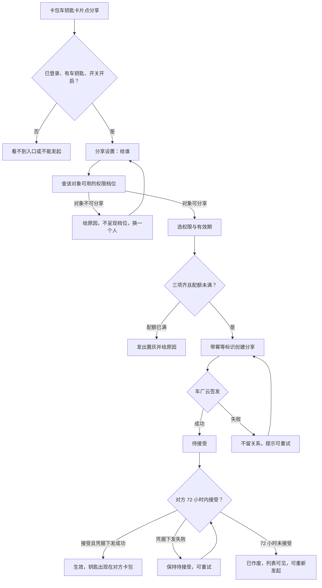
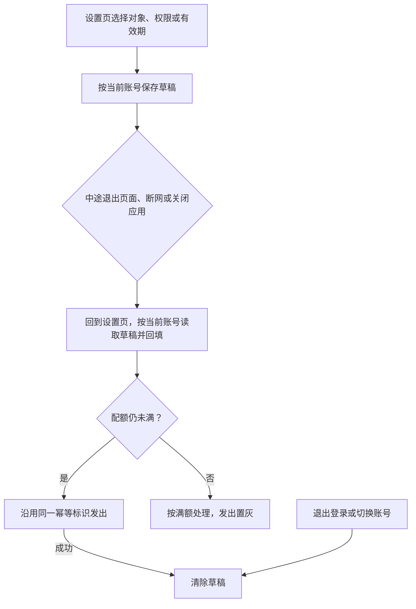
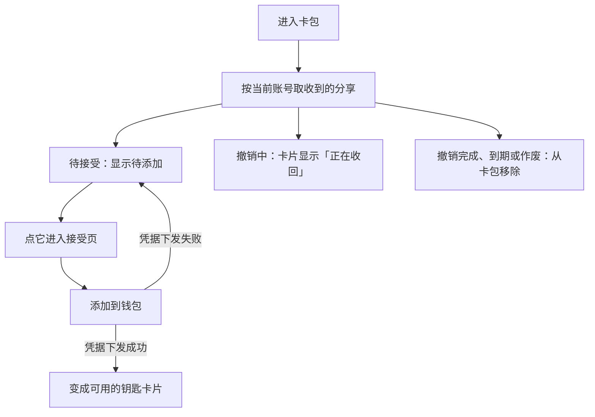
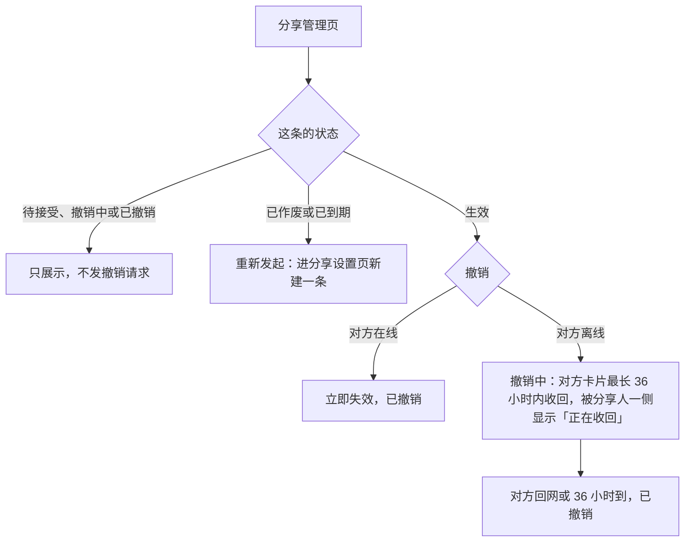

# 数字车钥匙分享（钱包端）— 需求规格（Spec）

> **模块标识**: sharing-wallet-slice（蓝图 bp-ISSUE-206）
> **版本**: v1.1
> **创建日期**: 2026-10-03
> **最后更新**: 2026-10-03
> **状态**: 已确认（目标情景终点的示例状态）

---

## 0. 术语映射表（Terminology Mapping Table）

> 施工单位的术语行与蓝图 `discovery.facts` 中 `term:<原始术语>` 的确认结果一致，三行均已由需求方确认。「车钥匙分享」「分享状态」是新增业务词，确认后回写 `doc/glossary.yaml`。

| 原始术语 | 权威模块 | 所属层 | 置信度（high / medium / low）| 易混项（必须亮出）| 用户确认 |
|---------|---------|--------|-------------------------------|-------------------|---------|
| 车钥匙分享 | WalletMain | 02-Feature | medium | Phone——只负责应用壳与页面映射，分享的页面、数据与草稿都在钱包主功能 | [x] |
| 权限档位 | WalletMain | 02-Feature | medium | AccountManager——持有登录与账号，对象与车辆的关系由车云判定，钱包端不判断谁是家庭成员 | [x] |
| 分享状态 | WalletMain | 02-Feature | medium | 车辆状态——与钥匙可用性无关的车云状态；「撤销中」不等于钥匙还能用 | [x] |

**回写约定**：上表新增业务词在确认后追加到 `doc/glossary.yaml`。

---

## 1. 功能概述

车主在钱包卡包的车钥匙卡片上把钥匙分享给家人或联系人，对方钱包里多一把可用的钥匙；车主在分享管理页看到每条分享的状态，可以随时撤销生效中的分享。钱包端承担分享的设置、创建、状态展示与撤销，车云维护分享关系，车厂云签发和失效凭据，消息推送把待接受与失效通知送到对方。

本工程还没有车钥匙卡片，本单元一并补上卡包里的车钥匙卡片与分享入口（D4）。车云开放接口在工程里还不可用：车主本人钥匙信息、车辆标识、分享关系，以及被分享人一侧按账号查收到的分享（六个车云接口里没有对应接口），都由可替换的模拟数据源承接（D3）；与车云的真实联调、推送点击进入接受页都另列依赖，不算本单元验过。被分享人能否再转给第三人、撤销后极端断网是否强制下线，上游未定，本单元不承载（D2、D5）。

---

## Scope 声明

> plan 继承本节的 `in_scope_modules`；coding 的改动不越出本节模块。确需扩展时先发起 scope 扩展提议，经用户确认后再更新本节。

### Scope 模块清单

| 字段 | 取值 | 说明 |
|------|------|------|
| 本需求允许修改的模块 | `WalletMain`、`Phone` | 分享的页面、数据源、仓储、草稿与卡包车钥匙卡片落在 WalletMain；Phone 只在宿主页面映射里登记新页面 |
| 本需求明确不修改的模块 | `AccountManager`、`CommUI`、`CommFunc` | 只复用登录态、界面组件、脱敏、日志与导航 |

### Scope 结构化字段（供 Spec 提取，必填）

```yaml
in_scope_modules:
  - WalletMain
  - Phone
out_of_scope_modules:
  - AccountManager
  - CommUI
  - CommFunc
rationale: |
  分享相关的页面、数据源、仓储、草稿存储与卡包车钥匙卡片都属于钱包主功能模块。
  工程的页面登记要改三处：页面文件导出 builder、WalletMain 的 index.ets 导出、宿主 Phone 的 navDestinationMap 加分支，
  所以 Phone 列入可修改范围，且只改页面映射。
  AccountManager、CommUI、CommFunc 是基线能力，只复用不修改。
  推送点击进入接受页需要宿主入口读取分享参数，属于推送接入的后续依赖；那时若要改宿主入口，先发 scope 扩展提议。
```

### Visual Handoff（视觉交接，供 check-spec 读取）

> 四张界面参考图来自导入的两份产品原稿；卡包里的车钥匙卡片没有参考图，沿用卡包现有卡片样式与 `CommUI` 的分区卡片。

```yaml
ui_change: new_or_changed
visual_handoff:
  kind: repo_assets
  authoritative_refs:
    - id: share_setup_page
      path: doc/features/ISSUE-206/ux-reference/share-setup.png
    - id: share_manage_page
      path: doc/features/ISSUE-206/ux-reference/share-manage.png
    - id: accept_page
      path: doc/features/ISSUE-206/ux-reference/accept-page.png
    - id: key_card_detail_page
      path: doc/features/ISSUE-206/ux-reference/key-card-detail.png
```

### 最小改动原则

1. **默认就地实现**：页面、数据源、仓储与草稿都在 `WalletMain` 内实现。
2. **禁止默默扩展**：发现需要在公共模块新增接口时，先出 scope 扩展提议给用户确认。
3. **公共能力优先复用**：脱敏用 `CommFunc` 的 `MaskUtil`，日志用 `Logger`，导航用 `NavPathContext`，登录态取 `AccountManager`。

---

## 2. 目标用户与使用场景

### 2.1 目标用户

| 用户角色 | 描述 |
|----------|------|
| 车主 | 持有车钥匙，想把钥匙临时给家人或联系人用的钱包用户 |
| 家庭成员 | 由车主在车机或 App 上加入的家人，可拿到全功能或仅解闭锁 |
| 其他联系人 | 临时借车的非家庭成员，只能拿到仅解闭锁 |

### 2.2 使用场景

| 场景编号 | 场景名称 | 场景描述 | 前置条件 |
|----------|----------|----------|----------|
| S1 | 车主发起分享 | 卡包车钥匙卡片点「分享」→ 选对象、权限、有效期 → 发出，对方收到待接受的钥匙 | 已登录、持有车钥匙、功能开关开启、配额未满 |
| S2 | 发起被打断后续办 | 退出页面、断网或关掉应用后回来，接着上次的选择发出 | 有未发出的草稿，仍是同一账号 |
| S3 | 配额已满 | 生效加待接受合计到 5，发出置灰并显示原因 | 车主进入分享设置页 |
| S4 | 对象不可分享 | 选定的对象没开通车钥匙等，权限区不呈现档位并给原因，车主换一个人 | 车主已选定对象 |
| S5 | 被分享人接受 | 本单元在卡包点待添加的钥匙进接受页（推送点击进接受页要等推送接入，另列依赖）→ 添加到钱包 → 钥匙生效，作为车钥匙卡片出现在卡包 | 分享为待接受且未逾期 |
| S6 | 车主管理与撤销 | 从车钥匙卡片进分享管理页，查看每条状态，撤销生效中的某一条 | 至少有一条生效的分享 |
| S7 | 被分享人查看收到的钥匙 | 进入卡包看到待接受与可用的钥匙；车主撤销后，撤销中显示「正在收回」，收回完成后移除 | 已登录 |

---

## 3. 功能清单

> 车云接口就绪前，F0、F3–F8 依赖的数据都来自模拟数据源（D3）；换成真实接口时只换数据来源，不改页面、仓储与状态语义。

| 编号 | 功能名称 | 优先级 | 描述 | 关联场景 |
|------|----------|--------|------|----------|
| F0 | 卡包车钥匙卡片 | P0 | 卡包里展示车主本人的钥匙（车型、车辆）；点卡片进钥匙卡片详情 | S1, S6 |
| F1 | 分享入口与门槛 | P0 | 本人钥匙卡片上有「分享」「分享管理」；未登录或没有车钥匙看不到入口；功能开关关闭时不能发起新分享，已生效的分享不受影响 | S1, S6 |
| F2 | 分享设置 | P0 | 给谁、权限、有效期三段；选定对象后查可用档位，换对象重查、旧档位不可用时请车主重选；对象不可分享时不呈现档位并给原因；三项选齐且配额未满才能发出 | S1, S3, S4 |
| F3 | 创建分享与草稿续办 | P0 | 带幂等标识创建；签发成功回待接受，签发失败不留关系、可重试；草稿扛过退出页面、断网与应用关闭，续办沿用同一幂等标识；回来时若配额已满按满额处理，草稿不绕过配额 | S1, S2, S3 |
| F4 | 分享管理与撤销 | P0 | 顶部车辆与剩余可分享数；逐条列出对象（打码）、权限、有效期、状态；只有生效的条目可撤销，已作废与已到期的可重新发起，其余只展示 | S6 |
| F5 | 接受页 | P0 | 车辆信息卡（车型、车主昵称、权限、有效期）与「添加到钱包」；不设拒绝按钮，72 小时未接受自动作废 | S5 |
| F6 | 钥匙卡片详情 | P1 | 进入时取当前状态，显示权限范围与有效期；权限之外的功能不出现，而不是置灰；已不可用时提示并回卡包 | S5, S7 |
| F7 | 状态、身份与隐私 | P0 | 六态与车云返回一致；页面与记录只显示对方昵称与打码账号；业务请求用可识别的对方账号标识，打码相同的两个账号仍能区分 | S1, S6 |
| F8 | 被分享人收到的钥匙 | P0 | 进入卡包时按当前账号取收到的分享：待接受的显示为待添加、点它进接受页；生效的显示为钥匙卡片；撤销中显示「正在收回」；撤销完成、到期或作废的移除；换账号重新获取 | S5, S7 |

---

## 4. 页面/界面描述

### 4.1 页面总览

本单元改一个页面、新增四个页面：卡包页（修改）嵌入车钥匙卡片分区；分享设置页与分享管理页给车主用；接受页与钥匙卡片详情给被分享人用。四个新页面都从卡包车钥匙卡片进入，推送点击进入接受页另列依赖。

| 页面 | 谁用 | 从哪进入 | 参考图 |
|------|------|----------|--------|
| 卡包页（修改） | 车主、被分享人 | 钱包卡包 Tab | 沿用卡包现有样式 |
| 分享设置页 | 车主 | 本人钥匙卡片「分享」 | share_setup_page |
| 分享管理页 | 车主 | 本人钥匙卡片「分享管理」 | share_manage_page |
| 接受页 | 被分享人 | 卡包里待添加的钥匙 | accept_page |
| 钥匙卡片详情 | 车主、被分享人 | 卡包里的钥匙卡片 | key_card_detail_page |

### 4.2 UI 组件详细描述

#### 区域 1: 卡包车钥匙分区

| 组件 | 类型 | 内容/数据 | 交互行为 |
|------|------|-----------|----------|
| 本人钥匙卡片 | 卡片 | 车型、车辆（模拟本人钥匙数据） | 点卡片进详情；「分享」进设置页；「分享管理」进管理页；门槛不满足时不显示这两个入口 |
| 待添加的钥匙 | 卡片 | 车型、车主昵称、「待添加」 | 点它进接受页 |
| 收到的钥匙卡片 | 卡片 | 车型、车主昵称 | 点卡片进详情；撤销中显示「正在收回」 |

#### 区域 2: 分享设置页

参考图 share_setup_page 自上而下：给谁、两档权限、三档有效期、原因提示条、发出按钮。

| 组件 | 类型 | 内容/数据 | 交互行为 |
|------|------|-----------|----------|
| 给谁 | 选择/输入 | 通讯录选择或输入对方账号，展示昵称与打码账号 | 选定后查可用权限档位；不可分享时显示原因 |
| 权限 | 单选 | 车云返回的档位（全功能 / 仅解闭锁），文案由云侧下发 | 换对象重查；旧档位不可用时请车主重选 |
| 有效期 | 单选 | 7 天 / 30 天 / 自定义（至多 180 天） | 选值 |
| 草稿恢复 | 隐式 | 上次未发出的对象、权限、有效期 | 进页时按当前账号回填 |
| 原因提示 | 提示条 | 对象不可分享、配额已满或原档位对新对象不可用的原因，取接口返回 | 有原因时显示在发出按钮之上，原因消除后隐藏 |
| 发出 | 主按钮 | — | 三项齐且配额未满可点；请求中禁用，防重复提交；满额置灰并显示配额接口给的原因 |

#### 区域 3: 分享管理页

参考图 share_manage_page：顶部车辆与剩余可分享数，其下逐条列出分享，条目底色随状态不同。

| 组件 | 类型 | 内容/数据 | 交互行为 |
|------|------|-----------|----------|
| 顶部配额 | 文本 | 车辆与剩余可分享数 | 每次进页拉取 |
| 分享列表 | 列表 | 每条对象（车云给的打码标识）、权限、有效期、状态；生效、过程中（待接受、撤销中）与已结束（已撤销、已作废、已到期）三类在样式上可区分 | 生效的条目有「撤销」；已作废、已到期的有「重新发起」；其余只展示 |

#### 区域 4: 接受页

参考图 accept_page：车辆信息卡、权限范围、有效期、添加到钱包。先讲清是谁分享的、能用到什么时候，再给添加按钮。

| 组件 | 类型 | 内容/数据 | 交互行为 |
|------|------|-----------|----------|
| 车辆信息卡 | 卡片 | 车型、车主昵称 | — |
| 权限范围 | 文本 | 用人话写能做什么（如「能开门、能开走」），不写档位代号 | — |
| 有效期 | 文本 | 有效到哪天 | — |
| 添加到钱包 | 主按钮 | — | 触发接受；成功回卡包，失败保持待接受、可重试；页面不设拒绝按钮，不添加就保持待接受，72 小时后自动作废 |

#### 区域 5: 钥匙卡片详情

参考图 key_card_detail_page：钥匙卡片、权限范围、有效期、状态提示条。

| 组件 | 类型 | 内容/数据 | 交互行为 |
|------|------|-----------|----------|
| 钥匙卡片 | 卡片 | 车型、车主昵称 | — |
| 权限范围 | 只读 | 用人话写能做什么 | 权限外的功能不出现在操作面上，不做置灰 |
| 有效期 | 只读 | 有效到哪天 | — |
| 状态提示 | 提示条 | 按 shareId 取的当前状态 | 撤销中显示「正在收回」；已撤销、已到期或找不到时提示这把钥匙已不可用，并回到卡包 |

### 4.3 页面状态

| 状态 | 描述 | 触发条件 |
|------|------|----------|
| 加载状态 | 进页拉取中 | 进入分享管理页、进入卡包、选定对象后查档位 |
| 空数据状态 | 管理页没有分享 | 本车没有任何分享 |
| 错误状态 | 网络失败态，管理页不展示陈旧列表 | 断网或接口失败 |
| 满额状态 | 设置页发出置灰并给原因 | 生效加待接受合计到 5 |
| 待添加 | 卡包里显示待接受的钥匙 | 当前账号有待接受的分享 |
| 撤销中 | 车主侧列表显示撤销中；被分享人卡包里的这把钥匙与详情显示「正在收回」 | 撤销时对方离线 |

---

## 5. 业务流程图

### 5.1 核心业务流（主路径）



本单元里「车厂云签发」「凭据下发」的结果都来自模拟数据源，用来验证钱包端在各分支下的表现。

### 5.2 子流程

**中断续办**：草稿在本地落盘，回来时按当前账号读取；发出成功、退出登录或切换账号清除。



**被分享人接受**：推送点击进入要等推送接入，本单元的入口是卡包里待添加的钥匙。



**管理与撤销**：



车辆侧从撤销发起那一刻起就拒绝这把钥匙；36 小时只影响对方设备上卡片的收回时间。车云接口现在返回的宽限值是 48 小时，要由车云调整为 36 小时，调整前联调口径不一致。

---

## 6. 异常/边界场景处理

| 编号 | 异常场景 | 触发条件 | 处理方式 | 用户提示 |
|------|----------|----------|----------|----------|
| E1 | 配额已满 | 生效加待接受合计到 5 | 不发请求 | 发出置灰，显示配额接口给的原因 |
| E2 | 对象不可分享 | 对方没开通车钥匙等 | 不呈现档位 | 显示原因，请车主换一个人 |
| E3 | 换对象后旧档位不可用 | 新对象不支持已选档位 | 作废旧档位，不静默降级 | 请车主重选 |
| E4 | 车厂云签发失败 | 创建时签发失败 | 不留关系 | 发出失败，可重试 |
| E5 | 重复触发发出 | 连点或重试 | 请求中禁用按钮；幂等标识让同一请求返回同一条分享 | 不出现第二条 |
| E6 | 待接受逾期 | 72 小时未接受 | 自动作废 | 列表可见作废条目，可重新发起 |
| E7 | 接受时凭据下发失败 | 接受时下发失败 | 保持待接受 | 可重试，重试不产生新分享 |
| E8 | 撤销时对方离线 | 撤销请求时对方离线 | 进入撤销中，对方卡片最长 36 小时内收回 | 车主侧显示撤销中，被分享人一侧显示「正在收回」 |
| E9 | 对非生效条目撤销 | 条目为待接受、撤销中、已作废、已到期或已撤销 | 不提供撤销，不发撤销请求 | 只看到状态；已作废、已到期的可重新发起 |
| E10 | 发起被打断 | 退出页面、断网或应用关闭 | 草稿保留，续办沿用同一幂等标识；回来时配额已满按满额处理 | 回来接着办，不发出第二条 |
| E11 | 断网进管理页或卡包 | 无网络 | 不展示陈旧列表 | 网络失败态，可重试 |
| E12 | 退出登录或切换账号 | 账号变化 | 清除草稿；列表与收到的分享按新账号获取 | 不带出上一个账号的草稿、列表或钥匙 |
| E13 | 清除应用数据 | 本地数据被清除 | 草稿丢失不崩溃，从头选 | 回到未选状态 |
| E14 | 打开已不可用的钥匙 | 从旧入口打开已撤销、已到期或已作废的钥匙详情 | 按当前状态处理 | 提示这把钥匙已不可用，回到卡包 |
| E15 | 推送未达 | 推送没送到被分享人 | 不改变分享关系；对方进入卡包时按当前账号补拉 | 卡包里看到待添加的钥匙 |

---

## 7. 非功能性需求

### 7.1 性能要求

| 指标 | 要求 | 说明 |
|------|------|------|
| 分享列表与配额 | 每次进入管理页拉取一次，不落地缓存 | 上游约束：系统设计说明「分享列表不做本地缓存」 |
| 权限档位 | 选定或换对象时查一次，以最近一次结果为准 | 上游约束：系统设计说明「上一次的结果不再作数」 |
| 后台调用 | 不设定时任务或后台轮询 | 本工程设定（DFX-01） |

### 7.2 兼容性要求

| 维度 | 要求 |
|------|------|
| 系统版本 | HarmonyOS 6.0.1(21) 及以上，目标 6.0.2(22)（本工程配置，来源于 `build-profile.json5`） |
| 设备类型 | 手机 |
| 深色与大字 | 车辆信息与主按钮可读可点（上游约束：接受侧界面说明） |
| 方向性 | 新页面与卡片用 start/end，从右到左语言下镜像正确（UX-01） |
| 错误码 | 沿用车云既有错误码，不新增（COMPAT-02 不适用） |

### 7.3 安全性要求

| 要求 | 说明 |
|------|------|
| 输出面脱敏 | 页面与记录只显示对方昵称与打码账号；打码在组装展示内容处做（`MaskUtil`），列表用车云返回的打码标识；日志与事件不带账号（SEC-01） |
| 业务身份 | 查权限与创建分享传可识别的对方账号标识；打码值不承担业务身份；打码后相同的两个账号仍要能区分 |
| 草稿中的身份 | 草稿里的对方账号标识只用于续办请求，不进入页面、日志与事件 |
| 凭据边界 | 钱包端不签发、不保存凭据，不自行扩大权限或有效期 |
| 调用前置 | 未登录不发起、不接受 |
| 事件字段 | 发起、接受、撤销、失效四类事件只带车型类别、阶段与结果分类，不带车牌、账号、位置 |

---

## 8. 验收标准

> AC-1–AC-11 承接产品稿验收意图 AC-K1–AC-K11；AC-12 起为本单元补充；规约验收挂对应知识判断。所有结论只到本地模拟数据，与车云的真实联调、推送点击进入接受页不在本单元验收内。

### P0 功能验收标准

- [ ] **AC-1**（关联 F2/F3）：卡包车钥匙卡片点分享，对象、权限、有效期三项都选齐前不能发出；选齐后发出，对方收到待接受的钥匙
- [ ] **AC-2**（关联 F5/F6）：对方接受后钥匙可用，权限与车主所选一致，钥匙作为车钥匙卡片出现在对方卡包
- [ ] **AC-4**（关联 F2/F4）：生效加待接受合计到 5 后不能再发起，能看到原因
- [ ] **AC-5**（关联 F4）：撤销时对方在线立即失效；对方离线进入撤销中，对方设备上的卡片最长 36 小时内收回，被分享人一侧显示「正在收回」；撤销起车辆侧就不认这把钥匙
- [ ] **AC-6**（关联 F3）：发起途中退出页面、断网或关掉应用再打开，回来接着上次的选择发出，沿用同一幂等标识，不发出第二条
- [ ] **AC-7**（关联 F4）：管理列表的状态与车云返回一致：待接受、生效、已作废、已到期、撤销中、已撤销
- [ ] **AC-9**（关联 F1）：未登录或没有车钥匙的用户看不到分享入口
- [ ] **AC-10**（关联 F1）：开关关闭后不能发起新分享，已生效的分享不受影响
- [ ] **AC-11**（关联 F2）：选家庭成员时全功能可选；换成其他联系人后全功能不可选，已选的全功能请车主重选；换回家庭成员又可选
- [ ] **AC-12**（关联 F0）：卡包展示车主本人的车钥匙卡片，卡片上有分享与分享管理入口
- [ ] **AC-13**（关联 F3/F7）：发出成功、退出登录或切换账号后草稿被清除，换账号后看不到上一个账号的草稿或列表
- [ ] **AC-14**（关联 F7）：两个打码后相同的合法账号，查权限与创建分享时各自拿到正确的对象
- [ ] **AC-24**（关联 F8）：推送没送到时，对方进入卡包能看到待添加的钥匙，点它进入接受页并能添加
- [ ] **AC-25**（关联 F8）：接受成功后，卡包里的待添加项变为可用的钥匙卡片；接受失败仍保持待接受
- [ ] **AC-26**（关联 F8）：车主撤销且对方离线时，被分享人卡包里的钥匙与详情显示「正在收回」；收回完成后卡片移除
- [ ] **AC-27**（关联 F6/F8）：撤销完成、到期或作废的钥匙从卡包移除；从旧入口打开它的详情时提示已不可用并回到卡包
- [ ] **AC-28**（关联 F7/F8）：切换账号后，卡包只显示新账号收到的待添加与可用钥匙
- [ ] **AC-29**（关联 F4）：只有生效的分享显示撤销；待接受、撤销中、已作废、已到期、已撤销的条目不显示撤销，也不发撤销请求
- [ ] **AC-30**（关联 F2/F3）：有草稿时配额已满，回到设置页按满额处理，不因草稿绕过配额

### P1 功能验收标准

- [ ] **AC-3**（关联 F4）：分享发出后 72 小时未接受自动作废，作废条目在列表可见，可重新发起
- [ ] **AC-8**（关联 F7）：全程页面与记录不出现对方完整账号或手机号，只显示昵称与打码账号

### 通用验收标准

- [ ] **AC-G1**（关联 F0/F5）：新页面与卡包车钥匙卡片在深色、大字下可读可点
- [ ] **AC-G2**（关联 F1/F4）：网络异常时有明确错误提示，不白屏、不崩溃
- [ ] **AC-G3**（关联 F4/F8）：断网进管理页或卡包给网络失败态，不展示陈旧列表

### 知识应用验收标准

- [ ] **AC-15**（UX-01）：新增页面与卡片的方向性参数用 start/end，从右到左语言下镜像正确
- [ ] **AC-16**（SEC-01）：输出面打码、业务接口传可识别标识，按 7.3 落实
- [ ] **AC-17**（DFX-01）：分享相关调用每次进页拉取一次，没有定时任务或后台轮询
- [ ] **AC-18**（OBS-02/03）：创建、接受、撤销可定位到失败步骤；四类事件结果完整且同次不重复
- [ ] **AC-19**（OBS-05/06）：上报字段符合项目上报协议，四类事件定义唯一
- [ ] **AC-20**（RES-01/02）：图标复用优先，新引入的写明依据；文案复用优先，新增的中英文齐备
- [ ] **AC-21**（COMPAT-01）：六个车云接口逐个核字段删除、类型、默认值与含义
- [ ] **AC-22**（ENV-01/02）：清除数据后不崩溃、从头选；重复触发发出不会创建第二条
- [ ] **AC-23**（DLV-01）：新增文案进入待翻译清单并跟踪回稿

---

## 宿主扩展治理项

| 扩展项 | 是否涉及 | 宿主模板/检查来源 |
|--------|----------|-------------------|
| 埋点（发起、接受、撤销、失效四类统计点） | 是 | `doc/extensions/knowledge/facts/event-tracking.md`；蓝图 detail-share-events |
| 资源（新增文案与图标） | 是 | `doc/extensions/knowledge/constraints/resource-usage.md` |
| 翻译字符串 | 是 | `doc/extensions/knowledge/constraints/deliverables.md`（DLV-01） |
| 端云接口兼容 | 是 | `doc/extensions/knowledge/constraints/compatibility-checklist.md` |
| 环境异常（草稿、网络、重复触发） | 是 | `doc/extensions/knowledge/constraints/env-exceptions.md`（ENV-01/02） |
| 不承载与依赖 | 是 | 被分享人再转第三人（D2）、撤销后极端断网强制下线（D5）不承载；车云真实接口、本人钥匙真实来源、被分享人一侧钥匙查询（D3）与推送点击进入接受页另列依赖；车云接口宽限值由 48 调整为 36 前联调口径不一致（D1、D7）；真车开锁、凭据签发与设备能力不在本单元（D4） |

---

## 附录

### A. 术语表

| 术语 | 解释 |
|------|------|
| 车钥匙分享 | 车主把钥匙的可用性分享给家人或联系人 |
| 权限档位 | 给对方的钥匙能力范围：仅解闭锁，或全功能（解闭锁、启动、后备箱） |
| 分享状态 | 待接受、生效、已作废、已到期、撤销中、已撤销 |
| 宽限窗 | 撤销时对方离线，对方设备上的卡片最长 36 小时内收回，被分享人一侧显示「正在收回」；车辆侧自撤销起即拒绝 |
| 发起草稿 | 发起分享未完成时的本地记录，扛过应用关闭，按账号隔离 |

### B. 参考资料

- 系统设计说明：`doc/features/ISSUE-206/SR/design.md`（分工、时序、状态机、六个接口、存储与失败恢复）
- 产品需求说明：`doc/features/ISSUE-206/RR/prd.md`（由产品原稿导入，验收意图 AC-K1–AC-K11）
- 车钥匙接受侧界面说明：`doc/features/ISSUE-206/ux-reference/README.md`（接受页与钥匙卡片详情参考图）
- 需求说明（Story）与评审记录：`doc/features/ISSUE-206/AR/story.md`、`doc/features/ISSUE-206/AR/review.md`

### C. 变更记录

| 日期 | 版本 | 变更内容 | 变更人 |
|------|------|----------|--------|
| 2026-10-03 | v1.0 | 初始版本：按需求方定案承接撤销宽限 48 小时卡片收回（D1）、模拟数据承载（D3）、补卡包车钥匙卡片（D4）、草稿边界（D6） | 钱包端需求侧 |
| 2026-10-03 | v1.1 | 评审回流：撤销宽限改为 36 小时卡片收回，被分享人一侧提示「正在收回」，车辆侧撤销即拒绝不变（D1、D7）；车云接口宽限值待调整 | 钱包端需求侧 |
