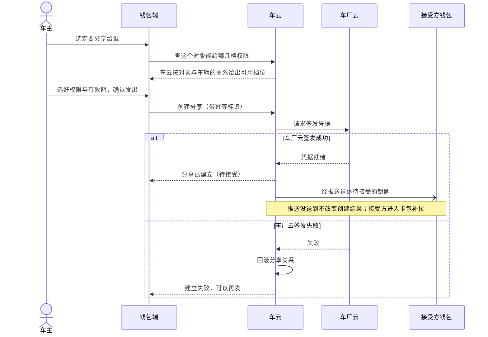
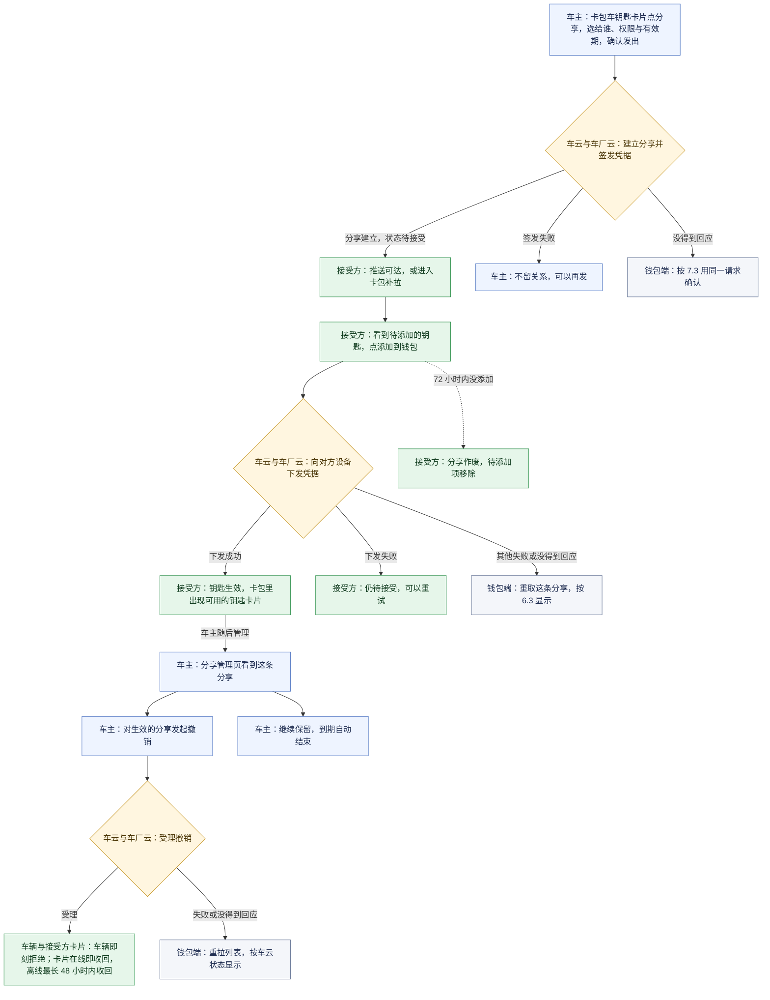
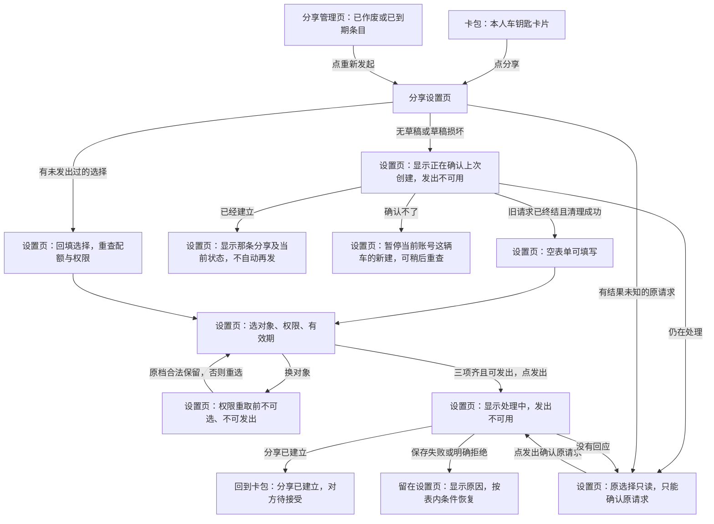
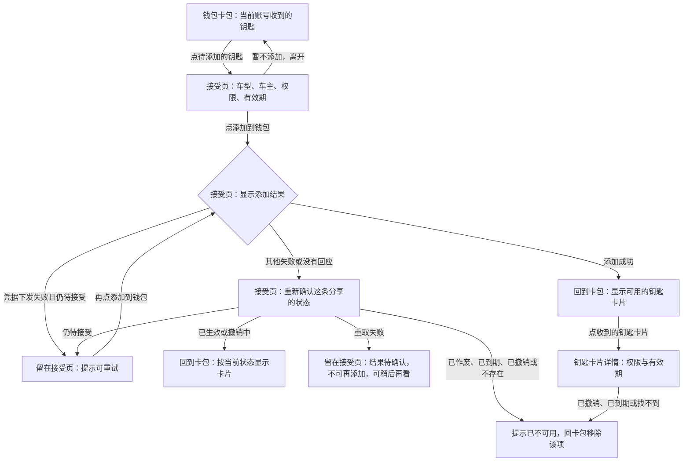
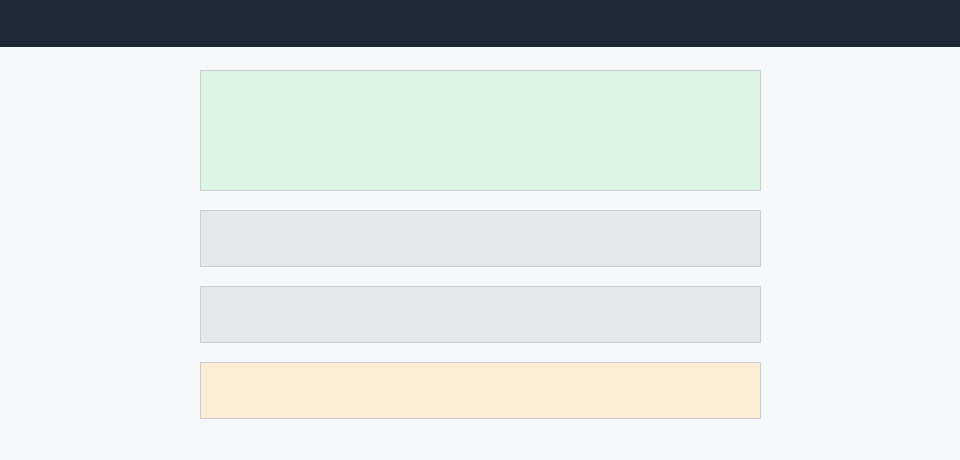
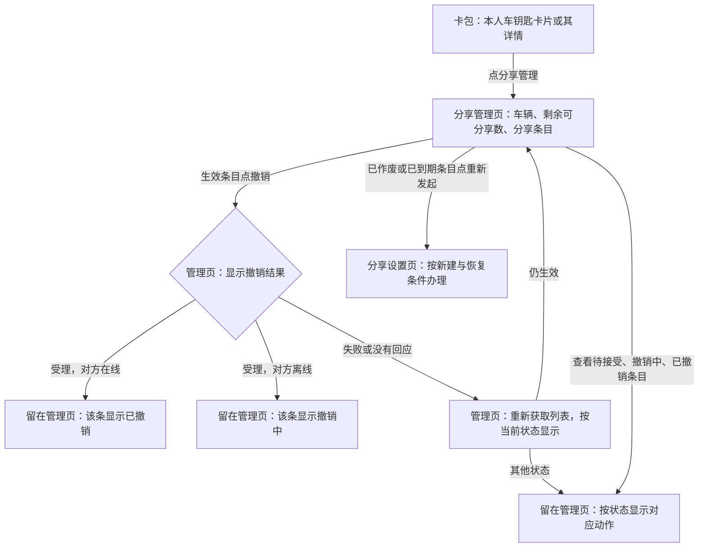
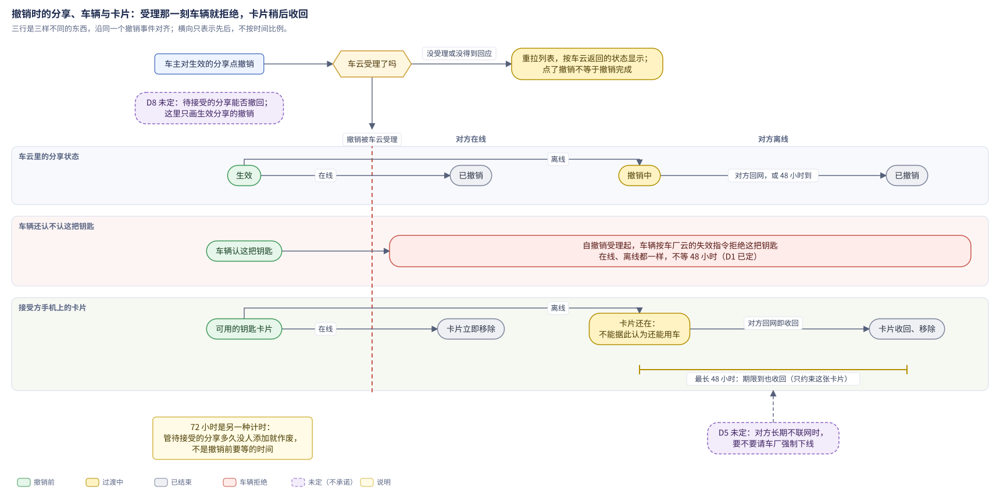
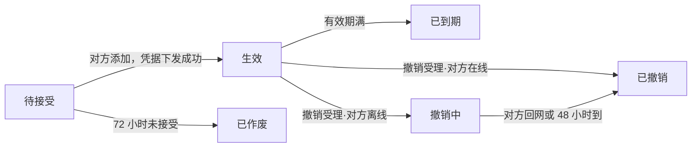

# ISSUE-206 数字车钥匙分享（钱包端）

> 本文说明钱包端预期业务与验收条件；本期使用模拟数据，真实车云联调与设备能力另验。

第 1—4 章说明问题、范围与分享机制；第 5 章按车主和接受方的旅程阅读，第 6—7 章查条件、状态与恢复，第 8—9 章用于验收和交付。接口字段、存储保护、质量约束、统计明细与来源集中在第 10 章。

## 1. 背景

### 1.1 实体钥匙交接的局限

一辆车全家用是常态，但实体钥匙通常只有一两把。家人临时用车，车主要么专程送一趟钥匙，要么把钥匙提前藏在某处，这是数字车钥匙用户反馈最集中的一条。

本人使用的数字钥匙已经上线，「把钥匙给别人用」还没有打开，借车仍然绑在实体钥匙的交接上：

- 对家庭成员：人在外地或临时有事，家人就到不了车、用不了车；
- 对钱包业务：这是数字车钥匙从「本人用」走向「全家用」缺的一块，也是「借车送钥匙」类客服咨询的主要来源。

### 1.2 钱包端车钥匙分享

这次做**车钥匙分享**：车主把钥匙分享给家人或联系人，对方钱包里直接多出一把能用的钥匙，车主可以收回。

- 车主选好给谁、什么权限、多长时间就能发出分享；本工程还没有车钥匙卡片，这次一并补上（D4）。
- 对方在钱包里收到一把待接受的钥匙，接受后就能用。
- 车主可以撤销生效中的分享，对已作废、已到期条目重新发起；已撤销条目只展示，再次分享从新建入口办理。还没被接受的分享能不能撤回，待裁定（D8）。

### 1.3 业务目标与衡量指标

| 目标 | 怎么算达到 |
|---|---|
| 分享能力上线三个月内，车钥匙用户中发起过分享的比例不低于 15% | 上线三个月内发起过分享的车钥匙用户 ÷ 车钥匙用户，由运营侧按产品需求的口径统计 |
| 「借车送钥匙」类客服咨询量下降一半 | 上线后该类咨询量相对上线前减半 |

- 发起比例衡量分享是否被用起来，咨询量下降衡量它是否真的替代了旧的借车交接方式；两个数字都由运营侧统计，钱包端以分享链路的顺畅支撑，不直接承诺。
- 钱包端上报分享发起、接受、撤销三个流程的结果，用来观察分享链路质量，随功能一同交付；分享被接受比例由车云按分享记录统计（D7），口径见第 8 章。

### 1.4 待决事项

这次都不下结论，方案里依赖它们的行为不写成已定：

- 被分享人能不能把钥匙再转给第三人：倾向禁止，等安全评审（D2）；
- 撤销后对方设备与车辆都长期不联网时要不要请车厂强制下线：还在和车厂谈（D5）；
- 还没被接受的分享能不能撤回：产品原文说车主「随时」可以撤销，车云的状态机只给出生效分享的撤销；推荐支持，但要车云补齐能力，待裁定（D8）。

## 2. 术语

### 2.1 术语表

| 术语 | 在本需求里的意思 |
|---|---|
| 车钥匙分享 | 车主把钥匙的可用性分享给家人或联系人：对方钱包里多一把能用的钥匙，车主可以撤销生效中的分享 |
| 车钥匙卡片 | 卡包里展示的车钥匙：车主本人的钥匙，以及当前账号收到并添加成功的钥匙；本次一并补上（D4） |
| 权限档位 | 分享时给对方的钥匙能力范围：全功能（解闭锁、启动、后备箱）或仅解闭锁；可选哪几档由车云按对方与车辆的关系判定，取值见 4.2 |
| 分享状态 | 一条分享当前所处的阶段：待接受、生效、已作废、已到期、撤销中、已撤销，六态互斥，真源在车云 |
| 待接受有效期 | 分享发出后对方必须在 72 小时内接受，逾期自动作废；与车主的发起草稿无关 |
| 发起草稿 | 按账号与车辆保存的未完成分享：已作的选择，发出前再加上原请求与幂等标识（D6）；保存与清除见 6.5 |
| 创建恢复 | 本地没有草稿或草稿损坏时，钱包端按当前账号和车辆向车云确认上次创建的去向：还在处理、已经建立、已经结束，或确认不了；本期由模拟车云提供 |
| 账号标识 | 当前登录账号的稳定标识，用来把草稿和请求分到账号。现有账号能力只给出打码后的展示账号，展示相同的两个账号可能不同；本期由钱包端的模拟身份提供 |
| 配额 | 同车可同时存在的分享人数上限，生效加待接受合计；取值见 4.2 |
| 宽限 | 撤销时对方离线，对方设备上的卡片收回的最长期限（48 小时，D1）；只影响卡片消失的时间，规则见 6.3 |

最容易读混的几处：

- 一条分享的成败不由钱包端裁决：关系的建立与状态真源在车云，钥匙能不能用的最终裁决在车厂云，钱包端只展示与操作；
- 推送不决定创建成功：车云返回已建立，分享就建立了；推送没送到，接受方进卡包也能补拉；
- 分享建立不等于对方已添加：建立后是待接受，对方添加且凭据下发成功才生效，这是两个时刻；
- 卡片还在不等于还能用车：撤销被车云受理后车辆侧就拒绝，撤销中只是对方卡片还没收回；
- 本地没有草稿不等于上次没发过：退出、换号、清数据或成功发出后草稿都会被删，车云那边的请求不跟着消失；
- 72 小时与 48 小时是两种计时：72 小时管待接受的分享多久没人接受就作废，48 小时管撤销后离线手机上的卡片最长多久收回。

### 2.2 六个分享状态的含义

| 状态 | 含义 | 容易误读的地方 |
|---|---|---|
| 待接受 | 车厂云已签发，分享已建立，对方还没添加 | 建立不等于对方已添加；72 小时内不添加就作废 |
| 生效 | 对方添加且凭据下发成功，钥匙能用 | —— |
| 已作废 | 待接受期内对方没有添加 | 车主没做任何操作，与撤销不同 |
| 已到期 | 分享的有效期到了 | —— |
| 撤销中 | 车云已受理撤销，对方离线，手机上的卡片还没收回 | 卡片还在，但车辆侧已拒绝这把钥匙 |
| 已撤销 | 撤销完成，对方卡片已收回 | —— |

管理列表与卡包都按车云返回的状态显示；状态之间怎样迁移、双方各能做什么见 6.3。

## 3. 范围

本需求交付钱包端的完整分享链路；车云与车厂云作为钱包调用的对端，不在本次交付范围。范围确认时需求方定为整单承载、不拆单。

| 参与方 | 在这项业务里负责什么 | 本期怎么承载 |
|---|---|---|
| 钱包端（本次交付） | 卡包车钥匙卡片（本人与收到的钥匙）与分享入口；分享设置页（给谁、权限、有效期）、创建与发起草稿保护；分享管理页（列表、状态、撤销、重新发起）；接受页、添加到钱包与钥匙卡片详情；状态展示、隐私打码、功能开关、退出登录时清理草稿。不签发凭据，不裁决钥匙可用性 | 本需求交付；卡包里的车钥匙卡片与分享入口一并补上，真车开锁、凭据签发与设备能力不在本次（D4） |
| 车云 | 分享关系的建立与唯一真源、状态维护、配额判定与对象可用权限的判定；按幂等标识防止重复建立 | 车云开放接口在工程里还不可用，六个接口按冻结契约用模拟数据承载（D3）；按接受方账号查询收到的分享、按账号与车辆做创建恢复，这两项不在六个接口里，本期同样由模拟车云提供 |
| 车厂云 | 签发钥匙凭据、下发失效指令，是钥匙能不能用的最终裁决方 | 签发与下发结果来自模拟数据（D3） |
| 消息推送 | 把待接受与失效通知送到接受方；推送失败不改变分享关系 | 推送点击进入接受页本次不接，被分享人从卡包里待添加的钥匙进入（D3） |
| 账号能力 | 登录态；未登录不允许发起或接受 | 现有能力只给打码后的展示账号，稳定账号标识由钱包端模拟身份提供：同一模拟账号重开后不变，展示相同的不同账号各不相同 |

本期还用钱包端的模拟数据承载：

- 车主本人钥匙的车辆标识、钥匙信息与统计要用的车型类别；
- 通讯录：通讯录选人这条路径用一份模拟联系人列表演示，含没有有效账号的联系人，不读设备通讯录、不申请权限。

草稿跨应用关闭保存时用系统的受保护存储（Asset）。本期模拟设计明确采用以下前提，真实接入前仍须核实，不能据此认定平台或真实接口已经支持：

- API 12 及以上，设备具备 `SystemCapability.Security.Asset`；完整草稿 UTF-8 序列化不超过 1024 字节。超过时保存失败、不发送，不截断、不改存明文。
- 模拟账号的稳定标识在重开后不变；展示相同的两个模拟账号仍是不同身份。
- 模拟车云的幂等记录及按账号、车辆保存的未终结创建独立于钱包进程保留；创建恢复能返回 pending、established、clear、unknown。只有旧请求已终结或迟到也不能再建分享时才可返回 clear，新的创建受理时再核未决请求。
- 上述创建恢复不在真实车云六个接口里。缺等价能力时，首次进入、成功后再发、退出换号或清数据之后、草稿损坏后等需先恢复的新建都不能正式开放。接受、撤销与管理按各自条件。

这些模拟前提不能替代真实设备与车云的能力验证。

本次不做：

- 车云与车厂云的实现；推送到达率的保障（由对方主动打开钱包补拉兜底）；
- 被分享人把钥匙再转给第三人（D2）、撤销后极端断网强制下线（D5）；
- 改权限：要换权限就撤销重发。

与车云的真实联调另行验收，本需求不算验过（D3）。各项能力正式开放的条件见第 9 章。

## 4. 业务方案

### 4.1 端云协作

分享关系的**真源在车云**，钥匙最终能不能开的**裁决在车厂云**，车辆只认车厂云签发的凭据。

不采用「钱包端自己判断谁是家庭成员、自己决定给哪档权限」：对象与车辆的关系由车主在车机或 App 上维护，那份关系不在端上，端上判会与车云对不齐。

一条分享要车云建立关系、车厂云签发凭据两边都成，**一成一败必须回滚**，不留「关系建了、凭据没发」的半生效状态；两朵云与推送按下面的顺序交接：

<!-- story-figure:fig-d087d97f:begin -->

<!-- story-figure:fig-d087d97f:end -->

- 同一个幂等标识重复请求，车云返回同一条分享，不会建出第二条；换对象怎样重查权限见 6.2。

钱包端按冻结的接口契约向车云做六件事：查配额、查对象可用的权限、创建分享、接受分享、撤销分享、查分享列表；各自在哪一页、什么时候调见第 5 章，结果怎么用落在 6.2、6.3 与第 7 章，接口名与字段见 10.1.1。

### 4.2 业务规则与数据

| 规则项 | 取值 | 适用范围 | 真源 |
|---|---|---|---|
| 同车分享上限 | 5 人 | 生效加待接受合计；满额时的发出条件见 6.2 | 车云配额判定 |
| 待接受有效期 | 72 小时 | 逾期自动作废，作废条目列表可见、可重新发起 | 车云状态机 |
| 权限档位 | 家庭成员可选全功能或仅解闭锁；其他联系人仅解闭锁 | 按对象与车辆的关系定（6.2）；本期不做改权限（4.3） | 车云关系判定 |
| 有效期 | 7 天 / 30 天 / 自定义至多 180 天 | 到期自动失效 | 车云状态机 |
| 撤销宽限 | 48 小时（D1） | 只对生效的分享；指对方离线时卡片收回的最长期限，撤销规则见 6.3；待接受的分享能否撤回待 D8 | 车云与车厂云 |
| 隐私 | 页面与记录只显示对方昵称与打码账号 | 对方账号以可识别的值交给车云，展示一律打码；完整边界见 6.6 | 钱包端在展示处打码，列表用车云返回的打码标识 |

钱包端的数据口径：

- **发起草稿**每个账号每辆车一份，整份存进系统的受保护存储（为什么见 4.3，保存与清除见 6.5，保护边界见 10.1.2）。
- 草稿与请求都按稳定账号标识隔离：展示相同的两个账号可能是两个人，草稿不会串过去。
- 普通存储里只放不含账号和车辆原值的索引与清理标记。
- **分享列表不做本地缓存**：钥匙类数据不落盘，每次进页从车云拉取。

### 4.3 取舍与边界

| 取舍 | 结论 | 没选的做法为什么不行 |
|---|---|---|
| 改权限怎么做 | 本期不做改权限，要换权限就撤销这条、重新分享 | 改权限需要车云与车厂云两侧联动变更，本期不引入新的契约面 |
| 撤销宽限按多久 | 48 小时，指对方设备上的卡片收回期限；车辆侧自撤销受理起即拒绝（D1） | 产品需求写「离线的 24 小时内失效」，系统设计与车云接口按 48 小时计；问过需求方后按卡片收回期限定案 |
| 草稿要扛到哪一层、放在哪 | 退出页面、断网、应用关闭后重开都能续办（D6）；放进系统受保护存储，每账号每车辆一份 | 只放在页面内存：应用关掉就丢；放普通键值存储：对方账号与原请求没有保护；分开存：可能只剩半份请求 |
| 发出与保存谁先谁后 | 先把原请求与幂等标识保存成功，再发出 | 先发后存：发出后应用被关，回来不知道发过什么，只能再发一条 |
| 本地没有草稿时能不能直接新建 | 先按账号与车辆向车云做创建恢复，确认上次创建的去向才开放 | 本地没有就当没发过：草稿被退出、清数据或损坏删掉后，在路上的旧请求可能晚到，再建就多出一条分享；看管理列表猜：列表只有打码对象，证明不了旧请求不会晚到 |
| 同一辆车两个入口同时发 | 同账号同车辆的「读原请求、创建恢复、保存新请求、发出或确认」排队执行，已有请求时复用它 | 只靠按钮禁用：两个入口各自读到空草稿，各发一条 |
| 被分享人的接受入口 | 本次是卡包里待添加的钥匙，推送点击进入另列依赖（D3） | 等推送接入再做接受：推送到达率本就不保证，补拉是兜底的唯一入口 |

再转第三人与极端断网强制下线（D2、D5）本期不承载；待接受的撤回（D8）保持待裁定。现有生效分享的撤销照常设计，不能据此替三项未决选边。

## 5. 业务流程

车主在卡包里发出一条分享，车云与车厂云共同把它建立为待接受；接受方在卡包里找到待添加的钥匙，添加后生效；车主随后在分享管理里继续保留，或撤销生效的分享，车辆随即拒绝、对方卡片随后收回。

- [跨角色旅程](#51-跨角色旅程)：车主、两朵云与接受方怎样交接；
- [车主发起与续办](#52-车主发起与续办)：从卡包进分享设置，选人、权限、有效期并发出，中途离开后回来接着办；
- [接受方添加与查看](#53-接受方添加与查看)：在卡包找到待添加的钥匙、添加到钱包、查看钥匙；
- [车主管理、撤销与重新发起](#54-车主管理撤销与重新发起)：看分享列表、撤销生效的分享、对已作废、已到期的条目重新发起。

分享状态怎样变化、车主与接受方各能做什么，完整规则在 6.3。

### 5.1 跨角色旅程

车主、两朵云和接受方之间按下面的顺序交接，节点前的角色名与底色标出由谁做；所有新建都先满足 6.1、6.2 的发起条件，本地没有草稿或草稿损坏时还要先经创建恢复（7.3）：

<!-- story-figure:fig-0169f210:begin -->

<!-- story-figure:fig-0169f210:end -->

- 图中为车主、云端和接受方的业务交接；页面上的操作、反馈和去向见 5.2—5.4。
- 图中的推送表示通知送达关系；本期不接推送点击进入，接受方从卡包补拉进入接受页。签发与下发由模拟数据承载（D3）。
- 待接受撤回没有进入本期旅程，仍待 D8。

### 5.2 车主发起与续办

车主从钱包卡包的本人车钥匙卡片点「分享」，进入分享设置页；分享管理里已作废、已到期条目的「重新发起」也通向这张页面。下面先看页面与反馈的分支，再按场景查每一步。

- 图中的「确认不了」只限制新建；已有分享的查询、接受、撤销仍按各自状态和原条件办理。创建恢复的判断依据见 7.3。

#### 正常填写与发出

设置页按「给谁、权限、有效期」自上而下填写；原因提示条位于「发出」按钮之上。

| 页面 | 来路/入口 | 用户操作 | 正常结果 | 异常提示与去向 |
|---|---|---|---|---|
| 卡包 | 钱包卡包 Tab | 在本人车钥匙卡片点「分享」 | 进入分享设置页 | 未登录或没有本人钥匙：没有相应卡片与入口；开关关闭：保留卡片与分享管理，不能新建；旧账号草稿未清完：提示正在清理，暂停发起 |
| 分享设置页 | 卡包「分享」或分享管理「重新发起」；完成进页恢复后 | 从模拟联系人列表选人，或手输对方账号 | 留在本页显示昵称与打码账号，取得这个对象的可用权限 | 取消、列表不可用或联系人缺账号：保留原对象并说明原因，不查权限，可手输；不可分享：权限区无档位并给原因，请换人 |
| 分享设置页 | 卡包「分享」或分享管理「重新发起」；对象已确定 | 选择权限；换对象时等待重新获取 | 按返回的可读档位选择；换对象后旧查询立即不可用，重查前权限选择与发出禁用；重查确认原档合法可保留 | 原档不合法：留页请重选，不静默降级；选项为空或无法解释：提示重新获取，不猜选项 |
| 分享设置页 | 卡包「分享」或分享管理「重新发起」；表单填写中 | 选 7 天、30 天或自定义有效期，最多 180 天 | 留在本页记下选择 | 材料未给具体日期控件，按已定期限规则细化，不增业务限制 |
| 分享设置页 | 卡包「分享」或分享管理「重新发起」；三项选齐且可发出 | 点「发出」 | 保存成功才发送；分享已建立后回到卡包，对方得到待接受的钥匙 | 三项未齐或新建满额：不可点，满额显示原因；保存中、请求中或同账号同车另一入口办理中：不能再发，另一入口提示进行中 |

#### 分享续办

退出页面、断网或关闭钱包后，从卡包本人车钥匙卡片再次进入分享设置页接着办；管理页的「重新发起」仍按同一账号、车辆核恢复结果，不绕过它。

| 页面 | 来路/入口 | 用户操作 | 正常结果 | 异常提示与去向 |
|---|---|---|---|---|
| 分享设置页 | 中断后从卡包「分享」再次进入，草稿只有选择、未发出 | 回来接着填写 | 回填原选择，重查配额与权限后继续，发出结果同上表 | 读取失败：留页提示恢复失败，可重试；不当作无草稿重新发起 |
| 分享设置页 | 中断后从卡包「分享」再次进入，已有结果未知的原请求 | 点「发出」确认上次结果 | 对象、权限、有效期只读，只确认同一请求；确认已建立后回卡包 | 仍没回应：留页显示结果待确认，下次继续确认；不换标识另发；这次确认不受端侧满额拦截 |
| 分享设置页 | 首次从卡包「分享」进入、成功后再发、退出换号或清数据后；或从管理页「重新发起」进入，本地无草稿 | 等待确认上次创建 | 期间发出不可用；确认旧请求已终结且迟到也不能建成、旧稿清理成功后，开放空表单 | 仍在处理：保存原请求成功后只确认那一条；已建立：显示那条与当前状态，不自动再发；确认不了：留页说明新建暂停，可稍后重查，也可去管理已有分享 |
| 分享设置页 | 从卡包「分享」或管理页「重新发起」进入，草稿损坏 | 等待确认上次创建 | 说明上次可能已发出、正在确认，后续按创建恢复结果办理 | 不提供删除后重来；恢复出的原请求保存失败或旧稿清理失败：保持受限并提示，可重试 |
| 卡包 | 钱包重开尚未登录，或退出、切换账号后 | 登录当前账号，查看并进入该账号的钥匙 | 未登录不回填、不发送、不清草稿；同账号登录可续办；新账号不带出旧账号草稿 | 清理失败仍退出；发起前提示正在清理、暂不可用，初始化失败则提示初始化失败；清理完成后按当前账号车辆恢复（7.4） |

#### 分享失败与结果确认

| 页面 | 来路/入口 | 用户操作 | 正常结果 | 异常提示与去向 |
|---|---|---|---|---|
| 分享设置页 | 卡包「分享」或管理页「重新发起」；填写或发出前 | 完成选择或点「发出」 | 选择与原请求按 6.5 保存，发出成功回卡包 | 保存失败：留页提示，不发送；存储限制与恢复见 7.4 |
| 分享设置页 | 本页点「发出」或确认原请求后 | 查看返回结果 | 已建立回卡包 | 明确拒绝（含签发失败、满额）：留页显示原因；原请求与标识持久清除成功后，才恢复编辑、再次发出 |
| 分享设置页 | 本页点「发出」或确认原请求后，没有回应 | 查看提示，稍后继续确认 | 保留原选择且只读，再点只确认原请求 | 留页显示结果待确认；仍没有回应继续保持，不当成失败重建 |
| 分享设置页 | 本页发出或确认后已建立，但旧草稿未删掉 | 查看已建立与待清理提示 | 分享仍算已建立，按成功去向回到卡包 | 不把旧稿当新请求；再次进入设置页只能确认同一请求或重试清理，清理完成前不把旧稿当新分享发出（7.4） |

### 5.3 接受方添加与查看

接受方从钱包卡包找到待添加的钥匙，点它进入接受页；添加成功回到卡包，再点收到的钥匙卡片进入详情。本期不接推送点击进入（D3）。

- 图中的撤销中卡片保留到收回完成，车辆已经拒绝，不表示仍能用车；卡片与状态的完整对应见 6.3。

#### 收到的钥匙

| 页面 | 来路/入口 | 用户操作 | 正常结果 | 异常提示与去向 |
|---|---|---|---|---|
| 卡包 | 钱包卡包 Tab | 进入卡包，查看当前账号收到的钥匙 | 待接受显示待添加，生效显示可用钥匙卡片，撤销中保留到收回完成；换账号不带出旧账号的钥匙 | 断网：留在卡包显示网络失败态，不展示陈旧列表；已作废、已到期、已撤销不显示 |
| 卡包 | 钱包卡包 Tab，当前账号已取到待添加项 | 点待添加的钥匙 | 进入接受页 | 推送未送到仍可在卡包补拉；本期不从推送点击进入 |

#### 钥匙添加与暂缓

接受页先讲清谁分享、能用到何时，再给唯一主动作「添加到钱包」。

| 页面 | 来路/入口 | 用户操作 | 正常结果 | 异常提示与去向 |
|---|---|---|---|---|
| 接受页 | 卡包里待添加的钥匙 | 看车型、车主昵称、可读权限与有效期，点「添加到钱包」 | 添加成功回卡包，待添加项变为可用钥匙卡片 | 凭据下发失败且仍待接受：留页提示可重试，重试不产生新分享 |
| 接受页 | 卡包里待添加的钥匙 | 暂不添加，离开页面 | 保持待接受，可回卡包 | 不设「拒绝」按钮；72 小时未添加自动作废，卡包移除待添加项 |
| 接受页 | 卡包里待添加的钥匙；点添加后其他失败或没有回应 | 查看状态确认结果 | 重取后仍待接受：留页可再点；已生效：回卡包显示钥匙；撤销中：回卡包，卡片保留到收回完成 | 已作废、已撤销、已到期或当前账号取不到：提示已不可用，回卡包移除；重取也失败：留页显示结果待确认，不让再点，可稍后再看 |

#### 钥匙详情

卡包里点收到的钥匙卡片，才进入下图的详情；添加完成回卡包后可沿此入口查看权限与有效期。

| 页面 | 来路/入口 | 用户操作 | 正常结果 | 异常提示与去向 |
|---|---|---|---|---|
| 卡包 | 钱包卡包 Tab，或接受页添加成功返回 | 点收到的钥匙卡片 | 进入这把钥匙的详情页 | 卡包读取失败显示网络失败态；已结束的分享不保留卡片入口 |
| 钥匙卡片详情 | 卡包里收到的钥匙卡片 | 查看权限范围与有效期 | 显示车型、车主昵称、可读权限及到期日；权限之外功能不出现 | 已撤销、已到期或找不到：提示这把钥匙已不可用，回卡包 |
| 钥匙卡片详情 | 卡包里车主本人的钥匙卡片 | 查看本人钥匙，点「分享」或「分享管理」 | 同一详情页显示车型与车辆，不显示分享权限和有效期；分别进入设置页或管理页 | 本人钥匙已不在当前账号下：提示已不可用，回卡包；发起仍按 6.1 门槛 |

### 5.4 车主管理、撤销与重新发起

车主从钱包卡包本人车钥匙卡片的「分享管理」进入管理页；本人钥匙详情页也有这一入口。列表里的操作随状态而定，撤销与重新发起走不同去向。

- 待接受条目的撤回仍待 D8；已撤销条目不提供重新发起，另有分享意图须从新建入口办理。

管理页顶部是车辆与剩余可分享数，下方逐条展示对象、权限、有效期与状态。

#### 分享管理操作

| 页面 | 来路/入口 | 用户操作 | 正常结果 | 异常提示与去向 |
|---|---|---|---|---|
| 卡包或本人钥匙详情 | 钱包卡包 Tab 的本人钥匙卡片，或点该卡片进入的详情 | 点「分享管理」 | 进入这辆车的分享管理页 | 未登录或无本人钥匙：无相应入口；开关关闭仍可管理已有分享 |
| 分享管理页 | 本人钥匙卡片或其详情的「分享管理」 | 进入页面查看列表 | 每次进页取当前列表与配额；顶部车辆与剩余数，下方逐条显示打码对象、权限、有效期与状态 | 断网：留页显示网络失败态，不展示陈旧列表 |
| 分享管理页 | 本人钥匙「分享管理」，列表中某条生效 | 点该条「撤销」 | 留在管理页；受理后对方在线显示已撤销，离线显示撤销中 | 失败或没回应：重新拉列表；仍生效才再给撤销，不能因失败写回生效 |
| 分享管理页 | 本人钥匙「分享管理」，列表中某条已作废或已到期 | 点该条「重新发起」 | 进入分享设置页，新建与恢复按 5.2 办理，配额照常计算 | 新建受限时按设置页提示处理，不恢复原分享 |
| 分享管理页 | 本人钥匙「分享管理」，列表中某条待接受、撤销中或已撤销 | 查看该条 | 留页只展示状态，不提供撤销或重新发起 | 待接受撤回仍待 D8；已撤销后再次分享须从新建入口办理 |

#### 撤销失败与结果确认

| 页面 | 来路/入口 | 用户操作 | 正常结果 | 异常提示与去向 |
|---|---|---|---|---|
| 分享管理页 | 本人钥匙「分享管理」；生效条目点撤销后失败或无回应 | 查看重拉后的列表 | 留在管理页，显示真实状态；仍生效可再撤销，其他状态只给其合法动作 | 重拉也失败：显示网络失败态，不展示陈旧列表，不凭旧状态再提供撤销；可稍后重新进入查看 |

撤销这一件事同时改变三样东西：车云里的分享状态、车辆还认不认这把钥匙、接受方手机上的卡片。三者在撤销受理、对方回网和 48 小时期限上有先后：撤销中卡片还在，车辆却已经拒绝。

<!-- story-reading:car-key-revocation-responsibility:begin -->

<!-- story-reading:car-key-revocation-responsibility:end -->

- 极端长期断网是否请车厂强制下线仍待 D5，本期不以卡片收回期限代替该决定。

## 6. 功能说明

钱包端在分享里提供六项能力：身份与入口、设置与发出条件、分享状态与双方可用动作、钥匙身份与权限展示、草稿保存与生命周期、隐私与安全展示。用户在页面上怎样走见第 5 章；这里写每项能力成立的条件与规则。

### 6.1 身份与入口

入口在卡包里的车钥匙卡片上：「分享」进分享设置页，「分享管理」进管理页。本工程还没有车钥匙卡片，这次一并补上，车主本人的钥匙与接受成功的钥匙都在卡包展示（D4）。

| 条件 | 不满足时 |
|---|---|
| 已登录，且有本人车钥匙 | 卡包里没有本人钥匙卡片与「分享」「分享管理」入口 |
| 分享功能开关开启 | 有卡片与「分享管理」，不能发起新分享；已生效的分享照常 |
| 上一个账号的草稿已清理完 | 有卡片与入口，提示正在清理，清理完成前不能发起 |
| 本地没有草稿或草稿损坏时，创建恢复允许新建 | 按 7.3 处理 |

- 入口与发起都认当前登录身份与这次登录；冷启动后还没登录时草稿怎样处理见 6.5。

### 6.2 设置与发出条件

| 条件 | 不满足时 |
|---|---|
| 选中的联系人有有效账号 | 取消选择、联系人列表不可用或联系人缺账号时，停在原对象上说明原因，不查权限；可以改为手输账号 |
| 对象可分享，且已选档位对这个对象可用 | 对象不可分享时权限区不呈现档位并给原因、请换人；换对象后旧权限查询结果失效，重查完成前禁用权限选择与发出；重查确认原档位合法可保留，否则请车主重选，不静默降级；选项为空或看不懂时提示重新获取，不猜更大的权限 |
| 对象、权限、有效期三项选齐 | 「发出」不可点 |
| 配额未满（新建时；进设置页时向车云查一次） | 「发出」置灰，显示配额接口给的原因 |
| 同一辆车没有另一个入口正在发 | 提示进行中；同账号同车辆排队执行，已有请求时复用它，不同车辆互不影响 |

- 联系人本期来自模拟列表，含没有有效账号的联系人；填写方式见 5.2。权限按车云返回的可读选项原样呈现，选中项原样交回车云。
- 发出：请求中、保存中或这辆车已有一份请求在处理时不可点。确认上次结果未知的发出不受端侧满额拦截，满额由车云对这次请求判定：最后一个名额可能正是这次请求占的，按端侧查到的「已满」挡住就再也拿不回它；没发出过或上次被明确拒绝的草稿不绕过配额。

### 6.3 分享状态与双方可用动作

一条分享只在六个互斥状态之间迁移；撤销被受理时对方在线直接到已撤销，离线先进撤销中：

<!-- story-figure:fig-b533fea2:begin -->

<!-- story-figure:fig-b533fea2:end -->

- 已作废、已到期、已撤销是终态，不再迁出。已作废、已到期条目提供「重新发起」；已撤销条目只展示，再次分享可从新建入口办理，不能恢复旧分享。
- 撤销中只表示对方卡片的收回还没完成，不能据此认为车辆还能用：车辆侧的拒绝以撤销受理为起点，不等宽限结束。
- 图中的 72 小时与有效期均由车云计时，钱包端不自行推进状态。
- 待接受能不能直接撤回，图里没有这条边：车云的状态机只给出生效分享的撤销，是否补上待 D8。

车主的管理页和接受方的卡包读的是同一份车云状态，但各自展示、各自能做的事不同：

| 车云状态或读取结果 | 车主的分享管理页 | 接受方的卡包与接受页 |
|---|---|---|
| 待接受 | 显示待接受；能否撤回待 D8，裁定前只展示 | 显示待添加，可以添加到钱包 |
| 生效 | 显示生效，可以撤销 | 可用的钥匙卡片，详情显示权限范围与有效期 |
| 撤销中 | 显示撤销中，不再提供撤销 | 卡片保留到收回完成，不能再添加；车辆侧已经拒绝 |
| 已撤销 | 显示已撤销，只展示 | 从卡包移除 |
| 已作废 | 仍在列表里显示已作废，可以重新发起 | 从卡包移除 |
| 已到期 | 仍在列表里显示已到期，可以重新发起 | 从卡包移除 |
| 明确不存在：当前账号下取不到这条 | —— | 按已不可用移除 |
| 查询失败 | 网络失败态，不展示陈旧列表 | 网络失败态，不展示陈旧的钥匙列表；添加后重取失败时显示结果待确认，不让再点添加 |

- 进入卡包时的初次读取和添加失败后的重取，共用这一张表。
- 添加时只有凭据下发失败且仍是待接受，能确定保持待接受、可以重试；其他失败与没得到回应都重取这条分享，按上表显示（为什么见 7.2）。
- 明确不存在只针对这一条分享，不能推导车主本人的钥匙也不存在（6.4）。
- 只有生效的分享能撤销。待接受的分享在 D8 有结论前只展示状态：误发的分享要么等对方接受后撤销，要么等 72 小时作废。
- 48 小时限定离线卡片收回，不延后车辆拒绝；车辆从车云受理撤销起拒绝（D1）。
- 撤销失败或没得到回应时，以重新拉到的状态为准，不因这次失败写回生效（为什么见 7.2）。
- 重新发起是新建一条，占用配额照常计算，按 6.1、6.2 的条件走。
- 列表里生效、过程中（待接受、撤销中）与已结束（已撤销、已作废、已到期）三类在样式上可区分；列表与配额每次进页从车云按车辆拉取，不在本地缓存。

### 6.4 钥匙身份与权限展示

- 收到的钥匙按分享标识取数，车主本人的钥匙按车辆标识取数；本人钥匙不是一条分享，不借用分享标识。
- 收到的钥匙：接受页先讲清是谁分享的、能用到什么时候，再给添加按钮；接受页与卡片详情写车型、车主昵称、权限范围、有效期到哪天；权限范围用可读业务说明，如「能开门、能开走」，不写档位代号，和车主选的那一项是同一个意思；权限之外的功能不出现在操作面上，而不是置灰。接受页不设「拒绝」按钮。
- 本人钥匙：进同一个详情页，看车型与车辆，以及「分享」「分享管理」入口，没有权限范围与有效期这两项；已不在当前账号下时提示已不可用并回到卡包。材料只给了收到的钥匙那一种的图，本人钥匙那一种沿用同页样式。
- 进入详情时取这把钥匙的当前状态；已撤销、已到期或找不到时提示已不可用。
- 深色主题与大字体下，车辆信息与主按钮保持可读可点。

### 6.5 草稿保存与生命周期

发起途中草稿怎样保存和清除：

| 什么时候 | 本地做什么 | 对端与依据 | 失败时 |
|---|---|---|---|
| 完成一项选择：对象、权限或有效期 | 按账号与车辆把选择存进受保护存储 | —— | 停在本页提示保存失败（7.4） |
| 点发出 | 先把原请求与新幂等标识写进同一份草稿 | 写入成功才发出创建 | 停在本页提示，不发送 |
| 创建没得到回应 | 原请求与幂等标识留着，三项只读 | 回来或再点时用同一请求确认；车云对同一标识返回同一条分享，没收到过就当作第一次 | 不换新标识重发 |
| 车云返回已建立 | 删除这辆车的草稿 | —— | 删除失败：显示已建立并待清理（7.4） |
| 车云明确拒绝，含满额与签发失败 | 先持久清掉原请求与幂等标识，才开放编辑 | 再发是一次新的请求，满额照常判定 | —— |
| 主动退出或切换账号 | 先记下旧账号的草稿不可恢复、隔离旧页面与在途请求，再删除旧账号全部车辆的草稿 | 车云那边的请求不跟着撤销 | 删除失败照样退出，清理完成前不能发起（7.4） |
| 清除应用数据后首次启动 | 初始化标记缺失时先按功能标签清理遗留草稿，再开放 | —— | 提示初始化失败（7.4） |
| 冷启动后还没登录 | 不回填、不发送，也不清草稿 | —— | 同一账号登录后接着办 |

- 先存后发的理由见 4.3。
- 草稿按账号与车辆各存一份：从另一辆车进来看不到这辆车的草稿，也不把它当成这辆车的请求。
- 读到什么草稿、本地没有或读坏了怎样恢复，见 7.3。

### 6.6 隐私与安全展示

- 页面与记录只显示对方昵称与打码后的账号，不出现完整账号或手机号；打码在组装展示内容处做，管理列表直接用车云返回的打码标识。
- 查权限与创建分享时把可识别的对方账号标识交给车云，打码值不承担业务身份；两个打码后相同的账号仍要能区分。
- 草稿里的对方账号只用于续办请求，不出现在页面、日志与事件里。
- 发起、接受、撤销三个流程的事件可带有来源的非敏感流程上下文：车型类别、阶段、结果、权限档、有效期档、是否续办、异常类型、凭据状态、撤销状态及收回期限；车型类别取模拟数据给出的分类，没有就记未知，不按车型名称猜。错误只带按错误码映射的安全说明及经协议格式校验的合法外码；账号、车牌、位置、凭据内容及任意原始错误信息不进入事件与日志，字段来源见 10.3。

## 7. 异常与恢复

### 7.1 业务限制与自然结束

下面这些是需求设计成的受限结果，不是执行失败；条件与责任在各自的主落点，用户看到的反馈在第 5 章：

- 配额已满、联系人选不成、权限档位不可用或对象不可分享：发出条件见 6.2，配额与可用权限由车云判定、钱包端展示，联系人由钱包端处理；页面见 5.2。
- 待接受逾期作废、撤销时对方离线、对非生效条目撤销：状态与撤销规则见 6.3，计时与撤销受理在车云，失效下发在车厂云；页面见 5.4。
- 功能开关关闭：只管能不能发起，见 6.1。

与这些业务限制不同，确认不了上次创建属于结果未知：先按 7.3 恢复，不能当成一次新建被拒绝。

### 7.2 远端失败与结果未知

| 情形 | 触发与依据 | 钱包端怎么做 | 责任 |
|---|---|---|---|
| 车厂云签发失败 | 车云明确返回建立失败，已当场回滚 | 提示可以再发；清掉原请求与幂等标识后开放编辑，再发换新的幂等标识 | 车云回滚，钱包端提示 |
| 接受时凭据下发失败 | 回包为凭据下发失败且仍是待接受 | 保持待接受、可以重试，不产生新分享 | 车云、车厂云 |
| 接受的其他失败 | 其他错误不保证状态未变：对方可能在接受页停了超过 72 小时、分享已经作废，也可能已在另一台设备上接受，甚至接受后车主马上撤销、此刻是撤销中 | 重取这条分享，按 6.3 的表显示；已作废、已被接受的不会显示成待接受 | 钱包端重取 |
| 撤销失败 | 车云返回失败；车云可能已经受理，也可能这条早已不是生效，例如在旧的管理页上撤销一条其实已经到期的分享 | 重新拉列表按车云状态显示；已到期、已撤销的不会因为这次失败显示成生效 | 钱包端重拉 |
| 创建、接受或撤销没得到回应 | 请求可能已被车云受理 | 不按失败也不按成功下结论：创建用同一幂等标识确认（6.5），接受重取这条分享，撤销重新拉列表；按车云状态显示后才决定能不能再点 | 钱包端 |
| 推送失败 | 推送没送到接受方 | 不改变分享关系；接受方进入卡包时按当前账号补拉待接受的钥匙 | 推送；推送到达率不作为验收项，补拉要验 |
| 打开已不可用的钥匙 | 进入详情时取到已撤销、已到期或找不到 | 提示这把钥匙已不可用，回到卡包 | 钱包端 |

### 7.3 分享中断与恢复

回到设置页时，先取当前登录身份，再按账号与车辆读草稿。先区分本地记录的情况，再决定是否要向车云确认，不能把读取失败当成没有草稿。

#### 本地草稿状态

| 读到的草稿或创建恢复结果 | 依据的事实 | 允许做什么 |
|---|---|---|
| 有选择，没有原请求 | 上次没有发出过 | 恢复选择，重新查配额与权限后发出；不绕过配额 |
| 有原请求与幂等标识 | 上次发出没得到回应，请求可能已在车云建成，也可能没到 | 三项只读，用同一请求确认 |
| 读不出：不可访问或服务失败 | 存储暂时打不开 | 提示恢复失败、可重试；不当成没有草稿，不自动换新标识重发 |
| 明确不存在：首次进入、成功发出清稿后再次发起、退出换号或清数据之后 | 只说明这台设备上没有记录 | 先做创建恢复，按下面四种结果 |
| 内容损坏 | 原请求与幂等标识可能都丢了 | 隔离损坏原件、不复制进日志，再做创建恢复；不提供删除后重建 |

#### 创建恢复结果

创建恢复只针对当前账号与这辆车；返回结果必须能唯一对应，不能拿管理列表为空代替恢复结论。

| 创建恢复结果 | 依据的事实 | 允许做什么 |
|---|---|---|
| pending | 车云仍有这个账号这辆车未结束的创建，返回原请求与幂等标识 | 原请求受保护保存成功后，只确认那一条；保存失败保持受限 |
| established | 车云明确对应此前那次创建的分享与当前状态 | 显示已建立与当前状态，清掉本地旧草稿，不自动再发；之后有新的分享意图按正常新建 |
| clear | 原创建都已结束或作废，旧请求迟到也建不出新分享 | 清掉旧草稿成功后开放空表单；清除失败保持受限 |
| unknown 或查询失败 | 证明不了终态、对不上当前账号车辆、数据不完整，或多条可能相关而不能唯一对应 | 仅暂停当前账号这辆车的新建；已有分享的查询、接受、撤销按各自状态与原条件处理 |

- 本地没有可用草稿时先问车云，不按管理列表为空推断 clear（理由见 4.3）。
- clear 包含迟到请求：车云只在确认旧请求已结束、或它迟到也建不出分享时才回答 clear；受理新的创建时车云再核一次未决请求，页面检查之后的变化绕不过这条约束。
- 草稿、请求与创建恢复都认当前账号与这次登录：退出或换账号后才到的旧回调只记下结果，不改新账号的页面，也不把已经删掉的草稿写回来。
- 创建恢复本期由模拟车云提供，车云六个接口里没有它，真实接入时要车云补上同等能力（第 9 章）。

### 7.4 环境异常与清理失败

| 情形 | 触发与依据 | 钱包端怎么做 | 责任 |
|---|---|---|---|
| 草稿保存失败 | 受保护存储写入失败或超过存储上限 | 停在本页提示；发出前那一次保存失败就不发送，不截断、不改存普通存储 | 钱包端 |
| 草稿读取或解析异常 | 存储不可访问、服务出错、内容无法解析或账号车辆绑定不符 | 按 7.3 分别判断读取失败与内容损坏；退出或清数据不能代替对未结束请求的确认 | 钱包端、车云 |
| 建立后草稿没删掉 | 删除草稿失败 | 显示已建立、待清理；只能确认同一请求或重试清理，不把旧草稿当新请求；下次进入时重试删除 | 钱包端 |
| 同一辆车两个入口同时发出 | 两个入口读到同一份草稿 | 只有一份请求，另一个入口提示进行中；同账号同车辆排队处理，不同车辆互不影响 | 钱包端 |
| 断网进入管理页或卡包 | 拉不到列表 | 网络失败态，不展示陈旧列表；分享列表不落地缓存 | 钱包端 |
| 退出、换账号时清理失败 | 6.5 的旧账号清理未完成 | 删除失败照样退出；清理完成前不开放新的分享会话。连「不可恢复」标记也写不进时先重试清理；同一账号再登录后的首次发起按 7.3 做创建恢复 | 钱包端 |
| 清数据后初始化失败 | 6.5 的遗留草稿清理失败 | 提示初始化失败，保持受限；清理完成后回到未选状态，每辆车首次发起仍按 7.3 做创建恢复 | 钱包端 |
| 重复点发出 | 请求还在进行中 | 请求中不可再点，幂等标识收敛，只会有一条分享 | 钱包端、车云 |

冷启动后还没登录、换一辆车发起属于草稿的正常生命周期，见 6.5。

## 8. 验收

按要验的事分组，每条原始验收编号独立一行；主责指由谁验，产品验收看端侧行为，接口联调验收看端云对账。

| 分组 | 编号 | 验收点 | 可观察的通过条件 | 主责 |
|---|---|---|---|---|
| 发起分享 | AC-K1 | 发起分享 | 车主在卡包里的车钥匙卡片上点分享，对象、权限、有效期三项都不选齐前「发出」不可点；三项选齐后发出，对方收到待接受的钥匙 | 产品 |
| 发起分享 | AC-K4 | 配额 | 生效加待接受合计到 5 人后不能再发起，能看到原因 | 产品 |
| 发起分享 | AC-K6 | 中断续办 | 发起途中退出页面、断网或关掉应用再打开，回来接着办，同一幂等标识，不会发出第二条（D6） | 产品 |
| 发起分享 | AC-K11 | 权限随对象定 | 选家庭成员时全功能可选；换对象后旧权限查询结果失效，重查前禁用权限选择与发出；换成其他联系人后全功能不再可选，已选的全功能请车主重选；重查确认原档位合法则可保留，换回家庭成员又可选 | 产品 |
| 接受生效 | AC-K2 | 接受生效 | 对方接受后钥匙可用，权限与车主所选一致，钥匙作为车钥匙卡片出现在对方卡包 | 产品 |
| 生命周期 | AC-K3 | 逾期作废 | 分享发出后 72 小时未接受，自动作废；作废条目在列表可见，可重新发起 | 产品 |
| 生命周期 | AC-K5 | 撤销 | 对方在线撤销立即失效；离线的进入撤销中，对方设备上的卡片最长 48 小时内收回（D1），撤销受理起车辆侧就不认这把钥匙 | 产品 |
| 状态与隐私 | AC-K7 | 状态一致 | 管理列表状态与实际一致：待接受、生效、已作废、已到期、撤销中、已撤销 | 产品 |
| 状态与隐私 | AC-K8 | 隐私 | 全程页面与记录不出现对方完整账号或手机号，只显示昵称与打码账号 | 产品 |
| 入口与开关 | AC-K9 | 入口门槛 | 未登录或没有车钥匙的用户看不到分享入口 | 产品 |
| 入口与开关 | AC-K10 | 功能开关 | 开关关闭后不能发起新分享，已生效的分享不受影响 | 产品 |

撤销宽限的验收口径：产品需求写 24 小时，系统设计与车云接口按 48 小时计；问过需求方后按 48 小时卡片收回期限验收，车辆侧自撤销受理起即拒绝这把钥匙（D1）。

本次另验这几件产品需求没有编号的事：

| 要验的事 | 可观察的通过条件 |
|---|---|
| 卡包车钥匙卡片与入口 | 卡包里有本人钥匙卡片与分享、分享管理入口（D4）；本人钥匙与收到的钥匙各自进详情 |
| 草稿在四个中断时点 | 保存选择后、原请求存好还没发、已发还没回包、已建立还没删草稿，四个时点关掉应用回来，各自按 6.5 的保存表与 7.3 的恢复表恢复，不出现第二条分享 |
| 草稿读写失败 | 原请求存不进去时不发送；读不出或损坏时不当成没有草稿、不换新标识重发；超过存储上限时提示保存失败；原请求已发出时草稿损坏，按创建恢复处理，不提供删除后重建 |
| 首次进入也先做创建恢复 | 这辆车本地从没有过草稿，或上次成功发出后草稿已清，进设置页时先做创建恢复：clear 才开放空表单，pending 只确认原请求，unknown 或查询失败时仅暂停当前账号这辆车的新建，已有分享的查询、接受、撤销按各自状态与原条件处理 |
| 退出或清数据后再发起 | 原请求已发出、草稿损坏、退出并清掉本地后同一账号再登录：车云还在处理就只确认原请求；已建成就显示那条；确认已结束才能重新填，旧请求晚到也不出第二条；确认不了保持受限。完整草稿续办、取消或换对象、另一辆车与另一个账号都照原样工作 |
| 结果未知时确认 | 创建、接受、撤销没得到回应时按车云状态确认、不重复执行，含满额时确认最后一个名额是不是这次请求占的 |
| 接受与撤销失败不复活旧状态 | 在接受页停留超过 72 小时后再点添加、另一台设备已接受后再点添加、在旧管理页撤销一条已到期的分享：都显示重新取到的状态 |
| 同车两个入口 | 同账号同一辆车两个入口同时发出，只形成一份请求；两辆车各自发出互不影响 |
| 账号隔离 | 展示账号相同的两个模拟账号草稿互不可见；退出登录后旧请求的回调才到，不写新账号的页面、不重建草稿；冷启动未登录不清草稿，同一账号登录后能接着办 |
| 联系人与权限 | 取消选择或联系人缺账号时不查权限；换对象后旧权限查询结果失效，重查前禁用权限选择与发出；重查确认原档位合法可保留，否则请车主重选；权限选项为空时提示重新获取 |
| 被分享人的钥匙 | 推送没到时在卡包补拉到待添加的钥匙、接受后变成钥匙卡片、撤销中保留到收回完成、已结束的移除 |
| 撤销范围 | 只有生效的分享显示撤销；待接受的撤回待 D8，裁定前不验 |

车云开放接口在工程里还不可用，以上验收范围只到本地模拟（D3）；草稿保护按本次设计前提验，没有在目标设备上验证；与车云的真实联调、推送点击进入接受页另行验收。

上线后观察两类指标。成功标准由运营侧统计：

| 指标 | 怎么算 | 谁来统计 |
|---|---|---|
| 发起分享比例 | 三个月内发起过分享的车钥匙用户 ÷ 全部车钥匙用户，目标不低于 15% | 运营侧 |
| 「借车送钥匙」客服咨询量 | 上线后相对上线前下降一半 | 运营侧 |

流程指标不作为验收判据：

| 指标 | 怎么算 | 谁来统计 |
|---|---|---|
| 分享发起成功率 | 车主确认发出后分享建立起来的尝试 ÷ 全部发出尝试 | 钱包端上报 |
| 分享接受成功率 | 点「添加到钱包」后钥匙生效的尝试 ÷ 全部添加尝试 | 钱包端上报 |
| 分享撤销成功率 | 撤销被车云受理的尝试 ÷ 全部撤销尝试 | 钱包端上报 |
| 分享被接受比例 | 按创建时间把分享分成批次；一个批次里每条分享的接受期限都结束后再算：曾被接受的分享 ÷ 这个批次成功创建的分享。接受后又被撤销的仍算曾被接受；还没到完整观察期的批次单列为未结算，不进比例 | 车云按分享记录统计（D7） |

- 分享被接受比例的批次口径是对需求方答复的设计细化：需求方只定了「按车云的分享记录统计」，批次怎么划、撤销与未结算怎么算是这里补的。
- 推送到达率不作为本需求的验收项。

## 9. 交付与上线

本次交付停在本地模拟验证的钱包端。车云接口就绪后按系统设计的顺序联调：先创建与接受两条链路，再撤销与失效；观察三个流程的失败分类后放开分享功能开关。开关只决定能不能发起新分享，各项能力是否正式开放还按自己的条件判断：

| 能力 | 本期怎么承载 | 正式开放还要什么 | 谁负责 | 缺了怎样 |
|---|---|---|---|---|
| 卡包车钥匙卡片与分享入口 | 本次补上（D4）；本人钥匙的车辆标识、钥匙信息与车型类别来自模拟数据（D3） | 车钥匙本人能力给出真实来源 | 车钥匙本人能力 | 卡片与分享用的车辆标识只能来自模拟数据 |
| 发起新分享：凡要先做创建恢复的新建 | 模拟车云的创建接口与创建恢复（D3） | 创建链路联调；车云提供按账号与车辆回查创建、并终结迟到请求的等价能力；稳定账号标识；在目标设备核实受保护存储与系统版本 | 车云、账号能力、钱包端 | 首次进入、成功发出清稿后再次发起、退出换号或清数据之后、草稿损坏，这些新建都不能正式开放 |
| 带原请求的续办确认 | 模拟车云按幂等标识返回同一条分享 | 创建链路联调；目标设备核实受保护存储 | 车云、钱包端 | 草稿存不进去时不发送 |
| 通讯录选人 | 模拟联系人列表，不读设备通讯录 | 接入系统联系人，按需申请权限 | 钱包端 | 只能手输账号或从模拟列表选 |
| 接受：卡包补拉与添加到钱包 | 模拟收到的分享与接受结果（D3） | 车云提供按接受方账号查询的接口；接受链路联调 | 车云、车厂云 | 被分享人看不到收到的分享 |
| 推送点击进入接受页 | 本次不接（D3） | 推送通道接入 | 消息推送 | 只能从卡包进入接受页 |
| 撤销与失效 | 模拟撤销结果与收回期限（D3） | 撤销接口与车厂云失效下发联调，排在创建与接受之后 | 车云、车厂云 | —— |
| 分享管理列表与配额 | 模拟列表与配额（D3） | 查列表、查配额接口联调 | 车云 | —— |
| 待接受分享的撤回 | 不提供（D8） | D8 有结论，且车云补齐能力 | 产品、车云 | 管理页只展示待接受的分享 |
| 分享被接受比例 | 不在本次交付（D7） | 车云按分享记录统计 | 车云 | —— |

- 车云开放接口在本工程内不可用，接口契约已冻结；交付与验收分开写本地模拟验证与车云联调两种结论，后者本需求不算验过（D3）。
- 分享功能开关默认关闭，随版本放开；关闭后已生效的分享不受影响，接受、撤销、到期照常。材料没有约定分批放量。
- 端侧版本回退后没有分享入口；已产生的分享关系由车云维护，不随端侧回退撤销。撤销是终态动作，不会因为关开关或回退版本而恢复。

### 9.1 交付物

| 交付物 | 给谁 | 做什么用 | 什么时候要 |
|---|---|---|---|
| 卡包车钥匙卡片与分享入口 | 车主、被分享人 | 展示本人与收到的钥匙，进入分享 | 首次发布分享能力时 |
| 分享设置页、草稿保护与创建恢复 | 车主 | 发起新分享、中断后接着办 | 首次发布分享能力时 |
| 分享管理页 | 车主 | 查看每条分享状态、撤销生效的分享 | 首次发布分享能力时 |
| 接受页、卡包里待接受与已接受的钥匙、钥匙卡片详情 | 被分享人 | 补拉待接受的钥匙、添加到钱包、查看权限与有效期 | 首次发布分享能力时 |
| 发起、接受、撤销三个流程的事件埋点 | 运营、端侧质量观察 | 观察分享链路质量与失败分类 | 与功能一同交付 |
| 待翻译字符串清单 | 翻译、端侧 | 新增中英文文案的翻译跟踪与回稿合入 | 编码新增文案时同步，提交测试前完成首版 |

## 10. 附录

### 10.1 接口、存储与配置摘要

这里保留业务评审与交接所需的接口语义、保护边界和运行约束。共同设计参考见[车钥匙分享蓝图](../blueprint/blueprint.target.md)；施工单位的行为验收与落实方案分别见 [CU Spec](../wallet-key-sharing/spec/spec.md)与 [CU Plan](../wallet-key-sharing/plan/plan.md)。

#### 10.1.1 车云接口与本期模拟能力

| 接口 | 性质 | 输入 → 输出 | 错误码 |
|---|---|---|---|
| `queryKeySharingQuota` | 新增 | vehicleId → canShare、remaining、reason（可空，满额时给原因）、shares（每项 shareId、status） | 车云错误码与可读信息，不新增 |
| `queryGranteePermission` | 新增 | vehicleId、granteeId（可识别的对方账号标识）→ shareable、permissionLevels（可读选项，不可分享时为空列表）、reason（可空） | 同上 |
| `createKeySharing` | 新增 | vehicleId、granteeId、permissionLevel、validUntil、idempotencyKey → shareId、status（固定 pending）；同一幂等标识重复请求返回同一条，签发失败返回失败且不留关系 | 同上 |
| `acceptKeySharing` | 新增 | shareId → credentialStatus（issued / failed）、status（active / pending）；`failed` 且 `pending` 为凭据下发失败，保持待接受 | 同上；其他错误不保证状态未变，按重取结果处理 |
| `revokeKeySharing` | 新增 | shareId → status（revoked / revoking）、graceHours（可空，revoking 时给出宽限小时数，D1） | 同上；失败按重拉列表的状态处理 |
| `queryKeySharingList` | 新增 | vehicleId → items（每项 shareId、status、permissionLevel、validUntil、granteeMasked） | 同上 |

| 能力 | 本期字段 | 缺失或不可用时 | 真实接入依赖 |
|---|---|---|---|
| 当前账号身份 | `accountKey`（不透明，模拟账号重开后相同，展示相同的不同账号不同）；登录、主动退出、切换账号事件 | 取不到时按未登录处理，不发起、不恢复草稿 | 账号能力提供稳定账号标识 |
| 联系人 | 联系人名、可识别账号；账号可能缺失 | 取消、不可用或缺账号时不发权限查询 | 真实系统联系人接入，按需申请权限 |
| 本人钥匙 | `vehicleId`、`modelName`、`modelCategory`（可空） | 类别缺失按未知，不从车型名称猜 | 车钥匙本人能力 |
| 收到的分享 | `shareId`、`vehicleId`、`modelName`、`modelCategory`（可空）、车主昵称、`permissionLevel`（与 `permissionLevels` 同一语义）、`validUntil`、`status`、撤销中时的收回期限 | 查询失败给网络失败态，不展示陈旧列表 | 车云按接受方账号查询的接口 |
| 模拟车云的幂等记录 | 按幂等标识保存已建立的分享，独立于钱包进程重建保留 | —— | 真实车云自带；这是模拟对端的状态，不是钱包端缓存 |
| 创建恢复 | 输入当前登录会话与 `vehicleId`；结果 pending（带原请求与幂等标识）、established（带 shareId 与当前状态）、clear、unknown；模拟车云按账号与车辆记录未终结的创建，独立于钱包进程保留，受理新的创建时再核一次 | 查询失败、数据不完整、对应不上当前账号车辆，或多条可能相关而不能唯一对应，都按 unknown，不当 clear | 车云按账号与车辆回查创建并终结迟到请求的等价能力；缺这项时，本地无草稿或草稿损坏的新建都不能正式开放 |

六个接口都由钱包端调用车云开放接口 2.1，主叙事里的「查配额、查对象可用的权限、创建分享、接受分享、撤销分享、查分享列表」依次对应第一张表的六行；第二张表是不在这六个接口里、本期由模拟数据提供的能力（D3）。

#### 10.1.2 草稿与索引的保护边界

| 键名/表名 | 介质 | 值结构 | 有效期 | 用途 |
|---|---|---|---|---|
| `key_sharing_draft` | 系统 Asset，每账号每车辆一条（D6） | SECRET：`{ accountKey, vehicleId, granteeId, granteeDisplay, permissionLevel, validUntil, request, idempotencyKey }`，UTF-8 序列化不超过 1024 字节（本期公开模拟前提；真实接入须复核字段上限）；ALIAS 为账号与车辆的加盐不可逆摘要，标签只放功能标签与账号摘要 | 创建成功清这一条；明确拒绝只清 `request` 与 `idempotencyKey`；主动退出、切换账号清本账号全部；初始化标记缺失时按功能标签清遗留；损坏的原件隔离，拿到创建恢复的明确结果并安全替换或清理后才去掉 | 发起途中退出页面、断网或应用关闭后续办；留着 `idempotencyKey` 表示上次发出结果未知，确认时沿用它不发出第二条；本地没有或损坏时，原请求由创建恢复找回后受保护写回 |
| `key_sharing_draft_index` | 系统轻量键值存储 | `{ salt, initialized, pendingCleanup }`（待清理只记账号摘要） | 随应用；不参与备份恢复 | 加盐、初始化与待清理标记；不放请求副本或任何账号、车辆原值 |
| 分享列表与配额 | 不落盘 | — | 每次进页从车云拉取 | 管理页展示；车云是唯一真源 |

主叙事里的「发起草稿」对应上面第一行。

#### 10.1.3 开关与权限文案

| 配置项 | 默认值 | 关闭态行为 | 历史版本兼容 |
|---|---|---|---|
| 分享功能开关 | 关，随版本放开（系统设计约定） | 不能发起新分享；已生效分享的管理、接受、撤销与到期照常 | 旧版本没有分享入口 |
| 权限档位文案 | 云侧随 `permissionLevels` 返回 | 端侧不写死档位名；无法解释时提示重新获取 | — |

#### 10.1.4 系统能力与既有依赖

| 依赖 | 变更 | 体积影响 | 兼容风险 |
|---|---|---|---|
| 编排 SDK `framework`（页面交互） | 复用（WalletMain 已声明依赖） | 无 | 无 |
| 系统 Asset 存储（`@kit.AssetStoreKit`） | 新增使用系统能力 | 无，系统能力不进包 | 设备须具备 `SystemCapability.Security.Asset`；不具备时按草稿保存失败处理，不发送、不改存明文 |

### 10.2 质量约束与资源交付

这些要求与前面的业务行为共同验收，由施工单位落实到具体实体和验证。接口、状态与保护的精确设计以共同设计为准；这里说明会影响用户体验、安全、运行与交付的结果。

| 主题 | 本需求必须达到的结果 | 依据 |
|---|---|---|
| 页面方向与可读性 | 新页面及卡包车钥匙分区用 start/end、TextAlign.Start/End，不用 left/right；深色与大字下车辆信息与主按钮可读可点 | UX-01、接受侧界面说明 |
| 账号处理与展示 | 可识别的 granteeId 只交给查权限与创建分享，分享结果里的对象标识按业务原样保留；展示另经 MaskUtil.maskAccount 打码，管理列表用 granteeMasked。账号不超过4位时该工具会原样返回，此时只显示昵称；打码值不用于身份判定 | SEC-01 |
| 草稿保护 | 每账号每车辆一条 Asset，完整草稿放一个 SECRET；设备首次解锁后可访问、不同步、不设卸载保留。ALIAS与标签只放加盐摘要和功能标签；普通存储只放盐、初始化与待清理标记，不参与备份恢复；清除失败须保留可重试错误，不能宣称成功 | SEC-01 |
| 失败定位与安全说明 | 创建、接受、撤销经既有 CommFunc.Logger 定位到失败步骤，不另造日志封装或独立定位事件。已知错误码映射为安全说明，未知码按通用分类；外码按协议格式校验，不拼接原始 message 或错误对象，不带账号、车牌、位置 | OBS-02、SEC-01 |
| 调用与存储频率 | 配额与列表进页各取一次，选定或换对象时查权限，本地无草稿或损坏时进设置页做创建恢复。进页读草稿、完成选择写一次、发出前保存原请求；建立后删除、明确拒绝后清请求、退出换号后清本账号各依生命周期执行；不在重绘或逐字输入时写盘，没有定时任务与后台轮询 | DFX-01 |
| 流程统计 | 只记录实际适用结果，同一次尝试与重复回调不重计；实际调用创建、接受或撤销前建立新尝试，未调用不计；确认旧请求沿用原幂等标识。字段有真实来源，车型类别取 modelCategory、缺失记未知，外码取失败响应，说明取安全映射；沿用 Wallet_COMMON，新事件编码核已有模板枚举与本业务登记，真实全局分配来源未取得前保持候选，不假定仓内已有全局登记，不另造通道 | OBS-03、OBS-05、OBS-06 |
| 图标、文案与体积 | 图标按系统符号、已归档图片、新引入顺序取，新引入说明依据；界面图仅供参考，不进运行资源。优先复用已有相同中文的 string，新增 base 与 en_US（含新目录）齐备，进入待翻译清单、跟踪回稿并合入；编码时给新增字符串条数与 UTF-8 字节数。不新增图片运行资源或 SDK，Asset为系统能力不进包 | RES-01、RES-02、DLV-01、DFX-02 |
| 六接口的兼容边界 | 都是钱包端新增调用，无旧消费者字段删除，不改字段类型、含义或触发新的服务端校验；必有/可空按原系统设计，reason与graceHours可空，不可分享时permissionLevels为空列表。接受只有 failed 加 pending 能确定为凭据下发失败，其他错误按重取状态。沿用车云错误码，不新增；模拟账号、联系人、车型类别、收到的分享与创建恢复不能冒充六接口已有字段或能力 | COMPAT-01 |
| 环境与并发 | 清数据先清遗留草稿再开放；草稿读不出、损坏与不存在分别恢复；同账号同车辆创建串行、原请求幂等确认，回调按账号与会话匹配。第5至7章已经说明各自的用户反馈和恢复，施工不能仅靠按钮禁用或本地清空替代这些责任 | ENV-01、ENV-02 |

### 10.3 三个钱包流程的统计口径

本需求观察发起、接受、撤销三个流程的结果，为失败定位与链路复盘提供口径。项目既有上报入口为公共能力模块导出的 Chart/VOC 上报封装（模板枚举当前仅 Wallet_COMMON），仓内目前无业务调用（建设差距）；本需求在既有封装之上新增流程级统计点，不另造上报通道，实现层的取值由 plan 落实。

统计边界：

- 创建统计在实际调用 `createKeySharing` 前建立一次尝试，前置门槛未满足、草稿保存失败或已有请求进行中而未调用时不建立尝试；实际调用确认旧请求时另建统计尝试，原请求与幂等标识不变。接受、撤销从各自实际调用前开始尝试；同一次尝试只结算一次，重复回调不再计。
- 查配额、查权限、读写草稿与进入卡包补拉收到的分享属于前置查询、本地存储或页面加载，失败只写定位记录、不进统计。
- 事件可带车型类别（模拟数据的 `modelCategory`，缺失记未知）、阶段与结果分类；权限档、有效期档来自本次请求，续办标记来自发起方式，异常类型来自本次失败分类，凭据状态、撤销状态与收回期限来自对应响应。错误只带按错误码映射的安全说明及经协议格式校验的合法外码；不带账号、车牌、位置、凭据内容或任意原始错误信息。上报失败不改变分享关系。

分享被接受比例由车云按分享记录统计（D7），钱包端不上报失效事件、不做跨账号关联；口径见 Story 的观察指标。成功标准里的两个业务指标由运营侧统计，不在这里。

#### 10.3.1 分享发起成功率

衡量车主确认发出后分享建立起来的比例。怎么算：发起流程以「分享建立（待接受）」结束的尝试 ÷ 全部尝试；车厂云签发失败、车云返回其他失败与通信失败（结果未知）都在分母里；结果未知后实际调用 `createKeySharing` 确认时另计一次尝试，原请求与幂等标识不变；前置受限、保存失败或进行中而未调用的动作不进分母。随事件带失败时车云返回的错误码与映射后的安全说明。发起流程只有创建分享一步，这一步的结果就是流程的结果。

| 统计点 | 业务动作 | 实际适用结果 | 本端获知时机 | 已有覆盖或新增 |
|---|---|---|---|---|
| 发起流程 / 创建分享 | 确认发出，车云建关系并请车厂云签发 | 已建立 / 车云返回失败（含签发失败）/ 通信失败 | createKeySharing 返回或通信失败 | 新增 |

#### 10.3.2 分享接受成功率

衡量被分享人点「添加到钱包」后钥匙生效的比例。怎么算：接受流程以「生效」结束的尝试 ÷ 全部尝试；凭据下发失败保持待接受，再点算新的一次；其他失败与没得到回应按这次的结果结算，之后重取状态不进统计。随事件带凭据状态，车云返回失败时的错误码与映射后的安全说明。接受流程只有接受一步，这一步的结果就是流程的结果。

| 统计点 | 业务动作 | 实际适用结果 | 本端获知时机 | 已有覆盖或新增 |
|---|---|---|---|---|
| 接受流程 / 接受 | 点「添加到钱包」，车厂云下发凭据 | 生效 / 凭据下发失败 / 车云返回失败 / 通信失败 | acceptKeySharing 返回或通信失败 | 新增 |

#### 10.3.3 分享撤销成功率

衡量车主撤销一条生效分享后车云受理的比例；受理后车辆侧即刻拒绝这把钥匙。怎么算：撤销流程以「已受理」结束的尝试 ÷ 全部尝试；对方在线的立即失效与离线的进入撤销中都算受理。随事件带受理结果（立即失效 / 撤销中），车云返回失败时的错误码与映射后的安全说明。撤销流程只有撤销一步；没得到回应记为通信失败（结果未知），之后重拉列表不进统计；撤销中何时变成已撤销由车云决定，本端不计时。

| 统计点 | 业务动作 | 实际适用结果 | 本端获知时机 | 已有覆盖或新增 |
|---|---|---|---|---|
| 撤销流程 / 撤销 | 车主撤销一条生效分享 | 已受理 / 车云返回失败 / 通信失败 | revokeKeySharing 返回或通信失败 | 新增 |

### 10.4 材料与设计参考

| 材料 | 来源 | 贡献 |
|---|---|---|
| 产品需求 [prd.md](../../../../../../../../../archive/2.1.0/2026-10-28-2.x适配收敛/参考/2026-10-28-首轮金样/doc/features/ISSUE-206/RR/prd.md) | [数字车钥匙分享.docx](../../../../../../../../../archive/2.1.0/2026-10-28-2.x适配收敛/参考/2026-10-28-首轮金样/doc/features/ISSUE-206/inbox/数字车钥匙分享.docx)（产品需求说明 v0.4） | 背景与目标（发起比例不低于 15%、咨询量减半）、用户旅程、规则表（配额、待接受 72 小时、权限档位、有效期、撤销 24 小时、隐私）、还没定的两件事与验收意图 AC-K1 至 AC-K11；设置页与管理页两张界面图。撤销宽限与系统设计不一致，问过需求方后按 48 小时卡片收回期限定案（D1） |
| 系统设计 [design.md](../../../../../../../../../archive/2.1.0/2026-10-28-2.x适配收敛/参考/2026-10-28-首轮金样/doc/features/ISSUE-206/SR/design.md) | [design.md](../../../../../../../../../archive/2.1.0/2026-10-28-2.x适配收敛/参考/2026-10-28-首轮金样/doc/features/ISSUE-206/SR/design.md)（车云侧系统设计说明，摘要 68ff916d） | 五方分工、发起时序与分享状态机两张图、六个接口（车云开放接口 2.1 字段，撤销宽限 48 小时）、数据与存储、配置与事件、失败与恢复、交付顺序；事件里的失效一类改由车云按分享记录统计被接受比例（D7） |
| 开发需求 [detail.json](../../../../../../../../../archive/2.1.0/2026-10-28-2.x适配收敛/参考/2026-10-28-首轮金样/doc/features/ISSUE-206/AR/detail.json) | 本地问题单 ISSUE-206 的登记原件 | 原始开发诉求；整单承载、不拆单采用既有范围答复 |
| 接受侧界面说明 [README.md](../../../../../../../../../archive/2.1.0/2026-10-28-2.x适配收敛/参考/2026-10-28-首轮金样/doc/features/ISSUE-206/ux-reference/README.md) | [车钥匙接受侧界面说明.docx](../../../../../../../../../archive/2.1.0/2026-10-28-2.x适配收敛/参考/2026-10-28-首轮金样/doc/features/ISSUE-206/inbox/车钥匙接受侧界面说明.docx)（摘要 fbc813c5） | 接受页与钥匙卡片详情的界面、交互与可读性要求（先讲清谁分享、能用到何时；权限写人话；深色与大字可读），两张界面图 |

共同设计的完整接口、实体职责、模式角色与验收关联由[蓝图人读参考](../blueprint/blueprint.target.md)承载；本施工单位 [Spec](../wallet-key-sharing/spec/spec.md)与 [Plan](../wallet-key-sharing/plan/plan.md)落实钱包端责任。业务未决及已有答复见[评审记录](review.md)。这些参考补充工程细节，不替代本稿中的业务流程、恢复、安全、状态与验收条件。
