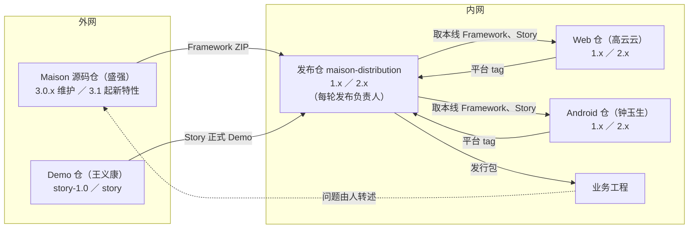
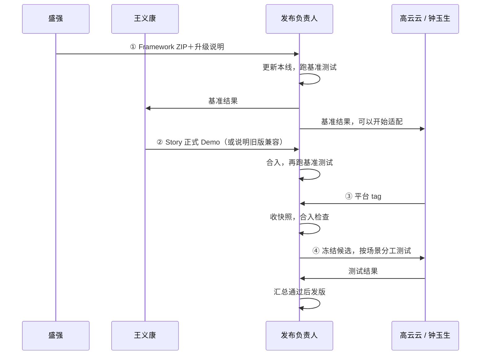
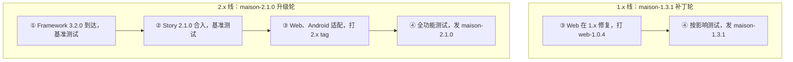

# Maison 共建方案：谁做什么、东西怎么流转、怎么发版

2026-11-05 原位重写，当前有效方案，接替 [07](07-Maison内外网共建协作方案.md)。人员任命、内网建仓和 Framework 配套能力尚未落实，进度见 §1 和 §10。本次修订的来源见 §12。

## 1. 一页总览

**目标**：鸿蒙、Web、Android 的业务团队在内网用上验证过的同一套 Maison；Framework、Story、平台各自演进，每次组合都有人负责验证和发布，稳定版与新特性版可以同时维护。

外网两个产品各有稳定线和新特性线，内网三个仓按同名的 `1.x`、`2.x` 两条线对应：



- 每条线每一轮发版走四步：①Framework 到达，发布仓更新本线并跑基准测试 → ②Story 适配后合入，再跑基准测试 → ③Web、Android 取本线的 Framework 开发适配，打 tag 交回发布仓 → ④发布仓冻结候选，做全功能测试后发布。
- `1.x`、`2.x` 两条线各走各的四步，可以同时进行。
- 平台打 tag 就是交付；发布仓原样收下 tag，平台内容只在平台仓里改。
- 发布仓有自己的代表工程和测试场景，对每个组合的验证结果负责。
- Web、Android 进入正式支持前，需要 Framework 提供配套能力（§9）。

| 状态 | 内容 |
|---|---|
| 已在用 | Framework、Story 外网开发发布；鸿蒙业务手工拷贝发布件使用 |
| 代码可见、内网未跑过 | Framework 打包和 init、Story adapt 的安装步骤（本地只读核对） |
| 本方案新增 | 三个内网仓和 `1.x`／`2.x` 线、版本清单、基准与全功能场景集、发行包 |
| 需外网承接 | Framework 接入 Web、Android 的配套能力（§9） |

## 2. 人和责任

| 角色 | 人 | 负责 |
|---|---|---|
| Framework 维护者 | 盛强 | 外网开发、发版、接入 Demo main；带入内网并附升级说明；处理平台提出的公共能力诉求 |
| Story 维护者 | 王义康 | 按 Demo 变化适配、发版（`story-1.0` 对应 1.x，`story` 对应 2.x）；带入内网并说明配哪个 Framework |
| Web 维护者 | 高云云 | Web 仓两条线的开发、适配、本平台测试、打 tag；参与全功能测试中 Web 部分 |
| Android 维护者 | 钟玉生 | 同上，负责 Android |
| 发布负责人 | 每条线每轮指定一人，可连任、可轮换、两条线可同一人 | 本线的输入更新、基准测试、收平台 tag、冻结候选、组织全功能测试、发版、写发布说明和交接 |
| 跨部件需求负责人 | 每项需求指定一人 | 一个需求同时涉及 Framework、Story、平台时，跟进各方直到整体可用 |
| 业务验收人 | 需求方或使用团队 | 提供真实场景，确认效果和已知限制 |
| 黄志强、潘雨晨 | 分工待定（§11） | — |

平台作者自己测过，说明这个平台在作者的工程上可用；发布仓用同一候选、同一场景测过，才说明这个组合可用。两者都要有，后者由发布负责人负责。

有外网和强模型条件的共建成员可以向 Framework、Story 提交贡献，由所属维护者评审合入。

## 3. 约束

| 约束 | 影响 |
|---|---|
| 内网的代码、文档、日志不能带到外网 | 平台源码只在内网；需要 Framework 改动时，由人写成文字需求交给盛强 |
| 内网问题由人在内网分析，再文字转述到外网 | 定位问题归属是内网的工作 |
| Framework 只在内网正式使用，外网用于开发和 Demo | 外网 Demo 跑主要场景，内网验证通过才算能用 |
| Framework、Story 由外网维护者开发发布，内网只用正式发布件 | 业务工程和发布仓里的 Framework、Story 内容保持发布件原样，公共问题回外网修 |
| Web、Android Profile 随 Framework 一起交付；Story 保持独立版本，声明配哪个 Framework | 业务拿到的是一个发行包，Profile 不单独安装 |
| Framework、Story 开发需要强模型 | 公共能力的改动由有外网强模型条件的人来做 |

## 4. 流转的东西

| 东西 | 是什么 | 从哪来 | 谁能改 | 去哪 |
|---|---|---|---|---|
| Framework ZIP | 打好的 `framework/` 目录，带逐文件校验清单和构建标识 | 盛强在外网打包 | 盛强（重新发版） | 发布仓 `上游/framework/` |
| Story 正式 Demo | Story 正式发布时的 Demo 工程目录；adapt 从这里把 Story 装进业务工程 | 王义康在外网发布 | 王义康（重新发版） | 发布仓 `上游/story/` |
| 平台 tag | 平台仓某条线上的一个固定提交，其中的 `profile/` 就是要交付的 Profile | 平台作者 | 平台作者（打新 tag） | 发布仓 `平台/` |
| 发行包 | 一个 ZIP：放好 Web、Android Profile 的 `framework/`、Story 正式 Demo、版本清单、安装和升级说明 | 发布负责人用冻结的候选组装 | 内容有错就出新版本 | 业务工程 |
| 业务工程里的 Maison | 拷入的 `framework/`、init 生成的配置和入口、adapt 装入的 Story、业务自己的知识和规则 | 业务按说明安装 | 业务维护自己的部分 | — |

同一个 Framework 版本号可能有不同构建，所以 Framework 用"版本号＋构建标识"认定，构建标识取自 ZIP 里校验清单记录的源码提交。

## 5. 版本线和三个仓

### 5.1 两条线

| Maison 线 | Framework | Story | 发布仓分支 | Web、Android 仓分支 |
|---|---|---|---|---|
| 1.x 稳定 | 3.0.x（外网 3.0 的维护补丁） | 1.x（`story-1.0`） | `1.x` | `1.x` |
| 2.x 新特性 | 3.1 及以后（Demo main） | 2.x（`story`） | `2.x` | `2.x` |

这一对应关系依据用户此前的说明（`story-1.0` 对应 Framework 3.0，`story` 跟随 Demo main），开线前由盛强、王义康确认。2.x 稳定、业务迁完后，1.x 停止维护；将来开 3.x，按同样方式加一条线。

### 5.2 平台仓（`maison-web`、`maison-android` 结构相同）

```text
maison-web/
├─ profile/     交付的 Web Profile，发行时放到 framework/profiles/ 下
├─ tests/       本平台测试
├─ examples/    作者开发自测用的工程
└─ 基线.md       本线基于发布仓的哪个提交（随之确定 Framework、Story 版本）
```

- 分支：`1.x`、`2.x` 两条长期线；任务分支从所属线拉出，例如 `2.x/登录适配`。
- 只把可交付的内容合回线分支，没做完的留在任务分支。
- tag 带线和版本，例如 `web-1.0.3`、`web-2.0.3`。

### 5.3 发布仓（`maison-distribution`）

```text
maison-distribution/
├─ 上游/framework/<版本-构建>/   Framework ZIP 和升级说明，放入后不改
├─ 上游/story/<版本>/           Story 正式 Demo 和适配说明，放入后不改
├─ 平台/web/、平台/android/      收进来的平台 tag 快照，内容与 tag 一致
├─ 版本清单.md                   本线当前组合和本轮进度
├─ 验证/                        代表工程说明、基准场景集、全功能场景集、按候选存放的结果
└─ 发布/                        各版发布说明、交接记录
```

- 分支：`1.x`、`2.x`；改动用短分支，按团队习惯合回。
- tag：候选 `maison-2.1.0-rc.1`，正式 `maison-2.1.0`。正式 tag 和发行包发出后不改。
- `平台/` 目录只通过复制平台 tag 更新。平台有问题，回平台仓修好、打新 tag 再收。

版本清单示例：

```text
线：2.x        本轮：maison-2.1.0，进行到第 3 步
Framework：3.2.0（构建 a1b2c3d）      Story：2.1.0
Web：web-2.0.3                       Android：android-2.0.1（沿用上一版）
基准结果：验证/2.1.0/基准-第2步.md
```

## 6. 一轮发版的四步



### 第 1 步：Framework 到达，成为本轮起点

| 项 | 内容 |
|---|---|
| 谁 | 盛强带入；发布负责人执行 |
| 在哪 | 发布仓对应的线（3.0.x 进 `1.x`，3.1 起进 `2.x`） |
| 做什么 | 放入 `上游/framework/`；改版本清单采用它；在发布仓代表工程上跑**基准场景集**（每个平台最核心的流程，如安装 → init → 走一个小需求到 UT 通过） |
| 产出 | 基准结果：哪些通过，哪些因 Story 或 Profile 还没适配而失败，失败各归谁 |
| 交给谁 | 王义康、高云云、钟玉生，附 Framework 升级说明 |
| 完成 | 本线已采用新 Framework，基准结果已记录并通知到人 |

### 第 2 步：Story 适配合入

| 项 | 内容 |
|---|---|
| 谁 | 王义康在外网适配发布并带入；发布负责人合入 |
| 在哪 | 外网对应分支（`story-1.0` 或 `story`）→ 发布仓同一条线 |
| 做什么 | 放入 `上游/story/`，改版本清单，重跑基准场景集。旧 Story 兼容新 Framework 时，王义康写明，本步沿用第 1 步的结果 |
| 产出 | 第二份基准结果 |
| 交给谁 | 平台作者 |
| 完成 | 本线的 Framework 和 Story 组合已确定，基准结果已记录 |

### 第 3 步：Web、Android 适配交付

| 项 | 内容 |
|---|---|
| 谁 | 高云云、钟玉生，两个平台同时进行 |
| 在哪 | 平台仓同名线的任务分支 |
| 输入 | 发布仓本线最新提交里的 Framework 和 Story，提交号写进 `基线.md`。第 1 步完成就可以开始；只有依赖 Story 新能力的部分才等第 2 步 |
| 做什么 | 开发、适配，跑本平台测试，合回线分支，打 tag，把 tag 交给发布负责人 |
| 合入检查（发布负责人） | 快照与 tag 一致、只含 `profile/`；平台 `基线.md` 与本线当前的 Framework、Story 一致，不一致就请作者在当前组合上重跑本平台场景；该平台基准场景通过 |
| 完成 | 本线版本清单记录了新的平台 tag，合入检查通过 |

### 第 4 步：全功能测试与发布

| 项 | 内容 |
|---|---|
| 谁 | 发布负责人组织；平台作者测各自平台，发布负责人测鸿蒙、首装和升级 |
| 做什么 | 冻结候选（打 rc tag），按候选组装发行包。在发布仓代表工程上跑**全功能场景集**：三平台的主要功能、从发行包首装、从业务在用的旧版本升级、Story adapt。所有人用同一个候选，结果存到 `验证/<候选>/` |
| 失败 | 交给对应负责人修复，修好后出新候选，只重跑受影响的场景，其余结果在组件版本相同时沿用 |
| 产出 | 正式 tag、发行包、发布说明（组合、支持范围、已知问题、升级注意） |
| 完成 | 全功能场景集在同一个候选上通过，发行包和发布说明已存档并通知业务 |

### 不是每轮都从第 1 步开始

| 这轮变了什么 | 从哪步开始 |
|---|---|
| Framework 新版本或补丁 | 第 1 步 |
| 只有 Story 新版本或补丁 | 第 2 步 |
| 只有 Web 或 Android 的功能或修复 | 第 3 步 |
| 只有发行包、安装说明出错 | 第 4 步（§8.2） |

**一轮还没走完，又来了新 Framework**：候选还没冻结时，发布负责人决定本轮换用（回到第 1 步），还是留到下一轮；候选已冻结的，留到下一轮。

## 7. 并行

### 7.1 1.x 和 2.x 同时进行



- 两条线的分支、输入、基准结果、候选、发布负责人各自独立；同一人可以同时负责两条线。
- 外网 3.0.x 补丁和 `story-1.0` 补丁进 1.x 线；3.1 起的版本和 `story` 版本进 2.x 线。
- **跨线修复**：一个修复在一条线上交付时，修复者写明另一条线是否需要。需要的，在另一条线也交付一次（各线代码不同，按各线实际情况修）；不需要的，写明原因。2.x 的新功能默认不回 1.x，需求方要求时作为 1.x 的一项需求处理。

### 7.2 同一条线内

- Web、Android 同时做第 3 步，分别交 tag，最终由第 4 步统一验证组合。
- 同一平台两人并行：各开任务分支。后合入的人先把已合入的成果合进自己的分支、在平台仓里解决冲突，再合回线分支。打出的 tag 包含两人的成果。
- 一个平台能发、另一个还没做完：没做完的留在任务分支；本轮版本清单沿用它上一个 tag。

## 8. 其他场景

### 8.1 平台需要 Framework 新能力

1. 平台作者写文字需求：要支持什么、为什么、做到什么算可用，不带内网代码。
2. 由内外网都有的人交给盛强，盛强排进 Framework 版本计划，在外网实现并用外网示例工程验证。Android 的工程拓扑能力就是一例，目前计划在 3.2.0。
3. 新 Framework 发版后，从第 1 步进入对应的线。
4. 等待期间，平台作者先做不依赖新能力的部分；依赖新能力的功能不写进本线的支持范围。

### 8.2 发行包或安装说明本身出错

部件都没变时，由发布负责人在发布仓修正，出补丁版本号（如 `maison-1.3.2`），从第 4 步开始，重跑受影响的安装或升级场景。修复同样检查另一条线。

### 8.3 业务首次安装与升级

首次安装（在业务工程的接入分支上）：

1. 从发布说明确认要装的版本和支持范围。
2. 把发行包里的 `framework/` 拷到工程根目录，按说明准备 Harness 依赖。
3. 运行 framework-init，选对工程类型。init 会扫描工程、确定计划、生成项目配置和宿主入口。
4. 用发行包里的 Story Demo 对业务工程执行 adapt。
5. 补业务自己的知识、检视规则、需求系统对接和个人工具链设置。
6. 按发布说明的接入验收项确认可用，再合入业务主线。

升级：

1. 按发布说明的升级步骤替换 `framework/`，按 Story 对应版本的说明更新。
2. 业务自己的知识、规则、配置和对接保留，按升级说明适配。
3. 2.x 不接续 1.x 的在途需求：在途需求在 1.x 工程上做完，新需求进 2.x。

### 8.4 发布负责人换人，或候选验证失败

发布负责人随时把本轮状态写在发布仓：版本清单、当前候选、各场景结果、失败项及归属、下一步。换人时，接手的人从同一个候选和失败记录继续；要换输入，就按 §6 规则开新候选。

### 8.5 业务报了问题

| 问题出在 | 怎么修 | 回到哪一步 |
|---|---|---|
| 业务自己的知识、规则、配置 | 业务团队改 | — |
| Web 或 Android Profile | 平台作者在对应线修，打新 tag | 第 3 步 |
| Framework 或 Story | 内网分析的人写清现象、复现条件和期望，交给盛强或王义康；外网发版后带入 | 第 1 步或第 2 步 |
| 发行包、安装说明 | 发布负责人修 | 第 4 步 |

还没定位清楚时，业务工程的 `framework/` 保持发布件原样。只有当该业务的配置和在途需求能在上一个版本上继续时，才回退到上一个版本；否则保持现场，等修复版本。

### 8.6 某个平台赶不上本轮

本轮版本清单沿用该平台上一个 tag；如果上一个 tag 和本轮的 Framework 不兼容，本轮发布说明写明不支持该平台，这个平台的业务继续用上一个版本。

### 8.7 外网不再修旧线

盛强或王义康决定不再为 3.0.x 或 `story-1.0` 出补丁时，发布负责人与需求方商定迁到 2.x 的计划，发布说明写明 1.x 的维护截止。

## 9. Web、Android 进入正式支持前的 Framework 配套能力

Profile 位于 `framework/profiles/<名称>/`，现有的有 `hmos-app`（鸿蒙）和 `generic`（通用）。加入新平台涉及 Framework 本身：

| 情况 | 依据 | 需要谁做 |
|---|---|---|
| init 的工程类型菜单只有 generic、hmos-app | 已核：Maison `skills/reference/confirmation-registry.yaml` | 盛强：让 init 能选到 Web、Android |
| 发行包的 `framework/` 里多出内网 Profile，上游的校验清单里没有这些文件；它们对打包校验和 Framework 更新流程的影响 | 推断，未运行；需盛强核 | 盛强：确认现有流程是否接受，不接受时给出做法 |
| Android 多仓、二进制依赖的工程结构需要 Framework 新增核心能力 | 已核：Maison 的 Android 适配计划排在 3.2.0 | 盛强按版本计划交付；它只能进 2.x 线 |

就绪之前，对应平台只在发布仓的代表工程上试验，不写进发布说明的支持范围。

## 10. 先做的事

| 顺序 | 事项 | 负责 | 做完的样子 |
|---|---|---|---|
| 1 | 指定首轮发布负责人；确认 §5.1 的线对应关系 | 团队；盛强、王义康 | 有名字；对应表确认 |
| 2 | 核 §9 的三项 | 盛强 | 写明哪个 Framework 版本提供、之前怎么在代表工程上试 |
| 3 | 建三个仓和 `1.x`／`2.x` 线，迁入 Web、Android 现有源码和历史 | 高云云、钟玉生 | 两个平台在各自工程上能跑通 |
| 4 | 1.x 线放入内网当前在用的 Framework 和 Story，建鸿蒙代表工程和基准场景集，跑第一次基准测试 | 盛强或王义康带入；发布负责人 | 1.x 有第一份基准结果 |
| 5 | 1.x 出第一个发行包，在一个真实鸿蒙业务工程上按 §8.3 首装 | 发布负责人 | 第一个正式版本和发布说明 |
| 6 | Story 2.x 发布后，2.x 线开第一轮 | 发布负责人 | 2.x 第 1、2 步完成 |

## 11. 还没定的事

| 事项 | 由谁定 |
|---|---|
| 首轮发布负责人 | 团队 |
| 基准场景集、全功能场景集的具体内容 | 首轮发布负责人与平台作者 |
| 上游发布件放 Git 仓还是共享盘（体积大时） | 发布负责人 |
| 1.x 何时停止维护 | 需求方与发布负责人，看业务迁移进度 |
| 黄志强、潘雨晨的分工；做公共能力需要外网和强模型条件 | 团队 |
| lite、review 增强由谁做（属 Framework 公共能力，在外网开发） | 团队与盛强 |

## 12. 讨论与修订依据

### 12.1 2026-11-04 首稿的依据

用户读完 01—07 后指出：讨论缺少让人看懂的描述，表达形式和内容都不行，部分设计过于理想化。追问中用户确认：

- 读者是共建成员，开头一页总览可用于汇报。
- 理想化的是三处：内网体系太重、发布流程太重、把 Profile 当插件。
- 新文档重新设计并替代 07。
- 内网现状是手工把发布件拷进业务仓。

07 原件见提交 `a043c874`，首稿见 `f7123b78`。

当时核到的事实，本稿仍然沿用：

| 事实 | 来源 |
|---|---|
| Profile 位于 `framework/profiles/<id>/`，由 profile.yaml、规则 overlay、harness provider 和 Skill 补充组成 | Maison `profiles/README.md` |
| init 菜单为 `1=generic 2=hmos-app` | Maison `skills/reference/confirmation-registry.yaml` |
| 发布件带逐文件哈希清单，完整性在打包和升级、集成时校验 | Maison `harness/scripts/utils/framework-integrity.ts` 头注释 |
| Android 适配要新增工程拓扑核心维度和 init 问询，计划在 3.2.0 | Maison `.cursor/plans/android_工程适配_5e3400c3.plan.md` |

### 12.2 2026-11-05 纠正与重写

用户看了另一会话的交接文件 [09](09-会话交接-共建诉求场景与精简边界.md) 后指出：08 首稿走向了过于简单的极端，没有充分考虑实际场景的复杂度；交接者搞得太复杂，首稿想得太简单。

本轮用户的两项决定：

- 仓库组织选择"三仓，简化交接"：平台打 tag 交付，发布仓只收 tag、不改平台内容。
- 方案必须覆盖以下核心流程（原话）：
  1. fwk 发布新版本，更新发布仓作为新版本的起点，完成基准测试
  2. ext 完成适配，合入发布仓，完成基准测试
  3. profile 从发布仓获取最新 fwk 并开发，完成后开发适配后提交发布仓
  4. 发布仓进行全功能测试，并准备发布
  5. 上述 1-4 可能同时并行发生在 maison 的 1.x（稳定发布分支）、2.x（新特性开发分支）

本轮重写前的计划已有三仓和两级验证，用户反查发现它缺少 1.x、2.x 两条长期线，以及第 1、2 步的基准测试。本稿以"版本线 × 四步"为主干（§5—§7）。

首稿的错误判断及更正：

| 首稿 | 问题 | 本稿 |
|---|---|---|
| 内网一个仓，共用 `main` 打 tag | 一个平台能发、另一个有未完成内容时，tag 会把未完成内容带上；没有稳定线和新特性线并行 | 三仓，两条线，平台各自打 tag（§5、§7） |
| 没改的平台只验能装上、能 init | Framework 变了，平台源码不变也可能受影响 | 基准场景覆盖所有平台；第 4 步按同一候选验证（§6） |
| 作者在自己工程上测过就写进版本记录 | 没人对组合结果负责 | 发布仓有代表工程和场景，发布负责人负责（§2、§6） |
| Framework 升级会覆盖内网后加的 Profile | 推错了对象：发行包的 `framework/` 本来带着 Profile，升级时随包一起替换 | 改为核上游校验清单对多出文件的处理（§9） |
| 07 每版三平台全验 | 夸大了 07：07 允许按影响复验、复用证据 | 本表更正；补丁轮按影响缩小范围（§6） |
| 固定一位发布负责人 | 用户原话："这个不是关键，理论上共建团队的任何人都可以轮值负责" | 每条线每轮指定一人，可连任、可轮换，交接靠发布仓记录（§2、§8.4） |

### 12.3 与 07 的取舍

| 07 | 本稿 | 原因 |
|---|---|---|
| 三仓 | 保留 | 平台独立交付、两条线并行都需要 |
| 发布仓保存"已接纳快照"，平台回交时三方比较、按路径回交，冲突回平台解决 | 发布仓只原样复制平台 tag，平台内容只在平台仓里改 | 快照永远等于某个 tag，三方比较没有必要 |
| 平台仓 `dependencies.json` 记录公共依赖与同步基线 | `基线.md` 记录基于发布仓哪个提交 | 一处记录即可确定 Framework、Story 版本 |
| 九类分支（intake、integrate、upgrade、maint、release 等） | 两条长期线＋任务分支＋tag | 用户给出的 1.x、2.x 并行就是主干；其余是线内的短分支 |
| 当值发布负责人与轮换交接 | 每条线每轮指定，交接靠发布仓记录 | 保留责任和交接，去掉制度 |
| 合入验证、发行验证 | 基准测试、合入检查、全功能测试 | 按用户四步对应到具体时点 |
| assembly、dist 与发行装配 | 发布负责人按候选组装发行包，业务照说明手工安装 | 与现状衔接；出现真实痛点再评估工具 |

### 12.4 场景覆盖

| 场景 | 来源 | 本文 |
|---|---|---|
| Framework 新版本作为起点，基准测试 | 用户 1 | §6 第 1 步 |
| Story 适配合入，基准测试 | 用户 2 | §6 第 2 步 |
| Profile 从发布仓取 Framework 开发，交回 | 用户 3 | §6 第 3 步 |
| 全功能测试并发布 | 用户 4 | §6 第 4 步 |
| 1—4 在 1.x、2.x 并行 | 用户 5 | §5.1、§7.1 |
| Framework 已到，Story 未适配 | 09 §5 | §6 第 1、2 步，第 3 步可先开始 |
| 同名 Framework 不同构建 | 09 §5 | §4、§5.3 |
| 只有 Web 做普通功能 | 09 §5 | §6"从哪步开始"、§7.2 |
| 两人并行改同一平台 | 09 §5 | §7.2 |
| Web 可发，Android 有未完成内容 | 09 §5 | §5.2、§7.2 |
| 平台基于 F0 开发，集成时已是 F1 | 09 §5 | §6 第 3 步合入检查 |
| 平台需要公共能力 | 09 §5 | §8.1 |
| Framework 升级期间稳定版报错 | 09 §5 | §7.1 |
| 一个修复影响多个分支 | 09 §5 | §7.1 跨线修复 |
| 发行装配或安装说明出错 | 09 §5 | §8.2 |
| Profile 未变，Framework 变了 | 09 §5 | §6 第 1 步基准、第 4 步 |
| 目标工程首次安装 | 09 §5 | §8.3 |
| 旧工程升级，保留知识、规则、对接 | 09 §5 | §8.3 |
| 1.x 在途需求遇到 2.x | 09 §5 | §8.3 |
| 发布负责人换人，候选验证失败 | 09 §5 | §8.4 |
| 问题未定位，或上游不修旧线 | 09 §5 | §8.5、§8.7 |
| 一个平台暂不能进入新版 | 09 §5 | §8.6 |
