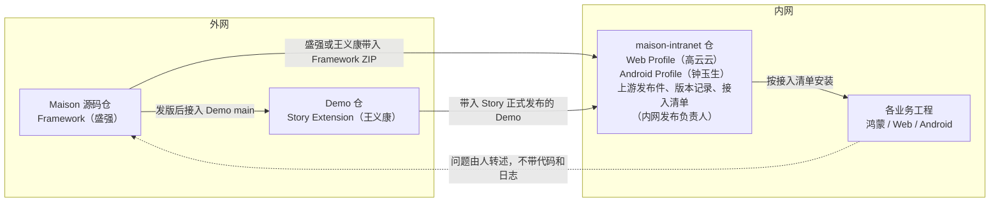

# Maison 共建方案：谁做什么、东西怎么流转、怎么发版

2026-11-04。当前有效方案，接替 [07](07-Maison内外网共建协作方案.md)。人员任命、内网建仓和 Framework 配套能力都还没落实，进度见 §7。

## 1. 一页总览

**目标**：让鸿蒙、Web、Android 的业务团队在内网用上同一套 Maison，并且有人负责它持续升级、出了问题有人修。

东西从外网流到内网业务工程，只走一条路：



- 外网照旧：盛强发 Framework，王义康跟着适配发 Story，外网 Demo 先把主要场景跑通。
- 内网只建一个仓 `maison-intranet`：放 Web、Android 两个 Profile 的源码，以及带进来的 Framework、Story 发布件。
- 一位固定的内网发布负责人，把"某个 Framework＋某个 Story＋某版 Web/Android"定成一个内网版本，验过再发给业务。
- 业务工程沿用现在的手工拷贝方式安装，照着按版本写好的接入清单一步步做。
- Web、Android 要真正交给业务，先要 Framework 提供三项配套能力（§6），由盛强排期。

| 事项 | 现在 | 要做到 |
|---|---|---|
| 鸿蒙业务用 Maison | 已在用，手工拷贝发布件 | 有版本记录和接入清单，升级有人负责 |
| Web Profile | 高云云在内网开发、验证中 | 进 `maison-intranet`，等 Framework 配套能力就绪后随内网版本交付 |
| Android Profile | 钟玉生在内网开发、验证中；Framework 侧计划在 3.2.0 | 同上，另外依赖 Framework 3.2.0 的工程拓扑能力 |
| 内网发布负责人 | 无 | 团队指定一人，长期负责 |

## 2. 现在是什么样

| 人 | 负责 | 网络与模型 |
|---|---|---|
| 盛强 | Framework 主体 | 内外网都有，可用 Claude、GPT 等强模型 |
| 王义康 | Story Extension（本仓 `story` 分支） | 同上 |
| 高云云 | Web Profile | 内网，GLM |
| 钟玉生 | Android Profile | 内网，GLM |
| 黄志强、潘雨晨 | 新加入，分工未定 | 内网为主 |

Framework 和 Story 已经在外网开发、外网 Demo 验证、拿到内网使用。目前进内网的方式是：有人把外网发布件拷进内网，直接放到业务工程里。内网没有统一存放 Maison 的地方，业务装的是哪个版本、有没有人验过，全靠口头说明。

要解决三件事：

1. **分工**：Web、Android 加进来以后，谁开发、谁把各部分凑成一个能用的版本、谁对业务负责。
2. **发版**：Framework、Story 各自升级，Web、Android 也在变，业务拿到的应当是验证过、能一起用的一套。
3. **内外网协作**：内网发现的问题怎么回到外网修，平台需要 Framework 改动时怎么提。

## 3. 必须遵守的约束

| 约束 | 影响 |
|---|---|
| 内网开发的代码、文档、日志不能带到外网 | Web、Android 源码只在内网；它们需要 Framework 改的部分，只能由人写成文字需求交给盛强 |
| 内网问题由人在内网分析，再用文字转述到外网 | 定位问题归属是内网的工作；外网只收到问题描述 |
| Framework 只在内网正式使用，外网只用来开发和跑 Demo | 外网不面向正式用户；内网验证通过才算能用 |
| Framework、Story 要用强模型开发 | 公共能力的改动由盛强、王义康或有外网强模型条件的人来做 |
| 内网不改 Framework、Story 的文件 | 发现公共问题就转述到外网修，业务工程里的 `framework/` 只来自正式发布件 |

## 4. 方案

### 4.1 外网：保持现有做法

- 盛强从 Maison 源码仓打出 Framework ZIP，接入外网 Demo 的 main 分支，同时把同一个 ZIP 带进内网。
- 王义康看 Demo main 的变化，决定 Story 要不要适配。要适配就在 `story` 分支做完再发版；不需要就说明"旧版 Story 可以继续配这个 Framework"。`story-1.0` 继续维护 Framework 3.0 对应的 Story。
- 带进内网时附一段升级说明：这版改了什么，对鸿蒙、Web、Android 各有什么影响。

### 4.2 内网：一个仓

```text
maison-intranet/
├─ web/          Web Profile 源码和测试（高云云）
├─ android/      Android Profile 源码和测试（钟玉生）
├─ 上游发布件/    带进来的 Framework ZIP、Story Demo，按版本存放，放进来后不再修改
├─ 接入清单.md    业务工程按版本安装的步骤
└─ 版本记录.md    每个内网版本里装了什么、验了什么、有什么已知问题
```

两个平台在同一个仓里各管一个目录，用 `main` 加任务分支开发，改完合回 `main`。发版时在 `main` 上打 tag（如 `v1.1`）。只有某个业务停在旧版本、又必须修一个问题时，才从那个 tag 拉出维护分支。

上游发布件体积太大、不适合放进 Git 时，改放团队共享盘，在版本记录里写明位置。

### 4.3 版本记录

每发一个内网版本加一行：

| 内网版本 | 日期 | Framework | Story | Web | Android | 这次变了什么 | 验了什么 | 已知问题 |
|---|---|---|---|---|---|---|---|---|
| v1.0 | — | 3.x.x | 1.9.x | 某提交 | 某提交 | 首个版本 | 见 §4.4 | — |

业务问"我该装哪个"、出了问题问"你装的是哪个"，都查这一张表。

### 4.4 发版前验什么

外网 Demo 已经跑过主要场景，内网验的是真实工具链、内网模型和真实工程。每个平台由作者在内网固定一个代表工程（可以是某个业务工程的副本），按这次改了什么决定验多少：

| 这次改了什么 | 要验什么 | 谁验 |
|---|---|---|
| 某个平台的 Profile | 该平台代表工程：安装 → init → 走一个小需求，覆盖开发、UT 和真机或浏览器测试 | 该平台作者 |
| 其他没改的平台 | 能装上、能完成 init | 发布负责人 |
| Framework 或 Story 换了版本 | 三个平台的代表工程都走一个小需求 | 各平台作者验自己的平台；鸿蒙由发布负责人验 |
| 有业务要从旧版升级 | 用该业务实际在用的旧版本升级一次 | 发布负责人和该业务的接口人 |

验完把结果写进版本记录的"验了什么"一列，再打 tag、通知业务。

### 4.5 业务工程怎么装

接入清单按版本写，步骤固定：

1. 从版本记录确认要装的内网版本。
2. 在业务工程的接入分支，把该版本的 Framework 解压到 `framework/`。
3. Web、Android 工程：放入对应 Profile（放法以 §6 中 Framework 提供的方式为准）。
4. 运行 framework-init，选对工程类型，生成项目配置和宿主入口。
5. 用该版本带入的 Story Demo，对业务工程执行 Story adapt。
6. 补业务自己的知识、检视规则、需求系统对接和个人工具链设置。
7. 按清单最后的自检项确认可用，再合入业务主线。

业务自己的知识、规则和配置由业务团队维护，升级时保留。

### 4.6 谁负责什么

| 人 | 负责 | 交出什么 |
|---|---|---|
| 盛强 | Framework 开发和发版；Profile 需要的 Framework 配套能力 | Framework ZIP 和升级说明 |
| 王义康 | Story 适配和发版 | Story 正式版 Demo，以及它配的 Framework 版本 |
| 高云云 | Web Profile 开发、在代表工程上验证、修 Web 问题 | `maison-intranet` 中 `web/` 的可发版提交 |
| 钟玉生 | Android Profile，职责同上 | `android/` 的可发版提交 |
| 内网发布负责人（待定，可兼任） | 收上游发布件、组版本、组织验证、发版、写接入清单、接业务问题并分派 | 版本记录中的一行、tag、接入清单 |
| 跨部分需求的负责人（每项指定） | 一个需求同时涉及 Framework、Story 和平台时，跟进各方直到整体可用 | 需求的整体验收结果 |

## 5. 典型场景

### 场景 A：Web 加一个功能并发版

1. 高云云在 `maison-intranet` 从 `main` 开分支，改 `web/`。
2. 在 Web 代表工程里放入改后的 Profile，按 §4.4 第一行跑通。
3. 合回 `main`，告诉发布负责人"Web 有新功能要发"。
4. 发布负责人沿用当前的 Framework、Story 和 Android，只把 Web 换成新提交；鸿蒙和 Android 只验能装上、能 init。
5. 版本记录加一行，打 tag，通知 Web 业务按接入清单升级。

### 场景 B：Framework 出了新版

1. 盛强在外网发布新 Framework，接入 Demo main。
2. 王义康判断 Story 是否要适配，要适配就发新 Story，不需要就说明旧 Story 可以配。
3. 盛强或王义康把 Framework ZIP、对应的 Story Demo 和升级说明带进内网，放进 `上游发布件/`。
4. 发布负责人通知高云云、钟玉生。两人在各自的代表工程里换上新 Framework 试；Profile 需要改的，开分支改。
5. 三个平台都按 §4.4 第三行验过后，发布负责人发新内网版本。
6. 某个平台暂时跟不上：其他平台先发新版本；跟不上那个平台的业务继续用上一版，版本记录里写明原因。

### 场景 C：业务报了一个问题

1. 业务接口人把问题报给发布负责人。
2. 在内网定位问题属于哪一部分：

| 问题出在 | 怎么修 |
|---|---|
| 业务自己的知识、规则、配置 | 业务团队在自己的工程里改 |
| Web 或 Android Profile | 对应平台作者在 `maison-intranet` 修，按场景 A 发版 |
| Framework 或 Story | 分析的人用文字写清现象、复现条件和期望，交给盛强或王义康；外网修好后按场景 B 带进来 |

3. 还没定位清楚时，业务先用上一个可用版本；业务工程里的 `framework/` 保持发布件原样。

### 场景 D：平台需要 Framework 改核心

以 Android 为例：Android 工程常常由多个仓、以二进制依赖拼在一起，需要 Framework 能理解这种工程结构。这部分改的是 Framework 核心，Profile 做不了。

1. 钟玉生用文字写清：需要 Framework 支持什么、为什么、做到什么程度算可用。内容只描述需求，不带内网代码。
2. 由内外网都有的人交给盛强。盛强在外网设计实现，用外网的示例工程验证。
3. 这类需求排进 Framework 的版本计划，时间由盛强定。Android 的这部分目前计划在 Framework 3.2.0。
4. 新 Framework 发版后按场景 B 进内网。等待期间，钟玉生先做 Profile 里不依赖新能力的部分。

### 场景 E：业务停在旧版本，必须修一个问题

1. 先确认这个业务确实不能升到新版本。
2. 问题在 Profile：平台作者从旧版本的 tag 拉维护分支修复，发布负责人发补丁版（如 `v1.1.1`），平台作者再看 `main` 是否需要同样修。
3. 问题在 Framework 或 Story：转述到外网，由盛强、王义康决定是否在旧版本线出补丁（Story 的旧版本线是 `story-1.0`）；不出补丁，就和业务商定升级。

## 6. Web、Android 交付前要 Framework 配好的三项能力

Profile 是 Framework 里 `framework/profiles/<名称>/` 下的一组规则、脚本和说明，现有的有 `hmos-app`（鸿蒙）和 `generic`（通用）。它和 Framework 一起发布，加一个新平台要动到 Framework 本身。以下来自外网 Maison 源码的只读核对，具体做法需盛强确认：

| 现在的情况 | 影响 | 需要谁做 |
|---|---|---|
| framework-init 的工程类型菜单只有 generic、hmos-app 两项 | 业务工程在 init 时选不到 Web、Android | 盛强：让 init 能选到内网提供的 Profile |
| Framework 发布件带逐文件校验清单，升级时整体替换 `framework/` | 内网后加进去的 Profile 不在清单里，Framework 升级时会冲突或被覆盖 | 盛强：给内网 Profile 一个能随 Framework 升级保留的安装位置或方式 |
| Android 多仓、二进制依赖的工程结构需要 Framework 新增核心能力，Maison 已有计划，排在 3.2.0 | 只有 Android Profile，还处理不了真实的 Android 工程 | 盛强：按 Framework 版本计划交付；钟玉生按场景 D 提供需求 |

这三项就绪之前，Web、Android Profile 只在作者自己的代表工程里手工放入验证，不交给业务工程。

## 7. 先做的五件事

| 顺序 | 事项 | 负责 | 做完的样子 |
|---|---|---|---|
| 1 | 指定内网发布负责人 | 团队 | 有名字，所有人知道业务问题找谁 |
| 2 | 确认 §6 三项能力的做法和所在版本 | 盛强 | 写明哪个 Framework 版本提供、在那之前怎么临时验证 |
| 3 | 建 `maison-intranet`，放入 Web、Android 现有源码 | 高云云、钟玉生 | 两个目录各自能在代表工程里跑通；已有提交历史尽量保留 |
| 4 | 带入内网当前在用的 Framework、Story，写第一版接入清单 | 盛强或王义康带入；发布负责人写清单 | 一个鸿蒙业务工程照清单装上并完成 init |
| 5 | 发第一个内网版本 | 发布负责人 | 版本记录有第一行，鸿蒙可用；Web、Android 视第 2 项结果加入 |

## 8. 还没定的事

| 事项 | 由谁定 |
|---|---|
| 内网发布负责人是谁 | 团队 |
| 黄志强、潘雨晨做什么；他们要做 Framework 公共能力，需要外网和强模型条件 | 团队，结合两人的条件 |
| lite 轻量模式、review 增强由谁做（两者属于 Framework 公共能力，在外网开发） | 团队与盛强 |
| §6 三项能力的具体做法 | 盛强 |
| 上游发布件放 Git 仓还是共享盘 | 发布负责人，按体积和内网条件 |
| Profile 改动由谁评审（同仓的另一位平台作者，或发布负责人） | 高云云、钟玉生与发布负责人商定 |

## 9. 讨论与修订依据

### 9.1 本轮用户纠正

2026-11-04，用户读完 01—07 后指出：当前讨论缺少让人看懂的描述，表达形式和内容都不行；有些设计没有考虑真实情况，过于理想化。用户要求理解人的诉求和场景，整理新文档说明。

在追问中用户确认：

- 读者是共建成员，开头一页总览可用于汇报。
- 过于理想化的是三处：内网体系太重、发布流程太重、把 Profile 当插件。
- 新文档重新设计并替代 07。
- 内网现状是手工把发布件拷进业务仓，没有内网 Maison 仓。

修改前对象：07 及其修订前原件已在提交 `a043c874` 原样入库。

### 9.2 本轮核到的事实

| 事实 | 来源 |
|---|---|
| Profile 位于 `framework/profiles/<id>/`，由 profile.yaml、规则 overlay、harness provider 和 Skill 补充组成 | `agent-maison/profiles/README.md` |
| init 工程类型菜单为 `1=generic 2=hmos-app` | `agent-maison/skills/reference/confirmation-registry.yaml` |
| 新 Profile 的测试基线要登记到 Framework 测试常量表 | `agent-maison/profiles/README.md`「回归基线」 |
| 发布件带逐文件哈希清单，完整性在打包和升级/集成时校验 | `agent-maison/harness/scripts/utils/framework-integrity.ts` 头注释 |
| Android 适配要新增工程拓扑核心维度和 init 问询，计划已多次顺延，当前在 3.2.0 | `agent-maison/.cursor/plans/android_工程适配_5e3400c3.plan.md` |

"升级时内网后加的 Profile 会冲突或被覆盖"是根据整包替换和校验清单推断的，没有实际运行，需盛强确认。

### 9.3 与 07 的差异

| 07 的安排 | 08 的安排 | 原因 |
|---|---|---|
| 内网三仓（Web 仓、Android 仓、发布仓），按部件路径三方比较反合 | 一个 `maison-intranet` 仓，两个平台各管一个目录 | 两人规模，没有人力建设和维护跨仓同步；同仓分支开发不需要反合 |
| 发布仓 inputs/components/release.lock/assembly/test/dist 结构，九类分支 | 两个源码目录、上游发布件、版本记录、接入清单；`main`＋任务分支＋tag，必要时开维护分支 | 内网现状是手工拷贝，从能马上用的最小结构起步 |
| 每版轮值发布负责人及交接 | 固定一位发布负责人 | 团队小，轮值的交接成本高于收益 |
| 每版三平台首装、升级、真机全验 | 按改动验证（§4.4） | 外网 Demo 已跑主要场景；没改的平台只验能装上、能 init |
| 内网把上游 Framework 和内网 Profile 装配成完整发行包 | Profile 要 Framework 提供三项配套能力，就绪前不交给业务（§6） | Profile 嵌在 Framework 内部，init 菜单、升级校验、Android 工程结构都要改 Framework |
| 发行装配脚本和完整发行 ZIP | 沿用手工拷贝，按版本写接入清单 | 手工方式已在用；出现真实的手工痛点再评估工具 |

保留的部分：外网开发发布链、人员归属、跨部分需求负责人、公共问题转述外网修、内网不改公共文件、业务自有知识与规则在升级时保留。
