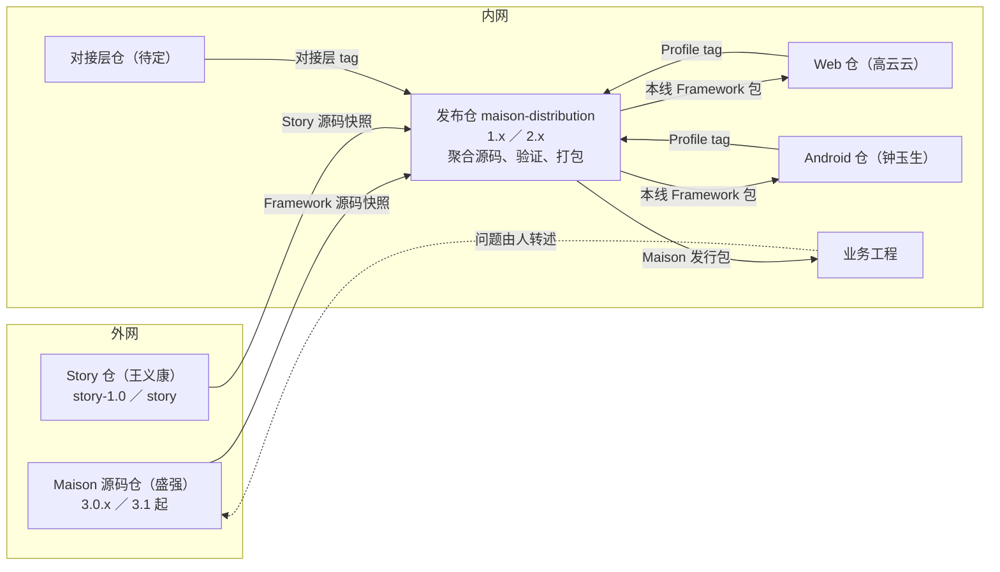
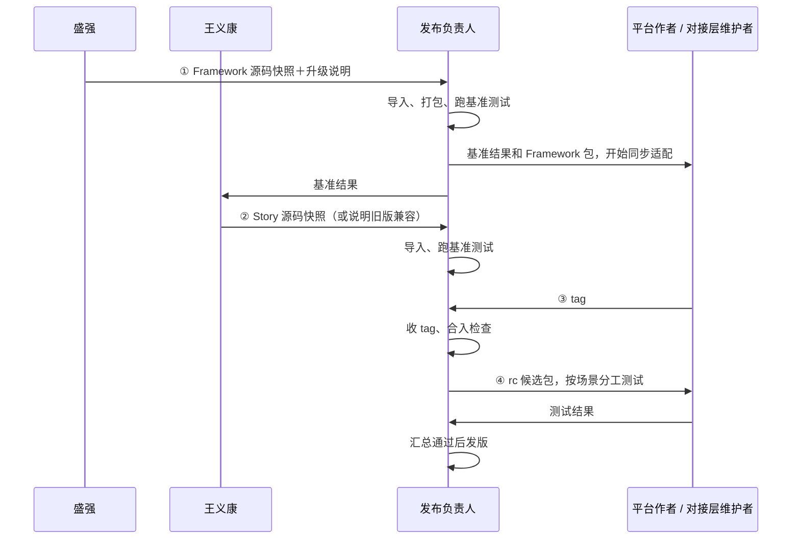
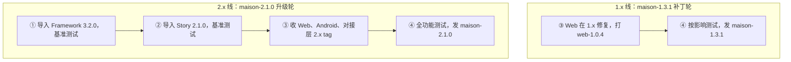

# Maison 共建方案：谁做什么、东西怎么流转、怎么发版

2026-11-05 修订，当前有效方案，接替 [07](07-Maison内外网共建协作方案.md)。人员任命、内网建仓和 Framework 配套能力尚未落实，进度见 §1 和 §10。修订来源见 §12。

## 1. 一页总览

**目标**：鸿蒙、Web、Android 的业务团队在内网用上验证过的同一套 Maison。Framework、Story、平台各自演进，每次组合都有人负责验证和发布，稳定版与新特性版可以同时维护。

内网的发布仓汇集所有部件的源码，由它验证、打包，发出 Maison 完整发行包：



- 内网四个仓都分 `1.x`（稳定）、`2.x`（新特性）两条线。每条线每轮发版走四步：①导入 Framework 源码，打包并跑基准测试 → ②导入 Story 源码，跑基准测试 → ③收 Web、Android、对接层的 tag，做合入检查 → ④打出候选包，全功能测试后发布。
- 发布仓不开发特性。任何特性改动都回所属的源码仓：Framework、Story 回外网，平台和对接层回内网对应的仓。
- 平台仓和发布仓的协作方式，与现在 Story 和 Framework 的协作方式一样：装好发布仓打出的 Framework 包，在上面开发自己的部分。
- 业务工程装的是一个 Maison 发行包。升级和 Framework 一样：替换包，重跑初始化（Framework 跑 init，Story 跑 adapt）。
- Web、Android 进入正式支持，以及 Story 2.x 的新形态，都需要 Framework 配套（§9）。

| 状态 | 内容 |
|---|---|
| 已在用 | Framework、Story 在外网开发发布；鸿蒙业务手工拷贝发布件使用 |
| 代码可见、内网未跑过 | Framework 打包（`release:pack`）和 init、Story adapt 的安装步骤 |
| 本方案新增 | 内网四个仓及两条线、发布仓的导入与打包流程、基准和全功能场景集、Maison 发行包 |
| 需外网承接 | Framework 配套能力（§9）；Story 2.x 目录整改（§5.7） |

## 2. 人和责任

| 角色 | 人 | 负责 |
|---|---|---|
| Framework 维护者 | 盛强 | 外网开发、发版；把发布提交的源码快照带入内网，附升级说明；处理平台提出的公共能力诉求 |
| Story 维护者 | 王义康 | Story 适配、发版（`story-1.0` 对应 1.x，`story` 对应 2.x）；把发布提交的源码快照带入内网，说明配哪个 Framework |
| Web 维护者 | 高云云 | `maison-web` 两条线的开发、测试、打 tag；参与全功能测试中 Web 部分 |
| Android 维护者 | 钟玉生 | `maison-android`，职责同上 |
| 对接层维护者 | 待定（§11） | `maison-story-adapters`：内网需求系统对接层的开发、在真实需求系统上验证、打 tag |
| 发布负责人 | 每条线每轮指定一人；可连任、可轮换；两条线可以是同一人 | 本线的导入、收 tag、打包、基准测试、组织全功能测试、发版、发布说明和交接 |
| 跨部件需求负责人 | 每项需求指定一人 | 一个需求涉及多个部件时，跟进各方直到整体可用 |
| 业务验收人 | 需求方或使用团队 | 提供真实场景，确认效果和已知限制 |
| 黄志强、潘雨晨 | 分工待定（§11） | — |

平台作者自己测过，说明这个平台在作者的工程上可用；发布仓用同一个候选包、同一组场景测过，才说明这个组合可用。两者都要做，后者由发布负责人负责。

有外网和强模型条件的共建成员，可以向 Framework、Story 提交贡献，由所属维护者评审合入。

## 3. 约束

| 约束 | 影响 |
|---|---|
| 内网的代码、文档、日志不能带到外网 | 平台、对接层源码只在内网；需要 Framework 改动时，由人写成文字需求交给盛强 |
| 内网问题由人在内网分析，再用文字转述到外网 | 定位问题归属是内网的工作 |
| Framework 只在内网正式使用；外网用于开发和 Demo | 外网 Demo 跑主要场景，内网验证通过才算能用 |
| Framework、Story 由外网维护者开发 | 发布仓里的 `framework/`、`story/base/` 只通过导入更新，问题回外网修 |
| Web、Android Profile 随 Framework 一起打包；Story 和对接层随 Maison 发行包一起交付 | 业务拿到的是一个发行包 |
| Framework、Story 开发需要强模型 | 公共能力的改动由有外网强模型条件的人做 |

## 4. 流转的东西

| 东西 | 是什么 | 从哪来 | 到哪去 |
|---|---|---|---|
| Framework 源码快照 | 外网 Maison 源码仓某个发布提交的完整源码（如 `git archive` 打出的文件） | 盛强带入 | 导入发布仓 `framework/`，导入后不保存这个文件 |
| Story 源码快照 | 外网 Story 仓某个发布提交的扩展源码（2.x 为 `extensions/base/`） | 王义康带入 | 导入发布仓 `story/base/` |
| 平台 tag | 平台仓某条线上的固定提交，其中 `profile/<名>/` 就是交付内容 | 平台作者 | 发布仓 `framework/profiles/<名>/` |
| 对接层 tag | 对接层仓某条线上的固定提交，其中 `adapters/` 就是交付内容 | 对接层维护者 | 发布仓 `story/adapters/` |
| Framework 包 | 发布仓在 `framework/` 里用 Framework 自带的打包命令打出的 `framework-<版本>.zip` 和 `.manifest.json`，已包含 Web、Android Profile | 发布仓打包 | 平台仓同步用；放进 Maison 发行包 |
| Maison 发行包 | `maison-<版本>.zip`，结构见 §5.5 | 发布仓从 rc 或正式 tag 打包 | 业务工程 |

## 5. 版本线和四个仓

### 5.1 两条线

| Maison 线 | Framework | Story | 内网四个仓的分支 |
|---|---|---|---|
| 1.x 稳定 | 3.0.x（外网 3.0 的维护补丁） | 1.x（`story-1.0`） | `1.x` |
| 2.x 新特性 | 3.1 及以后（Demo main） | 2.x（`story`） | `2.x` |

这一对应关系依据用户此前的说明（`story-1.0` 对应 Framework 3.0，`story` 跟随 Demo main），开线前由盛强、王义康确认。2.x 稳定、业务迁完后，1.x 停止维护；将来开 3.x，按同样方式加一条线。

### 5.2 发布仓 `maison-distribution`

```text
maison-distribution/                       分支 1.x、2.x
├─ README.md                               发布负责人手册：导入、收 tag、打包、四步怎么做
├─ 来源.md                                  每个部件当前来自哪里（见下方示例）
├─ framework/                              Framework 源码
│  ├─ package.json、scripts/、harness/、skills/、specs/、agents/ ……   随外网快照
│  ├─ profiles/
│  │  ├─ generic/、hmos-app/                随外网快照
│  │  ├─ web-app/                          来自 maison-web 的 tag
│  │  └─ android-app/                      来自 maison-android 的 tag
│  └─ dist/                                打包输出，不入库
├─ story/
│  ├─ base/                                Story 源码，随外网快照
│  └─ adapters/                            来自 maison-story-adapters 的 tag
├─ 打包/
│  ├─ pack-maison.ps1（或 .sh）             从当前提交打出 Maison 发行包
│  └─ 模板/安装与升级说明.md                 每版发布时填写
├─ 验证/
│  ├─ 代表工程/hmos-sample/、web-sample/、android-sample/   真实业务代码的副本，测试时复制到 .work/ 并 git init
│  ├─ 场景/基准.md                          每个平台最核心的流程：安装 → init → Story adapt → 走一个小需求到 UT 通过
│  ├─ 场景/全功能.md                        三个平台的主要功能、首装、升级、Story 全流程
│  └─ 结果/maison-2.1.0-rc.1/              按候选存放：每个场景谁测、结果、日志或截图位置
├─ 发布/
│  ├─ maison-2.1.0.md                      发布说明
│  └─ 本轮交接.md                            当前候选、失败项、下一步
└─ .work/                                  不入库：测试现场
```

`来源.md` 示例：

```text
线：2.x        本轮：maison-2.1.0，进行到第 3 步
framework/                 Maison 源码仓 3.2.0，外网提交 a1b2c3d
framework/profiles/web-app        maison-web  web-2.0.3
framework/profiles/android-app    maison-android  android-2.0.1（沿用上一版）
story/base/                Story 仓 2.1.0，外网提交 e4f5a6b，配 Framework 3.2.0
story/adapters/            maison-story-adapters  adapters-2.0.2
```

更新规则按目录归属，每次导入或收 tag 单独提交，提交信息写明来源和版本：

| 动作 | 整份替换 | 保留不动 |
|---|---|---|
| 导入 Framework | `framework/` | `framework/profiles/web-app/`、`android-app/` |
| 导入 Story | `story/base/` | `story/adapters/` |
| 收平台 tag | `framework/profiles/<名>/` | — |
| 收对接层 tag | `story/adapters/` | — |

打包（写进 `pack-maison` 脚本，只在 rc 或正式 tag 上执行）：

1. 在 `framework/` 下安装打包依赖，执行 `npm run release:pack`，在 `framework/dist/` 得到 `framework-<版本>.zip` 和 `.manifest.json`；再执行 `npm run release:verify` 核对。打包按目录收集文件，所以 Web、Android 已进入包内的校验清单。
2. 建 `maison-<版本>/`，放入 Framework 包、`story/base/`、`story/adapters/`。
3. 从 `来源.md` 生成版本清单，从模板填写安装说明，附发布说明。
4. 压成 `maison-<版本>.zip`，计算 sha256，存到团队发布存储。

### 5.3 平台仓 `maison-web`、`maison-android`

和本仓（Story）跟 Framework 的协作方式相同：`demo/` 里装着发布仓打出的 Framework 包，作者在 `profile/` 开发，测试时把 demo 复制成一次性工程，装入开发版再跑。

```text
maison-web/                                分支 1.x、2.x（maison-android 结构相同）
├─ AGENTS.md                               维护约定：同步、开发、测试、交付
├─ 基线.md                                  demo/framework 来自发布仓哪个提交打出的包
├─ profile/web-app/                        开发源，即交付内容
│  ├─ profile.yaml                         识别文件、能力与 provider、设备能力、个人前置
│  ├─ config-defaults.json                 init 写进项目配置的平台默认值
│  ├─ phase-rules-overlays/                spec、plan、coding、ut 等阶段规则的平台补充
│  ├─ skills/                              各阶段 Skill 的平台补充、skill-assets.yaml
│  ├─ harness/                             编译、lint、UT、浏览器测试的 provider
│  │  └─ tests/unit/、tests/fixtures/      平台单元测试和 fixture
│  ├─ doc-skeletons/                       init 生成的架构说明、模块目录骨架
│  └─ templates/agents-md/                 宿主入口文件的平台片段
├─ demo/                                   消费工程：真实 Web 代码＋装好的 Framework
│  ├─ framework/                           只读，只经同步更新
│  ├─ framework.config.json                project_profile 为 web-app
│  └─ 业务代码、宿主入口
├─ test/                                   测试脚本：复制 demo → 用 profile/web-app 换掉副本的 framework/profiles/web-app → 跑
└─ docs/                                   需求、设计、交付记录（每个 tag 一段）
```

| 动作 | 做法 |
|---|---|
| 同步 | 发布仓本线完成第 1 步后，取发布仓打出的 Framework 包，在 `demo/` 解压替换 `framework/`，执行 framework-init UPDATE，更新 `基线.md`，单独提交 |
| 开发 | 从线分支拉任务分支，改 `profile/web-app/` |
| 测试 | 端到端在 `test/` 的一次性工程里跑；单元测试和 fixture 在发布仓源码的 checkout 里跑（发布件的 `npm test` 不跑 fixture，见 §9） |
| 交付 | 合回线分支，打 tag（如 `web-2.0.3`），在 `docs/` 写交付记录，通知发布负责人 |

Profile 名 `web-app` 是暂定，正式名由盛强随 §9 一起定。

### 5.4 对接层仓 `maison-story-adapters`

```text
maison-story-adapters/                     分支 1.x、2.x
├─ adapters/                               交付内容：入口、鉴权及内部模块
├─ test/                                   按 Story 演进记录里 [对接层] 条目的验证项，在真实需求系统上跑
└─ docs/                                   接口变化与交付记录
```

首个版本从一个已经接通需求系统的业务工程提取。

### 5.5 Maison 发行包

```text
maison-2.1.0.zip（另附 maison-2.1.0.zip.sha256）
└─ maison-2.1.0/
   ├─ 安装与升级说明.md                首装、升级的步骤（§8.3）
   ├─ 发布说明.md                     支持范围、已知问题、相对上一版的变化
   ├─ 版本清单.md                     发布仓 tag 和提交；每个部件的来源和版本
   ├─ framework-3.2.0.zip            发布仓打出的 Framework 包，含 web-app、android-app
   ├─ framework-3.2.0.manifest.json
   └─ story/
      ├─ base/                        Story 机制：manifest、skills、hooks、rules、examples/knowledge
      └─ adapters/                    内网需求系统对接层
```

1.x 线的 Story 按 §5.7 的过渡方式交付。

### 5.6 装好后的业务工程（2.x）

```text
<业务工程>/                                 必须是 Git 根
├─ framework/                               解压 framework-3.2.0.zip 得到
│  └─ harness/node_modules/                 init 时 npm install 生成，不入库
├─ framework.config.json                    init 生成：项目名、project_profile、架构分层
├─ framework.local.json                     个人工具链路径，不入库
├─ AGENTS.md、CLAUDE.md 等                   init 生成宿主入口；adapt 写 Story 标记区
└─ doc/
   ├─ architecture.md、module-catalog.yaml   init 生成骨架，业务填写
   ├─ usage.json                            使用记录
   └─ extensions/
      ├─ base/                              Story 机制，升级时整份替换
      ├─ knowledge/                         业务知识及其加载清单，由 adapt 生成和演进
      ├─ adapters/                          对接层，首装取自发行包，之后由 adapt 演进
      └─ adaptation.yaml                    已适配版本等状态
```

### 5.7 Story 2.x 的目录整改

Story 现在的 `extensions/` 里，包的内容和业务自己的内容混在一起：知识放在 `knowledge/`，知识清单写在 `manifest.yaml`；对接层嵌在 `skills/story/scripts/adapters/`。这些都妨碍直接在业务仓里替换升级。2.x 整改为三块：

| 目录 | 归谁 | 升级时 |
|---|---|---|
| `base/` | 包：manifest、skills、hooks、rules，以及 `examples/knowledge/` 样例 | 整份替换 |
| `knowledge/` | 业务：知识及其加载清单 | 由 `/story adapt` 按演进记录适配 |
| `adapters/` | 业务：需求系统对接层 | 由 `/story adapt` 按演进记录适配 |
| `adaptation.yaml` | 业务：已适配版本等状态 | 由 adapt 写 |

- **安装和升级与 Framework 一样**：
  - 首装：复制 `base/`、`adapters/`，再执行 `/story adapt` 生成知识。
  - 升级：替换 `base/`，再执行 `/story adapt`。
  - Framework 先于 Story 安装，因为 Story 的宿主入口由 Framework 按 manifest 生成。
- **新业务没有知识可参考**：Demo 的知识作为样例放在 `base/examples/knowledge/`。样例不登记加载，只给 adapt 作参考；它随 base 一起替换，不需要删除。模型会照着样例写，所以样例要选达到金样水平的内容。
- **需要 Framework 配合**：现在 Framework 在扩展根读 `manifest.yaml`，技能入口固定在 `<扩展目录>/skills/<id>/SKILL.md`，知识清单写在 manifest 里。三块分开存放，要 Framework 的扩展约定支持"包放在 `base/`、知识自带清单"（§9）。
- **Demo 的定位**：Story 仓里的 Demo 继续用于外网开发和测试；它的替身对接层留在 Demo，不进 `base/`。
- **整改的具体设计和实施进入 Story 2.x 的 Spec**，由王义康负责。

**1.x 线（过渡）**：Story 1.x 保持现有目录，只能从已经装好 Story 的工程执行 adapt。1.x 发行包写明"从已适配的业务仓执行 adapt"；能否直接从包目录安装，由王义康核。1.x 停止维护时，这条过渡路径一并退出。

## 6. 一轮发版的四步



### 第 1 步：导入 Framework，成为本轮起点

| 项 | 内容 |
|---|---|
| 谁 | 盛强带入快照；发布负责人执行 |
| 在哪 | 发布仓对应的线：3.0.x 进 `1.x`，3.1 起进 `2.x` |
| 做什么 | 按 §5.2 规则导入 `framework/`，更新 `来源.md` 并提交；打出 Framework 包；装进代表工程跑**基准场景集** |
| 产出 | 基准结果：哪些通过，哪些因 Story、Profile 还没适配而失败，失败各归谁；本线的 Framework 包 |
| 交给谁 | Framework 包和基准结果交平台作者、对接层维护者（用于同步）；基准结果交王义康 |
| 完成 | 本线已是新 Framework，基准结果已记录、已通知到人 |

### 第 2 步：导入 Story

| 项 | 内容 |
|---|---|
| 谁 | 王义康在外网适配发布并带入快照；发布负责人执行 |
| 在哪 | 外网对应分支（`story-1.0` 或 `story`）→ 发布仓同一条线 |
| 做什么 | 导入 `story/base/`，更新 `来源.md`，重跑基准场景集。旧 Story 兼容新 Framework 时由王义康写明，本步沿用第 1 步的结果 |
| 产出 | 第二份基准结果 |
| 完成 | 本线的 Framework 和 Story 组合已确定，基准结果已记录 |

### 第 3 步：收平台和对接层的 tag

| 项 | 内容 |
|---|---|
| 谁 | 高云云、钟玉生、对接层维护者，可以同时进行；发布负责人收 tag |
| 前提 | 部件作者已按第 1 步的 Framework 包同步（§5.3）。第 1 步完成就可以开始；只有依赖 Story 新能力的部分才等第 2 步 |
| 做什么 | 作者打 tag 交付；发布负责人把 tag 中的交付目录整份复制到发布仓对应位置，更新 `来源.md` 并提交 |
| 合入检查 | 复制内容与 tag 一致；作者 `基线.md` 与本线当前提交一致，不一致就请作者在当前组合上重跑；在发布仓 `framework/harness` 跑 Framework 自带测试（含平台 fixture）；跑该部件的基准场景 |
| 完成 | `来源.md` 记录了新 tag，合入检查通过 |

### 第 4 步：全功能测试与发布

| 项 | 内容 |
|---|---|
| 谁 | 发布负责人组织；平台作者测各自平台，发布负责人测鸿蒙、首装和升级 |
| 做什么 | 打 rc tag（如 `maison-2.1.0-rc.1`），冻结后不再换输入；用 `pack-maison` 打出候选包；所有人用同一个候选包，在代表工程上跑**全功能场景集**（三个平台的主要功能、从候选包首装、从业务在用的旧版本升级、Story 全流程）；结果存进 `验证/结果/<候选>/` |
| 失败 | 交给对应负责人修复，修好后出新候选；只重跑受影响的场景，其余结果在部件版本相同时沿用 |
| 产出 | 正式 tag（如 `maison-2.1.0`）、Maison 发行包、发布说明 |
| 完成 | 全功能场景集在同一个候选包上通过；发行包和发布说明已存档，并通知业务 |

### 不是每轮都从第 1 步开始

| 这轮变了什么 | 从哪步开始 |
|---|---|
| Framework 新版本或补丁 | 第 1 步 |
| 只有 Story 新版本或补丁 | 第 2 步 |
| 只有 Web、Android 或对接层的功能或修复 | 第 3 步 |
| 只有打包或安装说明出错 | 第 4 步（§8.2） |

**一轮还没走完又来了新 Framework**：候选还没冻结时，发布负责人决定本轮换用（回到第 1 步）还是留到下一轮；候选已冻结的，留到下一轮。

## 7. 并行

### 7.1 1.x 和 2.x 同时进行



- 两条线的分支、来源、基准结果、候选、发布负责人各自独立；同一人可以同时负责两条线。
- 外网 3.0.x 补丁和 `story-1.0` 补丁进 1.x 线；3.1 起的版本和 `story` 版本进 2.x 线。
- **跨线修复**：一个修复在一条线上交付时，修复者写明另一条线是否需要。需要的，在另一条线也交付一次，按各线的代码分别修；不需要的，写明原因。2.x 的新功能默认不回 1.x；需求方要求时，作为 1.x 的一项需求处理。

### 7.2 同一条线内

- Web、Android、对接层同时做第 3 步，分别交 tag，最终由第 4 步统一验证组合。
- 同一平台两人并行：各开任务分支。后合入的人先把已合入的成果合进自己的分支，在平台仓里解决冲突，再合回线分支。打出的 tag 包含两人的成果。
- 一个平台能发、另一个还没做完：没做完的留在任务分支；本轮 `来源.md` 沿用它上一个 tag。

## 8. 其他场景

### 8.1 平台需要 Framework 新能力

1. 平台作者写文字需求：要支持什么、为什么、做到什么程度算可用。不带内网代码。
2. 由内外网都有的人交给盛强，排进 Framework 版本计划，在外网实现，并用外网示例工程验证。Android 的工程拓扑能力就是一例，目前计划在 3.2.0。
3. 新 Framework 发版后，从第 1 步进入对应的线。
4. 等待期间，平台作者先做不依赖新能力的部分；依赖新能力的功能不写进本线的支持范围。

### 8.2 发行包或安装说明本身出错

部件都没变时，由发布负责人在发布仓修正 `打包/` 或说明，出补丁版本号（如 `maison-1.3.2`），从第 4 步开始，重跑受影响的安装或升级场景。修复同样检查另一条线。

### 8.3 业务首次安装与升级（2.x）

首次安装，在业务工程的接入分支上：

1. 从发布说明确认要装的版本和支持范围，核对发行包的 sha256。
2. 把 `framework-<版本>.zip` 解压到工程根，得到 `framework/`。
3. 运行 framework-init，选对工程类型。init 会安装 Harness 依赖、扫描工程、确定计划，生成 `framework.config.json` 和宿主入口。
4. 把发行包的 `story/base/`、`story/adapters/` 复制到 `doc/extensions/base/`、`doc/extensions/adapters/`。
5. 在业务工程里打开会话，执行 `/story adapt`：按演进记录生成知识（参考 `base/examples/knowledge/`），写 `adaptation.yaml`，核对对接层和入口。
6. 在 `framework.local.json` 填个人工具链路径。
7. 按安装说明的接入验收项确认可用，再合入业务主线。

升级：

1. 解压新的 Framework 包替换 `framework/`，执行 framework-init UPDATE。
2. 替换 `doc/extensions/base/`，执行 `/story adapt`。adapt 按 `adaptation.yaml` 之后的演进条目适配知识和对接层；发布说明写明对接层有新版本时，adapt 按条目处理。
3. 业务自己的知识、规则、配置保留。
4. 2.x 不接续 1.x 的在途需求：在途需求在 1.x 工程上做完，新需求进 2.x。

### 8.4 发布负责人换人，或候选验证失败

发布负责人随时把本轮状态写进发布仓：`来源.md`、当前候选、`验证/结果/`、`发布/本轮交接.md`（失败项及归属、下一步）。换人时，接手的人从同一个候选和失败记录继续；要换输入，就按 §6 的规则开新候选。

### 8.5 业务报了问题

| 问题出在 | 怎么修 | 回到哪一步 |
|---|---|---|
| 业务自己的知识、规则、配置 | 业务团队改 | — |
| Web、Android Profile 或对接层 | 部件作者在对应仓、对应线修，打新 tag | 第 3 步 |
| Framework 或 Story | 内网分析的人写清现象、复现条件和期望，交给盛强或王义康；外网发版后导入 | 第 1 步或第 2 步 |
| 发行包、安装说明 | 发布负责人修 | 第 4 步 |

还没定位清楚时，业务工程里的 `framework/` 和 `doc/extensions/base/` 保持发行包原样。只有该业务的配置和在途需求能在上一个版本上继续时，才回退到上一个版本；否则保持现场，等修复版本。

### 8.6 某个部件赶不上本轮

本轮 `来源.md` 沿用它上一个 tag。如果上一个 tag 和本轮的 Framework 不兼容，本轮发布说明写明不支持该平台，这个平台的业务继续用上一个版本。

### 8.7 外网不再修旧线

盛强或王义康决定不再为 3.0.x 或 `story-1.0` 出补丁时，发布负责人与需求方商定迁到 2.x 的计划，发布说明写明 1.x 的维护截止时间。

## 9. 需要 Framework 配合的事

| 情况 | 依据 | 需要谁做 |
|---|---|---|
| init 的工程类型菜单只有 generic、hmos-app | 已核：Maison `skills/reference/confirmation-registry.yaml` | 盛强：让 init 能选到 Web、Android |
| fixture 扫描根只登记了 hmos-app、generic；发布件的 `npm test` 是 `check:global`，不跑 fixture | 已核：Maison `harness/tests/run-tests.ts`、`framework/README.md` | 盛强：Web、Android 的 fixture 能在源码测试中运行 |
| 发布仓在 `framework/` 里直接执行 `release:pack`、`release:verify`，打包依赖能否在内网安装 | 打包按目录收集文件（`scripts/release-pack-rules.mjs`）；整套发布命令在发布仓能否跑通，需核 | 盛强核；需要时说明在发布仓里的打包方式 |
| Android 多仓、二进制依赖的工程结构需要 Framework 新增核心能力 | 已核：Maison 的 Android 适配计划排在 3.2.0 | 盛强按版本计划交付；只能进 2.x 线 |
| 扩展约定支持"包放在 `base/`、知识自带清单"（Story 2.x 目录整改的前提） | 已核现状：Maison `harness/extension-loader.ts`（扩展根读 manifest）、`harness/scripts/utils/instance-skill-bridge.ts`（技能入口在扩展根 `skills/`） | 王义康提需求，盛强设计排期 |

这些就绪之前，Web、Android 只在代表工程里试验，不写进发布说明的支持范围；Story 2.x 先保持现有目录。

## 10. 先做的事

| 顺序 | 事项 | 负责 | 做完的样子 |
|---|---|---|---|
| 1 | 指定首轮发布负责人和对接层维护者；确认 §5.1 的线对应关系 | 团队；盛强、王义康 | 有名字；对应表确认 |
| 2 | 核 §9 各项 | 盛强、王义康 | 写明哪个版本提供、之前怎么试 |
| 3 | 建四个仓和 `1.x`／`2.x` 线；迁入 Web、Android 现有源码和历史；从已接通的业务工程提取对接层 | 高云云、钟玉生、对接层维护者 | 每个部件都能在自己的 demo 或工程上跑通 |
| 4 | 发布仓 1.x 线导入内网当前在用的 Framework、Story 源码；在发布仓跑通 `release:pack`；写 `pack-maison`；建鸿蒙代表工程和基准场景集；跑第一次基准测试 | 发布负责人；盛强、王义康带入快照 | 1.x 有第一份基准结果和第一个 Framework 包 |
| 5 | 1.x 出第一个 Maison 发行包，在一个真实鸿蒙业务工程上首装 | 发布负责人 | 第一个正式版本和发布说明 |
| 6 | Story 2.x 目录整改完成后，2.x 线开第一轮 | 王义康；发布负责人 | 2.x 第 1、2 步完成 |

## 11. 还没定的事

| 事项 | 由谁定 |
|---|---|
| 首轮发布负责人 | 团队 |
| 对接层维护者，以及从哪个业务工程提取首个版本 | 团队 |
| Web、Android Profile 的正式名称 | 盛强 |
| Story 2.x 目录整改所在版本，以及 Framework 扩展约定的排期 | 王义康、盛强 |
| 基准场景集、全功能场景集的具体内容 | 首轮发布负责人与部件作者 |
| 1.x 何时停止维护 | 需求方与发布负责人，看业务迁移进度 |
| 黄志强、潘雨晨的分工；做公共能力需要外网和强模型条件 | 团队 |
| lite、review 增强由谁做（属 Framework 公共能力，在外网开发） | 团队与盛强 |

## 12. 讨论与修订依据

### 12.1 2026-11-04 首稿的依据

用户读完 01—07 后指出：讨论缺少让人看懂的描述，表达形式和内容都不行，部分设计过于理想化。追问中用户确认了以下几点：

- 读者是共建成员，开头一页总览可用于汇报。
- 理想化的是三处：内网体系太重、发布流程太重、把 Profile 当插件。
- 新文档重新设计并替代 07。
- 内网现状是手工把发布件拷进业务仓。

07 原件见提交 `a043c874`，首稿见 `f7123b78`。

### 12.2 2026-11-05 第一次纠正：首稿过简

用户看了另一会话的交接文件 [09](09-会话交接-共建诉求场景与精简边界.md) 后指出：首稿走向了过于简单的极端，没有充分考虑实际场景的复杂度；交接者搞得太复杂，首稿想得太简单。

本轮用户的决定：

- 仓库组织选择"三仓，简化交接"。
- 方案必须覆盖以下核心流程（原话）：
  1. fwk 发布新版本，更新发布仓作为新版本的起点，完成基准测试
  2. ext 完成适配，合入发布仓，完成基准测试
  3. profile 从发布仓获取最新 fwk 并开发，完成后开发适配后提交发布仓
  4. 发布仓进行全功能测试，并准备发布
  5. 上述 1-4 可能同时并行发生在 maison 的 1.x（稳定发布分支）、2.x（新特性开发分支）

据此以"版本线 × 四步"为主干重写，修订稿见 `0f9c1f24`。

首稿的错误判断及更正：

| 首稿 | 问题 | 更正 |
|---|---|---|
| 内网一个仓，共用 `main` 打 tag | 一个平台能发、另一个有未完成内容时，tag 会带上未完成内容；也没有稳定线和新特性线的并行 | 分仓，两条线，各部件各自打 tag（§5、§7） |
| 没改的平台只验能装上、能 init | Framework 变了，平台源码不变也可能受影响 | 基准场景覆盖所有平台；第 4 步用同一个候选验证（§6） |
| 作者在自己工程上测过就写进版本记录 | 没人对组合结果负责 | 发布仓有代表工程和场景，发布负责人负责（§2、§6） |
| Framework 升级会覆盖内网后加的 Profile | 推错了对象 | 改由发布仓打包，Profile 进入包内校验清单（§5.2） |
| 07 每版三平台全验 | 夸大了 07：07 允许按影响复验、复用证据 | 补丁轮按影响缩小范围（§6） |
| 固定一位发布负责人 | 用户原话："这个不是关键，理论上共建团队的任何人都可以轮值负责" | 每条线每轮指定一人，交接靠发布仓记录（§2、§8.4） |

### 12.3 2026-11-05 第二次纠正：发布仓放源码，目录要能照做

用户要求平台仓、发布仓、完整发布包的结构具体到能照着做。审计划时，用户对"发布仓归档上游 ZIP、从 ZIP 组装"的设计提出四点（原话）：

1. 如果上游归档的 zip 吧，那 profile 仓怎么同步，走 framework 安装流程吗？
2. story 的发布形态不对，不可能发布 demo 啊。这里要讨论下，什么形态才对（story 的 2.x 准备整改），你可以进行设计
3. 我感觉发布仓不应该归档 zip 实体，而是源码，要发布还是走发布仓的打包流程
4. 即发布仓是一个聚合态的 Maision 全功能代码仓，它本身不直接演进特性，但是要提供源码管理、功能验证、打包发布的能力

追问后的决定：

- Profile 跟 Framework 的协作类似当前 Story 跟 Framework 的协作。区别是 Profile 要回合到发布仓，随 Framework 绑定发布；Story 目前分开，后续也想一起发布。
- Story 后续也同步源码到发布仓，由发布仓打 Maison 完整发布包。
- 内网需求系统对接层作为内网部件，随包发布。

用户对 Story 的设想（原话摘要）：

- 把 Extensions 改为 knowledge、adapters、base 三块，以后只替换 base，不再动内网的 knowledge 和 adapters，二者的变化由 story adapt 完成。
- 新业务仓缺少样例参考，就把 demo 的 knowledge 打包到 base 里，adapt 完成后删除。
- 和 Framework 升级一样：替换包，重新跑 adapt。

评估与采纳：

- 三块划分与"替换包＋重跑"采纳（§5.7）。
- 样例知识"adapt 后删除"与"每次整份替换 base"冲突，删掉的样例在下次升级时又会回来。改为放在 `base/examples/knowledge/` 且不登记加载。
- 三块分开存放要 Framework 扩展约定配合，列入 §9。

本轮退出的设计：

| 退出 | 由什么接替 |
|---|---|
| 发布仓 `上游/` 归档 Framework ZIP 和 Story Demo | 发布仓保存 Framework、Story 源码，自己打包（§5.2） |
| 平台从上游 ZIP 手工组装自测工程 | 平台仓带 `demo/`，按发布仓打出的 Framework 包同步（§5.3） |
| Story 以正式 Demo 作为发布形态 | 2.x 发 `base/`＋`adapters/`；1.x 过渡（§5.7） |
| "上游校验清单对附加文件的处理"待核 | Profile 在发布仓随源码打包，进入校验清单，这个问题不再存在 |

本轮核到的事实：

| 事实 | 来源 |
|---|---|
| Framework 打包按目录收集文件；版本取自 `package.json`，构建标识取打包所在仓的 HEAD；输出到 `dist/` | Maison `scripts/pack-release.mjs`、`scripts/release-pack-rules.mjs` |
| `framework/harness/node_modules` 不随包，由 framework-init 安装 | `demo/framework/README.md` |
| Profile 的组成 | Maison `profiles/hmos-app/` |
| fixture 扫描根和发布件 `npm test` 的范围 | Maison `harness/tests/run-tests.ts`、`demo/framework/README.md` |
| 本仓 Story 与 Framework 的协作：`demo/framework/` 只读，经解压加 framework-init UPDATE 同步；`extensions/` 开发；测试装入一次性工程 | 本仓 `AGENTS.md` |
| Story 2.x 的归属划分：`adaptation.yaml`、`knowledge/`、对接层归目标 | `extensions/adaptation.yaml`、`extensions/skills/story-adaptation/SKILL.md` |
| Framework 在扩展根读 manifest，技能入口固定在扩展根 `skills/`，知识清单在 manifest | Maison `harness/extension-loader.ts`、`harness/scripts/utils/instance-skill-bridge.ts` |

首稿时核到、仍然沿用的事实：

| 事实 | 来源 |
|---|---|
| init 菜单为 `1=generic 2=hmos-app` | Maison `skills/reference/confirmation-registry.yaml` |
| Android 适配要新增工程拓扑核心维度和 init 问询，计划在 3.2.0 | Maison `.cursor/plans/android_工程适配_5e3400c3.plan.md` |

### 12.4 与 07 的取舍

| 07 | 本稿 | 原因 |
|---|---|---|
| 三仓 | 四仓（增加对接层仓） | 对接层按用户决定作为内网部件随包发布 |
| 发布仓 `inputs/` 归档原包、`components/` 存已接纳快照，平台回交时三方比较 | 发布仓保存源码，部件 tag 整份替换对应目录 | 用户要求发布仓是聚合源码仓；整份替换后不需要三方比较 |
| 平台仓 `dependencies.json` | 平台仓 `demo/` 加 `基线.md` | 沿用 Story 已在用的协作方式 |
| 九类分支 | 两条长期线＋任务分支＋tag | 用户给出的 1.x、2.x 并行就是主干 |
| 当值轮换与交接 | 每条线每轮指定，交接靠发布仓记录 | 保留责任和交接，不另立制度 |
| 合入验证、发行验证 | 基准测试、合入检查、全功能测试 | 对应用户四步的具体时点 |
| assembly、dist 发行装配 | `打包/pack-maison` 加 Framework 自带打包 | 复用 Framework 打包，发布仓只做组装 |

### 12.5 场景覆盖

| 场景 | 来源 | 本文 |
|---|---|---|
| Framework 新版本作为起点，基准测试 | 用户 1 | §6 第 1 步 |
| Story 适配合入，基准测试 | 用户 2 | §6 第 2 步 |
| Profile 从发布仓取 Framework 开发，交回 | 用户 3 | §5.3、§6 第 3 步 |
| 全功能测试并发布 | 用户 4 | §6 第 4 步 |
| 1—4 在 1.x、2.x 并行 | 用户 5 | §5.1、§7.1 |
| Framework 已到，Story 未适配 | 09 §5 | §6 第 1、2 步，第 3 步可先开始 |
| 同名 Framework 不同构建 | 09 §5 | §4、§5.2（`来源.md` 记外网提交；发布仓打的包以发布仓提交为构建标识） |
| 只有 Web 做普通功能 | 09 §5 | §6"从哪步开始"、§7.2 |
| 两人并行改同一平台 | 09 §5 | §7.2 |
| Web 可发，Android 有未完成内容 | 09 §5 | §5.3、§7.2 |
| 平台基于 F0 开发，集成时已是 F1 | 09 §5 | §6 第 3 步合入检查 |
| 平台需要公共能力 | 09 §5 | §8.1 |
| Framework 升级期间稳定版报错 | 09 §5 | §7.1 |
| 一个修复影响多个分支 | 09 §5 | §7.1 跨线修复 |
| 发行装配或安装说明出错 | 09 §5 | §8.2 |
| Profile 未变，Framework 变了 | 09 §5 | §6 第 1 步基准、第 4 步 |
| 目标工程首次安装 | 09 §5 | §8.3 |
| 旧工程升级，保留知识、规则、对接 | 09 §5 | §8.3、§5.7 |
| 1.x 在途需求遇到 2.x | 09 §5 | §8.3 |
| 发布负责人换人，候选验证失败 | 09 §5 | §8.4 |
| 问题未定位，或上游不修旧线 | 09 §5 | §8.5、§8.7 |
| 一个平台暂不能进入新版 | 09 §5 | §8.6 |
