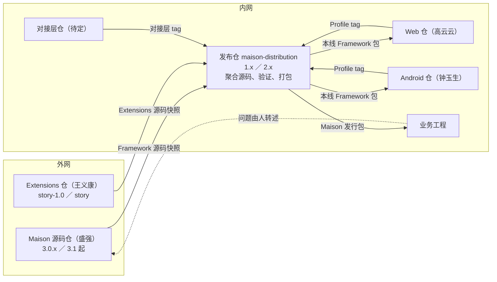
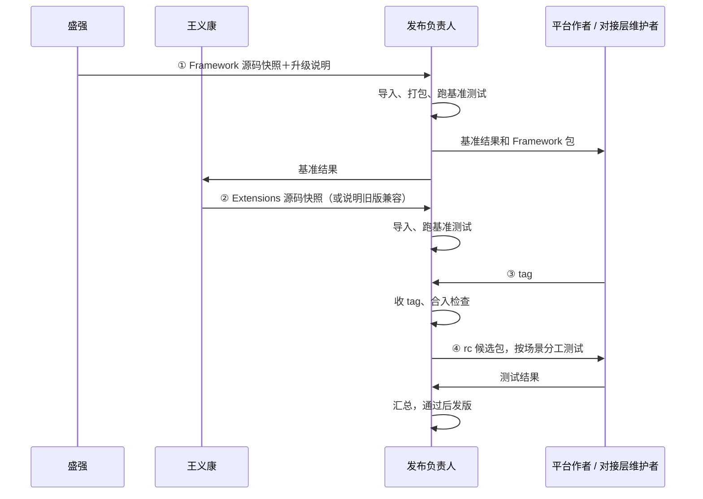

# Maison 共建方案：谁做什么、东西怎么流转、怎么发版

2026-11-05。当前有效方案，接替 [07](07-Maison内外网共建协作方案.md)。人员任命、内网建仓和需要外网配合的能力尚未落实，见 §1 的状态表和 §11。方案的来源与修订依据见 §13。

## 1. 一页总览

**目标**：鸿蒙、Web、Android 的业务团队在内网用上验证过的同一套 Maison。Framework、Extensions、各平台独立演进，每个组合都有人负责验证和发布，稳定版与新特性版可以同时维护。

内网发布仓汇集所有部件的源码，由它负责验证、打包，产出 Maison 完整发行包：



- 内网四个仓都分 `1.x`（稳定）、`2.x`（新特性）两条线。每条线每轮发版走四步：
  1. 导入 Framework 源码，打包并跑基准测试；
  2. 导入 Extensions 源码，跑基准测试；
  3. 收 Web、Android、对接层的 tag，做合入检查；
  4. 打候选包，全功能测试后发布。
- 发布仓汇集源码、负责验证和打包。特性改动在各部件自己的源码仓里进行。
- 平台仓和 Framework 的协作方式，与 Extensions 和 Framework 的协作方式相同：先装好发布仓打出的 Framework 包，再在上面开发自己的部分。
- 业务工程装的是一个 Maison 发行包。升级方式和 Framework 一致：替换包，再重新初始化（Framework 跑 init，Extensions 跑 adapt）。
- 有几项需要外网配合才能就绪：Web、Android 进入正式支持，以及 Extensions 2.x 的新目录（§10）。

| 状态 | 内容 |
|---|---|
| 已在用 | Framework、Extensions 在外网开发发布；鸿蒙业务手工拷贝发布件使用 |
| 代码可见、内网未跑过 | Framework 打包（`release:pack`）和 init；Extensions adapt |
| 本方案新增 | 内网四个仓和两条线、发布仓的导入与打包流程、基准和全功能场景集、Maison 发行包 |
| 需外网配合 | 见 §10 |

## 2. 人和责任

| 角色 | 人 | 负责 |
|---|---|---|
| Framework 维护者 | 盛强 | 外网开发、发版；把发布提交的源码快照带入内网，附升级说明；处理平台提出的公共能力诉求 |
| Extensions 维护者 | 王义康 | Extensions 适配、发版（`story-1.0` 对应 1.x，`story` 对应 2.x）；把发布提交的源码快照带入内网，说明配哪个 Framework |
| Web 维护者 | 高云云 | `maison-web` 两条线的开发、测试、打 tag；参与全功能测试中 Web 部分 |
| Android 维护者 | 钟玉生 | `maison-android`，职责同上 |
| 对接层维护者 | 待定 | `maison-adapters`：内网需求系统对接层的开发、在真实需求系统上验证、打 tag |
| 发布负责人 | 每条线每轮指定一人；可连任、可轮换；两条线可以是同一人 | 本线的导入、收 tag、打包、基准测试、组织全功能测试、发版、发布说明和交接 |
| 跨部件需求负责人 | 每项需求指定一人 | 一个需求涉及多个部件时，跟进各方直到整体可用 |
| 业务验收人 | 需求方或使用团队 | 提供真实场景，确认效果和已知限制 |
| 黄志强、潘雨晨 | 分工待定（§12） | — |

平台作者自测通过，说明这个平台在作者的工程上可用；发布仓用同一个候选包、同一组场景测试通过，说明这个组合可用。两者都要有，后者由发布负责人负责。

有外网和强模型条件的共建成员，可以向 Framework、Extensions 提交贡献，由所属维护者评审合入。

## 3. 约束

| 约束 | 影响 |
|---|---|
| 内网的代码、文档、日志不能带到外网 | 平台、对接层源码只在内网；需要 Framework 改动时，由人写成文字需求交给盛强 |
| 内网问题由人在内网分析，再用文字转述到外网 | 定位问题归属是内网的工作 |
| Framework 只在内网正式使用，外网用于开发和 Demo | 外网 Demo 跑主要场景，内网验证通过才算能用 |
| Framework、Extensions 由外网维护者开发 | 发布仓里这两部分只通过导入更新，问题回外网修 |
| Framework、Extensions 开发需要强模型 | 公共能力的改动由有外网强模型条件的人来做 |

## 4. 部件与版本线

| 部件 | 负责人 | 源码仓 | 在发布仓的位置 | 怎样进入发布仓 |
|---|---|---|---|---|
| Framework | 盛强 | 外网 Maison 源码仓 | `framework/` | 发布提交的源码快照（如 `git archive` 打出的文件），导入后快照文件不保存 |
| Web Profile | 高云云 | 内网 `maison-web` | `framework/profiles/web-app/` | 平台 tag |
| Android Profile | 钟玉生 | 内网 `maison-android` | `framework/profiles/android-app/` | 平台 tag |
| Extensions | 王义康 | 外网 `SimulatedWalletForHmos` | `extensions/base/`、`extensions/examples/` | 发布提交的源码快照 |
| 需求系统对接层 | 待定 | 内网 `maison-adapters` | `extensions/adapters/` | 对接层 tag |

Profile 随 Framework 一起打包；Extensions 和对接层随 Maison 发行包一起交付。业务拿到的是一个发行包。Profile 名 `web-app`、`android-app` 是暂定名，正式名由盛强定。

两条版本线：

| Maison 线 | Framework | Extensions | 内网四个仓的分支 |
|---|---|---|---|
| 1.x 稳定 | 3.0.x（外网 3.0 的维护补丁） | 1.x（`story-1.0` 分支） | `1.x` |
| 2.x 新特性 | 3.1 及以后（Demo main） | 2.x（`story` 分支） | `2.x` |

这一对应关系依据此前的用户说明（`story-1.0` 对应 Framework 3.0，`story` 跟随 Demo main），开线前由盛强、王义康确认。2.x 稳定、业务迁完后，1.x 停止维护；以后开 3.x，按同样方式加一条线。

## 5. 仓库

### 5.1 发布仓 `maison-distribution`

```text
maison-distribution/                       分支 1.x、2.x
├─ README.md                               发布负责人手册：导入、收 tag、打包、四步
├─ 来源.md                                  每个部件当前来自哪里
├─ framework/                              Framework 源码
│  ├─ package.json、scripts/、harness/、skills/、specs/、agents/ ……   随外网快照
│  ├─ profiles/
│  │  ├─ generic/、hmos-app/                随外网快照
│  │  ├─ web-app/                          来自 maison-web 的 tag
│  │  └─ android-app/                      来自 maison-android 的 tag
│  └─ dist/                                打包输出，不入库
├─ extensions/
│  ├─ base/                                Extensions 包，与业务工程 doc/extensions/base/ 同构，随外网快照
│  ├─ examples/knowledge/                  样例知识，随外网快照
│  └─ adapters/                            来自 maison-adapters 的 tag
├─ 打包/
│  ├─ pack-maison.ps1（或 .sh）             从当前提交打出 Maison 发行包
│  └─ 模板/安装与升级说明.md
├─ 验证/
│  ├─ 代表工程/hmos-sample/、web-sample/、android-sample/   真实业务代码的副本，测试时复制到 .work/ 并 git init
│  ├─ 场景/基准.md                          每个平台最核心的流程：安装 → init → adapt → 走一个小需求到 UT 通过
│  ├─ 场景/全功能.md                        三个平台的主要功能、首装、升级、Extensions 全流程
│  └─ 结果/maison-2.1.0-rc.1/              按候选存放：每个场景谁测、结果、日志或截图位置
├─ 发布/
│  ├─ maison-2.1.0.md                      发布说明
│  └─ 本轮交接.md                            当前候选、失败项、下一步
└─ .work/                                  不入库：测试现场
```

`来源.md` 示例：

```text
线：2.x        本轮：maison-2.1.0，进行到第 3 步
framework/                        Maison 源码仓 3.2.0，外网提交 a1b2c3d
framework/profiles/web-app        maison-web  web-2.0.3
framework/profiles/android-app    maison-android  android-2.0.1（沿用上一版）
extensions/base/、examples/       SimulatedWalletForHmos 2.1.0，外网提交 e4f5a6b，配 Framework 3.2.0
extensions/adapters/              maison-adapters  adapters-2.0.2
```

更新按目录归属进行。每次导入或收 tag 单独提交，提交信息写明来源和版本：

| 动作 | 整份替换 | 保留不动 |
|---|---|---|
| 导入 Framework | `framework/` | `framework/profiles/web-app/`、`android-app/` |
| 导入 Extensions | `extensions/base/`、`extensions/examples/` | `extensions/adapters/` |
| 收平台 tag | `framework/profiles/<名>/` | — |
| 收对接层 tag | `extensions/adapters/` | — |

打包步骤写进 `pack-maison` 脚本，只在 rc 或正式 tag 上执行：

1. 在 `framework/` 下安装打包依赖，执行 `npm run release:pack`，在 `framework/dist/` 得到 `framework-<版本>.zip` 和 `.manifest.json`；再执行 `npm run release:verify` 核对。打包按目录收集文件，Web、Android 随之进入包内的校验清单。
2. 建目录 `maison-<版本>/`，放入 Framework 包和整个 `extensions/`。
3. 从 `来源.md` 生成版本清单，按模板填写安装说明，附上发布说明。
4. 压成 `maison-<版本>.zip`，计算 sha256，存到团队发布存储。

### 5.2 平台仓 `maison-web`、`maison-android`

协作方式与 Extensions 仓相同：`demo/` 里装着发布仓打出的 Framework 包，作者在 `profile/` 下开发；测试时把 demo 复制成一次性工程，装入开发版再跑。

```text
maison-web/                                分支 1.x、2.x（maison-android 结构相同）
├─ AGENTS.md                               维护约定：同步、开发、测试、交付
├─ 基线.md                                  demo/framework 来自发布仓哪个提交打出的包
├─ profile/web-app/                        开发源，即交付内容
│  ├─ profile.yaml                         识别文件、能力与 provider、设备能力、个人前置
│  ├─ config-defaults.json                 init 写进项目配置的平台默认值
│  ├─ phase-rules-overlays/                spec、plan、coding、ut 等阶段规则的平台补充
│  ├─ skills/                              各阶段 Skill 的平台补充、skill-assets.yaml
│  ├─ harness/                             编译、lint、UT、浏览器测试的 provider
│  │  └─ tests/unit/、tests/fixtures/      平台单元测试和 fixture
│  ├─ doc-skeletons/                       init 生成的架构说明、模块目录骨架
│  └─ templates/agents-md/                 宿主入口文件的平台片段
├─ demo/                                   消费工程：真实 Web 代码＋装好的 Framework
│  ├─ framework/                           只读，只经同步更新
│  ├─ framework.config.json                project_profile 为 web-app
│  └─ 业务代码、宿主入口
├─ test/                                   测试脚本：复制 demo → 用 profile/web-app 换掉副本的 framework/profiles/web-app → 跑
└─ docs/                                   需求、设计、交付记录（每个 tag 一段）
```

| 动作 | 做法 |
|---|---|
| 同步 | 发布仓本线完成第 1 步后，取发布仓打出的 Framework 包，在 `demo/` 里解压替换 `framework/`，执行 framework-init UPDATE，更新 `基线.md`，单独提交 |
| 开发 | 从线分支拉任务分支，修改 `profile/web-app/` |
| 测试 | 端到端测试在 `test/` 的一次性工程里跑；单元测试和 fixture 在发布仓源码的 checkout 里跑（§10） |
| 交付 | 合回线分支，打 tag（如 `web-2.0.3`），在 `docs/` 写交付记录，通知发布负责人 |

### 5.3 对接层仓 `maison-adapters`

```text
maison-adapters/                           分支 1.x、2.x
├─ adapters/                               交付内容：入口、鉴权及内部模块
├─ test/                                   按 Extensions 演进记录里 [对接层] 条目的验证项，在真实需求系统上跑
└─ docs/                                   接口变化与交付记录
```

首个版本从一个已经接通需求系统的业务工程提取。

## 6. 发布物与安装

### 6.1 Extensions 的包形态

业务工程里的 `doc/extensions/` 分成四块，各有归属：

| 目录 | 归谁 | 内容 | 升级时 |
|---|---|---|---|
| `base/` | 包 | manifest、skills、hooks、rules | 整份替换 |
| `knowledge/` | 业务 | 业务知识及其加载清单 | 由 `/story adapt` 按演进记录适配 |
| `adapters/` | 业务 | 需求系统对接层 | 由 `/story adapt` 按演进记录适配 |
| `adaptation.yaml` | 业务 | 已适配版本等状态 | 由 adapt 写 |

- Extensions 发布的包就是 `base/`，结构与业务工程里的 `base/` 一致。
- Maison 发行包另外带上内网对接层 `adapters/`（首装时用），以及样例 `examples/knowledge/`。
- 业务工程的 `paths.extension_dir` 指向 `doc/extensions/base`，Framework 从这里读 manifest、skills 和 hooks。
- 新业务还没有自己的知识，adapt 会读取发行包里的样例作为参考。样例留在包里，不进业务代码仓。模型会照着样例写，所以样例要选达到金样水平的内容。
- 外网 Extensions 仓的 Demo 用于外网开发和测试，它的替身对接层只留在 Demo 里。

这一目录是 Extensions 2.x 的整改目标，由王义康在 Extensions 2.x 的 Spec 里设计并实施，前提见 §10。主要改动有三项：

- 拆出 `base/`、`knowledge/`、`adapters/` 三个目录；
- Extensions 的脚本从 `../adapters/` 加载对接层；
- adapt 支持"本工程替换 base 之后自升级"，首装时从发行包目录读取样例。

**1.x 线的过渡做法**：

- Extensions 1.x 保持现有目录，只能从已经装好 Extensions 的工程执行 adapt，1.x 发行包写明"从已适配的业务仓执行 adapt"。
- 能否直接从发行包目录安装，由王义康核实。
- 1.x 停止维护时，这条过渡路径一起结束。

### 6.2 Maison 发行包

```text
maison-2.1.0.zip（另附 maison-2.1.0.zip.sha256）
└─ maison-2.1.0/
   ├─ 安装与升级说明.md                首装、升级步骤（§6.4）
   ├─ 发布说明.md                     支持范围、已知问题、相对上一版的变化
   ├─ 版本清单.md                     发布仓 tag 和提交；每个部件的来源和版本
   ├─ framework-3.2.0.zip            发布仓打出的 Framework 包，含 web-app、android-app
   ├─ framework-3.2.0.manifest.json
   └─ extensions/
      ├─ base/                        Extensions 包；升级时只用它
      ├─ adapters/                    内网需求系统对接层；首装时复制
      └─ examples/knowledge/          样例知识；adapt 读取参考，留在包里
```

### 6.3 装好后的业务工程（2.x）

```text
<业务工程>/                                 必须是 Git 根
├─ framework/                               解压 framework-3.2.0.zip 得到
│  └─ harness/node_modules/                 init 时 npm install 生成，不入库
├─ framework.config.json                    init 生成：项目名、project_profile、架构分层；paths.extension_dir 指向 doc/extensions/base
├─ framework.local.json                     个人工具链路径，不入库
├─ AGENTS.md、CLAUDE.md 等                   init 生成宿主入口；adapt 写 Extensions 标记区
└─ doc/
   ├─ architecture.md、module-catalog.yaml   init 生成骨架，业务填写
   ├─ usage.json                            使用记录
   └─ extensions/
      ├─ base/
      ├─ knowledge/
      ├─ adapters/
      └─ adaptation.yaml
```

### 6.4 首装与升级

首装，在业务工程的接入分支上进行：

1. 从发布说明确认要装的版本和支持范围，核对发行包的 sha256。
2. 把 `framework-<版本>.zip` 解压到工程根，得到 `framework/`。
3. 运行 framework-init，选对工程类型。init 会安装 Harness 依赖、扫描工程、确定计划，并生成 `framework.config.json` 和宿主入口。
4. 把发行包里的 `extensions/base/`、`extensions/adapters/` 复制到 `doc/extensions/` 下。
5. 在业务工程里打开会话，执行 `/story adapt`。adapt 会参考发行包里的 `extensions/examples/knowledge/` 生成知识，写入 `adaptation.yaml`，把 `paths.extension_dir` 设为 `doc/extensions/base`，并核对对接层和入口。
6. 在 `framework.local.json` 里填写个人工具链路径。
7. 按安装说明里的接入验收项确认可用，再合入业务主线。

Framework 要先于 Extensions 安装，因为 Extensions 的宿主入口由 Framework 按 manifest 生成。

升级：

1. 解压新的 Framework 包，替换 `framework/`，执行 framework-init UPDATE。
2. 替换 `doc/extensions/base/`，执行 `/story adapt`。adapt 按 `adaptation.yaml` 之后的演进条目适配知识和对接层；发布说明里标明对接层有新版本时，adapt 按对应条目处理。
3. 业务自己的知识、规则、配置保持原样。
4. 2.x 不接续 1.x 的在途需求：在途需求在 1.x 工程上做完，新需求进 2.x。

## 7. 一轮发版的四步



### 第 1 步：导入 Framework，作为本轮起点

| 项 | 内容 |
|---|---|
| 谁 | 盛强带入快照，发布负责人执行 |
| 在哪 | 发布仓对应的线：3.0.x 进 `1.x`，3.1 起进 `2.x` |
| 做什么 | 按 §5.1 的规则导入 `framework/`，更新 `来源.md` 并提交；打出 Framework 包；装进代表工程，跑**基准场景集** |
| 产出 | 基准结果（哪些通过；哪些因 Extensions、Profile 还没适配而失败，各归谁）；本线的 Framework 包 |
| 交给谁 | Framework 包和基准结果交平台作者、对接层维护者，用于同步；基准结果交王义康 |
| 完成 | 本线已切到新 Framework，基准结果已记录并通知到人 |

### 第 2 步：导入 Extensions

| 项 | 内容 |
|---|---|
| 谁 | 王义康在外网适配发布并带入快照，发布负责人执行 |
| 在哪 | 外网对应分支（`story-1.0` 或 `story`）→ 发布仓同一条线 |
| 做什么 | 导入 `extensions/base/` 和 `examples/`，更新 `来源.md`，重跑基准场景集。旧版 Extensions 兼容新 Framework 时，由王义康写明，本步沿用第 1 步的结果 |
| 产出 | 第二份基准结果 |
| 完成 | 本线的 Framework 和 Extensions 组合已确定，基准结果已记录 |

### 第 3 步：收平台和对接层的 tag

| 项 | 内容 |
|---|---|
| 谁 | 高云云、钟玉生、对接层维护者，可以同时进行；发布负责人收 tag |
| 前提 | 部件作者已按第 1 步的 Framework 包完成同步（§5.2）。第 1 步完成就可以开始；只有依赖 Extensions 新能力的部分才需要等第 2 步 |
| 做什么 | 作者打 tag 交付；发布负责人把 tag 里的交付目录整份复制到发布仓的对应位置，更新 `来源.md` 并提交 |
| 合入检查 | 复制的内容与 tag 一致；作者的 `基线.md` 与本线当前提交一致，不一致时请作者在当前组合上重跑；在发布仓 `framework/harness` 跑 Framework 自带测试（含平台 fixture）；跑该部件的基准场景 |
| 完成 | `来源.md` 已记录新 tag，合入检查通过 |

### 第 4 步：全功能测试与发布

| 项 | 内容 |
|---|---|
| 谁 | 发布负责人组织；平台作者测各自平台，发布负责人测鸿蒙、首装和升级 |
| 做什么 | 打 rc tag（如 `maison-2.1.0-rc.1`），冻结输入；用 `pack-maison` 打出候选包；所有人用同一个候选包，在代表工程上跑**全功能场景集**，包括三个平台的主要功能、从候选包首装、从业务在用的旧版本升级、Extensions 全流程；结果存进 `验证/结果/<候选>/` |
| 失败 | 交给对应负责人修复，修好后出新候选；只重跑受影响的场景，部件版本相同的场景沿用原结果 |
| 产出 | 正式 tag（如 `maison-2.1.0`）、Maison 发行包、发布说明 |
| 完成 | 全功能场景集在同一个候选包上通过；发行包和发布说明已存档，并通知业务 |

### 从哪步开始

| 这轮变了什么 | 从哪步开始 |
|---|---|
| Framework 新版本或补丁 | 第 1 步 |
| 只有 Extensions 新版本或补丁 | 第 2 步 |
| 只有 Web、Android 或对接层的功能或修复 | 第 3 步 |
| 只有打包或安装说明出错 | 第 4 步（§9.2） |

一轮还没走完又来了新 Framework：候选还没冻结的，由发布负责人决定本轮换用新版（回到第 1 步）还是留到下一轮；候选已冻结的，留到下一轮。

## 8. 并行

### 8.1 1.x 和 2.x 同时进行


- 两条线的分支、来源、基准结果、候选和发布负责人各自独立；同一人可以同时负责两条线。
- 外网 3.0.x 补丁和 `story-1.0` 补丁进 1.x 线；3.1 起的版本和 `story` 版本进 2.x 线。
- **跨线修复**：修复者在一条线上交付修复时，写明另一条线是否也需要。需要的，按另一条线的代码在那条线也交付一次；不需要的，写明原因。2.x 的新功能默认留在 2.x，需求方要求时，作为 1.x 的一项需求来处理。

### 8.2 同一条线内

- Web、Android、对接层同时做第 3 步，各自交 tag，最后由第 4 步统一验证整个组合。
- 同一平台两人并行：各开任务分支。后合入的人先把已合入的成果合进自己的分支，在平台仓里解决冲突，再合回线分支。打出的 tag 包含两个人的成果。
- 一个平台能发、另一个还没做完：没做完的留在任务分支，本轮 `来源.md` 沿用它的上一个 tag。

## 9. 其他场景

### 9.1 平台需要 Framework 的新能力

1. 平台作者写文字需求：要支持什么、为什么、做到什么程度算可用。内容只写需求，不带内网代码。
2. 由内外网都能访问的人交给盛强，排进 Framework 的版本计划，在外网实现并用外网示例工程验证。Android 的工程拓扑能力就是一例（§10）。
3. 新 Framework 发版后，从第 1 步进入对应的线。
4. 等待期间，平台作者先做不依赖新能力的部分；依赖新能力的功能，留到新能力就绪后再写进支持范围。

### 9.2 发行包或安装说明本身出错

部件都没有变化时，由发布负责人在发布仓修正 `打包/` 或说明，出补丁版本号（如 `maison-1.3.2`），从第 4 步开始，重跑受影响的安装或升级场景。修复也要检查另一条线是否需要。

### 9.3 发布负责人换人，或候选验证失败

发布负责人随时把本轮状态写进发布仓：`来源.md`、当前候选、`验证/结果/`、`发布/本轮交接.md`（失败项及归属、下一步）。换人时，接手的人从同一个候选和失败记录继续；要换输入的，按 §7 的规则开新候选。

### 9.4 业务报了问题

| 问题出在 | 怎么修 | 回到哪一步 |
|---|---|---|
| 业务自己的知识、规则、配置 | 业务团队修改 | — |
| Web、Android Profile 或对接层 | 部件作者在对应仓、对应线修复，打新 tag | 第 3 步 |
| Framework 或 Extensions | 内网分析的人写清现象、复现条件和期望，交给盛强或王义康；外网发版后导入 | 第 1 步或第 2 步 |
| 发行包、安装说明 | 发布负责人修正 | 第 4 步 |

定位清楚之前，业务工程里的 `framework/` 和 `doc/extensions/base/` 保持发行包原样。只有该业务的配置和在途需求能在上一个版本上继续时，才回退到上一个版本；否则保持现场，等修复版本。

### 9.5 某个部件赶不上本轮

本轮 `来源.md` 沿用它的上一个 tag。如果上一个 tag 与本轮的 Framework 不兼容，发布说明写明本轮不支持该平台，该平台的业务继续使用上一个版本。

### 9.6 外网停止维护旧线

盛强或王义康决定停止为 3.0.x 或 `story-1.0` 出补丁时，发布负责人与需求方商定迁到 2.x 的计划，发布说明写明 1.x 的维护截止时间。

## 10. 需要外网配合的事

| 事项 | 现状与依据 | 谁做 |
|---|---|---|
| init 能选到 Web、Android | init 的工程类型菜单只有 generic、hmos-app（Maison `skills/reference/confirmation-registry.yaml`） | 盛强 |
| Web、Android 的 fixture 能在源码测试中运行 | fixture 扫描根只登记了 hmos-app、generic（Maison `harness/tests/run-tests.ts`）；发布件里的 `npm test` 是 `check:global`，不跑 fixture | 盛强 |
| 发布仓能直接执行 `release:pack`、`release:verify` | 打包按目录收集文件（Maison `scripts/release-pack-rules.mjs`）；这套命令在发布仓里能否跑通、打包依赖能否在内网安装，需要核实 | 盛强核实，需要时说明发布仓里的打包方式 |
| Android 多仓、二进制依赖的工程结构 | 需要 Framework 新增核心能力；Maison 的 Android 适配计划排在 3.2.0，只能进 2.x 线 | 盛强按版本计划交付 |
| 在扩展根之外登记知识 | `paths.extension_dir` 指向 `base/` 后，Framework 能读到 manifest、skills、hooks；但知识只能经 manifest 登记，引用路径不得含 `..`，必须落在扩展根内（Maison `harness/extension-loader.ts` 的 `safeResolve`、`harness/scripts/utils/project-relative-path.ts`），所以 `doc/extensions/knowledge/` 登记不进去 | 王义康提需求，盛强设计排期 |
| Extensions 2.x 目录整改 | 见 §6.1；依赖上一项 | 王义康 |

这些就绪之前：

- Web、Android 只在代表工程里试验，发布说明的支持范围暂不列入；
- Extensions 2.x 保持现有目录。

## 11. 先做的事

| 顺序 | 事项 | 负责 | 做完的样子 |
|---|---|---|---|
| 1 | 指定首轮发布负责人和对接层维护者；确认 §4 的版本线对应关系 | 团队；盛强、王义康 | 有名字；对应表确认 |
| 2 | 核 §10 各项 | 盛强、王义康 | 写明哪个版本提供、就绪前怎么试 |
| 3 | 建四个仓和 `1.x`／`2.x` 线；迁入 Web、Android 现有源码和历史；从已接通的业务工程提取对接层 | 高云云、钟玉生、对接层维护者 | 每个部件都能在自己的 demo 或工程上跑通 |
| 4 | 发布仓 1.x 线导入内网当前在用的 Framework、Extensions 源码；在发布仓跑通 `release:pack`；写 `pack-maison`；建鸿蒙代表工程和基准场景集；跑第一次基准测试 | 发布负责人；盛强、王义康带入快照 | 1.x 有了第一份基准结果和第一个 Framework 包 |
| 5 | 1.x 出第一个 Maison 发行包，在一个真实鸿蒙业务工程上首装 | 发布负责人 | 第一个正式版本和发布说明 |
| 6 | Extensions 2.x 目录整改完成后，2.x 线开始第一轮 | 王义康；发布负责人 | 2.x 完成第 1、2 步 |

## 12. 还没定的事

| 事项 | 由谁定 |
|---|---|
| 首轮发布负责人 | 团队 |
| 对接层维护者，以及从哪个业务工程提取首个版本 | 团队 |
| Web、Android Profile 的正式名称 | 盛强 |
| Extensions 2.x 目录整改所在版本；Framework 支持扩展根之外登记知识的排期 | 王义康、盛强 |
| 基准场景集、全功能场景集的具体内容 | 首轮发布负责人与部件作者 |
| 1.x 何时停止维护 | 需求方与发布负责人，看业务迁移进度 |
| 黄志强、潘雨晨的分工；做公共能力需要外网和强模型条件 | 团队 |
| lite、review 增强由谁做（属 Framework 公共能力，在外网开发） | 团队与盛强 |

## 13. 讨论与修订依据

各轮原稿：07 原件 `a043c874`；本文各版 `f7123b78`、`0f9c1f24`、`0b63ac57`、`63cc1293`。另一会话的交接见 [09](09-会话交接-共建诉求场景与精简边界.md)。

### 13.1 用户诉求与纠正

| 日期 | 用户诉求或纠正（引号内为原话） | 带来的决定 |
|---|---|---|
| 11-04 | 当前讨论"缺少一个让人看懂的描述"，"有些设计没有考虑真实情况，过于理想化"；内网体系、发布流程太重，Profile 被当成插件；内网现状是手工把发布件拷进业务仓 | 新写替代 07 的方案，读者是共建成员，开头放一页总览 |
| 11-05 | "你设计的走向了过于简单的极端，没有充分考虑实际场景的复杂度"；必须覆盖：fwk 新版本更新发布仓并基准测试、ext 适配合入并基准测试、profile 从发布仓取 fwk 开发后提交、发布仓全功能测试并发布，"上述 1-4 可能同时并行发生在 maison 的 1.x（稳定发布分支）、2.x（新特性开发分支）" | 分仓、两条线、四步发版（§4、§7、§8） |
| 11-05 | "发布仓不应该归档 zip 实体，而是源码，要发布还是走发布仓的打包流程"；"发布仓是一个聚合态的 Maision 全功能代码仓，它本身不直接演进特性，但是要提供源码管理、功能验证、打包发布的能力"；profile 与 framework 的协作"类似当前 story 跟 framework 的协作"；story 后续也同步源码到发布仓；对接层作为内网部件随包发布 | 发布仓聚合源码并打包（§5.1）；平台仓带 demo（§5.2）；对接层仓（§5.3） |
| 11-05 | 改造 Extensions 为 knowledge、adapters、base，"以后只替换 base"；"story 的发布包结构，不是应该跟业务仓的 Extensions 里的结构一样吗"；base 里的样例"会提交到业务代码仓，这个有点问题" | 发布包与业务工程同构，升级为替换 base 后执行 adapt，样例留在包里（§6） |
| 11-05 | "文档里不要叫 story 吧，应该是 extensions"；"文档有多轮迭代的打补丁问题，请重新整理" | 部件统称 Extensions；本文整体重写 |

### 13.2 被更正的判断

| 曾经的判断 | 问题 | 现在的做法 |
|---|---|---|
| 内网一个仓，共用 `main` 打 tag | 一个平台能发、另一个还有未完成内容时，tag 会把未完成内容带上；也没有稳定线和新特性线的并行 | 分仓，两条线，各部件各自打 tag（§5、§8） |
| 没改的平台只验能装上、能 init | Framework 变了，平台源码不变也可能受影响 | 基准场景覆盖所有平台，第 4 步用同一候选包验证（§7） |
| 作者在自己工程上测过就写进版本记录 | 没有人对组合的结果负责 | 发布仓有代表工程和场景，由发布负责人负责（§2、§7） |
| 内网后加的 Profile 会被 Framework 升级覆盖，需要核上游校验清单怎么处理附加文件 | 推错了对象 | 发布仓随源码打包，Profile 进入包内校验清单（§5.1） |
| 07 要求每版三平台全验 | 夸大了 07，07 允许按影响复验 | 补丁轮按影响缩小范围（§7） |
| 固定一位发布负责人 | 用户原话："这个不是关键，理论上共建团队的任何人都可以轮值负责" | 每条线每轮指定一人，交接靠发布仓里的记录（§2、§9.3） |
| 发布仓归档上游 Framework ZIP 和 Demo | 用户要求发布仓放源码，并由它自己打包 | §5.1 |
| 平台从上游 ZIP 手工组装自测工程 | 与 Extensions 已在用的协作方式不一致 | 平台仓带 demo，按发布仓打出的包同步（§5.2） |
| Extensions 以正式 Demo 作为发布形态 | Demo 是开发测试工程 | 发布 `base/`，随 Maison 发行包交付（§6.1） |
| 样例知识放进 `base/`、不登记加载 | 会提交到业务代码仓 | 样例留在发行包里，adapt 从包读取（§6.1） |
| Extensions 三分目录需要 Framework 整体改扩展约定 | 混淆了"运行时 Framework 从哪里读"和"升级怎么做"；升级由 adapt 完成 | Framework 只需支持在扩展根之外登记知识（§10） |

### 13.3 核到的事实

以下来自本地源码的只读核对，没有在内网运行过。

| 事实 | 来源 |
|---|---|
| Profile 位于 `framework/profiles/<id>/`，由 profile.yaml、规则 overlay、harness provider 和 Skill 补充组成 | Maison `profiles/README.md`、`profiles/hmos-app/` |
| init 菜单为 `1=generic 2=hmos-app` | Maison `skills/reference/confirmation-registry.yaml` |
| fixture 扫描根只登记了 hmos-app、generic；发布件里的 `npm test` 是 `check:global` | Maison `harness/tests/run-tests.ts`、`demo/framework/README.md` |
| Framework 打包按目录收集文件；版本取自 `package.json`，构建标识取打包所在仓的 HEAD；输出到 `dist/` | Maison `scripts/pack-release.mjs`、`scripts/release-pack-rules.mjs` |
| 发布件带逐文件校验清单；`framework/harness/node_modules` 不随包，由 framework-init 安装 | Maison `harness/scripts/utils/framework-integrity.ts`、`demo/framework/README.md` |
| Android 适配要新增工程拓扑核心维度和 init 问询，计划在 3.2.0 | Maison `.cursor/plans/android_工程适配_5e3400c3.plan.md` |
| Framework 在扩展根读 manifest，技能入口固定在扩展根 `skills/`，知识清单在 manifest 里；引用路径不得含 `..`、必须落在扩展根内 | Maison `harness/extension-loader.ts`、`harness/scripts/utils/instance-skill-bridge.ts`、`harness/scripts/utils/project-relative-path.ts` |
| 本仓 Extensions 与 Framework 的协作：`demo/framework/` 只读，经解压加 framework-init UPDATE 同步；在 `extensions/` 开发；测试时装入一次性工程 | 本仓 `AGENTS.md` |
| adapt 按目录归属替换包的内容、合成 manifest、按演进记录适配目标；来源目前须是带 `framework.config.json` 的工程，目标须是 Git 根 | `extensions/skills/story-adaptation/SKILL.md`、`scripts/adapt-scan.mjs` |
| 当前 `adaptation.yaml`、`knowledge/`、`skills/story/scripts/adapters/` 归目标 | `extensions/adaptation.yaml`、`extensions/skills/story-adaptation/SKILL.md` |

### 13.4 与 07 的取舍

| 07 | 本文 | 原因 |
|---|---|---|
| 三仓 | 四仓（增加对接层仓） | 用户决定对接层作为内网部件随包发布 |
| 发布仓 `inputs/` 归档原包，`components/` 存已接纳快照，平台回交时三方比较 | 发布仓保存源码，部件 tag 整份替换对应目录 | 发布仓是聚合源码仓；整份替换之后不需要三方比较 |
| 平台仓用 `dependencies.json` 记录依赖 | 平台仓用 `demo/` 加 `基线.md` | 沿用 Extensions 已在用的协作方式 |
| 九类分支 | 两条长期线＋任务分支＋tag | 1.x、2.x 并行是主干 |
| 当值轮换与交接制度 | 每条线每轮指定一人，交接靠发布仓里的记录 | 保留责任和交接，省去制度 |
| 合入验证、发行验证 | 基准测试、合入检查、全功能测试 | 对应四步的具体时点 |
| assembly、dist 发行装配 | `pack-maison` 加 Framework 自带的打包命令 | 复用 Framework 打包，发布仓只负责组装 |

### 13.5 场景覆盖

| 场景 | 来源 | 本文 |
|---|---|---|
| Framework 新版本作为起点，基准测试 | 用户 1 | §7 第 1 步 |
| Extensions 适配合入，基准测试 | 用户 2 | §7 第 2 步 |
| Profile 从发布仓取 Framework 开发，交回 | 用户 3 | §5.2、§7 第 3 步 |
| 全功能测试并发布 | 用户 4 | §7 第 4 步 |
| 1—4 在 1.x、2.x 并行 | 用户 5 | §4、§8.1 |
| Framework 已到，Extensions 未适配 | 09 §5 | §7 第 1、2 步，第 3 步可先开始 |
| 同名 Framework 不同构建 | 09 §5 | §5.1（`来源.md` 记外网提交；发布仓打的包以发布仓提交为构建标识） |
| 只有 Web 做普通功能 | 09 §5 | §7"从哪步开始"、§8.2 |
| 两人并行改同一平台 | 09 §5 | §8.2 |
| Web 可发，Android 有未完成内容 | 09 §5 | §5.2、§8.2 |
| 平台基于 F0 开发，集成时已是 F1 | 09 §5 | §7 第 3 步合入检查 |
| 平台需要公共能力 | 09 §5 | §9.1 |
| Framework 升级期间稳定版报错 | 09 §5 | §8.1 |
| 一个修复影响多个分支 | 09 §5 | §8.1 跨线修复 |
| 发行装配或安装说明出错 | 09 §5 | §9.2 |
| Profile 未变，Framework 变了 | 09 §5 | §7 第 1 步基准、第 4 步 |
| 目标工程首次安装 | 09 §5 | §6.4 |
| 旧工程升级，保留知识、规则、对接 | 09 §5 | §6.1、§6.4 |
| 1.x 在途需求遇到 2.x | 09 §5 | §6.4 |
| 发布负责人换人，候选验证失败 | 09 §5 | §9.3 |
| 问题未定位，或上游不修旧线 | 09 §5 | §9.4、§9.6 |
| 一个平台暂不能进入新版 | 09 §5 | §9.5 |
