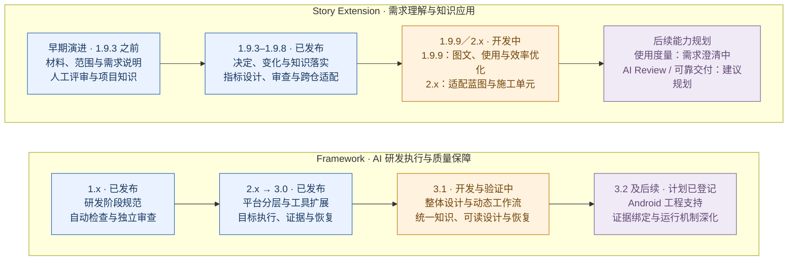

# Framework 与 Story Extension：研发执行与需求知识两条能力主线的演进

> 单页 PPT 内容稿｜截至 2026-10-15｜正文用于展示，文末备注与来源用于讲解和追溯。

## 单页正文

**Framework 持续提升 AI 的设计、开发、验证与自主执行能力；Story Extension 持续提升需求理解、知识应用、评审与变更管理能力。两个产品各有建设目标，通过明确接口协同交付。**

| 能力建设主线 | 建立基础流程 | 增强复用与可靠性 | 面向复杂需求深化 |
|---|---|---|---|
| **Framework：AI 研发执行与质量保障** | **1.x · 已发布** 解决研发步骤与完成标准不统一：贯通需求、设计、编码、审查、测试，建立自动检查、独立审查与真实编译测试 | **2.x → 3.0 · 已发布** 解决工程复用与持续执行问题：平台分层、工具与扩展接入、Goal 目标驱动执行；完善测试证据、完成判定和失败恢复 | **3.1 · 开发与验证中** 解决复杂任务的设计与执行组织：整体蓝图、施工单元、动态工作流、统一知识和可读设计；继续验证自动恢复与交付可靠性 |
| **Story Extension：需求理解与知识应用** | **早期演进（1.9.3 之前）** 解决材料分散、业务理解与评审表达问题：材料收集、范围确认、需求说明、人工评审、会议理解和项目知识应用 | **1.9.3–1.9.8 · 已发布** 解决决定、变化与知识落实问题：会议裁决、增量更新、指标与埋点设计、跨阶段知识传递；完善审查与跨仓适配 | **1.9.9／2.x · 开发中** 1.9.9 建设图文表达、递归收料、页面交互、适配与效率优化；2.x 专注适配 Framework 蓝图版本，衔接共同设计、需求交付与施工单元 |

**当前成果：** Framework 形成可复用的研发流程、目标执行与证据验证能力；Story Extension 形成材料理解、需求评审、知识应用与增量更新能力。

**下一步：** Framework 收口复杂任务设计、动态执行与恢复的真实验收；Story Extension 完成 1.9.9 能力优化与 2.x 蓝图适配的验证。

**后续能力规划：** 使用与效果可度量——按需求留存事实，结合 Git 跨项目统计；AI 提交前 Review——开发者用 AI 检视修复，committer 聚焦架构与实现设计；更可靠的 AI 交付——自动取材、同步与恢复，减少人工操作，保留关键决策责任。

> **规划状态：** 使用度量拟纳入 1.9.9，正在需求澄清；Review 增强与交付自动化为建议规划，具体版本与实施方案待定。三项需要 Framework 与 Extension 按各自职责协作。

> **发布边界：** 当前可确认的正式发布基线为 Framework **3.0.0**、Extension **1.9.8**。已发布版本仍有已知效果缺口；后续版本的实现、构建件和局部测试通过，不等于整体业务验收或正式发布。

## 可选图形：双产品演进图

此图可替换正文表格。单页 PPT 选用表格或图形之一，避免重复堆叠。蓝色为已发布，橙色为开发与验证中，紫色为后续方向；两条泳道按能力阶段对照，不表示版本同期发布或一一配套。

## 汇报备注（不放入单页正文）

### 建议讲解口径

本页平等汇报两个产品的建设成果。Framework 的评价对象是 AI 能否在明确目标、授权和证据约束下完成设计、开发与验证，并在失败后可靠恢复。Story Extension 的评价对象是 AI 能否正确理解需求和项目知识，形成可评审的说明，准确承接人的决定及后续变化。各自的能力、发布和验收独立说明。

Framework 的主线是“阶段规范 → 通用化与目标执行 → 复杂任务设计与动态组织”。从最初的研发阶段与质量门禁，发展到多工程类型、真实工具执行、证据驱动完成和恢复，再向蓝图、施工单元、动态工作流和统一知识深化。这些能力服务框架的多类研发任务，范围不局限于 Story 的接入需要。

Story Extension 的主线是“材料与需求表达 → 决定、变化与知识落实 → 需求交付质量与复杂设计协作”。从需求取材、范围和人读说明，发展到会议裁决、更新、指标设计、知识传递和跨仓适配，当前 1.9.9 继续构建图文、使用与效率优化能力；2.x 专注适配 Framework 蓝图版本，承接新的设计权威和施工组织方式。

两者的协作关系单独说明：需求依据、项目知识与人的决定参与整体设计，设计结果供需求评审与施工共同使用，变更回到相应权威来源。协作是否有效要验证，但不以某一个消费工程的采用范围代表另一产品的全部能力，也不把技术依赖关系表述为产品重要性的主次关系。

已经发布的成果与仍待验证的效果分别报告。Framework 的重点验收是设计、执行、验证和恢复能否可靠完成；Story Extension 的重点验收是理解、表达、知识应用和变化传递能否准确完成。本次不报告未经同条件验证的效率提升比例，也不以局部测试通过代替整体效果。

### 版本与状态补充

| 对象 | 关键增量 | 状态边界 |
|---|---|---|
| Framework 1.0 | 全阶段 Skill、Harness、独立 verifier、鸿蒙真实编译与 UT | 已发布；真机 UI 自动化尚非完整能力 |
| Framework 2.0–2.2 | profile 平台分层、Extension、Hylyre、阶段产物组织、确定性配置与初始化 | 已发布 |
| Framework 2.3 | Goal 目标执行、Skill 分层、Spec/Plan 阶段命名和工程工具增强 | 已发布；2.4 开发窗口未正式发布，部分探索在 3.0 撤销 |
| Framework 3.0 | 证据驱动完成、运行时统一、跨阶段恢复、视觉和测试证据消费 | 已发布；具体构建身份与使用效果按发布件和对应运行证据判断 |
| Framework 3.1 | 蓝图与 CU、动态工作流、知识统一、人读蓝图、可靠性收敛 | 已有实现及被采用的构建件；动态工作流宿主验收、人读蓝图验收和部分发布前回归仍未完成 |
| Framework 3.2 | Android 支持、旧基线清理、provider 证据绑定、完整性与视觉证据深化 | 已登记后续计划，尚未发布；具体范围以现行计划为准 |
| Extension 1.9.3 | 会议并入材料、停等统一、原义及时送达、解析与检查收敛 | 已发布；主动索料、审查执行和成本仍有缺口 |
| Extension 1.9.4 | update 统一承接材料、评审与决定变化 | 已发布；实跑更新传播成立，审查闭环仍有后续修复 |
| Extension 1.9.5–1.9.7 | 指标与埋点设计、知识自描述和跨阶段落实、人签与审查收敛 | 已发布；人的决定漏记、冲突与未决处理、重复读取仍有遗留 |
| Extension 1.9.8 | 六宿主入口、开发与发布分离、统一安装、首次知识适配质量 | 最新已发布版，含 09-29、09-30 同版补充；Story 业务机制主要继承 1.9.7 |
| Extension 1.9.9 | 图文与材料合同、递归收料、页面交互、SVG、本地阅读、适配与效率 | 当前 1.x 开发版；存在返修与待完成行为验证，未发布 |
| Extension 2.x | 适配 Framework 蓝图版本：需求依据与知识进入蓝图，Story/Review 承接共同设计，衔接 CU 施工单元 | 当前开发源为 2.0.4；蓝图适配尚未完成整体验收与正式发布 |
| 使用与效果可度量 | 按需求归档 Framework + Extension 使用事实，结合 Git 支持跨项目统计 | 拟纳入 1.9.9，需求澄清中；文件组织、身份关联与统计口径未定案 |
| AI 提交前 Review | 开发者用 AI 完成检视、修复和复核；committer 聚焦架构、实现设计与合入裁决 | 建议规划；具体门禁、试点范围和版本待定 |
| 更可靠的 AI 交付 | 自动取得材料、同步决定与变化、完成可恢复问题的修复验证，逐步减少人工操作 | 建议规划；按实际成熟度推进，保留人的关键决策责任 |

Framework 后续演进以自身研发任务范围为准：3.1 深化复杂设计、动态执行、知识和恢复，3.2 登记 Android 及证据能力等后续方向。某个 Extension 尚未接入，不影响这些能力在 Framework 侧按自身证据记述；相应能力是否已正式发布仍单独判断。

Story Extension 的两条线按建设目标分别汇报：1.9.9 讲能力优化，2.x 讲蓝图版本适配；2.x 过程中顺带建设的优化不重复列作其演进成果。未来过渡方式尚未定案。跨产品能力不自动继承，例如 Framework 的 Goal 能力不能直接作为 Story Extension 无人值守能力的证明。

### 后续能力规划：从使用可见到质量与交付改善

规划以本次用户提出的三项诉求为输入，以[需求交付流程](/E:/Project/SimulatedWalletForHmos-Story-1.0/doc/release/需求交付流程.md)中“AI 接管内容生产，人保留判断与责任”为方向。蓝图适配继续属于 2.x 当前在研事项，不再用一个适配版本节点代表长期演进方向。

| 方向 | 解决的问题 | 建议建设内容 | 效果观察 |
|---|---|---|---|
| 使用与效果可度量 | 多项目依赖人工问询，难以知道哪些人、哪些需求使用了哪些功能，结果如何 | 按需求自动生成使用记录并归档代码仓；统计时结合记录与 Git，关联项目、需求、参与者、产品版本、功能使用及交付结果 | 使用覆盖、功能采用、完成与失败、返工、人工介入、耗时与成本 |
| AI 提交前 Review | 开发者互审投入大，常规问题占用架构与设计审查时间 | 开发者用 AI 对实际变更进行检视，修复后复核，形成提交前质量门禁；committer 聚焦架构、实现设计与合入裁决 | 有效问题发现、提交后遗漏、误阻断、返工和人工检视投入 |
| 更可靠的 AI 交付 | 人仍在补料、搬运意见、重复确认、排查故障和推动流程 | 自动取材、意见回流、变更同步及已有授权内续行；AI 定位、修复和验证可恢复问题；成熟后再调整人工确认方式 | 人工操作次数与耗时、非必要停等、恢复成功、最终质量与总成本 |

建议先记录可核实的使用事实，再在统一口径下评估效果；Review 与自动交付可并行试点，不必等待全部统计功能完成。先形成基线，再比较改进前后，不能把使用次数或首次通过率单独当作质量结论。

**使用记录的边界：** Git 提交者不必然是实际使用者，提交时间也不等于 AI 执行耗时；这些事实应在运行时取得。需求使用文件的组织方式、更新时机、身份关联和多人协作冲突由正在进行的需求澄清定案，本稿不预设文件格式或新增统计平台。

**Review 的边界：** 门禁应关联实际提交内容、检查证据和问题处置，变更后核对旧审查是否仍适用；不以一份“AI 通过”文本放行。先比较 AI 与人工发现的问题，验证有效后逐步减少重复人工检视，合入责任仍由 committer 承担。

**人工参与的演进：** 先减少取材、同步、重复问询等操作性参与，再减少可恢复故障带来的介入；范围分析与拆分成熟后，才考虑从逐单确认转为抽查。需求评审表态、合入裁决和上线决策保留人的责任。人工投入下降须与质量、失败和下游返工一起衡量。

| 产品 | 建议职责 |
|---|---|
| Framework | 提供通用执行与验证事实、代码 Review 和完成判定、失败恢复及授权内推进能力 |
| Story Extension | 将使用事实关联到业务需求，表达需求级使用与交付结果，承接项目规约、人工意见和需求变化 |
| 协作验收 | 跨项目统计可信、提交前检视有效，人工投入下降的同时交付质量和可靠性保持或提升 |

这里记录的是汇报规划，不是产品实施方案；未批准新增通用平台、调度机制或版本承诺。使用度量的当前需求状态来自用户本次说明，Review 和自动交付的具体方案尚待设计。

### 证据口径

- 版本清单说明当前工作区实际装入什么；发布说明记录各版交付范围；现行计划、交回和评审说明开发及验证进展。
- 同版本构建件可能对应不同提交；接入一个 3.1.0 构建件不等于采用了当前 Maison main 的全部能力，也不等于 3.1 已正式发布。
- Maison 的 3.1 发布说明和维护者 changelog 早于部分后续改动，开发状态须结合现行 plan 阅读。
- 已发布不等于已知缺口清零。实现、离线检查、独立语义审查、真实业务效果与正式发布分别成立。
- 本稿基于本次仓库核对及既有验证记录整理，没有重新执行 CLI、设备测试或独立效果评估。

## 来源链接

链接使用本机绝对路径，便于在当前工作环境追溯；转发到其他电脑时需同步对应材料或替换为团队可访问的仓库链接。

### Framework

- [1.0 发布说明](/E:/Project/agent-maison/RELEASE-NOTES-v1.0.md)
- [2.0 发布说明](/E:/Project/agent-maison/RELEASE-NOTES-v2.0.md)、[2.1.0](/E:/Project/agent-maison/RELEASE-NOTES-v2.1.0.md)、[2.2.0](/E:/Project/agent-maison/RELEASE-NOTES-v2.2.0.md)、[2.3.0](/E:/Project/agent-maison/RELEASE-NOTES-v2.3.0.md)
- [3.0.0 发布说明](/E:/Project/agent-maison/RELEASE-NOTES-v3.0.0.md)
- [3.1.0 发布说明及未发布边界](/E:/Project/agent-maison/RELEASE-NOTES-v3.1.0.md)
- [动态工作流总纲](/E:/Project/agent-maison/.cursor/plans/动态工作流_总纲_全阶段Skill独立组合与义务驱动编排_91c4e7a2.plan.md)
- [动态工作流 P7：真实宿主验收与发布交接](/E:/Project/agent-maison/.cursor/plans/动态工作流_P7_分层完成判定与兼容迁移及宿主验收_a3d9b5f7.plan.md)
- [人读蓝图：设计表达、修订同步与宿主验收](/E:/Project/agent-maison/.cursor/plans/蓝图人读设计文档_默认交付与修订同步_7c2e9a41.plan.md)
- [知识统一发现、采纳与维护](/E:/Project/agent-maison/.cursor/plans/知识统一发现采纳与维护闭环_6c4e9a21.plan.md)
- [后续版本计划索引](/E:/Project/agent-maison/MAINTAINER-CHANGELOG.md)

### Story Extension

- [1.9.0 发布说明](/E:/Project/SimulatedWalletForHmos-Story-1.0/doc/release/1.9.0.md)、[1.9.1](/E:/Project/SimulatedWalletForHmos-Story-1.0/doc/release/1.9.1.md)、[1.9.2](/E:/Project/SimulatedWalletForHmos-Story-1.0/doc/release/1.9.2.md)
- [1.9.3 发布说明](/E:/Project/SimulatedWalletForHmos-Story-1.0/doc/release/1.9.3.md)、[1.9.4](/E:/Project/SimulatedWalletForHmos-Story-1.0/doc/release/1.9.4.md)、[1.9.5](/E:/Project/SimulatedWalletForHmos-Story-1.0/doc/release/1.9.5.md)、[1.9.6](/E:/Project/SimulatedWalletForHmos-Story-1.0/doc/release/1.9.6.md)、[1.9.7](/E:/Project/SimulatedWalletForHmos-Story-1.0/doc/release/1.9.7.md)
- [1.9.8 发布与同版适配补充](/E:/Project/SimulatedWalletForHmos-Story-1.0/doc/release/1.9.8.md)
- [1.9.9：与 2.x 并行演进的范围](/E:/Project/SimulatedWalletForHmos-Story-1.0/doc/spec/1.9.9/00-版本范围.md)
- [1.9.9 最新返修评审](/E:/Project/SimulatedWalletForHmos-Story-1.0/doc/plan/1.9.9/2026-10-14-全功能优化实施方案/评审意见/2026-10-15-第三轮返修复评.md)
- [2.0.2：实施及验证边界](/E:/Project/SimulatedWalletForHmos/doc/plan/2.0.2/2026-10-04-整体设计/01-实施总览.md)
- [2.0.4：实际运行与独立审查问题](/E:/Project/SimulatedWalletForHmos/doc/plan/2.0.4/2026-10-11-职责收敛与最小实现/评审意见/2026-10-12-本轮独立审查与返修过程评审.md)
- [2.0.5：人读蓝图交付后的职责重新设计](/E:/Project/SimulatedWalletForHmos/doc/spec/2.0.5/00-版本范围.md)

### 消费工程采用记录与源码版本（辅助证据，不代表产品全部范围）

- [1.x demo 的 Framework 清单](/E:/Project/SimulatedWalletForHmos-Story-1.0/demo/framework/RELEASE-MANIFEST.json)
- [1.x demo 的 Extension 清单](/E:/Project/SimulatedWalletForHmos-Story-1.0/demo/doc/extensions/manifest.yaml)
- [1.x 开发源清单](/E:/Project/SimulatedWalletForHmos-Story-1.0/extensions/manifest.yaml)
- [2.x demo 的 Framework 清单](/E:/Project/SimulatedWalletForHmos/demo/framework/RELEASE-MANIFEST.json)
- [2.x 开发源清单](/E:/Project/SimulatedWalletForHmos/extensions/manifest.yaml)
- [Maison 当前版本窗口](/E:/Project/agent-maison/package.json)
