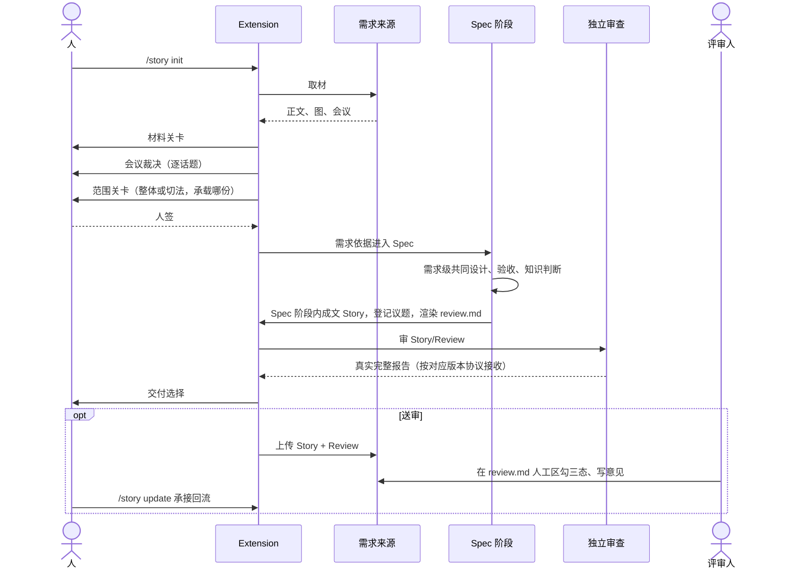
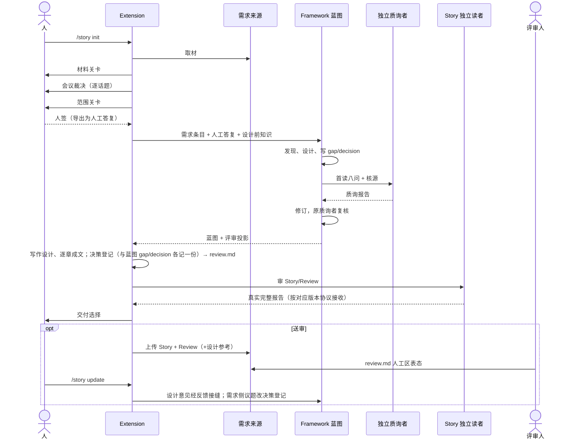
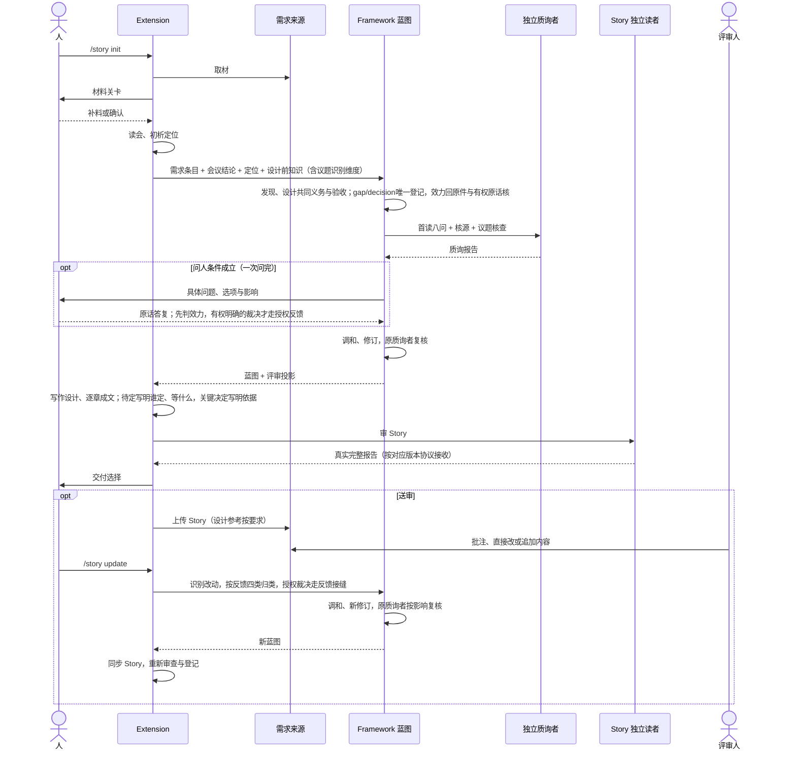
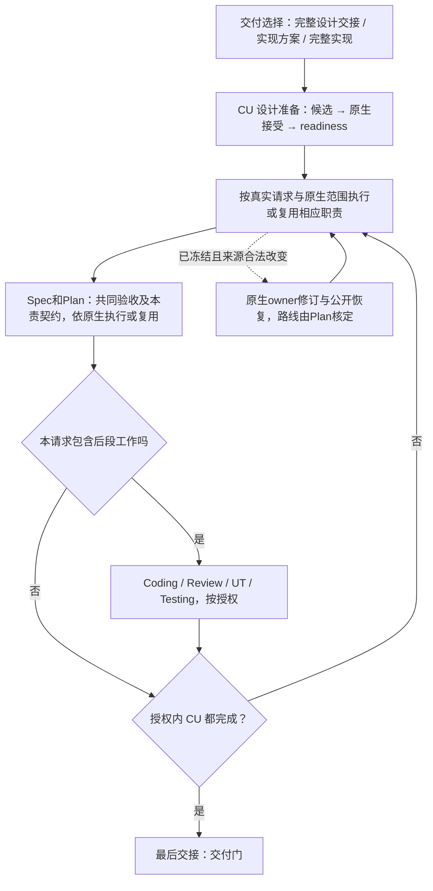

# Extension 能力集与交互对照：1.x、2.0.4、2.0.5

2026-11-12，维护设计者（Claude，独立于 2.0.4 设计/执行链）。按用户在 2.0.5 clarify 中的要求，在 Spec 之外独立梳理 Extension 的能力全集、三个阶段的承担差异和交互关系。本表于2026-11-13集中修订为修订3，承接D02机制与效果目标；历史1.x/2.0.4列保原职责事实。本文是版本级参考材料，不是施工指令；2.0.5 的有效需求以 [Spec](2026-11-12-蓝图下的人工确认与范围收敛.md) 为准。

## 0. 来源、口径与状态

| 列 | 口径 | 依据 |
|---|---|---|
| 能力全集 | 沿用旧 2.x 试验轮的完整特性树 A–H（48 项），每项按产品结果定义，不绑定目录或命令 | [旧特性树](../../archive/legacy-2.x/spec/2.0.0/01-完整特性树.md)；1.10.0 把它定为 1.x 行为合同的对照基准（[1.10.0 梳理二 §0](../1.10.0/01-全量特性效果与评判对照.md)） |
| 1.x | 1.9.9 发布版：Story 在 Spec 阶段内成文，Spec 承接共同设计 | [1.9.9 版本范围](../1.9.9/00-版本范围.md)、[旧交互时序 §1](../../archive/legacy-2.x/spec/2.0.0/04-交互时序对照.md) |
| 2.0.4 | 当前开发源 `extensions/`（C02 68545ad6 产品树），Framework 900c508d | `extensions/skills/story/SKILL.md`、`phases/design.md`、`phases/update.md` |
| 2.0.5 目标 | 2026-11-12 clarify 已定的方向（见 §4），**未实施、未验证** | 本次 clarify 的用户答复 |

旧交互时序中已退出的接缝编号、bind-design等不作当前实现依据。2.0.4 D02结果已纳入本次整合；固定900c旧无run现场的恢复缺口保留；FR1先核原生已有路线/正式候选，不再预设向上游新增，也不能用历史“已接替”签所有路径成立。

标记：**不变**＝承担方式不变；**改**＝承担者或形态变化；**退**＝该机制退出，场景由新承担者接住；**新**＝本阶段新增。

## 1. 承担者总览

| 活动 | 1.x（1.9.9） | 2.0.4 | 2.0.5 目标 |
|---|---|---|---|
| 取材、导入、材料确认 | Extension | Extension | Extension（不变） |
| 会议理解 | Extension 读会 + 会议裁决关卡 | 同 1.x | Extension 读会；裁决关卡退出，话题结论和待定项进蓝图 |
| 范围与分单 | Extension 范围关卡三级（整体/切法 → 承载哪份） | 同 1.x，结论经人工答复进蓝图 | 范围切分步骤退出；本单定位写进蓝图 `in_scope/non_goals`，「先做一部分」由只授权部分 CU 承担 |
| 共同设计 | Spec（需求级 Spec 承接） | Framework 蓝图（component-design），Extension 送设计前知识 | 同 2.0.4 |
| 设计独立核查 | Spec 阶段 verifier | 蓝图独立质询（原生）+ Extension 质询任务 | 同 2.0.4，质询任务核真实议题、共同验收及依据效力 |
| 需要人裁决的议题 | Extension：决策登记 `decisions.json` → `AR/review.md` | 同 1.x；同一议题在蓝图 gap/decision 里又记一份 | 蓝图 gap/decision 唯一承载（待确认的决定方、要定什么、可选做法与本期影响写在原生 `owner`、`unlock_condition`）；review.md、决策登记退出 |
| 人读业务说明 | Story（Spec 阶段内成文） | Story（蓝图之后成文） | Story（不变），待定与关键决定在正文受影响处写明 |
| 人读设计说明 | Spec 正文 | 蓝图评审投影 `component-blueprint.review.md`（设计参考） | 同 2.0.4；按原生投影呈现gap/decision，供技术查阅 |
| Story 独立审查 | Extension 隔离读者 | 同 1.x，审查对象含 Review | 审查对象不再含 Review |
| 人工表态与回流 | review.md 人工区三态 + 修改意见 → `/story update` | 同 1.x；设计意见经原生反馈接缝交蓝图负责方 | 会话内答复先区分原话与模型解释，有权且明确拍板的才登记为原生反馈的授权裁决；送审后评审人对 Story 批注、直接改或追加内容，update 识别并按反馈四类归类，经同一接缝进蓝图，调和后原质询者复核 |
| 施工与知识传递 | Spec → Plan → Coding/Review/UT/Testing，Extension 各阶段钩子 | 蓝图 → CU → 原生阶段链，Extension 各阶段钩子 | 同 2.0.4 |
| 变化处理 | `/story update` | `/story update` + 原生蓝图修订 | 同 2.0.4；议题与裁决统一走蓝图 |
| 归档与恢复 | Extension（需求系统） | 同 1.x，附件为 Story + Review（+设计参考） | 附件为 Story（设计参考按要求） |
| 安装与统计 | adapt、stats | 同 1.x，入口由 Framework 原生物化 | 同 2.0.4 |

## 2. 能力全集与差异

### A. 取得并澄清需求

| ID | 能力 | 1.x | 2.0.4 | 2.0.5 目标 | 变化（2.0.4→2.0.5） |
|---|---|---|---|---|---|
| A1 | 系统与本地来源接入 | 对接层取材；本地单直接起手 | 同 1.x；系统来源另写原生来源物化信封 | 同 2.0.4 | 不变 |
| A2 | 材料读取与转换 | 导入转换，原件留存 | 同 1.x | 同 2.0.4 | 不变 |
| A3 | 来源、版本与采用关系 | 材料索引登记版本 | 同 1.x；需求条目和 provenance 引用稳定版本，由原生核来源 hash | 保来源/版本/采用；原话与模型映射在实际消费者保持不同效力，混合文件不整份升级为人工批准 | **补达标**：输入效力与各出口一致 |
| A4 | 图片与视觉依据 | 图登记与取舍 | 同 1.x | 同 2.0.4 | 不变 |
| A5 | 材料充分性确认 | 材料关卡（人定是否补料） | 同 1.x | 材料确认保持；影响当前授权判断的身份事实缺口并入同次必要问答，有据事实不重复确认 | **保持/补承接**：不恢复固定角色关卡 |
| A6 | 会议理解与澄清 | 读会 + 会议裁决关卡逐话题问人 | 同 1.x | 保读会、纠偏、原话及参会人角色事实核实；有效已定入decision、未定入gap，真实缺口按需要集中问 | **改**：会议裁决关卡退出，附带能力保留 |
| A7 | 业务分析与承载范围 | 初析定位 + 范围关卡（切法维度、份表、四判据、承载哪份） | 同 1.x；关卡结论经人工答复进蓝图，蓝图另登记范围决定 | 初析定位保留，结论写进蓝图 `in_scope/non_goals`；人主动说「这次只做 X」按普通需求表述进蓝图；先做一部分由只授权部分 CU 施工承担 | **退**：范围切分步骤（第二、三级关卡、份表、维度、四判据、拆分检查、reopen 重拍范围） |
| A8 | 形成开发输入 | 需求条目、`AR/design.md` 交 Spec | 需求条目经 `import_sources.py --scope` 成为原生 `current_scope_items`；人工答复作必读来源 | 原生开发输入同源，原件、有效答复与本地推断分开；模型映射不扩大人答批准 | **补达标**：实际送达与授权含义 |

### B. 形成面向人的完整说明

| ID | 能力 | 1.x | 2.0.4 | 2.0.5 目标 | 变化 |
|---|---|---|---|---|---|
| B1 | 阅读组织与材料定位 | 写作设计 + 来源初筛 | 同 1.x | 保阅读主线、来源定位和章节输入；作者取当前共同设计，业务读者只读Story可理解 | **补达标**：完整阅读而非摘要化 |
| B2 | 完整业务叙事 | Story 十章，在 Spec 阶段内写 | Story 十章，按蓝图写；草稿可先成文 | 同 2.0.4；受影响章节写「待定：谁定、等什么、本期怎样处理」，关键已定决策在讲到处写明依据；不设议题专节，不用 D 编号 | **改**：议题由正文承载，D 编号退出 |
| B3 | 图表与文字协作 | 章内图 + SVG | 同 1.x | 保原图/增强与图文分工，按实际关系和视觉证据判断，不固定图数或以篇幅证明质量 | **补达标**：图文效果 |
| B4 | 精确内容与来源查阅 | Spec 附录 + Story 附录 | Story 附录（配置、埋点从蓝图投影）；完整技术契约在设计参考 | 同 2.0.4 | 不变 |
| B5 | 专项方案说明 | Spec 专项 | 蓝图 `story_details` → Story 对应章 | 共同统计/资源/恢复落在真实对象，结果、取数/量化责任及验收有据 | **补达标**：专项语义与下游承接 |
| B6 | 可靠写入与整体验证 | 逐章提交 + 全篇检查 | 同 1.x | 同 2.0.4 | 不变 |
| B7 | 需求级统一交付 | 一个需求一套 Story/Review | 一套 Story/Review，不随 CU 数量变化 | 一套 Story，不随 CU 数量变化；设计参考按要求附上 | **改**：Review 退出交付集合 |

### C. 支持真实的人工决定

| ID | 能力 | 1.x | 2.0.4 | 2.0.5 目标 | 变化 |
|---|---|---|---|---|---|
| C1 | 发现与解释议题 | 决策登记五类判据，作者写决策点、依据、选项、建议 | 同 1.x；议题另由 `design_target` 指回蓝图 gap/decision | 识别维度作为蓝图作者知识送达，议题直接成为 gap（待确认）或 decision（已确认）；决定方、要定什么、可选做法与本期影响写在原生 `owner`、`unlock_condition`；质询任务核议题真实并补找漏项 | **改**：真源移入蓝图，`decisions.json` 退出 |
| C2 | 人工表态与保护 | review.md 人工区（三态 + 修改意见），重渲逐字保留 | 同 1.x | 会话原话经权限/含义判断，只有明确有权拍板才作授权裁决；Story上的批注/编辑/追加保原件并有去向，不设逐项勾选表 | **改**：人工区退出，效力不被模型代签 |
| C3 | 已定与未定有据 | 决策登记 `open`/`settled` + 依据原话 | 同 1.x；蓝图另有 `decided_with_authority`/`open_decision` | 蓝图唯一登记已定/未决；原件与有权原话决定效力，状态标签不替代依据，模型映射不扩大批准 | **改**：单一登记并守真实效力 |
| C4 | 表态版本适用性 | 议题正文变了，人确认是否沿用旧表态 | 同 1.x | 原生反馈带 `source_revision`，版本不符资格不成立；「沿用上一版表态」一问随人工区退出 | **退**：沿用确认 |
| C5 | 反馈分类与结果 | update 区分意见、事实、建议、裁决；设计意见经原生反馈接缝 | 同 1.x，设计反馈经 `--feedback` 核资格 | 全部人工输入统一按原生四类归类：评审人是该议题决定方且原话明确拍板才算授权裁决，进调和、生成新修订，原质询者按影响复核；没把握的不升格，列进 update-notes 请会话用户确认 | **改**：需求侧议题也走同一接缝 |

### D. 知识看到、理解、应用、传递

| ID | 能力 | 1.x | 2.0.4 | 2.0.5 目标 | 变化 |
|---|---|---|---|---|---|
| D1 | 目标知识激活与读取 | manifest 激活清单 | 同 1.x；蓝图作者经 `skill_assets.component-design.knowledge` 读取 | 同 2.0.4 | 不变 |
| D2 | 项目事实与画像 | Spec 发现 | 蓝图发现，事实带 provenance | 同 2.0.4 | 不变 |
| D3 | 规约适用与冲突处理 | Spec 判断 | 蓝图判断（知识事实 + items 适用/不适用/待定） | 适用判断、承担对象义务与共同可观察验收同源；合法零CU也成立，真实消费者能核缺口 | **补达标**：早期完整性与实际消费 |
| D4 | 模式理解与选择 | Plan 选型 | 蓝图选型，`pattern_roles` 落到承担对象 | 选用/拒绝理由符合真实控制与数据依赖，角色有承担；不强制采用模式 | **补达标**：真实选型 |
| D5 | 对决定与实体产生作用 | Spec/Plan 实体 `must` | 蓝图设计对象 `must`、共同验收（B02） | 知识改变真实设计/契约实体及有效验收，按适用范围承接，不只回显编号 | **补达标**：完整落点 |
| D6 | 跨执行者传递 | Plan 冻结 → 下游 | 蓝图 → CU `design_refs` → Spec/Plan 原生投影 | 蓝图→实际CU→原生Spec复用/深化与Plan承接；冻结后合法来源修订先复用经核定的原生公开恢复路线/版本（FR1） | **改/补达标**：合法恢复与负路径 |
| D7 | 实现及代码审查 | coding/review 钩子 | 同 1.x | 同 2.0.4 | 不变 |
| D8 | 验证与整体责任 | UT/testing 钩子 | 同 1.x + 原生 closure | 同 2.0.4 | 不变 |
| D9 | 维护解耦与通用性 | 机制零业务特征 | 同 1.x | 同 2.0.4 | 不变 |

### E. 处理变化并保持一致

| ID | 能力 | 1.x | 2.0.4 | 2.0.5 目标 | 变化 |
|---|---|---|---|---|---|
| E1 | 取得本轮变化 | update 取材、材料关卡、评审回流、人的新决定 | 同 1.x | 同 2.0.4；评审回流的来源从 review.md 人工区改为 Story 上的批注、直接修改与追加（系统单经取材取回，本地单经收件箱文档或对话转述） | **改**：回流来源 |
| E2 | 比较与未完成识别 | 六项比较 | 同 1.x | 同 2.0.4 | 不变 |
| E3 | 理解影响与保留项 | 模型判断影响 | 同 1.x；设计影响交蓝图负责方 | 同 2.0.4；读会得出的新话题按蓝图 gap/decision 处理 | **改**：会议话题去向 |
| E4 | 最早责任处修订 | 改 Spec / 改决策登记 | 设计回蓝图；需求侧议题改决策登记 | 设计/范围/议题统一回蓝图owner；原生资格/调和/复核；冻结后恢复依FR1，不私写范围 | **改**：双登记/reopen退出，恢复有职责 |
| E5 | 增量同步与交回 | 同步 Story/Review/Spec | 同步 Story/Review | 同步Story并保人的原话，纯update关闭不让已完成且范围充分的审查自失效，真实变化仍复核 | **改**：Review退出及审查生命周期 |
| E6 | 本地撤回与现场保护 | update restore | 同 1.x | 同 2.0.4 | 不变 |

### F. 对外发布与恢复

| ID | 能力 | 1.x | 2.0.4 | 2.0.5 目标 | 变化 |
|---|---|---|---|---|---|
| F1 | 交付选择与授权 | 交付门问一次 | 同 1.x，已有授权直接接续 | 同 2.0.4 | 不变 |
| F2 | 归档发布 | Story 正文 + Review 附件 | 同 1.x；设计参考按系统要求或请求附上 | Story及按需设计参考归档，读回/登记/备份保持；成功向人展示当前仍携待定/未验证，不依赖Review | **改**：交付载体与成功提示承接 |
| F3 | 失败与外部冲突 | 发布前核逐件比较 | 同 1.x | 同 2.0.4，比较对象少一件 | 不变 |
| F4 | 远程恢复 | restore | 同 1.x | 同 2.0.4 | 不变 |

### G. 可继续、可核查的协作

| ID | 能力 | 1.x | 2.0.4 | 2.0.5 目标 | 变化 |
|---|---|---|---|---|---|
| G1 | 动作前信息送达 | 作者页、知识任务 | 同 1.x，另有蓝图作者页与质询任务 | 所需方法/知识/来源在决定前送达；原话、模型解释、批准含义不混 | **补达标**：信息先于决策 |
| G2 | 状态查询与续行 | `story_flow.py status` | 同 1.x | 查询/续行无退出关卡，按真实请求与当前原生事实推进；冻结后恢复只限制相关路径 | **改**：正常接续与FR1边界 |
| G3 | 检查、独立审查与返修 | Spec verifier + Story 独审 | 蓝图质询 + Story 独审 + 阶段 verifier | 蓝图/Story/阶段审查分责；真实回复与对象生命周期保持；未审范围/原因在Story和交回可见，不另要免审批准、不抹已知必修 | **改**：Review退出但独审与披露能力保留 |
| G4 | 有效证据与完成表达 | 登记与交付门 | 同 1.x | 登记/交付不依赖退出载体，真实来源与完成证据一致；保存后hash不冒首次真实性 | **改**：真实证据与消费 |
| G5 | 需求级进展与成本 | usage、stats | 同 1.x | 产品usage/stats按真实身份/工作起止/完成记录；测试侧API/工具/审查与等待计量另归TV03 | **补达标/分责**：产品统计与维护观测分别核 |

### H. 安装到真实目标工程

| ID | 能力 | 1.x | 2.0.4 | 2.0.5 目标 | 变化 |
|---|---|---|---|---|---|
| H1 | 首次接入与画像 | adapt | 同 1.x | 同 2.0.4 | 不变 |
| H2 | 升级与旧内容退出 | adapt 演进记录 | 同 1.x | 按所有权更新机制并传知识/对接主题；旧需求边界由发布说明及业务入口告知，adapt不盘点/迁移在途 | **保持/落实退出** |
| H3 | 来源与业务对接所有权 | adapters 归目标 | 同 1.x | 同 2.0.4 | 不变 |
| H4 | 环境支持、重复执行与自检 | adapt 自检 | 同 1.x，入口由 Framework 原生物化 | 同 2.0.4 | 不变 |

**汇总**：48项能力全部保有承担者。首稿的“18项变化、30项不变”仅描述人工确认子题，现已纳入D02的D/G组等达标工作，不再沿用该分母作整版覆盖结论。本表区分形态/承担变化、既有目标补达标与保持；正式验收仍按整版Spec及58项标准。

## 3. 交互关系

### 3.1 参与者

| 参与者 | 职责 |
|---|---|
| 人（会话用户） | 发起 `/story`，在停等点回答 |
| Extension及会话执行者 | 取材、导入、读会、写作Story、同步、归档；Framework泳道表示原生职责，实际执行体按所选公开交互契约，不能由图推定同一模型包办，也不另建Extension常驻Agent |
| Framework 设计 | component-design：蓝图发现、设计、准入、调和；原生反馈接缝核裁决资格 |
| 独立质询者 | 隔离读者，审蓝图（首读八问、核源、修订后复核） |
| Story 独立读者 | 隔离读者，审 Story |
| 评审人 | 送审后独立评审 Story：批注、直接改或追加内容，异步；系统单在需求系统上，本地单在仓内或经会话用户转述 |

### 3.2 停等点对照

| 停等点 | 1.x | 2.0.4 | 2.0.5 目标 |
|---|---|---|---|
| 材料关卡 | 有 | 有 | 有 |
| 会议裁决（逐话题） | 有 | 有 | **退出**；会议已有结论的直接采用，没定的进蓝图 gap |
| 范围关卡（范围定法 + 承载哪份） | 有 | 有 | **退出** |
| 术语确认（Framework） | Spec 阶段 | 蓝图设计 | 蓝图设计 |
| 视觉 provider（Framework） | 有 | 有 | 有 |
| 会话内议题确认 | 无（议题全部进 review.md 异步） | 质询问题「要人定的问人」，无明确条件 | 只在三种情况下、于第一轮质询报告回来后一次问完：上位依据冲突裁决不了；改动原需求真实边界；阻断当前切片且会话用户有权定。答复走原生反馈接缝 |
| 交付选择 | 有 | 有（已有授权不问） | 有（已有授权不问） |
| 查无此单 / 归档 / 恢复 | 有 | 有 | 有 |
| 评审人异步表态 | review.md 人工区 | review.md 人工区 | 对 Story 批注、直接改或追加内容，update 识别 |

两个 Case 的初始运行按现行交互脚本计：auto 共 12 问，其中 6 问是会议裁决（4 问确认会议已定结论，2 问是第三方才能定的「保持待定」），1 问是范围「不拆」；car 中范围「不拆」1 问。2.0.5 按目标，这些问题不再在会话里问。该数不是实际往返；2.0.4 D02实际宿主回复auto5次、car6次，一次可答多题。实际问数及节省以同业务责任的2.0.5实跑为准，未问的预备条目不计漏问或节省。

### 3.3 1.x：需求到交付

### 3.4 2.0.4：现状

### 3.5 2.0.5 目标

### 3.6 施工段（正常主线保持，合法修订恢复另闭合）

「先做一部分」在这一段由「只授权部分CU」承担：没授权的CU保留，当前请求完成与部件整体完成分别判断。只请求Spec/Plan时不进入后段；恢复边表示目标职责，不宣称R4的完整正式组合已经通过。

## 4. 本对照依据的 2.0.5 已定方向（2026-11-12 clarify）

| 编号 | 决定 |
|---|---|
| Q7 | 范围切分步骤退出（第二、三级关卡、份表、维度、四判据、拆分检查、reopen 重拍范围）；材料关卡与初析定位保留，定位写进蓝图 `in_scope/non_goals` |
| Q12 | 需要人确认的内容唯一走蓝图：gap/decision 承载，调和后由原质询者复核；review.md、`decisions.json`、会议裁决关卡退出；无上游前置，只提一条非阻塞建议：质询 scope 覆盖 decision 和 gap |
| Q13 | 会话内只在三种情况下问人（上位依据冲突裁决不了；改动原需求真实边界；阻断当前切片且会话用户有权定），在第一轮质询报告回来后集中当前可判问题；原话留存，明确有权的裁决才进入授权反馈，不把其他答复升格 |
| Q14 | 待确认的真源是蓝图 gap，决定方、要定什么、可选做法与本期影响写在原生 `owner`、`unlock_condition`（修订 Q12 原「附加字段」）；Story 受影响章节写「待定：谁定、等什么、本期怎样处理」，关键已定决策写明依据；不设议题专节 |
| Q15 | 人的独立评审就是评审 Story：批注、直接改或追加内容，不设勾选表；系统单经取材取回，本地单经收件箱文档或对话转述；update 识别后按反馈四类归类，评审人是决定方且原话明确拍板才算授权裁决，没把握的列进 update-notes 请会话用户确认 |
| Q6 | 2.0.5 验证至少包含一例 update 实跑 |
| 设计者默认 | 设计参考附件沿用 2.0.4 规则（系统要求或本单请求时附上），因为 Story 自足写明待定事项；用户可改 |

## 5. 未验证与边界

- 2.0.5 列都是目标，没有实现或实跑证据；整版变化对性能和稳定性的影响要靠 2.0.5 实跑验证，其中至少一例 update。
- 原生反馈接缝能否指向 `gap:` 地址（地址索引已含 `gap:`，见 900c `blueprint-addressing.ts:126`）要实测；不通时指向受影响的 decision 或设计对象。
- 1.x 列按 1.9.9 发布版的职责描述，不是逐项实跑结论。
- D02机制问题已纳入整版Spec：人答效力、共同验收、update审查生命周期、真实原件、冻结恢复及维护运输/计量。R4已核attended属于交互承载及另一源状态的机械恢复；FR1是相关原生路线/发布身份/完整组合核定，不默认新增上游能力，也不是整版硬前置；正式car评分边界不自动放宽。

修订3附加说明：本表不是当前产品已达标声明。原规范中的来源/正文/权限/独立性要求继续成立；去掉Review不能把其有效问题和决定丢掉，施工阶段遇共同设计修订应由原生公开接点重绑，不靠重新启动或私改冻结。正常链与负路径的工程安排已写入Plan修订1；实现和真实效果尚未验证。

### 修订3的附带能力与责任域

- 会议关卡退出后，角色/权限事实从明确来源或已有确认取得；影响效力的未知并入必要材料/集中问答，不新增逐人确认关卡。
- Review题头退出后，未审披露仍在Story交付说明和交回中；归档成功仍展示当前待定及未验证，由蓝图/Story/真实审查事实提供，不能把载体退出变成提示消失。
- Q13按授权裁决登记与Q15四类反馈合读：有权且明确的答复按原话处理，其他内容不升格。用户本轮已明确按已有授权统一解释，不再加一轮审批。
- 测试装置/宿主隔离与输出、计量要求见整版Spec TV01—TV03，不是新增第49项Extension能力。旧F23/F25/F33/F55、F1.5/F1.6/F3.2的当前承担见标准迁移§2a；F45/F4.7代码检视保持。

R4范围事实：本仓main/pin仍900c，源仓242f的用例含harness/receipt替身，未作为正式发布件接入；恢复、角色分工和原终点的完整组合仍由设计者在Plan核定，不能交执行者猜。
