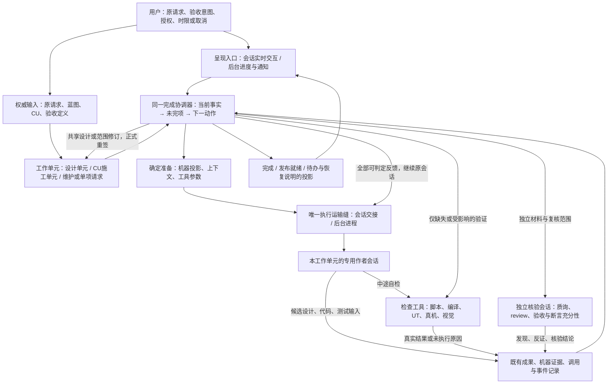

# AgentMaison 架构

> **状态：开发仓现状架构。** 本文按本窗口已实施的 P1–P3 职责与实际消费者核对；P3 官方 R3 开发门禁已于2026-11-02自然通过，结果见§6.1。P4 联合真实宿主验收与发布仍 pending。
>
> 本文件集中说明 Maison 的现行部件职责、事实归属和执行内核，供 goal、plan、OpenSpec 与代码检视共同对齐。以后改变职责划分须同步架构、实现与规格；计划不反向取代架构事实。
>
> 四条总原则仍以 [overview §1.2.1](overview.md#121-四条总设计原则) 原文为准。本文件解释其现行落点，不新增一套原则。此处是 **Maison 自身架构**，不同于宿主 `doc/architecture.md` 所承载的产品架构契约。

按本次用户裁决，原则中的“权责所属阶段”由设计单元、施工单元和独立验证职责承载，不再等于阶段派工；旧“硬预算”的调用数与默认墙钟实现退役，仅保留用户明示时限/取消等实际约束。四条原则原文保留，不能借其旧实现恢复已裁决删除的控制。

## 1. 目标与可验证判据

Maison 的职责是：在原请求与真实授权范围内，让 AI 持续解题，并用真实证据证明交付。发现问题应尽量回流到有能力、有权限处理它的执行者；准确报错并停止，本身不算可靠性提高。

| 判据 | 怎样证明 | 不能算作达成 |
|---|---|---|
| 原请求连续交付 | 从原始需求推进到全部适用 CU、必要组装及请求验收真实成立；除真实授权/环境处理外，无需人补写设计、代码或运行记录 | 蓝图准入、CU ready、首个施工请求、模型说完成或 run 成功标签 |
| 停止有合法原因且可恢复 | 每次停止都能对应 §4-I2；保留成果，说明未完事项与恢复条件，条件满足后接回原请求 | 因阶段次数、默认配额、格式账本或主会话提前收工而中断 |
| 结论一致 | 同一任务、授权、能力及事实，在有人/无人入口得到同一未完项、处置和完成结论 | 工具 PASS，另一消费者却无修法地挡完成；展示端自行改结论 |
| 质量有依据 | 实际构建/测试/设备结果与独立核验支撑适用验收；必需的未知不签通过 | 作者填 PASS、只证明格式合法、用弱化断言换绿灯 |
| 恢复不白做 | 已完成调用、合法写入和仍有效证据被承接；只补缺失或受影响部分 | 每次接续重派整阶段、重做未受影响的设计/真机测试 |
| 效率可解释 | 记录请求到交付的墙钟、作者/核验/工具窗口、等待、重复工作和人工介入，注明端点、模型与缓存口径 | 把失败停止时间与成功交付时间直接算提速比例；把累计输入当独立语料或费用 |

开发夹具证明机制和反例，真实模型证明执行能力，真实宿主证明原请求交付，三者不互相替代。最终由用户安排干净宿主 `bc-openCard-2` 验收；未到真实终点就保持联合验收 pending。框架不保证模型永不犯错或服务永不失效，保证的是事实真实、反馈可执行、停止有依据、成果可接续。

## 2. 总图与执行循环

**工作单元不是阶段。** 正式需求先进入设计单元，形成蓝图和适用 CU；每个 CU 有自己的施工单元。设计修订回原设计单元。维护、单独 review/UT/编译等只使用相应终点，不强造蓝图或六阶段。单元复用既有 root/CU/请求身份，不另建任务对象或状态中心。

**一个单元，一个持续的专用作者上下文。** 作者在授权内做设计细化、实现与测试编写，Skill 和阶段名只是方法/检查族/里程碑，不再轮流派不同阶段作者。有人在场与无人值守都用这个执行方式；主 Agent 只呈现、转交插话和授权，不承担施工，也不能替运行器宣告完成。

**持续会话不要求进程常驻。** 具备原生续接能力时使用准确会话 ID，禁止猜最近会话；不能续接时，依据当前权威输入、成果、有效证据与未完项重建专用上下文。进度文件只是投影。切换呈现方式不另开作者；独立核验始终另用独立上下文。原生 Goal、Stop hook、goal-condition 和进程退出只是触发信号，不拥有业务完成裁决。

**协调器不接管模型每个工具步骤。** 模型原生循环负责读、写、运行工具、理解失败和修复。Maison 在工具结果、核验里程碑、作者请求结束或恢复时评估真实完成差额，必要时将反馈送回同一会话；不再为每次里程碑切换冷启动作者。检查尚未执行、模型暂停发言和任务完成必须区分。

## 3. 部件职责与唯一事实归属

### 3.1 执行内核

下表的“拥有事实”指谁有权产生或改变其内容；记录层保存原件，不能另造一份业务裁决。

| 部件 | 做什么 / 不做什么 | 拥有的事实 | 输入 → 输出 | 谁调用 |
|---|---|---|---|---|
| 入口与呈现 | 判断请求终点，转交授权/插话，展示同一结果；不施工、不替用户扩权、不判完成 | 用户原话及来源；授权属于用户，解析不得加权 | 请求/回答 → 原始输入与可信授权；协调器结果 → 展示/通知 | 用户、宿主入口 |
| 设计单元 | 建立/修订蓝图、共享契约及 CU 边界，独立核验后正式重签；不替用户改需求或降低验收 | 部件设计决定、CU目标/范围与依赖；原请求仍属用户 | 原请求/工程事实/回流问题 → 设计候选 → 框架准入与发布 | 协调器 |
| 完成协调器 | 组装一次当前事实，确定未完项及处理对象，推进单元、恢复和签发完成；不代写实现、不重定义质量规则 | 当前处置与终点结论；都从下述权威事实派生 | 当前目标/成果/证据/调用事实 → 继续、核验、重签、条件等待、暂停或完成 | 入口、工具/核验结束、恢复与完成触发 |
| 确定准备 | 按共同字段契约生成可推导内容与准确命令，汇总可判定输入问题；不猜业务答案 | 技术ID、来源摘要、确定投影、准入派生及机器外壳 | 权威输入/真实调用事实 → 上下文、投影、工具参数 | 协调器、检查工具 |
| 专用作者会话 | 在工作单元权限内解题、编写设计候选/代码/测试，调用检查，消费完整反馈；不签通过、不改正式结果 | 候选内容、实现、测试源码及有证据的问题说明 | 上下文/未完项 → 成果、自检请求、修订提议 | 协调器经执行运输 |
| Adapter与执行运输 | 启动/准确续接、传入共同请求、归一实际调用结果；不决定业务下一步或授权 | 原生会话定位、真实完成/失败/等待和进程事实 | 请求/当前权限 → 调用原件、结果、写入观察 | 协调器；核验也复用调用能力 |
| 检查工具 | 用同一规则执行静态检查、构建、UT及适用真机/视觉，输出全部可判定问题；不另设完成/派工逻辑 | 本次执行的结果、输入绑定、未执行原因 | 当前事实/适用检查 → 真实证据、失败或缺口 | 作者自检、协调器补验/完成评估 |
| 独立核验 | 独立判断设计/实现、验收覆盖和断言强度；看上轮公开结论及真实变化，不重做无影响结论 | 实质发现、反证及核验结果；不能签用户授权 | 目标/真实成果/证据/前次结论/变化 → 发现或有据关闭 | 协调器在适用里程碑调用 |
| 成果与运行记录 | 保存成果、输入绑定、调用原件、机器证据及事件，提供恢复事实；不从日志文本猜授权或另算完成 | 谁在何时执行/修改什么、工具与核验原件 | 各真实生产者 → 既有run目录/证据载体 → 事实读取 | 生产者写入；协调器/状态读取 |

验收清单是原请求、已准入蓝图/CU和既有 acceptance 等的**适用视图**，不再建立一份可手填 done 的台账。当前事实的组装、处置和完成结论各只有一处；工具报告、NEXT、assess、进度、Feature/CU/部件完成和发布就绪只是不同终点或不同粒度的投影，不能各拿一部分事实重新推断。

`GoalPhaseRuntime` 承担上述协调职责；`readCurrentDispositionInput` 组装当前事实，`resolveCurrentDisposition` 形成处置，完成签发链核实相应终点。检查族及历史 phase 字段仍可被读取，但不再另成一套阶段作者队列或完成裁决。

### 3.2 其它模块只保留这一层地图

| 模块 | 与内核的接口 | 不可越过的边界 |
|---|---|---|
| Skills与写作指引 | 提供专业方法、产物输入输出；作者按当前任务按需读取 | 不再复制停止/授权/阶段派工规则，不让作者手抄机器字段 |
| 规格/schema/workflow | 定义字段、验收、能力输入及真实控制依赖；供准备、检查共同读取 | 格式合法不等于业务合格；workflow顺序不是隐含权限或必跑队列 |
| 项目知识与设计透镜 | 提供architecture、catalog、glossary、代码/业务约束及设计必答问题 | 不成为运行状态或完成真源；来源冲突交真正责任方 |
| Profile与能力provider | 实现具体构建、UT、设备和工具链，报告支持范围及执行事实 | 平台细节不写进通用协调器；声明有能力不等于已经执行 |
| 真机与视觉 | 通过框架执行安装/运行/采集和独立视觉验证，返回原件、执行键、条件缺口和质量结论 | 作者不可写正式截图/结果；设备真实性、缺执行、未知不能冒充通过 |
| 实例扩展 | 经既有契约提供知识、工具和产物；参与共同适用性与验证 | 不覆盖用户授权、不复制完成循环、不自报结果免检 |
| 锁、进程守卫、监督与恢复 | 保证单写入者、可靠终止卡死工具、按真实条件唤醒，维护调用身份 | 不因角色次数/默认配额终止业务；不得杀无关进程或重复执行已完成请求 |
| 发布与文档 | Maison发布件集成到宿主`framework/`；记录能力、迁移及发布准入 | 不支持submodule平行拓扑；功能完成不自动代表允许发布 |

## 4. 十条不变量

| ID | 必须始终成立 | 对齐或回归的观察点 |
|---|---|---|
| I1 真实通过 | 正式通过记录只能由框架依据真实机器执行证据及实际独立核验结果签发；作者不写PASS、截图或结果原件 | 作者声称完成/改测试报告不改变正式结论；testing证据写保护保留 |
| I2 停止有界 | 只因目标达成、用户明示时限/取消、真实授权边界、需人或维护方处理的环境/执行故障停止；另允许可续的无进展暂停 | 失败本身不是终止理由；必需未知不完成。没有可执行的独立工作时才因缺条件暂停，说明责任与恢复入口 |
| I3 检查与完成同源 | 同一当前事实、适用检查和有效证据产生一份处置；自检与终判不各写算法 | 工具、反馈、恢复、状态、完成和发布投影一致；原始检查结果与整体终点明确区分 |
| I4 不自我授权 | 扩范围、改公共契约或共享设计回设计单元重新签发；原需求/验收实质变化按真实用户授权处理 | CU不能就地改授权洗白；获全权也不代表能改用户目标或执行不可逆动作 |
| I5 局部故障局部阻断 | 框架故障/能力缺口只阻断真正依赖它的工作，未知不当产品失败，也不当PASS | 工具故障被登记后，独立可修工作仍送达执行者；必需验证缺口未补时完成不通过 |
| I6 两模式一个循环 | 有人/无人只改呈现与运输；同一单元均使用专用作者会话，主Agent不当执行者 | 同输入/授权/能力得同处置；切换模式不重置任务、重开另一作者或丢进度 |
| I7 不管理配额 | Maison不管理token、调用次数或默认总墙钟额度，不查账户余量、不自动提额 | 用户明说的时限/取消和工具卡死超时仍生效；厂商额度错误按实际环境事实保全恢复 |
| I8 确定内容机器生成 | 可由唯一既有关系确定的投影、ID、准入与记录由机器生成；业务取舍仍由作者/有权方决定 | 机器生成未知容器不能填绿；编号/记录位置变化不额外购买作者和质询循环 |
| I9 独立核验 | 质询/核验用独立上下文；作者所写测试的覆盖与断言强度必须独立判断 | 实际执行绿灯不足以证明测试充分；改弱测试不能关闭原验收，实质否定不会被总结PASS盖过 |
| I10 成果恢复与收敛 | 恢复承接真实调用、合法写入及有效证据；会话运行中同样按未满足验收/已核实发现的改善判断收敛，作者在会话内调用的检查结果与产物变化进入同一比较 | 重复报告幂等，只补受影响验证；判定无进展时协调器中断该会话、保全成果并可续暂停，不等待作者退出；有证据进展不误停，无可比事实不谎称无进展，不新增配额或计数器 |

无进展只在反馈已送达、执行者有机会处理且获得可比较评估后判断。连续没有证据改善，或同一组实质问题往复出现，应暂停并保全；新发现可能是有效验证，不能只按问题数量是否减少。元数据、无关改动和问题改名不算改善；独立证据确认子问题解决则算。无变化不定时重拉，用户明确继续或相关条件变化才续接。

## 5. 失败处置总表

所有出口由共同协调器产生。下表是行为分类，不新增状态枚举、停机原因注册表或另一套路由。工具未完成、验证未通过和任务不能继续必须分开。

| 问题 | 谁处理 | 继续还是暂停 | 恢复与关闭依据 |
|---|---|---|---|
| 产品实现/测试真实缺陷 | 当前单元作者修复；独立核验和工具复验 | 继续原专用会话，不按次数派回阶段 | 相关验收/核验问题有据关闭；仍有效结果复用 |
| 单元内设计缺口 | 当前单元作者在已批准语义与范围内补齐 | 继续，全部可判定缺口一次反馈 | 同源检查和适用独立核验通过 |
| 需扩范围或改共享设计 | 原设计单元修订；框架检查、独立质询后重签 | 依赖变更的工作等待，其它合法工作继续；确需用户决定才询问 | 新设计/授权有效、受影响CU重绑后接原会话 |
| 检查发现或结论冲突 | 统一事实组装先定适用性；实质问题交作者，争议/新反证交独立核验 | 不凭检查ID或日志文件位置猜责任，不因格式冲突整单停 | 使用全部有效证据确认、驳回或保留未知；不能只凭文件可读就关闭发现 |
| 机器投影/账本格式缺失 | 既有writer确定重建；不能确定的内容交真正作者 | 可恢复记录问题不单独终止整单 | 原来源和当前结果一致；不造业务事实或新通过证据 |
| checker/runtime自身故障 | 框架记验证缺口与具体问题；维护方修框架，业务作者不改framework | 不依赖它的工作继续；已无安全可做工作则按执行故障保全暂停 | 修复后只补缺失/受影响的检查；未知结果不能签通过 |
| 设备、凭据、厂商额度/认证/服务故障或能力缺失 | 环境/能力负责方；涉及真实授权由用户决定 | 先继续独立工作；需要外部条件的部分等待/暂停，不能无限调用同一失败服务 | 有可靠探针时按实际条件变化恢复，否则明确提示用户确认恢复；不查询余额预测重启 |
| 会话/进程中断 | 执行运输与协调器对账 | 有效结果已到则补检查；尚未结束则观察或准确续接，不整单重写 | 原生准确ID或当前事实重建；旧owner、重复结果、已结束调用均按既有身份对账 |
| 无进展 | 协调器按I10消费会话内检查结果与产物变化，使用同一比较并列出未完项/已尝试动作 | 会话运行中也须受约束；判定无进展即中断该会话、保全成果并可续暂停，不等作者退出，不新增配额或计数器 | 用户明确继续或相关事实/条件变化后接原请求；有证据进展不误停，无变化不自动重拉 |
| 用户时限/取消 | 协调器停止新工作并安全收尾 | 停止，不借子run或续接重置约束 | 用户再次明确继续/调整要求；原成果与历史保留 |

每份反馈包含具体未完项、证据、处理对象和下一动作。单元作者拒修须给证据；独立核验消化拒修理由后再判，不让拒修自动抹掉验收，也不无限重复同一句派单。非必需残差按既有规则披露，可使发布仍受阻；必需验收不因“债务”标签而免验。

## 6. 删除清单与两个现场缺陷的落点

| 退役内容 | 新结构如何承接 | 必须防止的回流 |
|---|---|---|
| 按spec/plan/coding/review/ut/testing派作者、回退队列、链外补阶段和阶段次数上限 | 工作单元专用作者持续解题；真实设计变化回设计单元；检查族保留 | 把旧phase循环藏进“完成协调器”，或用里程碑换名继续冷派工 |
| token/调用数/默认墙钟预算、跨run预算血缘、预算停机和提额/override用途 | 只保留用户时限、取消、工具卡死保护、环境故障及无进展暂停；历史统计只读 | 改名“安全次数”“默认截止”继续配额控制，或查询供应商余额 |
| 要作者填回执才能推进、阶段closed作为完成权威、hook放行即成功 | 工具产生证据；共同完成评估签发终点 | overview、Skill、Stop hook、assess各判一次完成 |
| 只为旧派工服务的signature一次性资格、角色缓存窗口、失败删草稿、旧失败永久重放 | 准确会话恢复、有效证据复用及同单元反馈 | 暂停材料被删、同签名永久失去修复资格、为兼容保留第二运行器 |
| 每轮独立质询从零重读、机器可推导内容要求作者手抄、首错遮蔽其它问题 | 上轮公开结论＋实际变化增量复核；确定投影机器生成；可判定问题一次汇总 | 以省事为由代答业务或复用真正已失效的核验 |
| 主Agent作为普通模式执行者、无run完整交付fallback、按模式另定授权/质量 | 两模式同一专用执行会话与共同政策；入口记录真实授权 | 主会话结束导致任务结束；无能力adapter假称等价支持 |
| `FEATURE_MARKER_DIRS`以`goal-runs`推平铺Feature的错误判定 | 共享目录解析区分蓝图工作区、root运行记录、CU及施工产物；项目级compile和最终工具使用同一解析入口 | 只在compile里吞异常，或关闭真实混放/孤儿检测。回归须穿过项目枚举到真实编译provider |
| `Found a framework bug? HALT and report it upstream.`及同义红线 | 不改framework，登记影响，继续独立可做工作；协调器仅暂停无法安全推进的部分 | 只删文案，协调器仍因发现framework问题全停。回归须证明业务编译/UI等剩余工作继续收到并执行 |

历史记录可保留读取，但历史阶段队列、预算和结果标签不能支配新执行。移除旧控制不删除其保护过的真实质量、授权、数据完整性和证据要求。允许主作者改实现和测试，不等于放开testing正式证据写保护。

### 6.1 本窗口的实际承接点

| 职责 | 已接入的现行实现 | 保留的边界 |
|---|---|---|
| 公开入口与两运输 | `goal-mode-entry`、`GoalPhaseRuntime`、`goal-phase-executor`、`session-execution-handoff` 共用工作单元上下文、原生会话定位及签发/交回原件 | 会话与进程只改变运输；作者完成声明不直接签业务通过 |
| 设计与确定准备 | `initial-design-delivery`、`design-repair-unattended`、`capability-resolution-entry-input`、`blueprint-skill-projection` 接原设计单元、真实输入和机器投影 | 设计差额仍回原责任方重签，不从阶段名推写权 |
| 写入与范围 | `repair-responsibility`、`phase-write-boundary`、`feature-track` 按当前义务和真实来源派生写域、收编合格证明与撤证 | 范围提案不直接授予源码写权；真实新来源、冻结输入和 required 义务保护保留 |
| 检查与独立核验 | `harness-runner` 调真实 checker/provider；原 verifier request/material/subject 约束独立核验；`phase-evidence-manifest` 保留实际绑定 | 正文、原生 Case/Step、输入及证据资格缺失保持未知；字节可复用不替代当前证明资格 |
| 当前处置与完成 | `readCurrentDispositionInput` → `resolveCurrentDisposition` → 原 Feature/CU/部件及发布终点消费者；NEXT、assess 和进度读取同一处置 | 完成、发布就绪与原请求交付端点分别核实，不由展示端重判 |
| 收敛与恢复 | `prepareExecutionContext`、`currentCompletionEvaluation` 和共同工具派发事实读取承接正常交回、可比改善、当前输入/源码变化及因果失效；有效原件复用 | 同条件不重复买工作；真实变化只补相关 producer，未知不假判无进展或完成；pending 为空不抹去真实 reused 方法 |
| 用户控制与进程安全 | 原 run owner/fence、guardian、显式用户截止/取消及有界条件探针维持真实调用安全 | 默认次数、总墙钟和通用恢复冷却不控制业务；真实工具时限、故障退避及设备系统约束保留 |

P3 开发门禁：2026-11-02，官方 R3 执行 `cd harness && npm test` 自然结束，退出码0；普通单测5751通过、0失败，fixtures 41通过、0失败。受测源码及检视切点无漂移，无人工终止。实现、定向回归和独立代码检视分别记录实际覆盖，不互相替代。

P4 的干净宿主 `bc-openCard-2` 联合真实宿主与设备交付验收以及发布仍 pending；本窗口未据开发仓结果声明宿主、设备或发布件已完成。

## 7. 与 OpenSpec 的对应及删改边界

本文件说明“部件管什么、事实归谁”；OpenSpec说明可检验的行为；schema/Skill contract定义字段与能力接口；goal/plan说明实施顺序及验收。批准后的职责变更须同步到这些消费者，不能只追加一个新Requirement而保留相反旧条款。历史归档不改写。本窗口已在既有 `completion-driven-execution` change 及相应现行规格中收编本批职责；下表保留退役条款与现行边界的对照。

| 架构部件/约束 | 对应现有能力规格（`openspec/specs/`） | 现行职责与迁移边界 |
|---|---|---|
| 入口、专用会话、执行运输 | `goal-mode-skill`、`goal-driver-handoff`、`agent-adapters` | 保留单内核、真实调用和owner围栏；将phase-boundary交接改为调用/安全边界；移除主Agent执行fallback与hook业务完成权威，加入准确原生续接/事实重建 |
| 完成协调器与统一反馈 | `goal-runner`、`reconcile-assessment`、`runtime-policy`、`correction-routing` | 保留当前处置同源、非干跑事实和完成/发布分层；删除“deterministic phase orchestration”、strict workflow repair routing、固定phase chain及内容次数终止 |
| 用户控制与故障恢复 | `goal-runner`的显式用户截止、真实进程控制及已退役的预算条款 | 删除额度和预算血缘；工具卡死保护、用户时限/取消、真实条件及无进展恢复重新表述，不能删除全部进程安全处理 |
| 检查工具及证据签发 | `harness-gates`、`verdict-lattice`、`runtime-step-evidence`、`capability-degradation` | 保留真实检查、缺口诚实化、执行键与有效复用；删receipt hard blocks dispatch、phase-state/closure作为推进条件和旧lite门；自检/终判同源 |
| 设计、机器准备、工作单元 | `complex-capability-meta-model`、`app-component-blueprint`、`change-unit-continuous-progression`、`component-assembly-coverage-closure` | 保留设计权威、适用CU依赖和真实组装终点；作者/机器字段同源，独立Q增量复核；删除其中固定施工阶段/额度前提，不降低设计质量 |
| 写入权与独立核验 | `phase-write-boundary`、`skill-contracts`、`harness-gates`中的source-mutation/review closure条款 | 写权改按产物性质、单元授权和验证责任；保留正式证据保护、独立上下文、验收/断言充分性，删“因为属于UT阶段所以不能修实现”等身份控制 |
| 目录与共享事实 | `feature-artifact-layout`、`skill-contracts`、`workflow-tracks` | 保留canonical路径与真实输入依赖；工作区root记录不算Feature标志；退役固定链/lite的执行意义，不让现行历史残留重新启用 |
| 真机、视觉及环境 | `visual-diff`、`visual-capability-routing`、`delegated-vision`、`ut-flow-dag-evidence`、`harness-gates` | 保留真实运行/截图、独立视觉、能力缺口和发布债务边界；删除绑定固定阶段作者或普通模式特殊降级的控制，不为重构减掉适用验收 |
| 周边能力与集成 | `instance-extension-management`、`skill-authoring`、`init-orchestration`、`release-boundary` | 保留专业接口和发布件集成；扩展接共同工具/事实接口，不拥有第二完成循环；接入程序不自动授权业务变更 |

§6.1 记录当前实现落点；旧文件名和 phase 字段的兼容读取不恢复旧派工含义。作者提示、自检 NEXT、回执兼容、恢复、状态、CU/部件和发布消费者按同一职责及事实链承接，不能只同步最终完成函数。

## 8. 审定、实施对齐与维护

本文于2026-10-29完成目标架构审定。本窗口 P1–P3 按批准边界实施，当前承接点及已通过的 P3 官方开发验收见§6.1。b84 保全原件与历史计划按原边界保存，不把已退役接线恢复为第二执行真源；P4 的真实宿主联合验收另行记录。

审定后，每个plan注明所实现的本文件章节及I编号，检视核对职责和事实归属。复用现有元检查/定向测试守住可机器化的不变量，例如新运行不产生配额停机、生产提示无全停红线、作者不能写正式结果、同输入两运输同结论；不为此新造治理系统或全仓规则注册表。

本文转为开发仓现状说明，P3 收口以§6.1的真实官方开发门禁记录为准；发布及P4联合验收仍 pending，不能由本次文档状态替代。以后改变职责划分须同步本文和相关规格。若实现与已审架构冲突，应说明真实原因并修订，不把偶然实现反写成既定原则。

overview 保留三层分离、关键能力拆解、常见问题教训、四原则和历史沿革，旧阶段派工、阶段回执及 Stop hook 完成权威的现行说明已定向同步，并链接本文。仍有效的方法解释继续保留，不能为了单一架构入口删去。
