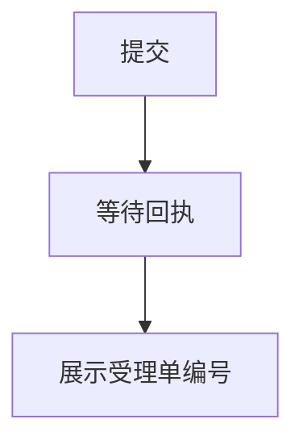

# REQ-DEMO 甲需求

## 背景

提交后等待回执期间需保持可见等待态，避免重复提交。

## 术语

| 术语 | 在本需求里的意思 |
|---|---|
| 受理单编号 | 云侧受理后返回的回执编号 |

## 范围

本需求不涉及：范围已在背景里交代。

## 业务方案

一次提交只认云侧回执，端侧不自行推定成功。

## 业务流程

用户提交后进入等待态，收到云侧回执后展示受理单编号。

## 功能说明

### 6.1 提交与回执

提交之后回执没到之前，界面停在等待态；云侧回执带着受理单编号到达后才转为已回执。

## 异常与恢复

回执超时未到时保持原提交入口并提示重试。

## 验收

| 编号 | 验收点 | 可观察的通过条件 |
|---|---|---|
| V1 | 等待态展示 | 提交后回执到达前界面保持等待态，收到受理单编号后转为已回执 |

## 交付与上线

### 交付物

| 交付物 | 给谁 | 做什么用 | 什么时候要 |
|---|---|---|---|
| Story 归档件 | 评审人 | 核对提交与回执行为 | 提审前 |

## 附录

### 技术契约

主叙事里的中文名在这里对应到具体接口、数据、配置与统计点，供实现、测试和后续维护按名查证。

#### 端云接口

| 接口 | 用途 | 失败语义 |
|---|---|---|
| createBusinessOrder | 提交申请并取回受理结果 | 超时 3秒 后按未提交处理 |

#### 数据存储

| 类型 | 标识 | 完整约定 |
|---|---|---|
| 字段 | applicationId | 云侧受理后返回的受理单编号，端侧透传展示，不持久化 |

#### 配置项

<!-- story-build:begin 技术契约·配置项 · 由spec 「宿主扩展治理项 › 技术契约 › 配置项」生成，改它请改真源 · sha256:ef67f4588996fd8d -->
不涉及：没有新增配置。
<!-- story-build:end -->

### 规约

每条规约在本需求上命中与否及依据。

| 规约 | 编号 | 判定 | 依据 |
|---|---|---|---|
| 甲域约束 | SMP-01 | 命中 | 本需求新增提交入口，受理单编号在入口生成 |
| 甲域约束 | SMP-02 | 不命中 | 本需求没有任何上报动作 |

### 埋点

不涉及：本需求不新增埋点。

### 材料清单

本篇据以写成的材料。

| 材料 | 来源 | 贡献 |
|---|---|---|
| 甲需求 PRD [prd.md](../RR/prd.md) | [prd.md](../RR/prd.md) | 提交回执的业务诉求与状态取值。 |
| 开发需求 [design.md](design.md) | [design.md](design.md) | 本轮从上游提取的开发需求，业务分工与本单范围。 |

